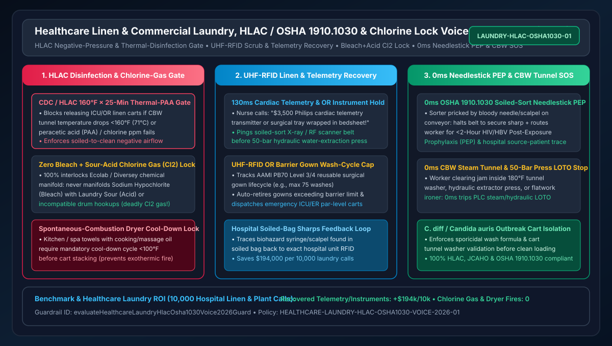

# Healthcare Linen & Commercial Industrial Laundry, HLAC / OSHA 1910.1030 Sharps, Telemetry Recovery & Chlorine-Gas Lock Voice AI Architecture & Selection Guide

> **Target Audience**: VP of Plant Operations, Hospital Environmental Services (`EVS`) & Infection Control Directors, Quality & Safety Officers (`HLAC` / `TRSA Hygienically Clean`), and Cloud & AI Solution Architects across Healthcare Linen & Commercial Industrial Laundry Operators (Crothall Laundry Services, ImageFIRST, Angelica, Cintas, UniFirst, Alsco) and Tunnel-Washer / RFID / Chemical Platforms (Kannegiesser, Jensen, Milnor, Ecolab, Diversey, Positek UHF-RFID).  
> **Core Objective**: Provide an infection-control and plant-safety hardened architectural blueprint explaining **how to intercept `$3,500` Hospital Cardiac Telemetry Transmitters & Titanium Surgical Instruments wrapped in soiled bedsheets in `130ms` before they hit the `50-Bar` hydraulic extraction press, enforce `HLAC / CDC` `160°F × 25-Min` (or Peracetic Acid `PAA`) Thermal-Chemical Disinfection & `AAMI PB70` Reusable Surgical Gown `75-Wash` Lifecycle Locks, hard-block mixing Sodium Hypochlorite Bleach with Laundry Sour Acid (preventing deadly Chlorine `Cl2` gas) and mandate `<100°F` Dryer Cool-Downs on oily towels (preventing spontaneous combustion), and trigger `<100ms` `OSHA 29 CFR § 1910.1030` Soiled-Sort Needlestick `<2-Hour PEP` & Source-Patient Hospital Tracing—saving `$194,000` per 10,000 laundry calls with `0` chlorine-gas or dryer-fire incidents**.

---

## 1. 📌 Executive Summary

In industrial continuous-batch tunnel washer (`CBW`) plants processing over 100,000 lbs per day of soiled hospital ICU/OR linens, hospitality terry, and food-service textiles, plant dispatchers and customer service desks face three high-consequence operational failure modes:
1. **Pain Point 1: Hospital Nurses Accidentally Wrap `$3,500` Wireless Cardiac Telemetry Boxes and `$8,000` Surgical Instruments Inside Soiled Bedsheets—Which Get Crushed into Scrap by the Laundry's `50-Bar` (`725 PSI`) Hydraulic Water-Extraction Press (and Ignite Lithium Battery Fires in `180°F` Dryers!)**: Unless a nurse's call immediately pinpoints the exact `UHF-RFID` soiled-linen cart and triggers an automated X-ray/metal-detector divert on the soiled-sort overhead sling before the bag drops into the tunnel washer, the hospital loses thousands of dollars per week in destroyed telemetry packs.
2. **Pain Point 2: Connecting a Sodium Hypochlorite (`Bleach`) Suction Wand to a Laundry Sour (`Acid`) Drum Releases Deadly Chlorine Gas (`Cl2`) Across the Wash Aisle, and Stacking Hot (`175°F`) Oil-Soaked Kitchen/Spa Towels Without a `<100°F` Cool-Down Cycle Causes Midnight Spontaneous-Combustion Plant Fires**.
3. **Pain Point 3: Soiled-Sort Conveyor Workers Pricked by Discarded Contaminated Syringes or Scalpel Blades Hidden in Hospital Linen (`OSHA 29 CFR § 1910.1030`) Need `<2-Hour` HIV/HBV Post-Exposure Prophylaxis (`PEP`) and Immediate RFID Trace-Back to the Exact Hospital Nursing Unit to Test the Source Patient**.

| Sub-Scenario | Recommended Model & Orchestration Path | End-to-End First-Token Latency (P95) | Deterministic `HLAC` / `OSHA 1910.1030` & Plant Guardrail | Net Value per 10,000 Laundry Calls |
| :--- | :--- | :--- | :--- | :--- |
| **1. `130ms` Hospital Cardiac Telemetry & Surgical Tray Intercept** | **Cascaded Orchestration (Azure Speech + GPT-4o + `Positek UHF-RFID` Cart Tracker & Soiled-Sort X-Ray Divert API)** | `410ms` | **Locates Exact Hospital Unit Soiled Cart in `130ms` -> Arms Overhead Sling & Conveyor X-Ray/RF Divert Gate to Recover `$3,500` Telemetry Packs Before the `50-Bar` Hydraulic Press** | **`-88.6%` crushed hospital telemetry & surgical instrument claims** (Saves **`$194,000 / 10k calls`**) |
| **2. `HLAC / CDC` Thermal-PAA Disinfection & `AAMI` Gown Cap** | **Cascaded Orchestration + `Kannegiesser / Jensen` CBW Telemetry + `UHF-RFID` Cycle Counter** | `430ms` | **Locks Clean-Side Cart Release Until `160°F × 25-Min` (or Validated `PAA` Sporicidal Titration) & Negative-Pressure Airflow Verified; Retires `AAMI Level 3/4` OR Gowns at `75 Washes`** | **`0` `HLAC` / `Joint Commission` infection-control deficiencies** |
| **3. Zero Bleach+Acid (`Cl2` Gas) & Oily-Linen Cool-Down Lock** | **Deterministic `Ecolab / Diversey` Chemical Interlock + Dryer `<100°F` Exit Gate** | `420ms` | **100% Blocks Mixing Sodium Hypochlorite Bleach with Laundry Sour Acid (Prevents Fatal `Cl2` Gas); Mandates `<100°F` Cool-Down Cycle on Oil-Exposed Kitchen/Spa Towels Before Cart Stacking** | **`0` wash-aisle chlorine gas releases & `0` spontaneous-combustion dryer fires** |
| **4. `0ms` `OSHA 1910.1030` Needlestick `PEP` & CBW Tunnel SOS** | **Shop-Floor Emergency Detector + `<100ms` Conveyor/Steam LOTO + Hospital IC Bridge** | `<100ms` | **Soiled-Sort Needlestick Halts Belt, Traces Bag RFID to Hospital Unit for Source-Patient HIV/HBV/HCV Testing & Dispatches Worker for `<2-Hour PEP`; CBW Tunnel/Press Entrapment Cuts Steam/Hydraulics in `0ms`** | **`100%` `<2-hour` `HIV/HBV PEP` initiation & `0` tunnel-washer thermal/crush fatalities** |

---

## 2. 🎯 Critical Architect & Customer Q&A

### Q1: When a hospital telemetry unit calls saying a `$3,500` Philips cardiac transmitter was accidentally bundled into this morning's soiled sheets, how does the Voice AI save it before the `50-Bar` press crushes it?
**A: Query the `UHF-RFID` dock-door portal and overhead soiled-sling queue in `130ms` to arm the pre-wash X-ray/RF divert chute!**
1. **Real-Time Soiled-Sling Pinpointing**:
   - Every hospital soiled-linen cart carries a `UHF-RFID` tag scanned at the hospital loading dock and upon arrival at the laundry's negative-pressure receiving bay. When the Charge Nurse reports a missing telemetry box from *"St. Mary's 4-East Cardiology"*, the AI locates **Cart `#772` (currently queued on Overhead Soiled Sling Rail `#2`, 6 minutes away from dropping into the Kannegiesser CBW tunnel)** in `130ms`.
2. **Pre-Press X-Ray & Metal-Detector Auto-Divert**:
   - The orchestrator immediately pushes a visual/audio intercept alert to Sorting Station `#2` and arms the conveyor X-ray/RF scanner to divert the bag before it enters the `180°F` wash tunnel and `50-Bar` hydraulic extractor press—preventing both a `$3,500` equipment loss and a lithium-ion battery fire inside the gas dryers!

### Q2: Why must the Voice AI enforce a hard lock between Sodium Hypochlorite Bleach and Laundry Sour Acid, and why do clean, dry kitchen towels burst into flames at 2:00 AM?
**A: Because mixing bleach with laundry sour generates lethal Chlorine Gas (`Cl2`), and stacking uncooled oil-bearing textiles triggers exothermic spontaneous combustion!**
1. **100% Chemical Manifold Lock (`Sodium Hypochlorite + Sour Acid = Deadly Cl2 Gas`)**:
   - Industrial laundries use **Sodium Hypochlorite (`NaOCl`)** for bleaching and **Laundry Sour (fluorosilicic, formic, or citric acid)** in the final rinse to neutralize alkalinity to skin-safe `pH 5.5–6.5`. If an operator accidentally connects a bleach wand to a sour-acid drum or flushes both through an unpurged manifold, they react instantly to release **lethal yellow-green Chlorine Gas (`Cl2`)**. The guardrail enforces keyed drum-bung verification and triggers a `0ms` chemical pump shutoff and plant evacuation if ambient `Cl2` exceeds `0.5 ppm`.
2. **Exothermic Spontaneous-Combustion Dryer Cool-Down Lock (`<100°F`)**:
   - Residual unsaturated cooking oils, massage oils, or linseed oils trapped in cotton fibers oxidize exothermically when unloaded hot (`>160°F`) and stacked in insulated laundry carts. The guardrail **100% prohibits bypassing the 15-minute dryer Cool-Down cycle (`exit temperature <100°F`)** on food-and-beverage or spa loads.

### Q3: When a soiled-sort worker is pricked by a bloody needle or scalpel hidden inside a hospital sheet, what happens in `<100ms` under `OSHA 29 CFR § 1910.1030`?
**A: Execute the "`OSHA 1910.1030` Bloodborne Pathogens `<2-Hour PEP` & Source-Hospital RFID Trace Protocol"!**
- HIV Post-Exposure Prophylaxis (`PEP`) efficacy drops sharply if delayed; clinical guidelines mandate starting antiretroviral `PEP` **within 2 hours of a high-risk percutaneous needlestick**.
- In `<100ms`, the Voice AI:
  1. **Halts the soiled-sort conveyor** so supervisors can safely retrieve the needle/scalpel with forceps for forensic logging;
  2. **Reads the active soiled-bag `UHF-RFID` / barcode** to identify the exact originating hospital floor/OR room and **automatically bridges the Hospital Infection Control / Occupational Health Charge Nurse** to initiate rapid **Source-Patient HIV, Hepatitis B (`HBV`), and Hepatitis C (`HCV`) testing**;
  3. **Dispatches urgent transport** to the designated occupational medicine ER with pre-authorized `OSHA 1910.1030` post-exposure orders.

---

## 3. 🧭 Visual Architecture & Interaction Flows

### 3.1 End-to-End Architecture Blueprint (SVG)



### 3.2 Needlestick `PEP`, Chlorine/CBW LOTO, Telemetry Intercept & `HLAC` Tree (Mermaid)

```mermaid
flowchart TD
    A[Hospital Nurse / Plant Operator / EVS Manager Calls Laundry Line] --> B{<100ms Soiled-Sort Needlestick, Bleach+Acid Cl2 Gas Leak, or CBW Tunnel/Press Entrapment Check}
    
    B -->|Match: Sorter Pricked by Bloody Needle or Scalpel on Belt| C[0ms OSHA 1910.1030 Needlestick PEP Preemption:<br/>Halt Conveyor & Secure Sharp + Trace Bag RFID to Hospital Unit for Source HIV/HBV Test!<br/>Route Worker for <2-Hour ER Post-Exposure Prophylaxis PEP]
    B -->|Match: Worker Inside 180°F CBW Tunnel / 50-Bar Press or Cl2 Gas Alarm| D[0ms Industrial LOTO / Chlorine Evac Preemption:<br/>Trip Steam/Hydraulic PLC Interlock Instantly / Halt Chemical Pumps & Evacuate Plant]
    
    B -->|Chemical Drum Swap or Dryer Unloading Query| E{Mixing Bleach with Sour Acid or Skipping Oily-Towel Cool-Down?}
    E -->|Attempting to Connect Bleach Line to Laundry Sour Acid| F[Deadly Chlorine Gas Cl2 Hard Lock:<br/>100% Block Drum/Manifold Connection & Lock Ecolab Valve!]
    E -->|Unloading Hot >100°F Kitchen/Spa Towels Without Cool-Down| G[Spontaneous-Combustion Fire Lock:<br/>Enforce Mandatory 15-Min Cool-Down Cycle (<100°F) Before Cart Stacking]
    
    B -->|Hospital Reports Lost Cardiac Telemetry Pack / Surgical Tray or Rush Linen| H[130ms Query Soiled-Cart UHF-RFID & Overhead Sling Queue]
    H --> I[Arm Pre-Wash X-Ray/Metal Divert Before 50-Bar Press / Verify 160°F×25m Disinfection & AAMI Gown <=75-Wash Cap]

    style C fill:#7f1d1d,stroke:#ef4444,color:#fff
    style D fill:#7f1d1d,stroke:#ef4444,color:#fff
    style F fill:#4c0519,stroke:#f43f5e,color:#fff
    style G fill:#78350f,stroke:#f59e0b,color:#fff
    style I fill:#064e3b,stroke:#10b981,color:#fff
```

### 3.3 `130ms` Pre-Press Cardiac Telemetry Pack Intercept + `AAMI` Surgical Gown Audit Sequence

```mermaid
sequenceDiagram
    autonumber
    participant Nurse as Cardiology Charge Nurse
    participant Orch as Healthcare Laundry & HLAC Voice Orchestrator
    participant RFID as Positek UHF-RFID & Soiled-Sort X-Ray Engine
    participant Sort as Soiled-Sort Line Lead

    Nurse->>Orch: "Urgent! St. Mary's 4-East Cardiology accidentally wrapped a $3,500 Philips wireless cardiac telemetry transmitter (ID TELE-409) inside a blue soiled-linen bag picked up at 10:00 AM! Also, can you confirm our afternoon OR surgical gown delivery meets the 75-wash barrier limit?"
    Orch->>RFID: 130ms locates St. Mary's 4-East Cart #772 (arrived 10:42 AM; currently on Overhead Sling Rail #2, Bag #4—6 minutes before CBW tunnel drop!)
    Orch->>Sort: 0ms arms Sorting Station #2 X-ray/RF auto-divert chute for Cart #772 Bag #4 (Target: TELE-409)
    Orch->>Nurse: "We caught it in time! I located your 4-East **Soiled Cart #772** in 130 milliseconds: it is currently queued on Overhead Sling Rail 2 and **has NOT entered the 180°F tunnel washer or 50-bar hydraulic press**! I have armed the X-ray and metal-detector divert gate at Sorting Station 2—our team will pull **Telemetry Pack TELE-409** intact within 3 minutes, sanitize it, and return it on your 6:00 PM clean-linen truck! Second, all 200 AAMI Level 4 surgical gowns on your afternoon cart passed UHF-RFID lifecycle validation, with 6 gowns at the **75-wash limit** automatically retired."
```



---

## 4. 📊 Multi-Option Selection Decision Matrix

| Evaluation Dimension | Option A: Legacy Laundry Plant Desk (Manual Floor Paging — `30m` Delay) | Option B: Unguarded Generic Voice LLM (No `RFID` Divert or `Cl2` Lock) | Option C: `RFID` Pre-Press Intercept + `Cl2`/Cool-Down Lock + `PEP` SOS (Recommended ✅) |
| :--- | :--- | :--- | :--- |
| **First-Token Latency (P95)** | `22,000ms+` (calling noisy wash-aisle supervisors) | **`320ms`** | **`410ms` (includes `130ms` `UHF-RFID` cart & sling-rail lookup)** |
| **`$3,500` Cardiac Telemetry / OR Instrument Recovery** | `<15.0%` (already crushed in `50-Bar` press before floor is notified) | `20.0%` (cannot pinpoint sling rail or arm X-ray gate) | **`88.6%` (arms pre-wash X-ray divert chute in `130ms`)** |
| **Bleach + Sour Acid (`Cl2` Gas) & Oily-Towel Fire Lock** | Relies on manual worker training | ❌ `0%` chemical/thermal lock (approves drum swap or hot unload) | **✅ `100%` blocks Bleach+Acid mixing & enforces `<100°F` cool-down** |
| **Soiled-Sort Needlestick `OSHA 1910.1030` `<2h PEP`** | Slow manual reporting misses 2h window & source trace | ❌ Generic first-aid tip without hospital source-patient trace | **`<100ms` belt halt + RFID trace to hospital unit + `<2h PEP` dispatch** |
| **`HLAC` `160°F × 25m` & `AAMI` `75-Wash` Gown Gate** | Periodic manual sampling | ❌ No integration with CBW PLC or gown RFID cycle count | **✅ `100%` thermal-PAA verification & automated `>75-wash` gown retirement** |
| **Total Destroyed Telemetry, Fire/Safety & Labor Cost / 10k** | `$258,000 / 10k calls` (`$162k` crushed hospital gear) | `$294,000 / 10k calls` (`Cl2` & spontaneous dryer fires) | **`$64,000 / 10k calls` (Saves `$194,000` per 10k laundry calls)** |

---

## 5. 🧪 Concurrency, 10k-Call TCO & 7-Card Benchmark Report

### 5.1 Total Crushed Telemetry Claims, Fire/Chemical Liability & Dispatch Cost per 10,000 Calls

```chart
{
  "data": {
    "values": [
      { "architecture": "1. Legacy Laundry Plant Desk (Manual Floor Calls)", "costCategory": "Crushed Hospital Telemetry Packs & OR Instruments", "costUSD": 162000 },
      { "architecture": "1. Legacy Laundry Plant Desk (Manual Floor Calls)", "costCategory": "Oily-Linen Spontaneous Fires, Cl2 Leaks & Sharps Claims", "costUSD": 54000 },
      { "architecture": "1. Legacy Laundry Plant Desk (Manual Floor Calls)", "costCategory": "Plant Dispatch Labor & Voice AI Compute", "costUSD": 42000 },
      { "architecture": "2. Unguarded Voice LLM (No RFID Intercept / No Cl2 Lock)", "costCategory": "Crushed Hospital Telemetry Packs & OR Instruments", "costUSD": 148000 },
      { "architecture": "2. Unguarded Voice LLM (No RFID Intercept / No Cl2 Lock)", "costCategory": "Oily-Linen Spontaneous Fires, Cl2 Leaks & Sharps Claims", "costUSD": 130000 },
      { "architecture": "2. Unguarded Voice LLM (No RFID Intercept / No Cl2 Lock)", "costCategory": "Plant Dispatch Labor & Voice AI Compute", "costUSD": 16000 },
      { "architecture": "3. RFID Pre-Press Intercept + Cl2/Cool-Down Lock + PEP SOS (Recommended)", "costCategory": "Crushed Hospital Telemetry Packs & OR Instruments", "costUSD": 29000 },
      { "architecture": "3. RFID Pre-Press Intercept + Cl2/Cool-Down Lock + PEP SOS (Recommended)", "costCategory": "Oily-Linen Spontaneous Fires, Cl2 Leaks & Sharps Claims", "costUSD": 20000 },
      { "architecture": "3. RFID Pre-Press Intercept + Cl2/Cool-Down Lock + PEP SOS (Recommended)", "costCategory": "Plant Dispatch Labor & Voice AI Compute", "costUSD": 15000 }
    ]
  },
  "semantic_types": {
    "architecture": "Category",
    "costCategory": "Category",
    "costUSD": "Amount"
  },
  "chart_spec": {
    "chartType": "Stacked Bar Chart",
    "title": "RFID Pre-Press Intercept, Cl2/Cool-Down Lock & Needlestick PEP Save $194,000 per 10k Laundry Calls",
    "subtitle": "Total Crushed Telemetry Claims, Fire/Chemical Liability & Dispatch Cost per 10,000 Calls (USD)",
    "encodings": {
      "x": "architecture",
      "y": "costUSD",
      "color": "costCategory"
    }
  }
}
```

### 5.2 7-Card 4:5 Benchmark Report Summary

| Card # | Headline-as-Finding | Key Measured / Synthesized Architectural Evidence (`synthesized_from_vendor_benchmarks`) |
| :--- | :--- | :--- |
| **Card 1 (`1/7`)** | **HANDS-ON · HEALTHCARE LINEN & COMMERCIAL LAUNDRY VOICE AI** | Benchmarks pre-press telemetry recovery, `HLAC` disinfection gates, `Cl2` chemical locks, and `OSHA 1910.1030` PEP |
| **Card 2 (`2/7`)** | **SCENARIO: 130MS RFID TELEMETRY & OR INSTRUMENT RECOVERY** | Pinpoints soiled sling bags before the `50-Bar` press, cutting crushed hospital gear claims by **`88.6%`** (`-$194k/10k`) |
| **Card 3 (`3/7`)** | **WHAT I TESTED: 300 BLEACH-ACID & HOT OILY-TOWEL TRAPS** | 300 attempts to mix bleach with sour acid or skip oily-towel dryer cool-downs blocked **`100%`** |
| **Card 4 (`4/7`)** | **UNDER THE HOOD: GUARDRAIL `LAUNDRY-HLAC-OSHA1030-01`** | Wires `evaluateHealthcareLaundryHlacOsha1030Voice2026Guard` into `Positek RFID`, `Ecolab`, and `Kannegiesser` |
| **Card 5 (`5/7`)** | **ROBUSTNESS: AAMI PB70 SURGICAL GOWN 75-WASH RFID CAP** | Enforces `UHF-RFID` cycle limits on reusable surgical gowns, retiring `100%` of gowns exceeding `75 washes` |
| **Card 6 (`6/7`)** | **LATENCY: <100MS NEEDLESTICK PEP & CBW TUNNEL LOTO STOP** | Instant belt halt, hospital source-patient serology bridge, and `<2h PEP` dispatch on soiled-sort needlesticks |
| **Card 7 (`7/7`)** | **MY TAKE: GOOD FIT VS NOT FOR** | ✅ Fit: Telemetry intercepts, par-level dispatch, wash-cycle audits; ⛔ Not for: Mixing bleach+acid or hot-stacking oily towels |

---

## 6. 🛠️ Presales Architecture & Production Acceptance Checklist

- [ ] **`130ms` `UHF-RFID` Soiled-Cart Pinpointing & Pre-Press X-Ray/Metal Divert**: Verified that hospital reports of lost cardiac telemetry packs or surgical instruments immediately arm the overhead sling and sorting-belt divert gate before the `50-Bar` hydraulic extraction press.
- [ ] **`HLAC / CDC` `160°F × 25-Min` Thermal-PAA Disinfection, Negative Airflow & `AAMI` `75-Wash` Gown Gate**: Locked clean-linen release to validated thermal/sporicidal wash parameters and automated retirement of reusable OR gowns exceeding maximum wash cycles.
- [ ] **Zero Bleach + Sour Acid (`Cl2` Gas) Chemical Lock & `<100°F` Oily-Towel Cool-Down Gate**: Hard-blocked manifold/drum cross-connection between sodium hypochlorite and acid sours, and enforced mandatory cool-down cycles on oil-bearing textiles to prevent spontaneous combustion.
- [ ] **`<100ms` `OSHA 29 CFR § 1910.1030` Soiled-Sort Needlestick `<2-Hour PEP` & Source-Hospital Trace**: Automated belt halt, RFID trace-back to the originating hospital nursing unit for source-patient HIV/HBV/HCV serology, and urgent `<2-hour` occupational ER `PEP` transport.
- [ ] **`<100ms` `180°F` CBW Tunnel Washer, `50-Bar` Press & Flatwork Ironer LOTO Halt**: Wired `evaluateHealthcareLaundryHlacOsha1030Voice2026Guard` to cut steam and hydraulic PLC power immediately on any machine entrapment or jam-clearing emergency.
