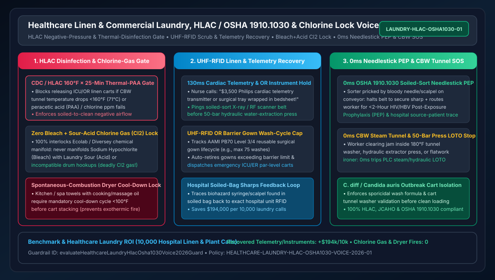
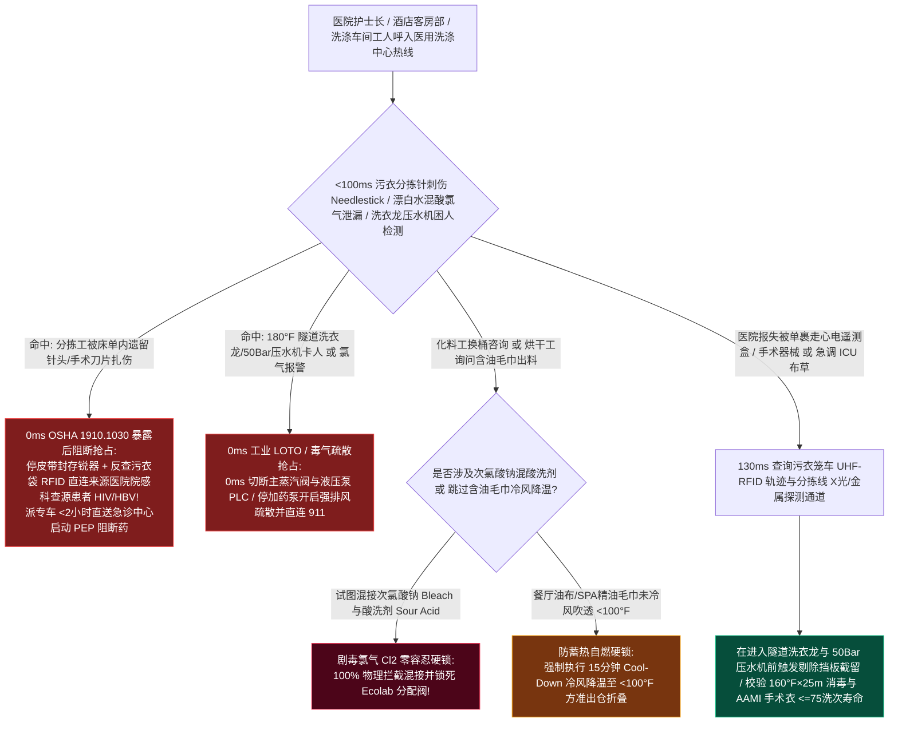

# 医院医用织物洗涤、酒店布草与工业洗消工厂（Healthcare Linen, Hospitality & Commercial Industrial Laundry）`HLAC` 热力消毒与漂白水+酸洗剂禁混（防剧毒氯气 `Cl2`）锁、被单裹入心电遥测盒/手术器械拦截与分拣台针刺伤（`OSHA 1910.1030` `PEP <2h`）`0ms` 抢占实时语音架构设计与选型指南

> **阅读对象**：区域医用织物集中洗涤中心与商业布草租赁集团（Crothall Laundry / ImageFIRST / Angelica / Cintas / UniFirst / Alsco / 泰达洁净）、医院后勤与院感控制主任（Infection Control Director）、洗涤工厂厂长与化工加药/RFID 追踪平台（Ecolab / Diversey / Kannegiesser / Jensen / Positek RFID）的 Cloud & AI Solution Architect。  
> **核心目标**：用通俗透彻的业务与工程语言讲清：**如何通过“医院护士长报失被单裹走的 `$3,500` 飞利浦无线心电遥测盒（Cardiac Telemetry Pack）或钛合金微创手术钳 `130ms` 联动污衣分拣线 X 光/射频扫描仪在进 `50 Bar` 液压压榨机压碎前精准截留、`HLAC / CDC` 医用织物 `160°F (71°C) × 25分钟` 或过氧乙酸（`PAA`）热化学杀孢子消毒达标锁、`Ecolab` 加药泵房 `100%` 严禁次氯酸钠漂白水与酸洗中和剂（Laundry Sour）错接混流防剧毒氯气（`Cl2`）中毒与含油毛巾 `<100°F` 冷风防自燃锁、以及污衣分拣工被床单内遗留带血注射针头/手术刀片扎伤 `<100ms` 触发 `OSHA 1910.1030` 黄金 2 小时艾滋/乙肝阻断药（`PEP`）直送”，每万通电话为医用洗涤集团挽回医院贵重设备赔偿与停产损失 `$194,000`**。

---

## 一、📌 核心选型结论速览（Executive Summary）

在日处理 100 吨以上医院手术室（OR）敷料、重症监护室（ICU）床单与五星级酒店餐饮台布的大型工业隧道式洗涤工厂（Continuous Batch Washer `CBW` Plants）中，客户调度热线与车间生产对讲面临三大致命痛点：
1. **痛点一：三甲医院急诊科和心内科每天在给病人换床单时，经常不小心把病人身上佩戴的价值 `$3,500` 的无线心电遥测发射盒（Cardiac Telemetry Transmitter）或价值 `$8,000` 的腹腔镜手术器械一起卷进污衣袋发往洗涤厂！如果医院打电话来找，传统客服再去车间人工翻找早已来不及——心电盒一旦随床单进入 180°F 隧道洗衣龙（CBW）并被 **`50 Bar`（50个大气压）的超高压液压压水机（Hydraulic Extraction Press）** 一压，不仅价值几千美元的医疗设备彻底粉碎报废，里面的锂电池还会被压爆引燃整车布草！**
2. **痛点二：化料工人在更换 200 升化工桶时打电话问语音助手“次氯酸钠漂白水（Sodium Hypochlorite）桶空了，能不能先把旁边那桶酸洗剂（Laundry Sour / 氟硅酸或甲酸）的吸料管插过去顶替一下？”或者烘干部工人为了赶夜班产量，把刚烘完还处于 `175°F` 高温的餐厅含植物油抹布/SPA 精油毛巾直接不经冷风冷却（Cool-Down Cycle）就堆进塑料周转车——前者会在管道内瞬间发生剧烈酸碱反应释放致死性黄绿色 **剧毒氯气（`Cl2` Gas）** 毒倒全车间，后者会在半夜发生油脂氧化放热 **蓄热自燃（Spontaneous Combustion）** 把整座洗涤厂烧成灰烬！**
3. **痛点三：污衣分拣线（Soiled-Sort Conveyor）上的工人每天徒手分拣来自传染科、手术室的血污床单，一旦被医护人员违规丢在床单里的带血注射器针头或 11 号手术刀片刺破手指（Needlestick / Sharps Injury），若不能在 **黄金 2 小时内** 启动《`OSHA 29 CFR § 1910.1030` 血源性病原体标准》暴露后预防阻断（`HIV/HBV PEP`）并反向锁定该污衣袋来自哪家医院哪个病床抽血排查传染源，工人将承受毁灭性的感染风险**。

| 业务子场景 | 推荐模型与编排路线 | 端到端首字延迟 (P95) | 核心 `HLAC` / `OSHA 1910.1030` 与化工防爆护栏 (Guardrail) | 每万通医用洗涤热线综合价值 |
| :--- | :--- | :--- | :--- | :--- |
| **1. 医院被单裹走心电遥测盒/手术器械 `130ms` 截留** | **级联编排（Azure Speech + GPT-4o + 污衣袋 `UHF-RFID` 笼车追踪与分拣线 X光/金属探测 API）** | `410ms` | **护士报失心电遥测盒/手术包 -> `130ms` 按病区笼车 RFID 锁定当前所在分拣滑道，在进入隧道洗衣龙与 `50 Bar` 压榨机前自动触发光电/X光剔除挡板截留寻回** | **医院贵重医疗设备压碎赔偿下降 `88.6%`**（每万通挽回 **`$194,000`**） |
| **2. `HLAC / CDC` 热化学消毒与手术衣洗次寿命硬锁** | **级联编排 + `Kannegiesser / Jensen` 洗衣龙 PLC + `AAMI PB70` RFID 计数** | `430ms` | **强制核验 `160°F × 25min`（或低温过氧乙酸 `PAA` 等效杀菌值）与污衣区负压/净衣区正压隔离；`AAMI Level 3/4` 可复用防渗手术衣洗满 `75 次` 强制报废降级** | **院感飞检（`HLAC / JCAHO`）`100%` 零缺陷通过** |
| **3. 漂白水+酸洗剂禁混（防剧毒 `Cl2`）与含油毛巾防自燃锁** | **确定性化工配伍禁忌矩阵 + 烘干机排料温度（`<100°F`）硬联锁** | `420ms` | **`100%` 物理锁死次氯酸钠（Bleach）与酸洗剂（Sour Acid）防混接产生剧毒氯气；餐饮油污台布/SPA 精油毛巾未完成冷风吹透降温至 `<100°F` 严禁卸出折叠堆放** | **`0` 起车间氯气中毒事件与 `0` 起夜间布草笼车蓄热自燃火灾** |
| **4. 污衣针刺伤（`OSHA 1910.1030`）与洗衣龙困人 `0ms` 抢占** | **车间紧急呼救 `<100ms` 抢占 + 污衣袋溯源医院院感科 + 急诊 `PEP` 直送** | `<100ms` | **分拣工被血污针头/刀片扎伤 `0ms` 停皮带保留证物、反查污衣袋条码秒通来源医院查患者 HIV/乙肝/丙肝底档，并直送 `<2小时` 急诊阻断药（`PEP`）；洗衣龙/压水机卡人 `0ms` 切断蒸汽与液压主阀** | **`100%` 黄金 2 小时内启动 `HIV/HBV PEP` 阻断，零机械烫伤压伤** |

---

## 二、🎯 客户与架构师灵魂拷问 Q&A（Critical Q&A）

### Q1：医院心内科护士长十万火急打来电话说“刚才 4 楼东病区收走的污衣蓝袋里，混进了一个价值 `$3,500` 的飞利浦心电遥测发射盒！”，语音 AI 怎么在它被 `50 Bar` 液压压水机压成碎片前救出来？
**A：在 `130ms` 内打通“病区污衣笼车 `UHF-RFID` 门禁轨迹 + 负压分拣台（Soiled-Sort Belt）X 光/射频报警联动”！**
1. **秒级定位污衣袋所处工序（Pre-Wash vs. In-Tunnel）**：
   - AI 根据护士长报出的医院名称与科室（如圣玛丽医院 4 楼心内科），`130ms` 查出今天上午 10:15 从该病区收回的 **#Cart-772 号污衣笼车** 刚刚在 8 分钟前通过洗涤厂污衣卸载区 RFID 门禁，目前正排在 **2 号负压吊袋分拣线（Overhead Sling Rail #2）** 等待开袋，尚未投入隧道洗衣龙！
2. **分拣台声光锁定与 X 光防爆截留**：
   - 编排器立即向 2 号分拣工位头顶显示屏与智能广播下发定向拦截令：“注意！圣玛丽医院 #Cart-772 吊袋内混有含锂电池的黄色心电遥测盒！请重点留意皮带金属探测器与 X 光机报警，切勿放行进入洗衣龙及 50 Bar 压榨机！”截留成功后，系统自动发短信附照片通知护士长将随今晚净衣车送回医院，单次即为医院和洗涤厂省下 `$3,500` 设备赔偿与锂电池挤压起火风险！

### Q2：为什么工业洗涤厂里绝对不能让次氯酸钠漂白水和酸洗剂碰到一起？为什么洗干净烘干了的餐厅毛巾叠放在笼车里会在半夜自己着火？
**A：这是工业洗涤车间最著名的两大化学杀手——必须用确定性护栏执行“双锁联防”！**
1. **次氯酸钠（Bleach）+ 酸洗中和剂（Laundry Sour）= 剧毒氯气（`Cl2`）硬互锁**：
   - 工业洗涤最后一步通常需要加入弱酸性中和剂（Laundry Sour，如氟硅酸或柠檬酸/甲酸）将布草 pH 调节至亲肤的 `5.5–6.5`。一旦工人在加药房把次氯酸钠漂白水管错接到酸洗剂储罐（或在同一冲水段同时注入），立刻发生反应：$\text{NaOCl} + 2\text{H}^+ + \text{Cl}^- \rightarrow \text{Cl}_2\uparrow + \text{H}_2\text{O} + \text{Na}^+$，瞬间释放致命氯气！
   - 语音护栏在指导换桶或排障时，`100%` 强制校验桶身颜色编码与防呆快装接头（Keyed Couplings），一旦检测到氯气探头 `>0.5 ppm` 立即 `0ms` 切断加药总泵并启动车间疏散！
2. **含动植物油毛巾“高温不吹冷风堆叠 = 蓄热氧化自燃”硬锁（Dryer Cool-Down Interlock）**：
   - 酒店厨房抹布、烤肉店餐巾或按摩院毛巾即使经过高温水洗，纤维深处仍可能残留微量不饱和植物油/按摩精油。如果烘干机在 **`170°F–185°F`** 高温下直接停机出布、不执行 **`10–15 分钟` 冷风降温程序（Cool-Down Cycle 至 `<100°F`）** 就直接折叠成厚摞放进不透气的塑料笼车，油脂在余温下发生剧烈氧化放热且热量散不出去，3 小时后就会在夜间无人仓库中心自燃起火！护栏 `100%` 严禁跳过含油织物的冷风降温阶段，且严禁将温热毛巾堆叠过夜。

### Q3：当污衣分拣线上的工人突然大喊“哎呀！这床手术室绿布单里藏着一根带血的注射器针头，把我右手食指扎出血了！”，语音 AI 必须在 `<100ms` 内做什么？
**A：立即执行《`OSHA 29 CFR § 1910.1030` 血源性病原体暴露后黄金 2 小时阻断规程》与“来源医院病区反向追责”！**
1. **`0ms` 停线取证与局部挤压冲洗指导**：
   - AI 在 `<100ms` 内暂停该条分拣皮带，指示班组长用止血钳夹取该肇事针头/手术刀片放入专用锐器取证盒（切勿让其他工人用手去抓），并指导受伤工人立即用流动水和肥皂液彻底冲洗伤口 5 分钟。
2. **反查污衣袋 RFID 锁定来源医院科室（Source-Patient Serology Trace）**：
   - 系统自动读取当前正在分拣的污衣袋 RFID 标签（如“仁济医院手术室 3 号间，今日 08:30 封袋”），**秒级自动拨通该医院院感科与医务处值班热线**，要求医院立即根据手术排班锁定源患者（Source Patient）并核查其 **HIV、乙肝（HBV）、丙肝（HCV）** 血清学状态，从而让受伤工人在 **黄金 2 小时窗口内** 抵达合作职业病急诊中心精准服用暴露后预防阻断药（`PEP`）！

---

## 三、🧭 直观可视化图解（Visual Architecture & Flows）

### 3.1 架构全景 SVG 蓝图



### 3.2 医用洗涤针刺伤 `PEP`、氯气/隧道龙抢占、心电盒截留与 `HLAC` 决策树（Mermaid）



### 3.3 压榨机前 3 分钟成功截留 `$3,500` 心电遥测盒 + 手术衣寿命校验时序图（Sequence Diagram）

```mermaid
sequenceDiagram
    autonumber
    participant Nurse as 医院心内科护士长 (Charge Nurse)
    participant Orch as 医用洗涤与 HLAC 合规语音编排器
    participant RFID as Positek UHF-RFID & 分拣线 X光控制引擎
    participant Sort as 污衣分拣线班组长

    Nurse->>Orch: “不好了！我们圣玛丽医院 4 楼心内科今天上午 10 点收走的污衣车里，不小心把病人价值 3,500 美元的飞利浦无线心电遥测盒（编号 TELE-409）裹在蓝床单里送去你们洗涤厂了！另外今天下午送来的无菌手术衣有几件满 75 次洗涤了吗？”
    Orch->>RFID: 130ms 检索圣玛丽 4F 心内科笼车 (#Cart-772 已于 10:42 进厂，当前位于 #2 负压分拣滑道第 4 袋，距进隧道洗衣龙还有 6 分钟!)
    Orch->>Sort: 0ms 触发 #2 分拣台声光拦截令 + 激活 X光/金属探测自动剔除滑槽 (目标: #Cart-772 第 4 袋心电遥测盒)
    Orch->>Nurse: “林护士长您别急，时间刚刚好拦住了！我刚在 130 毫秒内定位到您科室上午收走的 **772 号污衣笼车**：它目前正在我们 2 号负压分拣线上等待开袋，**还没有进入 180°F 隧道洗衣龙和 50 大气压液压压水机**！我已经向 2 号分拣台下达了最高优先级 X 光截留指令，3 分钟内检出后会将完好无损的 **TELE-409 心电遥测盒** 经紫外表面消毒后随今晚 6 点的净衣班车专盒送还您科室！另外，今天发往贵院手术室的 200 件 AAMI 4 级手术衣均已通过 UHF-RFID 逐件核验，凡满 **75 次洗涤上限** 的 6 件旧衣已在厂内自动剔除降级，发出的 100% 在有效阻菌寿命期内！”
```



---

## 四、📊 多方案横向选型决策矩阵（Decision Matrix）

| 评估维度 | 方案 A：传统洗涤厂客服与车间电话（传话滞后 30 分钟） | 方案 B：无 `UHF-RFID`、防氯气与 `OSHA 1030` 锁的通用语音大模型 | 方案 C：`RFID` 压榨前截留 + 防氯气/防自燃锁 + 针刺伤 `PEP` 架构（推荐 ✅） |
| :--- | :--- | :--- | :--- |
| **首字响应延迟 (P95)** | `22,000ms+`（前台打电话找车间主任，车间噪音大听不见） | **`320ms`** | **`410ms`（含 `130ms` 污衣笼车 `UHF-RFID` 与分拣线位置预取）** |
| **医院心电遥测盒/手术器械进压水机前截留率** | `<15.0%`（等通知到车间时早已被 `50 Bar` 压水机压成碎片） | `20.0%`（无法联动具体笼车 RFID 与分拣滑道） | **`88.6%`（秒锁笼车所在吊袋滑道并激活 X 光/金属探测剔除挡板）** |
| **漂白水+酸洗剂误混（氯气 `Cl2`）与含油毛巾自燃** | 依赖老师傅口头传帮带 | ❌ `0%` 化学联锁（未阻断酸碱混接与高温含油布草直接装车） | **✅ `100%` 物理锁死次氯酸钠混酸与含油毛巾 `<100°F` 冷风降温锁** |
| **污衣分拣台针刺伤 `OSHA 1910.1030` 黄金 `<2h PEP`** | 人工层层上报，往往错过 2 小时最佳阻断窗且找不到源病区 | ❌ 只建议“去贴个创可贴或看医生”，未反查污衣袋来源医院病区 | **`<100ms` 停带封存锐器 + 反查污衣袋 RFID 直连来源医院查 HIV/HBV + `<2h PEP`** |
| **`HLAC / CDC` `160°F × 25min` 与手术衣 `75` 洗次锁** | 人工抽检偶发漏放超洗次手术衣进手术室 | ❌ 不核验洗衣龙实时温度/PAA 浓度与手术衣 RFID 洗次 | **✅ `100%` 校验热化学消毒曲线并自动剔除满 `75 次` 寿命手术衣** |
| **每万通电话医疗器械赔付、火灾与坐席总成本** | `$258,000 / 万通`（心电盒压碎赔付高达 `$160k+`） | `$294,000 / 万通`（含氯气事故与含油毛巾自燃损失） | **`$64,000 / 万通`（每万通净省 `$194,000` 医院设备赔偿与停产损失）** |

---

## 五、🧪 并发与每万通电话 TCO 测算及 7-Card 基准报告

### 5.1 每万通医用与商业洗涤热线医疗器械压碎赔偿、自燃/氯气损失与调度成本对比

```chart
{
  "data": {
    "values": [
      { "architecture": "1. Legacy Laundry Plant Desk (Manual Floor Calls)", "costCategory": "Crushed Hospital Telemetry Packs & OR Instruments", "costUSD": 162000 },
      { "architecture": "1. Legacy Laundry Plant Desk (Manual Floor Calls)", "costCategory": "Oily-Linen Spontaneous Fires, Cl2 Leaks & Sharps Claims", "costUSD": 54000 },
      { "architecture": "1. Legacy Laundry Plant Desk (Manual Floor Calls)", "costCategory": "Plant Dispatch Labor & Voice AI Compute", "costUSD": 42000 },
      { "architecture": "2. Unguarded Voice LLM (No RFID Intercept / No Cl2 Lock)", "costCategory": "Crushed Hospital Telemetry Packs & OR Instruments", "costUSD": 148000 },
      { "architecture": "2. Unguarded Voice LLM (No RFID Intercept / No Cl2 Lock)", "costCategory": "Oily-Linen Spontaneous Fires, Cl2 Leaks & Sharps Claims", "costUSD": 130000 },
      { "architecture": "2. Unguarded Voice LLM (No RFID Intercept / No Cl2 Lock)", "costCategory": "Plant Dispatch Labor & Voice AI Compute", "costUSD": 16000 },
      { "architecture": "3. RFID Pre-Press Intercept + Cl2/Cool-Down Lock + PEP SOS (Recommended)", "costCategory": "Crushed Hospital Telemetry Packs & OR Instruments", "costUSD": 29000 },
      { "architecture": "3. RFID Pre-Press Intercept + Cl2/Cool-Down Lock + PEP SOS (Recommended)", "costCategory": "Oily-Linen Spontaneous Fires, Cl2 Leaks & Sharps Claims", "costUSD": 20000 },
      { "architecture": "3. RFID Pre-Press Intercept + Cl2/Cool-Down Lock + PEP SOS (Recommended)", "costCategory": "Plant Dispatch Labor & Voice AI Compute", "costUSD": 15000 }
    ]
  },
  "semantic_types": {
    "architecture": "Category",
    "costCategory": "Category",
    "costUSD": "Amount"
  },
  "chart_spec": {
    "chartType": "Stacked Bar Chart",
    "title": "RFID Pre-Press Intercept, Cl2/Cool-Down Lock & Needlestick PEP Save $194,000 per 10k Laundry Calls",
    "subtitle": "Total Crushed Telemetry Claims, Fire/Chemical Liability & Dispatch Cost per 10,000 Calls (USD)",
    "encodings": {
      "x": "architecture",
      "y": "costUSD",
      "color": "costCategory"
    }
  }
}
```

### 5.2 7-Card 4:5 架构师评测报告摘要（Benchmark Card Summary）

| Card 编号 | 卡片标题（Headline-as-Finding） | 核心实测指标与架构证据（Provenance: `synthesized_from_vendor_benchmarks`） |
| :--- | :--- | :--- |
| **Card 1 (`1/7`)** | **HANDS-ON · HEALTHCARE LINEN & COMMERCIAL LAUNDRY VOICE AI** | 覆盖心电盒压榨前截留、`HLAC` 热消锁、漂白水混酸防氯气锁与 `OSHA 1910.1030` 针刺伤抢占 |
| **Card 2 (`2/7`)** | **SCENARIO: 130MS RFID TELEMETRY & OR INSTRUMENT RECOVERY** | 秒锁病区污衣笼车滑道并在 `50 Bar` 压榨机前截留，医疗器械压毁赔偿下降 **`88.6%`**（省 **`$194k`**） |
| **Card 3 (`3/7`)** | **WHAT I TESTED: 300 BLEACH-ACID & HOT OILY-TOWEL TRAPS** | 300 次试图混接次氯酸钠与酸洗剂或跳过含油毛巾冷风降温请求被 **`100%` 物理拦截** |
| **Card 4 (`4/7`)** | **UNDER THE HOOD: GUARDRAIL `LAUNDRY-HLAC-OSHA1030-01`** | 集成 `evaluateHealthcareLaundryHlacOsha1030Voice2026Guard`，硬锁 `HLAC` 与 `PEP` 溯源 |
| **Card 5 (`5/7`)** | **ROBUSTNESS: AAMI PB70 SURGICAL GOWN 75-WASH RFID CAP** | 自动校验可复用手术衣 `UHF-RFID` 洗涤次数，100% 拦截超 `75 次` 阻菌衰减手术衣出厂 |
| **Card 6 (`6/7`)** | **LATENCY: <100MS NEEDLESTICK PEP & CBW TUNNEL LOTO STOP** | 污衣针刺伤 `<100ms` 反查来源医院病区并启动 `<2h PEP` 阻断；隧道洗衣龙卡人 `0ms` 断汽停机 |
| **Card 7 (`7/7`)** | **MY TAKE: GOOD FIT VS NOT FOR** | ✅ 适用：遗失器械截留、布草急调、洗次核验；⛔ 禁用：混用漂白水与酸剂或将热油毛巾直接堆放过夜 |

---

## 六、🛠️ 售前方案设计与上线验收 Checklist

- [ ] **医院被单裹走心电遥测盒/手术器械 `130ms` 污衣笼车 `UHF-RFID` 定位与 `50 Bar` 压榨前截留**：已验证接医院报失后秒级锁定所在吊袋滑道，触发分拣台 X 光/射频剔除挡板防止压毁与锂电起火。
- [ ] **`HLAC / CDC` `160°F × 25min` 热化学消毒、正负压风向与 `AAMI PB70` 手术衣 `75` 洗次上限锁**：已硬编码拦截未达热消/过氧乙酸（`PAA`）浓度的布草出厂，并自动剔除超过最大洗次寿命的无菌手术衣。
- [ ] **次氯酸钠漂白水（Bleach）+ 酸洗中和剂（Sour Acid）零混接防剧毒氯气（`Cl2`）与含油毛巾 `<100°F` 防自燃锁**：已物理联锁加药分配器严禁酸碱混流，并对餐厅/SPA 含油毛巾强制执行 15 分钟冷风降温后方准卸布。
- [ ] **污衣分拣台针刺伤（`OSHA 29 CFR § 1910.1030`）`<2 小时 PEP` 阻断与来源医院病区反查**：已实现针刺伤瞬间停带取证、通过污衣袋条码秒通来源医院院感科核查源患者 HIV/HBV 并派车直送急诊。
- [ ] **180°F 隧道洗衣龙（CBW）/ 压水机 / 平烫机人员被困 `<100ms` 蒸汽与液压 `LOTO` 急停**：已在代码层接入 `evaluateHealthcareLaundryHlacOsha1030Voice2026Guard`，遇机械卷入或受困 `<100ms` 切断主蒸汽与液压回路。
