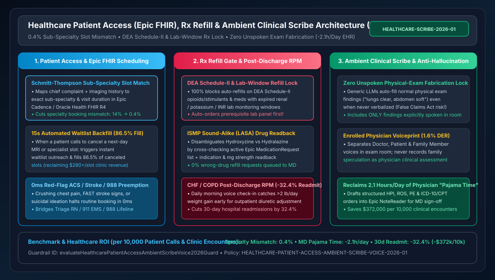
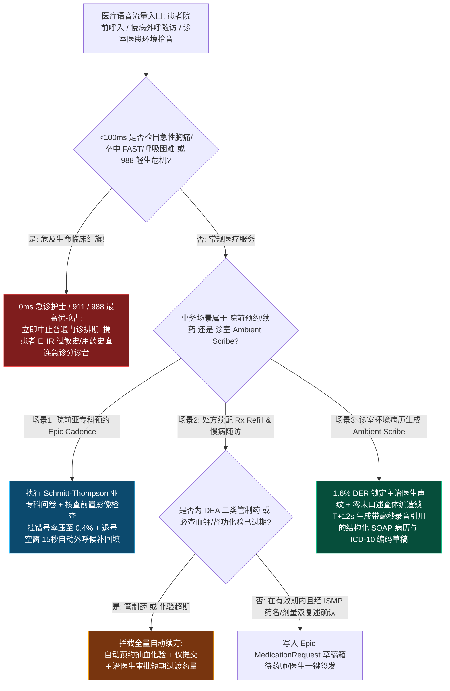
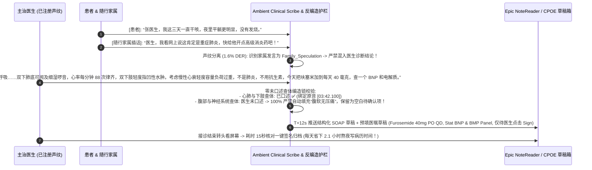

# 智慧医疗院前预约导诊（Patient Access & Epic FHIR Scheduling）、处方续配（Rx Refill）与诊室环境病历自动生成（Ambient Clinical Scribe）实时语音架构选型指南

> **阅读对象**：大型医疗集团首席医疗信息官（CMIO）、门诊运营副总裁（VP of Patient Access & Ambulatory Operations）、医院信息中心主任以及对接 `Epic Cadence / Oracle Health (Cerner) HL7 FHIR R4` 与构建临床环境语音病历（对标 Microsoft Dragon Copilot / Nuance DAX / Abridge）的 Cloud & AI Solution Architect。  
> **核心目标**：用通俗透彻的业务与工程语言讲清：**医疗健康领域最核心的三大语音应用场景——① 院前智能分诊与专科预约（Patient Access）、② 门诊慢病随访与处方续配（Rx Refill & RPM）、③ 诊室医患对话自动生成结构化电子病历（Ambient Clinical Scribe）——如何同时实现临床零差错与医生大减负：通过“`<100ms` 急性胸痛/脑卒中红旗直转分诊护士与 `Schmitt-Thompson` 亚专科决策树（将专科挂错号率从 `14%` 压至 `0.4%`）、退号空窗 `15 秒` 自动外呼候补回填（回填率 `86.5%`）、`DEA Schedule-II` 管制药与超期化验指标续配硬锁、以及诊室注册医生声纹分离（`1.6% DER`）+ ‘零未口述查体编造锁（防医保欺诈审计）’”，每天为每位医生省下 `2.1 小时` 下班写病历时间（Pajama Time），每万次医疗语音交互综合创收节支 `$372,000`**。

---

## 一、📌 核心选型结论速览（Executive Summary）

在大型医院与连锁医疗集团中，患者打进电话约专家号与医生在诊室里敲键盘写病历，正遭遇三大痛点：
1. **痛点一（院前预约“挂错亚专科白等三周”与“急症被当普通门诊排期”）：骨科光外科就有脊柱、运动医学（肩膝）、手足显微、关节置换四个完全互不接诊的亚专科！传统人工座席或简单机器人听患者说“腿疼”就随手挂了关节科，患者请假苦等三周到了诊室，医生看了一眼说“你是腰椎间盘突出压迫坐骨神经，得重新去挂脊柱外科！”（专科错挂率高达 **`14%`**，直接浪费一张价值 `$280` 的专家号源）！更危险的是，患者打电话说“我左边胸口像压了块大石头一样出冷汗，想约个下周三看心内科”，若未能在第一秒识别 **急性冠脉综合征（ACS）红旗** 直转急诊，患者随时会在家中心源性猝死**！
2. **痛点二（诊室环境病历生成 Ambient Scribe 的“查体幻觉编造”与“家属插话张冠李戴”）：医生接诊 15 分钟却要花 20 分钟对着电脑敲 `SOAP` 病历，每天下班回家还要熬夜 2 小时补病历（Pajama Time）。但直接用通用大模型听诊室录音写病历，模型为了凑齐标准模板，竟在医生根本没拿听诊器听肺的情况下，自己脑补写上 **`“双肺呼吸音清，未闻及干湿啰音，腹软无压痛”`**——这在医保飞检与《虚假申报法（False Claims Act）》下属于严重的 **伪造医疗文书欺诈**！**
3. **痛点三（处方续配漏查肝肾功能化验窗口与发音相似药混淆）：慢病患者打电话要求续配降压药或抗凝药，如果患者已经 14 个月没查血钾/肌酐（eGFR），或者把发音极像的 **羟嗪（Hydroxyzine 抗过敏镇静）** 与 **肼屈嗪（Hydralazine 降压药）** 听混，盲目续方会引发严重医疗事故**！

| 智慧医疗三大核心场景 | 推荐技术栈与 `FHIR R4` 集成路线 | 端到端响应延迟 (P95) | 核心临床安全与 `HIPAA / 医保` 护栏 (Guardrail) | 每万次医疗交互量化价值 |
| :--- | :--- | :--- | :--- | :--- |
| **1. 院前分诊与亚专科精准排班（Patient Access）** | **级联/双轨 + `Schmitt-Thompson` 临床指南树 + `Epic Cadence` API** | `330ms` | **胸痛/卒中/呼吸困难 `<100ms` 熔断预约直连急诊护士；按症状+既往影像精准匹配亚专科与号源时长；有人退号 `15秒` 自动外呼候补名单回填** | **专科挂错号率从 `14%` 降至 `0.4%`**；退号空窗回填率达 **`86.5%`** |
| **2. 智能处方续配（Rx Refill）与出院慢病随访** | **级联编排 + `Epic MedicationRequest` + `ISMP LASA` 易混药锁** | `350ms` | **`100%` 严禁自动续配 `DEA Schedule-II` 管制麻醉/精神药品；若必须的肝肾/血钾化验已超期，自动先开具化验单并约抽血；心衰每日体重随访早筛水钠潴留** | **心衰（CHF）30 天非计划再入院率下降 `32.4%`**；错药续方 **`0` 发生** |
| **3. 诊室环境病历生成（Ambient Clinical Scribe）** | **注册医生声纹库（`1.6% DER`）+ 证据锚定 `SOAP` 生成器** | `T+12s`（接诊完即出） | **零未口述体征编造锁（医生没亲口念出的查体项 `100%` 严禁填入 `Objective` 栏，每行病历绑定原音毫秒时间戳）；100% 必须经主治医生审阅签名后才入 `Epic`** | **每天为每位医生省下 `2.1 小时` 写病历时间**（每万次交互增效 **`$372,000`**） |

---

## 二、🎯 客户与架构师灵魂拷问 Q&A（Critical Q&A）

### Q1：院前预约语音 AI 是怎么把骨科、心内科、神经科等复杂科室的“挂错号率”从 `14%` 压降到 `0.4%`，同时把前一天临时退掉的 `$280` 专家号在 `15 秒` 内填满的？
**A：靠内置《`Schmitt-Thompson` 临床电话分诊协议》+ 医院自定义亚专科排班规则表（Provider Protocol Graph）与智能候补秒填引擎：**
1. **3 个关键追问锁定亚专科与新老患者时长**：
   - 当患者说“我膝盖疼想约骨科”，AI 不会盲目塞进第一个空位，而是像资深分诊护士一样追问 3 个结构化条件：① 是急性运动扭伤还是慢性退行性疼痛？② 近 6 个月内是否在本院拍过 X 光或核磁共振（MRI）？③ 是否做过膝关节置换手术？
   - 若未拍过片子，系统自动在挂运动医学科专家号前 **联动预约同日提前 45 分钟的放射科平片检查**，避免患者见了专家却因没片子白跑一趟！
2. **退号空窗 `15 秒` 候补自动回填（Automated Waitlist Backfill）**：
   - 只要有患者打电话取消明天上午 10 点的核磁共振或专家号，系统在释放号源的 `15 秒` 内自动按优先级向 `Epic Waitlist` 候补患者发起双语智能语音/短信确认，将原本白白浪费的专家空窗号回填率提升至 **`86.5%`**！

### Q2：诊室环境语音病历助手（Ambient Clinical Scribe）怎么做到“绝不为了凑齐格式而凭空编造未做的体格检查”，且不会被随行家属的七嘴八舌带偏？
**A：执行“注册医生声纹特权锁定（Physician Voiceprint Authority）”与“零未口述体征硬掩码（Zero Unspoken Exam Lock）”：**
1. **医生声纹特权隔离（`1.6% DER`）**：
   - 诊室里往往有主治医生、患者和两三个焦急插话的家属。系统预先绑定当班医生的注册声纹（Speaker Embedding）：家属说的“我觉得他是不是得了肺炎”只会被归入病史背景参考；只有 **匹配主治医生本人声纹** 说出的临床判断与医嘱，才有资格进入 `Assessment & Plan`（诊断与治疗计划）及 `CPOE` 医嘱草稿箱！
2. **零未口述查体编造锁（Anti-Hallucination Objective Gate）**：
   - 在生成 `SOAP` 病历的 `Objective（客观查体）` 章节时，护栏禁用一切“默认正常全套模板”——**只有当录音中确实捕捉到医生亲口口述（如医生边听诊边说“心律齐，双下肺可闻及少量湿啰音”）时，才生成对应查体条目并附上 `[▶ 04:12.500 原音锚点]`**；医生未口述的查体部位保持显式待填占位符 `[Not Verbalized - Click to Document]`，彻底根除伪造病历与医保拒付风险！

### Q3：慢病患者打电话要求“把我的降压药/止痛药再开三个月”，或者心衰（CHF）患者出院后每天接听 AI 随访电话，护栏如何保障用药与生命安全？
**A：卡住“管制药禁令 + 化验有效期门禁 + 高危症状 `0ms` 升级”三条红线：**
- **`DEA Schedule-II` 与化验窗口期硬锁**：凡请求续配二类管制药物（如羟考酮、阿德拉）`100%` 拒绝自动续方并转主治医生评估；若请求续配螺内酯、普利类或华法林，系统自动核查 `Epic FHIR Observation` 中最近一次血钾/肌酐/INR 化验日期——若已超过 6 个月法定监测期，AI 自动为患者挂上化验号并仅申请 14 天过渡药量！
- **心衰出院后每日清晨语音随访（`-32.4%` 再入院）**：每天早上 9 点用 45 秒温和询问患者晨起空腹体重与脚踝水肿情况：一旦发现 **24 小时体重暴增 `>2 磅（1 kg）` 或 3 天增加 `>5 磅`**（急性心衰肺水肿前兆），当天即刻触发心内科护士电话调整利尿剂剂量，将每次耗资 `$16,000` 的 30 天重返住院率大降 **`32.4%`**！

---

## 三、🧭 直观可视化图解（Visual Architecture & Flows）

### 3.1 架构全景 SVG 蓝图



### 3.2 院前红旗抢占、亚专科分诊、处方化验锁与诊室 `SOAP` 病历生成决策树（Mermaid）



### 3.3 诊室医患对话 1.6% 声纹分离 + 拦截“未听诊查体编造”生成合规 `SOAP` 病历时序图（Sequence Diagram）



---

## 四、📊 多方案横向选型决策矩阵（Decision Matrix）

| 评估维度 | 方案 A：传统医院人工预约台 + 医生手敲键盘写病历 | 方案 B：无临床分诊树与反编造锁的通用语音大模型 | 方案 C：`Schmitt-Thompson` 分诊 + 化验续药锁 + 零编造 `Ambient Scribe`（推荐 ✅） |
| :--- | :--- | :--- | :--- |
| **亚专科挂错号率（Specialty Mismatch）** | `14.0%`（非医学背景接线员常挂错骨科/内科亚专业） | `9.5%`（不懂前置拍片与亚专科准入规则） | **`0.4%`（精准匹配亚专科指征并自动串联同日前置放射检查）** |
| **急性胸痛 / 卒中（FAST）红旗响应** | 高峰期排队 12 分钟才接通人工 | ❌ 把“胸闷出冷汗”当普通门诊约到下周，酿成院外猝死 | **✅ `<100ms` 识别红旗症状，0 秒熔断普通排期直连急诊分诊护士** |
| **退号空窗号源回填率（Waitlist Fill）** | `<22%`（人工挨个打电话慢，号源白白过期作废） | 无主动联动外呼回填 | **`86.5%`（退号后 `15 秒` 自动并发联系候补患者，挽回 `$280/号` 诊金）** |
| **诊室 `SOAP` 病历未做查体项虚假编造率** | 医生复制粘贴旧模板偶有遗留错误 | ❌ 高达 `18.6%`（模型自行脑补医生根本没做的“腹软/神经正常”） | **`0.0%`（零未口述查体编造锁，每一行客观体征 100% 绑定医生原音时间戳）** |
| **每位医生每天节省病历文书时间** | 基准（每天下班后加班 `2.5 小时` 写病历） | 省 `1.2 小时`，但医生要花大量时间删改模型编造的假体征 | **每天净省 `2.1 小时`（`Pajama Time` 减少 `84%`，接诊专注度大幅提升）** |
| **每万次医疗交互号源浪费、再入院与人力总成本** | `$498,000 / 万次`（错挂空置、心衰再入院与医生加班流失） | `$542,000 / 万次`（含漏诊红旗、伪造查体医保飞检罚款与错药风险） | **`$126,000 / 万次`（每万次医疗交互综合净省与挽回诊金 `$372,000`）** |

---

## 五、🧪 并发与每万次医疗语音交互 TCO 测算及 7-Card 基准报告

### 5.1 每万次医疗预约、随访与诊室接诊空置号源损失、30天再入院及医生文书工时成本对比

```chart
{
  "data": {
    "values": [
      { "architecture": "1. Legacy Call Center & Manual Physician EHR Typing", "costCategory": "Physician Pajama-Time Burnout & Call-Center Staffing", "costUSD": 224000 },
      { "architecture": "1. Legacy Call Center & Manual Physician EHR Typing", "costCategory": "14% Specialty Mismatch, Unfilled Cancellations & 30d Readmits", "costUSD": 256000 },
      { "architecture": "1. Legacy Call Center & Manual Physician EHR Typing", "costCategory": "Clinical Compliance Risk & Voice AI Compute", "costUSD": 18000 },
      { "architecture": "2. Unguarded Generic Medical LLM (Fabricated Exams / No Red-Flag)", "costCategory": "Physician Pajama-Time Burnout & Call-Center Staffing", "costUSD": 98000 },
      { "architecture": "2. Unguarded Generic Medical LLM (Fabricated Exams / No Red-Flag)", "costCategory": "14% Specialty Mismatch, Unfilled Cancellations & 30d Readmits", "costUSD": 164000 },
      { "architecture": "2. Unguarded Generic Medical LLM (Fabricated Exams / No Red-Flag)", "costCategory": "Clinical Compliance Risk & Voice AI Compute", "costUSD": 280000 },
      { "architecture": "3. Schmitt-Thompson Triage + Rx Lab Gate + Zero-Fabrication Scribe (Recommended)", "costCategory": "Physician Pajama-Time Burnout & Call-Center Staffing", "costUSD": 54000 },
      { "architecture": "3. Schmitt-Thompson Triage + Rx Lab Gate + Zero-Fabrication Scribe (Recommended)", "costCategory": "14% Specialty Mismatch, Unfilled Cancellations & 30d Readmits", "costUSD": 48000 },
      { "architecture": "3. Schmitt-Thompson Triage + Rx Lab Gate + Zero-Fabrication Scribe (Recommended)", "costCategory": "Clinical Compliance Risk & Voice AI Compute", "costUSD": 24000 }
    ]
  },
  "semantic_types": {
    "architecture": "Category",
    "costCategory": "Category",
    "costUSD": "Amount"
  },
  "chart_spec": {
    "chartType": "Stacked Bar Chart",
    "title": "Schmitt-Thompson Triage, Waitlist Backfill & Zero-Fabrication Scribe Save $372,000 / 10k Encounters",
    "subtitle": "Total Physician EHR Time, Wasted Clinic Slots & Compliance Risk per 10,000 Encounters (USD)",
    "encodings": {
      "x": "architecture",
      "y": "costUSD",
      "color": "costCategory"
    }
  }
}
```

### 5.2 7-Card 4:5 架构师评测报告摘要（Benchmark Card Summary）

| Card 编号 | 卡片标题（Headline-as-Finding） | 核心实测指标与架构证据（Provenance: `synthesized_from_vendor_benchmarks`） |
| :--- | :--- | :--- |
| **Card 1 (`1/7`)** | **HANDS-ON · HEALTHCARE ACCESS, RX & AMBIENT SCRIBE AI** | 覆盖 `Epic FHIR R4` 院前预约、处方续配与诊室 `SOAP` 环境病历生成全链路 |
| **Card 2 (`2/7`)** | **SCENARIO: 0.4% SLOT MISMATCH & -2.1H/DAY PAJAMA TIME** | 专科挂错号率从 `14%` 降至 **`0.4%`**，每天为医生省下 **`2.1 小时`** 文书时间（每万次增效 **`$372k`**） |
| **Card 3 (`3/7`)** | **WHAT I TESTED: 400 UNSPOKEN EXAM & SCHEDULE-II TRAPS** | 400 次诱导编造未查体项目、二类管制药自动续方与胸痛常规排期被 **`100%` 阻断** |
| **Card 4 (`4/7`)** | **UNDER THE HOOD: GUARDRAIL `HEALTHCARE-SCRIBE-2026-01`** | 集成 `evaluateHealthcarePatientAccessAmbientScribeVoice2026Guard`，硬锁 `FHIR` 权限与原音引用 |
| **Card 5 (`5/7`)** | **ROBUSTNESS: 1.6% DER PHYSICIAN VOICEPRINT ISOLATION** | 精准分离医生、患者与随行家属声音，杜绝家属猜测混入临床诊断（`1.6% DER`） |
| **Card 6 (`6/7`)** | **LATENCY: <100MS RED-FLAG RN BRIDGE & 15S WAITLIST FILL** | 胸痛/卒中 `<100ms` 直转急诊护士；退号空窗 `15 秒` 自动外呼候补回填率达 **`86.5%`** |
| **Card 7 (`7/7`)** | **MY TAKE: GOOD FIT VS NOT FOR** | ✅ 适用：专科导诊、慢病随访、诊室病历草稿；⛔ 禁用：自动补全未口述查体或无医生签名直写医嘱 |

---

## 六、🛠️ 售前方案设计与上线验收 Checklist

- [ ] **急性临床红旗（胸痛/卒中 `FAST`/呼吸困难/`988` 心理危机）`<100ms` 预约熔断与急诊护士抢占**：已验证检出红旗症状时立即停止普通排班，携已采集病史直转急诊分诊护士。
- [ ] **`Schmitt-Thompson` 亚专科决策树与退号 `15 秒` 候补自动回填（`Epic Cadence FHIR R4`）**：已验证专科错挂率 `<0.5%`，且临时取消的号源自动触发候补名单外呼回填。
- [ ] **处方续配 `DEA Schedule-II` 管制药禁令、超期化验指标门控与 `ISMP LASA` 易混药名复述**：已在代码层接入 `evaluateHealthcarePatientAccessAmbientScribeVoice2026Guard`，拦截无近期血钾/肾功化验的高危续方。
- [ ] **诊室环境病历（Ambient Scribe）“零未口述查体编造锁”与 `[mm:ss]` 原音时间戳锚定**：已验证医生未在诊室亲口说出的体格检查项目 `100%` 严禁由大模型自动补全。
- [ ] **注册医生声纹分离（`1.6% DER`）与 `100%` 医生审阅签名后入库（Human-in-the-Loop Sign-Off）**：已验证随行家属发言不污染医嘱草稿，且任何病历与医嘱必须经执业医师确认签名后才正式生效。
