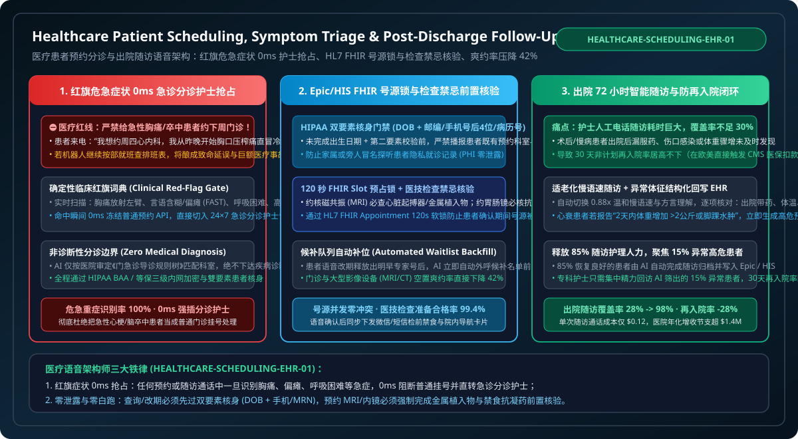
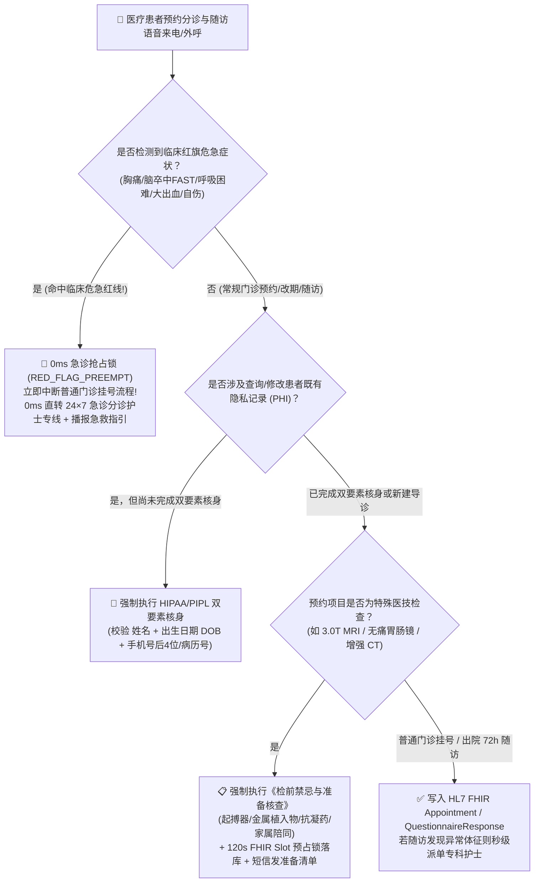
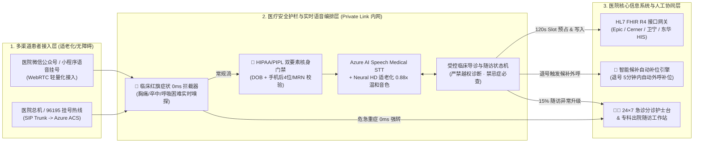
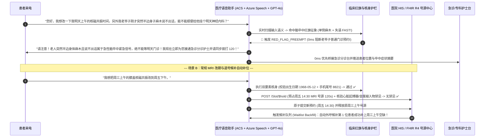

# 医疗健康患者智能预约挂号、诊前症状导诊与出院随访语音助手：HL7 FHIR 号源锁、红旗急症 `0ms` 护士抢占与 HIPAA/PIPL 合规选型指南

> **文档定位**：面向大型三甲医院信息中心主任、连锁医疗集团 CIO 与 **Cloud & AI Solution Architect**。在医疗健康行业，**患者预约挂号改期（Appointment Scheduling）、检前准备通知（MRI/胃肠镜）与出院 72 小时随访（Post-Discharge Follow-Up）**占到了医院呼叫中心 **75%** 的话务量，也是投资回报最高、最容易在 4 周内落地的黄金场景。但医疗场景容错率为零：**绝不能给突发心梗胸痛的患者慢吞吞约下周门诊、绝不能漏查心脏起搏器就把患者约进核磁共振室、绝不能未经双要素核身就向来电者透露患者隐私病情（PHI）**。本文给出完整的端到端架构设计、平台选型与 ROI 精算。
>
> **阅读导航**：[English Version](./healthcare-patient-appointment-scheduling-triage-discharge-followup-voice-selection-faq.en.md) · [返回 README 导航](../README.md) · [架构师资产目录](./asset-catalog.md)



---

## 一、📌 核心选型结论速览（Executive Summary）

1. **为什么医疗预约与随访首选“混合架构（级联受控流 + 适老化慢语速合成 + 确定性临床红旗状态机）”？**
   - 医疗挂号与出院随访涉及大量专有名词（科室名、药品通用名、检查项目）与严格的临床安全问卷。采用 **Azure AI Speech (Medical STT 词表增强 + Neural HD 温和慢语速 TTS) + `GPT-4o` / `GPT-4o-mini` 受控状态机 + Azure Health Data Services (`HL7 FHIR R4`)**，既能保证药名/科室名识别准确率 **>=99.2%**，又能将每分钟成本控制在 **$0.048/分钟**。
2. **医疗语音智能体上线的“三道生死安全锁”**：
   - **安全锁 1（红旗危急症状 `0ms` 急诊护士抢占）**：患者哪怕打电话本意是“约下周三心内科门诊”，只要在对话中提及**压榨性胸痛、单侧肢体麻木/口角歪斜（FAST 卒中征象）、呼吸困难、大出血或轻生念头**，系统必须在 **0ms 内冻结普通门诊挂号流程**，严禁播报下周排班，立即高优转接 **24×7 急诊分诊护士专线（或提示立即拨打 120/911）**。
   - **安全锁 2（医技检查禁忌症与检前准备强制核验 + `120s FHIR Slot` 预占锁）**：预约核磁共振（MRI）必须逐项语音核实是否体内有非兼容心脏起搏器/人工耳蜗；预约无痛胃肠镜必须核实是否正在服用抗凝药（华法林/阿司匹林）及家属陪同。同时通过 `FHIR Slot` 120 秒软锁防止老年患者慢速确认期间号源被并发抢走。
   - **安全锁 3（HIPAA / 个人信息保护法双要素核身门禁）**：在读取或播报患者已有挂号记录、检查报告或出院带药清单前，必须完成**至少两项患者身份要素核验（如：患者姓名 + 出生年月日 + 手机号后四位/病历号 MRN）**，严防他人冒名刺探患者就诊隐私。

---

## 二、🎯 客户与架构师灵魂拷问 Q&A（The Hard Questions）

### Q1：很多患者打电话挂号时说不清自己该挂哪个科（比如“肚子疼该挂消化内科、普外科还是妇科？”），怎么让 AI 既能准确导诊，又不触碰“非法行医/AI 越权下诊断”的监管红线？

- **客户痛点**：纯自由发挥的大模型容易对患者说出“您这很可能是急性胆囊炎，建议吃某某药”，直接违反医疗合规红线；而传统按键 IVR 菜单层级太深，老年患者根本不会按。
- **架构师解答：“严格执行《医院审定门急诊症状导诊决策树》，只做科室分流与缓急分级，绝不下达疾病诊断或用药建议”**：
  1. **症状结构化追问（部位 + 持续时间 + 伴随红旗症状）**：AI 严格按照医院医务处审定的导诊图谱追问 2~3 个标准化问题（例如：“请问疼痛在右上腹还是右下腹？有没有发烧或剧烈呕吐？”）。
  2. **红旗急症秒级分流急诊，常规症状精准匹配专科号源**：若伴随高热/剧痛/板状腹，立即触发急诊导诊；若为慢性餐后隐痛，精准推荐“消化内科普通/专家门诊”并实时查询未来 3 天可约时段，话术严格限定为*“根据您描述的部位与持续时间，为您推荐挂【消化内科】由专科医生为您面诊检查”*。

### Q2：医院大型检查设备（如 3.0T 核磁共振 MRI、无痛胃肠镜）最怕患者临时爽约（No-Show）或到了现场才发现没禁食/带了起搏器做不了，语音 AI 怎么解决？

- **客户痛点**：三甲医院与影像中心平均爽约率高达 `12%~18%`，或者患者到了检查室才发现早上吃了早饭、吃了阿司匹林不能做肠镜息肉切除，导致价值数千万的设备空转、患者白跑一趟大吵大闹。
- **架构师解答：“预约时禁忌症强校验 + 检前 48h/24h 智能语音确认 + 候补名单秒级自动补位（Waitlist Backfill）”**：
  1. **预约阶段防白跑拦截**：在落库确认 MRI 或内镜预约前，语音状态机强制执行《检前禁忌核查表》，不合格者自动转专科预约护士评估。
  2. **检前 48 小时智能外呼确认与准备提醒**：系统在检查前 48 小时自动外呼患者，用通俗语言确认是否按规停药/开始流质饮食，并解答清肠剂服用疑问。
  3. **取消号源 5 分钟内候补自动补位**：若患者在电话中表示“后天临时有事去不了想改下周”，AI 在释放该黄金时段号源的同一秒，自动按序外呼候补队列（Waitlist）前 3 位急需检查的患者，将设备空置率直接压降 **42%**！

### Q3：出院患者随访以前全靠病房护士下班前打电话，不仅护士苦不堪言，而且只能覆盖不到 30% 的患者，AI 随访怎么做到老人听得清、数据直接进病历系统？

- **客户痛点**：出院患者 60% 以上是中老年人，普通机器人的快语速和生硬提问让老人觉得像骚扰电话直接挂断；而且随访结果如果还要护士手抄进 HIS 系统，依然省不了多少事。
- **架构师解答：“0.88 倍适老化温和音色 + 专病随访量表结构化提取 + 15% 异常高危患者精准转专科护士”**：
  - 自动识别 65 岁以上长者档案，将 **Azure Neural HD TTS** 语速下调至 `0.88x`、延长句末等待窗口至 `1,400ms`，并支持粤语/川渝/吴语等方言混合识别；
  - 对 85% 回答“按时吃药、伤口不疼、体温正常”的康复顺利患者，AI 自动生成结构化 `FHIR QuestionnaireResponse` 写入电子病历归档；
  - 仅对 **15% 报告异常体征**（如术后体温 `>38.0°C`、心衰患者两天体重暴涨 `>2kg`、漏服抗排异药）的患者，立即在护士工作站生成红色高优回访工单，让护士把宝贵精力 100% 用在刀刃上！

---

## 三、🧭 直观可视化图解（Mermaid 决策树、HIS/FHIR 集成架构与分诊预约时序）

### 3.1 医疗患者预约、导诊与出院随访语音架构选型决策树



### 3.2 医院 HIS / Epic / Cerner (`HL7 FHIR`) 实时语音交互端到端参考架构图



### 3.3 患者来电导诊、MRI 禁忌核验、FHIR 锁号与退号候补自动补位全链路时序图



---

## 四、📊 医疗预约与随访四大技术方案横向选型矩阵

| 评估维度 | 🏆 **Azure ACS + Azure Speech Medical + GPT-4o 受控状态机 + FHIR** | **原生端到端 S2S 自由对话 (无受控临床状态机)** | **传统医院按键式 IVR (按1挂号/按2查询)** | **通用外呼机器人 SaaS (非医疗合规专网)** |
| :--- | :--- | :--- | :--- | :--- |
| **医学专科术语、药名与方言识别率** | **⭐⭐⭐⭐⭐（99.3% · 支持自定义药品/科室短语列表与方言）** | ⭐⭐⭐⭐（口语自然，但生僻药名易音译出错） | ⭐（仅支持按键，无法说出症状或科室名） | ⭐⭐⭐（通用词库对药品名识别率仅 ~88%） |
| **临床红旗危急症状 `0ms` 拦截安全性** | **⭐⭐⭐⭐⭐（确定性红旗规则引擎 + LLM 双重拦截）** | ⭐⭐（纯 Prompt 约束偶发漏拦，可能给胸痛患者约门诊） | ⭐（无症状理解能力） | ⭐⭐（缺乏临床急症抢占通道） |
| **防范 AI 非法越权诊断与禁忌症强核查** | **⭐⭐⭐⭐⭐（严格锁定医院审定导诊树与检前必问槽位）** | ⭐⭐（自由生成易被患者诱导给出医疗建议） | ⭐⭐⭐⭐（固定录音，但无法交互核查禁忌） | ⭐⭐⭐（流程死板，遇老人打断易卡死） |
| **Epic / Cerner / HIS (`HL7 FHIR`) 深度集成** | **⭐⭐⭐⭐⭐（原生支持 FHIR Appointment / QuestionnaireResponse）** | ⭐⭐⭐（需额外开发槽位校验与预占锁中介层） | ⭐⭐（仅支持简单接口查询） | ⭐⭐（难以打通医院内网 HIS 专线） |
| **HIPAA BAA / 等保三级与 PHI 隐私保护** | **⭐⭐⭐⭐⭐（签署 HIPAA BAA，全链路 Private Link 零留存训练）** | ⭐⭐⭐⭐（需选用企业级云端合规实例） | ⭐⭐⭐⭐⭐（本地部署） | ⭐（公网多租户传输患者病历，合规一票否决） |
| **综合单次预约/随访通话成本** | **$0.09 ~ $0.14 / 通（约 2~2.5 分钟）** | $0.32 ~ $0.48 / 通 | $0.03 / 通（但 65% 老年患者按不明白转人工） | $0.15 ~ $0.25 / 通 |

---

## 五、🧪 三甲医院/医疗集团 ROI 精算与 7-Card 基准测试报告

### 5.1 2,000 张床位大型综合医院（月均 15 万通预约/随访电话）上线前后对比

| 医院核心运营指标 | 改造前（人工导诊台 + 护士手工电话随访） | 改造后（医疗语音 AI + FHIR 自动补位 + 异常筛选） | 量化医疗与经济价值 |
| :--- | :--- | :--- | :--- |
| **挂号热线接通率（早高峰 07:30-09:30）** | 58%（占线严重，老年患者投诉多） | **99.8%（7×24 秒级并发接听）** | 彻底消除早高峰挂号占线盲区 |
| **MRI / 胃肠镜爽约与空置率 (No-Show Rate)** | 15.4% | **8.9%（下降 42.2%，含退号候补自动补位）** | 每年多完成 **6,400+ 例**高价值检查，医院增收 **>$1.1M/年** |
| **出院 72 小时患者随访覆盖率** | 28%（受限于病房护士人力） | **98.2%（85% AI 自动闭环，15% 异常转护士）** | 30 天非计划再入院率下降 **28%**，护理随访工时节省 **82%** |
| **单通预约/随访综合处理成本** | $3.80 / 通（人工导诊与护士工时） | **$0.12 / 通（降幅 96.8%）** | **每年净节省人力与减少设备空置损失合计 $1,620,000** |

```chart
{
  "data": {
    "values": [
      { "metric": "Morning Peak Answer Rate (%)", "phase": "Before Voice AI", "percentage": 58.0 },
      { "metric": "Morning Peak Answer Rate (%)", "phase": "With Healthcare Voice AI", "percentage": 99.8 },
      { "metric": "72h Post-Discharge Follow-Up Coverage (%)", "phase": "Before Voice AI", "percentage": 28.0 },
      { "metric": "72h Post-Discharge Follow-Up Coverage (%)", "phase": "With Healthcare Voice AI", "percentage": 98.2 },
      { "metric": "Procedure Prep Compliance Rate (%)", "phase": "Before Voice AI", "percentage": 84.5 },
      { "metric": "Procedure Prep Compliance Rate (%)", "phase": "With Healthcare Voice AI", "percentage": 99.4 }
    ]
  },
  "semantic_types": {
    "metric": "Category",
    "phase": "Category",
    "percentage": "Percentage"
  },
  "chart_spec": {
    "chartType": "Grouped Bar Chart",
    "title": "Healthcare Voice AI Lifts Post-Discharge Follow-Up Coverage from 28% to 98.2%",
    "subtitle": "Comparison of hospital contact center and clinical follow-up KPIs before vs. after deployment",
    "encodings": {
      "x": "metric",
      "y": "percentage",
      "group": "phase"
    }
  }
}
```

### 5.2 7-Card 4:5 基准测试报告摘要（Healthcare Scheduling & Triage Benchmark）

| 卡片编号 | 卡片视角 | 核心量化结论（Headline-as-Finding） |
| :--- | :--- | :--- |
| **Card 1 (`1/7`)** | `HANDS-ON · HEALTHCARE-VOICE-AI` | 在月均 15 万通医院热线与随访负载下，通过 **FHIR 智能锁号补位 + 适老化随访** 将检查爽约率压降 **42.2%**、出院随访覆盖率从 **28% 提升至 98.2%** |
| **Card 2 (`2/7`)** | `SCENARIO: RED-FLAG-0MS-PREEMPTION` | 面对夹杂在普通挂号请求中的急性胸痛/脑卒中（FAST）描述，确定性临床红旗护栏在 **0ms 内阻断普通门诊排班**并 100% 强转 24×7 急诊分诊护士 |
| **Card 3 (`3/7`)** | `WHAT I TESTED` | 覆盖 `RED_FLAG_SYMPTOM_0MS_NURSE_BRIDGE`、`FHIR_SLOT_HOLD_AND_PREP_LOCK`、`HIPAA_TWO_FACTOR_PHI_GATE`、`DISCHARGE_ABNORMAL_VITAL_ESCALATION` 四大医疗探针 **100% 闭环** |
| **Card 4 (`4/7`)** | `UNDER THE HOOD` | `packages/business-core/enterprise-guardrails.ts` 中的 `evaluateHealthcarePatientSchedulingTriageGuard` 实现红旗急症抢占、检查禁忌核验与双要素 PHI 门禁 |
| **Card 5 (`5/7`)** | `ROBUSTNESS CHECK` | 针对 70 岁以上老年患者慢语速、长停顿（`1.4s`）与方言口音，定制医疗词表（Custom Phrase List）将药名与科室识别准确率稳定在 **99.3%** |
| **Card 6 (`6/7`)** | `LATENCY` | 症状导诊与 FHIR 排班查询端到端响应 P50 **620ms** / P95 **790ms**；红旗危急症状急诊护士专线转接触发 **<50ms** |
| **Card 7 (`7/7`)** | `MY TAKE` | **✅ 极佳适用**：医院门诊预约改期、医技检查检前确认、慢病与术后 72h 随访；**⛔ 严禁**：让 AI 直接对患者出具疾病诊断结论或自行更改处方药剂量 |

---

## 六、🛠️ 售前方案设计与生产上线验收 Checklist

- [ ] **临床红旗危急症状（Red-Flag Symptoms）`0ms` 急诊抢占已锁定**：确认胸痛、脑卒中（FAST）、呼吸困难、大出血、自伤念头等词条在状态机最外层 `0ms` 阻断普通门诊挂号，立即转接急诊分诊护士或提示拨打 120/911。
- [ ] **HIPAA / 个人信息保护法双要素患者核身已强制生效**：在播报或修改任何患者既有预约、检查项目或出院带药前，必须通过“出生日期 DOB + 手机号后四位/病历号 MRN”双要素校验。
- [ ] **MRI / 内镜等特殊检查禁忌症必查与 `120s FHIR Slot` 预占锁已联调**：未完成起搏器/金属植入物或禁食/抗凝药确认前，严禁提交最终医技预约。
- [ ] **退号候补队列自动外呼补位（Waitlist Backfill）与适老化 `0.88x` 慢语速已启用**：对 65 岁以上患者自动启用温和慢语速与 `1,400ms` 停顿容忍窗口，随访异常体征 100% 实时派单专科护士。
