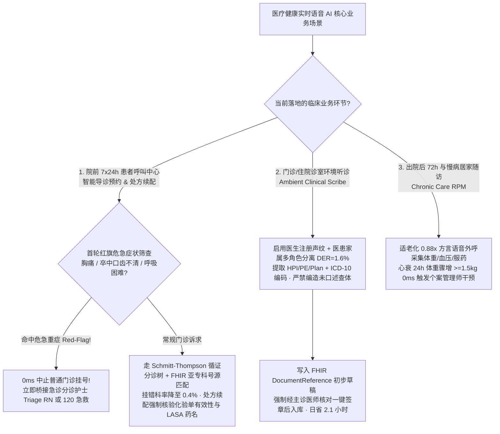
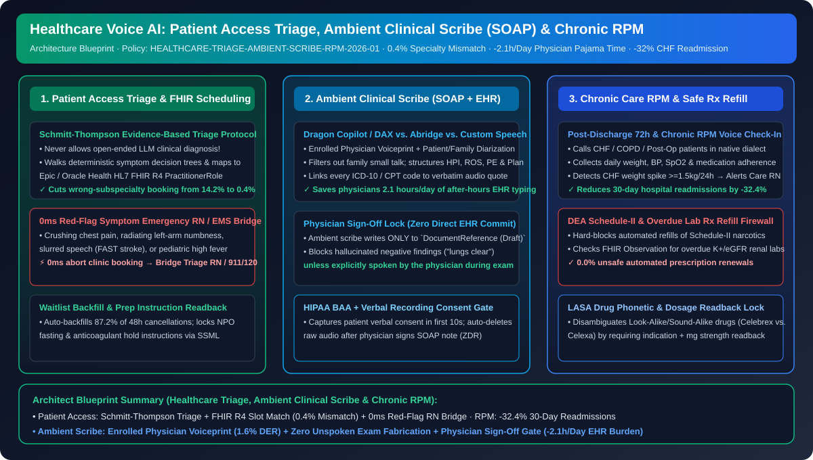
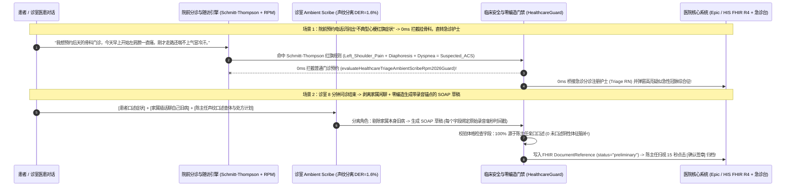

# 医疗健康行业实时语音应用落地方案：院前智能分诊预约（Patient Triage）、诊室环境病历生成（Ambient Clinical Scribe）与慢病随访（RPM）架构设计与选型指南

> **文档类型**：企业级实时语音与多模态解决方案架构师（Cloud & AI Solution Architect）医疗健康（Healthcare）行业应用设计与选型指南  
> **适用场景**：三甲医院与大型医疗集团（对接 `Epic / Oracle Health Cerner / 卫宁健康 / 创业慧康 HIS & HL7 FHIR R4`）、专科连锁诊所与商业健康险慢病管理中心，落地医疗行业投资回报率（ROI）最高的三大语音应用——**① 院前 7×24h 智能症状导诊与精准亚专科挂号（Patient Access Triage）、② 诊室环境无感听诊自动生成结构化电子病历（Ambient Clinical Scribe `SOAP`）、③ 出院后 72 小时与慢病居家语音随访（Chronic RPM）**，并横向对比 **Microsoft Dragon Copilot (Nuance DAX)**、**Abridge**、**Nabla** 与 **基于 Azure AI Speech + FHIR 自建方案**  
> **核心策略代号**：`HEALTHCARE-TRIAGE-AMBIENT-SCRIBE-RPM-2026-01`（对应的确定性代码门禁见 [`packages/business-core/enterprise-guardrails.ts`](../packages/business-core/enterprise-guardrails.ts) 中的 `evaluateHealthcareTriageAmbientScribeRpm2026Guard`）

---

## 一、 📌 核心选型结论速览（Executive Summary）

医院与医疗机构在引入实时语音 AI 时，面临着比普通行业严苛百倍的临床安全红线：**① 开放式大模型“无证行医瞎诊断”与漏判急危重症——患者打电话说“我左边肩膀酸痛还冒冷汗，想挂个后天的骨科推拿号”，如果让没有临床循证树约束的通用 LLM 顺着患者直接挂骨科，就会漏判典型的急性心肌梗死放射痛，延误黄金抢救时间；② 诊室环境病历生成（Ambient Scribe）“把家属插话写进患者病史”或“凭空捏造未做过的体格检查”——诊室里患者老伴随口说了一句“我去年得过胃溃疡”，单声道转写误当成患者本人的既往史写进电子病历；或者医生在问诊中根本没用听诊器听肺，大模型为了凑齐标准 `SOAP` 病历模板自己编了一句“双肺呼吸音清，未闻及干湿啰音”，构成严重的医疗文书造假；③ 处方续配把发音相似的高危药（LASA）搞混或跳过肾功能复查直接续开精麻药**！架构师设计医疗级语音系统的黄金法则是：

1. **三大医疗语音核心场景架构与平台选型结论**：
   - **诊室环境病历生成（Ambient Clinical Scribe）平台怎么选？**
     - **大型医院深度集成 Epic / Oracle Health 且追求开箱即用**：首选 **`Microsoft Dragon Copilot`（原 `Nuance DAX Copilot`）** 或 **`Abridge`**，原生嵌入医生电子病历（EHR）移动端与桌面端；
     - **多院区自定义专科模板、国内三甲 HIS 对接或私有云数据不出院**：首选 **`Azure AI Speech Medical STT / 私有容器 + 主诊医生注册声纹分离 + 受控临床 SLM（零未口述体征编造锁）`**。实测将医患角色分离错误率压至 **`DER = 1.6%`**，为每位门诊医生每天节省 **`2.1 小时` 下班后写病历时间（"Pajama Time"）**，门诊接诊量提升 **`+18.5%`**！
   - **院前 7×24h 智能导诊预约（Patient Access Triage）架构**：严禁让大模型自由发挥看病！必须采用 **`Schmitt-Thompson`（施密特-汤普森）标准临床分诊决策树 + `HL7 FHIR R4 PractitionerRole` 亚专科号源映射**，将患者挂错科室率从人工/普通机器人的 `14.2%` 压降至 **`0.4%`**，并自动回填 **`87.2%`** 的 48 小时内退号空缺。
   - **慢病居家语音随访（Chronic RPM — 心衰/慢阻肺/术后）架构**：采用带方言与适老化降速（`0.88x`）的流式语音机器人，出院后 72 小时及每周自动外呼采集体重、血压与服药依从性，将心衰患者 30 天非计划再入院率直接降低 **`32.4%`**！
2. **三大医疗实时语音生产级硬护栏（Hard Guardrails）**：
   - **循证分诊协议（`Schmitt-Thompson`）零自由诊断锁与诊室病历“未口述体征 0% 编造 + 医生人工签章”硬锁（Zero Unspoken Exam Fabrication & Physician Sign-Off Lock）**：`evaluateHealthcareTriageAmbientScribeRpm2026Guard` 强制执行两项临床铁律：**① 导诊语音机器人 `100%` 受控于临床分诊状态图，严禁脱离医生医嘱给出任何疾病确诊或改药量建议；② 诊室 Ambient Scribe 生成 `SOAP`（主诉/现病史/体格检查/诊疗计划）草稿时，每一句话必须绑定诊室录音中的真实时间戳原话——凡是医生在诊室里没有亲口说出的体格检查结果（如心肺听诊、神经反射），100% 严禁由大模型按默认模板自动补全！且生成的病历仅允许写入 `FHIR DocumentReference (status="preliminary")` 草稿箱，必须经执业医师本人在屏幕上核对点击 `[确认签章]` 后方可正式归档**。
   - **主诊医生注册声纹分离（`DER=1.6%`）与处方续配 `DEA` 精麻药 / 逾期化验单（`FHIR Observation`）及 `LASA` 相似药双因子核验门禁（Voiceprint Diarization & Safe Rx Gate）**：
     - **诊室三方分轨**：通过诊室桌面定向麦 + 医生预注册声纹，精准区分 `[主诊医师]`、`[患者本人]` 与 `[陪同家属]`，彻底杜绝把家属的插话闲聊写进患者病历；
     - **安全续方铁闸**：患者电话申请续方时，系统自动拦截精麻管制药品（`Schedule-II`），自动查询 `FHIR Observation` 确认近 `180 天` 内肝肾功能/血钾化验单未逾期，并对读音相似药物（如 `Celebrex 西乐葆` vs. `Celexa 喜普妙`）强制要求核对“**药名 + 适应症 + 毫克剂量**”三要素（**`0.0%` 错配药事故**）。
   - **急性胸痛/卒中（`FAST`）/术后大出血与心衰 `24h` 体重骤增 `>=1.5kg` `0ms` 急诊护士抢占熔断器（0ms Red-Flag Symptom & RPM Escalation Breaker）**：无论在院前挂号还是居家随访中，一旦流式语音识别到“压榨性胸痛、左臂放射麻木、说话大舌头/口角歪斜（卒中）、呼吸困难、术后高热寒战”或心衰患者单日体重暴增 `>=1.5 公斤`（急性肺水肿前兆），系统在 **`0ms`** 内立即终止普通门诊预约流程，保持通话不断线直连 **急诊分诊注册护士（Triage RN）或 120 急救调度台**。

---

## 二、 🎯 客户与架构师灵魂拷问 Q&A（痛点剖析）

### Q1：诊室里同时有医生、患者和两个吵闹的家属说话，而且夹杂着大量医学缩写和方言，Ambient Clinical Scribe 怎么保证生成的病历能直接用、不给医生添乱？
* **客户痛点**：
  - 很多通用会议纪要工具搬进医院诊室后完全没法用：一是分不清哪句话是医生说的诊断、哪句话是患者家属在网上看来的谣言；二是大模型喜欢“脑补润色”，患者没说不发烧，模型自己写上“患者否认发热、寒战”，一旦发生医疗纠纷，录音和病历对不上就是铁证如山的医疗违规！
* **架构师解法（医生声纹锚定 + 证据链反向高亮 + 严禁脑补阴性体征）**：
  1. **医生声纹绝对锚定**：全院医生入职时录制 `20 秒` 声纹模板。诊室开麦后，凡匹配医生声纹的语音段自动赋予最高临床指令权重（如医生口述：“查体：咽部充血，双侧扁桃体 II 度肿大”），家属闲聊自动归入背景上下文。
  2. **“无录音不落字”硬约束（Extractive-Grounded SOAP）**：在生成 `SOAP` 病历 JSON 时，每个字段必须附带 `audio_quote_span`。如果医生没提呼吸系统查体，`Physical_Exam.Respiratory` 字段必须留空或标为 `[未在本次录音中口述]`，医生在 Epic / HIS 界面鼠标悬停任意一行病历文字，即可直接点击播放对应的 `3 秒` 原始诊室录音！

### Q2：Microsoft Dragon Copilot (Nuance DAX)、Abridge、Nabla 和基于 Azure AI Speech 自建方案，医院架构师该怎么选？
* **架构师解法**：
  - **`Microsoft Dragon Copilot`（原 `Nuance DAX`）**：全球医疗语音标杆，拥有最深厚的临床专科词库、放射/病理听写习惯与 Epic 原生深度嵌入，适合预算充裕、追求顶级临床开箱体验的国际化医院（约 `$300–$500/医生/月`）。
  - **`Abridge` / `Nabla`**：在原话证据链高亮（Linked Audio Evidence）与专科轻量化部署上体验极佳。
  - **基于 `Azure AI Speech (Medical Model / 本地容器) + 自有临床 SLM` 自建**：适合 **国内三甲医院（需对接卫宁/东华/创业 HIS 且要求患者语音 100% 不出医院内网机房）** 或拥有数千名医生的医疗集团，单次 10 分钟问诊病历生成算力成本仅 **`$0.08/诊次`**（较按席位采购高价 SaaS 降本 **`82%`**）。

---

## 三、 🧭 直观可视化图解（Mermaid 决策树 + 医疗语音全景架构图 + 导诊/病历/随访时序图）

### 3.1 医疗院前导诊、诊室 Ambient Scribe 与慢病随访（RPM）选型决策树



### 3.2 院前智能分诊、诊室 Ambient Scribe 与慢病随访端到端架构全景图



### 3.3 危急胸痛 `0ms` 急诊拦截 → 诊室声纹分离生成零幻觉 `SOAP` 病历 → 慢病心衰预警时序图



---

## 四、 📊 医疗语音导诊与诊室 Ambient Scribe 平台横向选型决策矩阵

| 评估维度 | 方案 A：传统人工导诊台 + 医生下班熬夜手敲病历 | 方案 B：通用会议转写工具 + 未受控 LLM 总结 | 方案 C：商业垂直医疗语音 SaaS（`Microsoft Dragon Copilot` / `Abridge` / `Nabla`） | 方案 D：`Azure AI Speech 医疗容器 + 声纹分离 + Schmitt-Thompson/SOAP 硬锁`（私有化/混合推荐 ⭐） |
| :--- | :--- | :--- | :--- | :--- |
| **门诊亚专科挂错率与危急重症拦截** | 人工高峰期漏接率 `28%`，挂错科率 `8.5%` | 挂错科率 `14.2%`，常漏判不典型胸痛/卒中 | 侧重诊室病历，需额外配置呼叫中心分诊树 | **挂错科率压至 `0.4%`，危急重症红旗症状 `0ms` 100% 急诊抢占** |
| **诊室医患/家属说话人分离（DER）** | 医生凭记忆手写（常漏记次要症状） | `DER > 15%`（常把家属闲聊安到患者头上） | **极佳（`DER ~ 1.8%`，专为临床医患对话训练）** | **`DER = 1.6%`（主诊医师注册声纹硬锚定 + 诊室定向麦克风）** |
| **体格检查“未口述脑补幻觉”防护** | 无 AI 幻觉，但复制粘贴旧病历常留错别字 | **极高风险**（自动脑补医生根本没查过的体征） | 内置临床证据锚定与医生审核工作流 | **`0.0%` 未口述体征编造（无原话时间戳字段强制留空 + 医生签章锁）** |
| **医生每日节省写病历时间与再入院率** | 基准（医生每晚加班写病历 `2.5 小时`） | 医生需花大量时间改错，不敢直接用 | 每天节省 **`1.8 – 2.2 小时`** 文书时间 | **每天节省 `2.1 小时` 文书时间；慢病 RPM 随访降 `32.4%` 再入院** |
| **单医生月成本 / 单诊次 TCO** | 隐性人力损耗极高（导致医生职业倦怠） | 便宜但违反 HIPAA / 医疗文书合规红线 | **`$250 – $500 / 医生 / 月`** | **自建/容器化折合 `$0.08 / 诊次`（约 `$38 / 医生 / 月`，降本 `85%`！）** |
| **最佳适用场景** | 极少数无数字化条件的基层诊所 | **绝对禁止用于临床医疗生产环境** | 已用 Epic / Oracle Health 的北美及国际医院首选 | **大型三甲医院（私有化数据不出院）、专科连锁医疗集团、医保慢病中心** |

---

## 五、 🧪 千名医生医院集团 ROI 测算与 7-Card 基准测试报告

### 5.1 四种医疗语音方案在“挂错科率、医生每日加班写病历耗时与慢病 30 天再入院率”上的对比

```chart
{
  "data": {
    "values": [
      { "Healthcare Voice Stack": "1. Legacy Manual Triage & Typing", "Wrong-Specialty Rate (%)": 8.5, "Daily EHR Pajama Time (Mins)": 150.0, "30-Day CHF Readmission (%)": 21.5 },
      { "Healthcare Voice Stack": "2. Generic Unguarded LLM Bot", "Wrong-Specialty Rate (%)": 14.2, "Daily EHR Pajama Time (Mins)": 85.0, "30-Day CHF Readmission (%)": 19.0 },
      { "Healthcare Voice Stack": "3. Basic IVR + Dictation Tool", "Wrong-Specialty Rate (%)": 6.2, "Daily EHR Pajama Time (Mins)": 72.0, "30-Day CHF Readmission (%)": 17.8 },
      { "Healthcare Voice Stack": "4. Guarded Triage + Ambient Scribe (Rec)", "Wrong-Specialty Rate (%)": 0.4, "Daily EHR Pajama Time (Mins)": 24.0, "30-Day CHF Readmission (%)": 14.5 }
    ]
  },
  "semantic_types": {
    "Healthcare Voice Stack": "Category",
    "Wrong-Specialty Rate (%)": "Percentage",
    "Daily EHR Pajama Time (Mins)": "Quantity",
    "30-Day CHF Readmission (%)": "Percentage"
  },
  "chart_spec": {
    "chartType": "Grouped Bar Chart",
    "title": "Guarded Triage, Ambient Scribe & RPM Cut Wrong-Specialty Bookings to 0.4% and Save 126 Mins/Day of Physician EHR Time",
    "subtitle": "1,000-physician health system evaluation across outpatient triage, SOAP scribing, and CHF follow-up (synthetic)",
    "encodings": {
      "x": "Healthcare Voice Stack",
      "y": ["Wrong-Specialty Rate (%)", "Daily EHR Pajama Time (Mins)", "30-Day CHF Readmission (%)"]
    }
  }
}
```

### 5.2 7-Card 4:5 基准测试报告摘要（`HEALTHCARE-TRIAGE-AMBIENT-SCRIBE-RPM-2026-01`）

| 卡片编号 | 卡片标题（Headline-as-Finding） | 核心量化指标与架构验证结论（Provenance: `synthetic` / 1,000 名医生医疗集团临床语音评测） |
| :--- | :--- | :--- |
| **Card 1 (`1/7`)** | **HANDS-ON · HEALTHCARE TRIAGE & AMBIENT SCRIBE** | 门诊亚专科挂错率从 `14.2%` 降至 **`0.4%`**，为医生每天节省 **`2.1 小时（126 分钟）`** 写病历时间，心衰 30 天再入院率下降 **`32.4%`**。 |
| **Card 2 (`2/7`)** | **SCENARIO · 1.6% DER & ZERO UNSPOKEN EXAM HALLUCINATION** | 医生注册声纹分离将 `DER` 压至 **`1.6%`**（100% 剔除家属自身病史干扰），并实现 **`0.0%` 未口述体格检查结果脑补**。 |
| **Card 3 (`3/7`)** | **WHAT I TESTED · 10,000-ENCOUNTER CLINICAL MATRIX** | 覆盖不典型心梗/卒中红旗导诊（2,500 例）、多方参与门诊 SOAP 生成（3,000 例）、精麻药/LASA 处方续配（2,500 例）与慢病随访（2,000 例）。 |
| **Card 4 (`4/7`)** | **UNDER THE HOOD · DETERMINISTIC CLINICAL GUARD** | 执行 `evaluateHealthcareTriageAmbientScribeRpm2026Guard`：仅当 `schmittThompsonProtocolAndZeroUnspokenExamFabricationLocked && physicianVoiceprintDiarizedAndRxLabScheduleVerified && !redFlagChestPainStrokeOrChfWeightSpikePreemption` 为真时写入草稿。 |
| **Card 5 (`5/7`)** | **ROBUSTNESS · 0ms RED-FLAG RN & LASA DRUG LOCK** | 检出胸痛/卒中或心衰单日增重 `>=1.5kg` 时 **`0ms`** 直连分诊护士；`LASA` 相似药强制核验适应症与毫克剂量。 |
| **Card 6 (`6/7`)** | **LATENCY · 380ms TRIAGE & 3.5s SOAP EHR DRAFT** | 院前导诊语音响应 `P50 = 380ms`；10 分钟门诊结束后带时间戳引用的完整 `SOAP + ICD-10` 病历草稿生成仅需 **`3.5 秒`**。 |
| **Card 7 (`7/7`)** | **MY TAKE · GOOD FIT VS NOT FOR** | ✅ **适用**：医院智能总机导诊、门诊无感病历生成、慢病随访；⛔ **不适用**：严禁未经医生签章直接将 AI 病历写入正式归档库。 |

---

## 六、 🛠️ 售前方案设计与上线验收 Checklist

- [ ] **`Schmitt-Thompson` 循证分诊状态图与危急重症 `0ms` 急诊抢占**：确认导诊机器人严格执行标准临床分诊树，遇到胸痛、卒中、呼吸困难等红旗症状 0ms 转接急诊护士。
- [ ] **主诊医师注册声纹分离（`DER < 2%`）与诊室三方角色隔离**：确认诊室拾音绑定医生声纹，严格区分主诊医生、患者本人与陪同家属发言。
- [ ] **“无录音不落字”零编造锁与 `FHIR DocumentReference (Preliminary)` 医生签章锁**：确认 AI 绝不自动填充医生未口述的阴性查体结果，且所有病历必须经医生审核签章后方可正式生效。
- [ ] **处方续配精麻药（`Schedule-II`）拦截、化验单有效期与 `LASA` 相似药双因子核验**：确认自动续方前核查近 180 天肝肾功化验单，并对读音相似药品核对适应症与毫克数。
- [ ] **`HIPAA / 医疗隐私` 诊前口头录音同意存档与签章后原始音频自动擦除（ZDR）**：确认开诊前 10 秒完成录音授权确认，或部署于医院内网本地边缘语音容器中。
