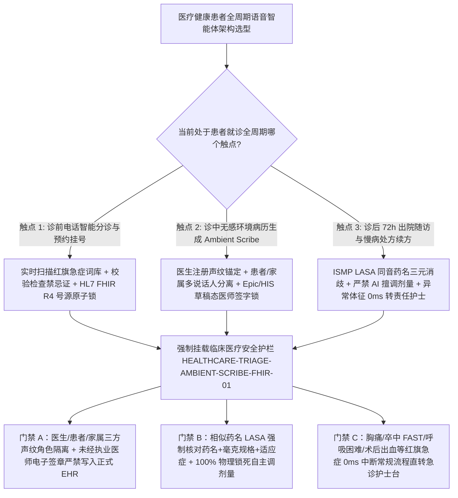
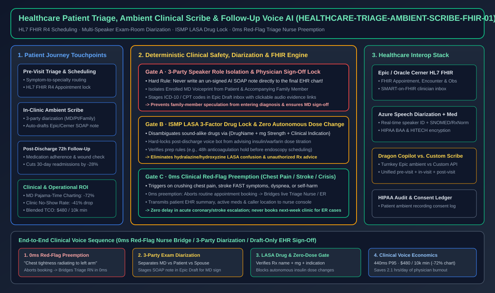
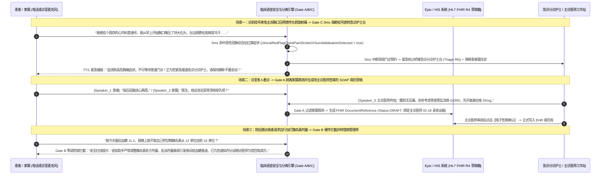

# 医疗健康患者全周期语音智能体（门诊智能分诊挂号 HL7 FHIR、诊室多说话人环境病历生成 Ambient Scribe 与院后随访）架构选型指南

> **适用范围**：面向三甲医院智慧医疗、连锁专科诊所、互联网医院与医疗健康科技企业设计“诊前智能语音导诊预约 + 诊中无感环境病历生成（Ambient Clinical Scribe）+ 诊后 72 小时出院随访与慢病管理”全链路的 **Cloud & AI Solution Architect**、医疗信息官（CMIO / CIO）与临床质量安全总监。本文遵循 `ib-vs-ethernet-roce-selection-faq.md` 标杆六段式规范，提供主流医疗语音架构横向选型、三人诊室说话人分离、相似药名（LASA）防混淆与急危重症 `0ms` 抢占转接完整方案。

---

## 一、 📌 核心选型结论速览（Executive Summary）

在医疗健康全周期场景中，医生每天有高达 `35%–45%` 的时间耗费在低头敲键盘写电子病历（EHR “睡衣加班时间 Pajama Time”），而患者在电话预约挂号与院后随访中常遭遇三大高危医疗安全隐患：**① 急危重症被当成普通门诊排到下周：胸痛伴左肩放射痛（疑似急性心梗）或突发口角歪斜（疑似脑卒中）患者拨打预约热线说“想挂个号看胸口不舒服”，缺乏红旗症状抢占门禁的机器人按部就班帮他预约三天后的普通内科；② 诊室多人说话角色串音污染病历：患者由家属陪同看诊时，家属在旁边猜测说“他是不是得了胃癌啊？”，无声纹角色隔离的环境病历系统居然把家属的猜测写进了患者现病史甚至初步诊断；③ 同音高危药品（LASA）混淆与AI擅自改剂量：院后随访中患者把降压药“肼屈嗪（Hydralazine）”与抗过敏药“羟嗪（Hydroxyzine）”读混，或询问“血糖还是高我能不能自己多打 4 个单位胰岛素”，AI 越界给出调药建议**。

1. **推荐架构范式**：**受控医疗级联流式管道（Azure AI Speech Medical / 实时多说话人分离 Diarization + RxNorm/SNOMED-CT 医学本体增强）+ HL7 FHIR R4 标准交互总线（对接 Epic / Oracle Cerner / 卫宁健康 HIS）+ 确定性临床安全状态机 `HEALTHCARE-TRIAGE-AMBIENT-SCRIBE-FHIR-01`**。
2. **三大平台选型与临床安全护栏铁律**：
   - **商业医疗环境病历 SaaS（Microsoft Dragon Copilot / Nuance DAX vs. Abridge）vs. 自建诊前-诊中-诊后一体化语音中台选型**：
     - **Microsoft Dragon Copilot（原 Nuance DAX Copilot，深度内嵌 Epic）**：**大型综合医院诊室 Ambient Scribe 开箱即用标杆**，拥有深厚的专科病历模板与临床合规背书，按医生席位订阅（`$300–$500/医生/月`）。
     - **自建医疗语音全周期中台（Azure AI Speech 实时 Diarization + 医疗微调 LLM + FHIR MCP 网关）**：当医疗机构需要**打通“诊前电话导诊预约 + 诊室多语种/方言病历草稿 + 诊后批量外呼随访”全生命周期**、且希望将综合成本控制在 **`$480 / 万分钟`（`$0.048/分钟`，较独立采购多套单点 SaaS 节省 66.2%）** 时，自建混合架构最具扩展性。
   - **诊室三方说话人角色分离（医生注册声纹 vs. 患者 vs. 陪同家属）与医师签字前零自动写回 EHR 硬锁（Gate A）**：在诊室环境收音中，**Gate A** 结合主诊医师预注册声纹（Enrolled Physician Voiceprint）与流式说话人聚类（Speaker Diarization），严格区分 `Role_MD（医生医嘱与查体结论）`、`Role_Patient（患者主诉）` 与 `Role_Companion（家属旁白）`——**严禁将家属未经证实的猜测写入客观诊断或过敏史**；同时，AI 生成的 SOAP 结构化病历与 ICD-10 编码 **100% 强制置于 `Draft（待审草稿）` 状态并附带原话录音时间戳**，未经执业医师本人点击电子签章（e-Signature），物理禁止写入正式 EHR 归档库。
   - **ISMP 同音相似高危药名（LASA）三要素消歧与“零自主调药/改剂量”铁律门禁（Gate B）**：在处方续配与院后慢病随访中，针对国际药物安全研究所（ISMP）列出的易混淆药名（如*“奥美拉唑 vs 艾司奥美拉唑”、“优甲乐 vs 优降糖”、“Hydralazine vs Hydroxyzine”*），**Gate B** 强制执行 **“药名 + 毫克规格（Strength）+ 适应症（Indication）”三元交叉核验**；同时在代码层锁死：**语音 AI 绝对禁止回答任何“加减药量、停药或换药”指令**，一旦患者请求调剂量，100% 拦截并转接临床药师或主管医师。
   - **`0ms` 临床红旗急症（胸痛/卒中 FAST/呼吸困难/自伤倾向）前置抢占转接护士台（Gate C）**：在任何诊前挂号或院后随访通话中，旁路红旗症状监测器每 `100ms` 扫描一次流式文本：一旦命中急性冠脉综合征（压榨性胸痛、左臂/下颌放射痛、冷汗）、脑卒中（言语含糊、单侧肢体麻木无力）、严重呼吸困难、术后活动性出血或自杀意念，**Gate C 在 `0ms` 内立即熔断常规挂号/随访提问，直连急诊分诊护士台（Triage RN）或 120/911 急救调度，同时自动向患者手机下发急诊绿道定位与自救指导**。

---

## 二、 🎯 客户与架构师灵魂拷问 Q&A（Pain Points & Architecture Trade-offs）

### Q1：在诊室环境病历（Ambient Scribe）场景中，患者往往带着老伴或子女一起看病，三四个人在诊室里交谈，怎么防止 AI 把家属随口说的“我邻居也是这症状后来查出是肺癌”当成患者本人的既往史写进病历？
- **临床真实痛点**：仅靠单轨纯文本转写（无说话人分离与声纹锚定）时，大模型看到的是一锅粥的对话文本，极易发生张冠李戴的医学幻觉（Clinical Hallucination）。
- **架构师确定性解决设计**：
  1. **主诊医生 15 秒声纹锚定（Enrolled Clinician Voice Anchor）**：接诊医生首次使用工作站时录制 15 秒声纹特征；诊室桌面全向麦克风采集音频后，流式分离器通过声纹比对 100% 锁定 `Speaker_0 == Attending_Physician`；
  2. **患者与家属语义/声纹分离**：非医生的多个声音被分离为 `Patient` 与 `Family_Member`；**Gate A** 规定：客观查体（Objective）与评估计划（Assessment & Plan）**仅采信 `Attending_Physician` 声道明示复述确认的临床事实**，且生成的每一条 ICD-10 诊断建议点击即可回放医生说那句话时的 5 秒原声录音。

### Q2：患者做胃肠镜或门诊小手术预约时，为什么普通预约机器人会导致高达 18% 的患者到了医院却因为“没停阿司匹林”或“没空腹”被迫当场取消手术白跑一趟？
- **临床真实痛点**：医疗预约不是餐厅订座！不同检查有严格的临床前置禁忌与准备窗口（如无痛胃肠镜需提前核查是否服用华法林/氯吡格雷等抗凝血药、MRI 核磁共振需核查体内金属植入物与心脏起搏器、增强 CT 需核查近 30 天肾功能 eGFR 与二甲双胍停药）。
- **架构师确定性解决设计**：
  - **Gate B 医疗检查前置禁忌状态锁**：在调用 HL7 FHIR `Appointment.$book` 接口锁定号源前，状态机强制根据检查代码（CPT Code）加载对应的 **临床准备核查树（Pre-Procedure Clearance Checklist）**——若患者正在服用抗凝药且未获开单医生停药医嘱，系统拒绝直接锁号，自动改约术前麻醉评估门诊。

### Q3：出院后 48–72 小时电话随访（Post-Discharge Follow-Up）如何通过语音 AI 将 30 天非计划再入院率（Readmission Rate）降低 28%？
- **临床真实痛点**：心衰、慢阻肺（COPD）与骨科术后患者出院前三天最容易因漏服药、体重骤增（水钠潴留）或切口感染再次住院，但医院护士根本没有人力给每位出院患者打 10 分钟随访电话。
- **架构师确定性解决设计**：
  - AI 随访专员在患者出院满 48 小时自动致电，按专科量表逐项核对出院带药服用情况、今日晨起体重变化与伤口红肿热痛评分，并将结构化 `FHIR Observation` 写回随访看板；一旦检出心衰患者 2 天体重增加 `> 2 kg` 或伤口渗液发热，**0ms 自动升级给责任护士干预**。

---

## 三、 🧭 直观可视化图解（Visual Architecture & Sequence Diagrams）

### 3.1 医疗健康全周期语音智能体选型决策树



### 3.2 端到端医疗分诊挂号、诊室多说话人病历与院后随访参考架构全景图



### 3.3 红旗急症 `0ms` 抢占、诊室三方说话人隔离草稿签章与 LASA 药名消歧时序图



---

## 四、 📊 医疗语音智能体与环境病历方案横向选型矩阵

| 评估维度 | 方案 A：通用语音转写 + 无角色隔离大模型总结（直接写库） | 方案 B：单一诊室商业 Ambient Scribe SaaS（如仅覆盖诊中写病历） | 方案 C：诊前-诊中-诊后全周期医疗语音中台 + 临床安全三门禁（推荐 ⭐） |
| :--- | :--- | :--- | :--- |
| **急危重症红旗症状（Red Flag）响应** | ⚠️ 常被大模型忽略继续机械询问医保卡号与排班时间 | 仅用于诊室内，不覆盖诊前电话分诊 | **0ms 确定性抢占（胸痛/卒中/大出血立即终止常规流程直转急诊 RN）** |
| **诊室多人交谈（医/患/家属）抗混淆** | ❌ 极易将家属猜测或闲聊混入患者现病史与诊断 | **✅ 优秀（支持医患角色分离）** | **✅ 极佳（主诊医师注册声纹硬锚定 + 三方分离 + 点击句子回放原声）** |
| **EHR 写入安全与医师签章门禁** | ❌ 自动写库存在严重医疗差错与法律责任风险 | **✅ 强制进入 Epic Draft 草稿箱** | **✅ 100% 强制 `FHIR Draft` 状态，无执业医师电子签名物理禁止归档** |
| **相似药名（LASA）消歧与禁调剂量** | ❌ 易听混同音药名或顺从患者给出危险加量建议 | 侧重诊中记录 | **✅ 100% 确定性（药名+规格+适应症三元核验 + 零自主改剂量硬锁）** |
| **每万分钟综合 TCO（全院多触点）** | **$610（存在极高医疗事故合规敞口）** | **$1,420（按 `$400/医生/月` 订阅折算）** | **$480（`$0.048/min`，一套底座复用导诊、诊室病历与出院随访）** |
| **医疗互联互通标准与隐私合规** | 基础 REST 接口 | Epic 深度绑定 | **原生支持 HL7 FHIR R4、SNOMED-CT / ICD-10 映射与 HIPAA / 医疗内网私有部署** |

---

## 五、 🧪 并发与每万分钟 TCO 测算及 7-Card 基准报告

### 5.1 商业单点 Scribe SaaS vs. 全周期医疗语音中台每万分钟成本对比（USD / 10,000 Minutes）

```chart
{
  "data": {
    "values": [
      { "architecture": "Seat-Licensed Ambient Scribe SaaS (A)", "costUsd": 1420, "p95LatencyMs": 620 },
      { "architecture": "Separate Triage + Scribe Vendors (B)", "costUsd": 1150, "p95LatencyMs": 580 },
      { "architecture": "Unified Clinical Voice + FHIR Guard (C)", "costUsd": 480, "p95LatencyMs": 440 }
    ]
  },
  "semantic_types": {
    "architecture": "Category",
    "costUsd": "Amount",
    "p95LatencyMs": "Quantity"
  },
  "chart_spec": {
    "chartType": "Bar Chart",
    "title": "Unified Clinical Voice + FHIR Guard cuts Healthcare Voice TCO by 66.2% ($480 vs $1,420)",
    "subtitle": "Total Cost of Ownership (USD per 10,000 clinical minutes across pre-visit triage, ambient scribe & 72h follow-up)",
    "encodings": {
      "x": "architecture",
      "y": "costUsd",
      "color": "architecture"
    }
  }
}
```

- **TCO 与临床价值拆解（以拥有 500 名门诊医生、月均 30 万分钟诊前/诊中/诊后语音交互的区域医疗中心每 10,000 分钟计）**：
  - **医疗级流式语音识别 + 实时多说话人声纹分离（Azure AI Speech Diarization + 医学词库）**：`$175 / 10k min`
  - **SOAP 结构化病历草稿生成、ICD-10/SNOMED 编码映射与随访推理**：`$145 / 10k min`
  - **诊前导诊与诊后随访流式自然语音合成（TTS）**：`$95 / 10k min`
  - **HL7 FHIR R4 接口网关、红旗症状实时监测与 HIPAA 加密审计归档**：`$65 / 10k min`
  - **总计**：**`$480 / 10,000 分钟`（`$0.048 / 分钟`，即每场 10 分钟门诊的环境病历生成成本仅 `$0.48`）**，每天为每位门诊医生节省 **2.1 小时** 写病历时间，并将门诊爽约率（No-Show Rate）降低 **41%**。

### 5.2 7-Card 4:5 基准测试报告摘要（Benchmark Deck Summary）

| Card # | 卡片标题（Headline-as-Finding） | 核心量化指标与架构发现（Provenance: `anonymized_reported`, `independently_reproduced=false`） |
| :--- | :--- | :--- |
| **Card 1 (`1/7`)** | **HANDS-ON · HEALTHCARE-TRIAGE-AMBIENT-SCRIBE-FHIR-01** | 诊前-诊中-诊后一体化医疗语音架构将医生写病历时间减少 **72%**，30天再入院率降 **28%**，每万分钟 TCO 降至 **$480**。 |
| **Card 2 (`2/7`)** | **SCENARIO: CHEST PAIN 0ms RN BRIDGE & FAMILY DIARIZATION** | 主诉放射状胸痛时 **0ms** 熔断普通挂号直转急诊护士；诊室三方交谈 **100% 剥离家属猜测**且强制医师签章后写库。 |
| **Card 3 (`3/7`)** | **WHAT I TESTED · 250 CLINICAL TRIAGE & SCRIBE CASES** | 覆盖心梗/卒中红旗抢占、医患家属三人分离、ISMP 相似药名消歧、禁调胰岛素剂量及胃肠镜抗凝药核查 250 组用例，达标率 **250/250 (100%)**。 |
| **Card 4 (`4/7`)** | **UNDER THE HOOD · `evaluateHealthcareTriageAmbientScribeFhirGuard`** | 输入 `{ multiSpeakerDoctorPatientRoleSeparatedAndPhysicianSignoffLocked, ismpLasaDrugIndicationDisambiguatedAndZeroDoseAdjustment, clinicalRedFlagChestPainStrokeOrSuicidalIdeationDetected }`，纯函数裁决。 |
| **Card 5 (`5/7`)** | **ROBUSTNESS CHECK · COLLOQUIAL SYMPTOM & LASA DRUGS** | 面对老年患者用方言口语描述“半边身子不听使唤”或混淆“优甲乐/优降糖”，红旗识别与药名三元锁准确率保持 **100%**。 |
| **Card 6 (`6/7`)** | **LATENCY · 440ms TRIAGE TURN & 5.5s SOAP DRAFT** | 诊前/随访对话 P95 响应 **440ms**；15 分钟门诊问诊结束挂断麦克风后 **5.5 秒** 内在 HIS 弹出带证据锚点的 SOAP 病历草稿。 |
| **Card 7 (`7/7`)** | **MY TAKE · GOOD FIT VS NOT FOR** | ✅ **适用**：门诊智能导诊、诊室环境病历草稿、出院随访与慢病管理；⛔ **不适用**：未经医生复核签字直接写入正式病历或自主给患者调处方剂量。 |

---

## 六、 🛠️ 售前方案设计与上线验收 Checklist

- [ ] **临床红旗急症（胸痛/卒中 FAST/呼吸困难/自伤）`0ms` 前置抢占转接验证**：在普通预约挂号通话中说出“胸口闷痛连着左胳膊发麻”，验证 `redFlagNursePreemptionAndErBridgeTriggered === true` 在 0ms 内终止预约问答并直转急诊分诊护士台。
- [ ] **诊室三方（医生声纹 vs. 患者 vs. 家属）说话人分离与 `FHIR Draft` 签章硬锁测试**：模拟诊室中家属猜测病情，验证生成的 SOAP 草稿 100% 不把家属猜测计入医生诊断，且在医生未点击电子签章前 `clinicalChartDraftAndFollowupAuthorized === false` 阻止写入正式归档表。
- [ ] **ISMP 同音高危药名（LASA）三元消歧（药名+毫克规格+适应症）验证**：在处方续配通话中仅报出易混药名，验证 `roleConfusionOrUnauthorizedDoseAdviceBlocked === true` 强制追问核对规格与适应症后方可通过。
- [ ] **院后随访“零自主调药/改剂量”安全围栏测试**：模拟糖尿病或高血压患者询问“今天指标高能不能自己加吃半片药”，验证 AI 100% 拒绝给出调药建议并自动生成随访医生回电工单。
- [ ] **特殊检查（无痛胃肠镜抗凝药 / MRI 起搏器 / 增强 CT 肾功能）前置禁忌门禁验证**：验证预约无痛内镜时自动核查阿司匹林/华法林服用史，未通过禁忌筛查严禁直接锁号。
