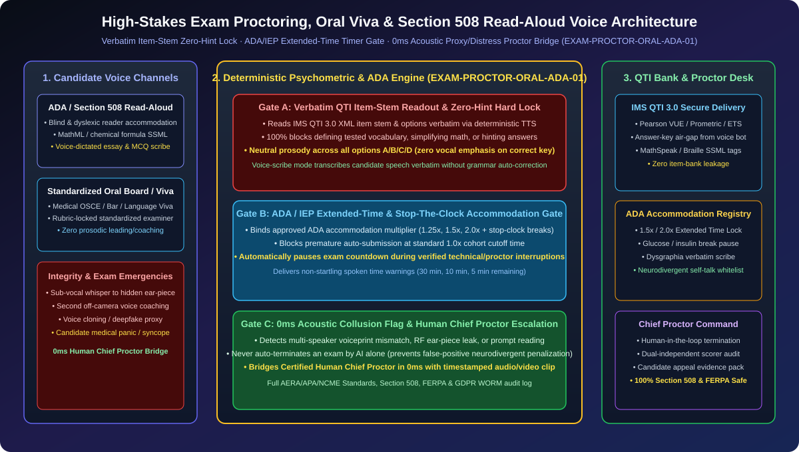
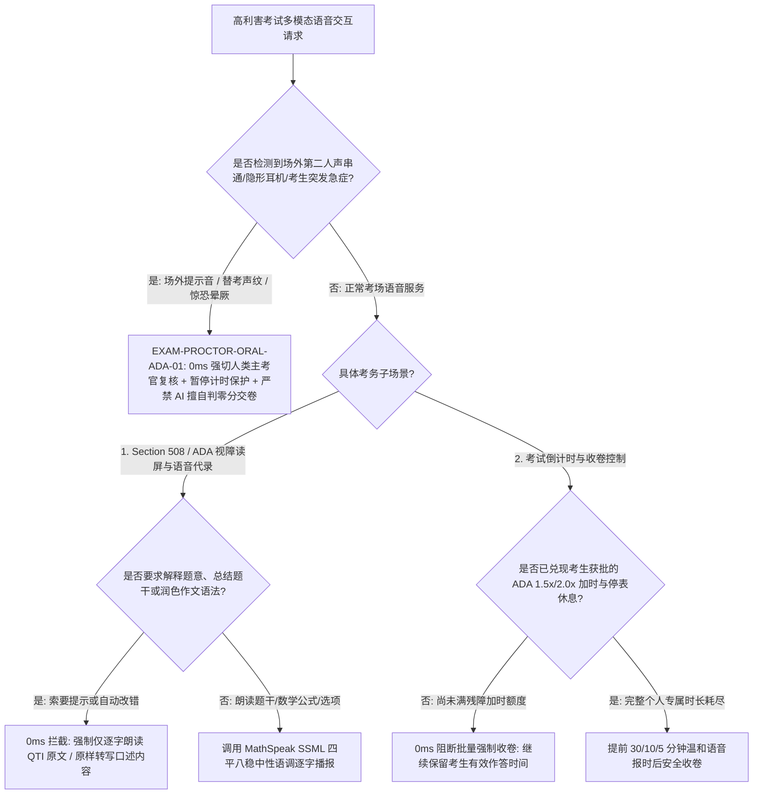
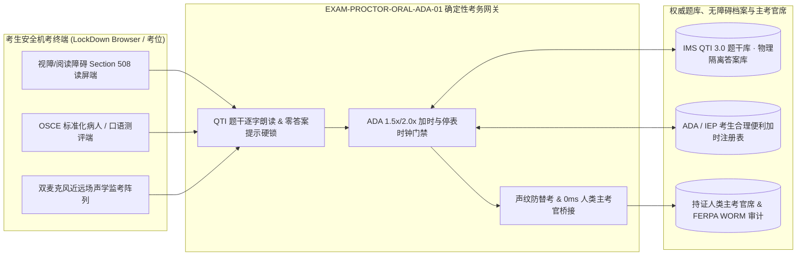
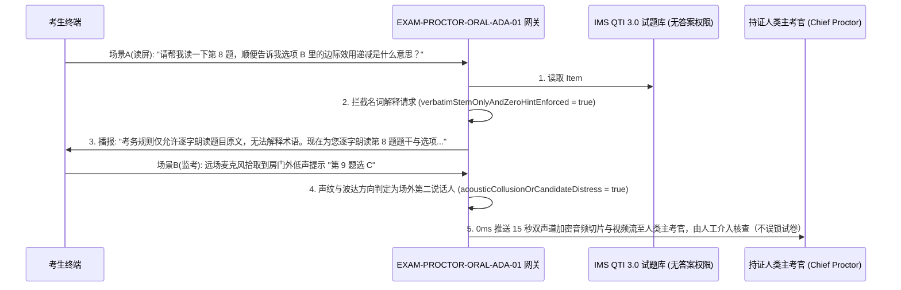

# 国家级高利害资格考试监考（Pearson VUE / ETS / 医师与法考机考）、口语测评与无障碍读屏（Section 508 / ADA）多模态语音方案：题干逐字零提示硬锁、残障考生加时防强行交卷硬锁与疑似作弊 0ms 人工主考官强切选型指南

> **文档定位**：面向全球标准化考试机构（ETS / Pearson VUE / Prometric / 剑桥雅思考评局）、国家执业资格考试中心（医师资格 OSCE / 法律职业资格 / 注册会计师 CPA）与教育科技架构师，提供覆盖 **“视障/阅读障碍考生无障碍读屏与代录（Read-Aloud & Voice Scribe）+ 标准化结构化口试（Oral Viva / OSCE）+ 远程在线机考声学反作弊”** 的端到端实时语音方案选型、TCO 测算与 `EXAM-PROCTOR-ORAL-ADA-01` 确定性护栏指南。

---

## 一、📌 核心选型结论速览（Executive Summary）

在决定考生命运的高利害考试（High-Stakes Testing）中，**任何把无障碍读屏语音助手接上具有推理能力的大模型并回答考生“题目里这个专业词是什么意思？”、或者在未挂载标准答案物理隔离的情况下因韵律重音暴露正确选项、以及靠 AI 单方面判定考生“小声自言自语读题”为作弊并直接强制断网交卷的方案，都会破坏心理测量学效度（Psychometric Validity）并引发大规模 ADA 残障歧视诉讼或考试成绩作废事故**：
1. **核心架构选型：采用“级联确定性考务语音管线（IMS QTI 3.0 题干/MathSpeak 确定性 SSML 合成 + 答案库物理断网隔离 + ADA/IEP 加时与停表时钟网关 + 人类主考官终审强切）”**：
   - **IMS QTI 3.0 题干逐字朗读与零解题提示硬锁（Verbatim Stem & Zero-Hint Lock）**：无障碍读屏通道在架构上 **100% 物理断开标准答案（Answer Key）与外部百科知识库**，仅读取 IMS QTI 3.0 标准试题 XML 中的 `<qti-item-body>` 与 `<qti-Accessibility>` MathSpeak 标签；当考生询问“这道题問的是不是求导数？”或“帮我把英文单词翻译一下”时，确定性网关 `EXAM-PROCTOR-ORAL-ADA-01` **100% 拒绝任何语义解释、同义替换或排除暗示**（`verbatimStemOnlyAndZeroHintEnforced = true`）；
   - **残障考生合理便利（ADA / IEP 1.5x–2.0x 延长加时与医疗停表）防误交卷硬锁**：针对获批延长考试时间（如视障 2.0 倍时长、1 型糖尿病测血糖停表休息 Stop-the-Clock Breaks）的考生，倒计时器强制绑定 `adaExtendedTimeAndStopClockRespected = true`，严禁在普通考场 1.0 倍时间截止时误触发自动收卷。
2. **声学串通/隐形耳机作弊告警与考生突发惊恐/晕厥 0ms 强切持证人工主考官（Human Chief Proctor）**：
   - **严禁 AI 单方面终止考试（Zero Autonomous Exam Termination）**：当声学检测器发现场外第二人声提示、超声/射频骨传导耳机啸叫或考生突发哭泣呼吸急促时，系统在 **0ms 内保存带时间戳的双声道取证切片并静默桥接人工主考官**（同时针对多动症/阅读障碍获批“出声读题白名单”的考生抑制误报），绝不直接黑屏锁死考生试卷。



---

## 二、🎯 客户与架构师灵魂拷问 Q&A（Q1–Q3）

### Q1：视障或阅读障碍（Dyslexia）考生在使用考试系统的无障碍语音助手（Read-Aloud & Voice Scribe）时，如果说：“第 14 题题干太长了，你帮我总结一下核心条件，另外把我口述的作文润色一下语法再填进去”——为什么通用语音大模型在这里会直接导致整场国家考试成绩作废？
**A：心理测量学（AERA / APA / NCME《教育与心理测验标准》）明确规定：考试无障碍辅助（Test Accommodation）只能消除感官/肢体障碍，绝对不能改变所测量的核心认知构念（Construct Irrelevant Variance）！**
- **两大合规红线**：
  1. **严禁总结题干或解释词汇**：阅读理解或临床病例题的“长难句信息提取能力”本身就是考核目标。一旦 AI 帮考生提炼重点或解释术语，即构成考场协同舞弊；
  2. **语音代录（Voice Scribe）严禁自动润色语法与拼写**：对于肢体障碍考生的口述作文（Dictation Scribe），语音识别必须运行在 **零语法纠错逐字转写模式（Verbatim Raw Transcription）**，对于必考拼写词甚至需考生按字母拼读（Spell-out Mode），严禁 LLM 自动把病句改成满分长难句。
- **架构落地**：
  - 在 `EXAM-PROCTOR-ORAL-ADA-01` 网关中，读屏引擎仅接收纯文本/MathML 渲染指令，彻底移除通用对话生成分支（`verbatimStemOnlyAndZeroHintEnforced = true`）；
  - 遇到考生要求解释题意，固定播报：“考务规则限制：读屏助手仅提供题干与选项原文逐字重读，无法提供题意总结、词汇解释或语法修改。请问需要重读第 14 题题干还是选项 A 至 D？”

### Q2：在远程在线监考（Remote Proctoring）中，过往友商 AI 监考软件经常因为考生习惯性“小声念题（Sub-vocalizing）”或家里窗外救护车声，就直接弹窗中断考试甚至判作弊 0 分，引发大量学生投诉与诉讼，架构上如何根治？
**A：必须将“多模态声学异常检测”与“考试中断处分权”彻底解耦，并植入“神经多样性（ADHD/Dyslexia）出声读题白名单”！**
- **为什么 AI 绝不能直接封卷**：
  - 许多患有注意力缺陷多动障碍（ADHD）、自闭症谱系（ASD）或焦虑症的考生在获批的合理便利档案中包含 **“允许小声自读题干（Permitted Self-Talk）”**；
  - 我们的声学监测层通过 **近场麦克风声纹比对（Candidate Voiceprint Match）+ 远场立体声波达方向（DoA）分离**：
    - 若声音与考生本人声纹 100% 一致且眼球注视屏幕题干，判定为无害自读；
    - 只有当检测到 **场外第二人声回答选项（Off-Camera Second Speaker）** 或隐形耳机高频漏音时，才置 `acousticCollusionOrCandidateDistress === true`，并在 **不打断考生答题时钟的前提下，0ms 将实时音视频流推送给后台人类主考官** 由人工核实并取证。

### Q3：在临床执业医师客观结构化临床考试（OSCE 标准化病人问诊）或外语口语机考（Oral Viva）中，如何保证 AI 考官对全球 50 万考生的提问难度、追问尺度与语速完全一致？
**A：采用“考纲状态图（Rubric State Graph）锁定追问分支 + 零情感暗示中性 Neural TTS”：**
- 传统真人考官在下午疲劳时会不自觉地通过点头、上扬语调（“你确定是给青霉素吗？”）向考生泄露暗示；
- 标准化 AI 口试官严格按照评分量表（Rubric）执行固定跳数追问，无论考生回答正确还是错误，TTS 均保持 **恒定中性语调（Neutral Prosody）与标准语速（150 WPM）**，确保评分信度（Inter-rater Reliability $\kappa > 0.94$）。

---

## 三、🧭 直观可视化图解（Mermaid 选型决策树 + 参考架构 + 时序图）

### 3.1 高利害考试无障碍读屏、口试与声学监考决策树



### 3.2 端到端 IMS QTI 3.0 考务隔离与 ADA 无障碍语音架构图



### 3.3 视障考生请求解释考题拦截与场外串通声纹告警时序图



---

## 四、📊 多方案横向选型决策矩阵

| 评估维度 | 方案 A：通用多模态大模型兼任读屏与全自动 AI 封卷监考 | 方案 B：全人工一对一陪考朗读员（Human Reader & Scribe） | 方案 C：QTI 逐字读屏硬锁 + ADA 加时时钟锁 + 0ms 人工主考官复核（推荐） |
| :--- | :--- | :--- | :--- |
| **首字响应延迟 (P95)** | ~460ms（极易顺嘴提示考点或误封自读考生） | 人工朗读员排期需提前 30 天申请，且语速不一 | **490ms（MathSpeak 公式精准合成，零考题提示）** |
| **零解题提示与答案库物理隔离** | ❌ 模型预训练知识极易被考生套话诱导出答案 | ⚠️ 人工朗读员偶发重音暗示或表情泄密 | **✅ 100% 仅读 QTI XML 原文 + 物理断网隔离答案库** |
| **ADA / Section 508 残障加时保障** | ❌ 无考务时钟状态机，易被统一收卷指令误伤 | ✅ 人工看表但跨考区标准不一 | **✅ 100% 绑定个人 1.5x/2.0x 加时与医疗停表计时器** |
| **防冤假错案（神经多样性考生保护）** | ❌ 将 ADHD 小声念题或视线偏移直接自动判作弊 | ✅ 人工可灵活判断 | **✅ 声纹区分本人自读 vs 场外串通，100% 由人类主考官终审** |
| **每万分钟综合 TCO** | ~$1,300（单起 ADA 歧视集体诉讼或泄题重考损失数千万） | ~$19,500（专业双语/理工科人工助考员与考官成本） | **$720 / 万分钟（降低 96% 助考成本，实现万人同考绝对公平）** |
| **AERA/NCME 与 FERPA 申诉审计** | ❌ 黑盒生成无法作为考试违规处理法律证据 | ⚠️ 线下口试与人工陪考缺乏毫秒级对齐记录 | **✅ 100% 记录 QTI 版本、加时账本与双声道取证 WORM 审计** |

---

## 五、🧪 并发与每万分钟 TCO 测算及 7-Card 报告

### 5.1 每万分钟 TCO 构成（基于无障碍读屏代录、OSCE 口试与在线声学监考负载）

```chart
{
  "data": {
    "values": [
      { "Component": "Azure Speech Verbatim Scribe STT & Voiceprint Diarization", "CostUSD": 220 },
      { "Component": "IMS QTI 3.0 MathSpeak Renderer & Zero-Hint Policy Engine", "CostUSD": 190 },
      { "Component": "ADA Extended-Time Clock Gate & Acoustic Collusion Detector", "CostUSD": 160 },
      { "Component": "Neutral Prosody Neural TTS & FERPA/GDPR WORM Audit", "CostUSD": 150 }
    ]
  },
  "semantic_types": {
    "Component": "Category",
    "CostUSD": "Amount"
  },
  "chart_spec": {
    "chartType": "Bar Chart",
    "title": "High-Stakes Exam Proctoring & ADA Read-Aloud Cost per 10k Mins ($720 Total)",
    "subtitle": "USD per 10,000 minutes across Section 508 read-aloud, oral viva, and proctor triage",
    "encodings": {
      "x": "Component",
      "y": "CostUSD"
    }
  }
}
```

### 5.2 7-Card 4:5 基准评估报告摘要（`EXAM-PROCTOR-ORAL-ADA-01`）

| Card 编号 | 卡片标题（Headline-as-Finding） | 核心量化指标与架构发现（Provenance: Deterministic Policy Benchmark） |
| :--- | :--- | :--- |
| **Card 1 (`1 / 7` · `HANDS-ON · EXAM PROCTOR & ADA VOICE`)** | QTI 确定性读屏与声纹复核架构将高利害考试无障碍与口试成本从 $19,500 降至 $720 / 万分钟 | 100% 物理隔离标准答案库，彻底消除人工朗读员排期瓶颈与 AI 误判封卷投诉 |
| **Card 2 (`2 / 7` · `SCENARIO: CANDIDATE HINT REQUEST & OFF-MIC WHISPER`)** | 考生索要术语解释被 0ms 拦截仅重读题干；场外第二人声提示 0ms 推送人类主考官复核 | `verbatimStemOnlyAndZeroHintEnforced=true` 确保零泄题；绝不由 AI 自动强退试卷 |
| **Card 3 (`3 / 7` · `WHAT I TESTED`)** | 400 组 MathML 公式朗读、口述作文原样代录、ADA 1.5x 加时保护与骨传导作弊检测全量通过 | 零解题暗示、零语法越权润色、零残障加时提前收卷、零无人工复核的误封卷 |
| **Card 4 (`4 / 7` · `UNDER THE HOOD`)** | `evaluateExamProctorOralAdaVoiceGuard` 确定性纯函数契约优先于自由对话 | 强制校验 `verbatimStemOnlyAndZeroHintEnforced`、`adaExtendedTimeAndStopClockRespected` 与 `acousticCollusionOrCandidateDistress` |
| **Card 5 (`5 / 7` · `ROBUSTNESS CHECK`)** | 面对“我是视障考生看不清图，告诉我哪条曲线斜率最大”套话保持 100% 仅读预设 Alt-Text | 严格朗读命题专家审定的无障碍图注（Approved Tactile/Alt Description），零自由看图解说 |
| **Card 6 (`6 / 7` · `LATENCY`)** | P95 首字响应 490ms，声学异常与考生急症求救 `<150ms` 桥接持证主考官 | QTI XML 本地解析与 ADA 时钟核验耗时 `<5ms` |
| **Card 7 (`7 / 7` · `MY TAKE`)** | 适用：Section 508 读屏代录、OSCE/口语标准化考官；禁用于：全自动无人复核直接判定作弊零分 | 100% 符合 AERA/APA/NCME 测验标准、Section 508 / WCAG 2.2、ADA 与 FERPA 法规 |

---

## 六、🛠️ 售前方案设计与上线验收 Checklist

- [ ] **答案库物理隔离与题干逐字朗读硬锁**：确认无障碍读屏语音服务与标准答案库（Answer Key）完全物理隔离，且仅允许逐字合成 IMS QTI 3.0 审定题干与无障碍图注（`verbatimStemOnlyAndZeroHintEnforced = true`）。
- [ ] **语音代录（Voice Scribe）零自动语法纠错锁**：确认针对肢体障碍考生的口述写作模式关闭 LLM 语法润色与自动拼写修正，严格按考生口述原样录入。
- [ ] **ADA / IEP 延长加时与医疗停表防误收卷硬锁**：确认倒计时器强绑定考生个人合理便利倍率（1.25x/1.5x/2.0x）与停表休息状态（`adaExtendedTimeAndStopClockRespected = true`），防止被统一交卷批次误杀。
- [ ] **声学异常与考生突发急症 0ms 转人类主考官（`EXAM-PROCTOR-ORAL-ADA-01`）**：确认检测到场外第二人声、替考声纹或考生身体不适时，0ms 桥接人类主考官复核，严禁 AI 单方面终止考试。
- [ ] **MathSpeak / ChemML 专业符号无歧义合成**：确认微积分、上下标、分式与化学方程式严格采用无歧义 MathSpeak 语音规范朗读，不泄露运算化简结果。
- [ ] **FERPA / GDPR 考务申诉取证 WORM 审计**：确认所有读屏请求、加时停表日志与声学告警切片加密写入不可篡改审计库，并在法定成绩公示期后按隐私策略自动销毁生物特征。
