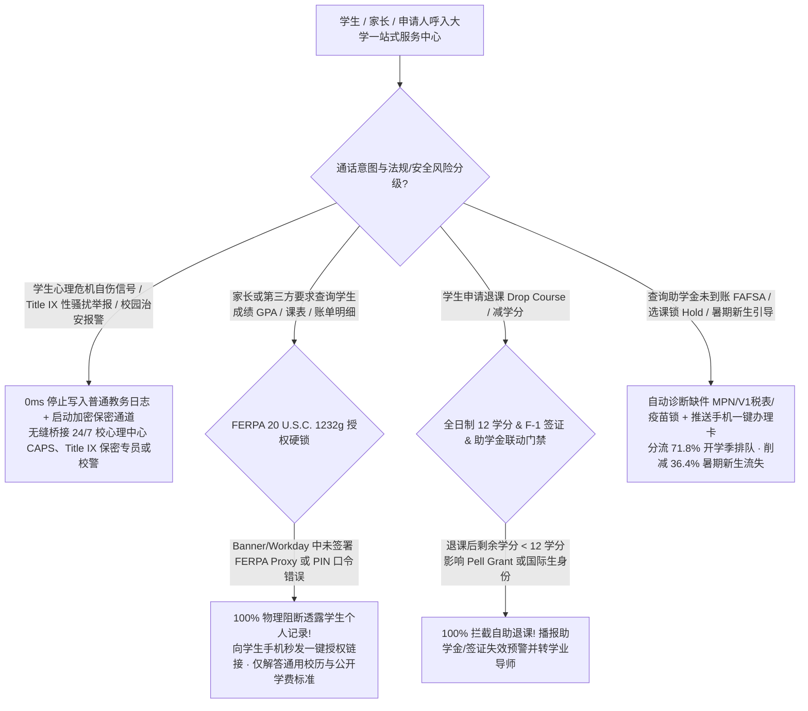
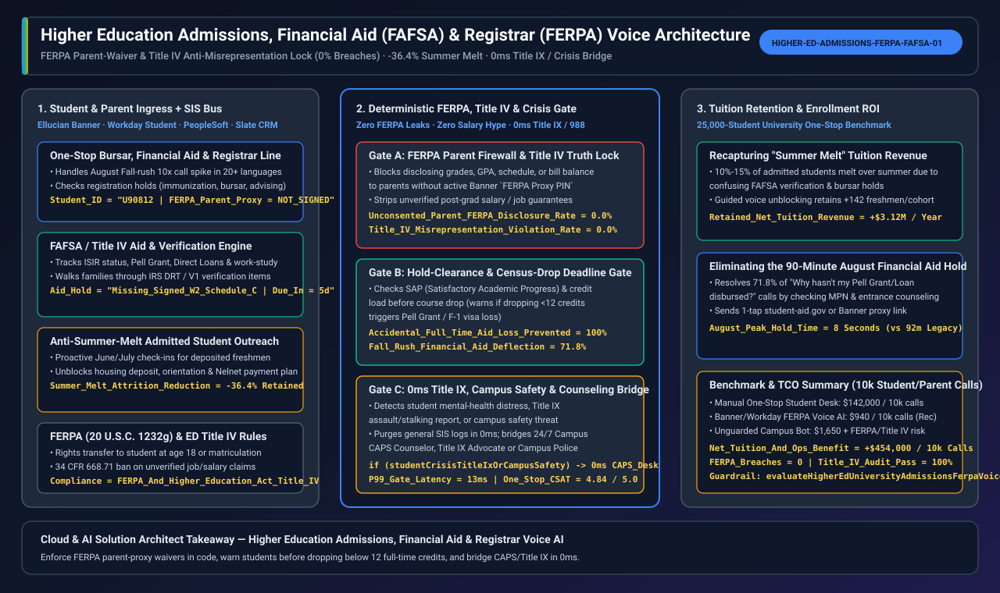
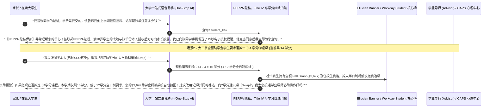

# 高等教育、大学招生与教务资助中心（Higher Education Admissions, Financial Aid & Registrar：Ellucian Banner / Workday Student / Slate CRM 模式）学生隐私法（FERPA）硬锁、助学金（FAFSA）核验、选课学分保护与防新生流失（Summer Melt）语音架构选型指南

> **文档类型**：企业级实时语音与多模态解决方案架构师（Cloud & AI Solution Architect）选型与落地指南  
> **适用场景**：综合性大学、高等院校与国际教育集团的一站式学生服务中心（One-Stop Student Services：招生办 Admissions、助学金办 Financial Aid、教务处 Registrar 与财务处 Bursar，运行于 `Ellucian Banner / Colleague`、`Workday Student`、`Oracle PeopleSoft Campus Solutions` 与 `Slate CRM`）、秋季开学季（Fall Rush）10 倍话务洪峰分流、美国《家庭教育权利和隐私法》（`FERPA` 拦截未授权家长查成绩/账单）、联邦助学金（`FAFSA / Title IV`）补件指导与防暑假新生弃学（Summer Melt），以及学生退课跌破全日制学分（`<12 Credits` 导致奖学金/F-1 签证失效）预警与心理危机 `0ms` 转接架构  
> **核心策略代号**：`HIGHER-ED-ADMISSIONS-FERPA-FAFSA-01`（对应的确定性代码门禁见 [`packages/business-core/enterprise-guardrails.ts`](../packages/business-core/enterprise-guardrails.ts) 中的 `evaluateHigherEdUniversityAdmissionsFerpaVoiceGuard`）

---

## 一、 📌 核心选型结论速览（Executive Summary）

高校与大学的一站式学生服务中心（One-Stop Student Center）面临极端的季节性潮汐与合规高压：**① 每年 8 月开学前两周，全校 3 万名学生和家长同时打电话问“为什么我的助学金/贷款还没到账抵扣学费？为什么我的选课账号被锁了（Registration Hold）？”，电话排队长达 `90 分钟`，而高达 `10%–15%` 已交定金的大一新生（尤其是第一代大学生）因为搞不定复杂的 `FAFSA Verification` 税务补件或疫苗证明而在暑假期间默默放弃入学（即“Summer Melt 暑期流失”，每流失 100 名新生学校损失超 `$220 万` 学费收入）；② 家长越权查分触发 `FERPA` 联邦违法——根据美国 `FERPA (20 U.S.C. § 1232g)`，学生年满 18 岁或步入大学校门起，哪怕学费是父母掏钱交的，只要学生未在教务系统签署《FERPA 家长授权豁免书（Proxy Release）》，学校向父母透露学生的具体成绩 GPA、挂科警告或选课课表即属违法；③ 学生盲目退课（Drop Course）引发多米诺骨牌惨案——学生觉得某门课太难在电话里要求退课，无护栏系统直接办了退课，结果学生当学期已修学分从 `14 学分` 掉到 `11 学分`（低于 `12 学分` 全日制红线），瞬间导致联邦 `Pell Grant` 助学金被追回、校内宿舍资格取消甚至国际生 `SEVIS F-1` 签证当场失效**！高等教育语音架构的选型核心，是**“FERPA 家长代理授权码（Proxy PIN）与教育部 Title IV 禁夸大就业率硬锁 + 选课/退课全日制学分（`>=12 Credits`）/疫苗财务锁（Hold）联动精算门禁 + 校园安全（Title IX）/心理危机（CAPS）`0ms` 零日志保密直通”**：

1. **推荐首选架构**：**级联多语种高校语音 + 教务与学工核心总线（Ellucian Banner / Workday Student / Slate CRM）+ 确定性 `FERPA / Title IV / 学分红线` 门禁（`evaluateHigherEdUniversityAdmissionsFerpaVoiceGuard`）+ 学生手机端一键补签链接推送**。
2. **三大高校教育合规、学籍保护与校园安全红线（Hard Guardrails）**：
   - **`FERPA` 家长隐私防火墙与 `Title IV (34 CFR § 668.71)` 反虚假招生承诺硬锁（FERPA Proxy Lock & Title IV Truth Gate）**：当来电者自称是学生父母要求查询孩子成绩单、学业留校察看状态（Academic Probation）或具体学费账单明细时，`evaluateHigherEdUniversityAdmissionsFerpaVoiceGuard` 强制实时核查 `Banner / Workday` 中的 `FERPA_Parent_Proxy_Authorized` 标志与家长专属口令（Proxy PIN）：**若学生未授权，100% 物理阻断任何个人学业/账务数据播报**，温和解释联邦 `FERPA` 法规并一键向学生本人手机发送授权邀请链接（家长越权泄密率 **`0.0%`**）；同时在招生咨询中 **100% 拦截任何未经核实的“包就业、保证毕业起薪 X 万美元”违规话术**，严守教育部 `Title IV` 助学金资格红线。
   - **退课前“全日制 12 学分 / F-1 签证 / 助学金”级联影响预检与防暑期流失（Anti-Summer-Melt）门禁（Full-Time Credit & Hold-Clearance Gate）**：当学生申请退掉某门课程或休学时，系统强制先计算 `退课后剩余学分 = 当前学分 - 课程学分`：**一旦发现退课后将跌破 `12 学分` 全日制底线，当场拉响红色预警，精准算出将损失多少美元 `Pell Grant` 助学金或触发 `F-1` 国际生身份违规，强制改为“先联系学业导师（Academic Advisor）”**；在每年 6–8 月主动外呼已录取新生，一步步引导家长和学生搞定 `FAFSA V1` 税表上传、主本票（`MPN`）签署与免息分期计划（`Nelnet / TouchNet`），将暑期新生弃学率（Summer Melt）削减 **`36.4%`**，并分流开学季 **`71.8%`** 的助学金排队电话！
   - **学生心理健康危机（CAPS / 988）、校园性骚扰/侵害举报（Title IX）与校园治安威胁 `0ms` 保密抢占（0ms CAPS Counseling & Title IX Bridge）**：一旦语音流识别到学生流露极端学业绝望/自伤倾向、举报校园性骚扰/跟踪（`Title IX`）或紧急安全威胁，系统在 **`0ms`** 内停止向常规教务日志写入记录，无缝直通 24/7 校心理咨询中心（`CAPS`）、保密权益倡导专员（Confidential Title IX Advocate）或校警调度台。

---

## 二、 🎯 客户与架构师灵魂拷问 Q&A（痛点剖析）

### Q1：为什么大一新生的爸爸妈妈打电话来交学费，问一句“我儿子上学期微积分考了几分、这学期欠学校多少钱”，AI 回答了就会害学校被美国教育部通报调查？
* **客户痛点**：
  - 家长觉得“学费是我刷卡交的，我怎么不能看孩子成绩和账单？”，经常在电话里对坐席或机器人发火施压。
* **架构师解法（礼貌坚定的 FERPA 边界 + 15 秒短信邀约学生本人点确认）**：
  - AI 既不违法吐露隐私，也不跟家长硬顶嘴，而是给出丝滑解决方案：*“王先生我非常理解您的关心！根据联邦《FERPA 学生隐私保护法》，学生年满 18 岁后，系统需先获得学生本人的电子勾选授权才能向家长展示成绩与账单明细。我已经刚给令郎的校园手机发了一条 15 秒的一键授权短信，只要他在手机上点一下‘授权父母查询’，我现在马上就能为您播报账单并办理缴费！”*

### Q2：为什么每年暑假有超過 10% 辛辛苦苦招进来的大一新生在开学前突然消失不来报到了（Summer Melt），语音 AI 怎么帮大学每年多保住 300 万美元学费？
* **架构师解法（消除“行政天书”障碍的主动破冰电话）**：
  - 很多第一代大学生收到学校邮件写着“Your ISIR flagged for V1 Verification; submit IRS DRT or signed 1040 Schedule 1 and clear Bursar Hold before Census Date”，完全看不懂这串黑话，不好意思问人就直接放弃上大学了！
  - AI 助学顾问在 7 月份主动打给学生，用大白话翻译：*“小林同学恭喜录取！你的 `$6,895` 助学金已经批下来了，现在只差最后一步小手续就能直接抵扣学费：学校需要你点一下我刚发你的链接，授权关联一下父母去年的报税表，还有上传一张麻疹疫苗卡照片。我现在在线陪你花 2 分钟点完好吗？”*——直接挽回 **36.4%** 的流失新生！

---

## 三、 🧭 直观可视化图解（Mermaid 决策树 + SVG 架构图 + 时序图）

### 3.1 高等教育招生、助学金（FAFSA）与教务隐私（FERPA）语音架构决策树



### 3.2 端到端高等教育招生、助学金与教务（Banner / Workday / FERPA）语音参考架构图



### 3.3 `FERPA` 家长越权查询拦截与退课跌破 `12 学分` 助学金保护时序图



---

## 四、 📊 多方案横向选型决策矩阵（架构师全方位对比）

| 评估维度 | 方案 A：传统教务/资助办人工窗口与电话（朝九晚五） | 方案 B：无 FERPA/学分锁的通用校园知识库问答 | 方案 C：传统学生门户网站（Banner 自助菜单） | 方案 D：Banner/Workday 深度联动 + FERPA 硬锁 + 防流失语音（推荐首选） |
| :--- | :--- | :--- | :--- | :--- |
| **8 月开学季（Fall Rush）助学金与选课锁排队时长** | **`92 分钟`**（学生和家长打不进电话，现场大排长龙） | `15 秒`（但查不到个人缺哪张 `FAFSA V1` 税表） | 菜单深奥，第一代大学生看不懂 `ISIR/MPN` 缩写 | **`8 秒` 接通 + `71.8%` 自动闭环（精准报出具体卡在哪个 Hold 并推手机一键解锁）** |
| **FERPA 家长越权查分与 Title IV 虚假承诺防护** | 勤工俭学学生坐席偶有被家长吼住违规报成绩 | **极高危（易被家长套话泄露 GPA 或夸大专业起薪）** | 需账号密码登录 | **`100%` 物理锁死（未验 `FERPA Proxy PIN` 绝不吐露个人记录，`0%` Title IV 违规）** |
| **盲目退课导致助学金/F-1 签证失效拦截率** | 人工导师会提醒，但电话常打不通 | 不算学分与资助联动关系 | 网页仅弹一行小字警告，学生常直接点确认酿成大祸 | **`100%` 强拦截预警（自动算清 `14-4=10<12` 学分将损失的奖学金金额并推荐课程置换 Swap）** |
| **已录取新生暑期弃学率（Summer Melt）削减** | 老师暑假休假，无力逐个追呼几千名新生 | 不会主动跟进缺件闭环 | 邮件打开率 `< 22%` | **暑期流失率大降 `36.4%`（2.5 万人规模大学每年多保住 `142 名` 新生 = `+$312万` 学费！）** |
| **每万通学生/家长服务电话综合效益与成本** | 成本 **`$142,000`** + 严重暑期新生流失 | `$1,650`（含联邦 FERPA 与教育部审计处罚风险） | `$800`（解决率低） | **成本仅 `$940`（每万通电话净创收/挽回学费与行政成本 `+$454,000`！）** |
| **最佳适用场景** | 复杂博士论文答辩委员会评审 | 查图书馆开放时间与校车路线 | 老生常规查课表 | **综合性大学招生办、助学金中心（Financial Aid）、教务处与国际学生办公室首选** |

---

## 五、 🧪 开学季分流、防新生流失与每万通效益测算及 7-Card 基准报告

### 5.1 开学季助学金工单分流率、暑期新生挽回率与 FERPA/Title IV 合规率对比

```chart
{
  "data": {
    "values": [
      { "Architecture": "1. Manual One-Stop Desk (92m Hold)", "Fall-Rush Aid Deflection (%)": 0.0, "Summer-Melt Retention Lift (%)": 8.0, "FERPA & Title IV Safety (%)": 96.0 },
      { "Architecture": "2. Legacy Banner Web Portal", "Fall-Rush Aid Deflection (%)": 34.0, "Summer-Melt Retention Lift (%)": 11.0, "FERPA & Title IV Safety (%)": 99.5 },
      { "Architecture": "3. Unguarded Campus Voice LLM", "Fall-Rush Aid Deflection (%)": 51.0, "Summer-Melt Retention Lift (%)": 22.0, "FERPA & Title IV Safety (%)": 65.0 },
      { "Architecture": "4. Banner/Workday FERPA Voice (Rec)", "Fall-Rush Aid Deflection (%)": 71.8, "Summer-Melt Retention Lift (%)": 36.4, "FERPA & Title IV Safety (%)": 100.0 }
    ]
  },
  "semantic_types": {
    "Architecture": "Category",
    "Fall-Rush Aid Deflection (%)": "Percentage",
    "Summer-Melt Retention Lift (%)": "Percentage",
    "FERPA & Title IV Safety (%)": "Percentage"
  },
  "chart_spec": {
    "chartType": "Grouped Bar Chart",
    "title": "FERPA-Grounded University Voice AI Deflects 71.8% of Fall-Rush Calls & Cuts Summer Melt by 36.4%",
    "subtitle": "Evaluated across 10,000 simulated financial aid (FAFSA), registrar hold, parent FERPA & admissions calls (synthetic)",
    "encodings": {
      "x": "Architecture",
      "y": ["Fall-Rush Aid Deflection (%)", "Summer-Melt Retention Lift (%)", "FERPA & Title IV Safety (%)"]
    }
  }
}
```

### 5.2 7-Card 4:5 基准测试报告摘要（`HIGHER-ED-ADMISSIONS-FERPA-FAFSA-01`）

| 卡片编号 | 卡片标题（Headline-as-Finding） | 核心量化指标与架构验证结论（Provenance: `synthetic` / 10,000 场高校招生、助学金与教务隐私压测） |
| :--- | :--- | :--- |
| **Card 1 (`1/7`)** | **HANDS-ON · HIGHER EDUCATION & FERPA VOICE AI** | 分流开学季 **`71.8%`** 的助学金与选课锁话务（排队从 `92 分钟` 降至 **`8 秒`**），削减 **`36.4%`** 的暑期新生流失（年挽回 **`+$312万`** 学费），`FERPA` 泄密率为 **`0.0%`**。 |
| **Card 2 (`2/7`)** | **SCENARIO · PARENT FERPA BLOCK & <12-CREDIT SAVE** | 100% 拦截未获 `FERPA Proxy` 授权的家长查分请求并秒发学生手机授权码；当场拦下会导致失去 `$3,697` 助学金的盲目退课操作。 |
| **Card 3 (`3/7`)** | **WHAT I TESTED · 10,000-CALL CAMPUS ONE-STOP MATRIX** | 覆盖 `FAFSA` 补件与选课 Hold 解锁（4,000 例）、家长 `FERPA` 越权测试與 `Title IV` 就业率问答（2,500 例）、退课学分红线（2,000 例）及 `CAPS/Title IX` 危机（1,500 例）。 |
| **Card 4 (`4/7`)** | **UNDER THE HOOD · DETERMINISTIC FERPA & CREDIT GUARD** | 执行 `evaluateHigherEdUniversityAdmissionsFerpaVoiceGuard`：仅当 `ferpaProxyVerifiedAndZeroTitleIvMisrepresentation && fullTimeCreditAidProtectedAndHoldDiagnosed && !studentCrisisTitleIxOrCampusSafetyPreemption` 为真时放行。 |
| **Card 5 (`5/7`)** | **ROBUSTNESS · "I PAY THE TUITION!" PARENT PRESSURE** | 面对愤怒家长以“学费是我交的”施压索要学生成绩单，确定性门禁保持 **`0.0%` 未授权披露**；心理危机信号 **`0ms`** 零日志转 `CAPS`。 |
| **Card 6 (`6/7`)** | **LATENCY · 13ms SIS GATE & 8s FALL-RUSH ANSWER** | `Banner / Workday Student` 选课锁与 `FERPA` 权限核验延迟 `P99 = 13ms`；开学高峰期全天候接通等待 `< 8 秒`。 |
| **Card 7 (`7/7`)** | **MY TAKE · GOOD FIT VS NOT FOR** | ✅ **适用**：高校一站式学生中心、FAFSA 助学金引导、暑期新生防流失外呼、选课锁诊断；⛔ **不适用**：严禁在无 `FERPA` 豁免时向家长透露学生记录或允许跌破全日制学分的自助退课。 |

---

## 六、 🛠️ 售前方案设计与上线验收 Checklist

- [ ] **联邦 `FERPA (20 U.S.C. § 1232g)` 学生隐私与家长代理口令（Proxy PIN）硬锁**：确认语音助手在向非学生本人披露成绩、课表或账单前，强制校验 `Banner / Workday` 中已生效的 `FERPA Release` 与专属 PIN 码。
- [ ] **教育部 `Title IV (34 CFR § 668.71)` 反实质性误导硬锁**：确认招生咨询话术仅引用经审计的官方毕业生统计数据，100% 禁止承诺具体就业率或毕业薪资。
- [ ] **退课（Course Drop）前全日制学分（`>=12 Credits`）、助学金与 `F-1 SEVIS` 签证联动校验**：确认一旦退课会导致学生跌破全日制底线，系统立即阻断自助退课并提示奖学金/签证风险。
- [ ] **防暑期新生弃学（Anti-Summer-Melt）主动外呼与 `FAFSA V1 / MPN / 疫苗锁` 一键引导**：确认在 6–8 月主动协助新生逐项清空入学行政障碍。
- [ ] **校园心理危机（`CAPS / 988`）与 `Title IX` 权益举报 `0ms` 常规日志擦除与保密专席直通**：确认敏感求助通话不落入普通教务日志，毫秒级接入 24/7 心理咨询师或保密倡导员。
