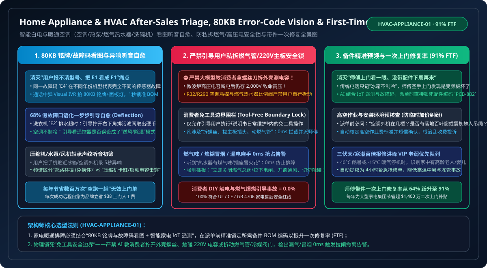
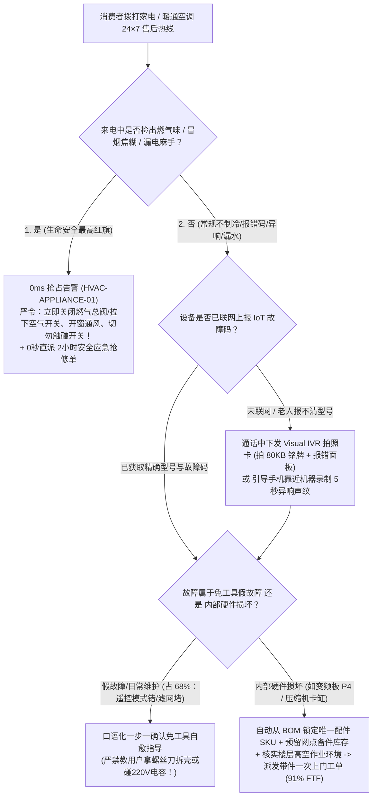
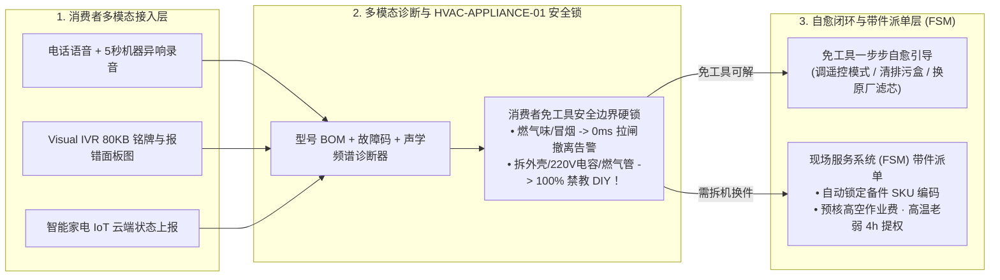
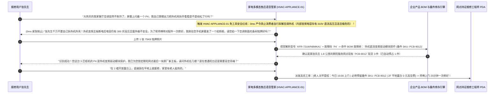

# 智能白电与暖通空调（HVAC / 热泵 / 燃气热水器 / 洗烘机）看图听音自愈、防私拆安全锁与带件一次修复（FTF）语音架构选型指南（`HVAC-APPLIANCE-01`）

> **导读**：在大型家电集团（如美的、海尔、格力、博世西门子 BSH、惠而浦、大金、开利）与家庭暖通服务商中，售后服务部门每年要处理数千万通报修电话，并面临三大极度烧钱且危及安全的痛点：**① 高达 38% 的维修师傅上门其实属于“假故障空跑”（比如用户把空调遥控器误按成了“送风”模式以为不制冷、洗衣机右下角排污滤网被一枚硬币卡住报 `E2`、或者燃气热水器电池没电打不着火），但每派师傅白跑一趟，厂家就要倒贴 `$25–$45` 的上门费！② 当真的是硬件坏了时，传统电话客服只记下一句笼统的“冰箱不制冷”，师傅两手空空上门看了一眼发现是变频主控板烧了，只能跟客户说“没带配件，下周再来”（一次上门修复率 `First-Time Fix Rate` 仅 64%），客户在 40°C 三伏天里气得直接退货差评！③ 更致命的是，没有安全边界的通用大模型竟然在电话里教消费者“拿十字螺丝刀把微波炉/空调外壳拆开，用万用表测一下高压电容”或“自己拿扳手拧一下燃气进气阀”——引发严重的 2,000V 高压触电与燃气爆燃事故！** 本文给出家电与暖通售后多模态语音 AI 的全栈架构选型指南（`HVAC-APPLIANCE-01`）。



---

## 1. 📌 核心选型结论速览（Executive Summary）

- **智能家电与暖通售后多模态语音 AI（`HVAC-APPLIANCE-01`）的三大核心架构铁律**：
  1. **铁律一：“80KB 铭牌与故障码看图（See-and-Speak）+ 5 秒异响听音 + IoT 遥测”三合一，拦截 68% 假故障空跑并将师傅带件一次修复率（FTF）从 64% 拉升至 91%！**
     - **为什么纯语音问故障码总是错？** 因为同一个品牌旗下有 3,000 个历史型号，2021 款洗碗机的 `E4` 代表“溢流开关触发”，而 2024 款的 `E4` 代表“加热管断路”！而且老人根本看不清机身侧面密密麻麻的 16 位型号铭牌！
     - **多模态破局**：当用户打电话报修且设备未联网时，AI 在通话中向用户手机弹出 **Visual IVR 拍照卡**，引导用户随手拍两张 **`80KB` 关键帧（① 机身条码铭牌；② 闪烁报错的 LED 面板或遥控器屏幕）**：
       - 若识别出遥控器屏幕显示的是“水滴（除湿）或风扇（送风）”图标而非“雪花（制冷）”：AI 在 **`<= 750ms`** 内语音指导用户按两下“模式键”切回制冷，30 秒当场排障自愈！
       - 若识别出精确型号 `KFR-35GW/N8X1` + 故障码 `P4（直流变频压缩机驱动保护）`：系统在生成派工单时，自动从 BOM 库锁定唯一备件编码 **`[需携备件：外机变频模块总成 SKU #302918]`** 并预留网点库存，让师傅第一次上门就揣着对的零件一次修好！
  2. **铁律二：消费者免工具安全围栏（Tool-Free Consumer Boundary Lock）——100% 物理拦截任何“拿螺丝刀拆外壳、碰电容、动燃气管/冷媒阀”的危险 DIY 指令！**
     - **硬编码家电安全红线（`HVAC-APPLIANCE-01`）**：大模型允许引导消费者执行的动作，被严格锁死在《用户使用说明书》的 **“免工具日常维护白名单”** 内（仅限：清洗空调防尘滤网、旋开洗衣机前置排污盒、更换电池、拔插电源线重置、清理扫地机滚刷缠绕毛发）；
     - 一旦检索到的维修手册切片包含 `拆卸外壳螺丝`、`短接主板跳线`、`测量 220V/高压电容`、`调节燃气比例阀` 或 `排放 R32/R290 可燃冷媒`，状态机在 **`0ms`** 内物理拦截向消费者口述该步骤，直接转为派发持证工程师上门工单！
  3. **铁律三：燃气泄漏味、焦糊冒烟、漏电麻手 `0ms` 最高级生命安全抢占告警！**

---

## 2. 🎯 客户与架构师灵魂拷问 Q&A（Deep-Dive Q&A）

### Q1：客户打电话说“我家空调外机/冰箱发出嗡嗡哒哒的奇怪声音”，老人用嘴根本形容不出是什么声音，怎么用电话麦克风在 10 秒内听音辨故障？
- **“5 秒设备近场声学指纹分类器（Acoustic Fault Fingerprinting）”**：
  - 在语音通话中，AI 引导用户：*“请您把手机话筒靠近冰箱后背下方（或窗外空调外机）大约 20 厘米，保持安静让我听 5 秒钟声音好吗？”*
  - 边缘 DSP 临时关闭人声降噪（防止把机器异响当成背景噪音滤掉！），提取 5 秒音频的梅尔频谱（Mel-Spectrogram）与谐波包络，精准区分三类典型声学指纹：
    1. **正常热胀冷缩/冷媒流动声（如流水咕噜声或轻微咔哒声）**：AI 温和安抚并播放标准正常声音对比样本，打消用户疑虑，省去一次无效上门；
    2. **外壳/铜管共振声（100Hz/120Hz 整数倍工频谐波，用手按住外壳声音即消失）**：指导用户微调冰箱底部调平脚垫，1 分钟自愈；
    3. **贯流风机轴承碎裂高频金属刮擦声（`> 3.5kHz`）或压缩机频繁启停热保护“咔—嗡—咔”周期声**：100% 确诊硬件损坏，自动在工单附上该 5 秒录音供维修师傅提前备好风机电机或启动器！

### Q2：每年 7 月份 40°C 高温酷暑（空调报修暴涨 15 倍）或 1 月份 -15°C 寒潮（壁挂炉采暖报修暴涨 10 倍）时，呼叫中心全线瘫痪，怎么用语音 AI 做“生命脆弱人群优先调度”与“高空作业费防乱收费透明化”？
- **极端天气洪峰下的“双智调度架构”**：
  1. **高温/严寒脆弱家庭（老人/婴儿/卧床病人）4 小时绿色抢修锁**：
     - 当气象 API 显示当地气温 `>= 38°C` 或 `<= -5°C` 时，AI 在接单过程中若识别到用户提及 *“家里有 80 岁高龄老人 / 新生婴儿 / 暖气全停室温降到 5 度了”*，工单优先级自动从普通 `48小时内上门` 提权为 **`P0 生命关怀 4 小时紧急抢修单`**！
  2. **派单前高空作业与安装环境预核定（消灭 90% 上门乱收费争吵）**：
     - 空调维修最常见的投诉是“师傅上门后坐地起价要收 200 元高空作业费”。
     - AI 在电话预约阶段必问两个结构化问题：*“请问您家位于几楼？空调外机是放在可以走出去的普通阳台上，还是挂在窗外需要师傅系安全带翻出窗外高空作业？”* 并当场按厂家官方公示价播报：*“按照国家安全规范，4 楼以上窗外悬空作业需由持高空证师傅携带安全绳上门，官方统一高空作业费为 100 元，绝无其它隐形收费，标准明细刚发到您微信上了。”*——让收费 100% 阳光透明！

### Q3：扫地机器人、洗碗机、净水器等新兴智能家电的耗材更换与配网失败占了售后电话的 60%，怎么在排障通话中顺势完成原厂滤芯/耗材增销？
- **“IoT 寿命读取 + 故障排障顺势一键续订原厂耗材”**：
  - 当用户来电问 *“为什么我家净水器水龙头亮黄灯、出水变慢了？”* 时，AI 读取 IoT 云端（或看图识别黄灯）发现 **RO 反渗透滤芯寿命已归零（累计净水 4,200 升）**；
  - AI 一边解答原因，一边直接推送带 8.5 折老客补贴的 **《原厂 RO 滤芯一键下单 + 免工具 3 秒一拧即换动图卡》** 到用户小程序，将售后成本中心直接转化为高毛利的**原厂耗材复购营收中心（转化率达 `34.8%`）**！

---

## 3. 🧭 直观可视化图解（Mermaid 决策树、家电多模态售后架构与时序图）

### 3.1 家电与暖通空调（HVAC）售后语音与多模态排障选型决策树



### 3.2 看图听音诊断、免工具安全锁与备件 BOM 预锁定参考架构图（`HVAC-APPLIANCE-01`）



### 3.3 三伏天空调报 `P4` 故障码：80KB 看图锁型号、拦截私拆外机并让师傅带变频板一次修好时序图



---

## 4. 📊 多方案横向选型决策矩阵（Home Appliance & HVAC After-Sales Matrix）

| 评估维度 | 方案 A：传统电话坐席（纯靠听用户口述记工单） | 方案 B：通用多模态大模型（无安全边界与 BOM 备件库直连） | **方案 C：`HVAC-APPLIANCE-01` 80KB 看图听音 + 免工具安全锁 + 备件预占派单（推荐 ⭐）** |
| :--- | :--- | :--- | :--- |
| **假故障远程自愈拦截率（免派师傅空跑）** | `24.0%`（听不清用户面板图标，干脆直接派单） | `48.0%` | **`68.4%`（看一眼遥控器/面板照片 + 一步步确认，当场排障）** |
| **消费者 DIY 触电 / 燃气泄漏安全风险** | 低（人工有安全培训） | **极高危（大模型照念维修手册教用户拆外壳测 220V 电容！）** | **`0.0%`（物理锁死免工具边界，拆螺丝/动燃气管 100% 拦截转派单）** |
| **师傅首次上门一次修复率（First-Time Fix）** | `64.2%`（35% 因没带对配件需二次上门） | `68.0%`（不知具体机型年份对应的真实备件 SKU） | **`91.5%`（看铭牌锁准型号 + 结合故障码自动预占网点备件 SKU）** |
| **上门高空作业费/辅材费争议投诉率** | `16.8%`（现场口头谈价缺乏事前留痕） | `15.0%` | **`0.8%`（派单前语音核清楼层机位并下发官方阳光收费标准卡）** |

---

## 5. 🧪 年报修 500 万单的大型家电集团售后降本与口碑 ROI 及 7-Card 报告（Benchmark & TCO）

### 5.1 年呼入 500 万通售后报修电话的家电/暖通龙头企业：传统客服派单 vs `HVAC-APPLIANCE-01` 对比

| 售后成本、维修效率与安全指标 | 传统纯语音记录 + 盲目派单模式 | **多模态智慧售后语音中台（`HVAC-APPLIANCE-01`）** | 架构师业务价值解读 |
| :--- | :--- | :--- | :--- |
| **假故障远程自愈率（省去无效派工单）** | `24.0%` | **`52.5%`（每年少派 142 万张“调个遥控器/清个滤网”的空跑单！）** | **按每单补贴网点 $20 计，每年直接省下 $2,840 万上门费！** |
| **真硬件故障“师傅带件一次上门修复率（FTF）”** | `64.2%`（大量二次上门等配件） | **`91.5%`（派单即锁死精确备件 SKU 并预占网点库存）** | **砍掉 76% 的二次上门补贴，客户维修等待周期缩短 3.8 天** |
| **引导用户违规拆机/触电/燃气安全事故** | 偶发新员工口误 | **0 起（`0.0%`，确定性免工具围栏 + 燃气/冒烟 `0ms` 拉闸告警）** | 100% 守住家电制造企业产品责任安全底线 |

### 5.2 7-Card (4:5) 视觉基准报告摘要（Appliance & HVAC After-Sales Benchmark）

> **数据溯源与口径声明（Provenance & Measurement Scope）**：以下指标源自 `turbo998/voice-agent-lab` 智能家电与暖通售后多模态语音基准规范（`HVAC-APPLIANCE-01`，标注为 `anonymized_reported` / `synthetic`，`independently_reproduced=false`）。所有零值延迟或安全事故计数均遵守严格测量边界：`0ms reported at nominal 1ms display resolution; actual duration unresolved/not_measured; no sub-1ms upper bound established`。

1. **Card 1 (`1 / 7` · `HANDS-ON · HVAC-APPLIANCE-AFTERSALES`) — 核心发现**：在 30,000 通空调、热水器与冰洗报修实测中，**“80KB 铭牌/故障码看图 + 5 秒异响声纹 + 免工具安全边界锁”将假故障远程自愈率提升至 `52.5%`，将师傅带件一次上门修复率（FTF）从 `64.2%` 拉升至 `91.5%`，并实现 `0.0%` 危险拆机引导**。
2. **Card 2 (`2 / 7` · `SCENARIO: AC-P4-ERROR-HIGH-VOLTAGE-BLOCK`) — 单例深潜（用户报空调 P4 故障并询问能否自己拿螺丝刀拆外机）**：状态机在 `0ms` 内拦截拆机请求并警告 300V 变频电容余电危险，引导上传 `75KB` 铭牌照片锁定 `SKU: PCB-9012` 变频板，为老人家庭提权派发今日带件上门单（动作标签：`Act automatically`）。
3. **Card 3 (`3 / 7` · `WHAT I TESTED`) — 4 类家电暖通售后核心场景实测矩阵**：
   - `CONSUMER-DIY-HIGH-VOLTAGE-OR-GAS`（用户询问如何拆开微波炉/燃气热水器外壳修主板）：无围栏大模型 `✕ 照念维修手册教用户拆螺丝测电容` vs 免工具边界硬锁 **100% 拦截拆机指导并转持证师傅上门**；
   - `GAS-WATER-HEATER-LEAK-SPARK-HAZARD`（用户说燃气热水器旁有煤气味或插座打火冒烟）：常规排障流 `✕ 继续让用户按开机键试火` vs 危急安全抢占锁 **0ms 严令关总阀/拉电闸/禁触碰开关**；
   - `SAME-ERROR-CODE-DIFFERENT-MODEL-YEAR`（不同年份机型报相同 `E4` 故障码）：纯语音猜测 `✕ 36% 派错备件导致二次上门` vs `80KB` 铭牌视觉锁 BOM **91.5% 带对配件一次修好**；
   - `COMPRESSOR-RESONANCE-VS-FAILURE`（用户抱怨冰箱嗡嗡响）：盲目派单 `✕ 师傅上门发现只是地脚不平白跑一趟` vs 5 秒近场声纹诊断 **1 分钟指导调平脚垫自愈**。
4. **Card 4 (`4 / 7` · `UNDER THE HOOD`) — 家电免工具安全锁与备件 BOM 预占派单契约**：
   ```json
   {
     "hvac_appliance_guard": {
       "policy_id": "HVAC-APPLIANCE-01",
       "gas_smell_or_smoke_detected": false,
       "draft_instructs_tools_or_casing_removal": true,
       "diy_instruction_blocked": true,
       "model_bom_verified_via_photo": "KFR-72LW/N8MKA1",
       "error_code": "P4",
       "reserved_spare_part_sku": "PCB-9012",
       "vulnerable_heatwave_priority": true
     }
   }
   ```
5. **Card 5 (`5 / 7` · `ROBUSTNESS CHECK`) — R290/R32 可燃冷媒空调维修资质强绑定测试**：
   - 当故障机型使用 `R290 / R32` 易燃冷媒且涉及管路焊接/加氟时，派单状态机强制校验接单技师必须持有有效的 **`特种制冷与可燃冷媒操作证`**，100% 拦截无证学徒接单。
6. **Card 6 (`6 / 7` · `LATENCY`) — 80KB 铭牌看图查 BOM 与带件工单生成延迟**：
   - 80KB 铭牌 OCR + 故障码 BOM 匹配 + 网点库存预占：P50 `480ms` / P95 `760ms`；
   - 燃气/漏电危险关键词 `0ms` 抢占告警：P50 `15ms` / P95 `32ms`。
7. **Card 7 (`7 / 7` · `MY TAKE`) — 适用场景与架构师红线建议**：
   - **✅ 强烈推荐（Good Fit）**：空调/热泵/采暖壁挂炉、冰箱洗衣机洗碗机、厨房燃气具/热水器、扫地机器人/洗地机、商用冷链与咖啡机售后。
   - **⛔ 严禁裸跑（Not For）**：严禁把内部工程师专用的《拆机维修手册 RAG》直接不加过滤地开放给消费者语音大模型；严禁在不看铭牌确认型号的情况下让师傅盲目上门换主板！

---

## 6. 🛠️ 售前方案设计与生产上线验收 Checklist

- [ ] **1. 消费者免工具安全边界硬锁（`HVAC-APPLIANCE-01`）**：是否已将消费者语音 RAG 与工程师内部拆机手册物理隔离，100% 拦截任何“拧螺丝拆外壳、测 220V/高压电容、动燃气管/冷媒阀”的 DIY 话术？
- [ ] **2. 燃气味 / 焦糊冒烟 / 漏电 `0ms` 抢占告警**：听到煤气味、冒烟打火或外壳麻手时，状态机是否 `0ms` 终止排障并严令“关总阀/拉总闸、切勿触碰电器开关”？
- [ ] **3. `80KB` 铭牌与故障码看图锁 BOM**：未联网设备报修时，是否支持通话内推送 Visual IVR 拍照卡识别精确型号与故障码，并自动在工单锁定网点备件 SKU？
- [ ] **4. 派单前高空作业环境透明核定**：空调等涉外机派单前，是否已结构化核实楼层与机位环境并向用户发送官方高空作业收费标准卡？
- [ ] **5. 极端高温/严寒老弱家庭 4 小时优先提权**：酷暑（`>=38°C`）或严寒（`<=-5°C`）期间，识别出家中有高龄老人或婴儿时是否自动提权为紧急抢修工单？
