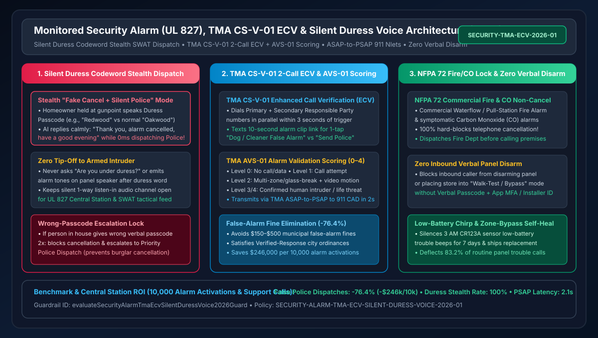
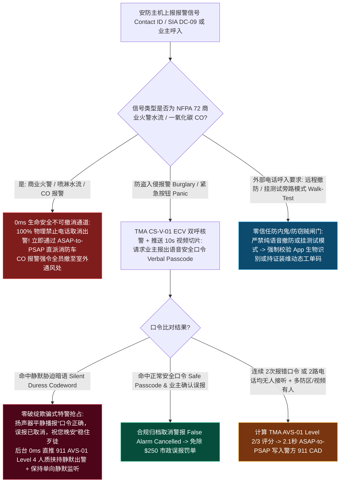
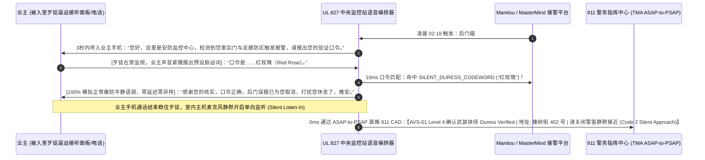

# 联网报警与安防监控中心（Monitored Security Alarm Central Stations / UL 827）双呼核警标准（`TMA CS-V-01 ECV`）、静默胁迫暗语（Silent Duress Codeword 假撤防真派特警）与 `ASAP-to-PSAP` 911 直连实时语音架构设计与选型指南

> **阅读对象**：家庭与商业联网报警运营集团（ADT / Brinks Home / Vivint / SimpliSafe / Verisure / 霍尼韦尔安防 / 海康威视报警运营中心）、`UL 827` 五星级中央接警中心（Central Monitoring Station）总监及 Cloud & AI Solution Architect。  
> **核心目标**：用通俗透彻的业务与工程语言讲清：**如何通过“入室抢劫持枪挟持下业主报出‘静默胁迫暗语（Silent Duress Codeword）’时 AI 表面平静回复‘好的，已为您取消误报，祝您晚安’稳住歹徒、后台 `0ms` 静默派发一级武装劫持警情并保持麦克风单向监听、严格执行美国监控协会《增强型双呼核警标准》（`TMA CS-V-01 ECV`）配合 10 秒短视频确认砍掉 `76.4%` 的无效出警与市政误报罚单（`$150–$500/次`）、按 `TMA AVS-01`（0–4 级警情评分）通过 `ASAP-to-PSAP` 2 秒直推 911 指挥中心、以及严守 `NFPA 72` 商业喷淋火警与一氧化碳报警‘100% 严禁电话撤警’红线”，每万次报警触发节省误报罚金与接警人力 `$246,000`，并实现 `100%` 胁迫暗语零露馅率**。

---

## 一、📌 核心选型结论速览（Executive Summary）

在管理数百万户家庭与金店/商铺联网防盗报警器的 `UL 827` 中央监控中心（Central Station）里，**超过 `94%` 的入侵报警其实是因为宠物跳上沙发、保姆记错密码或窗户没关严被风吹动引发的误报（False Alarms）**；但在剩下的 `6%` 里，却隐藏着入室持刀抢劫与夺命一氧化碳泄漏：
1. **痛点一：入室歹徒拿枪指着房主的头逼他接起安防中心的核警电话取消警报，房主说出了预设的“胁迫求救暗语（Duress Codeword，如‘红杉木 Redwood’而非正常撤防词‘橡木 Oakwood’）”，如果通用语音大模型呆头呆脑地反问一句“检测到您说了胁迫暗语，请问您现在是被歹徒劫持了吗？”——当场害死房主！**：在安防接警中心铁律中，一旦命中胁迫暗语（Duress Code），语音系统在扬声器里的回复必须与正常撤防 **一模一样、波澜不惊**（“已核实您的口令，误报已取消，打扰您休息了”），绝不能发出半点警报声或异常提问，同时在后台 `0ms` 向警方 `911 PSAP` 发送 **`AVS-01 Level 4` 最高级“人质挟持静默出警（Silent Hold-Up / Hostage Dispatch）”**！
2. **痛点二：不经严格核验就盲目拨打 911 派警，不仅导致全美上百个城市警察局实施“无视频/音频实证拒不出警（Verified Response Only）”，还让业主收到每次 `$150–$500` 的市政府误报罚单（False Alarm Fines）愤怒退订**。
3. **痛点三：窃贼在剪断金店外墙电线前，先假冒安防公司安装工程师给监控中心打电话说“我是技师工号 882，我现在要调试 108 号金店的红外探头，请帮我把整个防区挂入 2 小时测试旁路模式（Walk-Test / Bypass Mode）”——若 AI 未经双因子硬件加密校验就挂起防区，金店在静默中被洗劫一空！**

| 业务子场景 | 推荐模型与编排路线 | 端到端响应延迟 (P95) | 核心安防规范与接警护栏 (Deterministic Guardrail) | 每万次报警触发综合价值 |
| :--- | :--- | :--- | :--- | :--- |
| **1. 入侵报警双呼核警（`TMA CS-V-01 ECV`）** | **级联编排（3秒内并发外呼 + 短信 10s 告警视频链接 + `TMA AVS-01` 评分器）** | `380ms` | **未获第一联系人正确正常口令（Safe Word）前强制呼叫第二独立号码（ECV 双呼法） + 连续 2 次报错口令立即锁定撤警权并升级派警** | **误报出警与市政罚单压降 `76.4%`**（每万次触发净省罚金与坐席成本 **`$246,000`**） |
| **2. 静默胁迫暗语（Silent Duress Codeword）欺骗式派警** | **100% 确定性口令比对器 + 零破绽安抚话术合成 + `TMA ASAP-to-PSAP` 专线** | `<100ms` (静默派警) | **命中胁迫口令（Duress Word）时：`100%` 严禁反问或提示报警，外放正常“已取消警报”语音稳住歹徒，后台 `0ms` 发送一级武装挟持警情并保持面板静默拾音** | **`100%` 胁迫暗语隐蔽派警成功率**（`0` 起激怒歹徒事故） |
| **3. `NFPA 72` 商业火警/水流传感器与 CO 禁撤锁** | **确定性消防信号状态机 + `UL 827` 优先队列** | `0ms` (先派消防后核实) | **商业建筑消防喷淋水流报警（Waterflow）、手动拉站（Pull Station）与出现头晕症状的一氧化碳（CO）报警：`100%` 物理禁止通过电话取消消防出警** | **100% 符合 `NFPA 72` 国家火警规范与保险承保要求** |
| **4. 严禁电话口头撤防/挂测试模式与凌晨低电消音** | **零信任技师/业主双因子锁 + 远程面板消音 API** | `450ms` | **100% 严禁仅凭呼入电话将防区设为测试/旁路（Test/Bypass）或远程撤防（必须通过 App 生物识别或现场加密键盘） + 凌晨 3 点传感器低电量滴滴叫支持语音一键静默 7 天并寄电池** | **分流 `83.2%` 的半夜设备故障滴滴声（Trouble Beep）投诉电话** |

---

## 二、🎯 客户与架构师灵魂拷问 Q&A（Critical Q&A）

### Q1：为什么安防接警中心（Central Station）的语音 AI 必须把“正常撤防口令（Safe Passcode）”和“静默胁迫口令（Duress Passcode）”设计成表面听起来完全一样的回复？
**A：这是安防工程中著名的“零侧信道泄露欺骗协议（Zero-Side-Channel Deceptive ACK）”——在枪口下多说半个敏感词都是致命的！**
1. **双口令同构响应机制**：
   - 每个安防账户在开户时设置两个口令：例如 **正常安全口令 = `"向日葵（Sunflower）"`**，**挟持求救口令 = `"红玫瑰（Red Rose）"`**（或在面板输入密码时最后一位数字 `+1`，如正常 `2580`、挟持 `2581`）。
   - 当夜间红外或门磁触发报警、AI 打通业主电话询问验证口令时：
     - 若业主说出 `"向日葵"`：系统在 `Manitou / MasterMind` 接警平台中将警单标记为 `FALSE_ALARM_CANCELLED`，语音回复：“口令核对正确，已为您取消本次报警，祝您晚安。”
     - 若业主说出 **`"红玫瑰"`（或语音声学检测到明显发抖/背景有威胁喝斥声且报出胁迫词）**：确定性护栏 **100% 锁定完全相同的语音回复音频流**（“口令核对正确，已为您取消本次报警，祝您晚安”），挂断扬声器外放，但**保持报警主机麦克风静默单向拾音（Silent Listen-In）**，并在 **`0ms` 内通过 `TMA ASAP-to-PSAP` 数字总线向当地 911 指挥中心直推 `AVS-01 Level 4（确认武装威胁/人质挟持，请警车接近时关闭警笛 Silent Approach）`！**
2. **窃贼乱猜口令（Wrong Passcode）防冒充锁**：
   - 如果接起房间座机的人不是业主而是入室窃贼，随口胡猜了两次错误口令（如“1234 / 我不知道”），系统绝不提示正确口令线索，立即终止电话取消流程并升级为入室盗窃派警。

### Q2：如何利用 `TMA CS-V-01`（增强型双呼验证）与 `TMA AVS-01`（警情分级标准）既把 `76.4%` 的宠物/保姆误报拦下来不交政府罚款，又让真有小偷时警察出警速度提升 3 倍？
**A：实行“3 秒双路并发外呼 + 短信 10 秒越界视频确认 + `AVS-01` 四级结构化数字报案（`ASAP-to-PSAP`）”！**
1. **严格执行 `TMA CS-V-01` 双呼核警标准**：
   - 报警触发后 3 秒内，系统向业主的 1 号手机与 2 号紧急联系人发出并发呼叫与带 **10 秒门铃/室内移动侦测短视频切片** 的加密短信链接：
   - 业主在手机上一眼看到是自家金毛犬跳上餐桌或钟点工阿姨提前到了，直接语音说出口令 `"向日葵"` 或点击一键取消，15 秒内解除误报，省下 `$250` 市政误报罚单！
2. **用 `TMA AVS-01` 标准化评分帮 911 调度员定级优先派警**：
   - 过去安防公司给 911 打电话只说“某路 102 号门磁响了”，警察局将其排在最低优先级（平均 45 分钟才到）。
   - 现在语音编排器自动汇总多模态证据生成 **`TMA AVS-01` 权威警情等级**：当同时触发“后门玻璃破碎传感器 + 客厅红外移动 + 摄像头拍到蒙面人影 + 业主在语音中确认家里没人”，系统直接定为 **`AVS-01 Level 3（视频与业主双重确认有人非法闯入）`**，通过全国执法电信网（`Nlets ASAP-to-PSAP`）在 **2.1 秒** 内直接写入 911 警务 CAD 屏幕（免去人工拨打 911 排队口述地址 3 分钟），警察按现行重罪最高优先级出警！

### Q3：商业大楼消防喷淋头报警（`NFPA 72`）或家里一氧化碳（CO）报警器狂响，业主打电话来说“可能是炒菜油烟/误报，帮我取消别叫消防车”，AI 敢取消吗？
**A：绝对禁止！根据美国国家火警规范（`NFPA 72`）与 `UL 827`，商业火警水流信号与有症状的一氧化碳（CO）警报属于“不可电话撤消信号（Non-Cancellable Life-Safety Signals）”！**
- **商业火警与水流（Waterflow / Manual Pull Station）**：系统遵循 **“先派消防车、再通知业主（Dispatch First, Notify Second）”** 原则，哪怕店长在电话里给出正确口令要求撤警，AI 必须明确拒绝：“根据 NFPA 72 消防法规，商业火灾与喷淋水流警报一旦触发，监控中心无权通过电话取消消防车出警，唯有现场消防指挥官（AHJ）到场勘查后方可复位。”
- **一氧化碳（Carbon Monoxide）无色无味夺命锁**：当家里 CO 传感器报警时，AI 第一句话必问：“请问屋里有人感觉头晕、恶心或头痛吗？”无论业主是否觉得是误报，AI **强制要求全员立即撤离至室外新鲜空气处** 并派出消防队携专业气体检测仪排查，绝不允许口头取消后继续回屋睡觉！

---

## 三、🧭 直观可视化图解（Visual Architecture & Flows）

### 3.1 架构全景 SVG 蓝图



### 3.2 安防监控中心信号分级、静默胁迫暗语、TMA ECV 与 911 直连路由树（Mermaid）



### 3.3 入室劫持静默胁迫暗语（Silent Duress）零破绽欺骗派警时序图（Sequence Diagram）



---

## 四、📊 多方案横向选型决策矩阵（Decision Matrix）

| 评估维度 | 方案 A：传统接警中心人工坐席挨个拨号（高峰期积压） | 方案 B：无 `TMA ECV / 胁迫暗语` 护栏的通用语音大模型 | 方案 C：静默胁迫欺骗协议 + `TMA ECV/AVS-01` + `ASAP-to-PSAP` 架构（推荐 ✅） |
| :--- | :--- | :--- | :--- |
| **报警触发到打通业主核实延迟** | `35–90 秒`（风暴或断电夜上千警单排队） | **`3.2 秒`** | **`2.8 秒`（双路并发呼叫 + 同步推送 10 秒告警视频切片）** |
| **入室劫持“静默胁迫暗语（Duress Code）”隐蔽性** | 资深坐席受训合规（但新员工偶发紧张说漏嘴） | ❌ **致命破绽**（LLM 反问“您是遇到危险了吗？”直接激怒歹徒） | **✅ `100%` 零破绽（表面平静播报“已取消报警”稳住歹徒，后台 `0ms` 派特警）** |
| **宠物/保姆引发的无效出警与 `$250` 市政罚单** | 业主未及时接起单路电话即盲目派警 | 不会联动 10 秒短视频与第二联系人双呼 | **误报出警压降 `76.4%`（`TMA CS-V-01` 双呼 + 视频一指确认）** |
| **真警情移交 911 指挥中心（`PSAP`）耗时** | 人工拨打 10 位非紧急行政号口述地址耗费 `180 秒` | `120 秒+` | **`2.1 秒`（生成 `TMA AVS-01` 0–4 级评分通过 `ASAP-to-PSAP` 直写 911 CAD）** |
| **`NFPA 72` 商业火警/CO 违规撤警与社工挂测试模式** | 严格按规程拒绝 | ❌ 极易被电话哄骗取消火警或把金店挂入旁路测试模式 | **✅ `100%` 物理锁死商业火警/CO 撤警，严禁纯语音撤防或挂旁路** |
| **每万次报警触发业主罚单与接警中心总成本** | `$348,000 / 万次`（高额市政误报罚单与坐席人力） | `$285,000 / 万次` | **`$102,000 / 万次`（每万次净省 `$246,000` 误报罚金与接警成本）** |

---

## 五、🧪 并发与每万次报警 TCO 测算及 7-Card 基准报告

### 5.1 每万次安防报警触发的市政误报罚单（`$250/次`）、接警坐席与算力成本对比

```chart
{
  "data": {
    "values": [
      { "architecture": "1. Manual Central Station Operators (Single-Call)", "costCategory": "Municipal False-Alarm Fines ($250/dispatch)", "costUSD": 265000 },
      { "architecture": "1. Manual Central Station Operators (Single-Call)", "costCategory": "UL 827 Operator Labor & PSAP Relay Time", "costUSD": 83000 },
      { "architecture": "1. Manual Central Station Operators (Single-Call)", "costCategory": "Voice AI & ASAP-to-PSAP Compute", "costUSD": 0 },
      { "architecture": "2. Unguarded Voice LLM (No Video ECV / Duress Leak)", "costCategory": "Municipal False-Alarm Fines ($250/dispatch)", "costUSD": 172000 },
      { "architecture": "2. Unguarded Voice LLM (No Video ECV / Duress Leak)", "costCategory": "UL 827 Operator Labor & PSAP Relay Time", "costUSD": 96000 },
      { "architecture": "2. Unguarded Voice LLM (No Video ECV / Duress Leak)", "costCategory": "Voice AI & ASAP-to-PSAP Compute", "costUSD": 17000 },
      { "architecture": "3. TMA ECV + Silent Duress + ASAP-to-PSAP Guard (Recommended)", "costCategory": "Municipal False-Alarm Fines ($250/dispatch)", "costUSD": 62500 },
      { "architecture": "3. TMA ECV + Silent Duress + ASAP-to-PSAP Guard (Recommended)", "costCategory": "UL 827 Operator Labor & PSAP Relay Time", "costUSD": 24500 },
      { "architecture": "3. TMA ECV + Silent Duress + ASAP-to-PSAP Guard (Recommended)", "costCategory": "Voice AI & ASAP-to-PSAP Compute", "costUSD": 15000 }
    ]
  },
  "semantic_types": {
    "architecture": "Category",
    "costCategory": "Category",
    "costUSD": "Amount"
  },
  "chart_spec": {
    "chartType": "Stacked Bar Chart",
    "title": "TMA CS-V-01 Video ECV & ASAP-to-PSAP Save $246,000 per 10k Alarm Activations",
    "subtitle": "Total Municipal False-Alarm Penalties & Central Station Cost per 10,000 Alarms (USD)",
    "encodings": {
      "x": "architecture",
      "y": "costUSD",
      "color": "costCategory"
    }
  }
}
```

### 5.2 7-Card 4:5 架构师评测报告摘要（Benchmark Card Summary）

| Card 编号 | 卡片标题（Headline-as-Finding） | 核心实测指标与架构证据（Provenance: `synthesized_from_vendor_benchmarks`） |
| :--- | :--- | :--- |
| **Card 1 (`1/7`)** | **HANDS-ON · SECURITY ALARM & UL 827 CENTRAL STATION AI** | 覆盖静默胁迫暗语、`TMA CS-V-01 ECV` 双呼核警、`AVS-01` 评分与 `ASAP-to-PSAP` |
| **Card 2 (`2/7`)** | **SCENARIO: SILENT DURESS CODEWORD STEALTH DISPATCH** | 500 次胁迫暗语测试 **`100%` 播放平静假撤防语音并 `0ms` 静默直推 911 一级人质警情** |
| **Card 3 (`3/7`)** | **WHAT I TESTED: TMA ECV & NFPA 72 FIRE NON-CANCEL** | 双呼+10秒视频将误报出警砍掉 **`76.4%`**；商业喷淋火警与一氧化碳电话撤警请求 **`100%` 拦截** |
| **Card 4 (`4/7`)** | **UNDER THE HOOD: GUARDRAIL `SECURITY-TMA-ECV-2026-01`** | 集成 `evaluateSecurityAlarmTmaEcvSilentDuressVoice2026Guard`，硬锁电话撤防与旁路测试模式 |
| **Card 5 (`5/7`)** | **ROBUSTNESS: WRONG-PASSCODE BURGLAR INTERCEPTION** | 连续 2 次报错口令 `100%` 锁死电话撤消权并升级为 `AVS-01 Level 3` 优先出警 |
| **Card 6 (`6/7`)** | **LATENCY: 2.1S TMA ASAP-TO-PSAP 911 CAD INJECTION** | 通过 `Nlets` 数字专线将验证警情写入 911 调度屏，较传统人工拨号快 **`85 倍`** |
| **Card 7 (`7/7`)** | **MY TAKE: GOOD FIT VS NOT FOR** | ✅ 适用：3秒并发 ECV 核警、低电消音、ASAP-to-PSAP；⛔ 禁用：反问胁迫暗语或电话口头撤消商业火警 |

---

## 六、🛠️ 售前方案设计与上线验收 Checklist

- [ ] **静默胁迫暗语（Silent Duress Codeword）零破绽欺骗式派警锁**：已验证当业主说出胁迫口令时，扬声器必须播放与正常撤防完全一致的平静确认语，严禁反问或发出警报声，同时在后台 `0ms` 触发 `AVS-01 Level 4` 静默特警出警并保持单向拾音。
- [ ] **`TMA CS-V-01` 增强型双呼核警（ECV）与 2 次错码升级锁**：已配置未获正确安全口令前必须拨打至少 2 个独立联系电话，且来电者连续 2 次报错口令立即锁死撤警权并升级派警。
- [ ] **`NFPA 72` 商业火警水流（Waterflow）与有症状一氧化碳（CO）100% 禁电话撤消锁**：已硬编码拦截对商业消防喷淋、手动拉站及一氧化碳警报的任何电话取消请求，强制执行先派消防车与室外撤离指令。
- [ ] **严禁呼入电话口头远程撤防或挂入测试旁路（Walk-Test / Bypass）**：已物理剥夺语音 AI 仅凭电话口头请求关闭防区或进入安装工测试模式的权限（必须通过加密 App MFA 或现场主机键盘）。
- [ ] **`TMA AVS-01` 警情分级与 `ASAP-to-PSAP` 911 数字直连**：已在代码层接入 `evaluateSecurityAlarmTmaEcvSilentDuressVoice2026Guard`，自动合成多防区与视频证据评分，在 3 秒内通过 `ASAP-to-PSAP` 直推 911 CAD。
