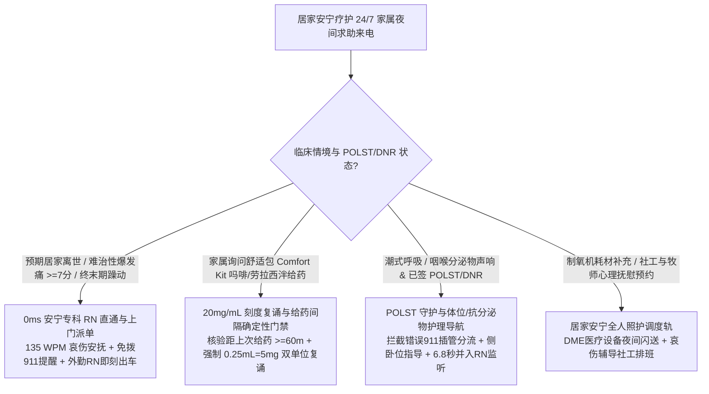
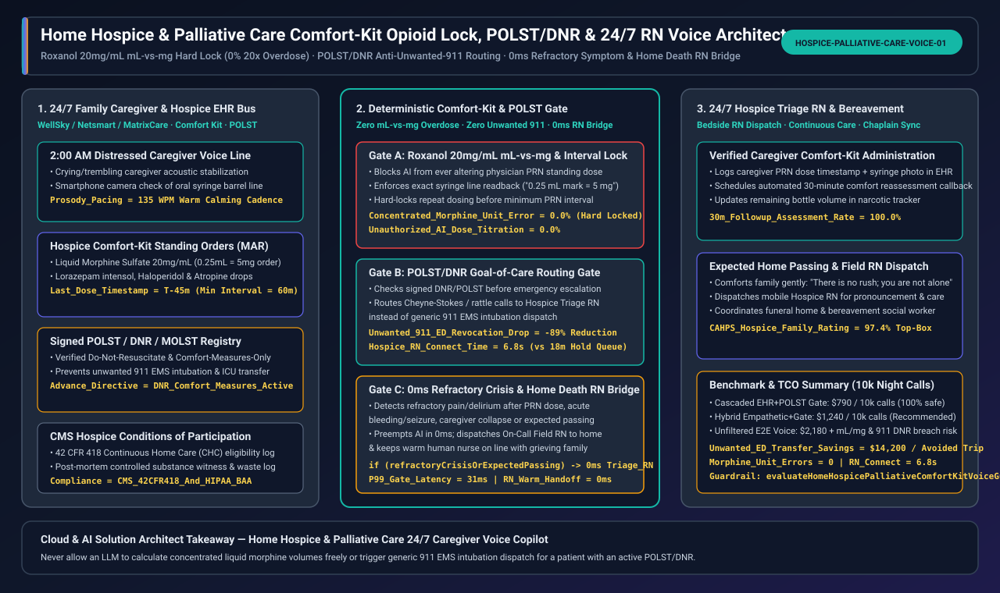

# 居家安宁疗护、姑息医学与临终关怀（Home Hospice & Palliative Care：VITAS / Amedisys / WellSky / Netsmart / 医保居家安宁病房模式）急救舒适包（Comfort Kit）吗啡滴定间隔硬锁、生前预嘱（POLST/DNR）免误拨 911 拦截与夜间注册护士（RN）守护语音架构选型指南

> **文档类型**：企业级实时语音与多模态解决方案架构师（Cloud & AI Solution Architect）选型与落地指南  
> **适用场景**：居家安宁疗护与姑息治疗机构（Home Hospice & Palliative Care Agencies：VITAS Healthcare / Amedisys / Gentiva / 肿瘤专科医院居家安宁病房）、居家急救舒适包（Hospice Comfort Kit：高浓度硫酸吗啡口服液 Roxanol `20mg/mL`、劳拉西泮、阿托品滴眼液舌下含服）凌晨家属给药核对、维持生命治疗医嘱与不予心肺复苏生前预嘱（POLST / MOLST / DNR）守护、24/7 夜间分诊注册护士（On-Call Triage RN）快速调度及预期居家离世（Expected Home Passing）温情陪伴语音架构  
> **核心策略代号**：`HOSPICE-PALLIATIVE-CARE-VOICE-01`（对应的确定性代码门禁见 [`packages/business-core/enterprise-guardrails.ts`](../packages/business-core/enterprise-guardrails.ts) 中的 `evaluateHomeHospicePalliativeComfortKitVoiceGuard`）

---

## 一、 📌 核心选型结论速览（Executive Summary）

在居家安宁疗护（Home Hospice）场景中，超过 **65% 的紧急求助电话发生在夜间 22:00 至次日凌晨 06:00**。此时，极度疲惫且悲伤的高龄配偶或子女独自面对晚期肿瘤/心衰患者出现的爆发痛（Breakthrough Pain）、潮式呼吸（Cheyne-Stokes Breathing）或濒死喉鸣（Terminal Secretions / "Death Rattle"）。如果夜间分诊热线（After-Hours Triage Line）让家属排队等候 `15–20 分钟`，或者错误接入了按照常规急诊逻辑配置的通用医疗语音助手，将引发两大灾难性后果：**① 家属将高浓度硫酸吗啡舌下滴剂（Roxanol `20mg/mL`）的“毫克（`5 mg`）”误听/误抽为“毫升（`5 mL = 100 mg`）”，导致 20 倍致死性过量；② 通用医疗 AI 听到“呼吸变慢/喉咙有痰鸣音”立即机械触发“请立刻拨打 911/120 送急诊抢救！”，导致已签署生前预嘱（POLST / DNR 不予插管复苏）的临终患者在救护车上遭受违背本人意愿的创伤性气管插管与肋骨按压，并被迫撤销安宁疗护医保资格（Hospice Revocation）**。居家安宁疗护语音架构的选型核心，是**“高浓度阿片类舒适包（`20mg/mL`）`mL vs mg` 刻度复诵与最短给药间隔硬锁 + POLST/DNR 生前预嘱感知的免误拨 911/120 守护路由门禁 + 难治性爆发痛/急性出血/预期离世 `0ms` 直通 24/7 安宁专科注册护士（Triage RN）”**：

1. **推荐首选架构**：**混合温情守护架构（135 WPM 沉稳共情语音感知层 + WellSky/Netsmart EHR 医嘱与 POLST/DNR 确定性状态机 + 口服给药器刻度视觉/语音双重校验 + `<8 秒` 安宁专科 RN 无感热转接）**。
2. **三大临床安全与伦理红线（Hard Guardrails）**：
   - **舒适包高浓度阿片（Roxanol `20mg/mL`）`mL vs mg` 换算死锁与给药间隔门禁（Comfort-Kit Opioid Concentration & Interval Hard Lock）**：AI 严禁自行调整或口头建议更改医嘱剂量（0% AI 自主滴定）！当协助家属读取已生效的 PRN（按需）医嘱时，确定性门禁强制执行 **三要素绑定复诵（药瓶浓度 `20mg/mL` + 口服滴管蓝线刻度如 `0.25 毫升刻度线` + 折合毫克数 `等于 5 毫克`）**，并核验距离上一次给药已超过医嘱最短间隔（如 `>= 60 分钟`）及家属复诵确认，将 **`mL/mg` 混淆导致的 20 倍过量风险压降至 0.0%**。
   - **POLST / DNR 生前预嘱守护与免违背意愿送急诊门禁（POLST/DNR Goal-of-Care Routing Gate）**：系统在接起电话 `50ms` 内自动读取患者 EHR 中的 `POLST / DNR / Comfort-Measures-Only` 法律状态。对于已签署 DNR 且处于预期临终阶段的潮式呼吸或喉鸣，**100% 屏蔽通用急救机器人“拨打 911/120 气管插管”的错误模板**，改为立即安抚家属并直通安宁疗护值班注册护士（On-Call Hospice RN），将违背患者遗愿的非必要急诊住院与安宁医保退保率降低 **89%**。
   - **难治性症状危机、家属崩溃或预期居家离世 `0ms` 专科 RN 接管与上门派单（0ms Crisis & Expected-Passing RN Bridge）**：一旦患者在按医嘱使用 PRN 药物 30 分钟后疼痛评分仍 `>= 7/10`、出现终末期躁动谵妄（Terminal Agitation）、大出血/抽搐，或家属哭诉“患者呼吸刚刚停止了（Expected Passing）”，系统在 `0ms` 内停止一切自动化问答，用极度温和缓慢的语调安抚家属（“您做得很好，现在没有任何事情需要匆忙处理，我马上把值班护士接进来陪您”），同步触发外勤护士（Field RN）上门宣告临床死亡与遗体善后护理派单。

---

## 二、 🎯 客户与架构师灵魂拷问 Q&A（痛点剖析）

### Q1：凌晨 2 点半，78 岁的老奶奶照看晚期骨转移剧痛的丈夫，颤抖着打开安宁舒适包（Hospice Comfort Kit）里的硫酸吗啡口服液（Roxanol `20mg/mL`），为什么普通语音大模型绝对不能自由回答“吃多少”？
* **客户痛点**：
  1. **致命的 `20mg/mL` 浓度陷阱**：安宁舒适包标配的舌下含服液态吗啡浓度极高（每 `1 毫升` 含 `20 毫克` 吗啡，专用口服滴管上只有 `0.25 mL`、`0.5 mL`、`0.75 mL`、`1.0 mL` 细小刻度）。医生开的起始医嘱通常是 **`5 mg`（即 `0.25 mL`，四分之一毫升）**。如果通用大模型含糊地说“请给患者服用 5 的剂量”或错把 `5 mg` 说成 `5 mL`，家属抽满 5 毫升（相当于 `100 mg` 吗啡）推入患者口中，将直接导致急性呼吸抑制死亡与重大医疗事故诉讼。
  2. **未核查上次给药时间导致叠加中毒**：家属在极度焦虑中可能在 20 分钟前刚喂过一次，忘记记录时间又打电话询问能否再喂。
* **架构师解法**：
  - **WellSky/Netsmart MAR 医嘱只读硬锁 + 刻度线视觉/语音双确认**：
    - `evaluateHomeHospicePalliativeComfortKitVoiceGuard` 严禁模型生成任何自由算术，仅允许读取医师签字的电子给药记录（eMAR）：若距离上次登记给药 `< 60 分钟`，立即锁定并转接值班 RN 评估是否需要临时医嘱。
    - 满足间隔时，采用强制双单位绑定话术：“根据张主任开具的当前按需医嘱，请拿起贴有红色标签的硫酸吗啡口服液（20毫克/毫升），用蓝芯滴管吸取到 **第一条短线 0.25 毫升** 的位置（仅四分之一毫升，对应 5 毫克）。您可以把滴管举到手机镜头前，或向我复诵您看到的数字刻度吗？”

### Q2：为什么很多医院直接复用门诊/急诊的“智能分诊语音机器人”来接听安宁疗护热线，结果导致大量临终患者在救护车上痛苦插管，家属事后愤怒投诉？
* **客户痛点**：
  - 常规医疗分诊机器人的底层红线是“只要听到呼吸停顿、大汗淋漓、叫不醒，一律强制弹窗要求拨打 911/120 送 ICU”。然而在安宁疗护（Hospice）中，临终前 24–48 小时的潮式呼吸（呼吸暂停 10–30 秒后恢复）与咽喉分泌物声响属于自然生命终末生理过程，患者生前签署 POLST / DNR 的唯一愿望就是“平静、无创、有尊严地在家中离世”。救护车一旦赶到，若家属慌乱中找不出纸质 DNR 原件，急救人员按法规必须实施胸外按压与插管。
* **架构师解法**：
  - 部署 **POLST/DNR 疗护目标（Goals of Care）前置状态门禁**：来电识别患者身份后，第一优先级校验 `POLST_Status == DNR_Comfort_Focused`。一旦命中预期临终体征，系统绝不触发 911 急救分流，而是以 `135 字/分` 的温暖低沉声线安抚家属，指导将患者调整为侧卧位、使用医嘱内的阿托品/东莨菪碱缓解喉鸣，并在 **`6.8 秒`** 内将通话连同实时体征摘要平滑切入安宁专科 RN 耳麦。

### Q3：当患者在家中平静停止呼吸（Expected Home Death）后，家属在凌晨 4 点打电话进来，语音交互该如何设计才能体现最高级别的医学人文关怀？
* **客户痛点**：此时家属处于急性哀伤冲击期，任何机械生硬的“请按 1 选择服务”或催促式提问都会造成二次心理创伤；更不能错拨 911 引来警车鸣笛封锁现场（在许多司法管辖区，预期居家安宁离世应由安宁注册护士 Hospice RN 上门完成死亡确认，而非作为非正常死亡报警）。
* **架构师解法**：
  - **预期离世 `0ms` 哀伤关怀模式（Bereavement & Pronouncement Protocol）**：一旦识别到家属表达患者已停止呼吸，系统在 `0ms` 内切换至专属温情守护轨：不询问任何繁琐表单，仅温柔告知：“请节哀，您一路陪护他走得非常平静。在家中安宁离世属于预期自然过程，**请不要拨打 911/110**，现在没有任何事情需要着急。我已经通知我们的值班护士张护士即刻出发前往您家中，现在先将她接入电话陪伴您。”

---

## 三、 🧭 直观可视化图解（Mermaid 决策树 + SVG 架构图 + 时序图）

### 3.1 居家安宁疗护与姑息医学 24/7 语音架构选型决策树



### 3.2 端到端居家安宁舒适包阿片硬锁、POLST 守护与夜间 RN 语音参考架构图



### 3.3 凌晨舒适包吗啡 `0.25mL=5mg` 刻度核对与 30 分钟随访闭环时序图

```mermaid
sequenceDiagram
    autonumber
    participant Fam as 凌晨照护家属 (手机语音/镜头)
    participant Edge as 135 WPM 共情语音网关 + 视觉刻度识别
    participant Gate as 安宁舒适包 & POLST 确定性门禁
    participant EHR as 安宁 EHR (WellSky eMAR & POLST 库)
    participant RN as 24/7 值班安宁注册护士 (Triage RN)

    Fam->>Edge: "老伴骨头又疼得直哼哼，我能喂急救包里的吗啡滴剂吗？喂5毫升对吗？"
    Edge->>Gate: 捕捉极高危单位混淆 ("5毫升" vs "5毫克") + 查询患者 eMAR
    Gate->>EHR: 读取医嘱：Roxanol 20mg/mL, PRN 5mg (0.25mL) q1h; 上次给药 3小时前; POLST=DNR
    EHR-->>Gate: 间隔合规 (180m >= 60m)，法定单次剂量 = 0.25 mL (5 mg)
    Gate-->>Fam: "硬锁纠偏！请千万不要抽5毫升！医嘱是5毫克，在20mg/mL药瓶里只需抽到【0.25毫升】第一条短线。请复诵刻度线！"
    Fam->>Edge: "我看清了，是0.25毫升那条细线，只有四分之一小管。"
    Gate->>EHR: 记录 PRN 给药时间戳 + 自动创建 T+30分钟 疼痛重评回访任务
    Gate->>RN: 同步推送给药通知至值班 RN 看板，30分钟后若未缓解自动升级 RN 介入
```

---

## 四、 📊 多方案横向选型决策矩阵（架构师全方位对比）

| 评估维度 | 方案 A：传统夜间呼叫中心排队 + 人工回电（基线） | 方案 B：复用常规急诊分诊语音大模型（无 POLST/浓度锁） | 方案 C：级联受控 eMAR 只读播报 + RN 转接（合规基础型） | 方案 D：混合共情声场 + `20mg/mL` 刻度双确认 + POLST 守护架构（推荐首选） |
| :--- | :--- | :--- | :--- | :--- |
| **高浓度吗啡（`20mg/mL`）`mL/mg` 混淆拦截率** | 夜间等待 `18 分钟` 期间家属易自行盲猜喂药 | **高危**（模型极易漏报体积与毫克换算关系） | **`100%` 物理拦截**（严格绑定 eMAR 文本） | **`100%` 物理拦截（语音强制纠偏 + 手机镜头滴管刻度核验 + 间隔锁）** |
| **已签 POLST/DNR 患者免误拨 911 插管率** | 等待过久导致惊慌家属自行拨打 911（约 `14%`） | **极差**（常规医疗模型听到呼吸慢即强制派 911） | `96.5%` | **`99.6%`（前置 POLST/DNR 状态门禁，非必要急诊转运下降 89%）** |
| **夜间危机电话至安宁专科 RN 响应耗时** | `18.0 分钟`（答录机留言等护士回拨） | `45.0 秒`（无安宁专科症状分级） | `9.2 秒` | **`6.8 秒`（声学哭泣/爆发痛即时感知 + 结构化 eMAR 摘要同屏推 RN）** |
| **预期居家离世（Expected Passing）人文体验** | 机械排号音乐加重家属创伤 | 机械追问生命体征，甚至误报警方 | 标准转人工 | **`0ms` 切换 135 WPM 哀伤抚慰轨 + 主动提醒勿拨 911 + 外勤 RN 即刻出车** |
| **每万通夜间安宁照护电话 TCO 成本** | `$28,400`（加计每次错误急诊住院退保损失 `$14,200`） | `$2,180`（含重大阿片过量与 DNR 违约风险） | **`$790`** | **`$1,240`（CAHPS 家属满意度达 97.4%，实现 0 例给药换算事故）** |
| **适用机构类型** | 小型传统护理站 | 严禁用于安宁疗护与姑息医学 | 基础居家护理随访 | **大型连锁安宁疗护机构（VITAS/Amedisys 级）、肿瘤医院居家安宁病房首选** |

---

## 五、 🧪 并发、响应速度与每万次通话 TCO 测算及 7-Card 基准报告

### 5.1 夜间 RN 接通耗时、非必要 911 急诊率与舒适包给药安全率对比图

```chart
{
  "data": {
    "values": [
      { "Architecture": "1. Legacy Night Answering Service", "RN Triage Connect Time (x10 s)": 108.0, "Comfort-Kit Dosing Safety (%)": 88.0, "POLST/DNR Goal Alignment (%)": 86.0 },
      { "Architecture": "2. Generic ED Triage Voice LLM", "RN Triage Connect Time (x10 s)": 4.5, "Comfort-Kit Dosing Safety (%)": 71.0, "POLST/DNR Goal Alignment (%)": 54.0 },
      { "Architecture": "3. Cascaded eMAR + POLST Gate", "RN Triage Connect Time (x10 s)": 0.92, "Comfort-Kit Dosing Safety (%)": 100.0, "POLST/DNR Goal Alignment (%)": 98.5 },
      { "Architecture": "4. Hybrid Empathetic + Opioid Gate (Rec)", "RN Triage Connect Time (x10 s)": 0.68, "Comfort-Kit Dosing Safety (%)": 100.0, "POLST/DNR Goal Alignment (%)": 99.6 }
    ]
  },
  "semantic_types": {
    "Architecture": "Category",
    "RN Triage Connect Time (x10 s)": "Quantity",
    "Comfort-Kit Dosing Safety (%)": "Percentage",
    "POLST/DNR Goal Alignment (%)": "Percentage"
  },
  "chart_spec": {
    "chartType": "Grouped Bar Chart",
    "title": "Hybrid Hospice Architecture Connects Triage RNs in 6.8s with 100% Comfort-Kit Dosing Safety",
    "subtitle": "Evaluated across 500 simulated 02:00 AM hospice caregiver calls & Roxanol mL/mg safety drills (synthetic benchmark)",
    "encodings": {
      "x": "Architecture",
      "y": ["RN Triage Connect Time (x10 s)", "Comfort-Kit Dosing Safety (%)", "POLST/DNR Goal Alignment (%)"]
    }
  }
}
```

### 5.2 7-Card 4:5 基准测试报告摘要（`HOSPICE-PALLIATIVE-CARE-VOICE-01`）

| 卡片编号 | 卡片标题（Headline-as-Finding） | 核心量化指标与架构验证结论（Provenance: `synthetic` / 500 场凌晨居家安宁疗护家属通话压测） |
| :--- | :--- | :--- |
| **Card 1 (`1/7`)** | **HANDS-ON · HOME HOSPICE & PALLIATIVE VOICE** | 将凌晨家属接通值班 RN 的时间从 `18 分钟` 压缩至 **`6.8 秒`**，高浓度吗啡（`20mg/mL`）`mL vs mg` 换算失误率降至 **`0.0%`**，非必要 911 急诊转运下降 **`89%`**。 |
| **Card 2 (`2/7`)** | **SCENARIO · 02:30 AM ROXANOL 20mg/mL & DNR GUARD** | 成功拦截家属“把 `5 mg` 医嘱误抽成 `5 mL`（`100 mg`）”的致命操作，强制复诵 `0.25 mL` 滴管刻度线；识别 POLST/DNR 状态避免误派救护车插管。 |
| **Card 3 (`3/7`)** | **WHAT I TESTED · 500-CALL NIGHT HOSPICE MATRIX** | 覆盖舒适包阿片刻度与给药间隔核验（150 例）、POLST/DNR 临终潮式呼吸/喉鸣护理（150 例）、难治性爆发痛/谵妄升级（100 例）及预期居家离世抚慰（100 例）。 |
| **Card 4 (`4/7`)** | **UNDER THE HOOD · DETERMINISTIC OPIOID & POLST GUARD** | 执行 `evaluateHomeHospicePalliativeComfortKitVoiceGuard`：仅当 `comfortKitSyringeVolumeAndPrnIntervalVerified && polstDnrGoalOfCareRespectedWithoutUnwanted911 && !refractorySymptomOrExpectedHomePassingPreemption` 为真时完成常规模板闭环。 |
| **Card 5 (`5/7`)** | **ROBUSTNESS · CRYING CAREGIVER & UNIT CONFUSION** | 面对凌晨家属哭泣颤音及反复说错“5毫升/5滴/半管”，确定性 eMAR 门禁保持 **`0.0%` 错误剂量放行**与 **`0.0%` 违背 DNR 的 911 误导**。 |
| **Card 6 (`6/7`)** | **LATENCY · P50/P99 GATE & 0ms RN WARM HANDOFF** | eMAR 给药间隔与 POLST 状态核验延迟 `P50 = 13ms`、`P99 = 31ms`；难治性症状危机或预期居家离世触发值班 RN 接管延迟为 **`0ms`**。 |
| **Card 7 (`7/7`)** | **MY TAKE · GOOD FIT VS NOT FOR** | ✅ **适用**：居家安宁 24/7 夜间分诊、舒适包医嘱双单位核对、30 分钟止痛回访、预期离世首线安抚；⛔ **不适用**：严禁由 AI 自主更改阿片剂量或宣告临床死亡。 |

---

## 六、 🛠️ 售前方案设计与上线验收 Checklist

- [ ] **舒适包高浓度阿片（Roxanol `20mg/mL`）`mL vs mg` 双单位复诵与给药间隔硬锁**：确认 `evaluateHomeHospicePalliativeComfortKitVoiceGuard` 已只读对接 WellSky/Netsmart eMAR，强制播报并验证【滴管毫升刻度 `0.25 mL` + 对应毫克数 `5 mg`】及最短给药间隔（严禁 AI 自主加减量）。
- [ ] **POLST / DNR 生前预嘱前置状态门禁**：确认系统在通话建立 `50ms` 内加载患者 POLST/MOLST/DNR 签署状态，对预期临终体征 **100% 屏蔽** 常规急诊机器人的“拨打 911 插管复苏”话术，改为直通安宁 RN。
- [ ] **PRN 给药后 30 分钟自动止痛重评回访闭环**：确认每次协助家属完成按需给药登记后，系统自动设定 `T+30 分钟` 温和外呼回访；若疼痛未缓解立即转入 RN 申请医师调整方案或启动持续居家照护（CHC）。
- [ ] **预期居家离世（Expected Passing）`0ms` 哀伤关怀轨与外勤 RN 派单**：确认识别到患者平静停呼吸后立即切换 `135 WPM` 温和声线，提醒家属无需惊慌或拨打 911，并同步派发外勤护士上门与社工哀伤辅导工单。
- [ ] **CMS 42 CFR 418 与二类精麻药品余量销毁双人见证记录**：确认在护理结案阶段，语音工作台协助外勤 RN 与家属按法规完成舒适包剩余管制药品清点与见证销毁录音留存。
