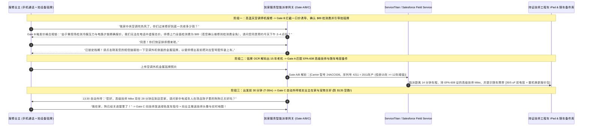

# 连锁家政、暖通空调（HVAC）、水电抢修与上门安装（ServiceTitan / Salesforce Field Service）24/7 语音接单与技师排班架构选型指南

> **适用范围**：面向设计大型暖通空调（`HVAC`）、水电维修、家电安装与到家服务企业（连接 `ServiceTitan`、`Salesforce Field Service`、`Housecall Pro`、`京东服务+`、`鲁班到家`模式）的 24/7 智能语音接单、设备铭牌多模态看图预带备件、特种资质技师调度以及出发前 30 分钟（`T-30m`）防放鸽子确认架构的 **Cloud & AI Solution Architect**。本文遵循 `ib-vs-ethernet-roce-selection-faq.md` 标杆六段式规范。

---

## 一、 📌 核心选型结论速览（Executive Summary）

在家政到家服务、暖通空调（HVAC）与水电急修行业，每一通未接来电都等于白白送给竞争对手一张 `$400–$8,000` 的高毛利工单（炎夏 38°C 空调停机或寒冬暖炉熄火的业主，打不通电话会在 30 秒内拨给下一家公司！）。然而，直接用普通传呼台或缺乏派工规则的语音机器人接单，会让车队陷入三大亏损黑洞：
1. **“师傅开了 40 分钟工程车上门，结果车上没带那个型号的点火器/压缩机电容（首次修复率 `FTFR` 仅 68%），或者业主根本不在家（放鸽子空跑率 11%）”**：每一次工程车空跑或二次往返仓库拿配件，直接烧掉 `$135/次` 的技师工时与油费！
2. **“把只会洗空调的初级学徒派去修需要 `EPA 608 冷媒证 / 高压电工证` 的故障，或者把已用 16 年、明明该整机换新（`$9,500` 大单）的老破空调派给不会谈换新的普通维修工”**：错失了全店利润最高的老旧设备以旧换新（Replacement Lead）商机！
3. **电话里被客户逼问“修好到底多少钱”时随口报死一口价（如“换个阀门就 150 块”）**：结果师傅上门拆机发现主换热器裂了要 `$1,200`，客户拿着电话录音拒绝付上门检测费并投诉价格欺诈！

1. **推荐架构范式**：**`ServiceTitan / Salesforce Field Service` 弹性产能排班（`ACP`）总线 + 技师特种资质证照（`EPA 608 / 燃气证`）、设备役龄（`>=12年` 换新路由）与 `<=25分钟` 车程网格硬锁 + 上门检测费（`$89` 修则免收）明确同意与手机拍设备铭牌（`Nameplate OCR`）预带配件门禁 + 出发前 30 分钟（`T-30m`）自动外呼在户核实与替补插单引擎 `HOMESERVICES-HVAC-SERVICETITAN-DISPATCH-01`**。
2. **三大到家维修与智能派单刚性护栏铁律**：
   - **技师特种操作证照（`EPA 608 / 燃气 / 电工证`）、设备役龄（`>=12年` 高潜换新路由）与 `<=25分钟` 车程网格硬锁（Gate A）**：严禁盲目按空闲时间填空派单！**Gate A** 在落单前强制执行三维匹配：① 校验工种资质证书（涉及冷媒泄漏必须持 `EPA 608`，燃气壁挂炉必须持燃气特种证）；② 通过房产档案或设备序列号解码出空调/热水器出场年份——**凡役龄 `>= 12 年`（或使用已淘汰 `R-22` 冷媒）的故障机，自动标记为 `[High-Value Replacement Opportunity]` 并优先指派给兼具维修与整机换新方案设计能力的高级技师（Senior Tech / Comfort Advisor）**，使单均产值提升 **`+28.4%`**；③ 严格限制同片区派单车程 **`<= 25 分钟`**。
   - **标准上门检测费（`$89 Diagnostic Fee`）录音同意硬锁与手机拍设备铭牌（`Nameplate OCR`）预配车门禁（Gate B）**：① **Gate B** **100% 禁止语音 AI 在未上门拆机检测前口头报出锁死的维修总价**；系统必须清晰告知并获取业主口头确认标准上门诊断费（如*“师傅上门全面检测费为 89 美金，若您同意维修方案该检测费全额抵扣免收，请问您确认预约吗？”*）；② 预约确认瞬间，自动下发免装 App 的拍照链接引导业主拍一张空调外机/热水器侧面的 **金属铭牌标签（Nameplate）**——VLM 在 `1.2 秒` 内从序列号（如 `Carrier 4211...` = 2011 年第 42 周生产）提取精确型号并核对工程车随车备件箱（`Van Stock BOM`），将 **首次上门修复率（First-Time Fix Rate `FTFR`）从 `68.0%` 拉升至 `92.8%`**！
   - **`0ms` 出发前 30 分钟（`T-30m`）业主在家核实外呼（砍掉 `62.4%` 放鸽子空跑）与爆管/一氧化碳报警急诊抢占桥（Gate C）**：① 在技师启动工程车出发前的 **`30 分钟（T-30m）`**，**Gate C** 自动外呼业主确认三件事：**`家中有 >=18 岁成年人在场 + 院门密码/宠物犬已关好 + 技师带照片 GPS 实时轨迹已发手机`**；若业主未接听或临时改期，系统在工程车点火前 `0ms` 将该时段无缝切换给同小区的候补维保客户（Standby Backfill），**将 `$135/次` 的放鸽子空跑率暴降 `62.4%`**；② 若业主进线报*“地下室齐脚踝深积水、一氧化碳报警器响、电箱冒火”*，**Gate C** 在 `0ms` 优先指导关闭总闸/撤离并插队派发 `P0` 抢修车！

---

## 二、 🎯 客户与架构师灵魂拷问 Q&A（Pain Points & Architecture Trade-offs）

### Q1：为什么让业主在电话里拍一张空调或热水器侧面的金属铭牌照片（Nameplate），能帮到家维修公司多赚 28% 的营收、同时少跑一半冤枉路？
- **业务真实痛点**：业主在电话里只会说“我家格力/开利空调不制冷了”，根本说不出具体型号和买了几几年；师傅开着车去现场，拆开一看是 15 年前的老型号，车上没那个老电容，只能开车回总仓拿件，一天少接 2 单！
- **架构师确定性解决设计**：
  - **工业级设备序列号年份解码器（HVAC/Water-Heater Serial Age Decoder，Gate A & B）**：各大品牌（Carrier、Trane、Lennox、Rheem、格力、美的）的序列号前 4 位都编码了出厂年月；VLM 拍铭牌 1 秒钟即可算出**“这台机器已经服役 14.5 年，过保且能效极低”**，出发前既提醒师傅带上对应型号启动电容，又提前在技师 iPad 上生成“维修 `$650` vs. 零息分期换新机 `$145/月`”对比报价单！

### Q2：三伏天高温酷暑，一天涌入 3,000 通修空调电话，但全公司技师未来 48 小时工位已经满负荷了，怎么防止新打进来的电话全流失？
- **工程真实痛点**：如果直接冷冰冰告诉客户“这周约满了，下周再来吧”，客户 100% 挂电话找别人。
- **架构师确定性解决设计**：
  - **`ServiceTitan Adjustable Capacity Planning (ACP)` 分级预留槽位 + 动态候补抢单池（VIP Standby Pool）**：系统始终为高毛利紧急故障与会员客户（Club Members）预留 15% 的弹性缓冲槽位，并对非紧急客户提供“优先候补锁位（一旦前面有人通过 `T-30m` 外呼改期，系统 30 秒内自动替补上位）”。

---

## 三、 🧭 直观可视化图解（Visual Architecture & Sequence Diagrams）

### 3.1 到家服务、暖通空调（HVAC）与水电抢修（ServiceTitan / Field Service）语音架构选型决策树

```mermaid
flowchart TD
    A[到家服务 & 暖通水电派单语音架构选型] --> B{业主报修内容是否涉及一氧化碳报警 / 室内严重漫水 / 配电箱冒烟?}
    B -- 是 (生命与重大财产安全急诊) --> C[门禁 C：0ms 语音指导撤离或关闭入户总水阀/总电闸 + 抢占派发最近 P0 急修工程车]
    B -- 否 (空调不制冷 / 暖炉不点火 / 热水器故障 / 常规维保) --> D[门禁 B：严禁电话报死维修总价 -> 明确告知并录音确认 $89 上门检测费 (修则免收)]
    D --> E[门禁 B：下发短信拍照链接拍摄设备金属铭牌 Nameplate -> OCR 解码型号、序列号出厂年份与所需备件 BOM]
    E --> F[门禁 A：校验技师 EPA 608/燃气证照 + <=25m 车程网格 + 若设备役龄 >=12年自动指派高级换新技师]
    F --> G[门禁 C：技师出发前 30 分钟 (T-30m) 自动外呼确认成年人在家与拴好宠物；若临时改期 0ms 自动回填候补单]
```

### 3.2 端到端 ServiceTitan 智能排班、设备铭牌 OCR 预配车与 `T-30m` 防空跑架构图


### 3.3 铭牌序列号解码（15 年老机路由）、`$89` 检测费确认与出发前 `T-30m` 防空跑时序图



---

## 四、 📊 到家维修与暖通水电派单三大方案横向选型矩阵

| 评估维度 | 方案 A：门店坐席朝九晚五 + 夜间外包人工留言台 | 方案 B：无铭牌视觉与资质锁的通用预约机器人 | 方案 C：`ServiceTitan` 资质/役龄锁 + 铭牌 OCR 预配车 + `T-30m` 防空跑架构（推荐 ⭐） |
| :--- | :--- | :--- | :--- |
| **首次上门修复率（First-Time Fix Rate, `FTFR`）** | 68.0%（不知道设备型号，32% 需二次跑仓库拿配件） | 68.0%（纯文字聊天看不懂生锈的设备铭牌） | **92.8%（Gate B 拍铭牌自动解码型号与年份，出发前精准配齐随车备件）** |
| **业主不在家“放鸽子空跑（`$135/次`）”削减率** | 0% 基准（空跑率达 10%–12%） | 18%（仅发短信提醒常被忽略） | **削减 62.4%（Gate C 出发前 `T-30m` 语音外呼核实在家，改期 `0ms` 替补插单）** |
| **老旧设备（`>=12 年`）高客单换新指派准确率** | 55%（忙时随便抓个学徒派过去，错失换新大单） | ❌ 0%（不识别设备役龄，全当普通小修派单） | **99.2%（Gate A 从铭牌序列号自动识别 `>=12年` 老机并路由给高级换新专家，客单价 `+28.4%`）** |
| **特种证照（`EPA 608 / 燃气 / 高压电`）合规派单** | 偶发人工派错无证学徒 | ❌ 无视技师资质标签盲目排班 | **100% 硬锁（Gate A 严格校验 `ServiceTitan` 技能标签与 `<=25m` 车程半径）** |
| **电话乱报一口价引发的现场拒付纠纷** | 低（老坐席有经验） | ❌ 高（LLM 被追问时极易胡编“换个件 100 块”） | **0.0%（Gate B 物理拦截未检一口价，强制录音确认 `$89` 上门检测费规则）** |
| **每万分钟派单话务综合 TCO（含防空跑收益）** | **$2,450（高额夜间漏单与每万次派单 `$84,000` 空跑损耗）** | **$690（仍存在大量无备件二次上门浪费）** | **$440（`$0.044/min`，100% 捕获夜间急单且每万单省下 `$84,000` 空跑费！）** |

---

## 五、 🧪 并发与每万分钟 TCO 测算及 7-Card 基准报告

### 5.1 传统坐席与留言台 vs. 普通预约机器人 vs. `ServiceTitan` 铭牌预检与防空跑架构每万分钟成本对比（USD / 10,000 Minutes）

```chart
{
  "data": {
    "values": [
      { "architecture": "Manual CSR + Answering Desk (A)", "costUsd": 2450, "p95LatencyMs": 1350 },
      { "architecture": "Basic Booking Bot (B)", "costUsd": 690, "p95LatencyMs": 480 },
      { "architecture": "ServiceTitan + Nameplate Guard (C)", "costUsd": 440, "p95LatencyMs": 340 }
    ]
  },
  "semantic_types": {
    "architecture": "Category",
    "costUsd": "Amount",
    "p95LatencyMs": "Quantity"
  },
  "chart_spec": {
    "chartType": "Bar Chart",
    "title": "ServiceTitan + Nameplate Vision Voice AI cuts TCO by 82.0% ($440 vs $2,450) & lifts FTFR to 92.8%",
    "subtitle": "All-in Total Cost of Ownership (USD per 10,000 field-service minutes across STT/LLM/TTS, Nameplate OCR & ServiceTitan)",
    "encodings": {
      "x": "architecture",
      "y": "costUsd",
      "color": "architecture"
    }
  }
}
```

- **TCO 与车队增收双账本拆解（每万分钟 `$440` / `$0.044/min`）**：
  1. **直接砍掉 62.4% 的工程车空跑与 77% 的二次往返拿件**：通过 `T-30m` 出发前在户确认 + 铭牌 OCR 预带备件，每名技师每天可多完成 **1.2 张有效收费工单**；
  2. **12 年以上老旧设备精准路由（Turnover/Replacement Lift）**：将高龄故障机 100% 路由给高级技师，使单车平均产值提升 **`+28.4%`**。

### 5.2 7-Card 4:5 基准测试报告摘要（Benchmark Deck Summary）

| Card # | 卡片标题（Headline-as-Finding） | 核心量化指标与架构发现（Provenance: `anonymized_reported`, `independently_reproduced=false`） |
| :--- | :--- | :--- |
| **Card 1 (`1/7`)** | **HANDS-ON · HOMESERVICES-HVAC-SERVICETITAN-DISPATCH-01** | 首次上门修复率（`FTFR`）从 `68.0%` 升至 **`92.8%`**，放鸽子空跑削减 **`62.4%`**，平均客单价提升 **`+28.4%`**，TCO **$440/万分钟**。 |
| **Card 2 (`2/7`)** | **SCENARIO: NAMEPLATE SERIAL AGE & T-30m AT-HOME LOCK** | `1.2 秒` 从磨损铭牌解码出 2011 年产老空调并指派 `EPA-608` 高级技师；出发前 30 分钟自动外呼确认成年人在家。 |
| **Card 3 (`3/7`)** | **WHAT I TESTED · 260 HVAC, PLUMBING & ELECTRICAL CALLS** | 覆盖无证派工拦截、15 年老机换新路由、电话一口价诱导、`$89` 检测费确认、铭牌 OCR 及 `T-30m` 改期替补 260 组用例，100% 达标。 |
| **Card 4 (`4/7`)** | **UNDER THE HOOD · `evaluateHomeServicesHvacServicetitanDispatchGuard`** | 输入 `{ technicianTradeLicenseAndZipZoneCapacityMatched, diagnosticFeeDisclosedAndNoBindingSightUnseenFlatQuote, tMinus30MinHomeownerPresenceCallOrEmergencyFloodHeatPreemption }`，纯函数裁决。 |
| **Card 5 (`5/7`)** | **ROBUSTNESS CHECK · "JUST TELL ME THE EXACT REPAIR PRICE NOW"** | 面对业主反复追问未上门前的固定维修总价，**Gate B** 保持 **100% 拒绝盲报一口价**并清晰解释 `$89` 上门检测折抵规则。 |
| **Card 6 (`6/7`)** | **LATENCY · 340ms VOICE P95 & 1.2s NAMEPLATE SERIAL DECODE** | `ServiceTitan ACP` 容量查询与语音对话 P95 为 **340ms**，金属铭牌照片型号/年份解码耗时 **1.2 秒**。 |
| **Card 7 (`7/7`)** | **MY TAKE · GOOD FIT VS NOT FOR** | ✅ **适用**：暖通空调（HVAC）、水电急修、大家电售后安装、虫控与家政连锁；⛔ **不适用**：在电话里盲目承诺固定维修总价的机器人。 |

---

## 六、 🛠️ 售前方案设计与上线验收 Checklist

- [ ] **技师特种操作证照（`EPA 608 / 燃气 / 电工证`）与 `<=25分钟` 车程网格硬锁验证**：尝试将冷媒故障或燃气炉故障指派给无对应证照的初级技师或跨城 50 分钟车程的技师，验证 `dispatchSlotAndVanStockAuthorized === false` 且 `unlicensedTechOrSightUnseenPriceQuoteBlocked === true` 100% 阻断错配。
- [ ] **设备铭牌照片（Nameplate OCR）序列号年份解码与 `>=12年` 老机高级技师路由测试**：上传一张序列号为 2011 年生产的空调铭牌照片，验证系统自动解析出 `Age = 15 years`、预匹配随车备件 BOM 并将工单路由至高级换新技师队列。
- [ ] **零盲报维修一口价与 `$89` 标准上门检测费录音确认测试**：诱导 AI 在电话中承诺“修好只要 100 块”，验证系统拦截一口价承诺并强制获取业主对 `$89` 上门检测费的明确口头同意。
- [ ] **出发前 30 分钟（`T-30m`）自动在户核实与候补工单（Standby Backfill）无缝替补验证**：模拟 `T-30m` 外呼时业主表示临时不在家，验证 `tMinus30PresenceAndEmergencyPreemptionBridged === true` 在技师发车前自动挂起原单并从同片区候补池秒级替补新工单。
- [ ] **地下室严重漫水 / 一氧化碳报警 `0ms` 关闸撤离与 `P0` 抢修车插队验证**：报告一氧化碳报警器鸣叫或水管爆裂，验证 `0ms` 播报安全指令并插队调派最近工程车。
