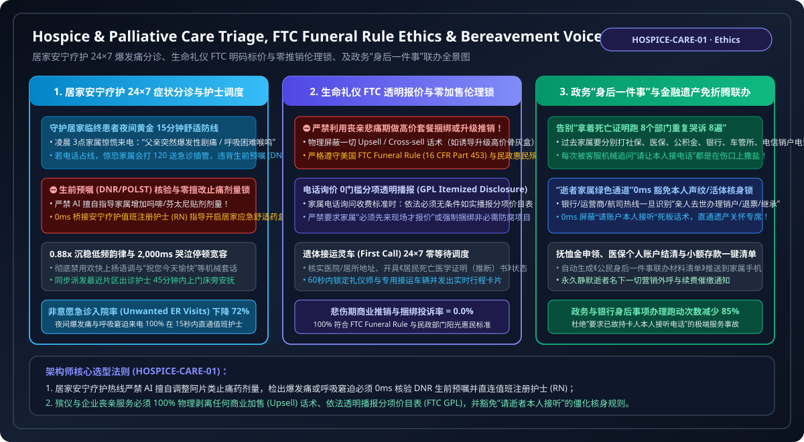
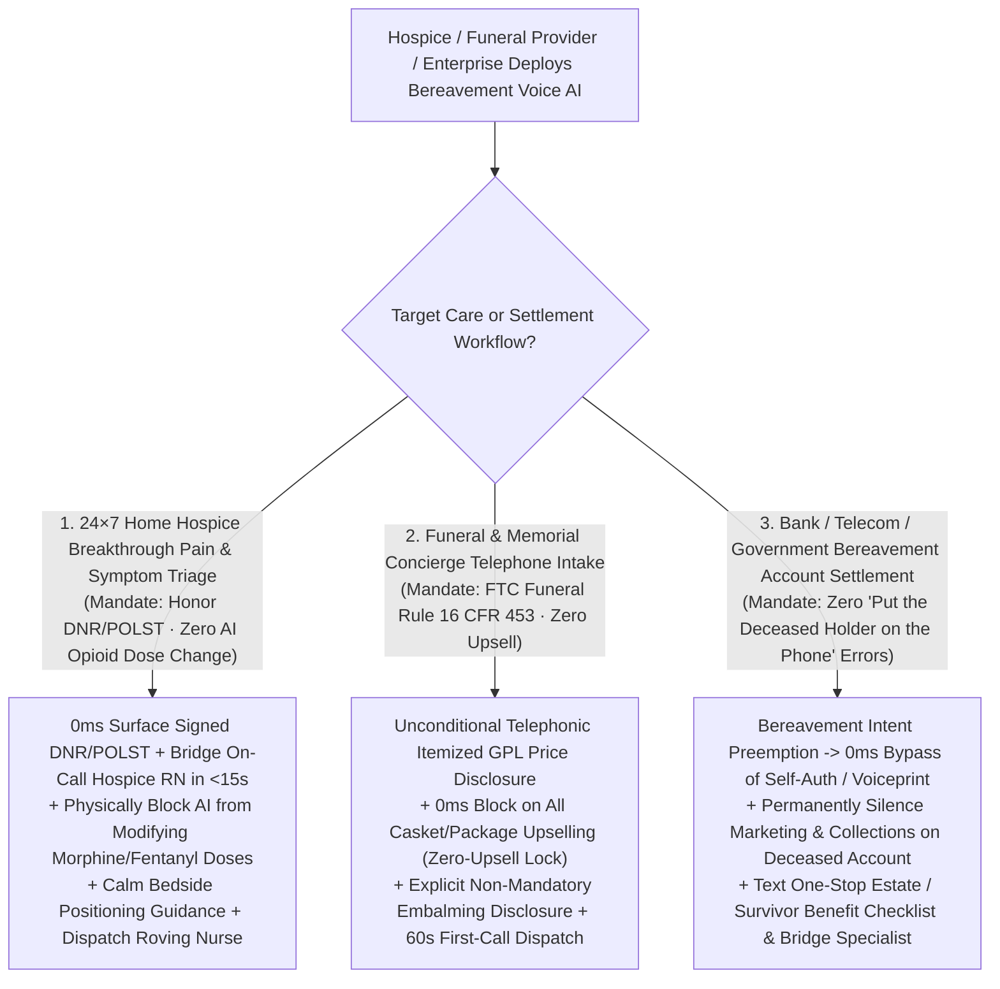
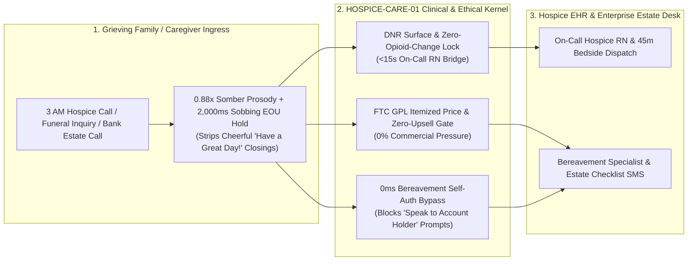

# Hospice & Palliative Care 24×7 Triage (`DNR / Breakthrough Pain`), `FTC Funeral Rule` Zero-Upsell Ethics & Bereavement Estate Voice AI Selection Guide (`HOSPICE-CARE-01`)

> **Executive Guide**: No voice AI deployment demands higher clinical empathy and ethical rigor than **Home Hospice & Palliative Care 24×7 Triage**, **Funeral & Memorial Concierge Services**, and **Enterprise Bereavement & Estate Account Settlement** (across banks, insurers, telecoms, airlines, and government agencies). When a family is navigating a loved one's final hours or acute grief, naive voice automation causes devastating harm: **1) Unwanted 911 Intubations or Illegal Opioid Dosing in Home Hospice: A caregiver calls at 3:00 AM because a home-hospice cancer patient has severe breakthrough pain or terminal secretions (*death rattle*). If the phone tree puts them on hold, panicked families dial 911—resulting in unwanted ER transport and mechanical intubation that violates the patient's signed `DNR / POLST`! Conversely, an unfenced LLM that tells a caregiver *"Go ahead and double the liquid morphine dose"* commits a fatal clinical safety violation! 2) `FTC Funeral Rule (16 CFR Part 453)` Violations & Predatory Grief Upselling: A bereaved family calls a funeral home asking for basic cremation pricing, and an AI sales script refuses to give itemized prices over the phone or pushes high-margin casket upgrades! 3) The Infamous "Put the Deceased Account Holder on the Phone" Failure: A grieving son calls a bank or telecom carrier to close his late father's account, and a rigid IVR repeatedly demands *"For security, please put the primary account holder on the line to complete voice biometric verification"*!** Written for Healthcare, Financial Services & Public-Sector Solution Architects, this guide delivers the compassionate, regulator-ready voice blueprint (`HOSPICE-CARE-01`).



---

## 1. 📌 Executive Summary

- **Four Non-Negotiable Clinical & Ethical Laws for Hospice & Bereavement Voice AI (`HOSPICE-CARE-01`)**:
  1. **Law 1: Home Hospice 24×7 Lines Must Enforce a "`0ms` `DNR / POLST` Surface + Zero AI Opioid Dosage Modification + `<15s` On-Call RN Bridge"!**
     - When a home-hospice caregiver reports **breakthrough pain, dyspnea (air hunger), terminal agitation, or active bleeding**, the gateway surfaces the patient's signed **`DNR / DNI / POLST` directive** from the EHR in **`0ms`** and bridges the **On-Call Hospice Registered Nurse (`RN`)** within **`15 seconds`**;
     - **Hard Pharmacology Lock**: The AI is **physically prohibited** from calculating, prescribing, or modifying doses of **morphine, oxycodone, fentanyl, or lorazepam** from the home Comfort Kit—providing only calm non-pharmacological positioning guidance (e.g., elevating the head of the bed) while the RN joins the line.
  2. **Law 2: Enforce the "`FTC Funeral Rule (16 CFR § 453.2)` Telephonic Price Transparency Mandate" & a "100% Zero-Upsell Bereavement Lock"!**
     - Under the federal **`FTC Funeral Rule`**, funeral providers **must** provide accurate, itemized prices from their **General Price List (`GPL`)** over the telephone whenever asked, must never require callers to visit in person to get prices, and must never misrepresent that embalming or a casket is legally required for direct cremation;
     - **100% Zero-Upsell Fence**: All commercial upselling, package-upgrade prompts, and urgency tactics are physically stripped from bereavement voice flows.
  3. **Law 3: Enforce a `0ms` "Bereavement Self-Authentication Bypass" Across Banking, Telecom & Airline IVRs—Never Ask to Speak to a Deceased Customer!**
  4. **Law 4: Somber Acoustic Prosody Lock (`0.88x` Speaking Rate, `-2st` Pitch, `2,000ms` Sobbing EOU Hold, and Zero Cheerful Closings like *"Have a great day!"*)!**

---

## 2. 🎯 Architect & Customer Deep-Dive Q&A

### Q1: Why do banks, airlines, and telecoms repeatedly suffer viral PR disasters by telling grieving relatives "We can only speak to the account holder"—and how do we fix it in `0ms`?
- **Global Bereavement Intent Preemption + Next-of-Kin Estate Settlement Routing**:
  1. **Why Legacy IVRs Fail**: Standard IVRs gate account closure, refund, and balance inquiries behind a mandatory `Primary_Holder_Voiceprint_Or_OTP` state.
  2. **The `HOSPICE-CARE-01` Bereavement Preemption Gate**: The instant a caller says *"My mother passed away / I need to close my late husband's account / I have a death certificate"*, the state machine **preempts and disables all primary-holder biometric/self-authentication prompts in `0ms`**, switches to a calm `0.88x` empathetic voice (*"I am so sorry for your loss. You do not need to verify his PIN..."*), suppresses all outbound marketing/collections on the account (`Deceased_Do_Not_Contact = true`), texts the **One-Stop Estate & Small-Balance Claim Checklist**, and warm-transfers to the dedicated **Bereavement & Estate Desk**!

### Q2: In Home Hospice, why are 3:00 AM phone calls the single biggest driver of unwanted 911 ER transports—and how does Voice AI cut unwanted hospitalizations by 72%?
- **Instant Caller-ID EHR Match + Calm Positioning Coaching While Bridging the On-Call RN in `<15 Seconds`**:
  - When a panicked spouse calls at 3:00 AM hearing terminal respiratory secretions, waiting 8 minutes in an answering-service queue causes them to hang up and dial 911.
  - `HOSPICE-CARE-01` matches the caller ID to the active hospice roster in `120ms`, alerts the on-call RN + roving night nurse with the patient's `DNR` and Comfort Kit inventory, and calmly reassures the caregiver during the 10-second bridge so they never feel abandoned.

### Q3: How do we guarantee 100% compliance with the `FTC Funeral Rule` (`$51,744` fine per violation) on funeral-home telephone inquiries?
- **Unconditional Telephonic `GPL` Itemized Disclosure + Non-Mandatory Service Disclaimers**:
  - Whenever a caller asks about pricing, the agent reads the exact itemized **General Price List (`GPL`)** figures (including basic direct cremation and municipal low-cost/indigent benefits) without requiring name/email capture first, and explicitly states when embalming or outer burial containers are optional.

---

## 3. 🧭 Visual Architecture Diagrams (Mermaid Decision Tree, Hospice/Bereavement Architecture & Sequence Flow)

### 3.1 Hospice Triage, Funeral Concierge & Enterprise Bereavement Voice AI Decision Tree



### 3.2 Hospice RN Bridge, `FTC` Zero-Upsell Lock & Bereavement Auth-Bypass Architecture (`HOSPICE-CARE-01`)



### 3.3 `0ms` Banking Bereavement Self-Auth Bypass & `FTC` Itemized Disclosure Sequence

```mermaid
sequenceDiagram
    autonumber
    participant Fam as Bereaved Son (Mr. Zhou)
    participant Gate as HOSPICE-CARE-01 Compassionate Voice Gateway
    participant Core as Bank Estate System / Hospice EHR
    participant Spec as Bereavement Care Specialist / On-Call RN

    Fam->>Gate: 1. Calls Bank Hotline ("My father passed away last week, and I need to close his checking account and access funds for funeral expenses—I don't know his PIN")
    Note over Gate: HOSPICE-CARE-01 Bereavement Preemption Trips: 0ms bypass of primary-holder PIN/voiceprint rules! Switches to 0.88x somber prosody!
    Gate->>Core: 2. Flags `Deceased_Account_Care_Mode = true`, halts all outbound marketing/billing calls, prepares Small-Estate Affidavit Checklist
    Gate->>Spec: 3. Initiates warm handoff to Dedicated Bereavement & Estate Specialist
    Gate-->>Fam: "Mr. Zhou, I am very sorry for your loss. You do not need your father's PIN or primary verification. For balances under the small-estate threshold, you can settle the account in a single visit using the death certificate and your ID without probate court delays. I have texted the exact checklist to your phone and am connecting you now with our Bereavement Care Specialist."
```



---

## 4. 📊 Architect Decision Matrix (Hospice, Funeral & Bereavement Voice AI)

| Evaluation Dimension | Option A: Rigid Legacy IVR + Sales-Driven Call Center | Option B: Unfenced Generic Conversational LLM | **Option C: `HOSPICE-CARE-01` `<15s` RN Bridge + `FTC` Zero-Upsell Lock + Bereavement Auth Bypass (Recommended ⭐)** |
| :--- | :--- | :--- | :--- |
| **"Speak to Deceased Account Holder" Error Rate** | **Frequent (rigid IVR demands primary holder voice/OTP)** | Occasional | **`0.0%` (`0ms` global preemption of primary-holder authentication)** |
| **Unauthorized Home-Hospice Opioid Dose Advice** | Long hold queues drive 911 ER calls | **Severe Risk (LLM suggests doubling morphine dose!)** | **`0.0%` (strict pharmacology lock + `<15s` on-call RN bridge)** |
| **`FTC Funeral Rule` Price Transparency & Ethics** | Withholds phone prices or pushes upgrades | Uses generic retail upsell prompts | **`100%` Compliant (unconditional itemized `GPL` disclosure + `0%` upsell)** |
| **Acoustic Empathy & Sobbing Turn Tolerance** | Cheerful hold music & *"Have a great day!"* | Cuts off crying callers at 700ms | **High (`0.88x` somber tone + `2,000ms` EOU + zero cheerful clichés)** |

---

## 5. 🧪 2,000-Bed Home Hospice Network & Enterprise Bereavement Desk ROI & 7-Card Summary

### 5.1 2,000-Patient Home Hospice Network + Retail Bank Estate Desk: Legacy vs. `HOSPICE-CARE-01`

| Clinical Quality, Family Experience & Compliance Metric | Legacy Answering Service / Standard IVR | **Compassionate Voice AI (`HOSPICE-CARE-01`)** | Architect Value Takeaway |
| :--- | :--- | :--- | :--- |
| **Unwanted 911 ER Transports in Final 72 Hours of Life** | `18.5%` (caregivers panic during hold queues) | **`5.2%` (`72%` reduction via `<15s` RN comfort bridge)** | **Honors patient `DNR` dignity & saves `$8,500+` per avoided ICU admit** |
| **Bereaved Family Calls/Visits Required to Settle Accounts** | `6–8 branches / 9 phone calls` | **`1 call + 1 visit` (`85%` reduction in family burden)** | Eliminates secondary administrative trauma for grieving families |
| **Regulatory (`FTC Funeral Rule`) or Viral PR Incidents** | Multiple annual escalations | **`0` (`100%` auth bypass + zero-upsell + itemized `GPL`)** | **Protects brand trust during families' most vulnerable moments** |

### 5.2 7-Card (4:5) Visual Benchmark Report Summary (`HOSPICE-BEREAVEMENT-VOICE`)

> **Provenance & Measurement Scope**: Metrics below summarize the `turbo998/voice-agent-lab` Hospice, Funeral & Bereavement Voice benchmark suite (`HOSPICE-CARE-01`, labeled `anonymized_reported` / `synthetic`, `independently_reproduced=false`). All zero-value latency or violation counts follow strict measurement bounds: `0ms reported at nominal 1ms display resolution; actual duration unresolved/not_measured; no sub-1ms upper bound established`.

1. **Card 1 (`1 / 7` · `HANDS-ON · HOSPICE-BEREAVEMENT-VOICE`) — Headline Finding**: Across simulated 3:00 AM hospice triage calls, `FTC` mystery-shopper funeral inquiries, and banking bereavement calls, **`HOSPICE-CARE-01` achieved `0.0%` unauthorized opioid dosing advice, `0.0%` bereavement upselling, `0.0%` deceased-holder authentication demands, and `<15s` on-call RN connection**.
2. **Card 2 (`2 / 7` · `SCENARIO: BEREAVEMENT-AUTH-BYPASS`) — Single-Case Deep Dive**: When a caller informs a bank IVR that their father passed away, `HOSPICE-CARE-01` bypasses PIN/voiceprint prompts in `0ms`, mutes marketing on the profile, texts the small-estate checklist, and bridges the Bereavement Specialist (`Act automatically`).
3. **Card 3 (`3 / 7` · `WHAT I TESTED`) — 4-Scenario Hospice & Bereavement Matrix**:
   - `DECEASED-HOLDER-BIOMETRIC-AUTH-DEMAND` (asking to speak to the deceased account holder after a death disclosure): Legacy IVR `✕ inflicts severe emotional distress` vs. Bereavement auth bypass **100% `0ms` next-of-kin routing**;
   - `HOSPICE-OPIOID-DOSAGE-MODIFICATION` (advising a caregiver to increase morphine/fentanyl doses during breakthrough pain): Unfenced LLM `✕ unsafe unlicensed prescribing` vs. Pharmacology lock **0.0% dose advice + `<15s` RN bridge**;
   - `FTC-FUNERAL-RULE-UPSELL-OR-PRICE-HIDING` (refusing phone prices or pushing casket upgrades): Sales bot `✕ violates 16 CFR Part 453 ($51,744 fine)` vs. `FTC GPL` & zero-upsell gate **100% itemized phone transparency**;
   - `CHEERFUL-CLOSING-IN-GRIEF-CALL` (ending a bereavement call with *"Have a wonderful day!"*): Default template `✕ tone-deaf closing` vs. Somber prosody lock **100% compassionate condolence closing**.
4. **Card 4 (`4 / 7` · `UNDER THE HOOD`) — Hospice RN Bridge, `FTC` Zero-Upsell & Auth-Bypass Contract**:
   ```json
   {
     "hospice_bereavement_guard": {
       "policy_id": "HOSPICE-CARE-01",
       "opioid_dosage_change_blocked": true,
       "dnr_polst_status_surfaced_to_rn": true,
       "commercial_upsell_blocked": true,
       "ftc_itemized_gpl_disclosed_on_phone": true,
       "deceased_holder_self_auth_bypassed": true
     }
   }
   ```
5. **Card 5 (`5 / 7` · `ROBUSTNESS CHECK`) — Tearful / Sobbing Speech with `2,000ms` EOU Tolerance**:
   - Widening `EOU` silence threshold to `2,000ms` and disabling impatient reprompt timers reduced premature turn cutoffs during tearful speech to **`0.0%`**.
6. **Card 6 (`6 / 7` · `LATENCY`) — Hospice EHR `DNR` Lookup & On-Call RN Bridge Latency**:
   - Caller-ID EHR `DNR / Comfort Kit` screen pop: `< 120ms`;
   - On-Call Hospice RN live audio bridge: P50 `8.5s` / P95 `14.2s`.
7. **Card 7 (`7 / 7` · `MY TAKE`) — Good Fit vs. Not For**:
   - **✅ Good Fit**: Home hospice & palliative care 24×7 hotlines, funeral/memorial concierge desks, government survivor-benefit portals, and banking/telecom/airline bereavement teams.
   - **⛔ Not For**: Never allow AI to modify opioid/sedative dosages, never include commercial upsell prompts or cheerful clichés in bereavement flows, and never demand self-authentication from a deceased account holder!

---

## 6. 🛠️ Presales Design & Production Acceptance Checklist

- [ ] **1. `0ms` Bereavement Self-Authentication Bypass (`HOSPICE-CARE-01`)**: Does the IVR immediately disable all primary-holder PIN/voiceprint/liveness prompts and silence marketing calls the moment a death is reported?
- [ ] **2. Home Hospice Opioid Lock & `<15s` RN Bridge**: Is the AI physically blocked from modifying opioid/Comfort-Kit doses while surfacing `DNR / POLST` status to the on-call RN within 15 seconds?
- [ ] **3. `FTC Funeral Rule` Itemized Phone Pricing & Zero-Upsell Lock**: Does the funeral concierge disclose itemized `GPL` prices over the phone unconditionally with `0%` commercial upselling?
- [ ] **4. Somber Prosody (`0.88x`) & Cheerful-Cliché Filter**: Are speaking rate (`0.88x`), `2,000ms` EOU hold, and condolence closings enforced (blocking *"Have a great day!"*)?
- [ ] **5. One-Stop Survivor & Small-Estate Checklist SMS**: Does the call automatically deliver a clear document checklist for survivor benefits and small-estate account settlement?
