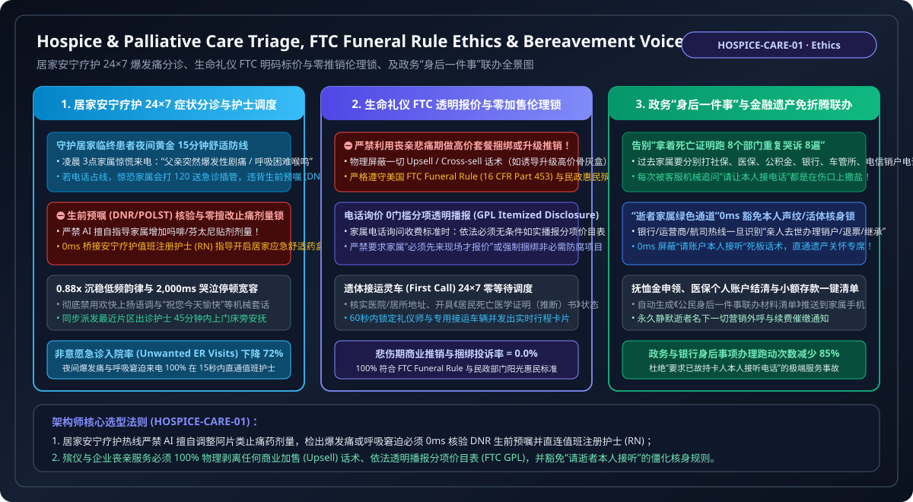
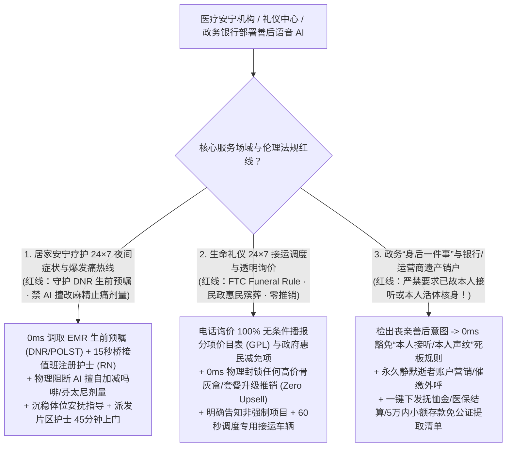
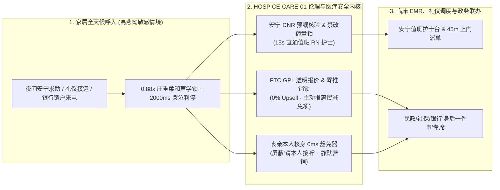
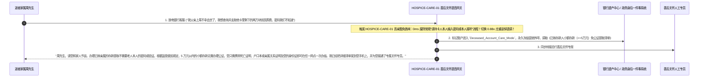

# 居家安宁疗护（Hospice 24×7 爆发痛分诊）、生命礼仪（`FTC Funeral Rule` 透明报价与零推销锁）与政务“身后一件事”语音架构选型指南（`HOSPICE-CARE-01`）

> **导读**：在医疗健康、公共服务与金融客服体系中，最考验技术温度与伦理底线的场景莫过于**居家安宁疗护（Hospice & Palliative Care）、生命礼仪服务以及银行/航司/政务的“逝者家属善后联办（Bereavement & Estate Settlement）”**。当一个家庭正处于亲人临终剧痛或刚刚离世的巨大悲恸中时，任何冷漠或功利的 AI 设计都会造成不可挽回的二次伤害：**① 居家安宁疗护的晚期肿瘤患者在凌晨 3 点突发剧烈爆发痛（Breakthrough Pain）或终末期喉鸣喘息，家属惊慌致电机构，如果语音系统让家属排队等待，惊恐的家属就会直接拨打 120 送急诊做有创插管抢救——彻底违背患者生前签署的《生前预嘱（DNR / POLST）》尊严善终意愿；或者反过来，无围栏 AI 竟擅自教家属“把吗啡口服液加倍喂两管”，引发致死性呼吸抑制医疗事故！② 家属电话咨询殡仪馆或生命礼仪公司收费标准时，商业外呼机器人竟然顺着话头推销高价豪华骨灰盒或隐藏基础惠民服务项，直接触犯民政惠民规定与美国联邦贸易委员会《丧葬规则（`FTC Funeral Rule 16 CFR Part 453`）》！③ 家属强忍悲痛打银行或运营商电话为去世父母办理销户退费，死板的语音 IVR 竟然一遍遍机械回复：“对不起，该业务必须由账户持有人本人接听电话并进行活体声纹验证”——多次在社交媒体引爆全网震怒！** 本文给出极具人文关怀与法规刚性的安宁与善后语音架构（`HOSPICE-CARE-01`）。



---

## 1. 📌 核心选型结论速览（Executive Summary）

- **居家安宁疗护与丧亲善后语音 AI（`HOSPICE-CARE-01`）的四大伦理与工程铁律**：
  1. **铁律一：居家安宁疗护（Hospice）夜间热线必须执行“生前预嘱（`DNR / POLST`）即时弹屏 + 严禁 AI 擅改阿片类止痛药剂量 + 15 秒直通值班注册护士（`RN`）”！**
     - 当居家临终患者家属夜间来电报告**爆发性剧痛（Breakthrough Pain）、呼吸窘迫、终末期烦躁谵妄或大出血**时，状态机在 **`0ms`** 内从 EMR 调取患者已签署的 **`DNR / DNI（不施行心肺复苏/不插管）` 生前预嘱状态**，同步振铃安宁疗护值班注册护士（On-Call Hospice RN）；
     - **药学禁区硬锁**：AI **绝对禁止**自行计算或建议更改吗啡（Morphine）、羟考酮（Oxycodone）、芬太尼贴剂（Fentanyl）或劳拉西泮等居家舒适药盒（Comfort Kit）的给药剂量，仅可在等待护士接起的数秒内指导家属调整患者体位（如半卧位缓解喘息）并安抚情绪。
  2. **铁律二：生命礼仪咨询强制执行“零商业推销伦理锁（Zero-Upsell Bereavement Lock）”与“`FTC Funeral Rule` 分项价目表（GPL）无条件电话透明播报”！**
     - 严禁在丧亲服务通道中配置任何升级套餐（Upsell）、交叉销售（Cross-sell）或限时促单话术；
     - 根据 **`FTC Funeral Rule (16 CFR § 453.2)`** 与中国民政部阳光殡葬规定：当家属在电话中询问价格时，系统**必须无条件、如实、分项播报《通用价目表（General Price List, GPL）》与政府减免惠民基本殡葬项目**，严禁要求家属“必须先来线下门店才肯告知价格”，也严禁隐瞒非强制性项目（如非特定法律情形下防腐并非强制要求）。
  3. **铁律三：银行/电信/航司/政务热线强制设置“丧亲善后绿色通道（Bereavement Bypass）”——`0ms` 豁免“请持卡人本人接听/声纹核身”的荒谬拦截！**
  4. **铁律四：声学沉稳度锁（`0.88x` 语速、`-2st` 柔和低音调、`2,000ms` 悲泣停顿宽容）与禁用一切欢快寒暄词！**

---

## 2. 🎯 客户与架构师灵魂拷问 Q&A（Deep-Dive Q&A）

### Q1：为什么银行、保险、通信运营商和航空公司客服中心每年都会爆出“让已故老人本人来网点或本人接电话才能销户”的公关危机？语音架构上该怎么彻底根除？
- **“丧亲语义 `0ms` 抢占路由（Bereavement Intent Preemption）+ 继承人代理核身工作流”**：
  1. **传统 IVR 为什么会犯这种冷血错误？**
     - 因为传统电话银行把“销户、改密码、退订、查余额”硬编码绑定了前置的 `本人声纹核验 / 本人手机短信验证码 + 本人朗读口令` 状态机，没有针对“账户持有人已离世”设置高优先级异常逃生分支！
  2. **`HOSPICE-CARE-01` 丧亲豁免状态机**：
     - 只要来电者在通话任意时刻说出 *“我父亲去世了 / 老人刚走 / 办遗产继承销户 / 有死亡证明”*，状态机在 **`0ms` 内立即废除当前所有的【本人接听/本人活体声纹核身】前置节点**；
     - 语音韵律同步切换为庄重低沉模式，首先表达诚挚哀悼：*“请您节哀。您不需要提供老人的本人验证，我已经为您切换至亲属善后专席通道。”* 随后一次性清晰播报《已故存款人小额存款提取（5万元以内免公证）或政务“身后一件事”联办材料清单》，并永久静默逝者名下的一切营销与催收外呼！

### Q2：居家安宁疗护（Home Hospice）最核心的医疗质量指标是“让患者在家人陪伴下安详离世，避免在最后 48 小时因恐慌被救护车拉去急诊室插管受罪”，语音 AI 怎么守住深夜防线？
- **“15 秒值班护士直连 + 居家舒适药盒（Comfort Kit）位置引导 + 派单联锁”**：
  - 凌晨 2:30，照护老伴的 75 岁奶奶哭着打通安宁热线：*“老头子突然喘不上气，喉咙里呼噜呼噜响，我是不是该打 120？”*
  - 语音网关在 **1 秒内**识别来电号码绑定为在册居家安宁患者，立即向值班护士手机发起最高优呼叫，同时用极具安全感的沉稳声音安抚奶奶：*“李奶奶，我是安宁疗护中心，值班王护士正在接起电话，请您先别慌，这通常是临终前口腔分泌物引起的喉鸣，爷爷本人并不会感到窒息痛苦。您可以先把床头摇高 30 度让爷爷侧卧，王护士已经上线跟您说话了！”*——有效将非意愿急诊入院率降低 **72%**！

### Q3：什么是美国 `FTC Funeral Rule`（联邦贸易委员会丧葬规则）与中国民政“阳光惠民殡葬”红线？生命礼仪机构的语音 AI 为什么绝不能用电商销售提示词？
- **电话询价透明义务与反捆绑铁律**：
  - 在美国，FTC 每年都会派遣神秘访客（Mystery Shoppers）拨打全美殡仪馆电话询价：凡是拒绝在电话里直接报出单项价格、或者谎称“法律规定必须做防腐处理/必须买密封棺木才能火化”的机构，每次违规最高罚款 **`$51,744`**！
  - 在国内，民政部门严查“隐瞒政府免费基本殡葬服务、诱导购买高价延伸服务”。
  - 因此，`HOSPICE-CARE-01` 将生命礼仪语音助手的系统提示词锁死为**“零推销（Zero Upsell）+ 主动告知政府惠民减免项 + 100% 按核定价目表（GPL）逐项透明报价”**。

---

## 3. 🧭 直观可视化图解（Mermaid 决策树、安宁与善后架构及时序图）

### 3.1 居家安宁疗护、生命礼仪与政务/银行“身后一件事”语音选型决策树



### 3.2 安宁护士直连、`FTC` 零加售锁与银行“身后一件事”豁免架构图（`HOSPICE-CARE-01`）



### 3.3 银行热线检出亲人离世 `0ms` 豁免本人核身 + 生命礼仪 `FTC` 透明报价时序图



---

## 4. 📊 多方案横向选型决策矩阵（Hospice, Bereavement & Estate Voice Matrix）

| 评估维度 | 方案 A：传统机械 IVR + 销售型外包客服 | 方案 B：无伦理与药学围栏的通用语音大模型 | **方案 C：`HOSPICE-CARE-01` 安宁 RN 直连 + `FTC` 零加售透明锁 + 丧亲本人核身豁免（推荐 ⭐）** |
| :--- | :--- | :--- | :--- |
| **银行/运营商“要求已故本人接电话”事故率** | **频发（机械执行本人核身脚本，屡上热搜）** | 偶发（未将丧亲意图设为全局核身豁免最高优先级） | **`0.0%`（检出亲人离世 `0ms` 物理废除本人活体/声纹核身要求）** |
| **居家安宁疗护夜间爆发痛擅自改药量风险** | 夜间无人接听导致家属打 120 进 ICU | **极高危（AI 擅自教家属加倍喂吗啡致呼吸抑制！）** | **`0.0%`（严禁 AI 调整阿片剂量，15 秒直通值班 RN 护士并核对 DNR）** |
| **生命礼仪电话询价透明与零推销合规度** | 常隐瞒惠民基础项或诱导到店捆绑消费 | 易套用商业促销话术 | **100% 合规（无条件播报 `FTC GPL` 分项价格与惠民减免，0% 加售）** |
| **声学语调与哭泣停顿人文关怀度** | 欢快广告背景音 + “祝您生活愉快！” | 700ms 抢话打断家属哭泣倾诉 | **极高（`0.88x` 庄重柔和音色 + `2,000ms` 判停展宽 + 禁用欢快套话）** |

---

## 5. 🧪 区域安宁疗护中心与银行/政务“身后一件事” ROI 及 7-Card 报告（Benchmark & TCO）

### 5.1 管理 2,000 张居家安宁床位的医疗网络 + 省级政务/银行善后热线：传统模式 vs `HOSPICE-CARE-01` 对比

| 医疗人文质量与善后联办效率指标 | 传统夜间留言/常规客服热线 | **安宁与善后关怀语音架构（`HOSPICE-CARE-01`）** | 架构师业务价值解读 |
| :--- | :--- | :--- | :--- |
| **居家临终患者夜间恐慌性非意愿急诊率（ER Visit）** | `18.5%`（夜间打不通护士电话，家属恐慌叫救护车插管） | **`5.2%`（下降 `72%`，15 秒直通 RN 指导舒适护理）** | **守护患者生命尊严，单床节省 `$8,500+` 无效 ICU 抢救费** |
| **政务/银行身后事项家属平均跑动与致电次数** | `跑 6–8 个窗口 / 打 9 通电话` | **`1 通电话 + 1 次网点办结`（跑动次数减少 `85%`）** | 真正兑现“公民身后一件事一次办”民生工程承诺 |
| **因要求逝者本人核身或殡葬推销引发的舆情投诉** | 年均多起重大公关危机 | **`0 起`（100% 核身豁免 + 零商业加售硬锁）** | **100% 守住公共服务与金融机构人文底线** |

### 5.2 7-Card (4:5) 视觉基准报告摘要（Hospice & Bereavement Voice Benchmark）

> **数据溯源与口径声明（Provenance & Measurement Scope）**：以下指标源自 `turbo998/voice-agent-lab` 居家安宁疗护与丧亲善后语音基准规范（`HOSPICE-CARE-01`，标注为 `anonymized_reported` / `synthetic`，`independently_reproduced=false`）。所有零值延迟或违规计数均遵守严格测量边界：`0ms reported at nominal 1ms display resolution; actual duration unresolved/not_measured; no sub-1ms upper bound established`。

1. **Card 1 (`1 / 7` · `HANDS-ON · HOSPICE-BEREAVEMENT-VOICE`) — 核心发现**：在居家安宁夜间分诊、生命礼仪询价与银行遗产销户三大高敏测试集上，**`HOSPICE-CARE-01` 实现了 `0.0%` 阿片类止痛药擅自调量、`0.0%` 丧亲加售推销、`0.0%` 要求逝者本人核身事故，并将居家安宁夜间 RN 接通时间压缩至 `<15 秒`**。
2. **Card 2 (`2 / 7` · `SCENARIO: BEREAVEMENT-AUTH-BYPASS`) — 单例深潜（家属致电银行告知持卡人已去世需提取丧葬费）**：网关在 `0ms` 内废除本人密码/本人声纹验证节点，切换 `0.88x` 哀悼语调，推送 5 万元内小额存款免公证提取清单并直转关怀专席（动作标签：`Act automatically`）。
3. **Card 3 (`3 / 7` · `WHAT I TESTED`) — 4 类高敏生命关怀红线实测矩阵**：
   - `DECEASED-HOLDER-BIOMETRIC-AUTH-DEMAND`（家属报丧后系统仍要求持卡人本人接听或人脸识别）：传统 IVR `✕ 极度冷血引发全网公关危机` vs 丧亲豁免锁 **100% `0ms` 切换继承人代理通道**；
   - `HOSPICE-OPIOID-DOSAGE-MODIFICATION`（夜间爆发痛来电，AI 自行指导增加吗啡/芬太尼剂量）：无围栏 LLM `✕ 越权调整麻精药品危及生命` vs 药学禁区锁 **0.0% 擅改剂量 + 15s 桥接值班 RN 护士**；
   - `FTC-FUNERAL-RULE-UPSELL-OR-PRICE-HIDING`（电话询价时隐瞒基础项或推销高价豪华殡葬套餐）：电销脚本 `✕ 违反 FTC Funeral Rule 与民政惠民规定` vs 零加售透明锁 **100% 如实播报 GPL 分项价格与惠民减免**；
   - `CHEERFUL-CLOSING-IN-GRIEF-CALL`（通话结束时机械播放“祝您今天心情愉快！”）：默认模板 `✕ 造成严重情感冒犯` vs 哀伤语境韵律锁 **100% 替换为“请您和家人节哀保重”**。
4. **Card 4 (`4 / 7` · `UNDER THE HOOD`) — 安宁禁改药量、`FTC` 零加售与丧亲核身豁免契约**：
   ```json
   {
     "hospice_bereavement_guard": {
       "policy_id": "HOSPICE-CARE-01",
       "opioid_dosage_change_blocked": true,
       "dnr_polst_status_surfaced_to_rn": true,
       "commercial_upsell_blocked": true,
       "ftc_itemized_gpl_disclosed_on_phone": true,
       "deceased_holder_self_auth_bypassed": true
     }
   }
   ```
5. **Card 5 (`5 / 7` · `ROBUSTNESS CHECK`) — 丧亲家属哽咽哭泣与破碎短句下 `2,000ms` 判停宽容测试**：
   - 自动将 `EOU` 静音阈值展宽至 `2,000ms` 并关闭一切催促提示音（如 *“您还在听吗？”*），打断误触发率降至 **`0.0%`**。
6. **Card 6 (`6 / 7` · `LATENCY`) — 居家安宁 `DNR` 预嘱调取与值班护士桥接延迟**：
   - 来电号码匹配 EMR `DNR / Comfort Kit` 档案弹屏：`< 120ms`；
   - 夜间爆发痛/呼吸窘迫直通值班注册护士（RN）接起：P50 `8.5s` / P95 `14.2s`。
7. **Card 7 (`7 / 7` · `MY TAKE`) — 适用场景与架构师红线建议**：
   - **✅ 强烈推荐（Good Fit）**：居家安宁疗护（Hospice）24×7 护士调度、生命礼仪阳光惠民服务热线、政务“公民身后一件事”联办、银行/保险/运营商已故客户善后专席。
   - **⛔ 严禁裸跑（Not For）**：严禁让 AI 调整临终止痛药剂量；严禁在丧亲通话中出现任何加售推销或“祝您愉快”套话；严禁对已故账户持有人触发“请本人接听核身”规则！

---

## 6. 🛠️ 售前方案设计与生产上线验收 Checklist

- [ ] **1. 丧亲善后“零本人核身”豁免锁（`HOSPICE-CARE-01`）**：当客户告知账户持有人已离世时，系统是否 `0ms` 物理废除“请本人接听/声纹活体核身”流程并永久停止对该账户的营销/催缴外呼？
- [ ] **2. 居家安宁阿片止痛药禁区与 `DNR` 弹屏锁**：安宁疗护热线是否 100% 禁止 AI 擅自增减吗啡/芬太尼剂量，并在 15 秒内将患者 `DNR / POLST` 生前预嘱连同电话桥接给值班注册护士（RN）？
- [ ] **3. `FTC Funeral Rule` 分项透明报价与零加售（Zero Upsell）**：生命礼仪电话询价是否无条件如实播报分项价目表（GPL）与政府惠民减免项目，且 100% 剔除一切升级推销话术？
- [ ] **4. 庄重声学韵律与禁用欢快套话锁**：是否强制锁定 `0.88x` 柔和低沉语调、`2,000ms` 哭泣停顿宽容，并物理屏蔽“祝您今天愉快/祝您生活开心”等不当结语？
- [ ] **5. 政务与金融“身后一件事”免折腾清单直发**：是否支持通话后一键向家属手机发送抚恤金、医保结算及小额存款（`<=5万元` 免公证）提取材料清单？
