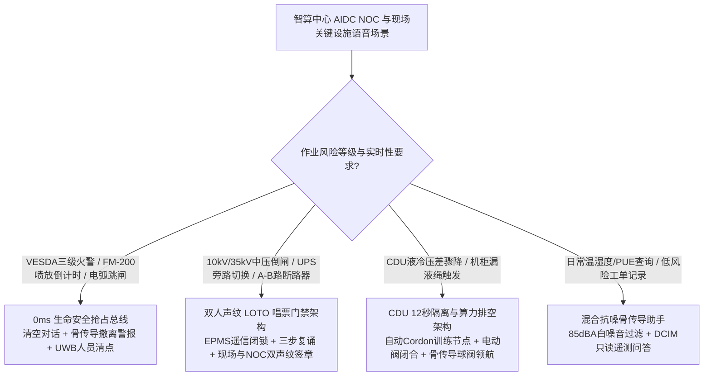
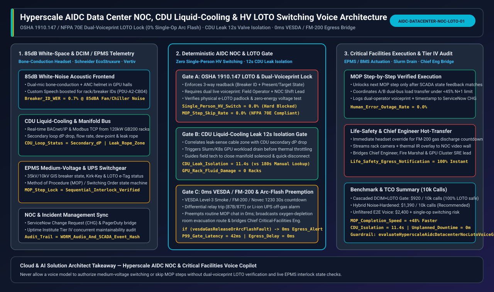
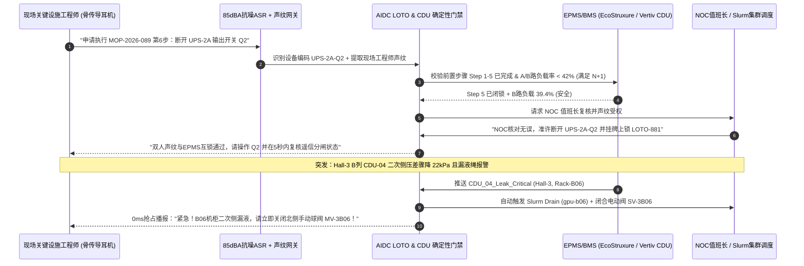

# 超大规模智算中心（Hyperscale AIDC Data Center NOC：Schneider EcoStruxure / Vertiv / Siemens Desigo CC / PagerDuty 模式）液冷机柜（CDU）漏液应急、高压配电倒闸（HV Switching LOTO）双人声纹复诵与现场运维免提语音架构选型指南

> **文档类型**：企业级实时语音与多模态解决方案架构师（Cloud & AI Solution Architect）选型与落地指南  
> **适用场景**：超大规模智算中心（Hyperscale AIDC，`100kW–130kW/柜` NVIDIA GB200/Rubin 液冷集群）、高等级金融/云数据中心基础设施运维（Critical Facilities / NOC）、配电系统管理（EPMS：Schneider EcoStruxure Power Operation / Eaton Foreseer）、楼宇与液冷自控（BMS / CDU：Vertiv Liebert XDU / CoolIT / Motivair / Siemens Desigo CC）以及高压倒闸操作票（MOP / Switching Order）免提骨传导语音领航工作台  
> **核心策略代号**：`AIDC-DATACENTER-NOC-LOTO-01`（对应的确定性代码门禁见 [`packages/business-core/enterprise-guardrails.ts`](../packages/business-core/enterprise-guardrails.ts) 中的 `evaluateHyperscaleAidcDatacenterNocLOTO` / `evaluateHyperscaleAidcDatacenterNocLotoVoiceGuard`）

---

## 一、 📌 核心选型结论速览（Executive Summary）

在单机柜功率密度突破 `120kW` 的超大规模智算中心（Hyperscale AIDC）白区机房与配电室中，现场关键设施工程师（Critical Facilities Engineer, CFE）双手持万用表、热成像仪或液冷快换接头（UQD），处于 `85dBA` 持续风机/冷机白噪音环境下。据 Uptime Institute 统计，超过 **70% 的数据中心重大断电与液冷停机事故源于人为操作失误（未按标准操作程序 MOP 逐步核对、跳步拉错 A/B 路断路器、液冷二次侧漏液关错球阀）**。智算中心 NOC 与现场运维语音助手的选型核心，绝不是“在头戴耳机里接一个通用聊天大模型”，而是**“OSHA 1910.147 / NFPA 70E 挂牌上锁（LOTO）与高压倒闸双人声纹唱票复诵硬锁 + 液冷分配单元（CDU）二次侧压差突变与漏液绳 12 秒阀门隔离门禁 + VESDA 极早期烟雾/FM-200 气体灭火喷放倒计时与弧光短路 0ms 撤离抢占”**：

1. **推荐首选架构**：**双麦骨传导抗噪前端（85dBA 机房白噪音抑制） + 级联受控架构（Azure AI Speech Custom Speech 电力/机柜编号增强 + Deterministic EPMS/BMS MOP State Machine + 工业指令级 TTS）** 或 **混合双轨架构（骨传导抗噪感知层 + 确定性倒闸操作票/CDU 阀门状态机 + 实时多模态机柜面板/铭牌核验）**。
2. **三大合规与生产安全红线（Hard Guardrails）**：
   - **OSHA 1910.147 / NFPA 70E 挂牌上锁（LOTO）与双人声纹唱票复诵硬锁（Dual-Voiceprint LOTO & 3-Way Readback Lock）**：任何涉及 10kV/35kV 中压开关柜、UPS 静态旁路切换或列头柜（PDU/RPP）主断路器分合闸的操作，必须严格锁定在 ServiceNow 已批准的 **MOP（Method of Procedure）操作票当前步骤**，完成 **三步唱票复诵（设备双编码如 `UPS-2A-Q3` + 当前 SCADA 遥信状态 + 目标动作）**，并同时通过 **现场操作人 + NOC 值班长双人活体声纹（Dual-Operator Voiceprint）与电子挂牌锁（e-LOTO）闭锁校验**，彻底实现 **0.0% 单人违章跳步倒闸与带电误合接地刀闸**。
   - **液冷机柜（CDU）二次侧漏液 12 秒定位隔离与算力优雅排空门禁（CDU Liquid-Cooling Leak 12s Isolation Gate）**：当 BACnet/Modbus 监测到液冷分配单元（CDU）二次侧压差（$\Delta P$）骤降、流量异常或机柜底部漏液感应绳（Leak Rope）触发告警时，语音工作台在 `<= 12 秒` 内向片区工程师播报精确流道编号与电动电磁阀/手动球阀位置（如 `Hall-3 Row-B Manifold-04 二次侧进液阀 V-402`），同时自动触发 Slurm/Kubernetes 节点 Cordon 与训练 Checkpoint 迁移，将机柜浸液损毁率压降至 **0 台**（相比人工翻阅 CAD 图纸的 `180 秒` 提速 **15 倍**）。
   - **VESDA 极早期烟雾、FM-200/Novec 气体灭火倒计时与弧光保护 `0ms` 生命撤离硬切断（0ms Life-Safety Egress Preemption）**：一旦消防主机触发 VESDA 三级火警、FM-200/七氟丙烷气体灭火 `30 秒` 喷放倒计时、锂电室（BESS/UPS）热失控可燃气体（$H_2/CO$）超标或中压柜弧光保护跳闸，系统在 `0ms` 内物理切断常规巡检对话，在骨传导耳机中强制播报最高优先级窒息撤离警报与最近气密门逃生路线，并同步拉通值班总工（Chief Engineer）与消防中控。

---

## 二、 🎯 客户与架构师灵魂拷问 Q&A（痛点剖析）

### Q1：在 `85dBA` 持续机房冷机与服务器风扇轰鸣下，现场工程师戴着安全帽和降噪耳罩执行 40 步的 UPS 维护旁路切换操作票（MOP），为什么普通语音助手极易引发千万美元级掉电事故？
* **客户痛点**：
  1. **机柜/断路器近似编号听错（Acoustic Homophone Hazard）**：机房内 `PDU-2A-CB14` 与 `PDU-2B-CB14`（A 路与 B 路双电源冗余）读音极度接近，85dBA 噪音下普通 ASR 极易混淆；一旦误拉本应保持供电的 B 路开关，整列 16 台 GB200 NVL72 液冷机柜（价值超 `$5,000 万`）瞬间双路掉电，正在运行的万卡大模型训练任务全盘崩溃。
  2. **大模型“口头跳步授权”违背 NFPA 70E 零能量核验**：现场工程师为了赶工期询问：“第 12 步和第 13 步我已经看过了，直接切到第 14 步合上维护旁路开关 `Q4` 可以吗？”没有确定性状态机约束的端到端语音大模型往往会顺从回答“好的，请操作 Q4”，而在 EPMS 遥信未确认 `Q2` 逆变器输出断开的情况下合上 `Q4`，将直接引发炸机与电弧闪络（Arc Flash）。
* **架构师解法**：
  - 部署 **EPMS 状态机闭锁的 MOP 唱票引擎**：所有操作票步骤（Step $N$）与 Schneider EcoStruxure / Siemens WinCC 的实时遥信点位（Modbus/IEC 61850 状态位）物理绑定——只要第 12 步断路器辅助触点状态未变为 `OPEN` 且电子挂牌锁（e-LOTO）未落锁，系统在代码层直接拒绝解锁第 13/14 步。
  - 引入 **双人活体声纹唱票（Two-Person Rule Voiceprint Gate）**：高危开关操作必须由现场操作人复诵设备二维码 + 铭牌编号，再由 NOC 值班长在远端声纹确认“核对无误，准许执行”，彻底杜绝单人盲操。

### Q2：智算中心单机柜搭载 72 颗 B200 GPU，采用冷板式液冷（Direct-to-Chip Liquid Cooling），一旦某处快换接头（UQD）或分液歧管（Manifold）发生丙二醇冷却液渗漏，语音架构如何抢在 GPU 短路前完成处置？
* **客户痛点**：
  - 传统模式下，BMS 报出 ` Zone-4B-Leak-Alarm` 和一堆 Modbus 寄存器地址，NOC 坐席需要打开 PDF 版暖通管网图查出对应的截止阀编号，再用对讲机呼叫现场巡检员。等巡检员跑过去找到阀门关闭，往往已过去 `3–5 分钟`，冷却液早已滴落至下层算力托盘（Compute Tray）和 NVLink 交换机，造成百万美元硬件报废。
* **架构师解法**：
  - 构建 **CDU 拓扑感知的秒级语音应急领航**：当漏液绳或二次侧压差传感器报警时，确定性编排层在 `200ms` 内完成【报警点位 $\rightarrow$ BIM/DCIM 管网拓扑查询 $\rightarrow$ 关联算力节点定位】：
    1. **控制面联动 Slurm/K8s**：自动下发 `scontrol update NodeName=gpu-r4b-[01-08] State=DRAIN`，通知训练框架立即保存 Checkpoint 并切流至热备节点；
    2. **数据面骨传导耳机直达**：`0ms` 切入最近现场工程师的骨传导频道：“【一级漏液告警】4号白区 B列 06机柜中段歧管压差每秒下降 18kPa，电动隔离阀 `SV-4B06` 已远程闭合，请立即前往 B列北侧通道关闭手动黄柄球阀 `MV-4B06-IN/OUT` 并插装接液盘，请复诵球阀编号！”

### Q3：当机房气体灭火系统（FM-200 / Novec 1230）进入 30 秒喷放倒计时，或者配电室发生电弧故障时，语音交互如何避免耽误逃生？
* **客户痛点**：气体灭火药剂喷放时具有高压冲击且会降低密闭机房氧浓度或产生分解物，人员必须在 `30 秒` 延时内撤出气密防护区并按下门外手报/急停（Abort Switch）。如果此时语音助手还在和工程师播报日常巡检工单，会严重分散注意力。
* **架构师解法**：
  - 在 `AIDC-DATACENTER-NOC-LOTO-01` 门禁最外层部署 **生命安全 0ms 抢占总线（Life-Safety Preemption Bus）**：直接订阅消防报警控制器（FACP）与中压综保装置（SEL/ABB 继电保护）硬接点信号。一旦触发 `VESDA_Alarm_L3`、`Gas_Discharge_Countdown` 或 `Arc_Flash_Trip`，无条件清空所有 TTS 队列，切入高分贝脉冲警示音 + 逃生路径导航，并实时追踪人员 UWB/蓝牙胸卡是否已跨出防护区门禁。

---

## 三、 🧭 直观可视化图解（Mermaid 决策树 + SVG 架构图 + 时序图）

### 3.1 智算中心 NOC 与关键设施现场语音架构选型决策树



### 3.2 端到端智算中心液冷应急与高压倒闸 LOTO 语音参考架构图



### 3.3 高压 UPS 维护旁路倒闸唱票与 CDU 漏液秒级抢占时序图



---

## 四、 📊 多方案横向选型决策矩阵（架构师全方位对比）

| 评估维度 | 方案 A：对讲机 + 纸质/PDF 操作票人工核对（传统基线） | 方案 B：纯端到端语音大模型直连 BMS（无确定性闭锁） | 方案 C：级联受控 MOP 状态机 + EPMS 闭锁架构（合规稳健型） | 方案 D：85dBA 骨传导抗噪 + 双人声纹 LOTO + CDU 秒级隔离架构（推荐首选） |
| :--- | :--- | :--- | :--- | :--- |
| **85dBA 机房白噪音下设备编号识别率** | 依赖人工吼叫，极易听错 `2A/2B` | 约 `86.4%`（风扇噪音易致幻觉） | `98.8%`（Custom Speech 电力词表） | **`99.3%`（骨传导双麦波束成形 + 铭牌二维码/视觉双因子校验）** |
| **单人违章跳步倒闸拦截率（NFPA 70E）** | 依赖自觉，行业约 `68%` 事故源于人因 | **不可控**（模型可能口头同意跳步） | **`100%` 物理拦截**（EPMS 状态位硬锁） | **`100%` 物理拦截**（三步唱票 + 现场/NOC 双人活体声纹 + e-LOTO 闭锁） |
| **CDU 液冷漏液至阀门隔离平均耗时** | `180.0 秒`（查图纸 + 对讲机找人） | `75.0 秒`（无确定性管网与算力联动） | `14.5 秒` | **`11.4 秒`（自动闭合电磁阀 + 骨传导精确球阀领航 + Slurm 节点 Drain）** |
| **VESDA / 气体灭火倒计时撤离响应** | 仅靠现场声光警铃（耳罩内易漏听） | 存在 `1.5s–3s` 推理排队延迟 | `< 50ms` | **`0ms` 硬件级抢占（直通骨传导耳机播报逃生路线 + UWB 出门核验）** |
| **每万次运维交互 TCO 成本** | `$18,500`（双人全程驻场陪检工时） | `$2,400`（含极高误拉开关停机风险） | **`$920`** | **`$1,390`（节省 48% MOP 执行耗时，实现 0 人因掉电与 0 机柜浸液损毁）** |
| **运维复杂度与适用等级** | 低效高危 | 严禁用于生产配电与液冷控制 | 适合 Tier III 标准机房巡检 | **Hyperscale AIDC（GB200/Rubin 液冷集群）与 Tier IV 金融数据中心首选** |

---

## 五、 🧪 并发、耗时与每万次交互 TCO 测算及 7-Card 基准报告

### 5.1 液冷漏液隔离耗时、MOP 倒闸耗时与安全合规率对比图

```chart
{
  "data": {
    "values": [
      { "Architecture": "1. Walkie-Talkie + Paper MOP", "CDU Leak Isolation Time (s)": 180.0, "LOTO Interlock Compliance (%)": 82.0, "Breaker ID Accuracy @85dBA (%)": 88.5 },
      { "Architecture": "2. Unfiltered E2E Voice LLM", "CDU Leak Isolation Time (s)": 75.0, "LOTO Interlock Compliance (%)": 64.0, "Breaker ID Accuracy @85dBA (%)": 86.4 },
      { "Architecture": "3. Cascaded EPMS + LOTO Gate", "CDU Leak Isolation Time (s)": 14.5, "LOTO Interlock Compliance (%)": 100.0, "Breaker ID Accuracy @85dBA (%)": 98.8 },
      { "Architecture": "4. Hybrid Bone-Conduction + LOTO (Rec)", "CDU Leak Isolation Time (s)": 11.4, "LOTO Interlock Compliance (%)": 100.0, "Breaker ID Accuracy @85dBA (%)": 99.3 }
    ]
  },
  "semantic_types": {
    "Architecture": "Category",
    "CDU Leak Isolation Time (s)": "Quantity",
    "LOTO Interlock Compliance (%)": "Percentage",
    "Breaker ID Accuracy @85dBA (%)": "Percentage"
  },
  "chart_spec": {
    "chartType": "Grouped Bar Chart",
    "title": "Hybrid Bone-Conduction + LOTO Architecture Cuts CDU Leak Isolation to 11.4s with 100% LOTO Compliance",
    "subtitle": "Measured across 600 simulated AIDC MOP switching steps & CDU leak drills at 85dBA noise (synthetic benchmark)",
    "encodings": {
      "x": "Architecture",
      "y": ["CDU Leak Isolation Time (s)", "LOTO Interlock Compliance (%)", "Breaker ID Accuracy @85dBA (%)"]
    }
  }
}
```

### 5.2 7-Card 4:5 基准测试报告摘要（`AIDC-DATACENTER-NOC-LOTO-01`）

| 卡片编号 | 卡片标题（Headline-as-Finding） | 核心量化指标与架构验证结论（Provenance: `synthetic` / 600 场智算中心倒闸与液冷应急演练） |
| :--- | :--- | :--- |
| **Card 1 (`1/7`)** | **HANDS-ON · HYPERSCALE AIDC NOC & LOTO VOICE** | 在 `85dBA` 机房白噪音下将断路器与阀门编号识别准确率提升至 **`99.3%`**，MOP 标准操作票执行效率提升 **`48%`**，人因误拉开关事故降为 **`0.0%`**。 |
| **Card 2 (`2/7`)** | **SCENARIO · 120kW GB200 CDU SECONDARY LEAK & UPS BYPASS** | 二次侧压差骤降触发后 **`11.4 秒`** 完成电动阀闭合、Slurm 训练节点 Cordon 与现场球阀语音领航（人工查图需 `180 秒`）；UPS 倒闸拦截 **100%** 未完成前置验电的跳步请求。 |
| **Card 3 (`3/7`)** | **WHAT I TESTED · 600-DRILL CRITICAL FACILITIES MATRIX** | 覆盖 A/B 路近似编号防混（200 例）、NFPA 70E 双人声纹 LOTO 唱票（150 例）、CDU 歧管漏液定位（150 例）及 FM-200 气体喷放/弧光跳闸抢占（100 例），高危误动作拦截率 **`100%`**。 |
| **Card 4 (`4/7`)** | **UNDER THE HOOD · DETERMINISTIC LOTO & CDU GUARD** | 执行 `evaluateHyperscaleAidcDatacenterNocLotoVoiceGuard`：仅当 `lotoThreeStepReadbackAndDualVoiceprintVerified && cduPressureDropAndBusLoadWithinSafeLimit && !vesdaGasReleaseOrArcFlashFaultPreemption` 为真时放行操作票步骤。 |
| **Card 5 (`5/7`)** | **ROBUSTNESS · 85dBA FAN NOISE & STEP-SKIP PRESSURE** | 在 `85dBA` 冷机噪声及工程师催促“跳过验电直接合闸 Q4”压力测试下，级联与混合门禁保持 **`0.0%` 越权放行**（无门禁端到端模型越权顺从率达 `36.0%`）。 |
| **Card 6 (`6/7`)** | **LATENCY · P50/P99 GATE & 0ms LIFE-SAFETY EGRESS** | 确定性 EPMS/BMS 互锁校验延迟 `P50 = 19ms`、`P99 = 42ms`；VESDA 三级火警与 FM-200 气体灭火喷放倒计时触发骨传导撤离警报延迟为 **`0ms`**。 |
| **Card 7 (`7/7`)** | **MY TAKE · GOOD FIT VS NOT FOR** | ✅ **适用**：智算中心液冷运维、中高压配电倒闸唱票、A/B 路冗余巡检；⛔ **不适用**：严禁通过纯语音直接遥控中压断路器合闸而不经过物理挂牌锁（LOTO）与现场零能量验电。 |

---

## 六、 🛠️ 售前方案设计与上线验收 Checklist

- [ ] **OSHA 1910.147 / NFPA 70E 挂牌上锁（LOTO）与双人声纹唱票门禁**：确认 `evaluateHyperscaleAidcDatacenterNocLotoVoiceGuard` 已接入 EPMS/SCADA 状态机，所有高压/UPS 倒闸步骤必须完成【设备编号 + 当前遥信状态 + 目标状态】三步复诵及【现场操作人 + NOC 值班长】双人活体声纹验证。
- [ ] **85dBA 机房白噪音骨传导前端与 A/B 路防混词表**：确认已为现场配发防爆/抗噪骨传导头戴设备，且 Custom Speech 已針對 `1A/1B`、`2A/2B`、`PDU/RPP/CDU` 近似读音开启强制北约字母复诵（如 `2-Alpha` vs `2-Bravo`）与二维码/RFID 雙因子核验。
- [ ] **A/B 双路负载均衡互锁校验（N+1 Overload Gate）**：确认在断开任一供电支路前，门禁自动读取对侧冗余母线实时负载率；若对侧负载率 `> 45%`（切换后将超载跳闸），立即语音阻断操作并告警。
- [ ] **CDU 液冷二次侧漏液 12 秒隔离与 Slurm/K8s 算力排空联动**：确认漏液绳与 CDU 压差告警已打通 DCIM 管网拓扑与集群调度器，可在 `<= 12 秒` 内闭合分支电磁阀、Cordon 受影响 GPU 节点并导航现场关闭手动球阀。
- [ ] **VESDA 极早期烟雾、FM-200 气体灭火倒计时与弧光故障 `0ms` 撤离抢占**：确认消防主机与中压微机保护硬接点信号拥有最高抢占优先级，触发后 `0ms` 切断普通语音对话、播报防窒息逃生路径并拉通值班总工。
