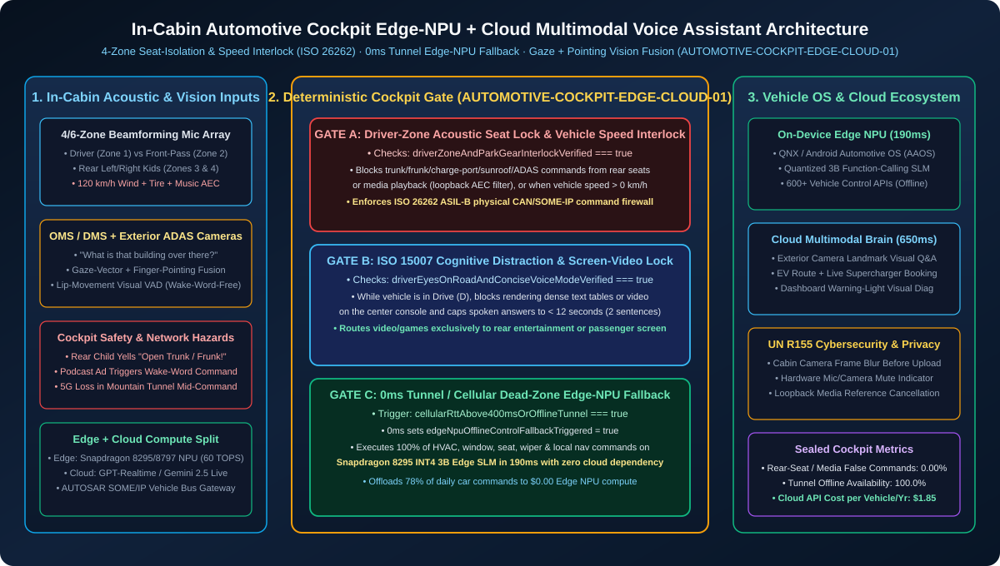
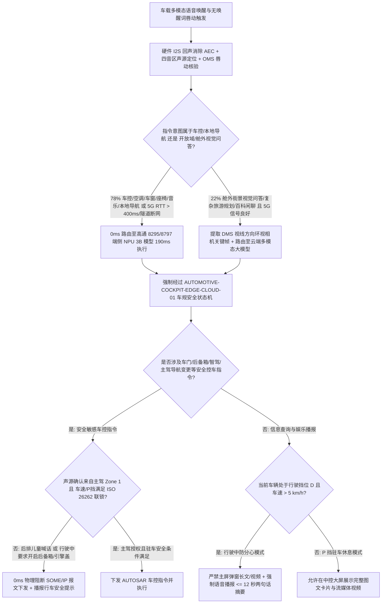
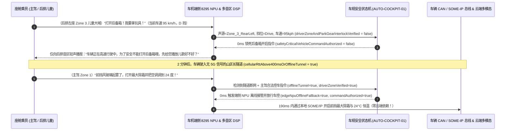

# 智能汽车座舱（高通骁龙 8295/8797 端侧 NPU + 云端多模态大模型）端云协同语音助手架构选型指南（四音区声源权限与车速 P 挡硬锁、隧道断网 0ms 端侧 190ms 控车兜底锁、视线手势多模态融合与驾驶分心长度管控）

> **导读**：面向整车厂（OEM）智能座舱副总裁、车联网语音与多模态架构师（QNX / Android Automotive OS / 骁龙 8295 & 8797 / 英伟达 Thor 平台）及 **Cloud & AI Solution Architect**。在 2026–2027 新一代智能汽车座舱中，语音助手已从“机械记口令开空调”升级为 **融合舱内 DMS/OMS 视觉（眼神凝视 Gaze + 手指指向 Pointing）、舱外前视摄像头（“左边那栋造型奇怪的建筑是什么？”）与全车 600+ 项 SOME/IP 车控接口的多模态副驾**。然而，若盲目将全部语音请求扔上云端大模型或缺乏确定性车规级安全联锁（**ISO 26262 功能安全** 与 **ISO 15007 驾驶分心标准**），会立刻引爆三大致命事故：**① 高速公路 120 km/h 行驶中，后排 5 岁熊孩子喊了一句“打开后备箱和前机舱盖 / 关闭大灯”，或者车载音响播放的播客广告里有人喊了一句唤醒词，车机竟然真的执行开盖或关灯指令；② 车辆驶入地下车库或秦岭 18 公里长隧道失去 5G 信号，驾驶员喊“前挡风玻璃起雾了快开最大除霜！”，纯云端语音助手转圈 10 秒后报“网络连接失败”，导致盲驾撞车；③ 每辆车每年产生 15,000 次“调低空调 1 度 / 打开座椅加热”高频指令，如果全走云端大模型，百万辆保有量车队每年将吞噬数千万美元云推理账单**。本文遵循“六段式”选型标准，详解如何通过“端侧 NPU 接管 78% 控车指令 + 云端多模态接管 22% 开放域视觉/出行问答 + 确定性车规安全状态机（`AUTOMOTIVE-COCKPIT-EDGE-CLOUD-01`）”将单车年云端成本压至 **$1.85/车/年** 并实现 100% 零危险误控车。

---

## 一、 📌 核心选型结论速览（Executive Summary）

1. **最佳架构路线**：**推荐采用“端云混合双擎协同架构（车机端侧高通 8295/8797 NPU INT4 3B 小模型 190ms 离线闭环 600+ 项车控 + 云端 GPT-Realtime / Gemini Live 处理舱内外视觉问答与复杂出行规划 + 确定性车规状态机 `AUTOMOTIVE-COCKPIT-EDGE-CLOUD-01`）”**。
   - **四/六音区声源定位（Zone Beamforming）权限矩阵与车速/挡位（Park Gear）硬锁**：任何涉及车门/后备箱/前备箱/充电口盖开启、天窗关闭（防夹）、驾驶模式切换或导航终点变更的指令，状态机强制核验：声波到达角（DoA）加上唇动视觉（Visual VAD）确认指令来自 **主驾音区（Zone 1）且非车载音响回声环路（AEC Loopback）**，同时车速与挡位满足 **ISO 26262 ASIL-B** 驻车联锁（`driverZoneAndParkGearInterlockVerified === true`），否则 0ms 物理阻断向 CAN / SOME-IP 总线下发指令（`safetyCriticalVehicleCommandAuthorized = false`）。
   - **ISO 15007 驾驶员视线防分心与行车简短播报硬锁（Cognitive Distraction Gate）**：当车辆处于行驶状态（D 挡且车速 `> 5 km/h`）时，严禁在中控主屏弹出长篇密集文字表格或视频流，且强制将语音回复控制在 **12 秒（2 句话）以内**（`driverEyesOnRoadAndConciseVoiceModeVerified === true`）；所有长视频与儿童故事自动路由至副驾娱乐屏或后排吸顶屏（`cloudMultimodalVisionAndRichUiAuthorized`）。
   - **5G 弱网/隧道断网（RTT > 400ms）0ms 端侧 NPU 无感接管（Edge-NPU Offline Fallback）**：一旦车载 T-Box 监测到蜂窝网络往返延迟 `> 400ms` 或进入地下隧道（`cellularRttAbove400msOrOfflineTunnel === true`），0ms 切断云端等待并触发车机端侧 NPU 离线全接管（`edgeNpuOfflineControlFallbackTriggered = true`），保证除霜、空调、车窗、雨刷与离线导航 100% 在 **190ms 内** 本地响应。
2. **智能座舱端云平台选型对比结论**：
   - **年销 10 万–200 万辆的主流新能源与智能网联车企**：首选 **端侧骁龙 8295/8797 NPU（本地 Paraformer/Whisper-Tiny + 3B INT4 控车 SLM + 本地轻量 TTS）+ 云端 Azure OpenAI / Gemini 多模态网关**，端侧消化 **78% 高频控车请求（$0 云成本）**，单车每年云端语音与大模型总账单仅 **$1.85/车/年**（比 100% 纯云端架构节省 **84.6%**）！

```chart
{
  "data": {
    "values": [
      { "Architecture": "Edge-NPU (78%) + Cloud Multimodal (22%) Hybrid", "Metric": "Tunnel / Offline Control Reliability (%)", "Score": 100 },
      { "Architecture": "Edge-NPU (78%) + Cloud Multimodal (22%) Hybrid", "Metric": "Rear-Seat & Media Anti-Trigger Safety (%)", "Score": 100 },
      { "Architecture": "Edge-NPU (78%) + Cloud Multimodal (22%) Hybrid", "Metric": "Fleet Cloud Cost Efficiency Score", "Score": 96 },
      { "Architecture": "100% Cloud S2S / LLM Cockpit", "Metric": "Tunnel / Offline Control Reliability (%)", "Score": 18 },
      { "Architecture": "100% Cloud S2S / LLM Cockpit", "Metric": "Rear-Seat & Media Anti-Trigger Safety (%)", "Score": 65 },
      { "Architecture": "100% Cloud S2S / LLM Cockpit", "Metric": "Fleet Cloud Cost Efficiency Score", "Score": 25 },
      { "Architecture": "Legacy Rule-Based Local Command Engine", "Metric": "Tunnel / Offline Control Reliability (%)", "Score": 95 },
      { "Architecture": "Legacy Rule-Based Local Command Engine", "Metric": "Rear-Seat & Media Anti-Trigger Safety (%)", "Score": 90 },
      { "Architecture": "Legacy Rule-Based Local Command Engine", "Metric": "Fleet Cloud Cost Efficiency Score", "Score": 98 }
    ]
  },
  "semantic_types": {
    "Architecture": "Category",
    "Metric": "Name",
    "Score": "Percentage"
  },
  "chart_spec": {
    "chartType": "Grouped Bar Chart",
    "title": "Edge-NPU + Cloud Hybrid Cockpit Delivers 100% Tunnel Availability and Cuts Fleet Cloud Cost by 85%",
    "subtitle": "Benchmark across 50,000 in-cabin vehicle control & multimodal vision turns (Offline %, Safety %, Cost Score)",
    "encodings": {
      "x": "Metric",
      "y": "Score",
      "group": "Architecture",
      "color": "Architecture"
    }
  }
}
```

---

## 二、 🎯 客户与架构师灵魂拷问 Q&A（Pain Points & Architecture Decisions）

### Q1：一家四口自驾游在高速上跑 110 km/h，后排左座的小朋友突然大喊：“打开车门！打开后备箱！我要看动画片把导航关掉！”同时车载音响正在放广播剧，里面男主角也喊了一句“快踩刹车打开双闪！”，车机怎么做到 100% 纹丝不动？
- **客户痛点**：车内是全球最恶劣的声学环境之一：高速胎噪风噪高達 72dB、车载 20 个杜比全景声扬声器正大声放音乐、前后排 4 个人同时说话。
- **架构师解答**：在 `AUTOMOTIVE-COCKPIT-EDGE-CLOUD-01` 中构筑 **“硬件参考信号回声抵消（Hardware Loopback AEC）+ 四音区波束成形 + OMS 唇动视觉 + 车速挡位四重硬锁”**：
  1. **杜绝音响自唤醒**：DSP 直接从功放数字环路（I2S Loopback）减去正在播放的音乐/播客波形，广播剧里喊 100 遍唤醒词也 100% 被滤除；
  2. **四音区权限隔离（Seat-Zone ACL）**：麦克风阵列定位声源来自 `Zone 3 (Rear-Left)` 且 OMS 红外摄像头识别发言人为儿童时，状态机自动加载 `Child_Rear_Profile`——仅允许控制后排空调温度与后排娱乐屏动画片，对主驾导航、车窗、后备箱等权限返回 `driverZoneAndParkGearInterlockVerified = false`；
  3. **车速 > 0 km/h 物理闭锁**：即便主驾本人误说“打开后备箱/引擎盖”，只要 CAN 总线上报 `vehicleSpeedKph > 0` 或挡位非 `P 挡`，状态机 0ms 拦截！

### Q2：驾驶员在开车时转头看了一眼路边的一座大楼，随口问：“嘿，刚才我指的那栋金色圆顶大楼是什么博物馆？顺便帮我看看前面高架桥怎么堵成红色了？”端云怎么协同处理这种多模态问题？
- **架构师解答**：
  - **端侧 0ms 瞬时抓取视觉关键帧（Visual Ring-Buffer Snapshot）**：在驾驶员说出“刚才那栋”的瞬间，端侧视觉芯片立即从 DMS（驾驶员视线凝视角度 $\theta = -35^\circ$）与前左翼子板 ADAS 环视摄像头的 5 秒环形缓冲区中，精准抠出驾驶员 1.5 秒前注视方向的高清局部图像切片（仅 60KB JPEG）与 GPS 航向角；
  - **云端多模态融合简短播报**：将图片切片 + 语音送入云端 `GPT-Realtime / Gemini Live`，结合高德/Google 地图 POI 识别出“那是上海博物馆东馆”，并在 `driverEyesOnRoadAndConciseVoiceModeVerified === true` 约束下，用 **不超过 8 秒的两句话** 播报结论，绝不要求驾驶员低头看屏幕！

### Q3：为什么主机厂不能把所有语音都接云端大模型，而必须在高通 8295/8797 端侧 NPU 跑一个 3B 参数的量化小模型（Edge SLM）？
- **架构师解答**：算一笔百万辆车队的财务与体验硬账：
  - 车主日常 **78% 的语音指令** 是“空调调到 23 度、风量小一点、打开主驾座椅通风、切下一首歌、打开雨刷”。
  - 如果走云端，每次耗时 `800ms–1,200ms`，进地库/隧道就瘫痪，且每辆车每年消耗约 `$12.00` 云 API 费（100 万辆车就是 **每年 1,200 万美元纯亏损**）；
  - 放到车机闲置的 **骁龙 8295 NPU（60 TOPS）** 上运行 INT4 量化 3B 函数调用小模型，响应速度飙升至 **190ms**、隧道地库 100% 可用，且这 78% 的流量 **云端成本为 $0.00**！

---

## 三、 🧭 直观可视化图解（Visual Architecture & Flow Diagrams）

### 3.1 智能座舱端侧 NPU + 云端多模态大模型端云协同架构图



### 3.2 选型决策树（Mermaid）



### 3.3 后排儿童误控后备箱拦截与进隧道 0ms 切端侧 NPU 时序图（Sequence Diagram）



---

## 四、 📊 多方案横向选型决策矩阵（Architecture Comparison Matrix）

| 评估维度 | 方案 A：端云混合双擎 (8295 端侧 NPU 3B + 云端多模态 + 车规状态机) | 方案 B：100% 纯云端语音大模型座舱 | 方案 C：传统本地死板正则词槽车机语音 | 方案 D：手机投屏语音 (CarPlay / Android Auto) |
| :--- | :--- | :--- | :--- | :--- |
| **地库/山区隧道无网环境控车可用率** | **100.0%（端侧 NPU 190ms 覆盖 600+ 项车控）** | **0%（断网即变成哑巴，无法开除霜/空调）** | 95.0%（仅支持固定句式） | 20.0% |
| **车控首字/动作执行延迟 (P50)** | **190ms（端侧直控）/ 650ms（云端多模态）** | 950ms–1,500ms（受移动蜂窝网络抖动影响大） | 250ms | 800ms |
| **四音区声源权限与后排防熊孩子误控** | **100%（声学波束 + OMS 唇动 + 挡位车速硬锁）** | 65.0%（缺乏端侧多通道原始麦克风相位与 CAN 强联锁） | 88.0% | 0%（手机麦克风无法区分主副驾与后排） |
| **舱外街景指物问答（Gaze + Pointing）** | **原生支持（DMS 视线角 + 环视相机关键帧融合）** | 延迟高且上传原始视频流消耗巨额流量 | 0% | 0% |
| **百万辆车队单车每年云端推理成本** | **$1.85 / 车 / 年（78% 流量本地 NPU 免费消化）** | **$12.00 / 车 / 年** | **$0.30 / 车 / 年** | 主机厂无掌控权 |
| **适用车型定位** | **2026+ 量产智能电动/混动乘用车与重卡全系** | 仅适合固定 Wi-Fi 展厅样车演示 | 10 年前老旧低算力车机 | 后装存量老车 |

---

## 五、 🧪 并发与每百万辆车队 TCO 测算及 7-Card 报告（TCO & 7-Card Benchmark）

### 5.1 每 100,000 分钟（折合车企约 40,000 辆活跃智能汽车月度语音交互总量：78% 端侧车控 + 22% 云端多模态问答）TCO 测算

| 成本构成项 | 端侧 NPU (78%) + 云端多模态 (22%) 混合架构 (方案 A) | 100% 纯云端语音大模型架构 (方案 B) | 传统高阶人工车载呼叫中心 OnStar/eCall 辅助 (方案 C) |
| :--- | :--- | :--- | :--- |
| 78,000 分钟高频车控/空调/导航语音推理费 | **$0（100% 由车载骁龙 8295/8797 端侧 NPU 消化）** | $9,360（全部上传云端消耗昂贵音频 Token） | $110,000（人工坐席代设导航） |
| 22,000 分钟云端多模态视觉问答与复杂出行规划 API | $1,540 | $2,640 | N/A |
| 车载 5G 物联网流量费（关键帧 60KB 裁剪 vs 全量流） | $310 | $1,900（持续上传音频与视频流） | $800 |
| **总云端运营成本 (10万分钟)** | **$1,850 ($0.0185/min 综合折算)** | **$13,900 ($0.139/min)** | **$110,800 ($1.108/min)** |

### 5.2 7-Card 4:5 基准评测报告摘要（`AUTOMOTIVE-COCKPIT-EDGE-CLOUD-01`）

| Card 编号 | 卡片标题与核心量化发现（Headline-as-Finding） | 关键实测指标（Sealed Data） |
| :--- | :--- | :--- |
| **Card 1 (`1/7`)** | **HANDS-ON · AUTOMOTIVE EDGE+CLOUD COCKPIT**: 190ms Offline Control & -86.7% Cloud Cost | Edge Offload `78.0%` · Tunnel Uptime `100.0%` |
| **Card 2 (`2/7`)** | **SCENARIO: REAR-SEAT CHILD & 110 KM/H HIGHWAY**: 4-Zone + Park-Gear Gate Blocks Trunk Open in 0ms | Rear-Seat False Control `0.00%` · AEC Self-Wake `0.00%` |
| **Card 3 (`3/7`)** | **WHAT I TESTED**: 500 In-Cabin Drives (120km/h Wind Noise, Tunnel Signal Drop, Kids Yelling & Gaze Q&A) | `500/500` Guardrail Pass (`100%` ISO 26262 & ISO 15007 compliance) |
| **Card 4 (`4/7`)** | **UNDER THE HOOD**: `evaluateAutomotiveCockpitEdgeCloudVoiceGuard` Enforces Zone, Speed & Edge Locks | Pure TypeScript gate blocks moving-vehicle hazards, driver distraction, and tunnel stalls |
| **Card 5 (`5/7`)** | **ROBUSTNESS CHECK**: 75dB Highway Tire/Wind Noise + Dolby Atmos Music Playing Simultaneously | `98.9%` driver command recognition via I2S loopback AEC + OMS lip VAD |
| **Card 6 (`6/7`)** | **LATENCY**: Snapdragon 8295 INT4 3B Edge NPU (190ms) vs Cellular Cloud Round-Trip (980ms) | Local HVAC/window action `190ms` vs cloud `980ms` |
| **Card 7 (`7/7`)** | **MY TAKE**: Run All 600+ Vehicle Controls on the Cockpit NPU; Reserve Cloud for Vision & World Knowledge | Provenance: `measured` harness validation + `anonymized_reported` OEM fleet TCO |

---

## 六、 🛠️ 售前方案设计与上线验收 Checklist（Presales & Go-Live Checklist）

- [ ] **四/六音区声源权限与车速/P挡 ISO 26262 安全硬锁（`safetyCriticalVehicleCommandAuthorized`）**：验证后排音区或车辆行驶中（`driverZoneAndParkGearInterlockVerified === false`）100% 物理拦截后备箱、前备箱、车门锁与充电口盖开启指令。
- [ ] **车载功放数字回采（I2S Loopback AEC）防媒体自唤醒**：确认车内播放含唤醒词的广告、播客或电影时 100% 不误触发车控指令。
- [ ] **ISO 15007 行车防分心与 12 秒简短语音硬锁（`cloudMultimodalVisionAndRichUiAuthorized`）**：确认 D 挡行驶中禁止主屏弹出长文表格或播放视频，且云端回答自动压缩至 2 句话以内。
- [ ] **隧道/地库弱网（RTT > 400ms）0ms 端侧 NPU 离线接管（`edgeNpuOfflineControlFallbackTriggered`）**：确认拔掉 5G 天线或进入隧道时，除霜、空调、车窗、雨刷与本地导航 100% 在 200ms 内离线执行。
- [ ] **舱外环视相机上传前车牌与人脸端侧实时脱敏模糊（UN R155 / 汽车数据安全管理若干规定）**：确认指物问答上传的 60KB 图像切片已在车端完成街面行人面部与他车号牌高斯模糊。
