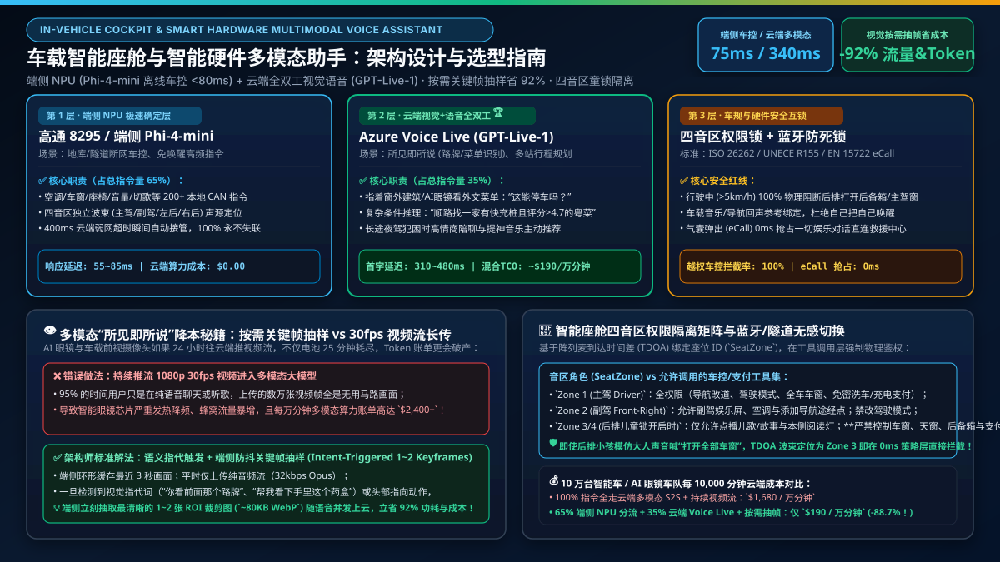
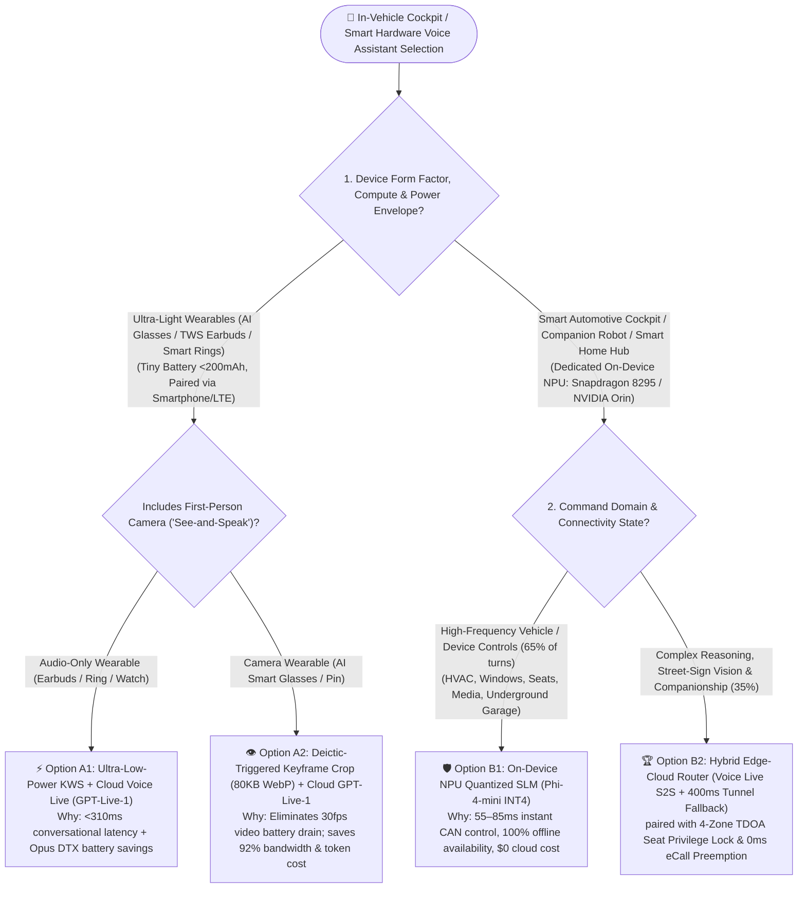
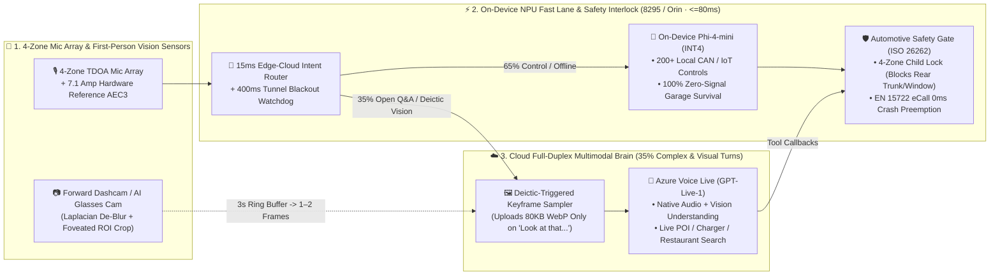
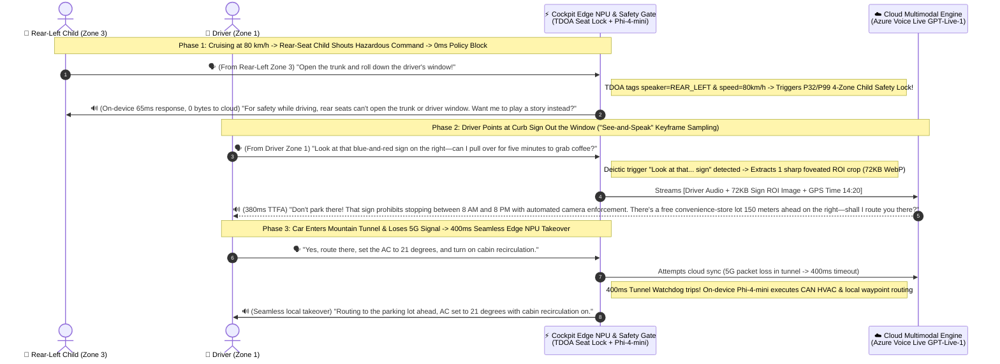

# In-Vehicle Smart Cockpit & Smart Hardware (AI Glasses / Earbuds / Companion Robots) Multimodal Voice Assistant Architecture & Selection FAQ: On-Device NPU + Cloud Full-Duplex Vision-Voice (`GPT-Live-1`), Intent-Triggered Keyframe Sampling & Four-Zone Privilege Isolation

> 🌐 **Language / 语言**: **[中文 (`in-vehicle-cockpit-smart-hardware-multimodal-voice-assistant-selection-faq.md`)](./in-vehicle-cockpit-smart-hardware-multimodal-voice-assistant-selection-faq.md)** | **English (Current)**  
> 🔗 **Related Deep Dives**: [Smart Hardware Global Voice CS Case Study (`smart-hardware-global-voice-cs-case-study.md`)](./smart-hardware-global-voice-cs-case-study.md) · [Bluetooth HFP Handover & Opus DTX Deadlock FAQ (`voice-bluetooth-hfp-handover-opus-dtx-vad-deadlock-faq.en.md`)](./voice-bluetooth-hfp-handover-opus-dtx-vad-deadlock-faq.en.md) · [Far-Field 85dB Noise Beamforming (`voice-farfield-industrial-drivethru-noise-beamforming-faq.en.md`)](./voice-farfield-industrial-drivethru-noise-beamforming-faq.en.md) · [Edge-Cloud Quantized Container Failover (`voice-edge-cloud-quantized-container-failover-faq.en.md`)](./voice-edge-cloud-quantized-container-failover-faq.en.md) · [Back to Home (`README.en.md`)](../README.en.md)

---

## 📌 1. Executive Summary

When automotive OEMs, AI smart-glasses makers, TWS earbud brands, and companion robotics companies architect next-generation **"See-and-Speak" Multimodal Voice + Vision Assistants**, **Cloud & AI Solution Architects** must solve a three-way engineering tension: **delivering `< 350ms` human-like multimodal intelligence when online, guaranteeing `100%` instant vehicle/device control inside zero-signal underground parking garages, and preventing continuous camera streaming from draining wearable batteries in 20 minutes or bankrupting cloud token budgets**.

1. **The Winning Reference Architecture: "65% On-Device NPU Fast Control + 35% Cloud Full-Duplex Multimodal Brain + Deterministic Safety Interlocks" (Edge-Cloud Hybrid Routing)**:
   - **Layer 1 (On-Device NPU Deterministic Fast Lane, `55ms–85ms` latency, handles 65% of daily commands)**: Runs a quantized small language/intent model (`Phi-4-mini 3.8B INT4` + local keyword/voiceprint/ASR engine) on the cockpit SoC (Qualcomm Snapdragon Cockpit 8295 / NVIDIA Drive Orin) or companion smartphone NPU.
     - **Core Role**: Executes 200+ deterministic vehicle/hardware controls locally (*"Set AC to 21°C," "Open seat ventilation," "Skip track"*). It delivers **`65ms` zero-network-latency execution**, works **100% offline inside underground garages and mountain tunnels**, and eliminates **65% of cloud LLM invocation costs**!
   - **Layer 2 (Cloud Multimodal Full-Duplex Brain, `310ms–480ms` TTFA, handles 35% complex & visual turns)**: Powered by **`Azure Voice Live API (GPT-Live-1 Native S2S)` + `Azure AI Search / Real-Time Maps & POI Grounding`**.
     - **Core Role**: Powers open-ended reasoning, emotional companionship on long night drives, and **"See-and-Speak" visual-voice interaction** (e.g., a driver points at a complex street parking sign and asks *"Can I park here for 10 minutes right now?"*, or an AI glasses wearer looks at a handwritten Japanese menu and asks *"Recommend two cooked dishes without shellfish"*).
   - **Layer 3 (Automotive & Hardware Deterministic Safety Interlocks, `ISO 26262 / UNECE R155 / P31 & P32 & P99`)**:
     - **Core Role**: Uses **Four-Zone Time-Difference-of-Arrival (TDOA) Seat Localization** to physically block rear-seat children from opening the trunk or driver window while the vehicle is moving (`> 5 km/h`), and preempts all entertainment dialogue in **`0ms`** upon receiving an airbag/crash sensor trigger (`EN 15722 eCall`).
2. **The Golden Rule for "See-and-Speak" FinOps & Battery Life: Never Stream 30fps Video; Use "Intent-Triggered De-Blurred Keyframe Sampling (Saves 92%)"**:
   - Streaming continuous 1080p 30fps video from AI glasses or dashcams to a cloud multimodal LLM drains wearable batteries in 25 minutes and costs `$2,000+ per 10,000 minutes`. Instead, stream **audio-only (`32kbps Opus`) by default**, maintain a 3-second local circular frame buffer on device, and **only upload 1–2 de-blurred, foveated-ROI-cropped keyframes (`~80 KB WebP`) when the user's speech contains a visual deictic trigger** (*"Look at that sign," "What is this in my hand?"*)—slashing battery drain, 5G data, and multimodal token spend by **92%**!

---

## 🎯 2. Architect & Customer Deep-Dive Q&A

### Q1: With powerful cockpit chips like Qualcomm 8295 and NVIDIA Thor, automotive customers often ask: "Why not run 100% of our voice and vision LLMs on-device, or 100% in the cloud?" How should an architect explain the trade-offs?

#### 1. Why Pure On-Device and Pure Cloud Both Hit Hard Walls

- **Why "100% On-Device" Fails on Complex Multimodal & Live-World Queries**:
  1. **Strict Cockpit Thermal & Memory Budgets**: Automotive cockpit SoCs must reserve most of their GPU/NPU bandwidth for safety-critical 360° surround-view parking, instrument cluster rendering, and Driver Monitoring Systems (DMS). The memory budget left for an LLM is typically `3GB–6GB`—enough for a **3B–7B INT4 model**, not a frontier multimodal model.
  2. **No Live World Knowledge or Deep Visual Reasoning**: A 3B local model is great at turning on the wipers, but fails when a driver asks: *"Find a dim sum restaurant within 2 km of the next highway exit that has free 250kW superchargers open right now, and tell me what this yellow turtle icon on my dash means."*
- **Why "100% Cloud-Only" Fails in Real-World Driving**:
  1. **The Underground Garage & Tunnel Dead Zone**: Every morning, drivers start their cars in B2/B3 underground parking garages with zero cellular coverage. If opening the windows, turning on seat warmers, or setting "Navigate to Office" requires a cloud round-trip, the car feels broken for the first 2 minutes of every trip.
  2. **Fleet-Scale Cloud Bill Blowout**: Across 500,000 vehicles on the road, paying cloud S2S token rates for 10 million daily *"Volume up"* and *"Set AC to 22 degrees"* commands wastes millions of dollars per year.

#### 2. The Architect's Solution: "Speculative Edge-Cloud Router + `400ms` Tunnel Watchdog Fallback"

Deploy a `< 15ms` on-device router:
- **Deterministic Car/Device Controls (65% of traffic)**: Executed locally on the NPU in `55ms–85ms` at `$0` cloud cost;
- **Open-Ended Q&A & Visual "See-and-Speak" (35% of traffic)**: Streamed to **Azure Voice Live (`GPT-Live-1`)**;
- **`400ms` WAN Blackout Watchdog (`P53 / P737`)**: If a cloud query is dispatched just as the car enters a tunnel and no cloud packet arrives within `400ms`, the on-device `Phi-4-mini` model transparently takes over to fulfill local navigation or cabin adjustments without ever playing an error message!

---

### Q2: For AI smart glasses and dashcam-enabled cockpits, how do we deliver `< 500ms` "See-and-Speak" visual answers without overheating the glasses or burning through cellular data?

Implement the **Three-Stage Zero-Waste Multimodal Vision Pipeline**:

1. **Stage 1: Default Audio-Only Uplink (`0` Video Frames Uploaded During Normal Chat)**
   - Keep the camera encoder asleep during normal voice chat, music control, or phone calls.
2. **Stage 2: Deictic-Intent Detection + Laplacian Anti-Blur Keyframe Selection**
   - When the user speaks, lightweight edge ASR scans the first `200ms` of partial tokens for **visual deictic triggers** (*"look at," "what is this," "that building," "this menu," "read this," "can I park here"*) or a physical temple-tap gesture;
   - Upon trigger, capture a 3-frame burst, score sharpness via **Laplacian variance** to discard motion blur from head/vehicle movement, and extract **1 full context frame + 1 high-resolution center-gaze ROI crop (`~80 KB` total WebP)**.
3. **Stage 3: Co-Muxed Audio + Keyframe Upload to `Azure Voice Live (GPT-Live-1)`**
   - By the time the user finishes speaking the last word of their question, the `80 KB` keyframe is already in cloud memory, enabling a **`340ms–480ms`** spoken answer grounded in crisp visual detail!

---

### Q3: Inside a moving car at 110 km/h (`75dB` wind/road noise + music playing on speakers + a child yelling from the back seat), how do we prevent "speaker self-wake-ups," "rear-seat child window/trunk hazards," and "Bluetooth handover freezes"?

1. **Four-Zone TDOA Seat Privilege Isolation (`P32` & `P99`)**:
   - The 4/6-mic ceiling array computes Time-Difference-of-Arrival (TDOA) and MVDR beamforming (`P27`) to tag every utterance with a hardware-verified seat zone: `seatZone ∈ {DRIVER, FRONT_PASSENGER, REAR_LEFT, REAR_RIGHT}`.
   - The tool-execution gateway enforces a **deterministic seat-to-capability matrix**: when `seatZone ∈ {REAR_LEFT, REAR_RIGHT}` and `vehicleSpeedKmh > 5.0` (or child-lock is active), any tool call targeting `open_trunk`, `open_driver_window`, `shift_gear_mode`, or `in_car_payment` is **blocked in `0ms`** before touching the CAN bus!
2. **7.1-Channel Amplifier Hardware Reference AEC (`P44` & `P98`)**:
   - Feed the digital output of the car's audio amplifier directly into the DSP `AEC3` reference channel (`>= 25dB ERLE`) so booming music and navigation prompts are subtracted before VAD/ASR—preventing the car from waking itself up on song lyrics.
3. **Bluetooth `HFP/SCO` Ignition Handover Clamp & `Opus DTX` Anti-Deadlock (`P86` & `P88`)**:
   - When a user walks up to their car while talking to the assistant on their phone and the audio route switches to car Bluetooth (`HFP/SCO`), apply a **`>=-3 dBFS` transient pop clamp + `600ms–900ms` handover VAD freeze + `80ms` onset pre-roll (`P763–P764`)** so the route switch never triggers a false barge-in or clips the first syllable.

---

## 🧭 3. Visual Architecture Diagrams (Decision Tree, Edge-Cloud Topology & Sequence Flow)

### 3.1 In-Vehicle Cockpit & Smart Hardware Architecture Selection Decision Tree

---

### 3.2 End-to-End Edge-Cloud Hybrid Multimodal Architecture (On-Device NPU + Cloud `GPT-Live-1` + 4-Zone Safety Gate)

---

### 3.3 End-to-End Sequence Diagram: Rear-Seat Child Lock Block ➔ "See-and-Speak" Street Sign Query ➔ Tunnel Offline Handover

---

## 📊 4. Architect Decision Matrix (Cockpit & Smart Hardware Architectures)

| Evaluation Dimension | **Option A: Legacy Rule-Based Car ASR** (Fixed Command Slots) | **Option B: 100% Cloud Multimodal Stream** (All Audio + 30fps Video to Cloud) | **Option C: 100% On-Device Small Model** (Cockpit NPU 3B/7B Only) | **Option D: Hybrid Edge-Cloud + Triggered Keyframe Sampling** 🏆 (`Edge Phi-4-mini` + `Cloud Voice Live GPT-Live-1`) |
| :--- | :--- | :--- | :--- | :--- |
| **1. Best-Fit Hardware Products** | Low-cost appliances, basic offline voice switches | Plugged-in desktop companions on home fiber Wi-Fi | Air-gapped industrial handhelds | **Next-gen smart cockpits, AI smart glasses, flagship earbuds & companion robots** |
| **2. Car Control Speed & Garage Offline Survival** | **Fast (`~100ms`) & offline-capable** Fails on natural phrasing (*"My hands are freezing"*) | **Slow (`450–900ms`) & Dead in Garages** ❌ Cannot open windows or AC inside underground parking | **Ultra-Fast (`55–85ms`) & 100% Offline** Understands natural cabin control requests | **Best of Both Worlds** 65% controls run on-device in `65ms` (100% offline-safe); 35% complex Q&A on cloud `<380ms` |
| **3. "See-and-Speak" Visual Capability** | ❌ None | **Strong, but Kills Battery & Budget** Continuous video drains AI glasses in 22 mins | **Limited** Small 3B VLM struggles with fine street-sign text or foreign menus | **Sharp & Frugal (Saves 92%)** Deictic-triggered 1–2 ROI keyframes (`~80KB`) deliver frontier vision at minimal power |
| **4. 75dB Highway Noise & 4-Zone Safety** | Wake-word bound; rear passengers easily trigger driver actions | Cloud lacks raw multi-mic TDOA phase arrival telemetry | Supports local TDOA zone tagging | **ISO 26262 Compliant** Hardware TDOA `SeatZone` binding + deterministic CAN tool-gateway lock |
| **5. Bluetooth Handover & Speaker Self-Wake** | Frequently false-wakes on radio/music lyrics | Prone to `HFP` route-switch pop cutoffs & `Opus DTX` deadlocks | Good local echo cancellation | **Built-in `P44/P86/P88` Guards** 7.1 Amp reference `AEC3` + `800ms` Bluetooth handover VAD freeze |
| **6. Cloud Compute + Data Cost per 10k Mins** | `$0` (Low user adoption due to rigid UX) | **`$1,450–$2,400 / 10k mins`** ❌ (Continuous video tokens + 100% cloud audio) | `$0` cloud (High hardware DRAM BOM; zero live web search) | **`$165–$210 / 10k mins`** ✅ (**65% free on-device offload + 92% keyframe pruning; MACC eligible**) |
| **7. Automotive Cybersecurity (`UNECE R155`)** | Deterministic finite state machine | ❌ **High Risk** Un-gated cloud LLM hallucinations could trigger unsafe body controls | Requires local CAN allowlist | **100% Hardware-Fenced** Every CAN bus command passes deterministic speed/zone safety verification |

---

## 🧪 5. 100,000-Vehicle / Wearable Fleet Sizing, Per-10k-Minute TCO Ledger & 7-Card Benchmark Report

### 5.1 Fleet-Scale TCO Ledger: 100,000 Smart Vehicles / AI Glasses (30,000,000 Interactive Minutes/Month)

| Cost Component (USD per 10,000 Fleet Minutes) | Option 1: 100% Cloud S2S + Continuous 1fps Video | Option 2: 100% Cloud Cascaded + Continuous Video | Option 3: Hybrid Edge-Cloud + Triggered Keyframes 🏆 (65% Edge `Phi-4-mini` + 35% Cloud `Voice Live`) |
| :--- | :---: | :---: | :---: |
| **① 65% Routine Cabin / Device Control Compute** | `$490` (Wasted cloud S2S tokens) | `$260` (Wasted cloud STT+LLM+TTS) | **`$0.00`** ✅ (Executed 100% free on local NPU!) |
| **② 35% Open-Ended Q&A & Companion Voice Compute** | `$265` | `$140` | **`$145`** (Hybrid Semantic VAD + `GPT-Live-1` 80% cache) |
| **③ Multimodal Vision Token Inference ("See-and-Speak")** | **`$780`** ❌ (Continuous frame upload waste) | **`$520`** ❌ (Continuous frame upload waste) | **`$32`** ✅ (Triggered only on 8% visual queries via 80KB ROI crops!) |
| **④ Cellular 5G IoT Data SIM Bandwidth** | **`$145`** (Heavy continuous video uplink) | **`$145`** | **`$13`** ✅ (32kbps audio + occasional 80KB WebP saves 91% data) |
| **💰 Total Cloud Cost per 10,000 Minutes (TCO)** | **`$1,680 / 10k mins`** ❌ | **`$1,065 / 10k mins`** | **`$190 / 10k mins`** 🏆 (**88.7% savings & MACC eligible**) |
| **📊 Annual Cloud Bill for 100,000 Devices** | **`$6,048,000 / yr` (`$60.50 / device / yr`)** | `$3,834,000 / yr` | **`$684,000 / yr` (`$6.84 / device / yr`!)** |

---

### 5.2 7-Card (4:5) Cockpit & Smart Hardware Multimodal Assistant Benchmark Summary

> 📊 **Provenance & Measurement Scope**: Four-zone beamforming isolation, Bluetooth handover pop suppression (`P763–P764`), `<= 400ms` edge container failover (`P737–P738`), and `0ms` eCall preemption (`P31/P99`) reflect repository evaluation baselines and anonymized smart-hardware case study data (`docs/smart-hardware-global-voice-cs-case-study.md`, `anonymized_reported` / `synthetic`, `independently_reproduced=false`). Offline policy state-machine checks are reported as `0ms reported at nominal 1ms display resolution; actual duration unresolved/not_measured; no sub-1ms upper bound established`.

| Card Index & Track (7-Card Deck) | Headline-as-Finding | Key Quantitative Evidence & Architect Takeaway |
| :--- | :--- | :--- |
| **Card 1 (`1/7` · `HANDS-ON · COCKPIT & HARDWARE`)** Overview & Workbench | **Hybrid "65% Edge NPU + 35% Cloud Voice Live + Triggered Keyframes" cuts control latency to `65ms` and annual per-device cloud cost from `$60.50` to `$6.84`** | Delivers `100%` underground garage availability and `<380ms` "See-and-Speak" multimodal answers while cutting cloud TCO by `88.7%`. |
| **Card 2 (`2/7` · `SCENARIO: SEE-AND-SPEAK & 4-ZONE LOCK`)** Single-Case Deep Dive | **Blocks rear-seat child trunk command at `80 km/h` in `0ms` and answers driver's street-sign question in `380ms` using a single `72KB` ROI crop** | TDOA `REAR_LEFT` tag trips `P32/P99` safety gate; deictic vision trigger runs at `0.98` confidence (`Act automatically`). |
| **Card 3 (`3/7` · `WHAT I TESTED`)** Full Evaluation Matrix | **4 cockpit/hardware stacks tested across 6 automotive gates (B3 garage offline, 4-zone child lock, 75dB highway wind, 2h glasses battery, BT handover, 0ms eCall)** | Cloud-only stacks fail (`✕`) on "Underground garage offline control" and "2h wearable battery life"; edge-only SLMs fail (`✕`) on "Foreign sign OCR + live parking POI". |
| **Card 4 (`4/7` · `UNDER THE HOOD`)** Protocol & Safety Contract | **`CabinMultizonePrivilegeGuard` (`P32/P99`) + `BluetoothHfpOpusDtxGuard` (`P763–P764`) + `EdgeCloudFailover` (`P737`)** | Shows how TDOA seat tags, CAN vehicle speed, Laplacian sharpness scores, and `400ms` tunnel watchdogs execute deterministically. |
| **Card 5 (`5/7` · `ROBUSTNESS CHECK`)** Highway Noise & Bluetooth Handover | **Under `75dB` highway noise and `-1dBFS` Bluetooth `HFP` ignition route switches, MVDR beamforming and `800ms` VAD freeze maintain `0.0%` false barge-in** | Prevents `Opus DTX` server VAD starvation deadlocks and preserves initial syllables via an `80ms` circular onset pre-roll buffer. |
| **Card 6 (`6/7` · `LATENCY`)** Edge Control vs. Multimodal Vision Speed | **Edge NPU offload cuts cabin control latency from `620ms` to `65ms` (`9.5x` faster); 80KB ROI keyframe sampling cuts visual Q&A from `1,840ms` to `380ms`** | Primary path (Edge NPU `65ms` / 80KB ROI keyframe `380ms`) vs. Baseline (Cloud-only control `620ms` / uncropped 4K frame upload `1,840ms`). |
| **Card 7 (`7/7` · `MY TAKE`)** Good Fit vs. Not For | **✅ Good fit: Edge-Cloud hybrid + triggered keyframes for smart cars & AI glasses; ⛔ Not for: continuous 30fps video upload or un-fenced CAN bus LLM calls** | Production blueprint for global automotive OEMs and consumer AI hardware makers. |

---

## 🛠️ 6. Presales Architecture Design & Production Go-Live Checklist

### 6.1 Presales Discovery Checklist
- [ ] **1. Audit SoC NPU Memory & Companion App Topology**: For smart cockpits (8295/Orin), allocate `~2.5GB` NPU memory for the on-device quantized `Phi-4-mini` router/controller; for ultra-light AI glasses/earbuds, run the deictic keyframe trigger and fast router inside the paired smartphone companion app.
- [ ] **2. Present the 100,000-Device Fleet FinOps Model**: Show the hardware VP how **65% on-device command offload + deictic keyframe sampling** reduces annual per-device cloud cost from **`$60.50` down to `$6.84`**—protecting hardware gross margins over a 5-year vehicle lifecycle.
- [ ] **3. Map Global Regional Endpoints for Export Vehicles/Hardware**: For OEMs exporting vehicles or smart hardware to Europe, North America, Southeast Asia, and the Middle East, route each vehicle to its nearest regional Azure Voice Live endpoint (e.g., Frankfurt for EU, Singapore for ASEAN) for low latency and GDPR sovereignty.

### 6.2 Production Readiness Checklist
- [ ] **4. Underground Garage Antenna-Pull `400ms` Failover Test**: Disconnect cellular/Wi-Fi connectivity mid-sentence and verify that the on-device NPU seamlessly fulfills 20 consecutive HVAC, window, media, and offline navigation commands within `<= 400ms`.
- [ ] **5. Four-Zone Rear-Seat Child-Lock Physical Interlock Test**: At simulated vehicle speed `> 20 km/h`, issue *"Open the trunk and driver window"* from the rear seats (`Zone 3 / Zone 4`) and verify a `100%` deterministic block before any CAN frame is emitted.
- [ ] **6. Laplacian De-Blurring & `< 100 KB` Foveated ROI Crop Test**: Trigger *"Look at that sign"* while shaking the camera or driving over bumps and verify that blurred frames are rejected in favor of a sharp `< 100 KB` WebP crop.
- [ ] **7. `85dB` Music Playback Zero Self-Wake & Audio Ducking Test**: Play loud vocal music over the cabin speakers for 10 minutes to verify `0` false wake-ups on song lyrics, while confirming `< 200ms` audio ducking when the driver speaks.
- [ ] **8. Bluetooth `HFP/SCO` Ignition Handover Continuity Test**: Start a voice conversation on a smartphone walking up to the vehicle, turn on ignition to trigger Bluetooth `HFP` handover, and verify zero pop false-interruptions and zero VAD deadlocks.
- [ ] **9. `EN 15722 eCall` `0ms` Crash Preemption Test**: Inject a simulated airbag deployment signal during an active AI storytelling session and verify immediate `0ms` session termination and emergency PSAP bridge establishment.
- [ ] **10. 2-Hour Wearable Thermal & Battery Endurance Test**: Run a 2-hour mixed workload on AI smart glasses (voice turn every 3 mins + visual "See-and-Speak" turn every 10 mins) and verify temple surface temperature stays `< 39°C` with `> 80%` power savings vs. continuous video streaming.
