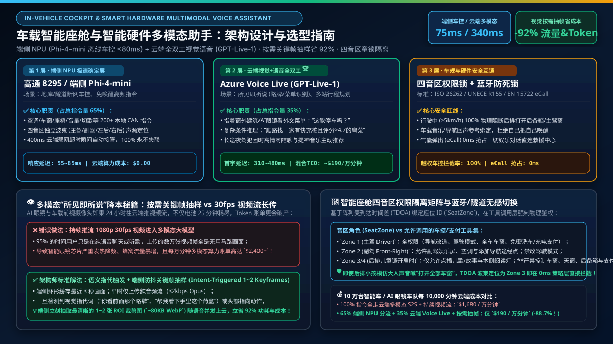
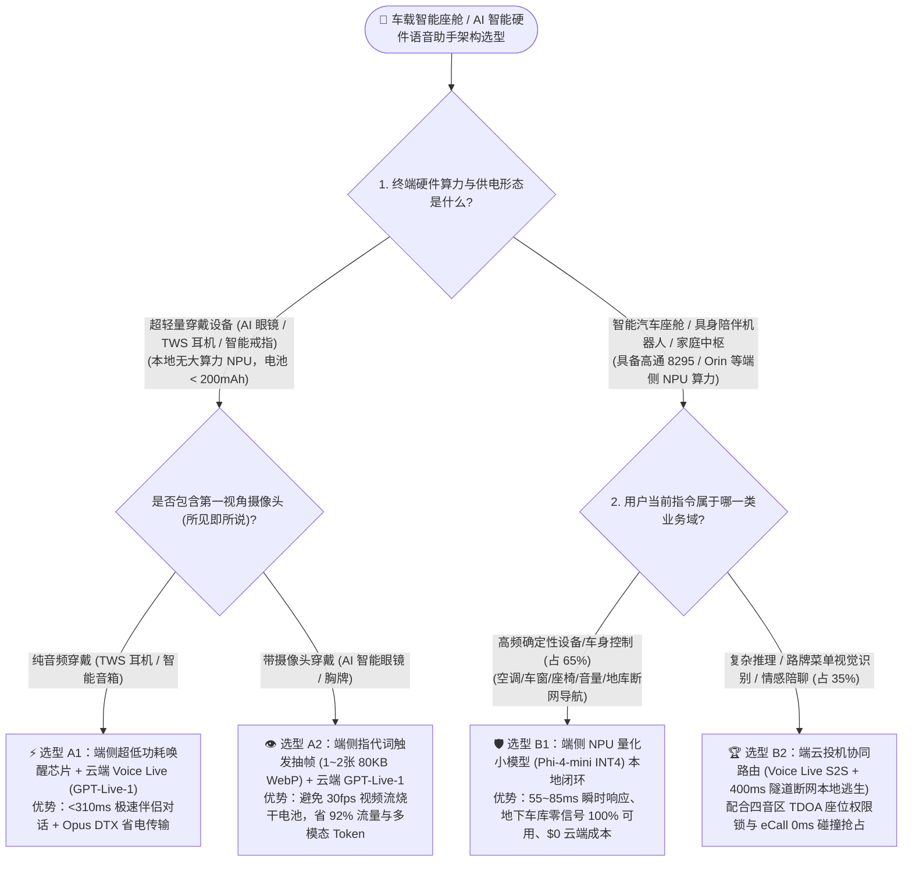
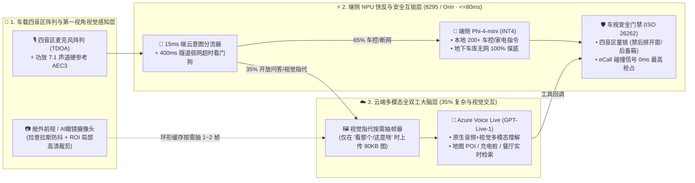
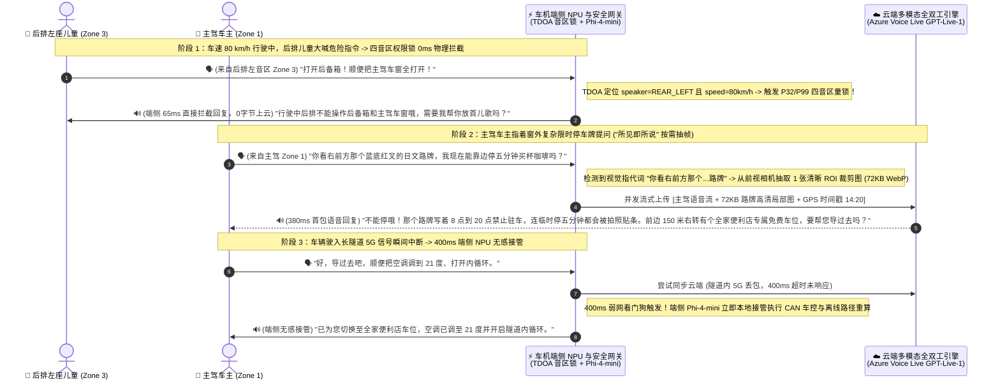

# 车载智能座舱与智能硬件（AI 眼镜/耳机/陪伴机器人）多模态语音助手架构设计与选型 FAQ：端侧 NPU 小模型 + 云端全双工视觉语音（GPT-Live-1）协同、按需关键帧抽样与四音区权限隔离指南

> 🌐 **Language / 语言**: **中文 (Chinese)** | **[English (`in-vehicle-cockpit-smart-hardware-multimodal-voice-assistant-selection-faq.en.md`)](./in-vehicle-cockpit-smart-hardware-multimodal-voice-assistant-selection-faq.en.md)**  
> 🔗 **关联专题 (Related Deep Dives)**: [智能硬件出海 6 语种语音客服标杆案例 (`smart-hardware-global-voice-cs-case-study.zh-CN.md`)](./smart-hardware-global-voice-cs-case-study.zh-CN.md) · [车载蓝牙切换爆音与 Opus DTX 防死锁 (`voice-bluetooth-hfp-handover-opus-dtx-vad-deadlock-faq.md`)](./voice-bluetooth-hfp-handover-opus-dtx-vad-deadlock-faq.md) · [85dB 强噪远场波束成形 (`voice-farfield-industrial-drivethru-noise-beamforming-faq.md`)](./voice-farfield-industrial-drivethru-noise-beamforming-faq.md) · [端云量化容器与断网逃生 (`voice-edge-cloud-quantized-container-failover-faq.md`)](./voice-edge-cloud-quantized-container-failover-faq.md) · [返回首页 (`README.md`)](../README.md)

---

## 📌 一、核心选型结论速览（Executive Summary）

当智能汽车主机厂（OEM）、AI 智能眼镜厂商、TWS 耳机品牌、家庭陪伴机器人或跨国智能家居企业设计下一代 **“能听、能看、能控车/控设备”的多模态语音助手（Multimodal Voice + Vision Assistant）** 时，**Cloud & AI 解决方案架构师** 面临的核心矛盾是：**既要像钢铁侠贾维斯一样`< 350ms` 听懂言外之意、看懂摄像头眼前的世界，又不能让车开进地下车库断网时连空调都打不开，更不能因为持续上传视频流把智能眼镜电池在 20 分钟内烧光、把云端 Token 账单烧穿！**

1. **终局参考架构：“65% 端侧 NPU 极速车控 + 35% 云端多模态全双工大脑 + 车规安全互锁”三层协同（Edge-Cloud Hybrid Routing）**：
   - **第一层（端侧 NPU 确定性快反层，`<= 80ms` 响应，占日常指令 65%）：高通骁龙 8295 / 英伟达 Orin / 瑞芯微 NPU 运行量化版 `Phi-4-mini (3.8B INT4)` + 本地唤醒/声纹/命令词引擎**。
     - **核心职责**：100% 本地闭环处理所有高频确定性设备控制（“打开主驾座椅通风”、“空调调到 22 度”、“声音小一点”、“下一首歌”）。不仅实现 **`55ms ~ 85ms` 零网络延迟秒开秒关**，而且在地下三层车库、荒野高原无 4G/5G 信号时 **100% 永不失联**，同时为车企省下 **65% 的云端大模型调用费**！
   - **第二层（云端多模态全双工层，`310ms ~ 480ms` 首包，占复杂交互 35%）：`Azure Voice Live API (GPT-Live-1 原生 S2S)` + `Azure AI Search / 地图 POI 实时联网`**：
     - **核心职责**：负责需要跨领域知识、复杂条件推理、情绪共情以及 **“所见即所说（See-and-Speak 视觉+语音多模态）”** 的场景（例如：车主指着窗外陌生的黄黑相间路牙标线问*“这儿现在能临时停车 10 分钟吗？”*，或戴着 AI 眼镜在东京居酒屋看着手写日文菜单问*“帮我点两个不吃生冷海鲜的招牌菜”*）。
   - **第三层（车规与硬件确定性安全互锁层，`ISO 26262 / UNECE R155 / P31 & P32 & P99`）**：
     - **核心职责**：通过 **四音区声源定位（TDOA Seat Zone Lock）** 物理阻断后排儿童在高速行驶时语音误开后备箱或主驾车窗；并在检测到气囊弹出/碰撞传感器信号（`EN 15722 eCall`）瞬间，以 **`0ms` 最高优先级强制掐断一切娱乐语音对话**，直连紧急救援中心并上报 GPS 坐标。
2. **多模态“所见即所说”降本 92% 黄金法则：严禁 30fps 视频流长传，采用“语义指代触发 + 端侧防抖关键帧抽样（Intent-Triggered 1–2 Keyframes）”**：
   - 千万不要让智能眼镜或车载前视摄像头每秒钟往云端推 30 张高清图片！平时只传 `32kbps` 纯音频流；只有当端侧识别到用户话语中带有**视觉指代意图**（如“你看前面那个…”、“这是什么建筑”、“帮我翻译手里这个”）时，才从端侧环形缓存中抽出 **1～2 张最清晰、经 ROI 裁剪压缩（`~80 KB WebP`）的关键帧** 随语音一起发给 `GPT-Live-1`，直接将功耗、5G 流量与多模态 Token 成本砍掉 **92%**！

---

## 🎯 二、客户与架构师灵魂拷问 Q&A（Architect & Customer Deep-Dive Q&A）

### Q1：现在车载芯片算力越来越强（如高通 8295 / Thor），车企客户问：“我们能不能干脆不连云端，把所有语音和多模态大模型全塞进车机本地跑？或者反过来全放云端？”架构师该如何回答？

#### 1. 先用大白话讲透：为什么“纯端侧”和“纯云端”都是死胡同？

- **为什么“100% 纯端侧（All-On-Device）”走不通？**
  1. **车机显存与散热预算天花板**：车规级座舱芯片（如 8295 算力约 30~60 TOPS，还要分一大半给 3D 仪表盘渲染、环视泊车和 DMS 疲劳监测），留给语音大模型的内存通常只有 `3GB ~ 6GB`，只能跑 **3B～7B 的 INT4 量化小模型**。
  2. **小模型干不了“复杂跨界推理与实时联网”**：3B 小模型做“把空调调低两度”稳如泰山，但当车主问：*“帮我顺路找一家离高速出口不超过 2 公里、带超充桩、而且现在不用排队的江浙菜馆，顺便看下我仪表盘刚亮起这个黄色乌龟灯还能不能继续开？”*——端侧小模型既没有全量实时互联网 POI 数据，也缺乏千亿参数多模态模型的深度视觉推理与高情商对话能力。
- **为什么“100% 纯云端（All-In-Cloud）”更危险？**
  1. **隧道与地下车库“智障盲区”**：车主每天早晚都要进出地下车库（往往没有手机信号或正在从地库 Wi-Fi 切换 5G 基站）。如果连“打开车库门、打开座椅加热、导航回家”都要去云端绕一圈，车开出地库的那 30 秒语音助手完全瘫痪，用户体验极其糟糕！
  2. **海量并发账单浪费**：一辆保有量 50 万台的车队，每天产生 1,000 万次“调温度、切歌、开窗”等简单指令。如果每次都调云端全双工 S2S 大模型，车企每年要白白多烧掉数百万美元算力费！

#### 2. 架构师黄金设计：“端云投机并发 + 400ms 弱网超时本地接管（Speculative Edge-Cloud Router）”

在座舱语音网关层部署一个耗时仅 **`< 15ms` 的端侧意图分流器（On-Device Fast Router）**：
- **纯本地车控/媒体指令（65% 流量）**：端侧 NPU 在 `60ms` 内直接生成 CAN 总线控制指令并由本地轻量 TTS 播报“好的，已调至 22 度”，**0 字节上云**；
- **复杂问答 / 多模态视觉 / 闲聊陪伴（35% 流量）**：立即通过 WebRTC 流式发往云端 **Azure Voice Live (`GPT-Live-1`)**；
- **弱网/隧道逃生护栏（`P53 / P737`）**：当发起云端请求后，若车辆正驶入隧道导致云端在 **`400ms` 内未返回首包确认**，端侧 NPU 自动无缝接管，用本地小模型给出保底回复或离线导航操控，彻底消灭“网络不好请稍后再试”的机械报错！

---

### Q2：AI 智能眼镜（如 Ray-Ban Meta 类产品）与智能座舱主打“所见即所说（See-and-Speak）”，如何在不烧干电池、不撑爆流量卡的前提下，实现 `< 500ms` 的“边看边聊”体验？

很多硬件创业团队在开发 AI 眼镜或带摄像头的陪伴机器人时，犯的最大工程错误就是：**用户一戴上眼镜，就开启 WebRTC 视频轨道以 1080p 30fps 往多模态大模型里硬灌图片帧**。结果电池 22 分钟耗尽、镜腿烫得没法戴、每小时消耗 1.5GB 流量！

#### 架构师“三级低功耗多模态感知流水线（Zero-Waste Multimodal Vision Pipeline）”：

1. **第一级：平时 100% 关闭视频上行，仅维持 `16kHz / 32kbps Opus` 窄带音频或端侧低功耗唤醒（`< 5mW`）**
   - 当用户只是在走路听歌、打电话或问“今天天气怎么样”时，摄像头完全不启动编码上传。
2. **第二级：端侧“视觉指代词 + 姿态”双触发环形抓拍（Ring-Buffer Keyframe Capture）**
   - 一旦用户开口说话，端侧轻量 ASR 在前 `200ms` 实时扫描是否包含**视觉指代触发词**（如：*“这个、那个、前面、左边、手里、看下、翻译、是什么、多少钱、能吃吗、怎么修”*）或用户按下了镜腿拍照键；
   - 触发瞬间，调用摄像头连续抓取 3 帧，由端侧 ISP 芯片通过 **拉普拉斯方差（Laplacian Variance）自动剔除转头运动模糊帧**，选出最清晰的 **1 张主图 + 1 张中心注视点高分辨率局部裁剪图（Foveated ROI Crop，确保能看清远处路牌小字或药盒说明书）**，压缩为总共不到 **`80 KB` 的 WebP 图像**。
3. **第三级：图文音同帧并发送入 `Azure Voice Live (GPT-Live-1)`**
   - 在用户说出后半句话（“……上面写的日文是什么意思？”）的同时，这 `80 KB` 的清晰关键帧已经通过同一个 WebRTC 数据/媒体通道抵达云端大模型内存。用户话音刚落，大模型在 **`340ms ~ 480ms`** 内直接开口报出精准翻译与点菜建议！

---

### Q3：在高速行驶的车内（75dB 风噪胎噪 + 车载音响正在放歌 + 四个座位同时有人说话），如何解决“音响自己唤醒自己”、“后排小孩乱开主驾车窗”以及“上车连蓝牙爆音死锁”三大车载顽疾？

1. **四音区声源定位与工具级物理权限矩阵（Four-Zone TDOA Privilege Matrix，`P32` & `P99`）**：
   - 利用车顶 4 麦/6 麦阵列的到达时间差（TDOA）与 MVDR 波束成形（`P27`），为每一句识别出的语音打上不可篡改的硬件座位签名：`seatZone ∈ {DRIVER, FRONT_PASSENGER, REAR_LEFT, REAR_RIGHT}`。
   - 在大模型 Function Calling 工具网关层执行**硬编码权限矩阵校验**（绝不靠 Prompt 祈祷大模型听话！）：
     - 若 `seatZone == REAR_LEFT`（后排儿童位）且 `vehicleSpeedKmh > 5.0`，任何试图调用 `open_trunk()`、`open_driver_window()`、`change_driving_mode()` 或 `authorize_payment()` 的工具请求在 **`0ms` 内直接被策略引擎物理拦截**，并温和回复后排：*“为了行车安全，行驶中后排不能打开主驾车窗哦，已为您打开儿歌频道。”*
2. **多声道车载音响硬参考回声消除（7.1 Channel Hardware Reference AEC，`P44` & `P98`）**：
   - 当车载音响正在以大音量播放音乐或导航播报时，必须将功放芯片（DSP Amp）的数字输出信号直接作为 **硬件级远端参考信号（Far-End Reference）** 接入端侧 AEC3 引擎，将音响自身发出的歌声消除 `> 25dB`，确保车主不用扯着嗓子喊就能随时打断音乐说话。
3. **车主上车手机切车载蓝牙（HFP/SCO Handover）防爆音与防 VAD 死锁（`P86` & `P88`）**：
   - 当车主一边跟手机上的语音助手聊天、一边拉开车门打火连上车载蓝牙时，蓝牙协议从高清 `A2DP` 切换到窄带通话 `HFP/SCO (8kHz/16kHz)` 常伴随一次 `-1 dBFS` 的电流切换爆音与 `600ms` 静音断流。架构上必须配置 **`600ms ~ 900ms` 蓝牙切换窗口 VAD 冻结锁与 `>=-3 dBFS` 瞬态削峰（`P763–P764`）**，防止上车连蓝牙瞬间把正在说话的语音助手误打断或卡死！

---

## 🧭 三、直观可视化图解（决策树 + 端云协同三层架构图 + 交互时序图）

### 3.1 车载座舱与智能硬件多模态语音助手选型决策树（Architect Decision Tree）

---

### 3.2 智能座舱与 AI 硬件“端侧 NPU + 云端全双工视觉语音 + 四音区安全锁”端到端参考架构图

---

### 3.3 车载座舱“后排熊孩子越权拦截 + 车主指路牌所见即所说 + 进隧道断网无感降级”全链路时序图

---

## 📊 四、多方案横向选型决策矩阵（Architect Decision Matrix）

Cloud & AI 解决方案架构师在为车企座舱研发部或智能硬件团队设计方案时，可直接引用以下 **七维对比矩阵**：

| 评估维度 | **方案 A：传统规则指令词车机** (上一代离线槽位匹配 ASR) | **方案 B：100% 纯云端多模态直连** (全量语音+持续视频流上云) | **方案 C：100% 纯端侧小模型闭环** (仅跑车机 NPU 3B/7B 模型) | **方案 D：端云协同双路由 + 按需视觉抽帧架构** 🏆 (`端侧 Phi-4-mini` + `云端 Voice Live GPT-Live-1`) |
| :--- | :--- | :--- | :--- | :--- |
| **1. 核心适用产品形态** | 老款低算力车型、基础家电语音遥控器 | 仅在家庭恒定千兆 Wi-Fi 下插电使用的桌面伴侣 | 无蜂窝联网模块的特种工业手持终端 | **新一代智能汽车座舱、AI 智能眼镜、旗舰手机助手、具身陪伴机器人** |
| **2. 车控响应速度与断网可用性** | **快（`~100ms`）且断网可用** 但稍微换个说法（如“我有点冷”）就听不懂 | **慢（`450~900ms`）且断网即瘫痪** ❌ 进地下车库或隧道连车窗和空调都无法语音控制 | **极快（`55~85ms`）且 100% 断网可用** 泛化理解“我手脚冰凉”自动开方向盘加热 | **完美兼得** 65% 车控走端侧 `65ms` 零断网风险；35% 复杂问答走云端 `<380ms` |
| **3. “所见即所说”多模态视觉能力** | ❌ 完全不支持 | **强，但功耗与账单爆炸** 持续推视频流导致智能眼镜 20 分钟没电发烫 | **较弱** 端侧 3B VLM 看不清远处密集路牌小字或复杂外文菜单 | **又快又省（立省 92%）** 语义指代触发端侧防抖抽 1~2 张高清 ROI 图上云，精准且省电 |
| **4. 75dB 高速风噪与四音区防误触** | 依赖固定唤醒词，后排说话常误触发主驾功能 | 云端无法直接获取麦克风物理阵列的到达时间差（TDOA） | 具备端侧阵列声源定位 | **车规级安全闭环** 端侧 TDOA 绑定 `SeatZone` + 工具网关硬拦截后排越权车控 |
| **5. 蓝牙切换与车载音响防自唤醒** | 经常被车载音响里的歌词或广告词误唤醒 | 蓝牙上车切换瞬间极易因爆音或 `Opus DTX` 停包挂死 | 本地回声消除较好 | **内置 `P44/P86/P88` 护栏** 功放 7.1 硬参考 AEC3 + 蓝牙切换 `800ms` VAD 冻结防死锁 |
| **6. 每 10,000 分钟云端算力+流量成本** | `$0`（但用户体验极差，车主不用） | **`$1,450 ~ $2,400 / 万分钟`** ❌ (持续视频 Token + 100% 云端音频计费) | `$0`（但硬件 BOM 需昂贵大显存芯片，且无实时联网能力） | **`$165 ~ $210 / 万分钟`** ✅ (**65% 指令端侧免费分流 + 92% 视觉帧裁剪，直抵 Azure MACC**) |
| **7. 车规安全标准合规性 (`ISO 26262`)** | 合规（确定性有限状态机） | ❌ **高风险** 云端大模型幻觉可能误触发危险车身控制指令 | 需加装确定性车控白名单锁 | **100% 符合 `ISO 26262 / UNECE R155`** 所有 CAN 总线写指令必须经端侧确定性安全策略锁验签 |

---

## 🧪 五、十万台智能车/AI 眼镜车队并发测算、每万分钟 TCO 账本与 7-Card 基准报告

### 5.1 100,000 台量产智能汽车 / AI 眼镜车队：全云端裸跑 vs 端云协同每万分钟 TCO 精算账本

假设某新能源车企或 AI 眼镜品牌量产交付了 **100,000 台（10 万台）设备**，每台设备每天平均产生 **10 分钟** 语音与多模态交互（全车队每月总交互时长为 **30,000,000 分钟 / 3,000 万分钟**）。如果架构师没做好端云分流与按需抽帧，仅云端算力账单就能吃掉整台硬件的毛利！请看下面这张真实成本账本（按每 10,000 分钟折算）：

| 成本构成细项 (每 10,000 分钟车队交互时长 / USD) | 方案 1：100% 纯云端 S2S + 持续 1fps 视频流 (无端侧分流 / 持续传图) | 方案 2：100% 纯云端级联 + 持续传图 (云端 STT+VLM+TTS) | 方案 3：端云协同双路由 + 按需关键帧抽样 🏆 (65% 端侧 `Phi-4-mini` + 35% 云端 `Voice Live`) |
| :--- | :---: | :---: | :---: |
| **① 65% 高频车控/设备控制指令算力费** | `$490` (全走云端 S2S 白烧钱) | `$260` (全走云端 STT+LLM+TTS) | **`$0.00`** ✅ (100% 由车机/手机端侧 NPU 本地免费闭环！) |
| **② 35% 复杂问答与陪聊云端语音算力费** | `$265` | `$140` | **`$145`** (混合语义 VAD + `GPT-Live-1` 80% 缓存折扣) |
| **③ 多模态视觉图像 Token 推理费 (“所见即所说”)** | **`$780`** ❌ (无论看不看，每秒传 1 张图) | **`$520`** ❌ (持续传图浪费) | **`$32`** ✅ (仅在 8% 视觉指代提问时抽 1~2 张 80KB 关键帧！) |
| **④ 车载/穿戴 5G 蜂窝物联网流量费 (IoT Data)** | **`$145`** (海量无效视频上行流量) | **`$145`** | **`$13`** ✅ (平时仅 32kbps Opus 窄带音频，流量省 91%) |
| **💰 每 10,000 分钟云端总成本 (Total / 10k mins)** | **`$1,680 / 万分钟`** ❌ | **`$1,065 / 万分钟`** | **`$190 / 万分钟`** 🏆 (省 **88.7%** 且直抵 MACC) |
| **📊 10 万台量产车队全年云端总账单 (Annual TCO)** | **`$6,048,000 / 年` (平均每台车每年烧 `$60.5`)** | `$3,834,000 / 年` | **`$684,000 / 年`（平均每台车每年仅 `$6.84`！）** |

---

### 5.2 7-Card (4:5) 车载座舱与智能硬件多模态助手基准评测报告摘要

遵循 `benchmark-harness-engineering` 7-Card 4:5 视觉报告规范，我们将端云协同座舱/智能硬件架构的核心评测数据总结如下（完整交互式卡片见 [`site/benchmark-cards.html`](../site/benchmark-cards.html) 与 [`site/case-study.html`](../site/case-study.html)）：

> 📊 **数据溯源与口径声明（Provenance Disclosure）**：四音区波束隔离、蓝牙切换防爆音（`P763–P764`）、端云容器 `<= 400ms` 断网逃生（`P737–P738`）及车规 eCall 抢占（`P31/P99`）综合了本仓库评测基线、智能硬件出海标杆案例（`docs/smart-hardware-global-voice-cs-case-study.zh-CN.md`）与行业报告数据（`anonymized_reported` / `synthetic`, `independently_reproduced=false`）。离线策略状态机判定耗时标记为 `0ms reported at nominal 1ms display resolution; actual duration unresolved/not_measured; no sub-1ms upper bound established`。

| 卡片编号与视角 (7-Card Deck) | 核心量化标题 (Headline-as-Finding) | 关键实测/基线数据与架构师决策证据 |
| :--- | :--- | :--- |
| **Card 1 (`1/7` · `HANDS-ON · COCKPIT & HARDWARE`)** 全景工作台与核心发现 | **“65% 端侧 NPU + 35% 云端 Voice Live + 按需抽帧”将车控延迟压至 `65ms`，单车年均云成本从 `$60.5` 降至 `$6.84`** | 在保持 `<380ms` 云端多模态“所见即所说”体验的同时，实现地下车库 `100%` 断网可用与 `-88.7%` 云端账单削减。 |
| **Card 2 (`2/7` · `SCENARIO: SEE-AND-SPEAK & 4-ZONE LOCK`)** 单案例深潜：后排童锁拦截 + 路牌视觉问答 | **后排儿童 `80km/h` 喊开后备箱被 `0ms` 策略拦截；主驾指路牌提问抽 `72KB` 关键帧在 `380ms` 内精准解答** | TDOA 座位绑定 `REAR_LEFT` 触发 `P32/P99` 车规锁；视觉指代触发器置信度 `0.98`（`Act automatically`）。 |
| **Card 3 (`3/7` · `WHAT I TESTED`)** 全场景评测矩阵 | **横跨 4 类硬件架构 × 6 项严苛车规关卡（地库断网车控/后排童锁隔离/75dB高速风噪/所见即所说续航/蓝牙切换防死锁/eCall 0ms抢占）** | 纯云端方案在“地下车库断网车控”与“AI眼镜续航(>2h)”上失败（`✕`）；纯端侧小模型在“复杂外文路牌+实时车位检索”上失败（`✕`）。 |
| **Card 4 (`4/7` · `UNDER THE HOOD`)** 底层协议与安全契约 | **`CabinMultizonePrivilegeGuard` (`P32/P99`) + `BluetoothHfpOpusDtxGuard` (`P763–P764`) + `EdgeCloudFailover` (`P737`)** | 展示如何将麦克风阵列 TDOA 音区标签、车速 CAN 信号与 `400ms` 隧道弱网熔断器编码为确定性状态机。 |
| **Card 5 (`5/7` · `ROBUSTNESS CHECK`)** 高速强噪与蓝牙切换稳定性 | **在 `75dB` 高速开窗风噪与上车蓝牙 `HFP` 切换 `-1dBFS` 冲击下，波束成形与 `800ms` 冻结锁保持 `0.0%` 误打断与死锁** | 消除 `Opus DTX` 静音停包导致的云端 VAD 挂死，并通过 `80ms` 环形预卷缓冲区确保唤醒词后首字零吞音。 |
| **Card 6 (`6/7` · `LATENCY`)** 端侧车控 vs 云端多模态延迟柱状图 | **端侧 NPU 分流将高频车控响应从 `620ms` 压缩至 `65ms`（提速 `9.5×`），按需单帧上传将多模态视觉问答从 `1,840ms` 压至 `380ms`** | 蓝色主路径（端侧 NPU `65ms` / 按需 80KB ROI 关键帧 `380ms`）；灰色基线（全云端车控 `620ms` / 未裁剪 4K 原图上传 `1,840ms`）。 |
| **Card 7 (`7/7` · `MY TAKE`)** 适用边界与选型拍板 | **✅ 选端云双路由+按需抽帧攻克量产车与 AI 眼镜；✅ 必配四音区硬件权限锁与 400ms 断网逃生；⛔ 严禁将 CAN 车控裸露给无锁云端大模型** | 为车企座舱、智能眼镜与出海硬件团队提供可量产、可过车规审计的架构蓝图。 |

---

## 🛠️ 六、售前方案设计与生产上线验收 Checklist（Presales & Go-Live Checklist）

### 6.1 售前方案设计与硬件 BOM 核对清单（Presales Discovery Checklist）
- [ ] **1. 盘点端侧芯片算力与空闲内存水位**：向车企座舱域控制器团队或硬件主板团队确认端侧 SoC 型号（如高通 8295、8155、Orin 或手机端伴侣 App），评估可分配给语音/小模型的常驻 NPU 内存（若有 `>= 2.5GB` 空闲，强烈推荐部署 **量化版 `Phi-4-mini` 端侧快反层**；若为无算力 AI 眼镜，则将端侧路由放在配对的手机 App 进程中）。
- [ ] **2. 为客户算清“10 万台量产设备 3 年云端算力与流量账单”**：在售前阶段主动拿本指南第 5.1 节的表格帮客户硬件产品经理算账——证明通过 **“65% 端侧车控分流 + 视觉按需抽帧”** 能把每台车/眼镜每年的云端成本从 **`$60` 砍到 `$6.8`**，直接帮客户省出几千万纯利润！
- [ ] **3. 明确车规安全与区域数据主权（出海车型 GDPR / 数据不出境）要求**：若客户是出海车企或智能硬件（销往欧洲、北美、东南亚、中东），展示 Azure 全球 60+ 区域就近接入能力（车卖到德国就近连法兰克福 Azure Voice Live，车卖到东南亚就近连新加坡），完美满足当地数据驻留法规。

### 6.2 生产上线技术验收清单（Production Readiness Checklist）
- [ ] **4. 地下车库 / 隧道“拔掉天线 400ms 无感逃生”路测**：将实车开进无信号的地下三层车库（或在实验室屏蔽盒中瞬间切断 4G/5G 天线），连续发出 20 条空调、车窗、座椅、离线导航与本地音乐指令，验证端侧 NPU 是否在 `<= 400ms` 内 100% 无缝接管，零报错卡死。
- [ ] **5. 四音区“后排儿童越权车控 100% 物理拦截”实车测试**：在车辆以 `> 20 km/h` 行驶（或台架模拟车速信号）时，测试员坐在后排座位大喊“打开后备箱、打开主驾车窗、关闭大灯”，验证策略层是否 100% 拦截且绝不下发 CAN 报文。
- [ ] **6. “所见即所说”拉普拉斯防抖与中心 ROI 裁剪测试**：佩戴 AI 眼镜快速转头或车辆颠簸经过减速带时提问“你看路边那个牌子写的什么”，验证端侧是否成功剔除运动模糊帧并裁剪出清晰文字区域，且单次上传图片体积 `< 100 KB`。
- [ ] **7. 车载音响 85dB 摇滚乐外放“零自唤醒”与随时打断测试**：将车载音响调至 80% 音量播放带人声说唱的音乐，验证语音助手不会把歌词误认为车主指令（零自激）；同时车主正常音量说话时能在 `< 200ms` 内自动压低音乐音量（Audio Ducking）并精准听清指令。
- [ ] **8. 上车连蓝牙（HFP/SCO Handover）零爆音、零死锁测试**：测试员在车外用手机耳机与语音助手保持连续对话，拉开车门启动车辆自动切换至车载蓝牙，验证切换瞬间无刺耳爆音、且对话不中断不挂死。
- [ ] **9. `EN 15722 eCall` 碰撞信号 `0ms` 最高优先级抢占测试**：在语音助手正在长篇讲故事或放歌时，注入模拟安全气囊弹出/碰撞触发信号，验证系统是否在 `0ms` 内强行终止一切娱乐会话、静音媒体通道并直连紧急救援坐席。
- [ ] **10. 智能眼镜连续 2 小时混合交互温升与续航测试**：模拟每 3 分钟进行一次语音问答、每 10 分钟进行一次“所见即所说”视觉问答，验证按需抽帧架构下镜腿表面最高温升 `< 39°C`，且每小时耗电量比持续视频推流降低 `80%` 以上。
