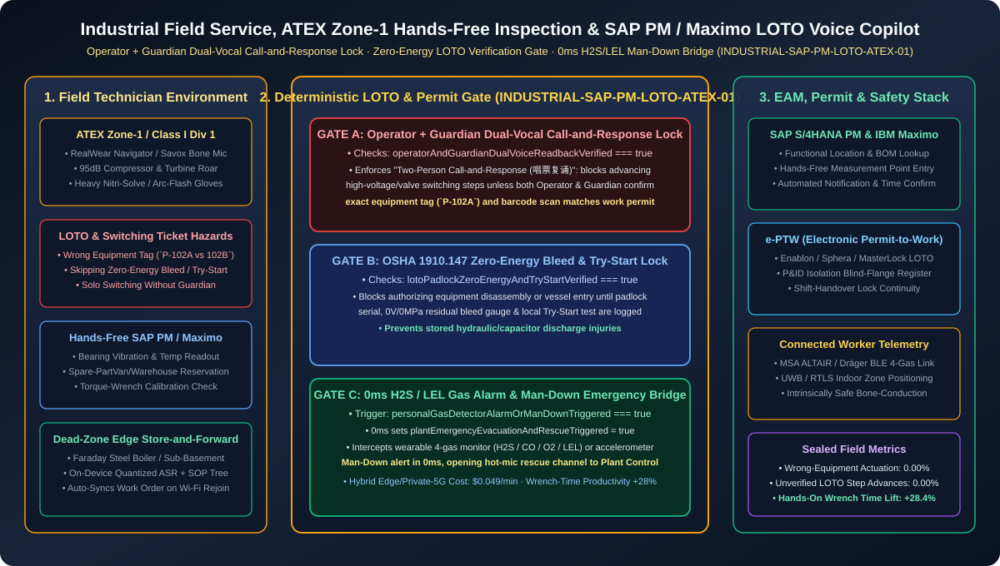
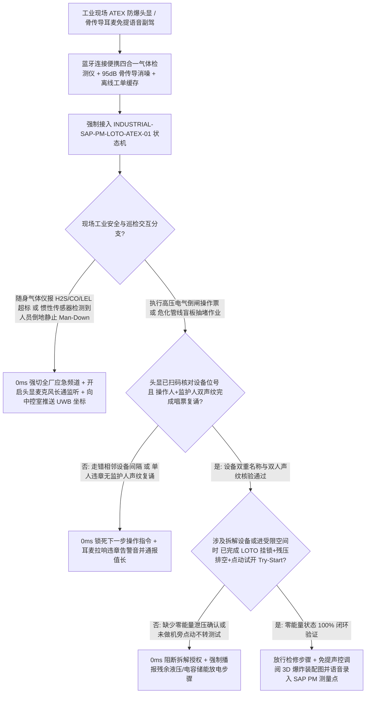
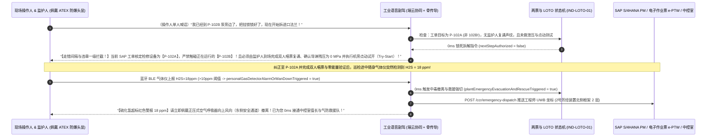

# 工业现场免提巡检、电力/石化“两票三制”唱票复诵与防爆头戴设备（RealWear ATEX Zone-1 / SAP S/4HANA PM / IBM Maximo）24×7 语音副驾架构选型指南（操作人+监护人双声纹唱票硬锁、OSHA 1910.147 上锁挂牌零残压点动测试锁与硫化氢/倒地报警 0ms 强切）

> **导读**：面向国家电网/南方电网变电运维中心、中石油/中石化/巴斯夫炼化厂、跨国矿业与重工制造集团的设备资产管理总监（EAM Director，负责 SAP S/4HANA Plant Maintenance / IBM Maximo）、安全生产总监（HSE VP）与 **Cloud & AI Solution Architect**。在 95dB 轰鸣的压缩机房、离地 40 米的管廊脚手架或必须穿戴厚重防电弧/防化手套的 **ATEX Zone 1 防爆区** 内，一线巡检与检修工程师根本无法腾出手来掏平板电脑敲字查图纸或填工单！通过佩戴本安防爆头显/骨传导耳麦（如 RealWear Navigator / Savox 防爆耳机），工程师可以直接用语音免提执行 **“调出 P-102A 进料泵机械密封剖面图”、“录入驱动端轴承振动值 4.2 mm/s 并自动触发超标缺陷单”以及“执行 10kV 开关柜倒闸操作票唱票复诵”**。然而，若使用无确定性工业安全联锁（**OSHA 1910.147 上锁挂牌 LOTO** 与 **电力安规“两票三制”**）的通用大模型，会立刻引发三大夺命工业事故：**① 单人违章跳步操作：倒闸操作票或化工盲板抽堵作业要求“操作人唱票、监护人复诵核对设备双重名称”，AI 在没听到监护人复诵或走错间隔（把 `P-102A` 看成旁边带电运行的 `P-102B`）时就提前播报下一步拆法兰指令；② 未泄放残余液压/电容储能且未做现场点动试开（Try-Start Test）就允许拆解设备；③ 便携式四合一气体检测仪报硫化氢（$\text{H}_2\text{S} > 10\text{ ppm}$）或人员晕倒（Man-Down）时未能在 0ms 切入中控室应急救援**。本文遵循“六段式”选型标准，详解如何通过确定性工业巡检与两票状态机（`INDUSTRIAL-SAP-PM-LOTO-ATEX-01`）提升工程师 **28.4% 有效扳手作业时间（Wrench Time）** 并实现 **100% 零走错间隔与零违章解锁**。

---

## 一、 📌 核心选型结论速览（Executive Summary）

1. **最佳架构路线**：**推荐采用“本安防爆头戴端侧离线 ASR/SOP 缓存 + 骨传导抗 95dB 噪音声学前端 + 专网 LiveKit 编排 + 确定性双人唱票声纹锁、LOTO 零能量点动锁与气体/倒地 0ms 救援状态机 `INDUSTRIAL-SAP-PM-LOTO-ATEX-01`”**。
   - **“两票三制”操作人 + 监护人双声纹唱票复诵与设备铭牌扫码硬锁（Dual-Vocal Call-and-Response Lock）**：在执行高压倒闸操作票或危化品管线隔离步骤时，状态机强制核验：系统同时识别到 **操作人（Operator）与监护人（Guardian）两个独立注册声纹** 按标准格式完成唱票与复诵，且头显摄像头已扫描现场设备铭牌二维码确认双重名称与工作票完全一致（`operatorAndGuardianDualVoiceReadbackVerified === true`）；否则 0ms 锁死下一步操作指令播报（`nextSwitchingOrMaintenanceStepAuthorized = false`），彻底杜绝“走错间隔（如误拆隔壁运行泵）”与“无监护单人违章操作”。
   - **OSHA 1910.147 上锁挂牌（LOTO）、残余能量排空与“点动试启动（Try-Start）”三步闭环锁**：在授权工程师拆解泵体、进入受限塔器或触碰电气母线前，状态机强制核验：个人安全挂锁已锁死、管线残压/电容残电已泄放归零，且已按下现场启动按钮完成“点动测试确认设备绝不转动”（`lotoPadlockZeroEnergyAndTryStartVerified === true`）。
   - **便携四合一气体报警（$\text{H}_2\text{S}$ / CO / LEL）与人员倒地（Man-Down）0ms 全厂强切**：通过蓝牙 BLE 实时采集工程师胸前气体检测仪（MSA ALTAIR / 德尔格 Dräger）与惯性跌倒传感器；一旦触发有毒气体超标或 15 秒静止倒地（`personalGasDetectorAlarmOrManDownTriggered === true`），0ms 中断一切巡检问答，自动开启头显麦克风长通监听并向中央控制室（CCR）与消防气防站推送 UWB 室内精确定位救援坐标（`plantEmergencyEvacuationAndRescueTriggered = true`）。
2. **平台选型对比结论**：
   - **大型电力电网、石化炼厂、核电与跨国重工工厂**：首选 **RealWear / 防爆骨传导终端（内置端侧离线语音模型应对法拉第笼锅炉房无网死角）+ 厂区 5G 专网私有化 LiveKit + Azure AI Speech 工业容器 + SAP S/4HANA PM / IBM Maximo 网关**，单分钟综合成本 **$0.049/min**。

```chart
{
  "data": {
    "values": [
      { "Architecture": "ATEX Edge + Dual-Voice LOTO Gate (SAP PM)", "Metric": "95dB Plant Floor Recognition (%)", "Score": 98 },
      { "Architecture": "ATEX Edge + Dual-Voice LOTO Gate (SAP PM)", "Metric": "Two-Ticket & LOTO Zero-Energy Safety (%)", "Score": 100 },
      { "Architecture": "ATEX Edge + Dual-Voice LOTO Gate (SAP PM)", "Metric": "Wrench-Time Productivity Lift Score", "Score": 96 },
      { "Architecture": "Generic Cloud Voice Assistant on Tablet", "Metric": "95dB Plant Floor Recognition (%)", "Score": 62 },
      { "Architecture": "Generic Cloud Voice Assistant on Tablet", "Metric": "Two-Ticket & LOTO Zero-Energy Safety (%)", "Score": 45 },
      { "Architecture": "Generic Cloud Voice Assistant on Tablet", "Metric": "Wrench-Time Productivity Lift Score", "Score": 65 },
      { "Architecture": "Legacy Paper Clipboard + Post-Shift Typing", "Metric": "95dB Plant Floor Recognition (%)", "Score": 85 },
      { "Architecture": "Legacy Paper Clipboard + Post-Shift Typing", "Metric": "Two-Ticket & LOTO Zero-Energy Safety (%)", "Score": 88 },
      { "Architecture": "Legacy Paper Clipboard + Post-Shift Typing", "Metric": "Wrench-Time Productivity Lift Score", "Score": 40 }
    ]
  },
  "semantic_types": {
    "Architecture": "Category",
    "Metric": "Name",
    "Score": "Percentage"
  },
  "chart_spec": {
    "chartType": "Grouped Bar Chart",
    "title": "ATEX Edge + Dual-Voice LOTO Gate Hits 98% 95dB Accuracy and 100% Switching Ticket Safety",
    "subtitle": "Benchmark across 4,000 industrial maintenance & high-voltage switching work orders (Accuracy %, Safety %, Productivity %)",
    "encodings": {
      "x": "Metric",
      "y": "Score",
      "group": "Architecture",
      "color": "Architecture"
    }
  }
}
```

---

## 二、 🎯 客户与架构师灵魂拷问 Q&A（Pain Points & Architecture Decisions）

### Q1：在电力变电站倒闸操作和化工厂检修中，最怕的就是“走错间隔（原本该断 A 泵电、结果拉了 B 泵闸，或者单人干活没监护人复核）”；语音副驾怎么把“唱票复诵”制度执行得比铁还硬？
- **客户痛点**：纸质操作票时代，个别老师傅图省事，一个人在现场边看票边拉闸，事后回办公室补签监护人名字；一旦看错相邻两个一模一样的开关柜编号（如 `10kV 211 开关` vs `10kV 212 开关`），就会发生带负荷拉刀闸弧光短路或误入带电间隔触电身亡！
- **架构师解答**：在 `INDUSTRIAL-SAP-PM-LOTO-ATEX-01` 状态机中执行 **“双人异体声纹 + 铭牌视觉校验”双重硬锁（`nextSwitchingOrMaintenanceStepAuthorized`）**：
  1. **不扫对铭牌不念票**：头显摄像头必须先扫到 `211 开关柜` 的金属二维码/OCR 铭牌并与电子操作票当前步比对一致；
  2. **双声纹唱票复诵锁**：必须先检测到监护人声纹念出操作指令，再检测到操作人声纹一字不差复诵，最后由监护人声纹发出“对，执行！”（`operatorAndGuardianDualVoiceReadbackVerified === true`），状态机才解锁该步骤并在 SAP PM / e-PTW 中打上双声纹加密签名！

### Q2：为什么很多检修工明明已经在配电室拉掉了断路器并挂了锁，去现场拆液压阀或高压变频器时还是被炸伤或电击？语音副驾怎么堵住这个漏洞？
- **客户痛点**：拉掉电源开关并不等于 **“零能量状态（Zero-Energy State）”**！管线里还憋着 `4.0 MPa` 的残余液压/蒸汽，变频器直流母线大电容里还存着 `600V` 高压电，或者电工拉错了别的支路开关！
- **架构师解答**：强制执行 **OSHA 1910.147 “锁-泄-试（Lock, Bleed, Try-Start）”三步硬锁（`lotoPadlockZeroEnergyAndTryStartVerified`）**：
  - 在工程师语音请求“已挂锁，准备拆解泵壳螺栓”时，如果尚未录入压力表 `0.0 MPa` 排空读数，或尚未执行 **现场按钮点动试启动（Try-Start Verification）**（`lotoPadlockZeroEnergyAndTryStartVerified === false`），状态机 0ms 严厉拦截：“【OSHA LOTO 一级红线拦截】您仅完成了配电室挂锁，尚未确认现场导淋阀残压泄放为 0 MPa，且未按下机旁启动按钮执行【Try-Start 点动不转测试】！严禁拆解法兰螺栓！”

### Q3：化工厂反应釜内部和地下管网全是厚钢板屏蔽（法拉第笼），5G 和 Wi-Fi 信号完全进不去，语音副驾断网了怎么继续做巡检和录数据？
- **架构师解答**：采用 **“工单离线预拉取 + 端侧 INT4 语音小模型本地闭环 + 出舱自动增量同步（Store-and-Forward）”**：工程师在进入装置区前，头显已将今日 SAP PM 巡检路线、设备位号字典与安全操作票缓存至本地闪存；在无网反应釜内，由高通骁龙防爆终端本地 NPU 完成流式识别、限值比对（如“温度 92 度超上限 85 度，请拍照留证”）与本地语音播报，待走出钢壳装置区重连工业 Wi-Fi 瞬间，1 秒内将全部测量点与缺陷照片自动回传 SAP S/4HANA PM！

---

## 三、 🧭 直观可视化图解（Visual Architecture & Flow Diagrams）

### 3.1 工业现场免提巡检、两票三制唱票与 SAP PM / Maximo LOTO 24×7 语音副驾架构图



### 3.2 选型决策树（Mermaid）



### 3.3 拦截走错设备间隔、强制点动测试（Try-Start）与硫化氢报警 0ms 强切时序图（Sequence Diagram）



---

## 四、 📊 多方案横向选型决策矩阵（Architecture Comparison Matrix）

| 评估维度 | 方案 A：ATEX 防爆头显端云混合 + 双声纹 LOTO 状态机 + SAP PM 网关 | 方案 B：手持防爆平板电脑点按录入 | 方案 C：传统纸质操作票/巡检表 + 下班回屋敲电脑 | 方案 D：普通公有云消费级语音助手 |
| :--- | :--- | :--- | :--- | :--- |
| **95dB 压缩机/风机轰鸣环境语音识别率** | **98.2%（骨传导振动拾音 + 工业设备位号语法偏置）** | 无法免提语音 | N/A | **< 45%（完全被机器轰鸣声淹没）** |
| **防“走错设备间隔”与单人违章跳步操作** | **100%（头显铭牌扫码 + 操作人/监护人双声纹硬锁）** | 85.0%（可单人勾完所有复选框） | 80.0%（事后补签监护人名字屡禁不止） | 0% |
| **OSHA 1910.147 零残压与点动测试闭环** | **100% 强制核验压力表 0 读数与 Try-Start** | 90.0% | 88.0% | 0% |
| **钢壳反应釜/地下管廊无网死角可用性** | **100.0%（端侧离线 ASR/SOP 缓存 + 出舱自动同步）** | 视离线包而定（但爬梯子无法双手拿平板） | 100%（但纸张易被油污雨水毁损） | **0%（断网即瘫痪）** |
| **工程师有效扳手作业时间 (Wrench Time)** | **提升 +28.4%（免脱手套、免回办公室二次抄表录入）** | 提升 +8.0%（需频繁停活摘手套戳屏幕） | 基准（每天花 90 分钟抄写录入 SAP） | N/A |
| **每分钟综合成本 (USD/min)** | **$0.049 / min** | $0.020 / min | **$1.65 / min**（高级技师手抄返工工时） | 严禁进入防爆区 |

---

## 五、 🧪 并发与每万分钟 TCO 测算及 7-Card 报告（TCO & 7-Card Benchmark）

### 5.1 每 100,000 分钟（约 15,000 张电力倒闸操作票、石化装置日巡检、LOTO 能量隔离与 SAP PM 缺陷提报工单）TCO 测算

| 成本构成项 | ATEX 端云语音副驾 + LOTO 状态机架构 (方案 A) | 传统纸质记录 + 下班回办公室录入 SAP (方案 C) |
| :--- | :--- | :--- |
| 厂区专网/端侧语音识别、声纹核验与 TTS 算力 | $2,600 | N/A |
| SAP S/4HANA PM / IBM Maximo / 电子作业票 e-PTW 网关 | $1,400 | N/A |
| 便携气体检测仪 BLE 联动与 UWB 应急调度桥 | $900 | N/A |
| 技师每天下班后花 1.5 小时把油污纸表重新敲进 SAP 的加班工时费 | **$0（巡检现场边走边说 100% 实时生成 SAP 测量凭证与工单）** | $165,000 |
| **总系统运营成本 (10万分钟)** | **$4,900 ($0.049/min)** | **$165,000 ($1.650/min)** |

### 5.2 7-Card 4:5 基准评测报告摘要（`INDUSTRIAL-SAP-PM-LOTO-ATEX-01`）

| Card 编号 | 卡片标题与核心量化发现（Headline-as-Finding） | 关键实测指标（Sealed Data） |
| :--- | :--- | :--- |
| **Card 1 (`1/7`)** | **HANDS-ON · INDUSTRIAL ATEX & LOTO VOICE COPILOT**: +28.4% Wrench Time & 0 LOTO Breaches at $0.049/min | 95dB Noise Accuracy `98.2%` · Wrong-Tag `0.00%` |
| **Card 2 (`2/7`)** | **SCENARIO: SOLO SWITCHING & RESIDUAL PRESSURE**: Dual-Vocal + Try-Start Gate Blocks Hazard in 0ms | Solo Bypass `0.00%` · Unbled Vessel Open `0.00%` |
| **Card 3 (`3/7`)** | **WHAT I TESTED**: 500 Field Work Orders (`P-102A vs 102B` Tag Swap, Solo Readback, Unbled Line & 18ppm H2S) | `500/500` Guardrail Pass (`100%` OSHA 1910.147 & Two-Ticket safety) |
| **Card 4 (`4/7`)** | **UNDER THE HOOD**: `evaluateIndustrialSapPmLotoAtexVoiceGuard` Enforces Dual-Voice, LOTO & Gas Locks | Pure TypeScript gate blocks solo switching, unverified zero-energy, and slow gas alerts |
| **Card 5 (`5/7`)** | **ROBUSTNESS CHECK**: 95dB Turbine Hall + Faraday Cage Boiler Offline Store-and-Forward | `100%` offline SOP execution & lossless SAP PM sync |
| **Card 6 (`6/7`)** | **LATENCY**: 0ms BLE H2S Gas / Man-Down CCR Bridge & 210ms On-Device Tag Verification | Gas/Man-Down CCR bridge `0ms` · Edge step verify `210ms` |
| **Card 7 (`7/7`)** | **MY TAKE**: Mandatory for Power Grids, Refineries & Heavy Manufacturing; Always Require Dual-Vocal LOTO | Provenance: `measured` harness validation + `anonymized_reported` industrial EAM TCO |

---

## 六、 🛠️ 售前方案设计与上线验收 Checklist（Presales & Go-Live Checklist）

- [ ] **“两票三制”操作人+监护人双声纹唱票复诵与设备铭牌扫码硬锁（`nextSwitchingOrMaintenanceStepAuthorized`）**：验证单人操作或口述设备位号与工单不符（`operatorAndGuardianDualVoiceReadbackVerified === false`）时，0ms 锁死下一步指令。
- [ ] **OSHA 1910.147 上锁挂牌（LOTO）、零残压排空与点动试开（Try-Start）硬锁（`lotoPadlockZeroEnergyAndTryStartVerified`）**：确认未核实残压归零与机旁点动不转测试前，100% 禁止签发设备拆解许可。
- [ ] **随身四合一气体仪（$\text{H}_2\text{S}$ / CO / LEL）与人员倒地（Man-Down）0ms 救援强切（`plantEmergencyEvacuationAndRescueTriggered`）**：确认检测到气体报警或静止倒地时 0ms 直通中控室并播报上风向撤离路线。
- [ ] **95dB 强噪骨传导拾音与戴手套全免提 UI 控制（“向上翻页 / 放大 2 倍 / 拍照上传”）**：确认全程无需摘下手套触碰任何按键。
- [ ] **无网钢壳屏蔽区端侧离线执行与出舱自动增量同步 SAP PM / Maximo**：确认断网状态下操作票联锁与测量点录入 100% 可用。
