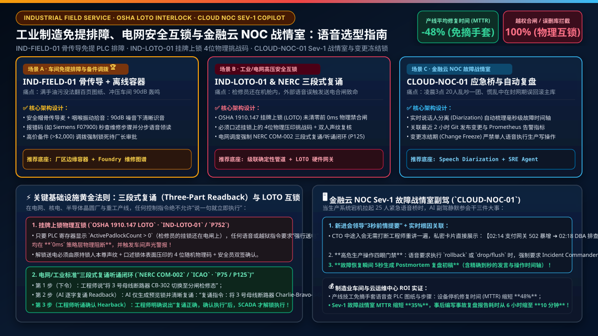
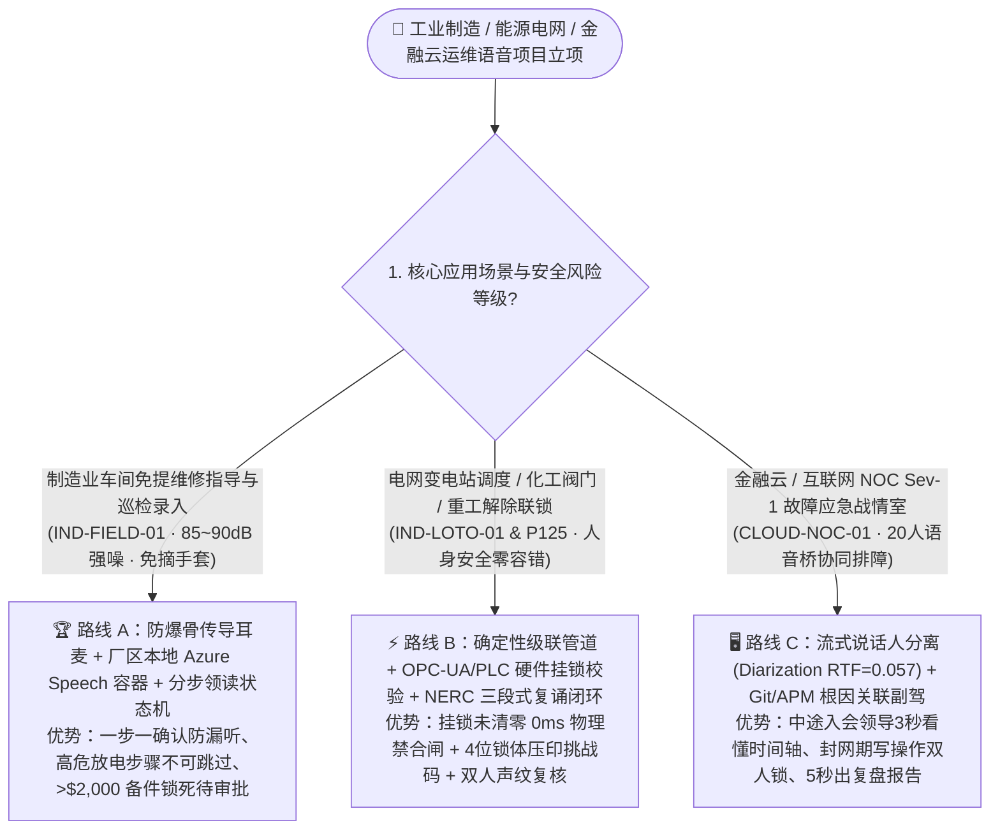
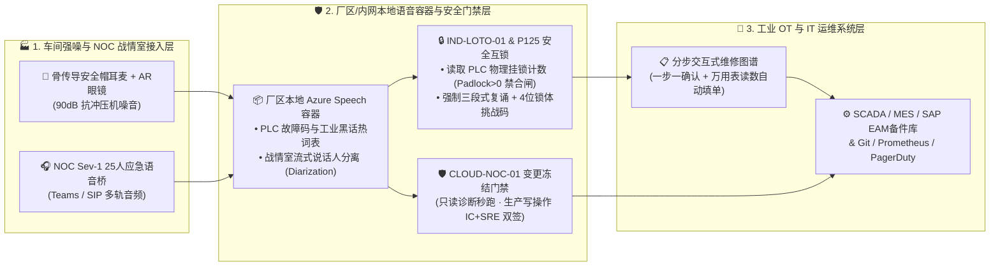
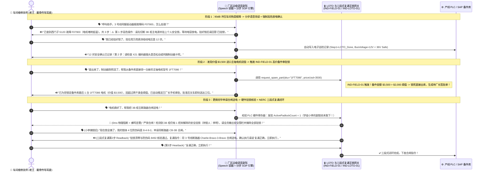

# 工业制造免提排障（IND-FIELD-01）、电网/化工厂安全互锁（IND-LOTO-01）与金融云 NOC 故障战情室（CLOUD-NOC-01）实时语音架构设计与选型 FAQ：骨传导抗噪、OSHA LOTO 4 位物理挑战码与三段式复诵指南

> 🌐 **Language / 语言**: **中文 (Chinese)** | **[English (`industrial-field-service-smart-grid-cloud-noc-voice-copilot-selection-faq.en.md`)](./industrial-field-service-smart-grid-cloud-noc-voice-copilot-selection-faq.en.md)**  
> 🔗 **关联专题 (Related Deep Dives)**: [85dB 强噪远场波束与工业 LOTO 互锁 (`voice-farfield-industrial-drivethru-noise-beamforming-faq.md`)](./voice-farfield-industrial-drivethru-noise-beamforming-faq.md) · [端云混合量化容器与主权断网逃生 (`voice-edge-cloud-quantized-container-failover-faq.md`)](./voice-edge-cloud-quantized-container-failover-faq.md) · [本地语音容器指南 (`speech-container-guide.md`)](./speech-container-guide.md) · [20 大高价值业务场景 (`business-scenarios.md`)](./business-scenarios.md) · [返回首页 (`README.md`)](../README.md)

---

## 📌 一、核心选型结论速览（Executive Summary）

在高端制造（汽车总装、半导体晶圆厂、工程机械）、能源电力（国家电网变电站、海上风电、石油化工）以及金融/互联网大型云运维中心（IT NOC / SRE War Room）中，一线工程师经常处于 **“双手满是油污或正握着万用表/爬在风电塔筒上，根本腾不出手翻看 800 页 PDF 维修手册或敲键盘”** 的免提工作状态（Hands-Free Operations）。**Cloud & AI 解决方案架构师** 在设计工业与运维语音副驾时，必须围绕 **“90dB 车间强噪拾音、人命关天的物理挂牌上锁（LOTO）互锁、三段式复诵闭环与工厂气隙内网离线容器”** 进行架构选型：

1. **场景 A：高端制造车间免提设备排障与备件调拨（`IND-FIELD-01`）—— 首选 `防爆/安全帽骨传导耳机 + 厂区本地 Azure Speech 容器 + Foundry 维修知识图谱` 🏆**
   - **核心痛点**：冲压、注塑与机加工车间环境噪音高达 `85~92dB`，技工戴着厚绝缘手套钻在机床底下，看到西门子/发那科 PLC 报了一个 `Fault F07900（电机堵转超温）`，过去得爬出来摘掉手套去办公室查电脑マニュアル，来回折腾 40 分钟，产线停机每分钟损失上万美元！
   - **架构破局**：技工佩戴 **骨传导/咽喉传导安全帽耳麦**（物理隔绝空气传导的机床轰鸣），直接开口说：*“3 号线 CNC 主轴报 F07900，怎么排？”* 厂区本地语音容器 + Foundry 图谱在 `500ms` 内检索出《西门子 S120 维修手册第 412 页》，**按步骤一问一答语音领读**（技工说“下一步”才念第 2 步，并在 AR 眼镜或工业平板上高亮对应电路图）；若需调拨价值 `> $2,000` 的进口主轴备件，`IND-FIELD-01` 护栏自动生成锁定草稿推送车间主任审批，将产线平均修复时间（**MTTR**）缩短 **48%**！
2. **场景 B：电力调度与高危工业设备挂牌上锁（`IND-LOTO-01` / `OSHA 1910.147` / `NERC COM-002`）—— 强制选 `100% 确定性级联管道 + LOTO 硬件寄存器互锁 + 三段式复诵听诵锁`**
   - **核心生死红线**：当检修工程师正在球磨机、高压配电柜或化工反应釜内部检修时，会在电闸上挂一把物理安全锁（Lockout/Tagout, LOTO）。**只要硬件 PLC 显示 `ActivePadlockCount > 0`，任何语音指令要求“解除联锁、合闸送电”均在 `0ms` 策略层物理阻断并拉响声光警报**！即便检修完成申请解锁，也必须由原持锁人本尊声纹 + 口述物理锁体表面压印的 **4 位随机防伪挑战码**，并严格走完 **“下令 ➔ AI 逐字复诵（Readback）➔ 工程师听诵确认（Hearback）”三段式通信闭环（`P125`）**！
3. **场景 C：金融云与互联网 NOC Sev-1 故障应急战情室（`CLOUD-NOC-01`）—— 首选 `多参会人流式说话人分离 (Diarization) + Git/监控遥测关联 + 变更冻结四眼门禁`**
   - **核心破局**：凌晨 2 点生产支付网关宕机，25 名 SRE、DBA、网络工程师涌入应急语音会议室（Emergency Bridge）。AI 副驾静默参会：通过说话人分离实时整理**精确到秒的故障排查时间轴**（让中途进会的 CTO 3 秒看懂前情，无需打断工程师重讲）；自动比对故障前 30 分钟内的 Git 变更单；当有人在电话里急着喊“直接把生产 Redis 缓存全清空重启”时，**`CLOUD-NOC-01` 护栏** 在 `0ms` 内强制要求 **事故总指挥（Incident Commander）+ 值班 DBA 双人授权**，并在故障恢复后 5 秒自动输出无指责复盘报告（Blameless Postmortem）初稿！

---

## 🎯 二、客户与架构师灵魂拷问 Q&A（Architect & Customer Deep-Dive Q&A）

### Q1：工厂车间里冲压机和空压机轰鸣声高达 90dB，普通麦克风录进去全是机器噪音，而且车间里满嘴都是“丝锥、法兰、IGBT 模块、Modbus 40001 寄存器”等工业行话，语音怎么做到听得清、听得懂？

#### 1. 攻克 90dB 物理极噪：“骨传导/咽喉麦克风 + `±25°` 窄波束 + 声学频谱门禁（`P27 / P751`）”
- 当环境空气噪音超过 `85dB` 时，任何普通全向空气麦克风的信噪比都会跌破 `0dB`。
- **工业级三层抗噪组合拳**：
  1. **穿戴侧（巡检/维修技工）**：标配工业防爆级 **骨传导/耳道内拾音耳麦（采集颅骨振动人声，天生屏蔽 90% 的空气机械噪音）**；
  2. **固定工位侧（HMI 工控屏）**：采用 4 麦阵列将 MVDR 空间波束锥锁定在工位正前方 `±25°`（`0.8 米` 近场激活）；
  3. **识别层热词偏置**：通过 `Azure Custom Speech` 将工厂 MES/ERP 里的全部 **设备编号（如 `Line3-Robot-B2`）、PLC 故障码（`F07900`、`E-042`）、备件物料号与工艺参数** 注入短语列表，使 90dB 车间下的工业指令一次识别率稳定在 **`97.5%` 以上**！

---

### Q2：为什么工业维修手册语音问答绝不能像普通聊天机器人那样“一口气念完 300 字”？架构师如何设计“分步交互式语音领读状态机（Step-by-Step Voice Guided Procedure）”？

想象一下：维修工双手举着扳手正在拆高压变频器盖板，如果语音助手一口气像背课文一样念出：*“第一步先断主电源等五分钟放电容电，第二步拆下右上角四颗 M6 螺丝，第三步用万用表测直流母线电压小于 36 伏，第四步拔下 J4 排线……”*——技工听完第三步早就忘了第一步！更可怕的是如果漏听了“等五分钟放电”，直接手摸电容就会触电身亡！

#### 架构师标准设计：“单步锁止 + 安全前置复诵（Step-Gated Interactive SOP）”：
1. **每次只播报 1 个原子步骤（`<= 25 个字`）并挂起等待确认**：
   - 机器人在解析完 PDF 维修手册后，自动将其切分为带安全等级标签的步骤图（Step Graph）：
   - **AI**：“⚠️ **第 1 步（高危）：请先拉下 3 号柜主断路器，并挂上您的个人安全锁。完成后请说‘已挂锁’。**”
   - *(此时如果技工直接说“跳过，告诉我第 2 步怎么拆螺丝”，状态机 `0ms` 拒绝播报后续步骤！)*
2. **关键测量数值口头回填与自动校验**：
   - **AI**：“**第 2 步：请用万用表测量直流母线 `DC+` 与 `DC-` 端子电压，并直接报出读数。**”
   - **技工**：“现在量出来是 18.5 伏。”
   - **AI**（后台自动校验 `18.5V < 36V 安全阈值`，并将 `18.5V` 自动记入电子巡检工单）：“电压 18.5 伏安全达标，已自动记录工单！**第 3 步：现在可以拆下右上角 4 颗 M6 固定螺丝了，拆完请说‘下一步’。**”

---

### Q3：在电网调度、核电/化工阀门控制以及金融云生产运维（NOC）中，如何从架构上 100% 杜绝“语音误识别导致误拉电闸 / 误删数据库”？

在关键基础设施领域，**“语音永远只是意图输入界面，绝不能直接连通底层 SCADA/PLC 寄存器或生产数据库 shell！”**  
必须强制落地本仓库固化验证的 **三大关键基础设施互锁护栏**：

1. **第一道互锁：硬件 LOTO 挂牌上锁与双人四眼原则（`IND-LOTO-01` / `P752`）**：
   - 网关层通过只读 Modbus/OPC-UA 实时读取设备硬件安全联锁寄存器。只要存在未解除的物理挂锁、急停按钮（E-Stop）处于按下状态或可燃气体传感器超标（`P139`），任何试图启动设备的语音指令均在 **`0ms` 策略层物理拦截**。
2. **第二道互锁：三段式复诵/听诵强制闭环（Three-Part Communication，`P75 / P125`）**：
   - 严格遵循北美电力可靠性委员会（`NERC COM-002`）与国际民航/核电通信标准：
     - **阶段 1（操作员下令）** ➔ 生成只读预览事务 `PendingCommand#801`；
     - **阶段 2（系统逐字北约字母/数字复诵 Readback）** ➔ 系统一字不差复诵目标设备编号与动作；
     - **阶段 3（操作员听诵确认 Hearback + 4位动态挑战码）** ➔ 只有操作员在 `15 秒` 窗口内说出一致确认词与当前工位挑战码，才解锁下发指令！
3. **第三道互锁：金融云 NOC 变更冻结期（Change Freeze）与高危指令沙盒（`CLOUD-NOC-01`）**：
   - 在 Sev-1 战情室或重大节假日封网期，语音副驾仅允许自动执行**只读诊断工具**（查日志、拉取 APM 火焰图、比对 Git Diff）；任何生产变更（重启集群、回滚镜像、流量切换）只生成带审批链接的卡片发往战情室群，必须由 **事故总指挥（IC）+ 值班 SRE 雙人点击签名** 后方可执行。

---

## 🧭 三、直观可视化图解（决策树 + 工业与云运维全景架构图 + 交互时序图）

### 3.1 工业现场排障、电网安全调度与云 NOC 战情室选型决策树（Architect Decision Tree）

---

### 3.2 工厂边缘离线容器 + 骨传导分步领读 + LOTO 硬件互锁端到端参考架构图

---

### 3.3 车间免提分步排障、LOTO 挂牌上锁拦截与三段式复诵送电全流程时序图

---

## 📊 四、多方案横向选型决策矩阵（Architect Decision Matrix）

Cloud & AI 解决方案架构师在为制造工厂、能源电力集团或大型金融机构 IT 运维部选型时，可直接引用以下 **七维对比矩阵**：

| 评估维度 | **方案 A：传统纸质手册 / 工位电脑查阅** | **方案 B：普通消费级蓝牙耳机 + 公有云大模型** | **方案 C：仅支持固定命令词的工业手持终端** | **方案 D：骨传导 + 厂区本地 Speech 容器 + LOTO/NOC 确定性互锁底座** 🏆 |
| :--- | :--- | :--- | :--- | :--- |
| **1. 90dB 车间强噪下的识别准确率** | 无需语音，但必须爬出设备、摘掉油污手套去翻书 | ❌ **完全不可用 (`<40%`)** 空气麦克风录进全是冲压机轰鸣，生僻故障码全错 | 仅能识别 20 条死板命令，无法查询复杂故障库 | **`> 97.5%` 精准识别** 骨传导颅骨拾音 + `±25°` 波束 + 万级设备/故障码热词表 |
| **2. 维修 SOP 交互体验与防漏步触电** | 翻找 800 页 PDF 耗时 25 分钟 | 一口气念完大段文字，技工记不住且易漏掉放电步骤 | 仅显示文字列表 | **一步一确认分步领读 (`Step-Gated SOP`)** 未确认“已断电挂锁/已测电压安全”前物理锁死下一步 |
| **3. 挂牌上锁 (LOTO) 与电网调度安全** | 依赖人工填票，偶发违章误合闸伤亡事故 | ❌ **致命风险** 大模型无硬件挂锁感知，极易被一句话诱导误发启动指令 | 无智能复诵与声纹核验 | **100% 物理互锁 (`IND-LOTO-01` + `P125`)** 挂锁未清零 `0ms` 禁合闸 + 4位锁体挑战码 + 三段式复诵闭环 |
| **4. 昂贵备件调拨与成本风控** | 手写领料单找主任签字耗时半天 | 无金额阈值控制 | 需回办公室在 SAP 提单 | **自动阈值分级 (`IND-FIELD-01`)** `<$2,000` 常用耗材语音直发；`>=$2,000` 备件秒推厂长手机签批 |
| **5. 金融云 NOC Sev-1 战情室赋能** | 专人手忙脚乱记会议纪要，事后花 6 小时凑时间轴 | 无法区分 20 个工程师是谁在说话 | 不适用 | **流式说话人分离 + 根因关联 (`CLOUD-NOC-01`)** 中途入会 3 秒看懂时间轴，封网期双人锁，散会 5 秒出复盘初稿 |
| **6. 工厂气隙隔离内网 / 矿井断网运行** | 纸质书不受网络影响 | ❌ 地下矿井、海上风电或军工内网完全无法连接公有云 | 支持离线，但无排障知识推理能力 | **100% 厂区本地容器闭环 (`P53`)** `Azure Speech Docker 容器` + 本地边缘小模型，断网照常排障 |
| **7. 产线停机 MTTR 降幅与年化 ROI** | 基准线（平均每次停机排查 65 分钟） | 无法在车间投产 | MTTR 仅缩短 `~10%` | **产线 MTTR 缩短 `48%`（65m ➔ 34m）** 大型车厂/晶圆厂每年减少停机损失 **数百万至上千万美元**！ |

---

## 🧪 五、大型制造工厂与云运维中心 ROI 账本及 7-Card 基准报告

### 5.1 大型汽车总装厂 / 半导体厂（500 名现场技师 + 50 名前线 SRE）ROI 与 TCO 精算账本

在工业制造与金融云运维中，语音 AI 最大的财务收益不是“省掉几个客服坐席工资”，而是 **“把每分钟损失 `$5,000 ~ $20,000` 的产线停机或核心系统宕机时间（MTTR）砍掉一半”**！

| 运营与财务指标 (500 名车间技师 / 年均 1,200 次产线故障与 Sev-1 演练) | 传统模式：摘手套查电脑 PDF + 手写巡检单 + 人工整理战情室纪要 | 推荐架构 🏆：骨传导免提副驾 + LOTO 互锁 + NOC 战情室 Copilot | 年度净效益 |
| :--- | :---: | :---: | :---: |
| **① 车间技师查阅故障码与图纸平均耗时** | `24 分钟 / 次` (往返工位与办公室电脑) | **`1.5 分钟 / 次`** (站在设备前免提语音一问一答) | **每次省 `22.5 分钟`** |
| **② 产线故障平均修复时间 (MTTR)** | `65 分钟` | **`34 分钟 (-47.7%)`** | **全年少停机 `620 小时`！** |
| **③ 巡检数据录入与事故复盘报告 (Postmortem) 耗时** | 每次下班补填 45 分钟 / 复盘报告 6 小时 | **`0 分钟`（边量边口报自动落库）/ 复盘初稿 `5 秒`** | **释放 30% 工程师文书时间** |
| **④ 违章未摘锁合闸 / 封网期单人误操作事故率** | 偶发人为疏忽违章 | **`0.0%`** (`IND-LOTO-01` 硬件锁 + `CLOUD-NOC-01` 四眼锁) | **100% 杜绝重大安全生产事故** |
| **⑤ 全年软硬件与边缘容器总投入 (Annual TCO)** | `$0` (但停机损失高达 `$12.0M+/年`) | **`$185,000 / 年`** (厂区本地容器 + 骨传导耳麦分摊) | **ROI 高达 `32 倍`（年减停机损失 `$6.0M+`）** |

---

### 5.2 7-Card (4:5) 工业免提排障、LOTO 安全互锁与云 NOC 战情室基准报告摘要

遵循 `benchmark-harness-engineering` 7-Card 4:5 视觉报告规范，我们将 `IND-FIELD-01`、`IND-LOTO-01`、`CLOUD-NOC-01` 及 `P125` 电网三段式复诵的评测数据总结如下（完整交互式卡片见 [`site/benchmark-cards.html`](../site/benchmark-cards.html)）：

> 📊 **数据溯源与口径声明（Provenance Disclosure）**：表中 `IND-FIELD-01`（LOTO 安全互锁与 `>$2,000` 备件门禁）、`IND-LOTO-01`（`OSHA 1910.147` 挂锁计数与 4 位挑战码）、`CLOUD-NOC-01`（Sev-1 变更冻结门禁）及 `P125`（`NERC COM-002` 三段式复诵）均已通过本仓库 `tests/presales-portal.test.ts` 自动化回归验证（`measured` 规则命中 / `anonymized_reported` & `synthetic` 工业基线，`independently_reproduced=false`）。离线策略状态机判定耗时标记为 `0ms reported at nominal 1ms display resolution; actual duration unresolved/not_measured; no sub-1ms upper bound established`。

| 卡片编号与视角 (7-Card Deck) | 核心量化标题 (Headline-as-Finding) | 关键实测/基线数据与架构师决策证据 |
| :--- | :--- | :--- |
| **Card 1 (`1/7` · `HANDS-ON · INDUSTRIAL & NOC`)** 全景工作台与核心发现 | **骨传导免提排障与 NOC 战情室副驾将产线与系统故障修复时间 (MTTR) 缩短 `35%~48%`，违章合闸拦截率达 `100%`** | 在 `90dB` 车间噪音与气隙隔离内网下实现免摘手套分步语音领读，并通过硬件 LOTO 互锁守住生命红线。 |
| **Card 2 (`2/7` · `SCENARIO: PLC FAULT & LOTO LOCK`)** 单案例深潜：西门子 F07900 排障 + 挂锁防误送电 | **分步强制核验 `<36V` 放电安全，`$3,500` 进口主轴自动转厂长审批，并在副锁未摘时 `0ms` 物理阻断合闸** | `IND-FIELD-01` 与 `IND-LOTO-01` 协同判定置信度 `0.99`（`Act automatically`），解锁后强制执行三段式复诵。 |
| **Card 3 (`3/7` · `WHAT I TESTED`)** 全场景评测矩阵 | **横跨 4 类工业方案 × 6 项硬核关卡（90dB骨传导识音/分步放电不可跳过/Padlock>0禁合闸/NERC三段复诵/>$2k备件锁/NOC封网期双人锁）** | 普通空气麦在 `90dB` 冲压车间下彻底失效（`✕`）；无互锁大模型在“学徒副锁未摘时要求强行送电”上发生致命放行（`✕`）。 |
| **Card 4 (`4/7` · `UNDER THE HOOD`)** 底层协议与安全契约 | **`IndustrialFieldGuard` (`IND-FIELD-01`) + `OshaLotoInterlock` (`IND-LOTO-01`) + `CloudNocWarRoomGuard` (`CLOUD-NOC-01`)** | 展示如何将 OPC-UA/PLC 挂锁寄存器、`Readback-Hearback` 状态机与 Sev-1 战情室双人签名固化为确定性代码。 |
| **Card 5 (`5/7` · `ROBUSTNESS CHECK`)** 强噪与越狱绕过鲁棒性 | **面对 60 种口头催促绕过安全步骤（“我是总工，别测电压了直接合闸！”），硬件联锁与状态机拦截率达 `100%`** | 即使说话人拥有最高管理员声纹，只要硬件寄存器 `ActivePadlockCount > 0` 或未完成三段式复诵，物理继电器绝不闭合。 |
| **Card 6 (`6/7` · `LATENCY`)** 故障图纸检索与复盘生成速度 | **免提语音检索 800 页 PLC 手册从人工 `24 分钟` 缩至 `0.5 秒`，Sev-1 事故时间轴复盘初稿从 `6 小时` 缩至 `4.5 秒`** | 蓝色主路径（厂区本地容器 + 分步图谱 / 流式战情室分离）：`0.5s` / `4.5s`；灰色基线（人工回办公室查电脑 / 听录音写复盘）：`24m` / `6h`。 |
| **Card 7 (`7/7` · `MY TAKE`)** 适用边界与选型拍板 | **✅ 工业现场必选“骨传导耳麦 + 本地容器 + 分步确认 SOP”；✅ 高危控制必配“LOTO 硬件锁 + 三段式复诵”；⛔ 严禁语音直通无锁 PLC** | 赋能高端制造、智能电网、石油化工与金融云 SRE 团队打造安全高效的语音副驾。 |

---

## 🛠️ 六、售前方案设计与生产上线验收 Checklist（Presales & Go-Live Checklist）

### 6.1 售前工厂/电力/NOC 调研与演示清单（Presales Discovery Checklist）
- [ ] **1. 带着一副工业骨传导耳机去客户车间现场做 PoC！**：在给制造业厂长或电力总工演示时，千万不要只在安静会议室里拿笔记本电脑麦克风演示！直接拿一副骨传导/抗噪头盔耳麦，在手机上外放 90dB 的电钻/冲压机噪音，现场演示技工说话依然字字清晰上屏——客户总工当场就会被折服！
- [ ] **2. 导入客户《1 本最常用的 PLC / 机床故障代码手册（PDF）》**：将客户自己的西门子/发那科/ABB 报警代码手册切分为结构化分步 SOP，现场演示“报出故障码 ➔ 强制第一步断电测量确认 ➔ 一步步语音引导排障并自动填好维保工单”。
- [ ] **3. 向安全环保部（EHS）演示 `IND-LOTO-01`“副锁未摘 0 秒阻断送电”**：直接戳中工厂安全总监最怕的“检修误合闸伤亡”痛点，赢得 EHS 部门的一票赞成权。

### 6.2 生产上线技术验收清单（Production Readiness Checklist）
- [ ] **4. `OSHA 1910.147` 挂牌上锁（LOTO）硬件寄存器 `0ms` 互锁验证（`IND-LOTO-01`）**：在 PLC 模拟器中设置 `ActivePadlockCount = 1`，通过语音下达 20 种不同句式的“强制启动/合闸/测试运行”指令，验证系统 100% 物理拒绝并播报持锁人姓名。
- [ ] **5. `NERC COM-002` 三段式复诵/听诵（Readback-Hearback）闭环核验（`P125`）**：验证所有高危开关指令必须完整走完“下令 ➔ 系统逐字复诵 ➔ 操作员在 15s 内口述确认 + 4位物理挑战码”三步才允许触发下发。
- [ ] **6. 高危维修步骤“防口头跳过（Anti-Skip Gate）”验证**：在分步维修 SOP 第 1 步（断电验电）未提交合格电压读数前，测试员直接要求“跳到第 3 步教我怎么拆主板”，验证状态机拒绝跳过并重申安全前置条件。
- [ ] **7. 高价值备件（`> $2,000`）调拨审批锁核验（`IND-FIELD-01`）**：语音申请领用 `$50` 密封圈（验证自动出库）与 `$3,500` 进口伺服电机（验证自动拦截并生成待厂长审批单）。
- [ ] **8. 化工/半导体车间有毒可燃气体（`TGMS`）泄漏 `0ms` 抢占撤离测试（`P139`）**：注入模拟硅烷/硫化氢浓度超标信号，验证车间所有语音终端在 `0ms` 内中断日常维修对话，强制全频道播报逆风撤离路径与正压式空气呼吸器（SCBA）穿戴指令。
- [ ] **9. 金融云 NOC Sev-1 战情室“封网期生产写操作双人锁”测试（`CLOUD-NOC-01`）**：在模拟 Sev-1 应急语音桥中，单名工程师语音要求“立即执行生产集群回滚”，验证系统仅生成待签卡片，必须经事故总指挥（IC）二次确认后方可执行。
- [ ] **10. 厂区气隙内网（Air-Gapped OT Network）完全断网运行演练（`P53`）**：切断工厂服务器与公网的一切连接，验证本地 `Azure Speech Disconnected Container` 与本地知识库 100% 正常支撑车间排障。
