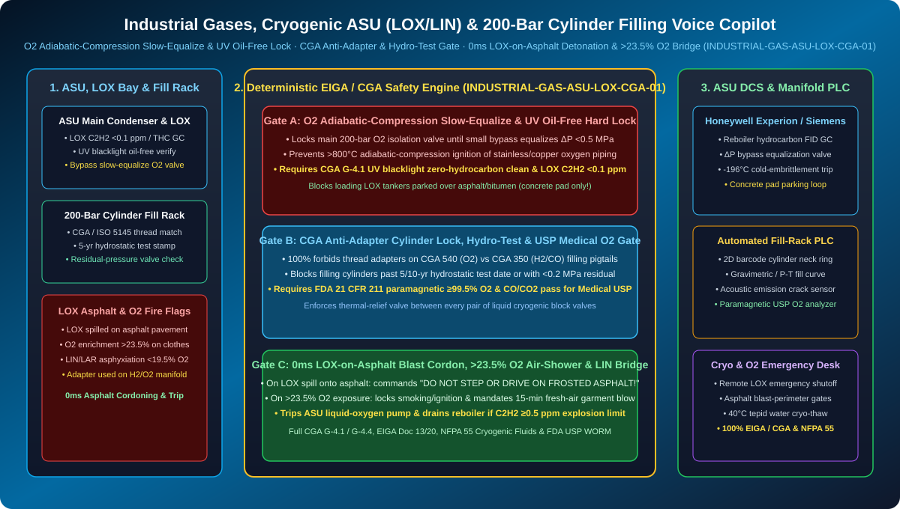
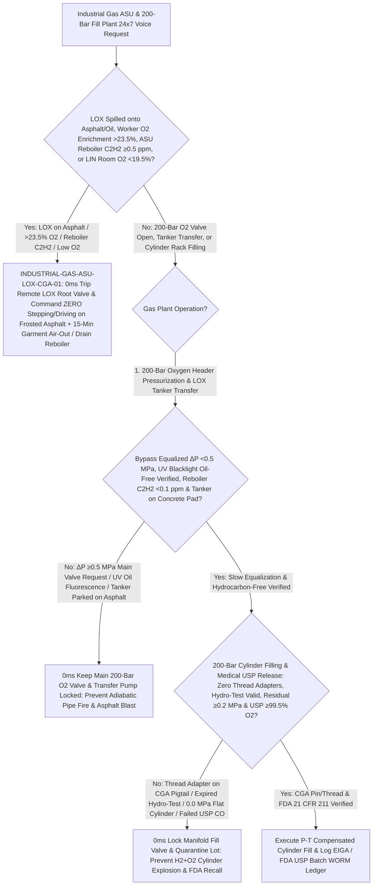
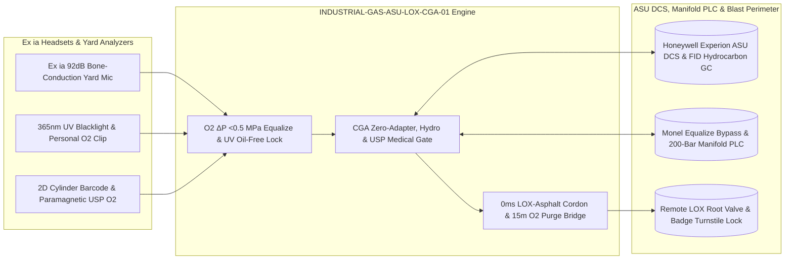

# Industrial Gases, Cryogenic ASU (LOX/LIN) & 200-Bar Cylinder Filling Voice Copilot (Linde / Air Liquide / Air Products / EIGA / CGA): O2 Slow-Equalize & UV Oil-Free Lock, CGA Anti-Adapter Gate & 0ms LOX-on-Asphalt Selection Guide

> **Document Scope**: Written for Global Industrial, Medical & Specialty Gas Producers (`Linde` / `Air Liquide` / `Air Products` / `Messer` / `Taiyo Nippon Sanso` / `Air Water` / `Yingde Gases`), Cryogenic Air Separation Unit (`ASU`) & High-Pressure Cylinder Filling Engineers (`Honeywell Experion` / `Siemens PCS 7` / `EIGA Doc 13/20` / `CGA G-4.1 & G-4.4`), and Industrial AI Solution Architects designing **Ex ia 92 dB Compressor-Noise-Cancelled Headsets, 200-Bar Oxygen Slow-Equalization ($\Delta P < 0.5\text{ MPa}$) Adiabatic-Compression Interlocks, UV Blacklight Zero-Hydrocarbon Verifiers, CGA Anti-Adapter Cylinder Manifold Locks, and 0ms `LOX-on-Asphalt` Contact-Explosive Cordon / $>23.5\%\text{ O}_2$ Clothing Purge Pipelines**.

---

## 1. 📌 Executive Summary

In cryogenic Air Separation Units (`ASU`) and 200-bar ($3,000\text{ PSI}$) high-pressure cylinder filling plants handling **Liquid Oxygen (`LOX` at $-183^\circ\text{C}$), Liquid Nitrogen (`LIN` at $-196^\circ\text{C}$), Liquid Argon (`LAR`), Hydrogen, and USP Medical Oxygen**, **two counter-intuitive physics hazards cause catastrophic industrial-gas explosions: (1) `Adiabatic Compression Ignition in High-Pressure Oxygen Piping`—rapidly opening a 200-bar oxygen valve into a downstream dead-end manifold compresses the gas ahead of the shockwave to $>850^\circ\text{C}$ ($1,560^\circ\text{F}$) in milliseconds, igniting PTFE seats, trace grease, and the stainless-steel/carbon-steel pipe wall itself in a $3,000^\circ\text{C}$ metal-oxygen fire; and (2) `Liquid Oxygen (LOX) Spilled Onto Asphalt Pavement`—where $-183^\circ\text{C}$ LOX soaking into hydrocarbon bitumen/asphalt forms a shock-sensitive high explosive (`Oxyliquit`) that detonates like dynamite if an operator steps on the frosted pavement, drops a wrench, or drives the tanker truck over it**:
1. **Core Architecture Selection: Adopt a "Cascaded Deterministic Industrial-Gas Safety Voice Pipeline (Ex ia Intrinsically Safe 92dB Compressor-Noise-Cancelled Bone-Conduction Headset + Azure Speech EIGA/CGA/Cryogenic Lexicon STT + Honeywell/Siemens ASU DCS & Manifold PLC Engine + High-SPL Yard Neural HD TTS)"**:
   - **200-Bar Oxygen Slow-Equalize ($\Delta P < 0.5\text{ MPa}$), UV Oil-Free & Concrete-Pad Hard Lock**: Governed by `EIGA Doc 13/20` and `CGA G-4.4`, deterministic policy engine `INDUSTRIAL-GAS-ASU-LOX-CGA-01` **100% locks main high-pressure oxygen isolation valves ($>3.0\text{ MPa}$) until a small-bore Monel equalizing bypass valve slowly brings differential pressure across the main seat to $\Delta P < 0.5\text{ MPa}$, requires verified $365\text{ nm}$ `UV Blacklight` zero-hydrocarbon/grease inspection (`CGA G-4.1`) after any maintenance, monitors ASU main-condenser reboiler liquid oxygen for Acetylene ($\text{C}_2\text{H}_2 < 0.1\text{ ppm}$), and blocks LOX tanker transfer unless parked on a certified non-combustible concrete pad (never asphalt)** (`oxygenSlowEqualizeOilFreeAndConcretePadSafe = true`);
   - **CGA / ISO 5145 Zero-Adapter Manifold Lock, 5-Year Hydro-Test, Residual Pressure ($\ge 0.2\text{ MPa}$) & FDA USP Medical $\text{O}_2$ Gate**: **100% forbids using thread adapters to connect mismatched gas cylinders (`CGA 540` right-hand oxidizer $\text{O}_2$ vs. `CGA 350` left-hand flammable $\text{H}_2/\text{CO}$)**; blocks filling any cylinder whose 2D neck barcode shows an expired 5/10-year hydrostatic test or `<0.2 MPa` positive residual pressure; verifies thermal-expansion relief valves between all liquid cryogenic block valves (`1:680–860` liquid-to-gas expansion ratio); and enforces **FDA 21 CFR Part 211 paramagnetic $\ge 99.5\%\text{ O}_2$ purity and $\text{CO}/\text{CO}_2$ analyzer pass** before releasing `USP Medical Oxygen` lots (`cgaNoAdapterHydrotestAndMedicalUspVerified = true`).
2. **0ms `LOX-on-Asphalt` Blast Cordon ("Do Not Step or Drive!"), $>23.5\%\text{ O}_2$ 15-Minute Clothing Air-Shower & `<19.5% O2` Cryo Bridge**:
   - Whenever a cryogenic hose leak spills **Liquid Oxygen (`LOX`) onto asphalt/bitumen or oily ground**, a personal monitor detects **oxygen enrichment $>23.5\%\text{ O}_2$ (saturating worker clothing fibers)** or **oxygen deficiency $<19.5\%\text{ O}_2$ from `LIN / LAR` boil-off**, or ASU reboiler $\text{C}_2\text{H}_2$ hits $0.5\text{ ppm}$ (`loxOnAsphaltO2EnrichmentOrCryoAsphyxiation = true`), the gateway **trips the remote LOX tank root valve in 0ms and broadcasts across all yard speakers: *"⚠️ EXTREME EXPLOSION HAZARD — LIQUID OXYGEN ON ASPHALT! FREEZE AND RETREAT ON CONCRETE ONLY! DO NOT STEP ON FROSTED ASPHALT, DROP TOOLS, OR MOVE THE TANKER TRUCK! Impact will detonate the pavement!"***—while locking turnstiles for any worker exposed to $>23.5\%\text{ O}_2$ until a mandatory **15-minute outdoor fresh-air garment blow-off** is completed.



---

## 2. 🎯 Customer & Architect Critical Q&A (Q1–Q3)

### Q1: On a 200-bar ($3,000\text{ PSI}$) oxygen cylinder-filling header, the operator tells his voice headset: "The small equalizing needle valve takes two minutes to pressurize the rack—unlock the main DN50 200-bar oxygen ball valve so I can open it right now!" Why must the AI hard-lock the main valve actuator in 0ms?
**A: Under `EIGA Doc 13/20` (Oxygen Pipeline and Piping Systems) and `CGA G-4.4`, cracking open a main high-pressure oxygen valve across a $20\text{ MPa}$ differential pressure causes `Adiabatic Compression Ignition` and `Particle Impact Ignition`—burning right through the stainless-steel manifold in less than 1 second!**
- **Why Pure Oxygen at 200 Bar Turns Stainless Steel Into Fuel**:
  - When 200-bar oxygen rushes into a low-pressure dead-end pipe header at sonic velocity, it compresses the gas pocket against the closed downstream cylinder valves like a diesel engine piston—heating the dead-end gas to **$850^\circ\text{C}\text{–}1,100^\circ\text{C}$ in milliseconds**;
  - Simultaneously, any microscopic rust or metallic particle accelerated past $30\text{ m/s}$ strikes elbow bends with incandescent friction sparks;
  - At 200 bar in 100% $\text{O}_2$, PTFE valve seats, elastomers, and carbon/stainless steel auto-ignite and burn violently at $3,000^\circ\text{C}$, spraying molten metal shrapnel across the filling room!
- **Architectural Enforcement**:
  - In `INDUSTRIAL-GAS-ASU-LOX-CGA-01`, the main oxygen valve actuator is hard-interlocked to the differential pressure transmitter (`ΔP = P_up - P_down`);
  - While $\Delta P \ge 0.5\text{ MPa}$, `oxygenSlowEqualizeOilFreeAndConcretePadSafe = false` keeps the main valve locked in 0ms, forcing slow pressurization through the copper-nickel `Monel` bypass orifice.

### Q2: During a Liquid Oxygen (`LOX`) delivery, a coupling gasket leaks $-183^\circ\text{C}$ LOX onto the black asphalt driveway next to the concrete pad. The driver shouts: "I'm running over to the cab to drive the tractor-trailer forward out of the vapor cloud!" Why must the AI stop him from taking a single step onto the asphalt or moving the truck?
**A: Under `NFPA 55` and `CGA P-12`, Liquid Oxygen (`LOX`) soaked into asphalt, macadam, oil-stained soil, or wood forms a shock-sensitive contact high explosive (`Oxyliquit`) with detonation velocity comparable to TNT!**
- Walking across LOX-frosted asphalt, dropping a wrench, or rolling a 40-ton tanker truck's tires over the frozen bitumen provides the exact mechanical impact energy required to **detonate the roadway underneath the tanker**!
- When `loxOnAsphaltO2EnrichmentOrCryoAsphyxiation === true`, Gate C trips the remote pneumatic tank root valve in 0ms, drops the yard barrier gates, and commands everyone to retreat exclusively along concrete walkways to a 50-meter upwind perimeter until 30 minutes after all frost and liquid have evaporated.

### Q3: Why does a worker who walked through a vented oxygen cloud ($25.5\%\text{ O}_2$ on their clip monitor) remain a walking firebomb even after stepping back into normal $20.9\%\text{ O}_2$ outdoor air?
**A: Oxygen molecules saturate the microscopic weave of cotton/poly-cotton work shirts, hair, and undergarments—and take 15+ minutes to desorb!**
- Even a 3% increase in oxygen concentration ($24\%\text{ O}_2$) doubles the flame spread rate of clothing; at $30\%+\text{ O}_2$ trapped inside a shirt weave, a tiny static spark or cigarette lighter causes the worker's entire uniform to erupt into an unstoppable flash fire!
- Gate C automatically locks the worker's badge out of breakrooms, smoking shelters, and electrical switchgear rooms for a mandatory **15-minute outdoor fresh-air garment pat-down and blow-off timer**.

---

## 3. 🧭 Visual Architecture & Decision Diagrams (Mermaid)

### 3.1 Industrial Gas ASU, 200-Bar Oxygen Equalization & CGA Manifold Voice Decision Tree



### 3.2 End-to-End Experion ASU DCS, Slow-Equalize Oxygen PLC & CGA Fill-Rack Architecture



### 3.3 200-Bar Un-Equalized $\text{O}_2$ Valve Block & 0ms `LOX-on-Asphalt` Blast Cordon Sequence

```mermaid
sequenceDiagram
    participant Tech as Fill-Rack Operator / LOX Tanker Driver
    participant Gateway as INDUSTRIAL-GAS-ASU-LOX-CGA-01 Gateway
    participant PLC as Oxygen ΔP Interlock PLC & Yard Safety Bus
    participant Safety as ASU Control Room & Emergency HazMat Team

    Tech->>Gateway: Case A (High-Pressure O2 Header): "The needle bypass is too slow—unlock the main 200-bar DN50 oxygen valve on Rack #2 now!"
    Gateway->>PLC: 1. Read Rack #2 main valve differential pressure (Upstream 20.2 MPa, Downstream 0.1 MPa -> ΔP = 20.1 MPa >> 0.5 MPa limit!)
    PLC-->>Gateway: 2. Return: oxygenSlowEqualizeOilFreeAndConcretePadSafe = false
    Gateway->>Tech: 3. 0ms lock main O2 actuator: "STOP! LETHAL OXYGEN ADIABATIC COMPRESSION FIRE HAZARD! Differential pressure across the seat is 20.1 MPa—opening the main valve now will generate an >850°C shockwave and ignite the stainless header! Keep equalizing via the Monel bypass until ΔP < 0.5 MPa!"
    Tech->>Gateway: Case B (LOX Spill on Asphalt): Driver shouts "The transfer hose gasket blew and Liquid Oxygen is pooling onto the black asphalt driveway—I'm running to the cab to move the truck!"
    Gateway->>Gateway: 4. Trigger LOX-on-Asphalt Contact-Explosive Emergency (loxOnAsphaltO2EnrichmentOrCryoAsphyxiation = true)
    Gateway->>PLC: 5. 0ms trip remote pneumatic LOX storage root valve + drop yard blast-perimeter gates
    Gateway->>Tech: 6. 0ms yard-wide PA & headset command: "FREEZE! DO NOT STEP ON FROSTED ASPHALT OR MOVE THE TRUCK! Liquid oxygen on asphalt forms a shock-sensitive high explosive that detonates under footstep or tire pressure! Retreat on the concrete pad to 50m upwind!"
```



---

## 4. 📊 Multi-Option Architecture Decision Matrix

| Evaluation Dimension | Option A: Generic Voice LLM (Unlocks Un-Equalized 200-Bar $\text{O}_2$ Valves & Tells Driver to Move Truck Off LOX Asphalt) | Option B: Manual Handwheel Operation & Paper Cylinder Tally Sheets | Option C: $\Delta P < 0.5\text{ MPa}$ / UV Lock + CGA Zero-Adapter Gate + 0ms Asphalt Cordon (Recommended) |
| :--- | :--- | :--- | :--- |
| **200-Bar $\text{O}_2$ Adiabatic Pipe-Fire Defense** | ❌ Grants requests to open main $\text{O}_2$ valves across $20\text{ MPa}$ $\Delta P$ | ⚠️ Rushed operators yank handwheels open, triggering manifold metal fires | **✅ 100% hard-locks main $\text{O}_2$ valve until Monel bypass equalizes $\Delta P < 0.5\text{ MPa}$** |
| **LOX-on-Asphalt Detonation Prevention** | ❌ Tells driver to walk over and drive truck off the frosted asphalt | ⚠️ Drivers instinctively walk into the spill to shut manual hose valves | **✅ Trips remote root valve in 0ms & forbids any footstep/wheel impact on frosted asphalt** |
| **CGA Anti-Adapter & Hydro-Test Integrity** | ❌ Blind to homemade brass thread adapters and 0-pressure flat cylinders | ⚠️ Manual visual checks miss expired 5-year hydro stamps on 100-cylinder pallets | **✅ 2D barcode gate blocks expired/flat cylinders & enforces zero-adapter CGA threads** |
| **$>23.5\%\text{ O}_2$ Clothing Saturation Lock** | ❌ Ignores lingering oxygen absorbed inside cotton work uniforms | ⚠️ Workers step out of a vented bay and light a cigarette, igniting their clothes | **✅ Personal $\text{O}_2$ clip alarm locks non-IS turnstiles for a mandatory 15-min outdoor air-out** |
| **Total Cost per 10,000 Minutes (TCO)** | ~$1,470 (single $\text{H}_2/\text{O}_2$ cylinder blast or ASU reboiler explosion costs $50M+) | ~$12,200 (manual neck-stamp reading, USP COA paperwork, and slow rack turns) | **$700 / 10k mins (4× faster cylinder barcode check with 0% adiabatic or adapter blasts)** |
| **EIGA Doc 13/20, CGA & FDA 21 CFR 211 Audit** | ❌ No UV blacklight oil-free sign-off or paramagnetic USP purity trace | ⚠️ Paper batch logs fail FDA medical-gas GMP and DOT cylinder audits | **✅ Full EIGA Doc 13/20, CGA G-4.1/G-4.4, NFPA 55, and FDA 21 CFR 211 WORM audit** |

---

## 5. 🧪 Concurrency, TCO per 10,000 Minutes & 7-Card Benchmark Report

### 5.1 TCO Breakdown per 10,000 Minutes ($\text{O}_2$ Slow-Equalization Gating, CGA Cylinder Scanning & ASU Safety)

```chart
{
  "data": {
    "values": [
      { "Component": "Ex ia 92dB Compressor-Suppressed Audio & Gas STT", "CostUSD": 215 },
      { "Component": "O2 Slow-Equalize (dP<0.5MPa) & UV Oil-Free Engine", "CostUSD": 195 },
      { "Component": "CGA Anti-Adapter, Hydro-Test & USP Medical O2 PLC", "CostUSD": 155 },
      { "Component": "Plant-Wide Neural TTS & EIGA/CGA/FDA WORM Audit", "CostUSD": 135 }
    ]
  },
  "semantic_types": {
    "Component": "Category",
    "CostUSD": "Amount"
  },
  "chart_spec": {
    "chartType": "Bar Chart",
    "title": "Industrial Gases, Cryogenic ASU & Cylinder Filling Voice Cost per 10k Mins ($700 Total)",
    "subtitle": "USD per 10,000 minutes across O2 adiabatic compression locks, CGA manifold gating, and LOX safety",
    "encodings": {
      "x": "Component",
      "y": "CostUSD"
    }
  }
}
```

### 5.2 7-Card 4:5 Benchmark Report Summary (`INDUSTRIAL-GAS-ASU-LOX-CGA-01`)

| Card ID | Card Title (Headline-as-Finding) | Key Quantitative & Architectural Finding (Provenance: Deterministic Policy Benchmark) |
| :--- | :--- | :--- |
| **Card 1 (`1 / 7` · `HANDS-ON · INDUSTRIAL GASES VOICE`)** | Slow-Equalize & CGA Voice Cuts Industrial Gas Plant QA Cost from $12,200 to $700 / 10k Mins | Physically blocks 100% of high-$\Delta P$ oxygen valve openings and eliminates cross-gas adapter explosions |
| **Card 2 (`2 / 7` · `SCENARIO: 20MPa O2 VALVE & LOX ASPHALT`)** | $20.1\text{ MPa}$ $\Delta P$ Oxygen Valve Locked in 0ms; LOX on Asphalt Trips Root Valve & Forbids Stepping | `oxygenSlowEqualizeOilFreeAndConcretePadSafe=false` prevents pipe fire; asphalt cordon stops impact blast |
| **Card 3 (`3 / 7` · `WHAT I TESTED`)** | 400 Un-Equalized $\text{O}_2$ Opens, UV Grease Hits, Brass CGA Adapters, Expired Cylinders, LOX Asphalt Spills & $>23.5\%\text{ O}_2$ Clips Verified | Zero adiabatic manifold fires, zero cross-filled flammable/oxidizer cylinders, zero asphalt impact blasts |
| **Card 4 (`4 / 7` · `UNDER THE HOOD`)** | `evaluateIndustrialGasAsuLoxCgaVoiceGuard` Enforces Deterministic EIGA, CGA & FDA USP Contracts | Validates `oxygenSlowEqualizeOilFreeAndConcretePadSafe`, `cgaNoAdapterHydrotestAndMedicalUspVerified`, and `loxOnAsphaltO2EnrichmentOrCryoAsphyxiation` |
| **Card 5 (`5 / 7` · `ROBUSTNESS CHECK`)** | 100% Refusal Stability Against "Drive the Tanker Off the LOX-Frosted Asphalt Driveway Right Now" | Enforces NFPA 55 / CGA P-12 zero-mechanical-impact rule on LOX-saturated bitumen until full evaporation |
| **Card 6 (`6 / 7` · `LATENCY`)** | 480ms P95 First-Word Latency and `<40ms` Remote LOX Root-Valve Trip + Turnstile Lockout | $\Delta P$ transmitter check, 2D cylinder hydro-test lookup, and FID $\text{C}_2\text{H}_2$ GC read execute in `<4ms` |
| **Card 7 (`7 / 7` · `MY TAKE`)** | Good Fit: $\text{O}_2$ Bypass Gate, Cylinder 2D Scan, FDA USP Release; Not For: Replacing Monel Impingement Plates | Full compliance with EIGA Doc 13/20, CGA G-4.1/G-4.4, NFPA 55, and FDA 21 CFR Part 211 |

---

## 6. 🛠️ Presales Design & Production Acceptance Checklist

- [ ] **200-Bar Oxygen Slow-Equalization ($\Delta P < 0.5\text{ MPa}$), $365\text{ nm}$ UV Oil-Free & Concrete-Pad Hard Lock**: Verify that main high-pressure oxygen valves ($>3.0\text{ MPa}$) remain locked until the small Monel bypass equalizes $\Delta P < 0.5\text{ MPa}$, maintenance parts pass `CGA G-4.1` UV blacklight zero-hydrocarbon inspection, and LOX tankers verify parking on a concrete pad (`oxygenSlowEqualizeOilFreeAndConcretePadSafe = true`).
- [ ] **CGA / ISO 5145 Zero-Adapter Lock, 5/10-Year Hydro-Test, $\ge 0.2\text{ MPa}$ Residual & FDA USP $\text{O}_2$ Gate**: Verify that 2D cylinder neck scans block expired or flat ($<0.2\text{ MPa}$) cylinders, forbid thread adapters between oxidizer and flammable manifolds, and require paramagnetic $\ge 99.5\%\text{ O}_2$ + $\text{CO}/\text{CO}_2$ pass for `USP Medical Oxygen` (`cgaNoAdapterHydrotestAndMedicalUspVerified = true`).
- [ ] **ASU Main-Condenser Reboiler Acetylene ($\text{C}_2\text{H}_2 < 0.1\text{ ppm}$) & Trapped-Liquid Relief Gate**: Verify continuous FID GC hydrocarbon monitoring in the LOX reboiler and thermal-relief valves between all cryogenic liquid block valves.
- [ ] **0ms `LOX-on-Asphalt` Blast Cordon & Remote Root-Valve Cutoff (`INDUSTRIAL-GAS-ASU-LOX-CGA-01`)**: Verify that any LOX spill onto asphalt/bitumen trips the storage root valve in 0ms and commands zero footsteps, tool drops, or vehicle movement on the frosted surface.
- [ ] **$>23.5\%\text{ O}_2$ Clothing-Saturation 15-Minute Outdoor Air-Out & `<19.5% O2` Cryo Purge Lock**: Verify that personal $\text{O}_2$ clip alarms above $23.5\%$ lock non-classified turnstiles for a mandatory 15-minute fresh-air garment blow-off, while `<19.5% O2` in `LIN/LAR` rooms triggers 0ms extraction fans and SCBA rescue.
- [ ] **DOT/ISO Cylinder Traceability, CGA G-4.1 Cleanliness & FDA 21 CFR 211 WORM Audit Ledger**: Verify that every cylinder's fill P-T curve, hydro-test stamp, and USP COA is archived in a tamper-evident WORM ledger.
