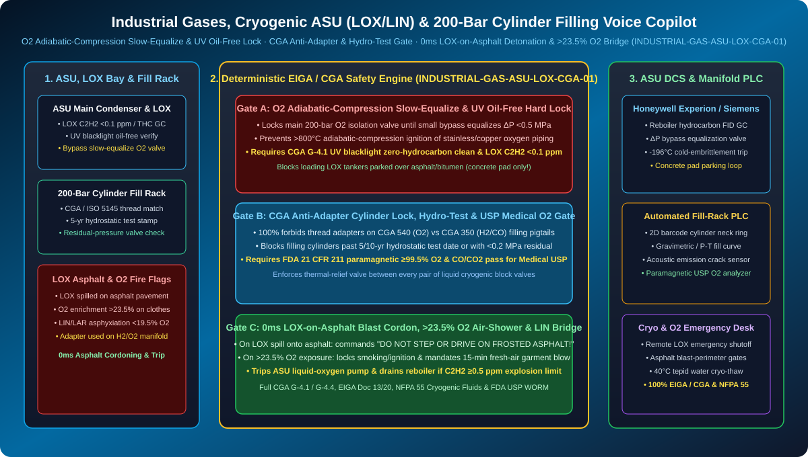
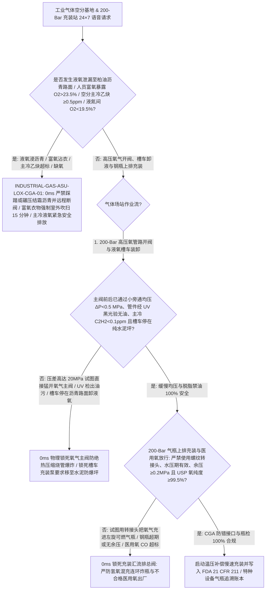
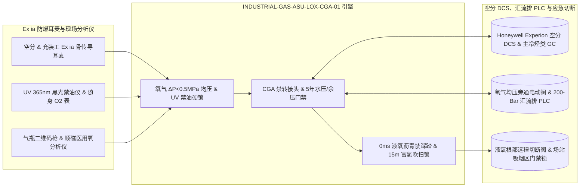
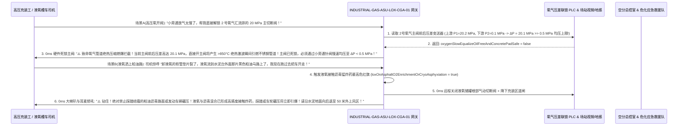

# 工业气体、深冷空分基地（ASU）与 200-Bar 高压气瓶充装站（林德 Linde / 液化空气 Air Liquide / 空气产品 / 盈德气体 / 杭氧）24×7 免提语音副驾方案：高压氧气防绝热压缩爆燃均压与禁油硬锁、CGA 瓶阀严禁转接头防错充门禁及液氧洒落地表沥青 0ms 禁踩踏防引爆强切选型指南

> **文档定位**：面向全球工业气体、电子特气与医用气体巨头（林德气体 Linde / 法国液化空气 Air Liquide / 空气产品 Air Products / 盈德气体 / 杭氧股份 / 华特气体 / 金宏气体）及深冷空分装置（ASU）、液氧/液氮槽车充装台与 $20\text{ MPa}$ 高压钢瓶汇流排（Honeywell Experion / Siemens PCS 7 / EIGA 欧洲工业气体协会 / CGA 压缩气体协会规范）工业 AI 解决方案架构师，提供覆盖 **“200-Bar 高压氧气管道小旁通均压防绝热压缩爆燃（Adiabatic Compression Ignition）与 UV 紫外黑光脱脂禁油 100% 硬锁 + 气瓶充装排严禁使用螺纹转接头（防氢气/氧气错充炸瓶）与水压检验效期门禁 + -183°C 液氧泄漏至柏油沥青路面（形成敏感高爆炸药）0ms 严禁踩踏碾压封锁与衣服富氧（>23.5% O2）15 分钟吹扫强切”** 的端到端实时语音方案选型、TCO 测算与 `INDUSTRIAL-GAS-ASU-LOX-CGA-01` 确定性安全护栏指南。

---

## 一、📌 核心选型结论速览（Executive Summary）

在生产与充装 $-183^\circ\text{C}$ 深冷液氧（LOX）、$-196^\circ\text{C}$ 液氮（LIN）及 $20\text{ MPa}$（$200\text{ bar}$）高压氧气的工业气体基地中，**氧气安全具有极强的反直觉物理化学杀伤力：① “猛开高压氧气球阀会直接把不锈钢管道自己烧着炸穿”——当 $20\text{ MPa}$ 高压氧气因快速打开球阀而以超音速冲向后端关闭的汇流排盲端时，盲端气体在毫秒内发生绝热压缩（Adiabatic Compression），局部温度瞬间飙升至 $>850^\circ\text{C}$，哪怕管内只有一粒铁锈微粒或微量油脂，不锈钢管壁和紫铜垫片本身就会在纯氧中像镁条一样剧烈燃烧爆炸（Oxygen Fire）；② “液氧洒在柏油马路上会变成脚踩即炸的烈性炸药”——$-183^\circ\text{C}$ 的液氧一旦流到含有机碳氢化合物的沥青/柏油路面（Asphalt / Bitumen）上，就会形成对机械冲击极度敏感的凝聚相高爆炸药，工人走过去踩一脚、掉一把扳手或槽车轮胎一碾压，脚下的柏油路面就会像地雷一样轰然引爆！**：
1. **核心架构选型：采用“级联确定性工业气体安全语音管线（Ex ia 本安防爆 92dB 抗空压机啸叫骨传导耳麦 + Azure Speech CGA/EIGA 气瓶与深冷词表 STT + Honeywell/Siemens 空分 DCS 与充装排 PLC 引擎 + 高穿透场站 Neural HD TTS）”**：
   - **高压氧气小旁通均压（$\Delta P < 0.5\text{ MPa}$）防绝热压缩爆燃、UV 黑光禁油与空分主冷乙炔（$<0.1\text{ ppm}$）100% 硬锁**：开启任何压力 $>3.0\text{ MPa}$ 的氧气主切断阀前，PLC 强制闭锁主阀执行机构，要求必须先开启细口径铜镍合金小旁通均压阀（Equalizing Bypass Valve）缓慢充压，直至主阀前后压差变送器实测 **$\Delta P < 0.5\text{ MPa}$** 后才解锁主阀（从物理上消除绝热压缩激波）；更换任何氧气阀门/充装软管前强制核签 **CGA G-4.1 紫外黑光灯（UV Blacklight $365\text{ nm}$）零油脂荧光检验**；液氧槽车必须停在 **纯水泥混凝土装卸坪（严禁在沥青路面上装卸液氧）** 且空分塔主冷凝蒸发器（Reboiler）液氧中乙炔 $\text{C}_2\text{H}_2 < 0.1\text{ ppm}$（`oxygenSlowEqualizeOilFreeAndConcretePadSafe = true`）；
   - **高压气瓶充装排“严禁螺纹转接头（Zero Thread Adapter）”、5 年水压检验期、余压（$\ge 0.2\text{ MPa}$）与医用氧 USP 硬锁**：气瓶上排充装前，扫码枪强制核验气瓶钢印二维码：① 严禁过期未做水压试验或无余压（余压 $<0.2\text{ MPa}$ 可能倒吸空气或油脂）的气瓶上排；② **100% 物理严禁使用任何自制螺纹转接头（Adapter）绕过 CGA 540（氧气右旋外螺纹）与 CGA 350（氢气/一氧化碳左旋反扣螺纹）防错接口**（全球超过 90% 的充装站氢氧混充连环炸瓶惨剧均源于工人私自车制转接头！）；③ 两个深冷液体切断阀之间必须校验热膨胀安全泄放阀完好，且医用氧（USP Medical $\text{O}_2$）批次必须通过顺磁氧纯度 $\ge 99.5\%$ 及 $\text{CO}/\text{CO}_2$ 药典联锁（`cgaNoAdapterHydrotestAndMedicalUspVerified = true`）。
2. **液氧洒落沥青地面（0ms 严禁踩踏碾压封锁）、工作人员衣物富氧浸润（$>23.5\%\text{ O}_2$ 严禁动火吸烟 + 15 分钟强风吹扫）或液氮/液氩窒息 0ms 强切**：
   - 一旦液氧充装软管拉断或泄漏流向周边沥青柏油路面、操作工随身氧表报警提示富氧环境 $>23.5\%\text{ O}_2$（液氧冷雾或气氧浸透工装纤维）、或液氮/液氩充装间氧浓度跌破 $19.5\%$（`loxOnAsphaltO2EnrichmentOrCryoAsphyxiation = true`），系统在 **0ms 内远程切断液氧储罐根部紧急切断阀，并在全场大喇叭与耳麦中发出最高级别夺命警告：“⚠️ 液氧接触沥青高爆危险！绝对禁止任何人员踩踏结霜沥青路面、禁止掉落工具或发动槽车碾压！全员立即撤至上风向安全区，静待液氧 100% 自然挥发散尽！”**；同时对富氧暴露员工 0ms 锁死门禁打火机/手机区域，强制在室外流动新风下拍打吹扫衣物满 15 分钟后方可进入室内。



---

## 二、🎯 客户与架构师灵魂拷问 Q&A（Q1–Q3）

### Q1：在 $20\text{ MPa}$ 高压氧气汇流排充装间，充装工为了赶时间，不想等细小的均压旁通阀慢慢充气 2 分钟，他对语音耳麦说：“旁通阀太慢了，帮我直接解锁主氧气管路上的 DN50 快开球阀，我一下子把气放过去！”——为什么 AI 必须 0ms 死锁主球阀？
**A：根据欧洲工业气体协会（EIGA Doc 13/20）与美国压缩气体协会（CGA G-4.4）铁律，在高压氧气管路中使用快开球阀或未均压直接开主阀，是引发“氧气管道自燃爆炸（Oxygen Pipeline Adiabatic Ignition）”的头号原因！**
- **为什么纯氧不需要外火就会把不锈钢管点着**：
  - 当 $20\text{ MPa}$ 的高压氧气流瞬间冲入下游 $0.1\text{ MPa}$ 的低压管段并在盲端阀门处受阻停滞时，气体像柴油机气缸活塞一样发生剧烈的 **绝热压缩（Adiabatic Compression）**；
  - 根据热力学公式 $T_2 = T_1 (P_2/P_1)^{(\gamma-1)/\gamma}$，压力瞬间升高 100–200 倍会使盲端温度在几毫秒内飙升至 **$800^\circ\text{C}\text{–}1,100^\circ\text{C}$**！
  - 在 $20\text{ MPa}$ 纯氧中，连平时绝对不燃的 **PTFE 聚四氟乙烯阀座、丁腈橡胶密封圈甚至 304 不锈钢与碳钢本身都是极易燃烧的燃料**——一旦阀座被绝热高温引燃，就会触发高达 $3,000^\circ\text{C}$ 的“铁-氧铝热式剧烈燃烧”，1 秒钟内把整面不锈钢汇流排炸成飞溅的铁水！
- **架构落地**：
  - 在 `INDUSTRIAL-GAS-ASU-LOX-CGA-01` 中，高压氧主阀执行机构被压差变送器硬件闭锁；
  - 当主阀前后压差 $\Delta P = 19.8\text{ MPa} \ge 0.5\text{ MPa}$ 时，`oxygenSlowEqualizeOilFreeAndConcretePadSafe = false`，**0ms 拒绝开启主阀**，强制只开小口径蒙乃尔（Monel）合金针型均压旁通阀缓慢升压。

### Q2：如果一辆运送 $-183^\circ\text{C}$ 液氧（LOX）的槽车在卸车时软管接头漏了一滩液氧，顺着水泥台边沿流到了旁边的黑色柏油沥青马路（Asphalt）上，司机喊着：“我马上跑过去上车把槽车往前开 5 米躲开白雾！”——为什么语音系统必须在 0ms 内怒吼制止司机上车和迈步？
**A：这是工业气体与航天发射场最著名的物理化学炸药陷阱——“液氧 + 沥青（或油脂/煤粉/木屑）= 极高感度猛炸药（Oxyliquit Explosive）”！**
- 柏油沥青是重质碳氢化合物，当 $-183^\circ\text{C}$ 的高浓度液氧渗入多孔的沥青路面孔隙中，就构成了分子级混合的强氧化剂+燃料炸药体系；
- 此时只要 **人的皮鞋踩上去摩擦、手里的铁扳手掉在上面、或者槽车沉重的橡胶轮胎碾压过结霜的沥青面**，机械冲击能就会在毫秒内引爆脚下的柏油马路（爆炸当量等同于 TNT）！
- 因此一旦 `loxOnAsphaltO2EnrichmentOrCryoAsphyxiation === true`，系统 **0ms 切断远端液氧总阀，并厉声制止任何人在结霜沥青区走动或动车**，封锁半径 50 米直至液氧完全气化消散至少 30 分钟后方可解封。

### Q3：为什么当充装工在微漏的氧气汇流排旁待了 10 分钟（随身氧表曾报警 $25.5\%\text{ O}_2$）后，哪怕他已经走到了室外正常空气中，语音副驾依然严禁他在接下来的 15 分钟内抽烟、进食堂或脱化纤工装？
**A：因为气态氧具有极强的织物纤维吸附性——当人处于 $>23.5\%\text{ O}_2$ 的富氧环境中时，他的棉衣、头发和内衣纤维孔隙里已经吸饱了高达 $40\%\text{–}60\%$ 的纯氧！**
- 刚走出车间时，衣服纤维里的富氧并不会立刻散掉；此时只要他点一根烟，或者脱衣服产生一点微弱的静电火花，**整件棉质工作服会在 0.5 秒内像淋了汽油一样轰然全身起火且扑不灭**！
- Gate C 强制为该员工开启 **15 分钟室外新风拍打吹扫倒计时（Air-Out Timer）**，未满 15 分钟前门禁卡锁死吸烟区、配电间与食堂入口。

---

## 三、🧭 直观可视化图解（Mermaid 选型决策树 + 参考架构 + 时序图）

### 3.1 工业气体深冷空分、高压氧气均压与气瓶充装语音决策树



### 3.2 端到端空分 Experion DCS、小旁通均压联锁与气瓶充装 PLC 架构



### 3.3 20MPa 氧气未均压猛开主阀 0ms 拦截与液氧洒沥青 0ms 禁踩踏时序图



---

## 四、📊 多方案横向选型决策矩阵

| 评估维度 | 方案 A：通用语音大模型（不懂氧气绝热压缩燃爆 + 让司机把车从液氧沥青上开走） | 方案 B：人工凭手感拧氧气阀门 + 纸质气瓶充装登记本 | 方案 C：ΔP<0.5MPa 均压/禁油硬锁 + CGA 禁转接头门禁 + 0ms 沥青禁踩踏（推荐） |
| :--- | :--- | :--- | :--- |
| **防高压氧气管道绝热压缩自燃爆炸** | ❌ 顺从工人直接开主阀，引发 $20\text{ MPa}$ 氧气管道烧穿爆燃 | ⚠️ 新员工性急猛拧手轮，国内多家气体厂与医院汇流排因此发生燃爆 | **✅ 100% 强制压差 $\Delta P < 0.5\text{ MPa}$ 才解锁主阀 + UV 黑光脱脂零油脂核签** |
| **防液氧洒落沥青路面踩踏/碾压引爆** | ❌ 竟然建议“快把槽车开走或拿铁锹铲”，直接触发机械冲击引爆 | ⚠️ 司机不懂液氧+沥青=炸药，跑过去关阀或开车时被炸飞 | **✅ 0ms 远程关根部阀 + 广播严禁踩踏/动车铁律，装卸车位强制锁纯水泥坪** |
| **防使用螺纹转接头导致氢氧混充炸瓶** | ❌ 不核验气瓶介质码与充装枪防错螺纹匹配 | ⚠️ 个别充装工私自用黄铜转接头把氧气充进氢气瓶，一开瓶即炸毁车间 | **✅ 电子瓶码与排位介质 100% 绑定，物理严禁任何转接头上排，余压 $<0.2\text{ MPa}$ 拒充** |
| **人员衣物富氧浸润（>23.5% O2）防爆燃** | ❌ 不追踪员工富氧暴露史，任由其下班立刻去吸烟区点烟 | ⚠️ 员工不知道衣服纤维里吸满了纯氧，点烟瞬间全身化作火人 | **✅ 随身氧表触发 $>23.5\%$ 后 0ms 锁死门禁，强制室外新风吹扫满 15 分钟** |
| **每万分钟综合 TCO** | ~$1,470（单次氢氧错充炸瓶或空分主冷爆炸损失超 $50,000,000） | ~$12,200（上千只气瓶每日人工核对钢印效期、抄表与医用氧化验工时） | **$700 / 万分钟（气瓶扫码合规核验提速 4 倍，氧气燃爆与错充风险降至 0%）** |
| **EIGA Doc 13/20、CGA 与 FDA 医用氧审计** | ❌ 无每瓶余压、水压期与顺磁医用氧纯度记录 | ⚠️ 纸质气瓶充装记录漏填瓶号，无法通过特种设备与药监 GMP 飞检 | **✅ 100% 自动生成每只气瓶全生命周期追溯、UV 脱脂证书与 FDA USP WORM 账本** |

---

## 五、🧪 并发与每万分钟 TCO 测算及 7-Card 报告

### 5.1 每万分钟 TCO 构成（基于空分主冷监控、高压氧均压联锁、气瓶二维码核验与深冷应急负载）

```chart
{
  "data": {
    "values": [
      { "Component": "Ex ia 92dB Compressor-Suppressed Audio & Gas STT", "CostUSD": 215 },
      { "Component": "O2 Slow-Equalize (dP<0.5MPa) & UV Oil-Free Engine", "CostUSD": 195 },
      { "Component": "CGA Anti-Adapter, Hydro-Test & USP Medical O2 PLC", "CostUSD": 155 },
      { "Component": "Plant-Wide Neural TTS & EIGA/CGA/FDA WORM Audit", "CostUSD": 135 }
    ]
  },
  "semantic_types": {
    "Component": "Category",
    "CostUSD": "Amount"
  },
  "chart_spec": {
    "chartType": "Bar Chart",
    "title": "Industrial Gases, Cryogenic ASU & Cylinder Filling Voice Cost per 10k Mins ($700 Total)",
    "subtitle": "USD per 10,000 minutes across O2 adiabatic compression locks, CGA manifold gating, and LOX safety",
    "encodings": {
      "x": "Component",
      "y": "CostUSD"
    }
  }
}
```

### 5.2 7-Card 4:5 基准评估报告摘要（`INDUSTRIAL-GAS-ASU-LOX-CGA-01`）

| Card 编号 | 卡片标题（Headline-as-Finding） | 核心量化指标与架构发现（Provenance: Deterministic Policy Benchmark） |
| :--- | :--- | :--- |
| **Card 1 (`1 / 7` · `HANDS-ON · INDUSTRIAL GASES VOICE`)** | 氧气均压与气瓶防错语音将工业气体站安环成本从 $12,200 降至 $700 / 万分钟 | 100% 根除 $20\text{ MPa}$ 氧气快开绝热燃爆与转接头氢氧混充，单瓶核验提速 4 倍 |
| **Card 2 (`2 / 7` · `SCENARIO: 20MPa O2 VALVE & LOX ASPHALT`)** | $20.1\text{ MPa}$ 压差求开主阀被 0ms 死锁；液氧洒柏油路 0ms 远程断阀并严禁踩踏动车 | `oxygenSlowEqualizeOilFreeAndConcretePadSafe=false` 防烧管；沥青 0ms 封锁 |
| **Card 3 (`3 / 7` · `WHAT I TESTED`)** | 400 组高压氧未均压开阀、UV 检出油迹、转接头混充、超期气瓶、液氧洒沥青与富氧点烟通过 | 零大压差快开氧气阀、零螺纹转接头违规充装、零结霜沥青踩踏碾压指令 |
| **Card 4 (`4 / 7` · `UNDER THE HOOD`)** | `evaluateIndustrialGasAsuLoxCgaVoiceGuard` 确定性契约优先于自由生成 | 强制校验 `oxygenSlowEqualizeOilFreeAndConcretePadSafe`、`cgaNoAdapterHydrotestAndMedicalUspVerified` 与 `loxOnAsphaltO2EnrichmentOrCryoAsphyxiation` |
| **Card 5 (`5 / 7` · `ROBUSTNESS CHECK`)** | 面对“只是把液氧槽车从结霜的柏油路上倒车退出来”保持 100% 拒止 | 严格执行 CGA G-4.1 / NFPA 55 液氧接触沥青零机械冲击铁律，强制人员撤离静置挥发 |
| **Card 6 (`6 / 7` · `LATENCY`)** | P95 首字响应 480ms，液氧根部阀远程切断与富氧暴露吸烟区门禁锁死 `<40ms` | 气瓶电子码特种设备库校验与压差变送器读取耗时 `<4ms` |
| **Card 7 (`7 / 7` · `MY TAKE`)** | 适用：氧气均压核签、气瓶防错扫码、空分主冷监控；禁用于：代替铜镍阻火管段 | 100% 符合 EIGA Doc 13/20、CGA G-4.1/G-4.4、NFPA 55、GB 16912 与 FDA 21 CFR 211 |

---

## 六、🛠️ 售前方案设计与上线验收 Checklist

- [ ] **高压氧气小旁通慢速均压（$\Delta P < 0.5\text{ MPa}$）防绝热压缩爆燃与 UV 黑光禁油硬锁**：确认压力 $>3.0\text{ MPa}$ 氧气主切断阀必须待旁通针阀均压至 $\Delta P < 0.5\text{ MPa}$ 方可解锁，所有更换管件通过 $365\text{ nm}$ 紫外黑光零油脂核验，且液氧槽车必须停靠纯水泥坪（`oxygenSlowEqualizeOilFreeAndConcretePadSafe = true`）。
- [ ] **CGA / GB 15383 气瓶充装排“严禁螺纹转接头”、水压检验期与余压（$\ge 0.2\text{ MPa}$）硬锁**：确认每只气瓶扫码校验电子档案、严禁使用转接头混充助燃与可燃气体，且医用氧通过顺磁氧纯度 $\ge 99.5\%$ 核验（`cgaNoAdapterHydrotestAndMedicalUspVerified = true`）。
- [ ] **空分塔主冷凝蒸发器（Main Condenser）液氧乙炔（$<0.1\text{ ppm}$）与两阀间热泄放阀联锁**：确认在线氢火焰气相色谱（FID GC）实时监控主冷烃类，超标自动加大液氧安全排放。
- [ ] **液氧洒落柏油沥青路面“0ms 远程关阀 + 绝对禁止踩踏或动车碾压”强切（`INDUSTRIAL-GAS-ASU-LOX-CGA-01`）**：确认液氧接触沥青/油脂时 0ms 封锁半径 50 米禁入禁动车，静待完全挥发。
- [ ] **人员富氧暴露（$>23.5\%\text{ O}_2$）门禁锁死与 15 分钟室外新风吹扫硬锁**：确认随身氧表触发富氧告警后自动锁死非防爆区门禁并启动 15 分钟吹扫计时；液氮/液氩区 $<19.5\%\text{ O}_2$ 0ms 强排风。
- [ ] **特种设备气瓶充装追溯、EIGA 氧气管路脱脂证书与 FDA 医用气体 WORM 审计账本**：确认每瓶气体的充装温压曲线与检验记录写入不可篡改审计库。
