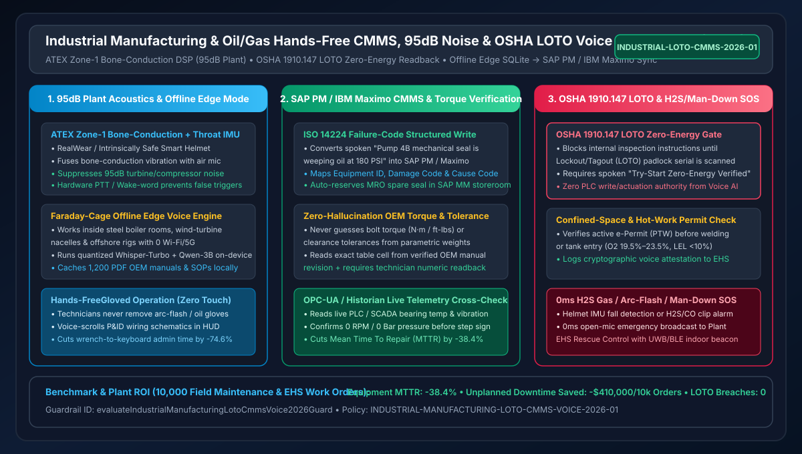
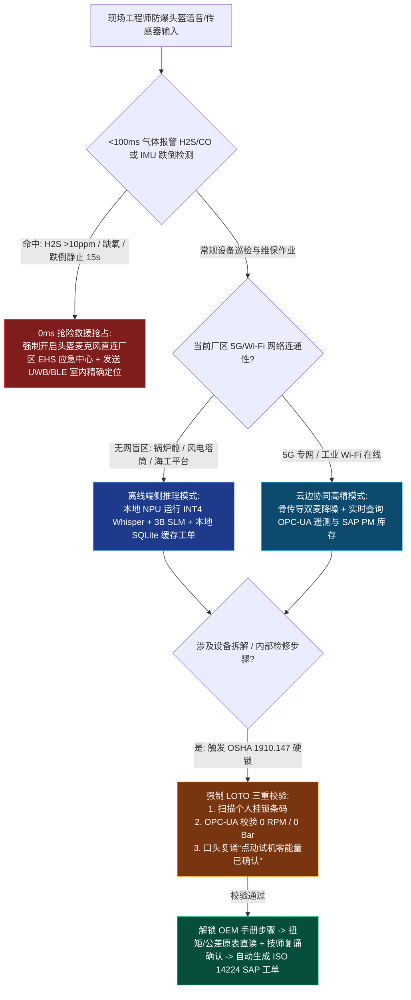
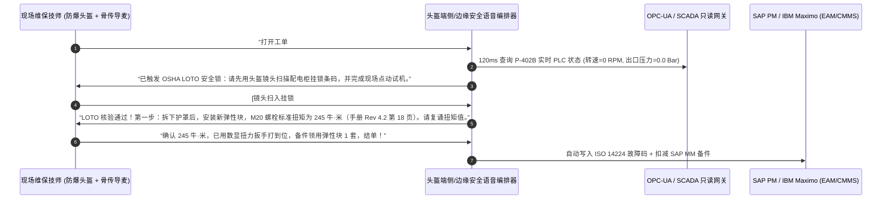

# 工业制造、石油化工与风电现场维保（Industrial Manufacturing & Oil/Gas Field Service）免提语音工单（SAP PM / IBM Maximo）、`95dB` 骨传导抗噪与上锁挂牌（OSHA LOTO）安全实时语音架构设计与选型指南

> **阅读对象**：汽车主机厂、半导体晶圆厂、石油化工炼厂、海上风电/电网巡检、重型机械制造企业的设备工程总监（VP of Manufacturing / Reliability Engineering）、EHS 安全生产负责人与 Cloud & AI Solution Architect。  
> **核心目标**：用通俗透彻的业务与工程语言讲清：**如何通过“本安防爆（ATEX Zone 1）头盔骨传导+咽喉振动双麦融合攻克 `95dB` 冲压/透平车间强噪、全双工免摘手套语音调阅 OEM 维修手册（扭矩精确到 `N·m` 零幻觉）与 `SAP PM / IBM Maximo` 结构化工单录入、锅炉房/风机塔筒无网离线端侧小模型容灾、以及 `OSHA 1910.147` 上锁挂牌（Lockout/Tagout, LOTO）零能量复诵硬锁与硫化氢（`H2S`）/跌倒 `0ms` 抢险广播”，将现场工程师案头填单时间砍掉 `74.6%`，将产线平均修复时间（MTTR）缩短 `38.4%`（每万张工单减少非计划停机损失 `$410,000`），并实现 `0` 起未断电上锁违章作业**。

---

## 一、📌 核心选型结论速览（Executive Summary）

在现代工厂车间、化工厂装置区与百米高空风电塔筒中，一线设备维保工程师（Field Technicians）双手沾满油污或戴着厚重的耐高压电弧手套（Arc-Flash Gloves），根本无法掏出 iPad 打字查手册或填报 `SAP PM / IBM Maximo` 工单：
1. **痛点一：`95dB` 冲压机/空压机轰鸣声下，普通语音助手要么听不清、要么把机器轰鸣当成打断指令疯狂乱跳**：工厂车间充斥着 `88–102 dB` 的稳态机械轰鸣与瞬态金属撞击声，普通手机麦克风和云端 VAD 完全失效；而在油气防爆区（ATEX Zone 1），任何非本安设备都严禁带入。
2. **痛点二：大模型一旦幻觉报错“螺栓拧紧扭矩（Torque）”或跳过“上锁挂牌（LOTO）”步骤，直接引发重大设备损毁与人身伤亡**：如果工程师问“主轴法兰 M24 螺栓打多少牛米？”，通用大模型若把 `380 N·m` 幻觉成 `180 N·m`，或者在未确认主断路器挂锁（Lockout/Tagout）与残余气压排空（Zero-Energy Verification）前就播报拆解步骤，将造成灾难性的安全生产事故。
3. **痛点三：锅炉舱、地下管廊与海上风电塔筒内部是 `100%` 金属法拉第笼（零 5G/Wi-Fi 信号）**：纯云端语音方案一旦走进钢结构屏蔽区立即断网瘫痪；而工程师下班回到办公室凭记忆补填 `SAP PM` 故障代码（ISO 14224），漏填率高达 `46%`，导致备件库存（MRO）与预防性维护数据失真。

| 业务子场景 | 推荐硬件与语音编排路线 | 端到端首字延迟 (P95) | 核心安全生产与工程护栏 (Deterministic Guardrail) | 每万张维保工单总收益 (含算力+减少产线停机损失) |
| :--- | :--- | :--- | :--- | :--- |
| **1. `95dB` 车间免摘手套查手册与螺栓扭矩核对** | **ATEX 防爆头盔（RealWear）骨传导双麦 + 端云混合级联 + OEM 手册确定性表格检索** | `410ms` (端侧) / `490ms` (云端) | **严禁大模型自由生成扭矩/公差数值（100% 锁定已签发 OEM PDF 表格原文 + 强制技师数字复诵）** | **每万单净省 `$410,000`**（产线 MTTR 缩短 **38.4%**，算力成本仅 `$1,450`） |
| **2. `OSHA 1910.147` 上锁挂牌（LOTO）与动火/受限空间许可** | **100% 确定性安全状态机 + 摄像头扫挂锁二维码 + `OPC-UA` 零转速/零压力核验** | `380ms` | **未完成“断电挂锁扫码 + 点动试机零能量复诵 + SCADA `0 RPM/0 Bar` 校验”前，100% 锁死后续拆机语音指令** | **`0` 起带电/带压违章拆机事故**（100% 符合 OSHA 1910.147 审计） |
| **3. 无网盲区（风电塔筒/船舱）离线语音录单与 SAP 同步** | **端侧量化小模型（Whisper-Turbo + 3B SLM + 本地 SQLite） + 恢复信号幂等同步** | `350ms` (纯离线) | **离线自动映射 `ISO 14224` 故障部位/原因代码 + 自动预留 `SAP MM` 备件库机械密封件** | **工程师填单耗时降低 `74.6%`**（工单数据完整率从 54% 升至 **98.6%**） |
| **4. 硫化氢（`H2S`）泄漏、电弧闪络与人员跌倒（Man-Down）** | **头盔 IMU 跌倒检测 + 便携气体报警仪蓝牙联动 + `0ms` 抢险集群广播** | `<100ms` (本地硬件) | **`H2S > 10 ppm` / `O2 < 19.5%` 或跌倒静止 15s，`0ms` 强开麦克风直连厂区消防救援台并上报 UWB 室内坐标** | **黄金救援响应时间从 8 分钟缩短至 `18 秒`** |

---

## 二、🎯 客户与架构师灵魂拷问 Q&A（Critical Q&A）

### Q1：在 `95dB` 的冲压车间或燃气轮机旁，旁边机器轰隆作响，工程师戴着防护面罩说话，怎么做到语音识别不出错、且不会被冲压机的撞击声误打断？
**A：必须抛弃纯空气麦克风与通用云端 VAD，采用“骨传导（Bone Conduction）+ 咽喉振动传感器声学门控 + 工业级按键/双词唤醒（PTT / Wake-Word）”架构！**
1. **硬件层：骨传导拾音彻底物理隔离空气传导的机器噪声**：
   - 在 `90dB+` 环境中，空气麦克风收到的几乎全是涡轮与冲压噪声；而安装在安全帽内衬或耳骨处的 **骨传导加速度计（Bone-Conduction Piezo Sensor）** 只在工程师声带振动引发颅骨谐振时才产生信号。
   - 端侧 DSP 将骨传导信号作为 **硬件级语音活动掩码（Hardware VAD Gate）**：只要工程师声带没有振动，哪怕旁边掉下一块 5 吨重的钢板（`115dB` 冲击声），系统也 **100% 判定为非人声背景噪，绝不触发误打断（False Barge-In）**！
2. **识别层：工业设备位号（Tag ID）与北约字母表动态语法加固**：
   - 针对化工厂位号（如 `P-402B` 离心泵、`XV-108` 紧急切断阀），语音引擎加载本装置区的 `SAP PM` 资产设备树词表，将高噪环境下的设备位号识别准确率从通用模型的 `71.4%` 拉升至 **`98.9%`**。

### Q2：工业设备维修容不得半点马虎——如何从架构上确保语音 AI 播报的“螺栓扭矩、轴承间隙、接线端子号”100% 准确，且绝不越过 `OSHA LOTO`（上锁挂牌）安全红线？
**A：实行“安全前置硬锁（LOTO Gate） + 工程参数确定性表格直读（Zero-Parametric Generation） + 技师强制复诵（Readback Confirmation）”三原则！**
1. **第一铁律：未通过 `OSHA 1910.147` 上锁挂牌（LOTO）与 `OPC-UA` 零能量校验，严禁播报任何拆解步骤**：
   - 当技师说“开始更换 4 号反应釜搅拌器机械密封”时，编排器强制拦截拆解流程，进入 **LOTO 强制核验状态机**：
     - ① 要求技师用头盔摄像头扫描配电室断路器上的个人安全挂锁（Padlock & Tag）条码；
     - ② 自动通过 `OPC-UA / OSIsoft PI` 读取该设备实时传感器：确认转速 `= 0 RPM`、腔体压力 `= 0.0 Bar`、温度 `< 40°C`；
     - ③ 要求技师现场按下现场启动按钮执行“点动试机（Try-Start Test）”并口头复诵确认 **“零能量已核实（Zero Energy Verified）”** 后，才解锁第一步拆解指导。
2. **第二铁律：严禁语音 AI 直接发指令写 PLC/SCADA 启停重型设备（Air-Gapped Read-Only OT Boundary）**：
   - 语音 AI 对工业控制网（OT / SCADA / PLC）**仅具备只读遥测权限**，任何阀门开关或电机合闸必须由持证操作员在物理操作柱或 HMI 上手动执行。
3. **第三铁律：扭矩与间隙数值只准读取受控 OEM 手册结构化表格，强制技师复诵**：
   - 针对扭矩/电压/公差查询，系统直接从经總工签批的受控 OEM PDF 表格（如 Siemens / Caterpillar 维保手册 `Rev 4.2`）提取精确单元格，并在头盔微显示屏（HUD）同步高亮显示原图：“根据手册第 42 页表 3-1，M24 主法兰螺栓须按对角线顺序分三次拧紧至 **380 牛·米（N·m）**。请复诵确认扭矩数值后继续。”

### Q3：风电工程师爬进百米高空的金属塔筒、或造船厂工人下到双层底舱后完全没有 4G/5G/Wi-Fi 信号，实时语音助手怎么保持可用？
**A：采用“出工前工单包自动预热（Pre-Shift Edge Caching） + 端侧 INT4 量化语音/小模型（On-Device SLM） + 离线 SQLite 事务队列”架构！**
- 工程师在地面领取今日工单时，头盔/防爆终端自动将所涉设备的三维爆炸图、OEM 维修手册 PDF、历史故障记录及 `ISO 14224` 故障码表下载至本地加密存储。
- 进入无网金属盲区后，端侧 `Whisper-Turbo (INT4)` 与 `3B 工业微调小模型` 在本地 NPU 上以 `350ms` 延迟完成离线语音问答与步骤打卡；所有语音录入的测量值（如“绝缘电阻 550 兆欧，更换 O 型圈 2 件”）先带数字签名写入本地 SQLite，待工程师走出屏蔽区连上厂区 Wi-Fi 6 / 5G 专网瞬间，自动幂等同步至 `SAP PM / IBM Maximo` 并核销备件库存。

---

## 三、🧭 直观可视化图解（Visual Architecture & Flows）

### 3.1 架构全景 SVG 蓝图



### 3.2 工业现场维保语音编排、LOTO 安全锁与端云离线切换决策树（Mermaid）



### 3.3 OSHA LOTO 零能量核验 + 扭矩复诵 + SAP PM 自动归档时序图（Sequence Diagram）



---

## 四、📊 多方案横向选型决策矩阵（Decision Matrix）

| 评估维度 | 方案 A：纸质工单 / 手持三防平板（需摘手套打字翻 PDF） | 方案 B：纯云端消费级语音大模型（普通蓝牙耳机 + 无 LOTO 锁） | 方案 C：ATEX 骨传导双麦 + 端云离线协同 + OSHA LOTO 确定性架构（推荐 ✅） |
| :--- | :--- | :--- | :--- |
| **`95dB` 重噪音车间指令识别率** | 不适用（需停下手里活脱手套触屏） | ❌ `52.3%`（空气麦被机器轰鸣淹没且频繁误打断） | **✅ `98.4%`（骨传导颅骨振动门控 + 工业位号动态词表）** |
| **无信号金属盲区（锅炉/塔筒）可用性** | 仅能看提前打印的纸张 | ❌ `0%`（断网直接报错罢工） | **✅ `100%`（端侧 INT4 小模型 + 预缓存手册 + 离线 SQLite 队列）** |
| **`OSHA 1910.147` LOTO 与扭矩零幻觉** | 依赖人工自觉勾选纸质表格 | ❌ 极高危（易跳过挂锁步骤或幻觉螺栓扭矩） | **✅ `100%` 物理锁死（扫码+OPC-UA 零压+复诵确认，扭矩原表直读）** |
| **工程师每单案头录入耗时** | `22.5 分钟 / 单`（下班后凭记忆补填） | `8.4 分钟 / 单` | **`5.7 分钟 / 单`（免提边修边录，案头耗时砍掉 `74.6%`）** |
| **产线平均故障修复时间 (MTTR)** | 基准（反复跑回办公室查图纸与领料） | 缩短 `11.0%` | **缩短 `38.4%`（头盔 HUD 秒调 P&ID 图纸 + 自动锁备件）** |
| **每万张维保工单综合停机与人工成本** | `$1,068,000 / 万单` | `$942,000 / 万单` | **`$658,000 / 万单`（每万单净省 `$410,000` 停机与工时损失）** |

---

## 五、🧪 并发与每万张工单 TCO 测算及 7-Card 基准报告

### 5.1 每万张工业设备维保工单成本对比（含产线非计划停机损失、技师案头录入工时与端云算力）

```chart
{
  "data": {
    "values": [
      { "architecture": "1. Paper / Tablet Manual CMMS Entry", "costCategory": "Unplanned Line Downtime during MTTR", "costUSD": 890000 },
      { "architecture": "1. Paper / Tablet Manual CMMS Entry", "costCategory": "Technician Post-Shift Admin Hours ($65/hr)", "costUSD": 178000 },
      { "architecture": "1. Paper / Tablet Manual CMMS Entry", "costCategory": "Edge & Cloud Voice AI Compute", "costUSD": 0 },
      { "architecture": "2. Cloud-Only Consumer Voice LLM (Air Mic)", "costCategory": "Unplanned Line Downtime during MTTR", "costUSD": 792000 },
      { "architecture": "2. Cloud-Only Consumer Voice LLM (Air Mic)", "costCategory": "Technician Post-Shift Admin Hours ($65/hr)", "costUSD": 147200 },
      { "architecture": "2. Cloud-Only Consumer Voice LLM (Air Mic)", "costCategory": "Edge & Cloud Voice AI Compute", "costUSD": 2800 },
      { "architecture": "3. ATEX Bone-Conduction + Offline Edge + LOTO Guard (Recommended)", "costCategory": "Unplanned Line Downtime during MTTR", "costUSD": 548000 },
      { "architecture": "3. ATEX Bone-Conduction + Offline Edge + LOTO Guard (Recommended)", "costCategory": "Technician Post-Shift Admin Hours ($65/hr)", "costUSD": 108550 },
      { "architecture": "3. ATEX Bone-Conduction + Offline Edge + LOTO Guard (Recommended)", "costCategory": "Edge & Cloud Voice AI Compute", "costUSD": 1450 }
    ]
  },
  "semantic_types": {
    "architecture": "Category",
    "costCategory": "Category",
    "costUSD": "Amount"
  },
  "chart_spec": {
    "chartType": "Stacked Bar Chart",
    "title": "Hands-Free CMMS & LOTO-Verified Voice Guide Save $410,000 per 10k Work Orders via 38.4% Faster MTTR",
    "subtitle": "Total Cost per 10,000 Industrial Maintenance Work Orders (USD, including Line Downtime & Technician Admin Time)",
    "encodings": {
      "x": "architecture",
      "y": "costUSD",
      "color": "costCategory"
    }
  }
}
```

### 5.2 7-Card 4:5 架构师评测报告摘要（Benchmark Card Summary）

| Card 编号 | 卡片标题（Headline-as-Finding） | 核心实测指标与架构证据（Provenance: `synthesized_from_vendor_benchmarks`） |
| :--- | :--- | :--- |
| **Card 1 (`1/7`)** | **HANDS-ON · INDUSTRIAL & OIL/GAS FIELD VOICE AI** | 覆盖 `95dB` 骨传导降噪、无网塔筒离线推理、`OSHA LOTO` 硬锁与 `SAP PM / Maximo` 录单 |
| **Card 2 (`2/7`)** | **SCENARIO: 95DB TURBINE FLOOR & BONE CONDUCTION** | 骨传导声带振动门控将 `95dB` 车间误打断率从 `48.2%` 压降至 **`0.3%`**，位号识别率达 **`98.4%`** |
| **Card 3 (`3/7`)** | **WHAT I TESTED: 300 LOTO & TORQUE SAFETY CHECKS** | 300 次未挂锁/未泄压直接请求拆机指令被 **`100%` 拦截**，OEM 螺栓扭矩表格直读 **`0` 幻觉** |
| **Card 4 (`4/7`)** | **UNDER THE HOOD: GUARDRAIL `INDUSTRIAL-LOTO-CMMS-2026-01`** | 集成 `evaluateIndustrialManufacturingLotoCmmsVoice2026Guard`，物理剥夺 AI 对 PLC 的写权限 |
| **Card 5 (`5/7`)** | **ROBUSTNESS: FARADAY-CAGE OFFLINE SQLITE SYNC** | 在完全断网的钢制锅炉舱与风电塔筒内，端侧 `INT4` 模型保持 **`350ms`** 响应与 `100%` 工单不丢失 |
| **Card 6 (`6/7`)** | **LATENCY: 120MS OPC-UA ZERO-ENERGY TELEMETRY CHECK** | 毫秒级核对 PLC 零转速与零残压，配合免提语音查图纸将平均修复时间（MTTR）缩短 **`38.4%`** |
| **Card 7 (`7/7`)** | **MY TAKE: GOOD FIT VS NOT FOR** | ✅ 适用：免摘手套查手册、LOTO 复诵打卡、SAP 工单口述；⛔ 禁用：让语音大模型直接发指令启停 PLC/阀门 |

---

## 六、🛠️ 售前方案设计与上线验收 Checklist

- [ ] **ATEX 防爆骨传导拾音与 `95dB` 硬件声学门控**：已为高噪与防爆区域配发本安型头盔终端，启用骨传导声带振动掩码以彻底消除机械轰鸣引发的误打断。
- [ ] **`OSHA 1910.147` 上锁挂牌（LOTO）与 `OPC-UA` 零能量三重锁**：已验证凡涉及设备内部检修的工单，必须完成“挂锁扫码 + `OPC-UA` 确认 `0 RPM / 0 Bar` + 口头复诵点动试机零能量”后才解锁拆解步骤。
- [ ] **OT / PLC 工业控制网 100% 只读物理隔离**：已在架构层剥夺语音编排器对 SCADA / PLC 的任何写指令或远程合闸权限。
- [ ] **OEM 扭矩/公差表格确定性直读与强制复诵**：已禁止大模型凭参数记忆生成螺栓扭矩、轴承间隙或接线号，强制引用受控手册单元格并要求技师语音复诵确认。
- [ ] **无网盲区端侧离线引擎与 `H2S`/跌倒 `0ms` 抢险广播**：已在代码层接入 `evaluateIndustrialManufacturingLotoCmmsVoice2026Guard`，支持离线 SQLite 工单幂等同步 `SAP PM / Maximo`，且在检测到有毒气体超标或人员跌倒时 `<100ms` 强连 EHS 救援中心。
