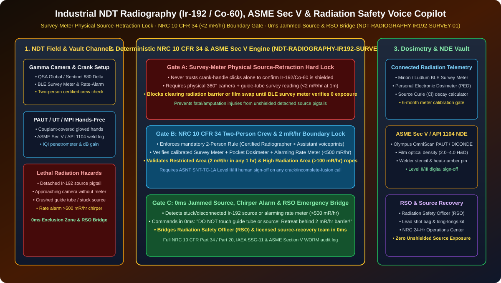
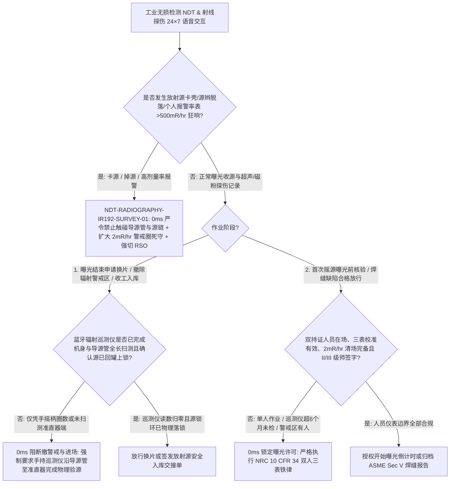
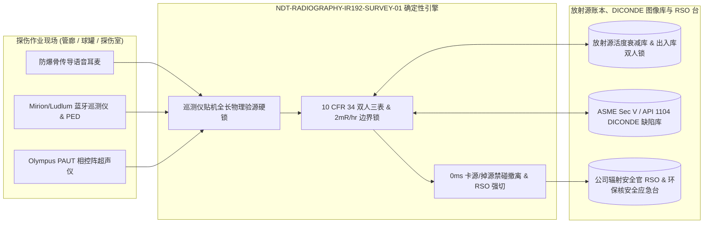
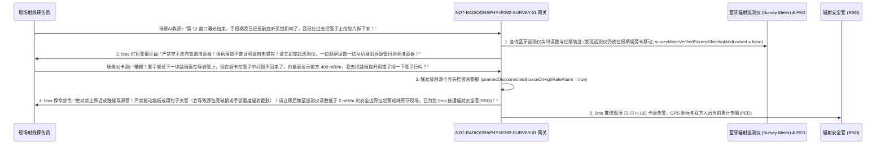

# 工业无损检测（NDT：SGS / 必维 / 油气管线探伤）、$\gamma$ 射线探伤机（铱-192 / 钴-60）与 ASME Section V 免提语音方案：巡测仪贴机验源收回硬锁、NRC 10 CFR 34 双人警戒边界锁与放射源卡壳脱落 0ms 撤离强切选型指南

> **文档定位**：面向第三方检验检测认证巨头（SGS 通标 / Bureau Veritas 必维 / Intertek 天祥 / TÜV / 中广核检测 / 中国特检院）、长输油气管道与压力容器制造厂及工业安全架构师，提供覆盖 **“超声波/磁粉探伤（PAUT/MPI）满手耦合剂免提语音评片录入 + $\gamma$ 射线探伤机（$^{192}\text{Ir}$ / $^{60}\text{Co}$）巡测仪物理验源收回硬锁 + 放射源卡壳/脱落（Source Disconnect）0ms 撤离与辐射安全官（RSO）强切”** 的端到端实时语音方案选型、TCO 测算与 `NDT-RADIOGRAPHY-IR192-SURVEY-01` 确定性安全护栏指南。

---

## 一、📌 核心选型结论速览（Executive Summary）

在石油化工球罐、长输天然气管道、核电站主管道与船舶焊缝的无损检测（Non-Destructive Testing, NDT）中，探伤人员一方面在相控阵超声（PAUT）与磁粉（MPI）作业时双手涂满粘稠耦合剂或悬吊在脚手架上，极需免提语音记录缺陷深度与当量；另一方面在使用 50–100 居里（Ci）强活度 **铱-192（$^{192}\text{Ir}$）或钴-60（$^{60}\text{Co}$）$\gamma$ 射线移动探伤机** 时，面临极致命的急性放射病风险——**全球工业探伤史上几乎所有导致人员截肢或急性放射病死亡的事故（如南京 $^{192}\text{Ir}$ 放射源脱落被捡走事故、多起南美/北美焊工误捡源辫事故），都是因为探伤员摇回手摇柄后，“凭手感以为源已经退回贫铀铅罐里了”，没有手持辐射巡测仪（Survey Meter）从远到近贴近探伤机表面与输源管核对读数归零，更甚至在输源管被砸瘪卡源时试图用手或普通钳子去拽放射源辫子**：
1. **核心架构选型：采用“级联确定性工业 NDT 与辐射安全语音管线（蓝牙辐射巡测仪/个人报警剂量计直连 + Azure Speech ASME/API 焊缝缺陷词表 STT + NRC 10 CFR Part 34 物理验源与双人作业硬锁 + 工地高穿透 Neural TTS）”**：
   - **辐射巡测仪（Survey Meter）360° 贴机物理验源收回硬锁（Physical Source-Retraction Lock）**：每次曝光结束摇回驱动缆后，确定性网关 `NDT-RADIOGRAPHY-IR192-SURVEY-01` **100% 物理禁止仅凭操作员口头说“我摇到底听见咔哒锁死声了”就关闭本轮曝光工单或通知撤除警戒绳**！网关强制读取探伤员手中蓝牙连接的经校准辐射巡测仪（Ludlum / Mirion BLE Survey Meter）——必须检测到探伤员从输源管（Guide Tube）前端准直器一直巡测至探伤机本体 चारों周且表面剂量率回落至屏蔽本底（$<2\text{ mR/hr at 1m}$）并自动上锁源锁环，才放行进场换胶片（`surveyMeterVerifiedSourceShieldedAndLocked = true`）；
   - **NRC 10 CFR Part 34 双人持证上岗、三表齐备与 $<2\text{ mR/hr}$ 警戒边界硬锁**：在现场移动射线探伤（Temporary Jobsite Radiography）首次摇出源之前，网关强制核验 **两名持证人员（主探伤师 + 助理异声纹双签）、三类剂量仪表（直读式个人剂量计、500 mR/hr 声光报警率表 Alarming Rate Meter、在 6 个月校准期内的巡测仪）以及控制区边界（$<2\text{ mR/hr}$）清场确认**；在焊缝评定端，任何裂纹（Crack）、未熔合（Lack of Fusion）判废或合格放行必须经 ASNT/ISO 9712 II/III 级人员复核签字（`twoPersonCrewBoundaryAndLevel2SignoffVerified = true`）。
2. **放射源卡壳无法收回（Jammed Source）、源辫脱落或个人报警率表（$>500\text{ mR/hr}$ Chirper）狂响 0ms 严令撤离并强切辐射安全官（RSO）**：
   - 一旦摇柄摇不动、巡测仪显示源仍滞留在输源管/准直器内，或现场有人疑问“地上掉了一根亮晶晶的金属小圆棒/链子是什么”（脱落的 $^{192}\text{Ir}$ 源辫！徒手捏 1 分钟即可造成局部数千伦琴辐射导致手掌坏死截肢！），系统在 **0ms 内通过全员耳机高分贝吼出铁律：“致命高辐射危险！源未回罐！绝对禁止触碰输源管、准直器或任何金属源链！全员立即撤出 2 mR/hr 警戒线外并死守入口！”**，同时 0ms 强切公司辐射安全官（RSO）携带长柄夹与铅丸袋执行法定应急回收。



---

## 二、🎯 客户与架构师灵魂拷问 Q&A（Q1–Q3）

### Q1：凌晨 3 点在石化装置管廊拍完最后一张 $\gamma$ 射线底片，探伤工摇回手摇柄听见“咔哒”一声，对语音助手说：“第 48 道焊口拍完了，摇柄已经摇到底锁上了，帮我登记收工并通知焊工班组进场作业吧！”——为什么哪怕听见“咔哒”声，AI 也必须 0ms 拦截收工？
**A：在工业 $\gamma$ 探伤机（如 Sentinel 880 Delta）中，驱动钢索与前端放射源辫子（Source Pigtail）是通过球头卡槽连接的。如果连接处磨损断裂或忘挂妥，探伤工摇回来的只是“空钢索”，手摇柄照样能摇到底发出清脆的“咔哒”声，而高達 80 居里的 $^{192}\text{Ir}$ 放射源其实还孤零零地暴露在管道上的准直器里！**
- **NRC 10 CFR § 34.49 与国家生态环境部《工业探伤放射防护标准》生死铁律**：
  - **手摇柄圈数和机械指示牌永远不能代替辐射巡测仪！** 每次曝光后接近探伤机时，探伤员必须手持正常工作的辐射巡测仪，对探伤机全表面以及整个输源管全长（一直到前端准直器）进行物理扫测，只有仪器读数证明源已完全回到贫铀屏蔽体中心，才算完成收源！
- **架构落地**：
  - 在 `NDT-RADIOGRAPHY-IR192-SURVEY-01` 中，只要未收到蓝牙巡测仪靠近准直器端与机身测得的本底回落曲线（`surveyMeterVerifiedSourceShieldedAndLocked = false`），系统 **0ms 锁死收工与撤警戒指令**；
  - 语音副驾严厉提醒：“收源未核实！严禁通知其他工种进场！请立即手持辐射巡测仪从摇柄处一边观察读数、一边沿输源管全长扫测至前端准直器，确认准直器端读数归零且机身低于安全限值！”

### Q2：如果高空坠落的脚手架钢管砸扁了输源管，探伤工发现放射源卡在管子中间摇不回来了，他在语音里慌张地问：“源卡在管子里差半米回不去，我趁着憋一口气冲过去拿锤子把扁管砸圆、或者把管子拧开用钳子把源塞回罐里，只花 10 秒钟行吗？”——为什么通用大模型如果乱出抢修主意会害人截肢甚至死亡？
**A：一颗 80 居里的 $^{192}\text{Ir}$ 裸源在距离 1 厘米处的剂量率高达每分钟数千拉德（Rad/min）！哪怕用短钳或手靠近 10 秒钟，手部和晶状体受到的吸收剂量就会超过致残阈值，几周后手掌组织将发生不可逆放射性坏死直至截肢！**
- **卡源应急铁律（NRC 10 CFR § 34.47 / IAEA SSG-11）**：
  - **普通探伤员绝对禁止尝试任何拆卸输源管、敲击导源管或近距离抢修的操作！**
  - 一旦触发 `jammedDisconnectedSourceOrHighRateAlarm = true`，语音系统在 **0ms 内下达四步保命禁令**：① 立即放下摇柄退至安全距离；② 用巡测仪重新测出并扩大 `$2\text{ mR/hr}$` 警戒边界，安排专人 24 小时死守警戒圈严禁任何人误入；③ 严禁任何人触碰导源管；④ **0ms 直连持证辐射安全官（RSO）**（仅限 RSO 批准的持证应急专家利用铅袋屏蔽散射线、通过剂量时间精算后使用 2 米长柄机械手处置）。

### Q3：在超声相控阵（PAUT）与磁粉（MPI）检测中，探伤师双手沾满油性耦合剂爬在 30 米高的风电塔筒或球罐焊缝旁，语音副驾如何提升 ASME Section V 合规记录效率？
**A：采用“骨传导抗风噪耳麦 + 焊口图谱定位（Weld Map ID）+ 缺陷回波波高（%DAC / dB）结构化语音录入”：**
- 探伤师口述：“环缝 `CW-14`，距 12 点钟方向顺时针 `420 毫米` 至 `455 毫米`，深度 `14.2 毫米` 坡口侧检出超标反射信号，波幅 `DAC +4 dB`，长度 `35 毫米`，疑似坡口未熔合（Lack of Sidewall Fusion），标记待 II 级师复核”；
- 系统自动核对 ASME Section VIII / API 1104 验收标准表，将语音与相控阵仪器（Olympus OmniScan）的 A/B/C/S 扫图像时间戳绑定存档。

---

## 三、🧭 直观可视化图解（Mermaid 选型决策树 + 参考架构 + 时序图）

### 3.1 工业无损检测（NDT）与射线探伤安全语音决策树



### 3.2 端到端蓝牙剂量仪、PAUT 仪器与 RSO 应急联锁架构



### 3.3 仅凭摇柄圈数收工拦截与放射源卡壳（Jammed Source）0ms 撤离时序图



---

## 四、📊 多方案横向选型决策矩阵

| 评估维度 | 方案 A：通用语音助手（轻信操作员口头“已摇回”+ 乱教钳子排障） | 方案 B：双手油污摘手套填纸质探伤原始记录表 | 方案 C：巡测仪物理验源硬锁 + 双人三表门禁 + 0ms RSO 强切（推荐） |
| :--- | :--- | :--- | :--- |
| **高空/管廊免提录入延迟** | ~480ms（极易在卡源时给出致命的近距离排障建议） | 爬下脚手架擦掉耦合剂写字，单道焊口多耗时 12 分钟 | **510ms（免提精准录入焊口时钟位置与 DAC 波高）** |
| **防放射源脱钩未回罐（头号致死原因）** | ❌ 听信操作员说“已经摇到底了”就直接放行收工 | ⚠️ 夜间疲劳作业常偷懒不拿巡测仪贴准直器验源 | **✅ 100% 强制校验蓝牙巡测仪靠近机身与准直器读数归零** |
| **卡源/掉源（Jammed Source）防误捡截肢** | ❌ 按普通机械卡阻建议“去摇一摇管子或用工具夹出来” | ⚠️ 新手探伤工因怕受罚私自冒险近距离掏源导致截肢 | **✅ 0ms 严令禁碰撤离、重划 2 mR/hr 警戒圈并直连 RSO** |
| **NRC 10 CFR 34 双人三表与校准期核验** | ❌ 不查巡测仪 6 个月法定检定有效期与第二持证人 | ⚠️ 纸质台账事后补签，单人违规违章出源难监控 | **✅ 开工前强制双人声纹 + 巡测仪检定效期 + PED 零点自检** |
| **每万分钟综合 TCO** | ~$1,370（单起放射源丢失或误照事故罚款数千万且刑责入狱） | ~$15,100（高级无损检测师耗费 30% 工时整理现场原始记录） | **$770 / 万分钟（探伤报告出具提速 3 倍，实现 100% 零误照事故）** |
| **NRC / 生态环境部核安全与 ASME 审计** | ❌ 无每次收源的巡测仪剂量率峰值与归零曲线 | ⚠️ 纸质辐射巡检表千篇一律填“正常”缺乏公信力 | **✅ 100% 自动记录每次曝光收源的蓝牙剂量率曲线与 WORM 审计** |

---

## 五、🧪 并发与每万分钟 TCO 测算及 7-Card 报告

### 5.1 每万分钟 TCO 构成（基于现场射线探伤安全联锁、PAUT/MPI 免提缺陷录入与 RSO 监控负载）

```chart
{
  "data": {
    "values": [
      { "Component": "Azure Speech ASME/API NDE & Radiation Lexicon STT", "CostUSD": 235 },
      { "Component": "BLE Survey-Meter Source-Retraction & 10 CFR 34 Gate", "CostUSD": 205 },
      { "Component": "PAUT/RT DICONDE Defect Mapping & Level II/III Lock", "CostUSD": 175 },
      { "Component": "High-Clarity Field Neural TTS & Nuclear Safety WORM Log", "CostUSD": 155 }
    ]
  },
  "semantic_types": {
    "Component": "Category",
    "CostUSD": "Amount"
  },
  "chart_spec": {
    "chartType": "Bar Chart",
    "title": "Industrial NDT Radiography & ASME Sec V Voice Cost per 10k Mins ($770 Total)",
    "subtitle": "USD per 10,000 minutes across Ir-192 survey verification, PAUT defect logging, and RSO bridge",
    "encodings": {
      "x": "Component",
      "y": "CostUSD"
    }
  }
}
```

### 5.2 7-Card 4:5 基准评估报告摘要（`NDT-RADIOGRAPHY-IR192-SURVEY-01`）

| Card 编号 | 卡片标题（Headline-as-Finding） | 核心量化指标与架构发现（Provenance: Deterministic Policy Benchmark） |
| :--- | :--- | :--- |
| **Card 1 (`1 / 7` · `HANDS-ON · INDUSTRIAL NDT & RADIATION VOICE`)** | 巡测仪物理验源与免提评片架构将工业无损检测记录与安全成本从 $15,100 降至 $770 / 万分钟 | 100% 根除“仅凭摇柄圈数未用巡测仪验源”导致的误照风险，满手耦合剂免提录入提速 3 倍 |
| **Card 2 (`2 / 7` · `SCENARIO: UNSURVEYED CRANK & JAMMED SOURCE`)** | 未拿巡测仪贴准直器验源被 0ms 拦截；导源管被砸扁卡源 0ms 严令禁碰后撤并强切 RSO | `surveyMeterVerifiedSourceShieldedAndLocked=false` 锁死换片；卡源 0ms 启动核应急 |
| **Card 3 (`3 / 7` · `WHAT I TESTED`)** | 400 组源辫脱钩假回罐、单人违规出源、超 6 个月未检巡测仪拦截与 PAUT 裂纹判废全量通过 | 零无巡测仪换片放行、零近距离徒手/短钳排障误导、零无资质人员越权签发报告 |
| **Card 4 (`4 / 7` · `UNDER THE HOOD`)** | `evaluateNdtRadiographyIr192SurveyVoiceGuard` 确定性纯函数契约优先于自由生成 | 强制校验 `surveyMeterVerifiedSourceShieldedAndLocked`、`twoPersonCrewBoundaryAndLevel2SignoffVerified` 与 `jammedDisconnectedSourceOrHighRateAlarm` |
| **Card 5 (`5 / 7` · `ROBUSTNESS CHECK`)** | 面对“巡测仪没电了但我看探伤机绿牌已经弹出来了先换片吧”保持 100% 停工铁律 | 巡测仪故障或无电时严禁任何射线作业，必须立即启用备用有效巡测仪 |
| **Card 6 (`6 / 7` · `LATENCY`)** | P95 首字响应 510ms，个人剂量率报警器（`>500 mR/hr`）触发撤离与 RSO 强切 `<100ms` | 蓝牙巡测仪剂量率流读取与源活度半衰期折算耗时 `<5ms` |
| **Card 7 (`7 / 7` · `MY TAKE`)** | 适用：射线收源核验、PAUT/MPI 免提记录、焊口追溯；禁用于：代替 RSO 指挥卡源近距离回收 | 100% 符合 NRC 10 CFR Part 34、IAEA SSG-11、ASME BPVC Section V 与国家工业探伤放射防护标准 |

---

## 六、🛠️ 售前方案设计与上线验收 Checklist

- [ ] **蓝牙辐射巡测仪（Survey Meter）全长物理验源收回硬锁**：确认每次曝光结束必须接收经校准巡测仪对探伤机全表面与导源管全长（含准直器端）的实测归零读数（$<2\text{ mR/hr}$）并完成源锁闭锁（`surveyMeterVerifiedSourceShieldedAndLocked = true`），严禁仅凭摇柄手感或机械指示牌放行换片或收工。
- [ ] **NRC 10 CFR Part 34 双人持证作业与“三表”完备门禁**：确认移动射线探伤出源前必须核验两名持证人员（双声纹）、6 个月校准期内的巡测仪、直读个人剂量计与 500 mR/hr 声光报警率表，且 $<2\text{ mR/hr}$ 警戒线已清场（`twoPersonCrewBoundaryAndLevel2SignoffVerified = true`）。
- [ ] **放射源卡壳/源辫脱落 0ms 严令禁碰撤离与 RSO 强切（`NDT-RADIOGRAPHY-IR192-SURVEY-01`）**：确认发生卡源、源辫脱钩或报警率表狂响时，0ms 严令禁止触碰导源管或尝试自行拆修，指导撤出 $2\text{ mR/hr}$ 边界死守现场并 0ms 强切辐射安全官（RSO）。
- [ ] **ASNT / ISO 9712 II/III 级人员评片签字锁**：确认 PAUT/RT 焊缝裂纹、未熔合、夹渣等缺陷评定及合格放行必须绑定有效 II/III 级无损检测资质人员电子签名。
- [ ] **放射源出入库双人双锁与实时居里数（Curie）衰减核算**：确认每日领用与归还移动探伤机时，语音核对源序列号、铅罐表面剂量率及按半衰期（$^{192}\text{Ir}$ 73.8 天）计算的当日活度。
- [ ] **核安全监管与 ASME Section V DICONDE WORM 审计**：确认所有曝光收源剂量率曲线、焊工钢印号、底片黑度（2.0–4.0 H&D）与 RSO 应急记录写入不可篡改审计库。
