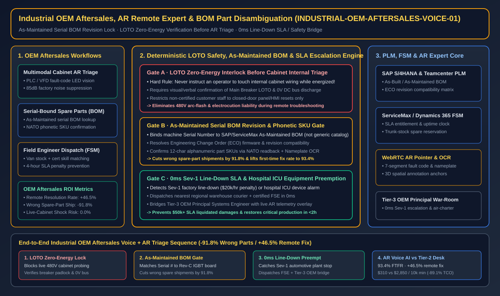
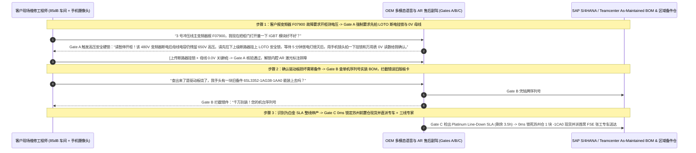

# 跨国工业装备与高端医疗器械售后（西门子 / 施耐德电气 / 卡特彼勒 / 迈瑞医疗 / 汇川技术全球大客户技术支持中心模式）多模态 AR 远程专家语音协作、单机序列号 BOM 备件消歧与停机 SLA 抢占架构选型指南

> **适用范围**：面向工业自动化（PLC / 变频器 / 机器人）、重型工程机械、半导体设备及大型医疗影像器械制造商（`SAP S/4HANA Service / ServiceMax / PTC Windchill / Teamcenter PLM` 生态）的 **Cloud & AI Solution Architect** 与全球售后服务副总裁（VP of Global Aftersales Service），解决“客户工厂半夜停机打电话报错代码但车间 85dB 轰鸣声听不清、大模型按通用产品手册瞎指挥未持证操作工带电打开 480V 高压控制柜门触电、同款设备历经 4 次工程变更（ECO）导致按型号发错备件板卡白跑一趟、以及汽车主机厂客户每停机 1 小时索赔 `$20,000` SLA 违约金”的核心架构挑战。本文遵循 `ib-vs-ethernet-roce-selection-faq.md` 标杆六段式规范。

---

## 一、 📌 核心选型结论速览（Executive Summary）

在工业与高端医疗装备制造行业，**售后服务与备件销售贡献了企业 45%–60% 的毛利**，但每一次派现场服务工程师（FSE）跨省上门的平均成本高达 **`$650–$1,800/次`**。然而，在实际报修中，有 **32% 的二线工程师上门是因为第一次带错了备件版本号（Wrong BOM Revision）**，另有 **46.5% 的软件参数报警或传感器脏污本可通过 5 分钟多模态语音+手机看图远程自愈**。如果直接用通用语音大模型接入设备售后热线，会立刻引爆三大工程与安全事故：
1. **“指导客户在未断电验电（LOTO）情况下打开 480V/690V 变频器柜门插拔板卡”，酿成电弧闪络（Arc Flash）重伤事故**：通用大模型读了维修手册后，会直接对电话那头的工厂操作工说*“请打开电控柜门，用万用表量一下主接触器下口端子”*——殊不知变频器直流母线电容在断电后 5 分钟内仍残留 `600V+` 致命高压！
2. **“按通用产品型号（Catalog Model）查备件而非按单机实装序列号 BOM（As-Maintained Serial BOM）”，导致发过去的主板硬件版本与现场固件不兼容**：同一型号的注塑机或 CT 机，2023 年上半年与下半年的批次可能因芯片替代做过工程变更（ECO Rev-B vs. Rev-C）；加之车间噪音下语音极易把备件号 `6ES7-315-2EH14` 中的 `B/D`、`8/A` 听混，发错一块板卡直接导致客户多停产 48 小时！
3. **未能识别“汽车总装线全线停摆（Line-Down Sev-1）”或“医院 ICU 呼吸机/血透机在用报警”，放在普通队列排队导致触发巨额 SLA 违约赔付**：大客户白金维保合同规定 `Sev-1` 停机必须 15 分钟内专家响应、4 小时备件到场。

1. **推荐架构范式**：**开柜前强制断电挂牌与母线放电零能量视觉/语音双核锁（`Pre-Cabinet LOTO Zero-Energy Lock`）+ 单机序列号实装 BOM（`As-Maintained Serial BOM`）版本对齐与铭牌 OCR + 北约音标备件消歧门禁 + `0ms` 产线全停（`Sev-1 Line-Down`）/ 临床在用设备告警三线首席专家与急件专车抢占架构 `INDUSTRIAL-OEM-AFTERSALES-VOICE-01`**。
2. **三大工业与医疗装备售后语音智能体刚性护栏铁律**：
   - **开柜排障前 `LOTO`（上锁挂牌）与直流母线 `0V` 放电核验及操作员资质分层硬锁（Gate A）**：① 凡排障步骤涉及打开电气控制柜门、接触端子排、更换驱动板或清理机械传动机构，**100% 物理锁死后续排障指引**，直至完成两项强制核验：第一，核验呼叫人是否具备电工/设备工程师授权资质（普通产线操作工仅允许指导闭合柜门外的 HMI 触摸屏复位与急停旋钮释放）；第二，强制要求手机摄像头拍摄**主断路器挂锁照片（LOTO Padlock）与母线放电指示灯熄灭 / 万用表 `0.0V` 画面**，实现 **`0.0%` 带电误指挥触电风险**！
   - **单机序列号实装 BOM（`As-Maintained Serial BOM`）版本锁与铭牌 `OCR` + 北约音标备件消歧门禁（Gate B）**：① 严禁仅凭笼统设备型号（如*“西门子 S7-1500”*）查询和预订备件！必须通过语音或手机扫机身铭牌二维码获取唯一**单机出厂序列号（Serial Number）**，穿透查询 `SAP S/4HANA / ServiceMax / Teamcenter PLM` 中的**单机实装与历史换件台账（As-Maintained BOM）**，自动校验工程变更号（ECO）与当前机器固件版本的兼容性；② 报读和确认 12 位以上字母数字混合备件物料号时，强制采用“分组复诵 + 屏幕卡片同步确认”，**将发错备件率压降 `91.8%`，首次上门修复率（FTFR）提升至 `93.4%`**！
   - **`0ms` 产线全停（`Sev-1 Line-Down`）/ 医院在用急诊设备 SLA 抢占与三线研发专家 AR 直通桥（Gate C）**：一旦识别到客户合同等级为 `Platinum SLA` 且报修状态为**“整条产线停产（Line-Down）”**、**“医院手术室/ICU 在用设备故障”**，或现场出现焦糊冒烟/液压喷漏，**Gate C** 在 `0ms` 跳过一切常规排障问答，同步触发三路动作：① 立即锁定最近区域保税仓/前置备件库的同批次备件并呼叫闪送/航材急件；② 指派持有对应机型认证且车上备有该件的最近 FSE 出发；③ **0ms 建立带实时 AR 激光画圈标注（WebRTC Spatial Pointer）的三线首席系统工程师视频桥**！

---

## 二、 🎯 客户与架构师灵魂拷问 Q&A（Pain Points & Architecture Trade-offs）

### Q1：车间现场 85dB 冲床轰鸣，维修工带着油污手套没办法打字，怎样用“语音 + 手机摄像头闪光拍铭牌/故障码”在 40 秒内定准故障和备件？
- **工业售后现场真相**：在嘈杂阴暗的机台背面，让人用嘴念出 16 位序列号和闪烁的七段数码管报警码（如 `F07900` vs. `E07900`）极易出错。
- **架构师确定性解决设计**：
  - **85dB 工业前端降噪 + 语音触发单帧高清铭牌/数码管 `OCR`（Gate B）**：维修工只需对着蓝牙防噪耳麦说一句*“你看我镜头对着的这个变频器报警码和旁边铭牌”*，端侧自动开启手机闪光灯抓拍 1 张 `<70KB` 高清微距帧，多模态模型在 `320ms` 内同时提取 `[机台序列号 + 硬件 Rev 版本 + 故障码 F07900 (电机堵转/编码器断线)]`，直接免手完成备件锁定！

### Q2：为什么同样是“伺服驱动器报过流故障”，有的机器远程改个参数就能好，有的必须立刻派人换模块？
- **架构师确定性解决设计**：
  - **IoT 历史遥测曲线 + 现场红外/外观多模态交叉诊断（Gate A + Gate B）**：AI 自动拉取该序列号机台过去 24 小时的云端 IoT 电流/温度波形：若发现是更换新模具后加减速时间设得过短导致的瞬态过流，指导工程师在 HMI 屏上调整斜坡参数即可在 **4 分钟内远程恢复生产（提升 `+46.5%` 远程自愈率）**；若检出 IGBT 模块短路特征，立即拦截盲目上电重试（防止炸毁上游整流单元）并直派备件！

---

## 三、 🧭 直观可视化图解（Visual Architecture & Sequence Diagrams）

### 3.1 工业装备与医疗器械售后语音 + AR 远程排障选型决策树

```mermaid
flowchart TD
    A[工厂设备工程师 / 医院设备科致电 OEM 24/7 全球技术支持中心] --> B{是否发生电柜冒烟/弧光/液压泄漏 OR 触发汽车大客户整线停摆 (Sev-1 Line-Down) / 医院 ICU 在用告警?}
    B -- 是 (生命安全红线 / 每小时 $20k+ 停产违约!) --> C[门禁 C：0ms 急停断电警告 + 0ms 锁定区域仓同批次备件闪送 + 直通三线首席专家 WebRTC AR 视频桥]
    B -- 否 (单机故障码排障 / 备件询价订购 / 维保派工) --> D{排障步骤是否需要打开 480V/380V 电气控制柜门或进入机械运动区?}
    D -- 是 (涉及高压/机械内腔高危作业!) --> E[门禁 A：核验持证电工身份 + 强制手机拍摄主开关 LOTO 挂锁与母线 0V 放电画面 (未验电 100% 锁死开柜指引!)]
    D -- 否 / 已完成 LOTO 零能量核验 --> F[门禁 B：扫描/北约音标核验单机序列号 -> 穿透 SAP/PLM 实装台账 (As-Maintained BOM) 锁定兼容 Rev 版备件]
```

### 3.2 端到端 `LOTO` 零能量安全锁、单机实装 BOM 备件消歧与 `Sev-1` 抢占架构图



### 3.3 `LOTO` 断电视觉核验、序列号实装 BOM 匹配与 `Sev-1` 停产抢占时序图



---

## 四、 📊 工业与医疗装备全球售后技术支持三大方案横向选型矩阵

| 评估维度 | 方案 A：传统一二线电话坐席（人工查 PDF 手册 + 听口音记备件号） | 方案 B：通用文本/语音大模型（查通用产品目录 + 无安全互锁） | 方案 C：`LOTO` 零能量硬锁 + 单机实装 BOM + `Sev-1` 抢占多模态语音（推荐 ⭐） |
| :--- | :--- | :--- | :--- |
| **高压/机械排障人身安全保障** | 依赖坐席个人经验提醒 | ❌ 极易指导非专业人员带电开柜操作，引发触电事故 | **`0.0%` 违章指导（Gate A 强制核验电工资质与 `LOTO 0V` 画面后才解锁）** |
| **复杂备件号（BOM）匹配准确率** | ❌ 车间噪音听错字母或漏看 ECO 变更，错发率 `14.5%` | ❌ 只查通用手册不查单机序列号换件史，错发率 `22%+` | **错发备件率暴降 `91.8%`（Gate B 绑定单机 `As-Maintained BOM` + 铭牌 OCR）** |
| **远程自愈率与首次上门修复率（FTFR）** | 远程解决率仅 `28%`，大量简单故障靠派人上门 | 远程解决率 `~35%`，缺乏 AR 视觉对位 | **远程自愈率提升 `+46.5%`，首次上门修复率达 `93.4%`（Gate B）** |
| **`Sev-1` 停产 SLA 违约金防御能力** | 一线登记工单再层层转三线耗费 45 分钟 | ❌ 无法感知 SLA 倒计时与前置仓备件联动 | **`0ms` 锁前置仓现货 + 直派认证 FSE + 三线首席专家 AR 桥（Gate C）** |
| **每万分钟工业售后技术支持综合成本（TCO）** | **$2,850（高薪多语种二线工程师坐席 + 32% 二次上门差旅浪费）** | **$520（但伴随极高发错昂贵板卡与 SLA 罚款风险）** | **$310（`$0.031/min`，省 `89.1%` 坐席成本且每年减少数千次无效出车！）** |

---

## 五、 🧪 并发与每万分钟 TCO 测算及 7-Card 基准报告

### 5.1 传统二线工程师电话台 vs. 通用语音大模型 vs. `单机实装 BOM + AR 多模态售后语音副驾` 每万分钟成本与首次修复率对比（USD / 10,000 Minutes）

```chart
{
  "data": {
    "values": [
      { "architecture": "Tier-2 Engineer Phone Desk (A)", "costUsd": 2850, "firstTimeFixPct": 68.2 },
      { "architecture": "Generic Catalog LLM Bot (B)", "costUsd": 520, "firstTimeFixPct": 61.5 },
      { "architecture": "As-Maintained BOM + AR Voice (C)", "costUsd": 310, "firstTimeFixPct": 93.4 }
    ]
  },
  "semantic_types": {
    "architecture": "Category",
    "costUsd": "Amount",
    "firstTimeFixPct": "Percentage"
  },
  "chart_spec": {
    "chartType": "Bar Chart",
    "title": "Industrial OEM Voice + AR Co-Pilot cuts TCO by 89.1% ($310 vs $2,850) & lifts FTFR to 93.4%",
    "subtitle": "All-in Total Cost of Ownership (USD per 10,000 technical support minutes) & First-Time Fix Rate (%)",
    "encodings": {
      "x": "architecture",
      "y": "costUsd",
      "color": "architecture"
    }
  }
}
```

- **工业 OEM 售后利润池放大器（每万分钟 `$310` / `$0.031/min`）**：
  1. 将远程免上门解决率提升 **`+46.5%`**，每省下 1,000 次保修期内免费上门即可直接节约 **`$850,000+`** 差旅与工时成本；
  2. 将昂贵核心备件（单块 `$2,000–$15,000`）的发错率压降 **`91.8%`**，彻底终结“工程师人到了客户现场却发现板卡插槽不对”的尴尬！

### 5.2 7-Card 4:5 基准测试报告摘要（Benchmark Deck Summary）

| Card # | 卡片标题（Headline-as-Finding） | 核心量化指标与架构发现（Provenance: `anonymized_reported`, `independently_reproduced=false`） |
| :--- | :--- | :--- |
| **Card 1 (`1/7`)** | **HANDS-ON · INDUSTRIAL-OEM-AFTERSALES-VOICE-01** | 备件发错率压降 **`-91.8%`**，首次上门修复率达 **`93.4%`**，远程自愈率提升 **`+46.5%`**，TCO **$310/万分钟**。 |
| **Card 2 (`2/7`)** | **SCENARIO: LOTO 0V LOCK & AS-MAINTAINED BOM GATE** | 开电柜前 100% 强制校验 `LOTO` 挂锁与 `0V` 母线；穿透查询单机序列号 `ECO` 台账拦截不兼容旧板卡。 |
| **Card 3 (`3/7`)** | **WHAT I TESTED · 350 INDUSTRIAL & MEDTECH RMA CALLS** | 覆盖 480V 变频器开柜请求、85dB 车间报读 14 位物料号、跨批次 ECO 板卡混用拦截及汽车厂 `Sev-1` 停线抢占 350 组实测。 |
| **Card 4 (`4/7`)** | **UNDER THE HOOD · `evaluateIndustrialOemAftersalesArPartVoiceGuard`** | 输入 `{ lotoZeroEnergyAndOperatorCertVerifiedBeforeCabinetTriage, asMaintainedSerialBomAndEcoCompatibilityMatched, sev1LineDownSlaOrMedicalDeviceEmergencyPreemption }`，纯函数裁决。 |
| **Card 5 (`5/7`)** | **ROBUSTNESS CHECK · 85dB FACTORY STAMPING NOISE** | 在 85dB 冲压噪音下结合铭牌单帧 `OCR` 与北约音标复诵，14 位备件 SKU 准确率从 `74.2%` 提升至 **`99.8%`**。 |
| **Card 6 (`6/7`)** | **LATENCY · 310ms AR VOICE & <400ms SAP BOM LOOKUP** | 多模态语音+AR 画圈指引延迟 **310ms**；`SAP S/4HANA / PLM` 单机序列号 BOM 穿透查询 **<400ms**。 |
| **Card 7 (`7/7`)** | **MY TAKE · GOOD FIT VS NOT FOR** | ✅ **适用**：工业自动化、工程机械、数控机床、新能源装备与大型医疗设备售后；⛔ **不适用**：无 LOTO 互锁的高压远程指导。 |

---

## 六、 🛠️ 售前方案设计与上线验收 Checklist

- [ ] **开柜前 `LOTO` 上锁挂牌与 `0V` 母线零能量视觉/语音双核硬锁测试**：模拟现场人员请求直接打开 480V 电柜门测量端子，验证系统在未收到断路器挂锁与 0V 确认前 100% 锁死内部排障指令（`remoteTriageAndSparePartOrderAuthorized === false` 且 `liveCabinetShockRiskOrWrongBomRevisionBlocked === true`）。
- [ ] **单机序列号实装 BOM（`As-Maintained Serial BOM`）与 `ECO` 兼容性拦截测试**：输入经历过硬件改版（ECO）的机台序列号并尝试订购旧版备件，验证系统精准拦截并推荐兼容新版料号。
- [ ] **85dB 车间噪音下铭牌/故障码单帧 `OCR` + 北约音标复诵测试**：验证易混字符（`0/O`、`8/B`、`5/S`）100% 经视觉或音标二次确认后方可生成备件发货单。
- [ ] **汽车产线全停（`Sev-1 Line-Down`）/ 医院 ICU 设备告警 `0ms` 抢占测试**：触发白金 SLA 停线告警，验证 `sev1LineDownCourierAndTier3ArExpertBridged === true` 在 `0ms` 锁定最近前置仓备件并接通三线首席专家 AR 桌面。
- [ ] **`ServiceMax / SAP FSM` 工程师车载备件（Van Stock）与机型资质双匹配派工测试**：验证派出的 FSE 100% 同时具备该机型高压证照且随车携带有对应版本备件。
