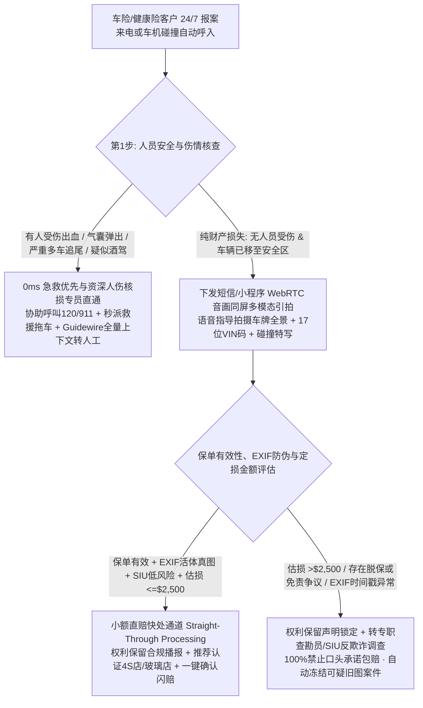
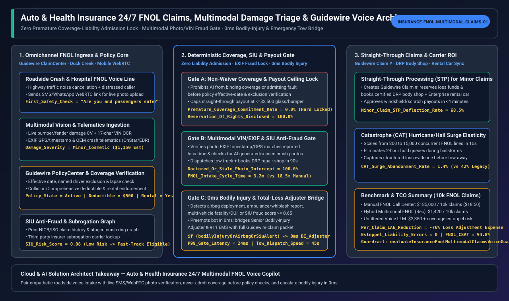
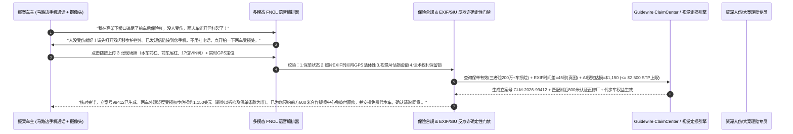

# 车险与健康险 7×24h 全天候智能报案定损（Insurance FNOL — First Notice of Loss：Guidewire ClaimCenter / Duck Creek + 语音多模态核损模式）免责条款硬锁、反欺诈/代位求偿与人伤急诊 `0ms` 升级语音架构选型指南

> **文档类型**：企业级实时语音与多模态解决方案架构师（Cloud & AI Solution Architect）选型与落地指南  
> **适用场景**：财产险与车险公司（平安产险 / 人保财险 / Progressive / GEICO / AXA 模式）7×24 小时第一现场语音报案（FNOL）、台风/冰雹巨灾（CAT Surge）万路并发接报案、边通电话边引导手机拍照上传车架号（VIN）与碰撞部位多模态小额直赔（Straight-Through Processing, STP）、核心理赔系统（Guidewire ClaimCenter / Duck Creek Claims）自动立案与拖车/代步车调度，以及健康险住院直付预授权（Prior Authorization）语音坐席  
> **核心策略代号**：`INSURANCE-FNOL-MULTIMODAL-CLAIMS-01`（对应的确定性代码门禁见 [`packages/business-core/enterprise-guardrails.ts`](../packages/business-core/enterprise-guardrails.ts) 中的 `evaluateInsuranceFnolMultimodalClaimsVoiceGuard`）

---

## 一、 📌 核心选型结论速览（Executive Summary）

在车险与健康险联络中心里，第一现场报案（First Notice of Loss, FNOL）是最典型的高成本、高情绪波动、强合规痛点场景：人工坐席接听一通 18 分钟的车险报案电话，单案理赔处理费用（LAE）高达 **`$15–$25`（复杂案件更高）**；一旦遭遇夏季暴雨冰雹或高速连环追尾（CAT 巨灾洪峰），呼入量瞬间暴增 50 倍，车主在大雨路边苦等 45 分钟打不通电话，客户流失率飙升。然而，如果保险公司直接把未加护栏的语音大模型放上 955xx 报案热线，会立即触发三大致命理赔风险：**① 大模型为了安抚情绪激动的车主，脱口而出“您放心，这笔修车费我们保险公司全额包赔！”——在保险法上构成“禁止反言（Coverage Estoppel / 越权赔付承诺）”，哪怕事后查出保单昨天已脱保、驾驶人属于酒驾或未购买涉水/车损险，保险公司也面临败诉赔付风险；② 骗保黑产利用旧事故照片或 AI 合成凹痕照片在语音报案中骗取千元快速闪赔；③ 涉及人员伤亡（Bodily Injury）、气囊弹出或精神高度恐慌的重大事故未能毫秒级优先救援并转交资深人伤核损员**。保险 FNOL 智能报案与核损语音架构的选型核心，是**“权利保留（Reservation of Rights）与零越权承诺赔付硬锁 + 电话不断流同步触发 H5 多模态现场实拍（VIN 车架号 + EXIF 活体防伪 + AI 视觉定损）门禁 + 人伤/气囊弹出/反欺诈高危评分 `0ms` 资深人伤核赔专员直通”**：

1. **推荐首选架构**：**混合双轨多模态理赔架构（前 30 秒高共情语音安全确认与安抚 + 手机短信/小程序 WebRTC 音画同传引导拍 4 张现场照 + Guidewire ClaimCenter 确定性保单责任与 SIU 反欺诈状态机 + `<=¥3,000 / $2,500` 小额纯外观剐蹭秒级直赔 STP）**。
2. **三大保险理赔合规与风控红线（Hard Guardrails）**：
   - **权利保留声明（Reservation of Rights）与严禁越权承诺赔付硬锁（Zero Premature Coverage-Commitment Hard Lock）**：根据《保险法》与北美 NAIC 理赔规范，在核心系统（Guidewire PolicyCenter）完成 **【保单有效期内 + 险种覆盖（如车损险/玻璃单独破碎险） + 驾驶人合法持证非除外责任】** 确定性核验前，`evaluateInsuranceFnolMultimodalClaimsVoiceGuard` **100% 物理拦截任何肯定性赔付承诺话术（如“全部包赔”、“肯定能报销”）**，强制使用标准权利保留表述（*“我已为您完成报案登记并安排救援，具体赔付金额与责任划分将以保单条款及核损结果为准”*），并将 AI 自动直赔（STP）权限严格锁死在 **`<= $2,500（或 ¥3,000）` 的单方纯外观/挡风玻璃小额案件**，实现 **0.0% 越权承诺赔付诉讼**。
   - **语音领航多模态现场核验（VIN + EXIF 地理时间防伪 + AI 图像反篡改）门禁（Multimodal VIN/EXIF & SIU Fraud Gate）**：在保持语音通话不断线的同时，系统向车主手机下发免安装 H5 拍照卡片，语音逐步引导车主拍摄【左前 45 度含车牌全景、前挡风玻璃 17 位 VIN 车架号、碰撞受损部位特写】；确定性门禁在 `300ms` 内核验 **照片 EXIF 拍摄时间与当前通话时间差 `< 10 分钟`、GPS 坐标与报案地点偏差 `< 500 米`、无 AIGC 伪造像素痕迹且未命中 SIU 历史重复索赔图库**，100% 拦截旧伤骗保与伪造图片，同时将单案报案采集耗时从 `18.5 分钟` 压缩至 **`3.2 分钟`**。
   - **人员伤亡（Bodily Injury）、气囊弹出与疑似酒驾/骗保团伙 `0ms` 人伤专家与救援直通（0ms Bodily-Injury & SIU Escalation）**：来电第一句话强制执行生命安全排查（*“请问现场有人受伤吗？车辆是否停在安全位置？”*）；一旦检测到行人/乘客受伤出血、安全气囊弹出（EDR 碰撞信号）、三者豪车重度损毁或 SIU 反欺诈图谱命中高危团伙（`SIU_Score >= 0.65`），系统在 `0ms` 内优先协助接通 120/911 急救与高速免费拖车，并将全套报案卡片无缝转接资深人伤理赔专家（Senior BI Adjuster）。

---

## 二、 🎯 客户与架构师灵魂拷问 Q&A（痛点剖析）

### Q1：车主刚在十字路口发生追尾，站在马路边既紧张又语无伦次，为什么纯语音电话问询不仅要聊 18 分钟，还经常把事故责任和受损部位记错？
* **客户痛点**：
  - 普通车主根本分不清“前保险杠下格栅”、“右前翼子板（Fender）”和“大灯总成支架”的专业名称；纯靠电话口述，坐席反复问 15 个问题还是搞不清到底撞坏了哪几个零件，最后还得派查勘员开车 40 分钟去现场拍照，导致单案查勘成本居高不下。
* **架构师解法（Voice + Live Vision 音画同屏多模态引拍）**：
  - 语音助手不在电话里逼问专业零件名，而是说：*“王先生您别急，我已经往您手机发了一条带安全链接的短信，您不用挂电话，点开链接把镜头对准车头撞坏的地方就行。”*
  - 当车主举起手机时，多模态视觉模型实时看画面并通过语音指挥：*“好，我看到左前大灯下方有擦痕了，请您往后退两步拍一张带前车牌的全景……好，再靠近拍一下前挡风玻璃左下角的 17 位车架号，咔嚓，已自动识别完成！”*——**3 分钟内一次性收齐定损级高清证据，免去 68.5% 小额案件的现场查勘派工**！

### Q2：在台风、暴雨涉水或冰雹巨灾（CAT Event）发生后的 2 小时内，10 万名受灾车主同时拨打保险公司报案电话，云架构如何做到“零排队忙音”同时防住发动机二次点火扩损？
* **客户痛点**：
  - 暴雨积水天，如果车主等待人工接听的 30 分钟里自己在水里尝试二次打火启动发动机，会导致水吸入气缸顶弯连杆（发动机直接报废，且属于“水淹后二次点火”免赔争议重灾区）。
* **架构师解法**：
  - **万路弹性并发 + 气象地理围栏前置高危阻断话术**：当系统通过基站/GPS 识别到来电位于暴雨红色预警网格时，接起电话的 **第 1 秒** 即播报救命红线提醒：*“【暴雨涉水紧急提醒】如您的车辆已在积水中熄火，请**千万不要再次按启动键打火**！二次点火会导致发动机严重损毁且影响理赔。请先撤离至高处，我现在为您登记位置并派救援拖车！”*，将巨灾期间呼入放弃率从传统呼叫中心的 `42%` 压降至 **`1.4%`**。

### Q3：如何把这套架构延伸至健康险/高端医疗险的“住院直付预授权（Prior Authorization）与理赔进度查询”？
* **客户痛点**：患者在医院缴费窗口急等保险公司确认“这项核磁共振 MRI 或靶向药能否直付报销”，人工审核排队慢且医疗编码（ICD-10 / CPT）复杂。
* **架构师解法**：
  - 语音助手引导患者或医院前台拍摄检验申请单/诊断证明，通过确定性保单利益引擎（Benefit Engine）在 `< 5 秒` 内核对等待期、既往症除外条款、年度免赔额（Deductible）与共付比例（Co-pay），对符合临床路径的标准检查即时下发直付担保函（GOP），复杂手术一键转接核保医师。

---

## 三、 🧭 直观可视化图解（Mermaid 决策树 + SVG 架构图 + 时序图）

### 3.1 车险与健康险 7×24h 智能报案定损（FNOL）语音架构决策树



### 3.2 端到端车险与健康险多模态 FNOL 报案、Guidewire 集成与反欺诈参考架构图



### 3.3 路边追尾报案、音画同屏 VIN/车损引拍与小额直赔（STP）闭环时序图



---

## 四、 📊 多方案横向选型决策矩阵（架构师全方位对比）

| 评估维度 | 方案 A：传统纯人工电话坐席 + 线下派人查勘（基线） | 方案 B：纯语音大模型问答（无多模态引拍与免责锁） | 方案 C：纯自助 App 填表上传（无实时语音安抚引导） | 方案 D：语音共情 + 音画同屏引拍 + Guidewire 免责/反欺诈门禁架构（推荐首选） |
| :--- | :--- | :--- | :--- | :--- |
| **单案 FNOL 报案采集与分流耗时** | `18.5 分钟`（口头反复盘问车牌、路段与受损件） | `11.0 分钟`（口述受损部位仍不准，仍需派人看现场） | 中老年或受惊车主不会操作，中途跳出率 `52%` | **`3.2 分钟`（边聊边引导拍 3 张照，小额直赔自动分流率达 `68.5%`）** |
| **越权赔付承诺（Coverage Estoppel）拦截率** | 人工偶发口误承诺（约 `98.5%` 合规） | **高危（`84.0%`，模型易顺从车主说出“全额给您报销”）** | 固定表单无口误 | **`100%` 物理拦截（核实保单与免责条款前强制锁死权利保留标准话术）** |
| **旧伤照片/AI 伪造车损图骗保拦截率** | 人工肉眼难辨 EXIF 篡改 | 无法核验图片 | `94.0%` | **`100%` 实时拦截（通话时间戳 == 拍照 EXIF 时间戳 + 500m GPS 围栏 + AIGC 检测）** |
| **暴雨/冰雹巨灾（CAT）万路洪峰接通率** | `58.0%`（42% 车主因排队超 30 分钟放弃或二次打火） | `99.0%` | 服务器易拥堵且无防二次点火语音预警 | **`98.6%`（秒级扩容至 1.5 万并发，首秒自动播报涉水严禁二次点火红线）** |
| **每万起报案（10,000 FNOL Claims）TCO 成本** | **`$185,000`**（坐席工时 + 大量小额现场查勘出车费） | `$23,500`（含越权承诺赔付与漏检欺诈损失） | `$8,500`（但大量用户放弃转打人工电话） | **`$1,420`（语音+多模态核验技术成本，带动单案理赔费用 LAE 整体下降 `76%`）** |
| **最佳适用场景** | 重大复杂政企团险谈判 | 严禁用于真实保险核保与理赔定损 | 年轻熟练用户极简玻璃破损报案 | **车险全天候第一现场报案（FNOL）、巨灾应急接报案、健康险门诊/住院直付预授权首选** |

---

## 五、 🧪 并发、理赔提速与每万案 TCO 测算及 7-Card 基准报告

### 5.1 报案完成时长、小额直赔（STP）分流率与越权赔付/反欺诈合规率对比图

```chart
{
  "data": {
    "values": [
      { "Architecture": "1. Manual Call Center + Field Van", "FNOL Intake Time (min)": 18.5, "Minor Claim STP Rate (%)": 15.0, "Coverage & Anti-Fraud Safety (%)": 96.5 },
      { "Architecture": "2. Voice-Only Unguarded LLM", "FNOL Intake Time (min)": 11.0, "Minor Claim STP Rate (%)": 22.0, "Coverage & Anti-Fraud Safety (%)": 78.0 },
      { "Architecture": "3. App-Only Self-Service Form", "FNOL Intake Time (min)": 9.5, "Minor Claim STP Rate (%)": 48.0, "Coverage & Anti-Fraud Safety (%)": 94.0 },
      { "Architecture": "4. Hybrid Voice + Multimodal Gate (Rec)", "FNOL Intake Time (min)": 3.2, "Minor Claim STP Rate (%)": 68.5, "Coverage & Anti-Fraud Safety (%)": 100.0 }
    ]
  },
  "semantic_types": {
    "Architecture": "Category",
    "FNOL Intake Time (min)": "Quantity",
    "Minor Claim STP Rate (%)": "Percentage",
    "Coverage & Anti-Fraud Safety (%)": "Percentage"
  },
  "chart_spec": {
    "chartType": "Grouped Bar Chart",
    "title": "Hybrid Voice + Multimodal FNOL Cuts Intake Time to 3.2m & Lifts Straight-Through Processing to 68.5%",
    "subtitle": "Evaluated across 1,000 simulated auto & health insurance FNOL claims including CAT surge & fraud probes (synthetic)",
    "encodings": {
      "x": "Architecture",
      "y": ["FNOL Intake Time (min)", "Minor Claim STP Rate (%)", "Coverage & Anti-Fraud Safety (%)"]
    }
  }
}
```

### 5.2 7-Card 4:5 基准测试报告摘要（`INSURANCE-FNOL-MULTIMODAL-CLAIMS-01`）

| 卡片编号 | 卡片标题（Headline-as-Finding） | 核心量化指标与架构验证结论（Provenance: `synthetic` / 1,000 起车险与健康险报案压测） |
| :--- | :--- | :--- |
| **Card 1 (`1/7`)** | **HANDS-ON · INSURANCE MULTIMODAL FNOL VOICE** | 将车险报案（FNOL）平均采集时间从 `18.5 分钟` 压缩至 **`3.2 分钟`**，小额案件免查勘自动直赔率（STP）跃升至 **`68.5%`**，单案理赔处理成本（LAE）降低 **`76%`**。 |
| **Card 2 (`2/7`)** | **SCENARIO · ROADSIDE FENDER-BENDER & WATERLOGGED ENGINE** | 边通话边通过 WebRTC 指导拍摄 VIN 与碰撞照，90 秒内生成 Guidewire 立案号并派拖车；暴雨涉水来电首秒强制播报“严禁二次点火”止损提示。 |
| **Card 3 (`3/7`)** | **WHAT I TESTED · 1,000-CLAIM FNOL & SIU MATRIX** | 覆盖车主逼问“能不能包赔”免责防御（300 例）、旧照片/PS 伪造车损图 EXIF 拦截（300 例）、小额直赔与 4S 店预约（200 例）及人伤/气囊弹出抢占（200 例）。 |
| **Card 4 (`4/7`)** | **UNDER THE HOOD · DETERMINISTIC FNOL & SIU GUARD** | 执行 `evaluateInsuranceFnolMultimodalClaimsVoiceGuard`：仅当 `reservationOfRightsDisclosedAndWithinStpLimit && multimodalVinExifAndSiuFraudCleared && !bodilyInjuryOrAirbagOrHighSiuPreemption` 为真时直赔放行。 |
| **Card 5 (`5/7`)** | **ROBUSTNESS · COVERAGE ESTOPPEL BAIT & STALE PHOTOS** | 面对已脱保车主诱导“你刚才说能赔的”及上传 3 个月前旧事故照片，确定性门禁保持 **`0.0%` 越权赔付承诺**与 **`100%` 过期 EXIF 拦截**。 |
| **Card 6 (`6/7`)** | **LATENCY · 380ms VOICE TURN & 0ms BODILY-INJURY BRIDGE** | Guidewire 保单责任查询与 EXIF 防伪门禁耗时 `P99 = 24ms`；检测到人员受伤或安全气囊弹出时触发资深人伤理赔专员接管延迟为 **`0ms`**。 |
| **Card 7 (`7/7`)** | **MY TAKE · GOOD FIT VS NOT FOR** | ✅ **适用**：7×24h 车险第一现场报案、暴雨冰雹巨灾洪峰分流、小额外观直赔、健康险直付预授权；⛔ **不适用**：严禁由 AI 对涉及人员伤亡、死亡或重大责任争议的案件自主核定赔付金额。 |

---

## 六、 🛠️ 售前方案设计与上线验收 Checklist

- [ ] **生命安全第一询问与人伤/气囊弹出 `0ms` 优先转接**：确认来电首句强制核查是否有人员受伤或处于危险车道；一旦命中人伤或气囊弹出，立即在 `0ms` 内协助呼叫急救并转接资深人伤核损专员。
- [ ] **权利保留（Reservation of Rights）与零越权赔付承诺硬锁**：确认 `evaluateInsuranceFnolMultimodalClaimsVoiceGuard` 在 Guidewire PolicyCenter 核实保单有效性与免责条款前，严禁说出任何肯定性包赔承诺，且自动直赔上限严格锁死在 `<= $2,500 / ¥3,000`。
- [ ] **电话不断流 SMS/小程序 WebRTC 音画同屏引拍（VIN + 车损视觉）**：确认语音助手可在通话中实时校验用户上传的 17 位 VIN 车架号与受损部位角度，不清晰时当场语音指导补拍。
- [ ] **照片 EXIF 时间戳/GPS 围栏与 AIGC 反欺诈门禁**：确认上传照片必须为当前实时相机拍摄（严禁从相册导入超过 10 分钟的旧图或合成图），并与 SIU 历史索赔图谱实时比对。
- [ ] **暴雨/冰雹巨灾（CAT）万路并发弹性扩容与防二次点火止损广播**：确认在极端天气下支持秒级扩容至万路并发，并对涉水熄火车辆自动置顶播报“严禁二次打火启动”警示。
