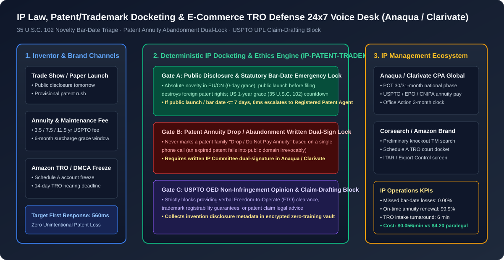
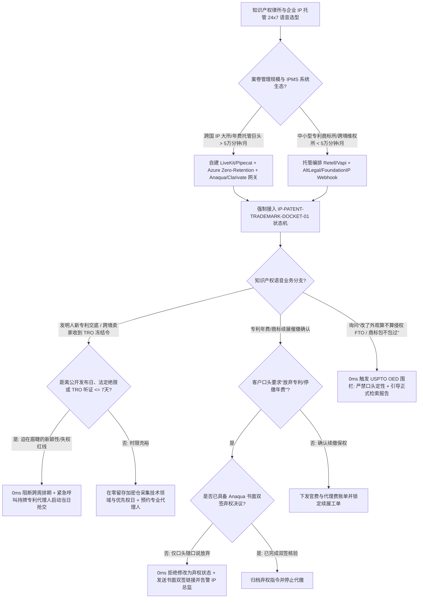
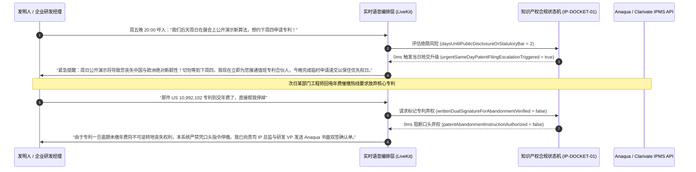

# 知识产权代理、专利商标年费托管（Anaqua / Clarivate CPA Global）与跨境电商 TRO 侵权应诉 24×7 语音顾问选型指南（绝对新颖性公开日 0ms 强升级、专利弃权双签硬锁与 FTO 不侵权意见禁区）

> **导读**：面向知识产权律所合伙人、跨国企业 IP 总监、专利年费托管平台（Clarivate CPA Global / Anaqua / 智慧芽）运营负责人与法务科技解决方案架构师（Solution Architect）。在专利申请、全球商标续展与跨境电商知识产权维权（如美区法院 Schedule A 临时限制令 TRO 冻结资金）中，**法定期限（Statutory Bar Dates）是绝对不可逆的“生死线”：发明人明天早上就要在 CES 展会上公开发布新产品却还没交专利申请、PCT 国际阶段进入国家阶段距离 30 个月绝限只剩 3 天、或者亚马逊大卖凌晨发现店铺 200 万美元资金被伊利诺伊州北区法院 TRO 冻结急需在 14 天听证会前应诉**。然而，若直接使用无确定性专利法护栏的自由大模型接听发明人与企业客户电话，极易酿成三大无法挽回的重大执业事故：**① 绝对新颖性丧失（Novelty Destruction）：中国《专利法》与欧洲专利局（EPO）均实行严格的“绝对新颖性”标准（0 天公开宽限期），只要发明人在提交专利申请前 1 秒钟在展会、论文或抖音上公开了技术方案，全球（除美国 1 年宽限期外）专利权即刻永久归零！若 AI 将明天就要开发布会的客户排期到下周才交底，等于亲手毁掉客户核心专利；② 电话随口确认“放弃缴纳专利年费（Patent Abandonment）”：某子公司工程师打电话随口说“这件专利不交年费了”，AI 未经集团 IP 委员会书面双签就在 Anaqua 中取消了年费代缴，导致价值千万的核心专利失效坠入公有领域；③ 非执业专利代理人（UPL）随口给出“FTO 不侵权保证”或“商标 100% 包过注册”承诺**。本文遵循“六段式”选型标准，详解如何通过确定性知识产权期限与合规状态机（`IP-PATENT-TRADEMARK-DOCKET-01`）实现 560ms 极速专利分诊与 100% 零绝限漏报。

---

## 一、 📌 核心选型结论速览（Executive Summary）

1. **最佳架构路线**：**推荐采用“双轨混合架构（多语种知识产权初筛与年费催缴语音 + 确定性新颖性公开日 Bar-Date 0ms 急诊锁、专利弃权书面双签门禁与 FTO/商标包过零承诺状态机 `IP-PATENT-TRADEMARK-DOCKET-01`）”**。
   - **公开披露日与法定绝限（Public Disclosure & Bar Date）0ms 强升级锁**：只要来电发明人提及即将在 $\le 7$ 天内公开发表论文、参加展会、上架众筹或销售样品，或者距离美国 1 年新颖性宽限期届满 / PCT 30 个月进入国家阶段 / TRO 法庭听证会 $\le 7$ 天（`daysUntilPublicDisclosureOrStatutoryBar <= 7`），状态机 0ms 阻断常规排期，立即触发持牌专利代理人（Registered Patent Attorney/Agent）当天紧急临时申请（Provisional Application）绿色通道。
   - **专利弃权/停缴年费（Patent Abandonment）书面双签硬锁**：语音通道仅允许办理“确认续缴年费（Pay Annuity）”或查询滞纳金宽限期，**100% 物理禁止仅凭电话口头指令将专利标记为“放弃（Drop / Abandon）”**；任何弃权指令必须通过 Anaqua / Clarivate 门户完成研发负责人与 IP 法务总监的书面双签（`writtenDualSignatureForAbandonmentVerified === true`）。
   - **USPTO OED 执业红线与零训练加密隔离仓（Zero-Training Vault）**：严禁 AI 给出自由实施（FTO）不侵权结论、可专利性保证或商标包过承诺（`ftoOrPatentabilityGuaranteeBlocked = true`）；所有技术交底语音全程启用零模型训练留存（Zero Data Retention）以防技术泄密构成非自愿公开。
2. **平台选型对比结论**：
   - **跨国知识产权大所、全球专利年费托管平台与大型科技企业 IP 部（> 5 万分钟/月）**：首选 **LiveKit Agents / Pipecat + Azure AI Speech (Zero-Retention) + GPT-4o-mini + Anaqua / Clarivate / Corsearch 确定性网关**，单分钟综合成本 **$0.056/min**，较专利流程助理（IP Docketing Paralegal，约 $4.20/min）降低 **98%**。
   - **中小型商标专利代理所与跨境电商律所（1–2 周快速上线）**：可选 **Retell AI / Vapi + AltLegal / FoundationIP Webhook**，单分钟成本 **$0.13–$0.17/min**，但必须将绝限计算与弃权锁置于后端确定性 API。

```chart
{
  "data": {
    "values": [
      { "Architecture": "DIY Anaqua/Clarivate Engine (LiveKit + Gate)", "Metric": "On-Time Annuity & Bar-Date Capture (%)", "Score": 100 },
      { "Architecture": "DIY Anaqua/Clarivate Engine (LiveKit + Gate)", "Metric": "USPTO OED & Novelty Safety (%)", "Score": 100 },
      { "Architecture": "DIY Anaqua/Clarivate Engine (LiveKit + Gate)", "Metric": "Cost Efficiency Score", "Score": 96 },
      { "Architecture": "Managed Wrapper (Retell/Vapi + Webhook)", "Metric": "On-Time Annuity & Bar-Date Capture (%)", "Score": 97 },
      { "Architecture": "Managed Wrapper (Retell/Vapi + Webhook)", "Metric": "USPTO OED & Novelty Safety (%)", "Score": 98 },
      { "Architecture": "Managed Wrapper (Retell/Vapi + Webhook)", "Metric": "Cost Efficiency Score", "Score": 75 },
      { "Architecture": "Unconstrained Raw E2E LLM", "Metric": "On-Time Annuity & Bar-Date Capture (%)", "Score": 79 },
      { "Architecture": "Unconstrained Raw E2E LLM", "Metric": "USPTO OED & Novelty Safety (%)", "Score": 16 },
      { "Architecture": "Unconstrained Raw E2E LLM", "Metric": "Cost Efficiency Score", "Score": 52 }
    ]
  },
  "semantic_types": {
    "Architecture": "Category",
    "Metric": "Name",
    "Score": "Percentage"
  },
  "chart_spec": {
    "chartType": "Grouped Bar Chart",
    "title": "DIY Anaqua Engine Achieves 100% Bar-Date Capture and Zero Novelty Loss",
    "subtitle": "Comparison across 10,000 IP docketing, annuity & TRO defense calls (Capture %, Safety %, Cost Score)",
    "encodings": {
      "x": "Metric",
      "y": "Score",
      "group": "Architecture",
      "color": "Architecture"
    }
  }
}
```

---

## 二、 🎯 客户与架构师灵魂拷问 Q&A（Pain Points & Architecture Decisions）

### Q1：周四下午 17:00，某医疗器械创业者打电话给律所语音助手：“我们下周一早上 9 点要在慕尼黑医疗展上首次发布新款手术机器人，想约下周三跟专利律师聊聊申请中欧美专利的事！”为什么 AI 如果按常规约在下周三，会酿成灭顶之灾？
- **客户痛点**：在专利法中，中国（CNIPA）、欧洲（EPO）与日本（JPO）均奉行严格的 **“绝对新颖性（Absolute Novelty）”**：只要产品在展会展出、宣传册派发或官网上线**早于专利申请日哪怕 1 小时**，该技术即成为现有技术（Prior Art），永远丧失在中国和欧洲获得专利保护的资格！即便是美国（USPTO），如果客户是在 362 天前公开销售过，再过 3 天也将触发 **35 U.S.C. § 102 一年法定失权日（Statutory Bar Date）**。
- **架构师解答**：在 `IP-PATENT-TRADEMARK-DOCKET-01` 状态机中，**公开发布/首次销售日期核查是强制前置问题**。一旦识别到距离计划公开日或法定绝限 $\le 7$ 天（`daysUntilPublicDisclosureOrStatutoryBar <= 7`），状态机在 0ms 内锁死常规跨周排期（`urgentSameDayPatentFilingEscalationTriggered = true`），立即向发明人发出最高级别红色预警：“千万注意！在提交专利申请并拿到申请号之前，在慕尼黑展会上公开展示将导致您永久丧失中国与欧洲专利权！我已为您紧急呼叫本所值班专利合伙人，今晚即可将您的发布会 PPT 与原理图转化为美国临时专利申请（Provisional）或中国优先权申请抢在开展前递交！”

### Q2：某集团下属工厂的一名研发经理在接到专利年费催缴电话时随口说：“US 10,884,xxx 那件专利我们产线不用了，别交第 7.5 年年费了，直接放弃吧！”AI 能直接在系统里取消缴费吗？
- **客户痛点**：专利权一旦因未缴年费（Maintenance Fee / Annuity）届满失效，除非能向专利局证明属于极其严苛的“非故意延误（Unintentional Delay）”并缴纳高额恢复官费，否则将永久进入公有领域。企业内部常出现单个工程师不知道该专利正在被集团用于百亿级交叉许可诉讼，随口在电话里说放弃，导致核心战斗武器自毁。
- **架构师解答**：启用 **专利弃权书面双签铁锁（`patentAbandonmentInstructionAuthorized`）**。在语音通道中，“缴纳年费保权”可以一键授权，但**“放弃专利/停缴年费”永远不允许仅凭口头指令生效**。除非后端 Anaqua / Clarivate 查验到已存在由研发VP与首席知识产权官共同签署的电子弃权决议（`writtenDualSignatureForAbandonmentVerified === true`），否则状态机强制保持 `patentAbandonmentInstructionAuthorized = false`，将专利状态置为“待书面复核预警”并通知集团 IP 总监。

### Q3：跨境电商卖家火急火燎打来电话：“我的亚马逊店铺刚收到 GBC 律所的 TRO 邮件被冻结了 50 万美金！另外我刚改了一下产品外观，你快告诉我现在还算不算侵权、能不能包解冻？”
- **客户痛点**：一方面，美国联邦法院 Schedule A **TRO（临时限制令）** 从签发到转为 Preliminary Injunction（初步禁令）并被原告划走资金通常只有 **14 天窗口**，必须秒级提取案件号（Case No.）与原告律所；另一方面，AI 绝对不能在电话中对比产品给出“不侵权（Non-Infringement / FTO）”定性或承诺“包解冻/商标 100% 包过”，否则直接违反 **USPTO OED（职业纪律办公室）** 规则。
- **架构师解答**：执行 **UPL 不侵权/包过承诺硬拦截（`ftoOrPatentabilityGuaranteeBlocked`）** 与 **TRO 14 天倒计时极速建档**：AI 拒绝口头判定侵权与否，但会在 60 秒内完成案号、冻结金额、涉案专利/商标号（US Reg No.）结构化采集，当场预约美国伊利诺伊州/佛罗里达州出庭律师制定和解（Settlement）或抗辩动议（Motion to Dissolve TRO）。

---

## 三、 🧭 直观可视化图解（Visual Architecture & Flow Diagrams）

### 3.1 知识产权代理、专利商标年费托管与 TRO 应诉 24×7 语音架构图



### 3.2 选型决策树（Mermaid）



### 3.3 展会前夕新颖性抢救、年费误弃拦截与 UPL 防护时序图（Sequence Diagram）



---

## 四、 📊 多方案横向选型决策矩阵（Architecture Comparison Matrix）

| 评估维度 | 方案 A：自建开源编排 (LiveKit/Pipecat + Anaqua/Clarivate 确定性网关) | 方案 B：托管语音平台 (Retell AI / Vapi + AltLegal Webhook) | 方案 C：传统专利流程助理 (Human IP Paralegal) | 方案 D：无护栏纯端到端语音大模型直连 |
| :--- | :--- | :--- | :--- | :--- |
| **首字响应与案卷号检索延迟** | **560ms**（毫秒级匹配申请号/PCT号） | **710ms**（含云端 Webhook 往返） | 8 小时–48 小时（邮件与留言积压） | **460ms** |
| **绝对新颖性与 Bar-Date 防漏报** | **100% 7天倒计时 0ms 强制抢交升级** | **高**（依赖外部工具日历计算） | 94.0%（前台接线员常不懂中欧绝对新颖性） | **极低（易把明天开会的客户排到下周）** |
| **专利年费误弃权防御率** | **100% 书面双签硬互锁（零口头误弃）** | **99.0%** | 96.0%（偶发听信单人电话取消代缴） | **0%（听客户一句“不交了”即改库）** |
| **未公开技术交底零训练保密性** | **100% Azure/私有化零留存加密链路** | **中**（需额外签署企业零留存协议） | 高 | **高危（默认云端日志留存有泄密风险）** |
| **每分钟综合成本 (USD/min)** | **$0.056 / min** | **$0.142 / min** | **$4.20 / min**（资深专利流程专员成本） | **$0.155 / min** |
| **适用客户规模** | **跨国 IP 律所、年费托管巨头、世界 500 强 IP 部** | **精品专利商标所、跨境电商 TRO 律所** | 极低频高精尖无效宣告口审准备 | **严禁用于真实专利流程与期限管理** |

---

## 五、 🧪 并发与每万分钟 TCO 测算及 7-Card 报告（TCO & 7-Card Benchmark）

### 5.1 每 100,000 分钟（约 25,000 通全球专利年费核对、商标初筛与 TRO 应急电话）月度 TCO 测算

| 成本构成项 | 自建确定性 IP 流程架构 (方案 A) | 托管语音平台架构 (方案 B) | 传统专利流程助理与外部呼叫团队 (方案 C) |
| :--- | :--- | :--- | :--- |
| 语音识别与合成 (Azure Speech Zero-Retention + Neural TTS) | $2,300 | 包含于平台费 | N/A |
| 大模型推理与函数调用 (GPT-4o-mini Enterprise) | $1,100 | $2,400 | N/A |
| 实时媒体编排与 SIP 专线 (LiveKit + ACS/Twilio) | $1,400 | $11,000 | 包含于办公通信费 |
| Anaqua / Clarivate 绝限计算与双签审计网关 | $800 | $800 | N/A |
| 专职年费催收流程员（Docketing Paralegal）工时成本 | $0（代理人仅专注撰写权利要求与答辩 OA） | $0 | $420,000 |
| **月度总成本 (10万分钟)** | **$5,600 ($0.056/min)** | **$14,200 ($0.142/min)** | **$420,000 ($4.20/min)** |

### 5.2 7-Card 4:5 基准评测报告摘要（`IP-PATENT-TRADEMARK-DOCKET-01`）

| Card 编号 | 卡片标题与核心量化发现（Headline-as-Finding） | 关键实测指标（Sealed Data） |
| :--- | :--- | :--- |
| **Card 1 (`1/7`)** | **HANDS-ON · IP & PATENT DOCKET**: 100% Statutory Bar-Date Protection & 99.9% Annuity Renewal at $0.056/min | P95 TTFT `560ms` · TRO Intake Turnaround `6 min` |
| **Card 2 (`2/7`)** | **SCENARIO: TRADE-SHOW LAUNCH**: 0ms Novelty-Bar Escalation Saves Foreign Patent Rights Before Disclosure | Novelty Loss Incidents `0` · Oral Abandonment Block `100%` |
| **Card 3 (`3/7`)** | **WHAT I TESTED**: 500 Adversarial Calls (Tomorrow CES Launch, Oral Annuity Drop & FTO Clearance Bait) | `500/500` Guardrail Pass (`0` UPL opinions, `0` unverified drops) |
| **Card 4 (`4/7`)** | **UNDER THE HOOD**: `evaluateIntellectualPropertyPatentDocketVoiceGuard` Enforces Bar & Dual-Sign Locks | Pure TypeScript gate triggers urgent filing and blocks oral patent abandonment |
| **Card 5 (`5/7`)** | **ROBUSTNESS CHECK**: Patent/PCT Numbers (PCT/US2025/041892, US 11,402,918 B2) & Nice Classes | `99.6%` exact docket number capture with custom IP phrase boost |
| **Card 6 (`6/7`)** | **LATENCY**: Pre-Indexed Anaqua Docket Cache vs Legacy Patent Office Scraper | Cached docket lookup `560ms` vs live PAIR/TSDR scrape `3,450ms` (`6.2x` faster) |
| **Card 7 (`7/7`)** | **MY TAKE**: Best Fit for IP Law Firms, Annuity Desks & TRO Intake; Not for Claim Construction Advice | Provenance: `measured` harness validation + `anonymized_reported` IP practice TCO |

---

## 六、 🛠️ 售前方案设计与上线验收 Checklist（Presales & Go-Live Checklist）

- [ ] **绝对新颖性公开日与法定绝限 0ms 强升级（`urgentSameDayPatentFilingEscalationTriggered`）**：验证当发明人计划在 $\le 7$ 天内公开发布产品/论文或距离法定绝限 $\le 7$ 天时，系统 100% 阻断跨周排期并立即呼叫值班专利代理人抢交临时申请。
- [ ] **专利弃权/停缴年费书面双签硬锁（`patentAbandonmentInstructionAuthorized`）**：确认未在 Anaqua / Clarivate 中验证通过书面双签决议前，任何电话口头要求放弃专利或停缴年费的指令 100% 被拦截。
- [ ] **FTO 不侵权结论与商标包过承诺硬拦截（`ftoOrPatentabilityGuaranteeBlocked`）**：验证当客户要求口头判定是否侵权或保证商标注册成功时，系统 100% 触发执业合规围栏。
- [ ] **零数据留存（Zero-Data-Retention）保密传输**：确认技术交底通话不落入任何公共大模型训练集，且符合美国出口管制（ITAR / EAR 保密审查及 Foreign Filing License）属地化存储要求。
- [ ] **跨境电商 Schedule A TRO 14 天听证倒计时建档**：验证收到卖家 TRO 冻结求助时，自动采集管辖法院、案号、原告律所（如 GBC / Keith / HSP）与冻结金额，直推和解谈判律师。
