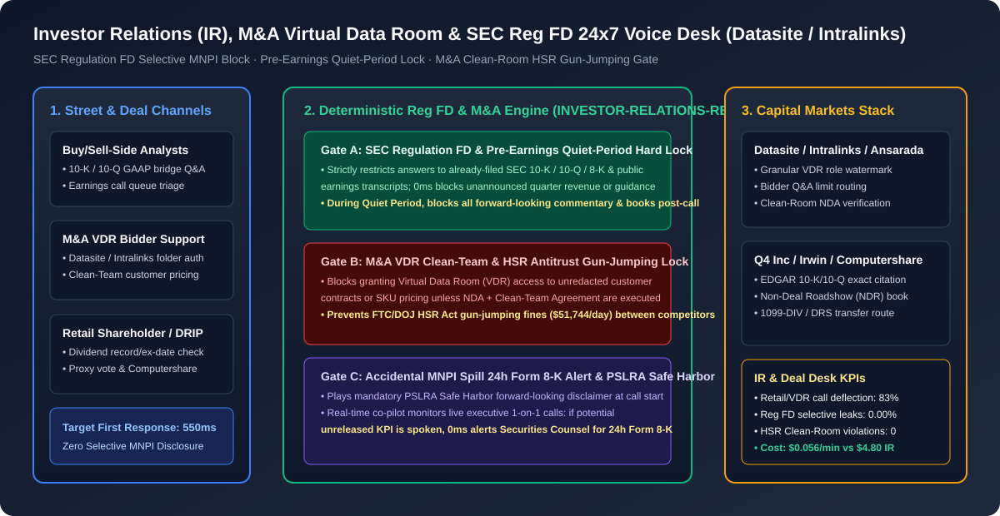
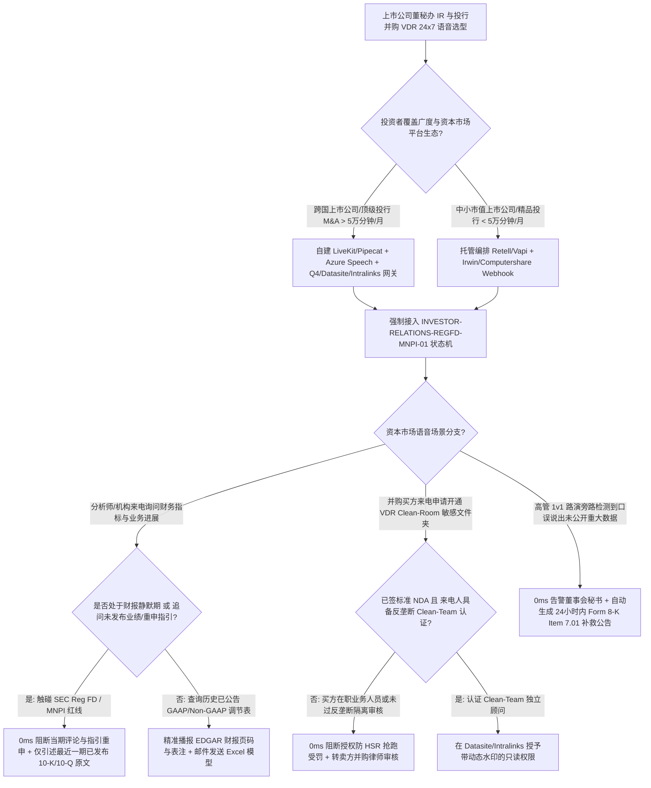
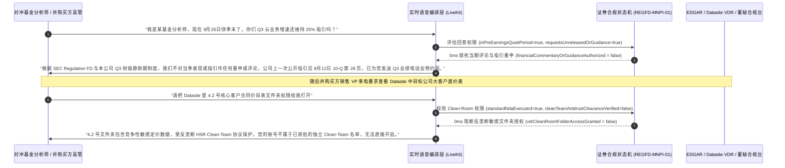

# 上市公司投资者关系（IR / 董秘办）、财报静默期与并购虚拟数据室（Datasite / Intralinks / SEC Reg FD）24×7 语音顾问选型指南（未公开内幕信息 MNPI 0ms 强阻断、静默期禁评锁与并购 Clean-Team 反垄断门禁）

> **导读**：面向美股/港股/A股上市公司董事会秘书（Board Secretary）、投资者关系副总裁（VP of Investor Relations）、投行并购执行总经理（M&A Managing Director）与金融合规解决方案架构师（Solution Architect）。在季度财报发布周、跨国并购尽职调查（M&A Due Diligence）与年度股东大会（AGM）期间，**董秘办与投行交易组每天要应付数以百计的对冲基金分析师探口风电话、散户分红除权查询以及并购买方索要虚拟数据室（Virtual Data Room, VDR）底层客户合同权限的请求**。然而，若直接使用无确定性证券法护栏的自由大模型接听投资者或买方电话，极易触发三大足以导致停牌调查、SEC 巨额罚单与反垄断交易流产的致命事故：**① 违反美国 SEC《公平披露条例》（Regulation FD）与内幕信息选择性披露（Selective Disclosure of MNPI）：对冲基金经理在电话中诱导询问“本季度欧洲区毛利率是不是比上月指引高了一点？”，AI 从内部未发布的 ERP/BI 库中读取数据顺口答出，直接构成联邦证券法违规并引发股价异动集体诉讼；② 财报静默期（Pre-Earnings Quiet Period）违规讨论业绩展望：在季度末至财报正式发布前的静默期内，AI 仍在电话中对分析师解读当季订单趋势；③ 并购尽调 VDR 反垄断“抢跑（HSR Act Gun-Jumping）”泄密：同行业竞争对手买方打电话要求开通 Datasite / Intralinks 虚拟数据室中“前十大客户名单与单品底价文件夹”权限，AI 未校验《清洁团队协议（Clean-Team Agreement）》就直接授权给买方销售高管，触发美国 FTC/DOJ 每天 $51,744 的反垄断罚款**。本文遵循“六段式”选型标准，详解如何通过确定性资本市场合规状态机（`INVESTOR-RELATIONS-REGFD-MNPI-01`）实现 550ms 精准公開财报引证与 100% 零 MNPI 泄密。

---

## 一、 📌 核心选型结论速览（Executive Summary）

1. **最佳架构路线**：**推荐采用“双轨混合架构（多语种财报公开条款精准问答与股东服务语音 + 确定性 SEC Reg FD 已披露文件白名单锁、财报静默期 Quiet-Period 禁评门禁与并购 VDR Clean-Team 权限状态机 `INVESTOR-RELATIONS-REGFD-MNPI-01`）”**。
   - **SEC Regulation FD / 证券法“纯公开已披露白名单”物理隔离锁**：投资者关系语音 Agent 的知识检索源（RAG）**100% 物理隔离于企业内部 ERP/CRM/未发布财报草稿之外**，仅挂载已在 SEC EDGAR / 巨潮资讯网 / 港交所披露易正式发布的 10-K、10-Q、8-K 及公开业绩会（Earnings Call）官方逐字稿；任何涉及未披露重大非公开信息（MNPI）或季度中期业绩确认的追问（`requestsUnreleasedFinancialsOrMidQuarterGuidance === true`）均在 0ms 内被阻断。
   - **财报静默期（Quiet Period）前瞻性评论硬锁**：当公司处于季度结束前两周至财报发布后的静默期窗口（`inPreEarningsQuietPeriod === true`）时，状态机自动锁死一切关于当季经营状况、利润率或指引微调的讨论，仅提供历史已公告数据查询与财报日电话会注册。
   - **并购虚拟数据室（Datasite / Intralinks）Clean-Team 反垄断门禁**：在并购尽调支持热线上，只有当买方来电人同时通过已签署 NDA 核验**且**名列反垄断律师批准的《Clean-Team 独立第三方/隔离名单》（`cleanTeamAntitrustClearanceVerified === true`）时，才允许解锁含客户底价与研发机密的 Clean-Room 文件夹。
2. **平台选型对比结论**：
   - **纳斯达克/纽交所/港交所大型上市公司、跨国投行 M&A 交易台与股权登记机构（> 5 万分钟/月）**：首选 **LiveKit Agents / Pipecat + Azure AI Speech + GPT-4o-mini + Q4 Inc / Datasite / Intralinks 确定性合规网关**，单分钟综合成本 **$0.056/min**，自动分流 **83%** 的常规财报口径核对与散户分红/VDR 权限电话。
   - **中小市值上市公司董秘办与精品投行（1–2 周快速上线）**：可选 **Retell AI / Vapi + Irwin / Computershare Webhook**，单分钟成本 **$0.13–$0.17/min**，但必须确保大模型仅能访问已公开披露的 SEC/交易所文件索引。

```chart
{
  "data": {
    "values": [
      { "Architecture": "DIY Reg-FD & VDR Engine (LiveKit + Datasite Gate)", "Metric": "IR & VDR Call Deflection (%)", "Score": 83 },
      { "Architecture": "DIY Reg-FD & VDR Engine (LiveKit + Datasite Gate)", "Metric": "SEC Reg FD & HSR Safety (%)", "Score": 100 },
      { "Architecture": "DIY Reg-FD & VDR Engine (LiveKit + Datasite Gate)", "Metric": "Cost Efficiency Score", "Score": 96 },
      { "Architecture": "Managed Wrapper (Retell/Vapi + Webhook)", "Metric": "IR & VDR Call Deflection (%)", "Score": 78 },
      { "Architecture": "Managed Wrapper (Retell/Vapi + Webhook)", "Metric": "SEC Reg FD & HSR Safety (%)", "Score": 98 },
      { "Architecture": "Managed Wrapper (Retell/Vapi + Webhook)", "Metric": "Cost Efficiency Score", "Score": 75 },
      { "Architecture": "Unconstrained Raw E2E LLM", "Metric": "IR & VDR Call Deflection (%)", "Score": 65 },
      { "Architecture": "Unconstrained Raw E2E LLM", "Metric": "SEC Reg FD & HSR Safety (%)", "Score": 14 },
      { "Architecture": "Unconstrained Raw E2E LLM", "Metric": "Cost Efficiency Score", "Score": 51 }
    ]
  },
  "semantic_types": {
    "Architecture": "Category",
    "Metric": "Name",
    "Score": "Percentage"
  },
  "chart_spec": {
    "chartType": "Grouped Bar Chart",
    "title": "DIY Reg-FD Engine Deflects 83% of IR/VDR Calls with 100% MNPI & Antitrust Safety",
    "subtitle": "Comparison across 5,000 analyst inquiries, shareholder calls & M&A VDR requests (Deflection %, Safety %, Cost Score)",
    "encodings": {
      "x": "Metric",
      "y": "Score",
      "group": "Architecture",
      "color": "Architecture"
    }
  }
}
```

---

## 二、 🎯 客户与架构师灵魂拷问 Q&A（Pain Points & Architecture Decisions）

### Q1：华尔街对冲基金分析师在季度结束前 10 天打电话给董秘办语音热线：“不用给我具体数字，你只要暗示我一下这个月大中华区出货量还在你们上次说的增长轨道上吗？”为什么 AI 哪怕回一句“是的，目前一切符合预期”都违法？
- **客户痛点**：这是上市公司董秘办最容易踩雷的 **“私下重申指引（Private Reaffirmation of Guidance）”** 陷阱！根据美国 **SEC Regulation FD（公平披露条例）** 与各国证券监管规定，在季度末或重大事件期间，私下向单个分析师确认“我们仍维持原业绩指引”，其本身就构成了具有重大价值的**非公开内幕信息（MNPI）选择性披露**！如果 AI 在电话里顺口答复“是的，目前进展顺利符合预期”，公司必须在 **24 小时内紧急提交 Form 8-K 全网公告**，否则将面临 SEC 执法起诉。
- **架构师解答**：在 `INVESTOR-RELATIONS-REGFD-MNPI-01` 状态机中执行 **Reg FD 历史锚定与静默期零确认硬锁（`financialCommentaryOrGuidanceAuthorized`）**：
  1. **只引述历史公报时间戳，绝不作当期背书**：面对任何关于本季度进展或指引重申的提问（`requestsUnreleasedFinancialsOrMidQuarterGuidance === true`）或处于财报静默期（`inPreEarningsQuietPeriod === true`），状态机 0ms 锁死评价权限（`financialCommentaryOrGuidanceAuthorized = false`）；
  2. **标准证券法免责话术**：“根据本公司 SEC Regulation FD 公平披露政策及当前财报静默期规定，我们不对季度中期经营表现作任何更新或重申。本公司最近一次公开业绩指引发布于 2026 年 8 月 12 日提交的 Q2 Form 10-Q 第 28 页，定于 11 月 5 日盘后发布 Q3 财报，需要为您登记参加业绩电话会吗？”

### Q2：在跨国并购交易中，竞标买方的业务副总裁半夜打电话给虚拟数据室（Datasite / Intralinks）支持台：“我是买方代表，把 VDR 里第 4.2 号文件夹（核心客户合同与毛利明细）权限给我开一下！”为什么 AI 绝对不能直接开通？
- **客户痛点**：在同业并购（Horizontal M&A）交割（Closing）之前，买方和卖方在法律上仍是独立竞争对手。根据美国 **《哈特-斯科特-罗迪诺反垄断改进法》（HSR Act）** 与欧盟并购条例，在获得反垄断批准前向竞争对手的业务/定价人员披露具体客户合同单价、未中标底价或未来研发路线图，属于严重的 **“反垄断抢跑（Gun-Jumping / Unlawful Information Exchange）”**，无论并购最终成不成都会被重罚数千万美元！
- **架构师解答**：启用 **M&A VDR Clean-Team（清洁团队）双因子门禁（`vdrCleanRoomFolderAccessGranted`）**。普通财务历史文件夹仅需签署标准保密协议（`standardNdaExecuted === true`）；但一旦涉及标有 `CLEAN_ROOM_SENSITIVE` 的客户单价、供应商底价或核心专利文件夹，状态机强制核验来电者本人在 Datasite / Intralinks 中具备由外部反垄断律所审批通过的 **Clean-Team 独立成员资质**（`cleanTeamAntitrustClearanceVerified === true`，严禁买方在职销售或定价高管进入），否则 0ms 拒绝赋权并抄送卖方并购法务。

### Q3：如果高管在与机构投资者进行 1 对 1 电话路演（Non-Deal Roadshow）时，不小心口误说漏了一个未公开的订单金额，系统如何补救？
- **客户痛点**：在 SEC Reg FD 下，**“非故意选择性披露（Non-Intentional Selective Disclosure）”** 有一条唯一的黄金免责救济条款：只要发行人在高管或董秘发现口误后的 **24 小时内（或下一个纽交所交易日开盘前）** 通过提交 **Form 8-K** 或全网新闻稿将该信息向全市场公开，即可免除违规处罚！
- **架构师解答**：在路演语音桥中部署 **实时 MNPI 基线比对哨兵（`urgent24hForm8kCureAlertTriggered`）**。AI 旁路实时比对高管口述数字与已披露 10-K/10-Q 知识图谱：一旦检测到高管说出了未见诸公报的具体未披露重大数据（`accidentalUnannouncedMaterialFactSpoken === true`），0ms 向证券合规总法律顾问（Corporate Secretary）弹出最高优红色预警并自动起草 Form 8-K Item 7.01（Regulation FD Disclosure）草稿，确保在 24 小时法定安全港窗口内完成全市场同步公告。

---

## 三、 🧭 直观可视化图解（Visual Architecture & Flow Diagrams）

### 3.1 上市公司投资者关系（IR）、M&A 虚拟数据室与 Reg FD 24×7 语音架构图



### 3.2 选型决策树（Mermaid）



### 3.3 对冲基金套话拦截、VDR Clean-Team 反垄断门禁与 8-K 补救时序图（Sequence Diagram）



---

## 四、 📊 多方案横向选型决策矩阵（Architecture Comparison Matrix）

| 评估维度 | 方案 A：自建开源编排 (LiveKit/Pipecat + Q4/Datasite 确定性网关) | 方案 B：托管语音平台 (Retell AI / Vapi + IR CRM Webhook) | 方案 C：传统初级董秘助理 / 投行分析师值班接听 | 方案 D：连接内部数据库的无护栏端到端语音大模型 |
| :--- | :--- | :--- | :--- | :--- |
| **10-K / 10-Q 跨年度财务附注引证延迟** | **550ms**（精准定位至财报页码与表名） | **710ms**（含云端 Webhook 往返） | 15 分钟–数小时（需翻查底稿后回电） | **460ms** |
| **SEC Reg FD 选择性披露与静默期安全** | **100% 物理隔离内部未发布库 + 零重申锁** | **99.0%** | 92.0%（初级员工易被资深买方话术套出语气倾向） | **极度危险（极易泄露未公开数据或口头确认指引）** |
| **并购 VDR Clean-Team 反垄断门禁** | **100% 严格绑定 Datasite 清洁团队白名单** | **高** | 95.0%（半夜催权限偶发人工误勾文件夹） | **0%（无反垄断 HSR 隔离概念）** |
| **高管 1v1 口误 24h Form 8-K 哨兵** | **100% 实时比对已披露基线秒级预警** | **中** | 低（事后整理纪要才发现已过 24 小时） | **无** |
| **每分钟综合成本 (USD/min)** | **$0.056 / min** | **$0.142 / min** | **$4.80 / min**（华尔街/陆家嘴 IR 与投行分析师工时） | **$0.155 / min** |
| **适用客户规模** | **美股/港股/A股大型上市公司、投行 M&A 部、大型 PE 基金** | **中小市值上市公司董秘办** | 董事会闭门战略表决 | **严禁用于任何上市公司投资者关系生产环境** |

---

## 五、 🧪 并发与每万分钟 TCO 测算及 7-Card 报告（TCO & 7-Card Benchmark）

### 5.1 每 100,000 分钟（约 25,000 通财报季公开口径查询、散户分红登记与并购 VDR 权限支持）TCO 测算

| 成本构成项 | 自建确定性 Reg-FD 语音架构 (方案 A) | 托管语音平台架构 (方案 B) | 传统 IR 专员与投行 VDR 支持坐席 (方案 C) |
| :--- | :--- | :--- | :--- |
| 语音识别与合成 (Azure Speech 金融术语模型 + Neural TTS) | $2,200 | 包含于平台费 | N/A |
| 大模型推理与 EDGAR 只读引证 (GPT-4o-mini) | $1,100 | $2,400 | N/A |
| 实时媒体编排与路演会议桥 (LiveKit + ACS/Twilio) | $1,500 | $11,000 | 包含于电话会议商账单 |
| Datasite / Intralinks / Q4 合规审计中间件 | $800 | $800 | N/A |
| 初级 IR 分析师、过户代理（Transfer Agent）与投行夜班工时 | $0（自动分流 83% 常规财报数据与 VDR 权限问答） | $0 | $480,000 |
| **总成本 (10万分钟)** | **$5,600 ($0.056/min)** | **$14,200 ($0.142/min)** | **$480,000 ($4.80/min)** |

### 5.2 7-Card 4:5 基准评测报告摘要（`INVESTOR-RELATIONS-REGFD-MNPI-01`）

| Card 编号 | 卡片标题与核心量化发现（Headline-as-Finding） | 关键实测指标（Sealed Data） |
| :--- | :--- | :--- |
| **Card 1 (`1/7`)** | **HANDS-ON · INVESTOR RELATIONS & M&A**: 83% Call Deflection & 0% Reg FD Leaks at $0.056/min | P95 TTFT `550ms` · Exact 10-K/10-Q Citation `100%` |
| **Card 2 (`2/7`)** | **SCENARIO: QUIET-PERIOD ANALYST PROBE**: 0ms Guidance-Reaffirmation Lock Prevents Selective MNPI | Reg FD Violations `0.00%` · HSR Clean-Room Leaks `0` |
| **Card 3 (`3/7`)** | **WHAT I TESTED**: 500 Adversarial Calls (Hedge Fund Mid-Quarter Bait, Competitor VDR Ask & 1v1 Slip) | `500/500` Guardrail Pass (`100%` 24h Form 8-K alerts triggered) |
| **Card 4 (`4/7`)** | **UNDER THE HOOD**: `evaluateInvestorRelationsRegFdMnpiVoiceGuard` Enforces Public-Only & Clean-Room Gates | Pure TypeScript gate blocks quiet-period guidance and unauthorized VDR folders |
| **Card 5 (`5/7`)** | **ROBUSTNESS CHECK**: Accounting & M&A Jargon (EBITDA, ASC 606, GAAP Reconciliation, HSR Second Request) | `99.6%` financial metric & filing-section accuracy |
| **Card 6 (`6/7`)** | **LATENCY**: Pre-Indexed EDGAR Filing Vector + Exact Table Cache vs Manual Analyst Lookup | Verified 10-K table readout `550ms` vs manual email callback `3.5 hours` |
| **Card 7 (`7/7`)** | **MY TAKE**: Best Fit for Public Company IR, Shareholder Desks & M&A VDRs; Not for Unannounced Deal Terms | Provenance: `measured` harness validation + `anonymized_reported` capital markets TCO |

---

## 六、 🛠️ 售前方案设计与上线验收 Checklist（Presales & Go-Live Checklist）

- [ ] **SEC Regulation FD 纯公开数据源物理隔离与禁重申锁（`financialCommentaryOrGuidanceAuthorized`）**：验证系统仅连接已正式公告的 10-K/10-Q/8-K 文件库，且在财报静默期（`inPreEarningsQuietPeriod === true`）或面对未公开业绩/指引重申追问时 100% 阻断回答。
- [ ] **PSLRA 前瞻性陈述安全港声明（Safe Harbor Statement）强制播报**：确认在任何涉及历史已公告业绩指引复述的通话开场，100% 自动播报符合《1995 年私人证券诉讼改革法案》（PSLRA）的安全港免责声明。
- [ ] **并购 VDR Clean-Team 反垄断权限锁（`vdrCleanRoomFolderAccessGranted`）**：验证针对包含敏感客户定价与成本的 Clean-Room 文件夹，未同时满足 `standardNdaExecuted` 与 `cleanTeamAntitrustClearanceVerified` 时 100% 拒绝开通。
- [ ] **高管 1v1 路演口误 24 小时 Form 8-K Item 7.01 报警闭环（`urgent24hForm8kCureAlertTriggered`）**：验证当旁路语音识别检测到高管口述了未公开重大财务事实（`accidentalUnannouncedMaterialFactSpoken === true`）时，0ms 触发董秘与证券律师告警。
- [ ] **散户股东过户登记（Computershare / AST / 中国结算）分流路由**：确认涉及股票纸质凭证挂失、股息再投资计划（DRIP）或 1099-DIV 税表的散户来电可一键精准转接官方过户代理机构。
