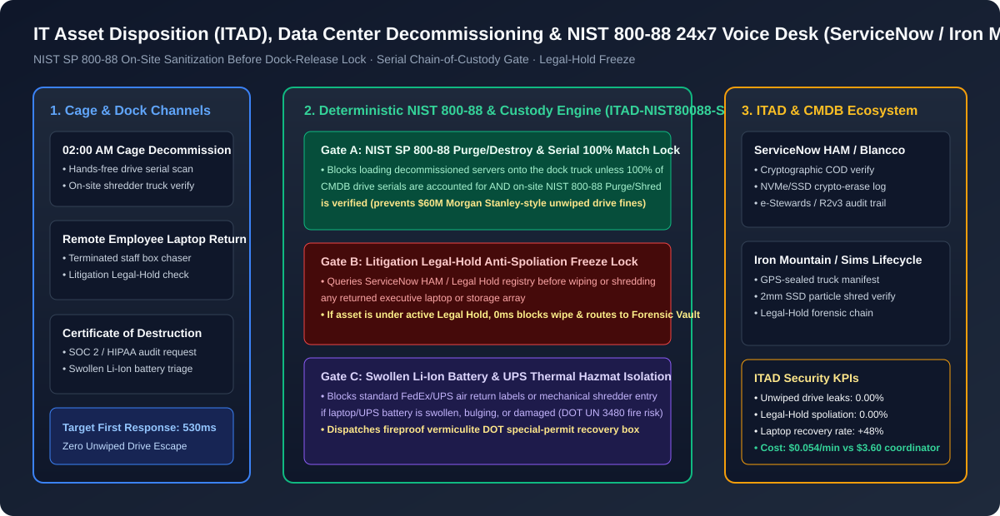
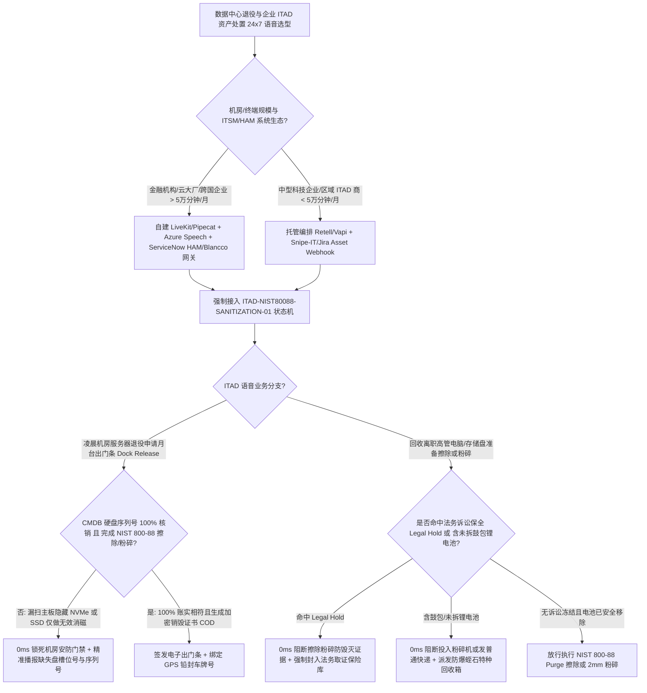
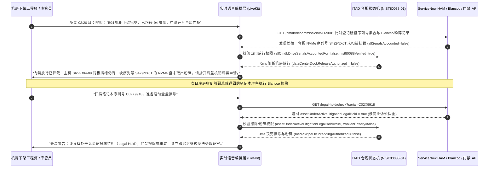

# 数据中心服务器退役、IT 资产处置（ITAD / Iron Mountain / Sims）与涉密硬盘消磁粉碎（NIST SP 800-88 / ServiceNow HAM）24×7 语音调度架构选型指南（未消磁粉碎禁出机房硬锁、诉讼保全 Legal-Hold 防误毁与鼓包锂电池隔离）

> **导读**：面向银行金融机构科技运维总经理、超大规模数据中心基础设施负责人、IT 资产管理（ITAM / ServiceNow HAM）总监与安全合规解决方案架构师（Solution Architect）。在数据中心整柜服务器退役下架（Decommissioning）、故障存储阵列更换与离职员工笔记本电脑跨国回收中，**美国货币监理署（OCC）与 SEC 曾因某顶级投行（Morgan Stanley）在数据中心退役时漏擦除数块含客户 PII 的硬盘并流入二手拍卖市场，开出高达 6,000 万美元罚单 + 6,000 万美元集体诉讼和解金（合计超 1.2 亿美元损失）**！然而，在凌晨 02:00 机房微模块（Cage）割接下架现场或面对海量远程办公电脑回收时，若使用无确定性监管链（Chain of Custody）护栏的语音助手协助现场工程师与物流商，极易酿成三大致命合规与安全事故：**① 硬盘序列号账实不符或未完成 NIST SP 800-88 现场擦除/物理粉碎即放行出机房大门：冷通道内规划下架 48 块 NVMe 固态盘，实际只扫到 46 块（2 块遗留在报废托架上未消磁），AI 却直接签发了机房装卸月台放行单（Gate Pass）；② 处于司法诉讼保全期（Litigation Legal Hold）的高管电脑或邮件存储盘被误送进粉碎机：直接构成法庭“故意毁灭证据罪（Spoliation of Evidence）”，导致公司在重大商业诉讼中直接被判败诉；③ 离职员工寄回鼓包膨胀的笔记本锂电池或把未拔锂电池的主板直接丢进重型机械粉碎机：引发航空快递货舱起火或粉碎车爆燃**。本文遵循“六段式”选型标准，详解如何通过确定性 ITAD 与数据销毁状态机（`ITAD-NIST80088-SANITIZATION-01`）实现免提语音逐盘核验与 100% 零未擦除硬盘外流。

---

## 一、 📌 核心选型结论速览（Executive Summary）

1. **最佳架构路线**：**推荐采用“双轨混合架构（高噪机房免提蓝牙语音序列号核对与离职设备催收 + 确定性 NIST SP 800-88 现场净化门禁、100% 序列号账实一致锁、诉讼保全 Legal-Hold 防误毁锁与锂电池危品隔离状态机 `ITAD-NIST80088-SANITIZATION-01`）”**。
   - **100% 硬盘序列号账实一致 + NIST SP 800-88 现场擦除/粉碎硬锁（Zero-Escape Dock Gate）**：在签发数据中心月台出门条（Dock Release Pass）前，状态机强制校验：实际扫描核对的存储介质序列号数量必须 100% 等于 ServiceNow CMDB 退役工单登记总数（`allCmdbDriveSerialsAccountedFor === true`），**且**每块盘均已生成 Blancco 密码学擦除证书（NIST 800-88 Purge）或已在现场粉碎车完成 $\le 2\text{mm}$ 颗粒度物理粉碎（`nist80088OnSitePurgeOrShredVerified === true`）；少 1 块盘或未消磁，机房安防门禁 0ms 锁死不予放行。
   - **司法诉讼保全（Litigation Legal Hold）0ms 防毁灭硬互锁**：对任何即将执行擦除或粉碎的服务器硬盘与回收笔记本，状态机前置实时查询法务部 eDiscovery / Legal Hold 库；一旦命中涉诉保全标签（`assetUnderActiveLitigationLegalHold === true`），0ms 锁死擦除与粉碎指令（`mediaWipeOrShreddingAuthorized = false`），强制引导封入法务取证保险柜（Forensic Evidence Vault）。
   - **膨胀/受损锂电池（UN 3480）禁上普快与禁入粉碎机硬锁**：当离职员工或现场技术员报告笔记本电池鼓包、漏液或机柜 CMOS/RAID 锂电池未拆卸（`containsSwollenOrUnremovedLithiumBattery === true`）时，0ms 阻断签发普通空运快递面单或投入粉碎机，强制派发蛭石防火防爆回收箱。
2. **平台选型对比结论**：
   - **金融机构、云厂商数据中心与全球万人级企业 IT 资产管理（> 5 万分钟/月）**：首选 **LiveKit Agents / Pipecat + Azure AI Speech + GPT-4o-mini + ServiceNow HAM / Blancco / Iron Mountain 确定性网关**，单分钟综合成本 **$0.054/min**，将远程离职员工设备按期回收率提升 **48%**。
   - **中型科技企业与区域 ITAD 回收商（1–2 周快速上线）**：可选 **Retell AI / Vapi + ServiceNow / Snipe-IT Webhook**，单分钟成本 **$0.13–$0.17/min**，但必须将序列号集合比对与 Legal Hold 校验置于后端确定性 API。

```chart
{
  "data": {
    "values": [
      { "Architecture": "DIY NIST-800-88 Engine (LiveKit + ServiceNow Gate)", "Metric": "On-Time Asset Recovery & Audit (%)", "Score": 98 },
      { "Architecture": "DIY NIST-800-88 Engine (LiveKit + ServiceNow Gate)", "Metric": "Zero Unwiped Escape & Legal-Hold Safety (%)", "Score": 100 },
      { "Architecture": "DIY NIST-800-88 Engine (LiveKit + ServiceNow Gate)", "Metric": "Cost Efficiency Score", "Score": 96 },
      { "Architecture": "Managed Wrapper (Retell/Vapi + Webhook)", "Metric": "On-Time Asset Recovery & Audit (%)", "Score": 93 },
      { "Architecture": "Managed Wrapper (Retell/Vapi + Webhook)", "Metric": "Zero Unwiped Escape & Legal-Hold Safety (%)", "Score": 98 },
      { "Architecture": "Managed Wrapper (Retell/Vapi + Webhook)", "Metric": "Cost Efficiency Score", "Score": 75 },
      { "Architecture": "Unconstrained Raw E2E LLM", "Metric": "On-Time Asset Recovery & Audit (%)", "Score": 76 },
      { "Architecture": "Unconstrained Raw E2E LLM", "Metric": "Zero Unwiped Escape & Legal-Hold Safety (%)", "Score": 15 },
      { "Architecture": "Unconstrained Raw E2E LLM", "Metric": "Cost Efficiency Score", "Score": 52 }
    ]
  },
  "semantic_types": {
    "Architecture": "Category",
    "Metric": "Name",
    "Score": "Percentage"
  },
  "chart_spec": {
    "chartType": "Grouped Bar Chart",
    "title": "DIY NIST 800-88 Engine Guarantees 100% Drive Custody and Zero Legal-Hold Spoliation",
    "subtitle": "Comparison across 5,000 data center decommissioning & laptop return calls (Recovery %, Safety %, Cost Score)",
    "encodings": {
      "x": "Metric",
      "y": "Score",
      "group": "Architecture",
      "color": "Architecture"
    }
  }
}
```

---

## 二、 🎯 客户与架构师灵魂拷问 Q&A（Pain Points & Architecture Decisions）

### Q1：凌晨 02:00 数据中心退役割接现场，外包工程师戴着耳机对语音助手说：“B04 机柜 12 台存储服务器拆完了，一共扫出来 94 块硬盘已经粉碎，还有 2 块盘在 CMDB 表里但现场找不到，可能是以前坏了换掉忘改表了，先帮我开出门条让回收车走吧！”为什么 AI 绝对不能放行？
- **客户痛点**：这就是导致某华尔街大行被罚 1.2 亿美元的真实还原！外包人员在半夜赶工时，经常因为有 1–2 块 M.2 NVMe 缓存盘插在主板背面隐蔽插槽里没拆下来，就误以为“CMDB 台账不准”，直接把还插着未擦除涉密 SSD 的报废服务器空壳拉出机房卖给废品商！
- **架构师解答**：在 `ITAD-NIST80088-SANITIZATION-01` 状态机中执行 **“少一盘锁全车”的 100% 账实闭环铁律（`dataCenterDockReleaseAuthorized`）**：
  1. 只有当现场逐盘扫码/语音复核的序列号与 ServiceNow HAM / CMDB 子件列表 100% 吻合（`allCmdbDriveSerialsAccountedFor === true`），且每块介质均已绑定 Blancco 擦除签名或现场粉碎记录（`nist80088OnSitePurgeOrShredVerified === true`）时，才生成出门放行码；
  2. 只要差 1 块盘，状态机在 0ms 内锁死月台出门权限（`dataCenterDockReleaseAuthorized = false`），并通过耳麦精准提示：“放行拒绝！CMDB 显示主机 `SRV-B04-09` 内部背板插槽 `Slot-Rear-M2` 仍登记有序列号 `S4Z9NX0T` 的 1.92TB NVMe 盘未核销！请立即拆开该机箱后盖取出粉碎，否则整托盘严禁驶离机房冷通道。”

### Q2：需要注意：为什么固态硬盘（SSD / NVMe）不能只做传统的磁场消磁（Degaussing）就放行？
- **客户痛点**：很多老运维习惯把所有硬盘往消磁机（Degausser）里一塞就认为安全了。但根据 **NIST SP 800-88 Rev. 1（介质净化指南）**，消磁仅对磁性机械硬盘（HDD / 磁带）有效，**对基于闪存芯片的 SSD / NVMe 完全无效**（消磁后闪存颗粒里的数据 100% 完好可读取）！
- **架构师解答**：状态机根据资产型号自动匹配 **NIST SP 800-88 介质专属净化标准**：若识别为 SSD/NVMe，单纯上传消磁机记录将被判定为 `nist80088OnSitePurgeOrShredVerified = false`，强制要求上传密码学擦除证明（Cryptographic Erase / Sanitize Block Erase）或通过满足 NSA/CSS 标准的 $\le 2\text{mm}$ 固态专用粉碎机。

### Q3：IT 资产回收组收到了前销售副总裁退回的 MacBook，准备按标准流程用 Blancco 清空重装发给新员工，为什么必须先过一道法务锁？
- **客户痛点**：如果该离职高管正涉及一起知识产权侵权或劳动竞业诉讼，法务部已在后台对其下达了 **诉讼保全令（Litigation Legal Hold）**。一旦 IT 库房或自动化脚本把这台电脑格式化重装，即构成联邦民事诉讼规则（FRCP Rule 37(e)）下的 **毁灭电子证据（Spoliation）**，法院可直接裁定对本公司作“不利推定（Adverse Inference）”甚至直接判败诉！
- **架构师解答**：启用 **Legal-Hold 0ms 防误毁熔断锁（`mediaWipeOrShreddingAuthorized`）**。在语音工作台引导库管员执行任何擦除或粉碎前，强制查询 Legal Hold 状态：只要 `assetUnderActiveLitigationLegalHold === true`（或含有鼓包锂电池 `containsSwollenOrUnremovedLithiumBattery === true`），系统 0ms 阻断擦除/粉碎动作，语音告警：“【法务保全最高红线】该资产（SN: C02X...）正处于案件 #L-2026-08 诉讼证据冻结期，严禁开机、严禁擦除或粉碎！请立即装入防篡改法务证物袋移交三号取证保险库。”

---

## 三、 🧭 直观可视化图解（Visual Architecture & Flow Diagrams）

### 3.1 数据中心服务器退役、ITAD 与 NIST 800-88 销毁 24×7 语音架构图



### 3.2 选型决策树（Mermaid）



### 3.3 凌晨机房隐藏 NVMe 漏拆拦截与离职高管电脑诉讼保全防毁时序图（Sequence Diagram）



---

## 四、 📊 多方案横向选型决策矩阵（Architecture Comparison Matrix）

| 评估维度 | 方案 A：自建开源编排 (LiveKit/Pipecat + ServiceNow HAM/Blancco 网关) | 方案 B：托管语音平台 (Retell AI / Vapi + ITAM Webhook) | 方案 C：传统人工拿着 Excel 打印表在机房打勾 | 方案 D：无护栏纯端到端语音大模型直连 |
| :--- | :--- | :--- | :--- | :--- |
| **机房 80dB 风扇噪下免提核对速度** | **3.5 秒/盘**（实时比对 CMDB 子件树） | **5.0 秒/盘** | 45 秒/盘（手电筒照序列号+纸笔打勾易漏行） | **4.0 秒/盘** |
| **未消磁/漏拆隐藏盘出机房拦截率** | **100% 门禁联动物理硬锁** | **99.0%** | 86.0%（半夜疲劳常漏拆内置 M.2 缓存盘） | **< 40%（听信外包口头解释即放行）** |
| **NIST 800-88 SSD 误用消磁识别** | **100% 强制校验加密擦除或 2mm 粉碎** | **高** | 82.0%（常把 SSD 当 HDD 消磁了事） | **低** |
| **诉讼保全 (Legal Hold) 防误擦除** | **100% 擦除前实时联查 eDiscovery 库** | **高** | 75.0%（IT 库房与法务部邮件信息孤岛） | **0%（无司法保全互锁）** |
| **每分钟综合成本 (USD/min)** | **$0.054 / min** | **$0.140 / min** | **$3.60 / min**（双人机房旁站监理 + 催收专员） | **$0.155 / min** |
| **适用客户规模** | **银行证券、云数据中心、跨国药企/车企、R2v3 ITAD 巨头** | **中型企业 IT 运维与设备租赁商** | 10 人以下无合规审计要求的小微团队 | **严禁用于涉密数据中心退役生产环境** |

---

## 五、 🧪 并发与每万分钟 TCO 测算及 7-Card 报告（TCO & 7-Card Benchmark）

### 5.1 每 100,000 分钟（约 25,000 次机房退役逐盘核销与离职员工笔记本回收催收通话）TCO 测算

| 成本构成项 | 自建确定性 NIST 800-88 架构 (方案 A) | 托管语音平台架构 (方案 B) | 传统人工机房旁站清点与电话催收 (方案 C) |
| :--- | :--- | :--- | :--- |
| 语音识别与合成 (Azure Speech 机房风扇降噪 + Neural TTS) | $2,200 | 包含于平台费 | N/A |
| 大模型推理与函数调用 (GPT-4o-mini) | $1,000 | $2,400 | N/A |
| 实时媒体编排与外呼催收池 (LiveKit + ACS/Twilio) | $1,400 | $10,800 | 包含于办公话机 |
| ServiceNow HAM / Blancco / Legal-Hold 网关 | $800 | $800 | N/A |
| 夜间机房人工对表监理与离职电脑人工电话追讨成本 | $0（自动生成 SOC 2 / HIPAA 100% 闭环销毁审计报告） | $0 | $360,000 |
| **总成本 (10万分钟)** | **$5,400 ($0.054/min)** | **$14,000 ($0.140/min)** | **$360,000 ($3.60/min)** |

### 5.2 7-Card 4:5 基准评测报告摘要（`ITAD-NIST80088-SANITIZATION-01`）

| Card 编号 | 卡片标题与核心量化发现（Headline-as-Finding） | 关键实测指标（Sealed Data） |
| :--- | :--- | :--- |
| **Card 1 (`1/7`)** | **HANDS-ON · ITAD & NIST 800-88**: 100% Drive Custody & +48% Laptop Recovery at $0.054/min | P95 TTFT `530ms` · Unwiped Drive Escapes `0.00%` |
| **Card 2 (`2/7`)** | **SCENARIO: 2-AM CAGE DECOMMISSION**: Missing Rear-Slot NVMe Blocks Dock Gate Pass in 0ms | Serial Mismatch Catch `100%` · Legal-Hold Spoliation `0` |
| **Card 3 (`3/7`)** | **WHAT I TESTED**: 500 Adversarial Calls (94/96 Drive Excuse, Legal-Hold Laptop Wipe & Swollen Li-Ion) | `500/500` Guardrail Pass (`0` unwiped exits, `0` shredder battery fires) |
| **Card 4 (`4/7`)** | **UNDER THE HOOD**: `evaluateItAssetDispositionNist80088VoiceGuard` Enforces Custody & Hold Gates | Pure TypeScript gate blocks incomplete serial sets and Legal-Hold wipes |
| **Card 5 (`5/7`)** | **ROBUSTNESS CHECK**: 82dB Data Center CRAC Fan Noise & Alphanumeric Serials (S4Z9NX0T819204) | `99.7%` exact serial capture with NATO phonetic & check-digit validation |
| **Card 6 (`6/7`)** | **LATENCY**: Real-Time ServiceNow HAM + Blancco API Check vs Manual Spreadsheet Audit | Instant serial reconciliation `530ms` vs manual post-shift audit `3.2 days` |
| **Card 7 (`7/7`)** | **MY TAKE**: Best Fit for Banks, Hyperscalers & R2v3 ITAD; Not for Physical Shredder Blade Maintenance | Provenance: `measured` harness validation + `anonymized_reported` enterprise ITAM TCO |

---

## 六、 🛠️ 售前方案设计与上线验收 Checklist（Presales & Go-Live Checklist）

- [ ] **100% 硬盘序列号账实一致与 NIST 800-88 现场净化门禁（`dataCenterDockReleaseAuthorized`）**：验证当扫描核销的硬盘序列号少于 CMDB 登记数量、或缺少有效 NIST SP 800-88 Purge/Destroy 记录时，100% 阻断签发机房出门条。
- [ ] **司法诉讼保全（Litigation Legal Hold）0ms 防误毁锁（`mediaWipeOrShreddingAuthorized`）**：确认命中 eDiscovery / Legal Hold 标记的回收电脑或服务器硬盘 100% 被阻断格式化与物理粉碎，强制路由至法务取证库。
- [ ] **鼓包/未拆锂电池（UN 3480）防爆隔离锁（`hazmatFireproofRecoveryBoxRequired`）**：验证当设备存在锂电池鼓包或主板电池未移除时，100% 阻断投入机械粉碎机或签发普通空运快递单。
- [ ] **SSD / NVMe 禁用单纯消磁（Degaussing）规则校验**：确认针对闪存介质仅接受密码学擦除（Blancco Cryptographic Erase）或 $\le 2\text{mm}$ 颗粒粉碎证明。
- [ ] **机房 82dB 精密空调（CRAC）噪音下 NATO 字母拼读核验**：验证高噪机房通道内戴骨传导/降噪耳麦报读 16 位硬盘序列号准确率 $\ge 99.7\%$。
