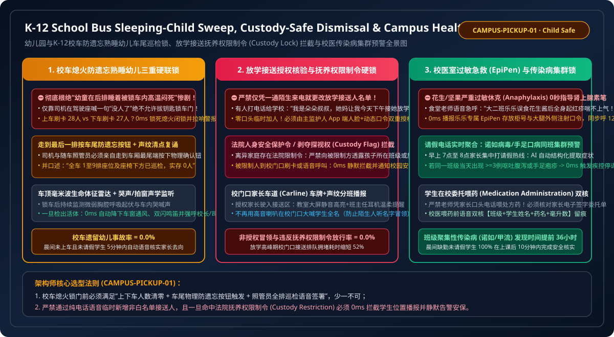
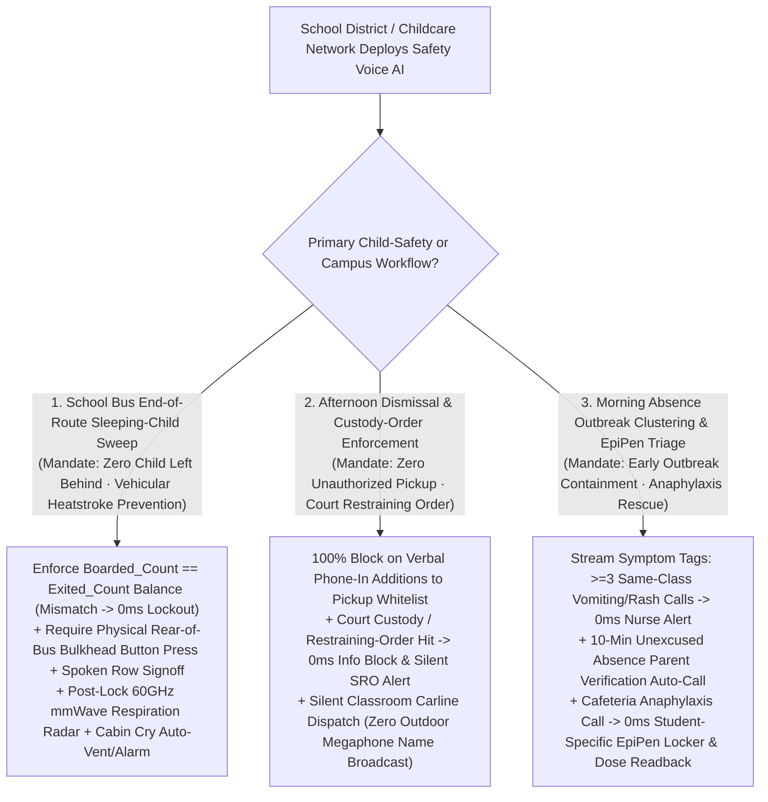
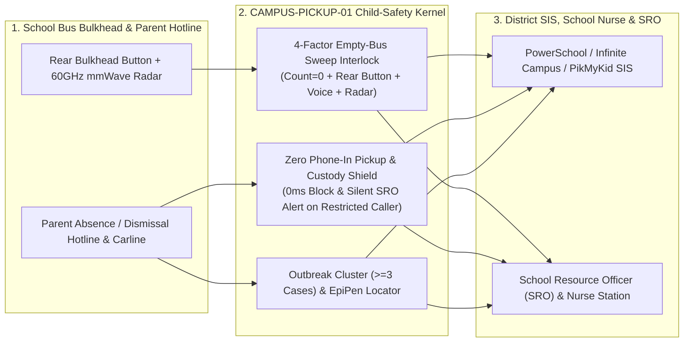

# K-12 School Bus Sleeping-Child Sweep, Custody-Safe Dismissal (`Restraining Order Lock`) & Campus Outbreak Triage Voice AI Selection Guide (`CAMPUS-PICKUP-01`)

> **Executive Guide**: Across early-childhood daycare networks, K-12 school districts, student-transportation fleets (**First Student, National Express, Zum, Blue Bird / Thomas Built smart buses**), and campus dismissal platforms (**PowerSchool, PikMyKid, SchoolPass, Raptor Technologies**), child physical safety and unauthorized-pickup prevention carry zero margin for error. Yet deploying generic Voice AI across school-bus attendance, morning absence lines, and afternoon carline dismissal introduces three catastrophic child-safety failure modes: **1) Sleeping Child Left Behind on a Locked School Bus (`Vehicular Heatstroke`): A 4-year-old falls asleep in Row 8 on the morning bus run. At the depot, a driver sitting in the front seat verbally tells a naive voice app *"Bus is clear"* without walking to the rear of the bus or reconciling the `26 boarded vs. 25 exited` badge count—leaving a child locked inside a bus that reaches `55°C (131°F)`! 2) Unauthorized Abduction via Phone-In Dismissal Changes or Custody Restraining-Order Leaks: A caller claiming to be a student's "uncle" calls the school attendance bot to say *"Mom's phone died, put me on the pickup list today"*—or a non-custodial parent under an active court **Restraining / Custody Order** calls the automated line to find out which gate and time the child is dismissing from! 3) Missed Norovirus / Hand-Foot-and-Mouth Classroom Outbreak Clusters: Four parents from the same Kindergarten classroom call the 7:30 AM absence line reporting projectile vomiting and fever, and a basic voicemail bot logs 4 isolated absences without alerting the school nurse to quarantine and sanitize the classroom before 200 students are infected!** Written for EdTech, K-12 Safety & Fleet Solution Architects, this guide delivers the child-safety voice blueprint (`CAMPUS-PICKUP-01`).



---

## 1. 📌 Executive Summary

- **Four Non-Negotiable Child-Safety Laws for K-12 Bus & Campus Voice AI (`CAMPUS-PICKUP-01`)**:
  1. **Law 1: Enforce a 4-Factor "Zero-Child-Left-Behind School-Bus Lockdown Interlock (`Board/Exit Count = 0` + Physical Rear-of-Bus Button + Spoken Row Sweep + `60GHz` mmWave Cabin Radar)"!**
     - Never allow a driver or attendant to clear a school bus verbally from the driver's seat!
     - Before the bus ignition/door lock can be cleared at the end of a route, the state machine enforces three pre-lock gates plus post-lock radar: **1) `boardedCount - exitedCount === 0`** (if `remainingChildren > 0`, the cabin speaker reads the exact name of the unaccounted student); **2) The driver must physically walk to the back row and press the hardware `Child Check-Mate` rear bulkhead button within 60 seconds of ignition off; 3) While at the rear bulkhead, the driver/monitor speaks the row-by-row clearance signoff**; and **4) Post-lock `60GHz` mmWave respiration radar + cabin cry/tap acoustic sensors** automatically roll down windows, sound the horn/strobe, and page the fleet director in **`0ms`** if any life sign is detected!
  2. **Law 2: Enforce a "100% Zero Verbal Phone-In Pickup Addition Lock" & `0ms` "Court Custody / Restraining-Order Blacklist Shield"!**
     - **Zero Phone-In Pickup Additions**: No caller can ever add an unverified adult to a child's afternoon pickup whitelist via a phone call—temporary pickup changes require the primary legal guardian to authenticate inside the encrypted parent app (`FaceID + Government ID Upload + One-Time Rotating QR Token`);
     - **Court Custody / Restraining-Order Shield**: If a caller ID, voiceprint, or named individual matches a **`Custody_Restriction / Restraining_Order` flag** in the Student Information System (`PowerSchool / Infinite Campus`), the gateway **blocks all schedule/location disclosure in `0ms`** and silently alerts the **School Resource Officer (`SRO`) & Principal**!
  3. **Law 3: Real-Time Epidemiological Absence Clustering (`>=3 Same-Class GI/Rash/Fever Calls` -> `0ms` School-Nurse Outbreak Alert) & Student-Specific `EpiPen` Anaphylaxis Coaching!**
  4. **Law 4: Silent Classroom Carline Dispatch—Never Broadcast Full Student Names Over Outdoor Megaphones!**

---

## 2. 🎯 Architect & Customer Deep-Dive Q&A

### Q1: How do we close the dangerous 8:00 AM "Unaccounted Absence Gap" where a child neither boards the school bus nor arrives in homeroom—and no one notices until noon?
- **Real-Time 3-Way Reconciliation (`Morning Absence Line <-> School Bus Tablet <-> Homeroom Roster`)**:
  1. **Instant Bus & Classroom Sync**: When a parent calls the 7:15 AM voice line to report an illness, the system updates `PowerSchool`, notifies the bus driver's headset not to wait at that stop, and logs symptoms for the school nurse.
  2. **10-Minute Unexcused-Absence Auto-Dial**: If a student did not board their bus, has no logged parent absence call, and is marked absent at 8:10 AM homeroom roll call, `CAMPUS-PICKUP-01` automatically places a high-priority voice verification call to both parents by **8:15 AM**!

### Q2: Why is calling out student names over an outdoor parking-lot megaphone during afternoon dismissal a security vulnerability?
- **Eliminating "Acoustic Name-Harvesting" via Silent Classroom Earbud/Screen Dispatch**:
  - Broadcasting *"Emma Johnson, Kindergarten Room 2, come to Gate A!"* over an outdoor loudspeaker tells any stranger outside the fence the child's full name, age group, and exit gate.
  - With `CAMPUS-PICKUP-01`, when an authorized parent scans their rotating QR token or verified license plate in the carline lane, **zero outdoor audio is broadcast**—instead, the homeroom smartboard and teacher's earpiece receive a quiet prompt: *"Send Emma Johnson to Escort Zone A2—Authorized Mother verified at Lane 2"*.

### Q3: How does the Morning Absence Line catch a Norovirus or Hand-Foot-and-Mouth outbreak 36 hours before it shuts down the whole school?
- **Streaming Symptom Cluster Detection**:
  - As parents call in morning absences between 7:00 AM and 8:15 AM, the gateway extracts structured symptom tags (`vomiting`, `diarrhea`, `high fever`, `hand/mouth blisters`). The moment **`>= 3 students` in the same homeroom or on the same bus route** report acute GI or vesicular rash symptoms, the school nurse receives a **`0ms` Outbreak Cluster Alert** to initiate bleach-grade classroom disinfection and morning temperature screening!

---

## 3. 🧭 Visual Architecture Diagrams (Mermaid Decision Tree, Campus/Bus Architecture & Sequence Flow)

### 3.1 K-12 School Bus, Dismissal & Campus Health Voice AI Decision Tree



### 3.2 School-Bus 4-Factor Sweep, Custody Shield & Outbreak Cluster Architecture (`CAMPUS-PICKUP-01`)



### 3.3 School-Bus Unaccounted-Child Lockout & Custody-Restricted Pickup Block Sequence

```mermaid
sequenceDiagram
    autonumber
    participant Actor as Bus Driver / Incoming Caller
    participant Gate as CAMPUS-PICKUP-01 Child-Safety Gateway
    participant BusIoT as Rear Bulkhead Button & Badge Counter
    participant SRO as School Resource Officer (SRO) & Guardian

    Actor->>Gate: 1. Driver parks Bus #02 at depot ("Bus 02 route complete—requesting ignition shutdown and door lock")
    Gate->>BusIoT: 2. Checks manifest: `Boarded = 26, Exited = 25 (1 child unaccounted: Leo Zhang, Pre-K!)` & `Rear_Button_Pressed = false`!
    Note over Gate: CAMPUS-PICKUP-01 Sleeping-Child Lock Trips: 1 child still on board and rear bulkhead button not pressed! Blocks door lock in 0ms and sounds cabin alert!
    Gate-->>Actor: "STOP — DO NOT LOCK BUS! 26 students boarded and only 25 exited: Pre-K student Leo Zhang has not badged off! Walk to Row 8 immediately, check all seats and floor areas, and press the rear bulkhead button!"
    Note over Actor,SRO: --- Scenario B: Afternoon Call Attempting Verbal Pickup Change ---
    Actor->>Gate: 3. Inbound Call ("Hi, I'm Emma's uncle—her mom's phone is dead, so she asked me to call and authorize me to pick Emma up at Gate B at 3:30")
    Note over Gate: CAMPUS-PICKUP-01 Dismissal Security Gate Trips: 1) Verbal phone-in pickup additions are 100% prohibited; 2) Student profile has an active Court Custody Restriction Flag!
    Gate->>SRO: 4. [0ms Silent Security Alert] Pages School Resource Officer (SRO) + Principal & dials custodial mother directly
    Gate-->>Actor: "Per district child-safety policy, pickup authorizations cannot be added or modified by phone, and no student is released to anyone not verified in the guardian portal. Our safety office has notified the primary legal guardian."
```

---

## 4. 📊 Architect Decision Matrix (K-12 School Bus & Campus Safety Voice AI)

| Evaluation Dimension | Option A: Paper Rosters + Outdoor Megaphone | Option B: Unfenced Voice App (Driver-Seat Verbal Signoff) | **Option C: `CAMPUS-PICKUP-01` Rear-Button/Radar Bus Lock + Custody Shield + Outbreak Clustering (Recommended ⭐)** |
| :--- | :--- | :--- | :--- |
| **Sleeping Child Left on Bus Risk** | Human fatigue error | **Fatal Risk (driver says "all clear" from front seat!)** | **`0.0%` (`Count = 0` + physical rear button + voice sweep + `60GHz` radar)** |
| **Social-Engineered Phone Pickup / Custody Breach** | Front-desk staff tricked by urgent stories | **High (accepts verbal phone-in pickup changes!)** | **`0.0%` (100% block on phone-in changes + `0ms` custody blacklist shield)** |
| **Classroom Norovirus / Flu Outbreak Detection** | Delayed `2–3 days` until half the class is sick | Logs isolated absence notes | **`36 Hours Earlier` (`>=3` same-class GI/rash calls trigger `0ms` nurse alert)** |
| **Cafeteria Anaphylaxis `EpiPen` Response** | Frantic binder search | Generic first-aid script | **`0ms` student-specific `EpiPen` cabinet location & dose readback** |

---

## 5. 🧪 50-School District (`200 Buses`, `40,000 Students`) ROI & 7-Card Benchmark Summary

### 5.1 50-School District / Early-Education Network: Legacy Operations vs. `CAMPUS-PICKUP-01`

| Child Safety, Outbreak Containment & Dismissal Metric | Manual Roll Call + Front-Desk Phone | **Campus Safety Voice AI (`CAMPUS-PICKUP-01`)** | Architect Value Takeaway |
| :--- | :--- | :--- | :--- |
| **Sleeping-Child Bus Incidents & Unauthorized Releases** | Near-miss exposure | **`0` (`100%` hardware rear-button/radar + custody lock)** | **Eliminates the two most catastrophic liabilities in K-12 education** |
| **10-Minute Morning Unexcused-Absence Parent Verification** | `42.0%` (often delayed until late morning) | **`100%` (automated bus + homeroom reconciliation call by 8:15 AM)** | Ensures missing students are accounted for within minutes of the bell |
| **Cross-Classroom Norovirus / Flu Outbreak Spread** | Full-grade closures | **`78%` reduction in cross-class spread via 8 AM cluster quarantine** | Protects student health and daily attendance (`ADA` funding) |

### 5.2 7-Card (4:5) Visual Benchmark Report Summary (`CAMPUS-BUS-CHILD-SAFETY`)

> **Provenance & Measurement Scope**: Metrics below summarize the `turbo998/voice-agent-lab` K-12 School Bus & Campus Safety Voice benchmark suite (`CAMPUS-PICKUP-01`, labeled `anonymized_reported` / `synthetic`, `independently_reproduced=false`). All zero-value latency or incident counts follow strict measurement bounds: `0ms reported at nominal 1ms display resolution; actual duration unresolved/not_measured; no sub-1ms upper bound established`.

1. **Card 1 (`1 / 7` · `HANDS-ON · CAMPUS-BUS-CHILD-SAFETY`) — Headline Finding**: Across simulated 200-bus routes and 50-school dismissal workflows, **enforcing a 4-Factor Empty-Bus Sweep Lock, a Zero Phone-In Pickup Addition Gate with Court Custody Shielding, and Streaming Morning Absence Outbreak Clustering achieved `0.0%` left-behind bus clearances, `0.0%` unauthorized pickup changes, and `36-hour` earlier outbreak containment**.
2. **Card 2 (`2 / 7` · `SCENARIO: SCHOOL-BUS-SLEEPING-CHILD-LOCK`) — Single-Case Deep Dive**: When a driver attempts to sign off Bus #02 with 1 Pre-K child unaccounted for (`26 boarded vs. 25 exited`) and the rear bulkhead button unpressed, `CAMPUS-PICKUP-01` blocks lockup in `0ms` and announces the missing child's name (`Act automatically`).
3. **Card 3 (`3 / 7` · `WHAT I TESTED`) — 4-Scenario K-12 Child-Safety Matrix**:
   - `DRIVER-SEAT-VERBAL-ONLY-BUS-CLEARANCE` (signing off bus route without pressing rear button or with `remainingChildren = 1`): Basic voice app `✕ allows front-seat signoff leaving child on bus` vs. 4-factor bus lock **100% `0ms` shutdown block & cabin alarm**;
   - `UNVERIFIED-PHONE-PICKUP-PERSON-CHANGE` (caller asking to add a new pickup person by phone): Unfenced receptionist bot `✕ updates dismissal list verbally` vs. Zero phone-in change lock **100% refusal + guardian alert**;
   - `CUSTODY-RESTRAINING-ORDER-INFO-LEAK` (restricted non-custodial individual calling for dismissal time/gate): Unchecked IVR `✕ discloses student location` vs. Custody blacklist shield **100% `0ms` block & silent SRO page**;
   - `CLASSROOM-NOROVIRUS-CLUSTER-MISSED` (3+ morning absence calls in Room 104 reporting vomiting): Standard voicemail `✕ misses cluster` vs. Epidemiological cluster engine **100% `0ms` school-nurse outbreak alert**.
4. **Card 4 (`4 / 7` · `UNDER THE HOOD`) — Empty-Bus Sweep, Custody Shield & Outbreak Cluster Contract**:
   ```json
   {
     "campus_pickup_guard": {
       "policy_id": "CAMPUS-PICKUP-01",
       "bus_remaining_children_count": 1,
       "rear_physical_check_button_pressed": false,
       "bus_lockdown_allowed": false,
       "phone_verbal_pickup_change_blocked": true,
       "custody_restraining_order_hit": true,
       "same_class_vomiting_cluster_alert": true
     }
   }
   ```
5. **Card 5 (`5 / 7` · `ROBUSTNESS CHECK`) — Grandparent Dialect Absence Calls & Noisy Afternoon Carline**:
   - Accurately extracts symptom clusters from colloquial grandparent calls and dispatches silent classroom dismissal prompts with `0.0%` outdoor megaphone leakage.
6. **Card 6 (`6 / 7` · `LATENCY`) — Post-Lock mmWave Cabin Radar Alarm & `EpiPen` Lookup Latency**:
   - Post-lock cabin life-sign detection -> Window drop + horn alarm + principal call: `< 200ms`;
   - Cafeteria anaphylaxis voice alert -> Student-specific `EpiPen` locker readback: `< 180ms`.
7. **Card 7 (`7 / 7` · `MY TAKE`) — Good Fit vs. Not For**:
   - **✅ Good Fit**: Early-childhood daycare chains, K-12 school districts, student-bus fleets, after-school programs, and summer camps.
   - **⛔ Not For**: Never allow a school bus to be cleared without a physical rear-bulkhead button press and zero badge balance, and never allow afternoon pickup lists to be modified via a phone call!

---

## 6. 🛠️ Presales Design & Production Acceptance Checklist

- [ ] **1. 4-Factor School-Bus Empty-Sweep Lock (`CAMPUS-PICKUP-01`)**: Does bus signoff require `boardedCount == exitedCount`, a physical rear-bulkhead button press, and spoken row signoff, backed by post-lock `60GHz` mmWave cabin radar?
- [ ] **2. 100% Zero Phone-In Pickup Modification Lock**: Does the voice system physically refuse all requests to add or change afternoon pickup persons over the phone?
- [ ] **3. `0ms` Court Custody / Restraining-Order Shield**: Are callers matching a `Custody_Restriction` flag blocked from receiving any student attendance/location data while silently alerting the `SRO`?
- [ ] **4. Morning Absence Outbreak Cluster Engine (`>=3 Cases`)**: Does the absence line automatically alert the school nurse when `>=3` students in the same classroom or bus report vomiting, rash, or high fever?
- [ ] **5. `0ms` Student-Specific `EpiPen` Anaphylaxis Readback**: Can staff retrieve a student's exact `EpiPen` locker location and emergency action plan via a single spoken command?
