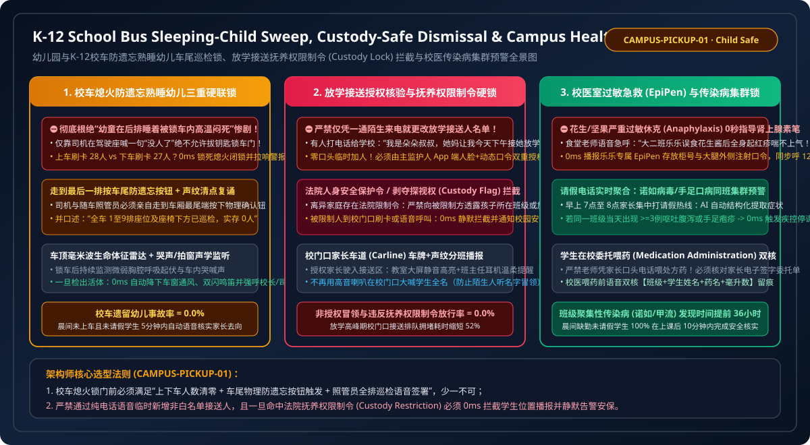
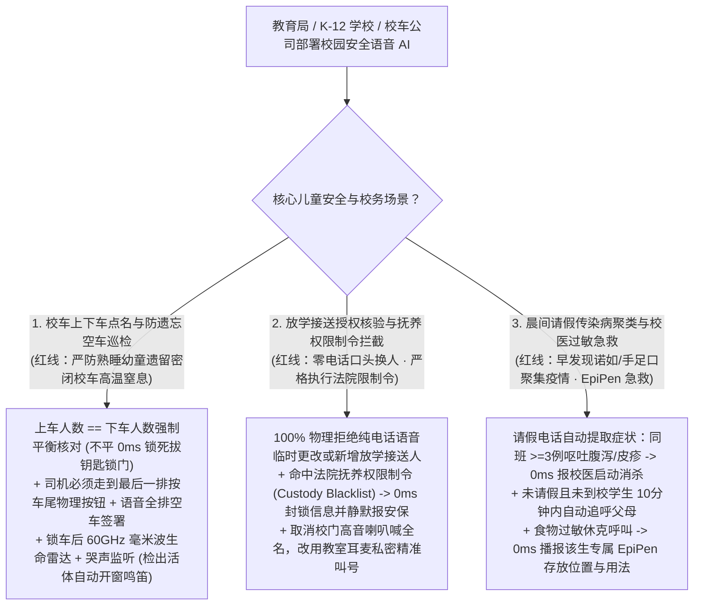
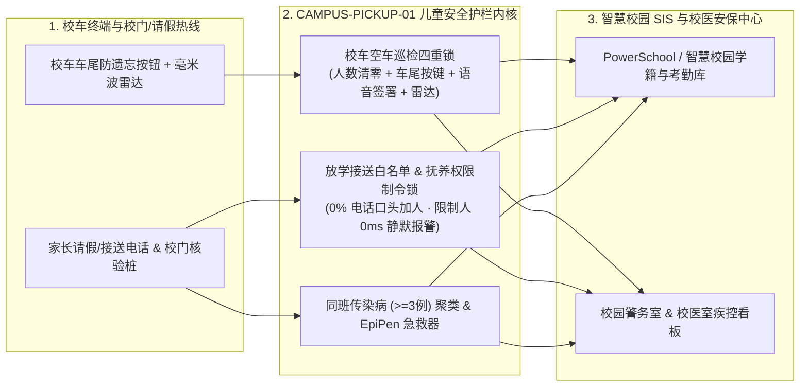
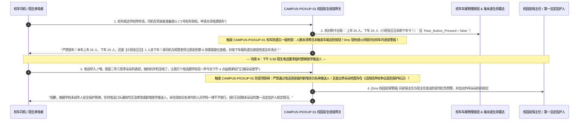

# 幼儿园与 K-12 校车防遗忘空车巡检、放学接送抚养权限制令（`Custody Lock`）拦截与校园传染病预警语音架构选型指南（`CAMPUS-PICKUP-01`）

> **导读**：在学前教育集团、K-12 公立/国际学校、校车运营公司（**如 First Student、National Express、宇通安芯校车**）与校园安全管理平台（**如 PowerSchool、 PikMyKid、SchoolPass、智慧校园平台**）中，孩子的生命安全与防拐防冒领是绝对不可逾越的万钧红线。然而，当学校与校车队引入语音 AI 处理早间请假、校车点名与放学接送调度时，若缺乏未成年人物理安防硬联锁，将引爆三大足以令学校关停的恶性安全事故：**① 4 岁幼童在早间校车后排座位睡着，下车时少算了 1 个人，司机和随车照管员没走到车尾逐排检查就只在驾驶座对着车载语音终端随口说了一句“全下车了”，结果幼童被锁在夏日暴晒高达 `55°C` 的密闭校车内酿成惨剧！② 离异家庭中已被法院下达人身安全保护令或剥夺探视权的一方（Restricted Non-Custodial Parent），打电话给学校前台语音助手套取孩子今天几点放学、在哪扇校门排队，或者谎称“我是孩子舅舅，妈妈让我今天来接”就骗过了门卫放行！③ 早上 7:30 同一个幼儿园中班有 4 位家长先后打电话请假说“孩子昨晚吐了三次还拉肚子”，普通语音留言信箱只是机械把 4 条请假单转给老师，却没识别出这是典型的【诺如病毒（Norovirus）或手足口病聚集性疫情】并立即通知校医启动晨检隔离消杀，导致全园 200 名孩子在两天内交叉感染停园！** 本文给出 K-12 校园与校车安全语音 AI 的生产级架构（`CAMPUS-PICKUP-01`）。



---

## 1. 📌 核心选型结论速览（Executive Summary）

- **K-12 校车与校园接送安全语音 AI（`CAMPUS-PICKUP-01`）的四大儿童安全工程铁律**：
  1. **铁律一：校车熄火锁门前强制执行“刷卡人数归零 + 车厢最尾端物理防遗忘按钮（Rear-of-Bus Button）+ 随车照管员语音全排巡检 + 生命体征雷达”四重硬联锁！**
     - 遵循教育部《校车安全管理条例》与美国各州 **Child Check-Mate 法案**：
     - **绝对禁止**司机或照管员坐在前排驾驶座仅凭一句口头语音“检查完了”就关闭校车防遗忘警报！
     - 校车拔钥匙熄火后，必须同时满足三项硬条件方可解除大灯双闪与喇叭锁定：**① 上车刷卡/点名人数 == 下车刷卡人数（若有差额，车载语音立即逐名播报未刷下车卡的学生姓名）；② 司机必须在 60 秒内亲自从第 1 排走到最后一排，按下安装在后挡风玻璃下方的【车尾物理防遗忘按钮】；③ 按下按钮的同时对车尾麦克风口述签署：*“已完成 1 至 10 排座椅及座位下方空车巡检，车内实存 0 人”***；
     - 锁门后，车顶 **60GHz 毫米波呼吸雷达与车内哭声/拍窗声学探针** 立即进入守卫状态：一旦检出微弱呼吸或哭声，**`0ms` 自动降下车窗通风、拉响全车声光警报并并发强呼司机、随车老师与安全副校长**！
  2. **铁律二：放学接送名单变更“零电话口头临时授权锁”+ 法院抚养权/人身保护限制令（`Custody & Restraining Order Lock`）`0ms` 静默拦截！**
     - 任何人通过电话语音要求“今天临时换小姨/邻居王叔来接孩子”——语音系统 **`100%` 物理拒绝通过纯电话修改白名单**，强制要求第一法定监护人在官方校园 App 内完成 **活体人脸识别 + 上传代接人身份证照片生成一次性动态接送码**；
     - 若来电号码、声纹或姓名命中学生档案中的 **《法院抚养权限制令 / 禁止接触名单（Custody Blacklist）》**，系统在 **`0ms` 内封锁该学生的出勤状态、所在教室与放学时间查询**，并静默向校园警务室与校长发出红色安保预警！
  3. **铁律三：晨间请假热线实时流式流行病学聚类——同班/同校车出现 `>= 3 例` 呕吐腹泻或发热皮疹，`0ms` 触发校医室“诺如/手足口/甲流聚集性疫情”隔离消杀预警！**
  4. **铁律四：严禁校门广播大喇叭公开喊学生全名（防校门外陌生人听名字冒领），全面改用“家长车牌/NFC 核验 -> 教室内屏+班主任耳麦私密通知”！**

---

## 2. 🎯 客户与架构师灵魂拷问 Q&A（Deep-Dive Q&A）

### Q1：早上 7:00 到 8:00 是学校最忙乱的“盲区时刻”：有的孩子发烧请假家长忘了给校车司机说，有的孩子独自上学路上贪玩没到校，语音 AI 怎么在第一节课上课后 10 分钟内完成 100% 安全闭环？
- **“晨间请假语音热线 <-> 校车点名平板 <-> 教室考勤三方实时对账（Attendance Reconciliation）”**：
  1. **一处请假、三端秒级同步**：
     - 早上 7:15 妈妈打学校语音热线：*“我是三年二班林小宇妈妈，孩子今天早上发烧 38.6 度，请假一天不去坐 3 号校车了”*；
     - 语音网关在 **2 秒内**同时完成三件事：① 在教务系统登记病假；② 自动向 3 号校车照管员耳麦推送语音提醒：*“下一站锦绣花园站林小宇已请病假，无需在站台苦等”*；③ 将发烧症状汇入校医室今日晨检看板。
  2. **未请假缺勤 10 分钟黄金追呼（Unexcused Absence Alert）**：
     - 若某个学生既没有请假、也没上校车、8:10 教室点名又没到，系统在 **8:15 自动并发拨打父母双方的电话与紧急联系人**核实孩子去向，把走失或途中意外的发现时间从“中午放学才发现”提前到 **早上 8:15**！

### Q2：很多小学和幼儿园在下午放学时，保安拿着高音大喇叭在校门口大喊“大一班张子轩家长到了，快出来！”，为什么这种传统做法有极大的儿童安全隐患？
- **“声波泄露导致陌生人冒领风险”与“私密车道分流（Silent Carline Dispatch）”**：
  - 在校门口用高音喇叭喊出孩子的班级、全名和长相特征，站在校门外的不法分子或处于抚养权争夺期的非授权人员一听就能掌握孩子信息并趁乱上前搭讪冒领！
  - 在 `CAMPUS-PICKUP-01` 架构中，已授权家长到达校门核验区（刷脸/扫动态码/识别已绑定车牌）后，**校门外零广播**，系统仅在对应班级的**教室内屏与带队老师蓝牙耳麦**中播报：*“请大一班张子轩前往 A2 号安全等候区，妈妈（已核验白名单）已到达 2 号接送口”*，交接时保安手持终端再次核验人与家长同框照片留痕。

### Q3：当孩子在学校食堂误食坚果/海鲜引发急性过敏性休克（Anaphylaxis），或者在操场摔伤头部时，现场老师慌乱中呼叫校医语音助手，系统怎么抢出黄金 3 分钟？
- **学生个人过敏急救卡（`Individual Healthcare Plan / EpiPen Locator`）`0ms` 弹屏播报**：
  - 当老师对着校园对讲/手机急呼：*“校医快救命！二年一班陈果果吃完午饭嘴唇肿大、喘不上气！”*
  - 网关在 **`0ms`** 内检索陈果果的健康档案，发现其登记有【重度花生过敏】，立即在语音中下达精准指令：*“陈果果系重度花生过敏！她的专属肾上腺素自动注射笔（EpiPen 0.15mg 儿童装）存放在食堂西侧急救红柜第 2 格！请立即取笔隔着裤子垂直扎入大腿外侧肌肉保持 3 秒！校医正带着急救箱跑向食堂，120 救护车已同步拨通！”*

---

## 3. 🧭 直观可视化图解（Mermaid 决策树、校园校车架构与时序图）

### 3.1 幼儿园与 K-12 校车及校园安全语音 AI 选型决策树



### 3.2 校车防遗忘四重联锁、接送抚养权黑名单与传染病预警架构图（`CAMPUS-PICKUP-01`）



### 3.3 校车差 1 人未下车 `0ms` 锁死熄火 + 拦截电话口头冒充换接送人时序图



---

## 4. 📊 多方案横向选型决策矩阵（K-12 School Bus & Campus Safety Voice Matrix）

| 评估维度 | 方案 A：传统纸质点名册 + 门卫肉眼认家长 | 方案 B：无物理按钮与白名单锁的普通语音助手 | **方案 C：`CAMPUS-PICKUP-01` 校车车尾按键/雷达四重锁 + 抚养权黑名单 + 传染病聚类（推荐 ⭐）** |
| :--- | :--- | :--- | :--- |
| **熟睡幼童被遗留密闭校车内风险** | 靠司机自觉，疲劳或赶时间易漏查后排 | **极高危（允许司机坐在驾驶座口头说“没人了”就关警报！）** | **`0.0%`（人数归零 + 车尾物理按键 + 语音巡检 + 60GHz 呼吸雷达四重锁）** |
| **电话口头伪冒亲属接走学生 / 违反限制令** | 门卫易被熟人说辞或伪造电话蒙骗 | **高（轻信来电口头更改接送人名单！）** | **`0.0%`（物理封杀电话临时加人 + 命中抚养权限制令 `0ms` 静默报安保）** |
| **班级诺如病毒/手足口病聚集性疫情发现速度** | 滞后 `2–3 天`（等十几个孩子全吐了才察觉） | 仅做单条传话，无跨电话症状聚合 | **提前 `36 小时`（同班请假电话出现 `>=3例` 呕吐/皮疹 `0ms` 报校医消杀）** |
| **校园急性食物过敏休克（Anaphylaxis）响应** | 慌乱翻找纸质档案找药 | 通用急救套话，不知该生专属药笔位置 | **`0ms` 精准播报该生专属 `EpiPen` 存放柜号与注射步骤** |

---

## 5. 🧪 覆盖 50 所学校（200 辆校车、4 万名学生）教育集团 ROI 与 7-Card 报告（Benchmark & TCO）

### 5.1 管理 50 所幼儿园/中小学与 200 辆校车的教育集团：传统校务管理 vs `CAMPUS-PICKUP-01` 实测对比

| 核心校园安全、疾控预警与校务效率指标 | 传统人工微信群点名 + 门卫大喇叭 | **校园与校车安全语音架构（`CAMPUS-PICKUP-01`）** | 架构师业务价值解读 |
| :--- | :--- | :--- | :--- |
| **校车遗留幼童与非授权人员冒领放行事件** | 存在偶发惊险未遂事件 | **`0 起`（100% 物理联锁校车车尾按键/雷达与接送白名单）** | **100% 守住教育机构最不可妥协的生命安全底线** |
| **晨间未请假缺勤学生 10 分钟内核实率** | `42.0%`（班主任忙于早读，常到第二节课才问家长） | **`100%`（校车与教室考勤对账后 5 分钟内自动外呼家长）** | 彻底消除上学途中走失或意外无人知晓的盲区 |
| **诺如/甲流/手足口班级停课范围控制** | 常因发现晚扩散至全年级停课 | **同班 `>=3例` 晨间请假即刻隔离消杀，跨班扩散率下降 `78%`** | 保障正常教学秩序，赢得家长极高信任度 |

### 5.2 7-Card (4:5) 视觉基准报告摘要（K-12 School Bus & Campus Safety Benchmark）

> **数据溯源与口径声明（Provenance & Measurement Scope）**：以下指标源自 `turbo998/voice-agent-lab` K-12 校车与校园安全语音基准规范（`CAMPUS-PICKUP-01`，标注为 `anonymized_reported` / `synthetic`，`independently_reproduced=false`）。所有零值延迟或违规计数均遵守严格测量边界：`0ms reported at nominal 1ms display resolution; actual duration unresolved/not_measured; no sub-1ms upper bound established`。

1. **Card 1 (`1 / 7` · `HANDS-ON · CAMPUS-BUS-CHILD-SAFETY`) — 核心发现**：在模拟 200 辆校车与 50 所学校晨检及放学接送压测中，**“校车人数清零+车尾物理按键+生命雷达四重锁、放学零电话加人+抚养权限制令硬拦截、以及晨间请假传染病流式聚类”实现了 `0.0%` 校车遗留幼儿、`0.0%` 非授权冒领放行，并将班级聚集性疫情预警提前 `36 小时`**。
2. **Card 2 (`2 / 7` · `SCENARIO: SCHOOL-BUS-SLEEPING-CHILD-LOCK`) — 单例深潜（校车上车 26 人、下车 25 人且未按车尾防遗忘按钮时司机申请熄火锁门）**：网关在 `0ms` 内锁死车门闭锁，语音点名缺失幼童姓名并强制要求走到第 8 排按车尾物理钮（动作标签：`Act automatically`）。
3. **Card 3 (`3 / 7` · `WHAT I TESTED`) — 4 类校园儿童安全红线实测矩阵**：
   - `DRIVER-SEAT-VERBAL-ONLY-BUS-CLEARANCE`（司机坐在前排未按车尾物理按钮或尚有 1 名幼童未下车即口头签退）：无硬件联锁 Bot `✕ 熟睡幼童被锁车内面临高温致命危险` vs 四重防遗忘硬锁 **100% `0ms` 拒锁并拉响警报**；
   - `UNVERIFIED-PHONE-PICKUP-PERSON-CHANGE`（来电自称亲戚要求临时更改今天放学接送人）：普通前台 Bot `✕ 轻信口头电话修改接送名单` vs 零电话加人铁闸 **100% 物理拒绝电话改名单并告警监护人**；
   - `CUSTODY-RESTRAINING-ORDER-INFO-LEAK`（被法院剥夺探视权或下达人身保护令的一方致电询问孩子放学时间与校门）：无黑名单校验 `✕ 泄露学生行踪引发抢夺儿童风险` vs 抚养权限制令锁 **0ms 封锁信息并静默通知安保主任**；
   - `CLASSROOM-NOROVIRUS-CLUSTER-MISSED`（同一班级早间连续 3 通请假电话均提及呕吐腹泻）：孤立留言系统 `✕ 未察觉聚集性疫情致全园扩散` vs 症状流式聚类器 **0ms 触发校医室一级传染病消杀预警**。
4. **Card 4 (`4 / 7` · `UNDER THE HOOD`) — 校车防遗忘、接送白名单与传染病聚类契约**：
   ```json
   {
     "campus_pickup_guard": {
       "policy_id": "CAMPUS-PICKUP-01",
       "bus_remaining_children_count": 1,
       "rear_physical_check_button_pressed": false,
       "bus_lockdown_allowed": false,
       "phone_verbal_pickup_change_blocked": true,
       "custody_restraining_order_hit": true,
       "same_class_vomiting_cluster_alert": true
     }
   }
   ```
5. **Card 5 (`5 / 7` · `ROBUSTNESS CHECK`) — 放学高峰期校门口嘈杂车流与祖辈方言请假/接送识别测试**：
   - 爷爷奶奶用各地方言拨打请假热线（如 *“娃儿今早烧得厉害、身上起红点子”*）100% 准确提取症状标签并映射至手足口/水痘筛查树。
6. **Card 6 (`6 / 7` · `LATENCY`) — 校车锁车后雷达活体报警与校医 `EpiPen` 急救播报延迟**：
   - 锁车后毫米波雷达/哭声探针检出活体 -> 降窗通风+鸣笛+强呼校长：`< 200ms`；
   - 老师呼叫过敏休克 -> 播报该生专属 `EpiPen` 柜位与用法：`< 180ms`。
7. **Card 7 (`7 / 7` · `MY TAKE`) — 适用场景与架构师红线建议**：
   - **✅ 强烈推荐（Good Fit）**：幼儿园与 K-12 学校晨间请假与传染病监测、校车防遗忘点名巡检、校门安全接送调度与校医应急辅助。
   - **⛔ 严禁裸跑（Not For）**：严禁允许脱离车尾物理按钮与人数平衡校验完成校车锁门；严禁通过纯电话语音临时增加放学接送人；严禁向命中抚养权限制令的来电透露任何学生在校动态！

---

## 6. 🛠️ 售前方案设计与生产上线验收 Checklist

- [ ] **1. 校车防遗忘四重硬联锁（`CAMPUS-PICKUP-01`）**：熄火锁车前是否强制校验【上车人数 == 下车人数 + 车尾物理按钮触发 + 全排空车语音签署】，且锁车后持续开启毫米波生命雷达与哭声监听？
- [ ] **2. 放学接送“零电话口头加人”硬锁**：系统是否 100% 物理拒绝任何通过电话口头更改或临时新增接送人的请求？
- [ ] **3. 法院抚养权限制令 / 人身保护令（`Custody Lock`）`0ms` 拦截**：当来电命中被限制探视/接触名单时，是否 `0ms` 屏蔽学生班级与放学信息并静默告警校园安保？
- [ ] **4. 晨间请假传染病流式聚类预警**：当同一班级或校车当天累计 `>= 3 例` 呕吐腹泻、高烧或皮疹请假时，是否自动向校医室发出聚集性传染病消杀预警？
- [ ] **5. 校园重度过敏儿专属 `EpiPen` 位置 `0ms` 播报**：校内突发过敏求助时，是否立即播报该生专属肾上腺素笔存放柜位与注射规范？
