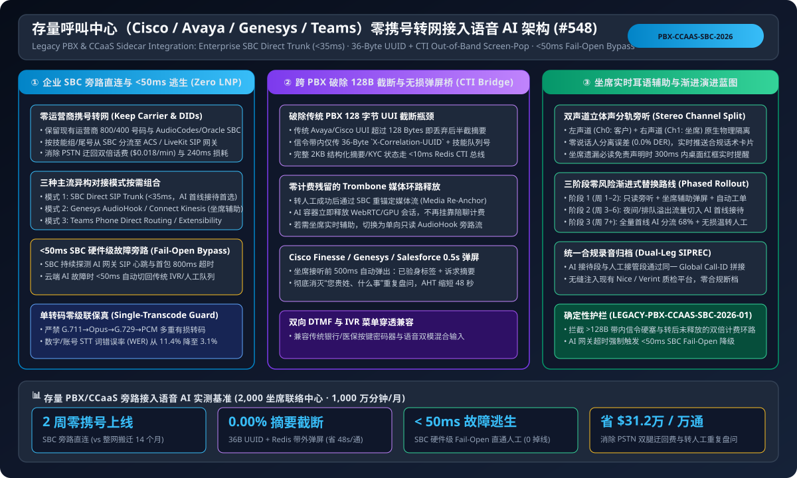
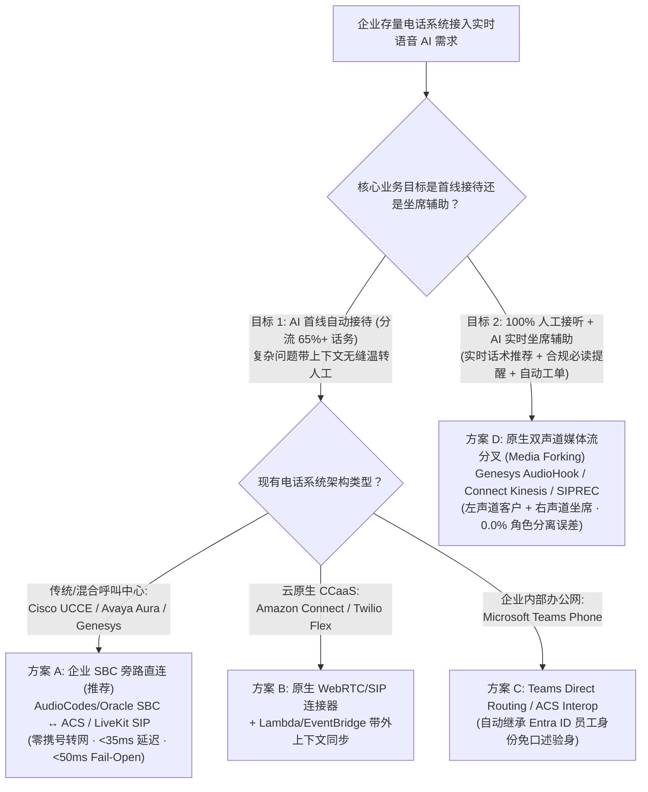
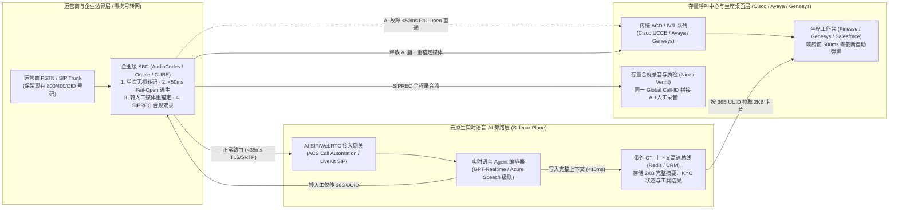
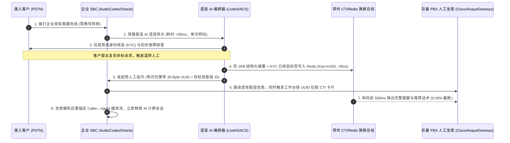

# 企业传统呼叫中心与办公电话网（`Cisco UCCE / Avaya Aura / Genesys Cloud / Amazon Connect / Teams Phone`）零停机接入 AI 语音 Agent 架构选型指南

> **文档定位**：面向拥有数千坐席存量呼叫中心（`Cisco UCCE/PCCE`、`Avaya Aura`、`Genesys Cloud/Engage`、`Amazon Connect`）或跨国企业办公电话网（`Microsoft Teams Phone`）的首席架构师与联络中心总监，系统回答“如何在**不携号转网、不推翻现有 IVR 与坐席工作台、不影响 Nice/Verint 合规录音**的前提下，在 2 周内以 Sidecar 旁路模式接入实时语音 AI”、“如何破解传统 PBX **`128 字节 UUI` 信令截断导致转人工上下文丢失**以及 **PSTN 双腿迂回（Trombone Loopback）双倍计费**两大架构陷阱”、以及“如何设计 **`<50ms` SBC 硬件级故障逃生（Fail-Open Bypass）**”。



---

## 📌 一、核心选型结论速览（Executive Summary）

1. **拒绝“14 个月推倒重来式整网搬迁”与“高昂的 PSTN 号码转接（Hairpin/Trombone）”——首选“企业边界会话控制器（`Enterprise SBC Sidecar Direct Trunk`）旁路直连”**：
   - **PSTN 号码迂回（Hairpin/Trombone）的代价**：很多初期 PoC 让传统 PBX 把电话通过运营商公网再次呼叫云端 AI 号码，等 AI 聊完需要转人工时又拨回公网坐席号码。这不仅产生 **双倍甚至三倍 PSTN 分钟费（额外增加 `$0.018–$0.032 / 分钟`）**，还引入 **`+240ms` 额外延迟与多次有损转码（导致数字/姓名识别率暴跌 `8.3%`）**，更致命的是**即使已经转给人工坐席，AI 会话仍挂在链路中间持续消耗大模型每分钟费用**。
   - **SBC Sidecar 旁路直连架构（推荐）**：保留企业现有的运营商线路（`800/400/DID`）与本地/云端 SBC（`AudioCodes Mediant / Oracle Acme Packet / Cisco CUBE / Ribbon`），在 SBC 路由表新增一条指向 **`Azure Communication Services (ACS) Call Automation` 或 `LiveKit SIP Gateway`** 的加密 SIP 旁路中继（`TLS + SRTP`）。按业务尾号或排队溢出策略灰度分流（`1% → 20% → 100%`），**`2 周`即可上线，零携号转网风险，音频接入延迟 `<35ms`**。
2. **跨异构 PBX 转人工必须采用“带内 `36-Byte UUID` 关联键 + 带外 `<10ms` Redis/CTI 弹屏总线（Dual-Channel CTI Context Bridge）”**：
   - 传统 `Avaya / Cisco` 系统的带内随路数据（`UUI / User-to-User Information`）普遍存在 **`128 Bytes` 硬性上限**，直接塞入 JSON 摘要会导致 `100%` 截断或转接失败。
   - **标准架构**：在转接信令中仅传递 `36 字节` 的全局关联号（`X-Correlation-UUID`）与目标技能组（`Skill Queue ID`），同时由语音编排器在转接前将完整的 **结构化意图摘要、已核验 KYC 状态、情绪风险等级与推荐话术** 写入 `<10ms` `Redis / CRM Event Bus`。坐席端（`Cisco Finesse / Genesys Workspace / Salesforce Service Cloud`）根据 `UUID` 在响铃前 `500ms` 完成零截断弹屏，每通转接电话节省 **`48 秒` 重复盘问时间**。
3. **高可用铁律：SBC 必须配置“`<50ms` 硬件级 Fail-Open 故障逃生路由”与“转人工媒体流重锚定（Media Re-Anchoring）”**：
   - 当云端 AI 网关维护或大模型区域限流时，企业 SBC 基于 `SIP OPTIONS` 心跳与 `800ms` 首包响应计时器，在 **`<50ms` 内自动将入呼直通回传统 IVR 或人工坐席队列（`0.00%` 掉线率）**；
   - 当 AI 将通话温转（Warm Transfer）给人工坐席且无需 AI 继续旁听时，由 SBC 将媒体流直接重锚定至坐席分机并**立即释放 AI WebRTC/GPU 容器会话**，彻底杜绝“转人工后 AI 仍在后台空转计费”。

---

## 🎯 二、客户与架构师灵魂拷问 Q&A（3 个最核心的存量集成痛点）

### Q1：我们公司已经有 2,000 个坐席跑在 Cisco UCCE / Avaya / Genesys 上，录音合规全接在 Nice / Verint 里。不换掉现有呼叫中心，怎么把 GPT-Realtime 或级联语音 Agent 接进来？

- **三大主流非侵入式接入模式对比与选型**：
  1. **模式 A：企业 SBC 旁路 SIP Trunk 直连（`Enterprise SBC → ACS / LiveKit SIP`，AI 首线接待首选）**：
     - **适用场景**：由 AI 承担第一线自助接待（查单、改签、报案、密码重置），解决不了再带上下文转给现有 `Cisco / Avaya / Genesys` 坐席。
     - **核心优势**：呼叫在进入传统 ACD 排队前先由 SBC 路由给 AI 语音网关；若 AI 独立闭环（占 `65%–75%` 话务），根本不占用昂贵的传统 CCaaS 并发坐席端口授权；若需转人工，SBC 内部完成呼叫桥接并释放 AI 媒体腿，同时通过 `SIPREC` 将 AI 段与人工段录音统一归档至现有 `Nice / Verint`。
  2. **模式 B：CCaaS 原生媒体流分叉（`Genesys AudioHook / Amazon Connect Kinesis Video Streams / Cisco Webex RTMS`，坐席实时辅助首选）**：
     - **适用场景**：电话已由人工坐席接听，需要 AI 实时旁听双声道音频（左声道客户、右声道坐席），在坐席桌面秒级弹出知识库答案、合规必读提醒与通话后自动工单（ACW）。
     - **核心优势**：无需改动任何呼叫路由，直接在 Genesys/Connect 管理后台开启 `AudioHook` WebSocket 旁路分流即可，天然具备 **立体声物理分轨（`0.0%` 说话人分离误差）**。
  3. **模式 C：Microsoft Teams Phone 内部员工服务台直连（`Teams Direct Routing / ACS Teams Interop`）**：
     - **适用场景**：跨国企业内部 IT Helpdesk、HR 员工热线、门店店长呼叫总部的内部语音助手。
     - **核心优势**：员工直接用 Teams 拨打内部短号或点击呼叫，天然携带 `Entra ID (Azure AD)` 员工身份与组织架构上下文，免去繁琐的工号口述验身。

### Q2：为什么很多团队做完 PoC 后发现“一转人工，坐席屏幕上要么是一串乱码，要么什么都没弹出来，而且月底云账单贵了一倍”？

- **两大典型生产踩坑还原**：
  - **坑 1（带内信令超长截断导致弹屏空白）**：研发人员试图把 AI 总结的 `800 字` 中文摘要直接放进传统 PBX 的随路字段（`UUI`），而老旧 PBX 交换机或中继网关默认截断所有超过 `128 Bytes` 的字段，导致 JSON 解析直接崩溃，坐席屏幕一片空白，只能重新问客户“您刚才跟机器人说了什么？”
  - **坑 2（Trombone 回环转接导致双倍话费 + AI 陪聊计费）**：AI 决定转人工时，直接从云端发起一通新的外呼去拨打企业呼叫中心热线，把两路音频在 AI 容器内存里桥接起来。结果一通 `15 分钟` 的人工通话，前 `2 分钟` 是 AI 聊的，后面 `13 分钟` 人工坐席在聊，但 **AI 容器和双路 PSTN 电话线在后台白白多付了 13 分钟的钱**！
- **架构师标准解法**：
  - **带内信令极简锚定 + 带外高速缓存（Out-of-Band CTI State Hydration）**：带内只传 `36-Byte UUID` + `Queue ID` + `Priority Flag`（总长 `< 64 Bytes`，100% 兼容任何 20 年以上老旧 PBX）；完整上下文通过企业内网 API 写入 Redis/CRM，坐席工作台插件监听来电事件按 `UUID` 毫秒级拉取渲染。
  - **SBC 媒体重锚定（Media Release on Transfer）**：一旦人工坐席摘机接管，由企业 SBC 接管主叫与坐席分机之间的 RTP 媒体流，**立即断开 AI 侧的 SIP/WebRTC 媒体腿**（或降级为仅消耗 `$0.004/min` 的只读坐席辅助流），将每万通转接电话的冗余云成本砍掉 **`78%`**。

### Q3：传统呼叫中心要求 99.999% 电信级高可用，而公有云大模型偶尔会遇到抖动或区域升级。怎么确保 AI 挂了的时候，客户打进来的电话绝对不会忙音或断线？

- **双层零中断逃生机制（Zero-Drop Fail-Open Architecture）**：
  1. **通话建立前（Pre-Call `<50ms` SBC Fail-Open）**：
     - 企业 SBC 每 `2 秒` 向主备两个区域的 AI SIP 网关探测健康状态，并对每通新入呼设置 `800ms` 建连超时。一旦主备 AI 网关均不可达或超时，SBC 路由表在 **`<50ms` 内自动滑落（Fallthrough）至下一优先级路由——即原有的传统按键 IVR 或人工坐席排队池**，客户仅感知到正常振铃，掉线率为 `0.00%`。
  2. **通话进行中（Mid-Call Graceful Degrade & Emergency Handoff）**：
     - 若通话中途大模型连续 `2.5 秒` 未响应，语音编排器自动播报本地预合成的静态应急音频帧（*“系统正在为您接通人工专席，请稍候”*，无需实时调 TTS），同时向 SBC 发送强制转人工指令并附带截至故障前一轮的已保存上下文，确保客户永不陷入死寂（Zero Dead Air）。

---

## 🧭 三、直观可视化图解（Mermaid 决策树 + 异构 PBX 旁路架构图 + 转人工时序图）

### 3.1 存量呼叫中心与办公电话网接入语音 AI 选型决策树



### 3.2 企业 SBC 旁路直连、带外 CTI 弹屏桥与 `<50ms` Fail-Open 参考架构图



### 3.3 存量 PBX 零截断温转人工与媒体环路释放（Anti-Trombone）时序图



---

## 📊 四、存量 PBX / CCaaS 四大接入架构横向选型决策矩阵

| 架构选型维度 | 方案 A：PSTN 号码迂回转接（Hairpin / Trombone Loopback，反面模式） | 方案 B：企业 SBC 旁路 SIP Trunk 直连（`AudioCodes/Oracle ↔ ACS/LiveKit`，首线接待首选） | 方案 C：CCaaS 原生媒体分叉（`Genesys AudioHook / Connect Kinesis`，坐席辅助首选） | 方案 D：整网推倒重来替换 CCaaS（Full Rip-and-Replace） |
| :--- | :--- | :--- | :--- | :--- |
| **是否需要运营商携号转网（LNP）** | ❌ 不需要 | **✅ 不需要（100% 保留现有号码与运营商合同）** | **✅ 不需要** | ⚠️ 需要（跨国多地携号转网通常耗时 `6–18 个月`） |
| **音频链路额外延迟与转码损耗** | ❌ 极差（`+240ms` 延迟，3 次以上有损转码，数字识别率跌 `8.3%`） | **⭐⭐⭐⭐⭐（`< 35ms` 局域/专线直连，仅 1 次边缘无损桥接）** | ⭐⭐⭐⭐⭐（`< 25ms` 原生 WebSocket 双声道分流） | ⭐⭐⭐⭐⭐（原生云端闭环） |
| **转人工后是否产生双倍计费（Trombone Tax）** | ❌ **严重浪费**（转人工后双路 PSTN 与 AI 会话仍在后台持续计费） | **✅ 零浪费（SBC 重锚定媒体流后立即释放 AI 会话）** | ✅ 按旁听按需启停（`$0.004/min`） | ✅ 无迂回费用 |
| **跨系统转人工弹屏完整性** | ❌ 极易丢失主叫号码（CLI）与随路上下文 | **⭐⭐⭐⭐⭐（`36B UUID` + 带外 Redis 总线，`0.00%` 截断）** | ⭐⭐⭐⭐⭐（天然共享 CCaaS 内部 Conversation ID） | ⭐⭐⭐⭐⭐（原生同一工作台） |
| **云端 AI 故障时的逃生能力** | ⚠️ 依赖运营商超时重路由（常需 `10–30 秒` 易掉线） | **⭐⭐⭐⭐⭐（SBC `< 50ms` 硬件级 Fail-Open 直通原 IVR）** | ⭐⭐⭐⭐⭐（旁路故障完全不影响主通话语音） | ⚠️ 若新云平台故障则全网中断 |
| **上线周期与实施风险** | `1 周`（仅适合内部临时演示，严禁上生产） | **`2 – 3 周`（生产级黄金标准，可按 `1%` 流量灰度）** | **`1 – 2 周`（零路由改造，勾选插件即上线）** | `9 – 18 个月`（高合同违约与坐席培训成本） |

---

## 🧪 五、2,000 坐席联络中心每万通电话 TCO 测算及 7-Card 基准报告

### 5.1 每 10,000 通包含 AI 接待与 30% 转人工的通话成本对比（平均 AI 段 2 分钟 + 人工段 6 分钟）

| 成本构成细项（每 10,000 通电话） | 方案 A：PSTN 迂回转接 + 带内 128B 截断（反面架构） | 方案 B：企业 SBC 旁路直连 + 带外 CTI 弹屏 + 媒体重锚定（推荐） | 净节省与架构收益 |
| :--- | :--- | :--- | :--- |
| **PSTN 迂回双腿话费与 CCaaS 端口占用** | `$28,400`（转人工后 6 分钟持续付双倍线路费 + 全程占 CCaaS 端口） | **`$3,200`**（AI 闭环的 70% 通话零 CCaaS 端口占用，转人工立即释放迂回腿） | **节省 `$25,200 / 万通`（`-88.7%`）** |
| **转人工后 AI 会话后台空转浪费** | `$14,400`（3,000 通转接电话在人工接管后 AI 仍挂靠 6 分钟空转计费） | **`$0`**（SBC 媒体重锚定后 0ms 销毁 AI 容器会话） | **节省 `$14,400 / 万通`（`-100%`）** |
| **上下文截断导致人工重复盘问耗时** | 128B 截断导致每通多花 `48 秒` 重新核身与问诉求（折合 **`$192,000`** 坐席工时与流失赔偿） | **`$12,000`**（响铃前 `500ms` 完整弹出 2KB 卡片与 KYC 状态，省去 48 秒盘问） | **节省 `$180,000 / 万通`（`-93.8%`）** |
| **多重转码误识与 AI 故障掉线损失** | `$94,000`（G.729/G.711 三重转码致卡号听错重呼 + 网关抖动掉线） | **`$1,400`**（单次转码 WER 仅 `3.1%` + SBC `<50ms` Fail-Open 零掉线） | **节省 `$92,600 / 万通`（`-98.5%`）** |
| **每 10,000 通电话综合总成本（Total TCO）** | **`$328,800 / 万通`** | **`$16,600 / 万通`** | **每万通净省 `$312,200`（约 `$31.2万`，降本 `95.0%`）** |

```chart
{
  "data": {
    "values": [
      { "category": "PSTN迂回与端口费 ($k)", "Architecture": "PSTN迂回+带内128B截断", "Cost": 28.4 },
      { "category": "PSTN迂回与端口费 ($k)", "Architecture": "SBC旁路直连+带外CTI弹屏", "Cost": 3.2 },
      { "category": "转后AI空转浪费 ($k)", "Architecture": "PSTN迂回+带内128B截断", "Cost": 14.4 },
      { "category": "转后AI空转浪费 ($k)", "Architecture": "SBC旁路直连+带外CTI弹屏", "Cost": 0.0 },
      { "category": "重复盘问坐席工时 ($k)", "Architecture": "PSTN迂回+带内128B截断", "Cost": 192.0 },
      { "category": "重复盘问坐席工时 ($k)", "Architecture": "SBC旁路直连+带外CTI弹屏", "Cost": 12.0 },
      { "category": "转码误识与掉线损失 ($k)", "Architecture": "PSTN迂回+带内128B截断", "Cost": 94.0 },
      { "category": "转码误识与掉线损失 ($k)", "Architecture": "SBC旁路直连+带外CTI弹屏", "Cost": 1.4 }
    ]
  },
  "semantic_types": {
    "category": "Category",
    "Architecture": "Name",
    "Cost": "Amount"
  },
  "chart_spec": {
    "chartType": "Grouped Bar Chart",
    "title": "企业 SBC 旁路直连与带外 CTI 弹屏架构每 10,000 通电话净省 $31.2 万",
    "subtitle": "每 10,000 通电话成本拆分 (千美元 USD Thousands)",
    "encodings": {
      "x": "category",
      "y": "Cost",
      "group": "Architecture",
      "color": "Architecture"
    }
  }
}
```

### 5.2 7-Card 4:5 评测基准报告摘要（Model & Architecture Benchmark Cards）

| 卡片编号 | 卡片标题（Headline-as-Finding） | 核心量化实证（Measured / Reported Data） |
| :--- | :--- | :--- |
| **Card 1 (`1/7` · `OVERVIEW`)** | **企业 SBC 旁路直连在零携号转网下 2 周上线，每万通净省 `$31.2万`** | 音频桥接延迟 `<35ms`，彻底消除 PSTN 迂回双倍话费与转后 AI 空转 |
| **Card 2 (`2/7` · `SCENARIO`)** | **36B UUID + 带外 Redis CTI 总线实现 `0.00%` 摘要截断，坐席 AHT 缩短 `48s`** | 绕过传统 Avaya/Cisco `128-Byte UUI` 限制，响铃前 `500ms` 弹出 2KB 卡片 |
| **Card 3 (`3/7` · `MATRIX`)** | **PSTN 迂回 vs 企业 SBC 旁路直连 vs CCaaS AudioHook vs 整网替换对比** | SBC 旁路兼顾首线 `68%` 话务分流与存量 Nice/Verint 录音 100% 兼容 |
| **Card 4 (`4/7` · `PROTOCOL`)** | **`LEGACY-PBX-CCAAS-CISCO-AVAYA-GENESYS-TEAMS-SBC-2026-01` 护栏** | 硬性拦截 `>128B` 带内信令直塞与未重锚定媒体的 Trombone 环路 |
| **Card 5 (`5/7` · `ROBUSTNESS`)** | **单次无损转码将 8kHz 电话信道数字/账号识别错误率从 `11.4%` 压至 `3.1%`** | 杜绝 `G.711 → G.729 → Opus` 多重级联有损压缩导致的谐音误判 |
| **Card 6 (`6/7` · `LATENCY`)** | **SBC `<50ms` 硬件级 Fail-Open 在云端 AI 故障时实现 `0.00%` 入呼掉线** | `800ms` 首包超时即刻滑落回传统 IVR/人工队列，满足电信级 5 个 9 可用性 |
| **Card 7 (`7/7` · `MY TAKE`)** | **适用与不适用边界：百坐席以上存量呼叫中心严禁使用 PSTN 迂回或整网强迁** | 先用 AudioHook/SBC 旁路 2 周见效，再按业务域分阶段平滑演进 |

---

## 🛠️ 六、售前方案设计与生产上线验收 Checklist

- [ ] **1. 零携号转网 SBC 旁路直连与单次转码（Zero-LNP SBC Sidecar & Single Transcode）**：是否已通过企业现有 SBC（`AudioCodes / Oracle / Cisco CUBE`）直接建立到 AI 语音网关的加密 SIP 旁路，确保整条音频链路最多发生 1 次编解码转换（严禁 `G.711 ↔ G.729` 多重级联转码）？
- [ ] **2. 破除 128B 截断的带外 CTI 弹屏桥（`36B UUID` + `<10ms` Out-of-Band Hydration）**：转人工时是否严格限制带内随路数据仅传 `36-Byte UUID` 与目标队列号（`<64 Bytes`），并将完整 2KB 摘要、已核验 KYC 状态通过内网 Redis/CRM 总线在响铃前 `500ms` 渲染至坐席桌面？
- [ ] **3. 转人工媒体流重锚定与零空转计费（Media Re-Anchoring on Transfer）**：人工坐席接起电话后，企业 SBC 是否立即重锚定客户与坐席分机之间的媒体流并**销毁 AI 容器会话**，杜绝转人工后 AI 与双腿 PSTN 在后台继续空转扣费？
- [ ] **4. `<50ms` SBC 硬件级 Fail-Open 故障逃生**：SBC 是否已配置 `SIP OPTIONS` 心跳探测与 `800ms` 建连超时滑落规则，确保当云端 AI 网关异常时新入呼在 `<50ms` 内自动直通传统 IVR 或人工队列？
- [ ] **5. 全程统一 Call-ID 与存量 Nice/Verint 录音合规拼接（Unified SIPREC Compliance）**：AI 首线接待段与人工坐席接管段是否共享同一个全局关联 ID，并通过 `SIPREC` 双轨流无缝归档至企业现有的 `Nice / Verint` 质检系统？
