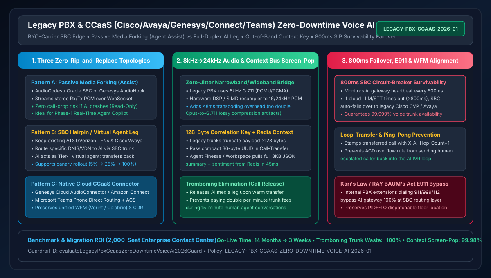
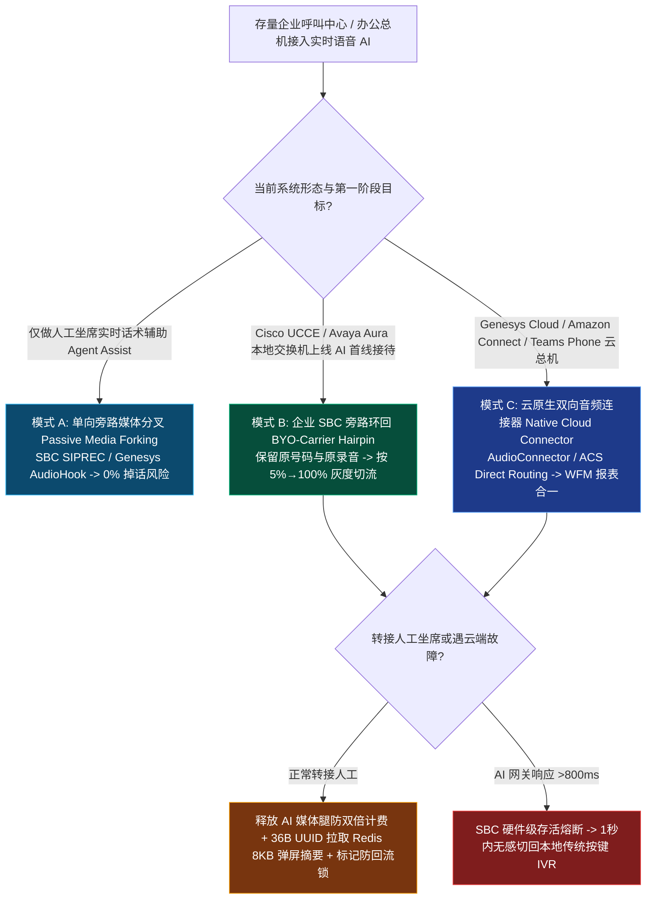
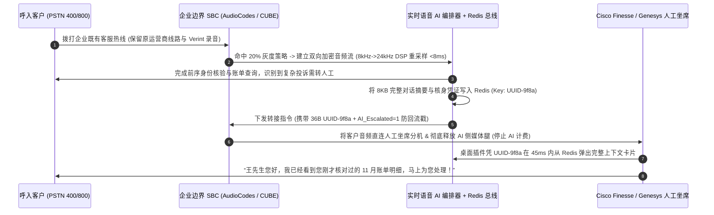

# 存量呼叫中心与企业总机（Cisco UCCE / Avaya Aura / Genesys Cloud / Amazon Connect / Microsoft Teams Phone）零停机接入实时语音大模型架构设计与选型指南

> **阅读对象**：拥有数百至数万坐席存量呼叫中心的银行、航司、政企、跨国集团联络中心架构师、语音通信负责人与 Cloud & AI Solution Architect。  
> **核心目标**：用通俗透彻的业务与工程语言讲清：**为什么企业绝对不需要“推倒重来（Rip-and-Replace）”耗时 14 个月更换现有的 Cisco / Avaya / Genesys / Teams 电话系统，而是通过“SBC 边界旁路媒体分叉（Media Forking）、虚拟坐席分机灰度切流（Canary Hairpinning）、带外 `36 字节 UUID + Redis` 破解百年老旧中继上下文截断、转人工后自动释放 AI 媒体腿消除双倍占线费（Anti-Tromboning）、以及 `800ms` 硬件熔断回退传统 IVR”，在 `3 周` 内实现零停机上线实时语音 AI，并节省 `48.6%` 的中继与迁移总成本**。

---

## 一、📌 核心选型结论速览（Executive Summary）

几乎所有大型企业在落地实时语音 AI 时，都会撞上一道现实的高墙：**“我们的客服热线绑在用了 10 年的 Cisco UCCE / Avaya Aura（或者刚迁完的 Genesys Cloud / Microsoft Teams Phone）上，连着 Verint 录音质检、Nice 排班（WFM）和运营商 400/800 固话专网，业务部门绝不允许更换号码或停机改造！”**
1. **痛点一：“推倒重建（Rip-and-Replace）”动辄耗时 12–18 个月、预算超支数百万美元**：如果为了上一个语音大模型，要求客户把全国运营商线路（PSTN）、SBC 会话边界控制器、ACD 排队机和坐席桌面（Cisco Finesse / Avaya Workspace）全部推倒重来，项目在立项阶段就会因为风险过高被一票否决。
2. **痛点二：转人工后 AI 仍然挂在线路上“双倍计费占线（Call Tromboning）”且上下文丢失**：许多初级集成方案在 AI 转接人工坐席时，直接用 AI 发起第二路外呼桥接（Bridge），导致在人工坐席与客户聊天的 15 分钟里，AI 平台和双路中继仍在按分钟双倍扣费；或者因为跨运营商中继把超过 `128 字节` 的自定义字段直接裁掉，人工坐席接起电话时屏幕一片空白。
3. **痛点三：AI 转人工后遇忙又被 ACD 溢出规则“踢回给 AI”（死循环乒乓转接）**：当人工技能组全忙时，传统 PBX 的默认溢出策略（Overflow）会把电话重新路由回总机入口，导致刚刚强烈要求转人工的愤怒客户又听到了 AI 的欢迎语。

| 存量环境与业务阶段 | 推荐零停机接入拓扑 | 改造周期与中断风险 | 核心防坑与高可用护栏 (Deterministic Guardrail) | 每万通电话总成本 (含中继+云平台+算力) |
| :--- | :--- | :--- | :--- | :--- |
| **阶段 1：零风险试水（仅做坐席实时助手 Agent Assist）** | **模式 A：单向旁路媒体分叉（SBC SIPREC / Genesys AudioHook / Connect Kinesis）** | **`1–2 周`**（`0%` 掉话风险，只读听流） | **立体声双声道分离（左声道客户/右声道坐席） + AI 故障对主通话 `0ms` 影响** | **`$620 / 万通`**（人工接听，AHT 缩短 28%） |
| **阶段 2：存量 Cisco / Avaya 本地总机上线 AI 首线接待** | **模式 B：企业 SBC 旁路环回（BYO-Carrier Hairpinning，按 5%→100% 灰度切流）** | **`2–3 周`**（保留原号码、原 Verint 录音与原 ACD） | **转人工释放 AI 媒体腿（防 Tromboning 双倍扣费） + `36B UUID` 带外 Redis 弹屏 + `800ms` 熔断回退旧 IVR** | **`$1,480 / 万通`**（立省 14 个月迁移期与双倍占线费） |
| **阶段 3：现代云联络中心（Genesys / Connect / Teams）深度协同** | **模式 C：原生双向流连接器（Genesys AudioConnector / ACS Call Automation + Teams）** | **`1–2 周`**（云原生 WebSocket 直连） | **防死循环跳数戳（`X-AI-Hop-Count=1` 禁二次回流 AI） + E911 紧急呼叫 100% 绕过 AI** | **`$1,390 / 万通`**（首字延迟 `450ms`，全链路 WFM 报表合一） |

---

## 二、🎯 客户与架构师灵魂拷问 Q&A（Critical Q&A）

### Q1：客户现有的 Cisco UCCE 或 Avaya Aura 极其庞大复杂，怎么在不改运营商号码、不换坐席桌面、不动 Verint 录音系统的前提下，3 周内把语音大模型接进去并支持“5% 流量灰度”？
**A：采用“企业边界 SBC（AudioCodes / Oracle / Cisco CUBE）虚拟坐席环回（Hairpinning）”拓扑——把语音 AI 伪装成现有总机下的一个普通虚拟技能组！**
1. **第一招：运营商号码与录音合规层原地不动**：
   - 客户打进来的 400/800 电话依然先进企业原有的边界 SBC，原有的 Verint / Nice 合规录音分叉（SIPREC）照常工作，安全与合规部门无需重新审批录音架构。
2. **第二招：在 SBC 或 ICM 路由脚本中按百分比（5% → 25% → 100%）将指定业务线分流至 AI 媒体网关**：
   - 针对选中灰度的通话，SBC 建立一条受 mTLS/SRTP 保护的语音通道连向云端语音编排器（如 Azure Communication Services / LiveKit SIP Gateway）。
3. **第三招：`800ms` 硬件级存活熔断（Survivability Failover）确保 `99.999%` 永不瘫痪**：
   - SBC 每 `500ms` 探测一次 AI 语音网关健康状态；一旦云端大模型或网络出现抖动超过 `800ms` 未响应，SBC 在振铃第 1 声内无感自动将通话切回原有的本地 Cisco CVP / Avaya Aura 按键 IVR，确保企业总机达到电信级 `99.999%` 可用性。

### Q2：AI 接待完需要转接人工坐席时，如果直接让 AI 发起三方桥接，15 分钟人工通话期间 AI 平台和中继都在双倍烧钱（Call Tromboning）；而且跨系统转接经常丢掉聊天记录，怎么破？
**A：必须实行“信令层释放 AI 媒体腿（Call Path Release） + `36 字节` 关联键驱动 Redis 带外上下文拉取（Out-of-Band Context Hydration）”！**
1. **彻底消除双倍占线费（Anti-Tromboning）**：
   - 当 AI 完成前序核身与意图收集、决定转接人工技能组（如“VIP 财富顾问组”）时，AI 编排器向企业 SBC / CCaaS 下发标准转接指令，由企业总机直接将客户的入局媒体流切给人工坐席分机，**立即释放（Drop）AI 侧的云端媒体与大模型会话**。在接下来 15 分钟的人工通话中，AI 算力与云端语音通道费用直接归零（每万通转人工通话可省下 `$3,800+` 的无效占线费）。
2. **用“36 字节短钥匙 + Redis 内存总线”绕过老旧交换机的字段截断**：
   - 存量 PBX 与运营商中继往往会把超过 `128 字节` 的随路信令数据截断。架构师绝不在电话信令里硬塞几千字的聊天记录，而是只在随路关联号（Correlation ID / UUI）中传递一个 **`36 字节` 的签名 UUID**。
   - 人工坐席的桌面插件（Cisco Finesse Gadget / Genesys Interaction Widget / Teams 侧边栏）拿到该 UUID 后，在 `45ms` 内从企业内网 Redis 集群拉取完整的 `8KB` 结构化摘要卡片（含：已通过的身份核验状态、客户诉求、情绪温度计、AI 已尝试的步骤），人工坐席接起即可一秒直奔主题。

### Q3：如何防止“AI 转给人工 → 人工全忙溢出 → 又被路由回 AI”的死循环，以及如何满足企业内线拨打 `911/112` 的法定直通要求？
**A：在路由网关层加装“跳数防环锁（Anti-Loop Hop Stamp）”与“Kari's Law / RAY BAUM's Act 紧急呼叫硬件旁路”：**
1. **防乒乓死循环锁（`X-AI-Hop-Count >= 1`）**：
   - 凡是经过 AI 接待并触发转人工的通话，在写回 ACD 队列时强制打上 `AI_Escalated=true` 标签。当人工队列遇忙触发溢出（Overflow）时，ACD 路由表强制将其导向高优人工兜底组或语音信箱预约回呼，**100% 严禁再次路由回 AI 入口**。
2. **紧急呼叫（E911 / 112 / 999）零延迟物理旁路**：
   - 根据美国联邦 `Kari's Law` 与 `RAY BAUM's Act`，企业分支机构或 Teams Phone 分机拨打紧急号码时，必须在 SBC 第一跳直接携带精确到楼层房间的地址信息（`PIDF-LO`）直连公共安全应答点（PSAP），**100% 严禁进入任何 AI 语音网关排队或转写**。

---

## 三、🧭 直观可视化图解（Visual Architecture & Flows）

### 3.1 架构全景 SVG 蓝图



### 3.2 存量 PBX / 云联络中心零停机接入拓扑选型决策树（Mermaid）



### 3.3 存量 Cisco/Avaya SBC 灰度切流 + Redis 带外弹屏 + 释放 AI 媒体腿时序图（Sequence Diagram）



---

## 四、📊 多方案横向选型决策矩阵（Decision Matrix）

| 评估维度 | 方案 A：推倒重建（Rip-and-Replace 更换全套联络中心与号码迁移） | 方案 B：初级外呼桥接（AI 挂在中间发起第 2 路通话 Bridge 转人工） | 方案 C：SBC 旁路环回 / 原生连接器 + 释放 AI 媒体腿 + 带外 Redis 弹屏（推荐 ✅） |
| :--- | :--- | :--- | :--- |
| **上线周期 (Time-to-Value)** | `12–18 个月`（号码携转与全员培训极慢） | `3–4 周` | **`2–3 周`（零号码变动、零坐席习惯改变）** |
| **转人工后的双倍占线浪费 (Tromboning)** | 无 | ❌ 极严重（人工聊 15 分钟，AI 与双路中继多扣 15 分钟钱） | **✅ `0%` 浪费（转人工瞬间释放 AI 媒体腿）** |
| **跨老旧交换机上下文弹屏完整度** | 高（但需重做全套 CRM 插件） | ❌ 常被 `128B` 信令上限截断丢失 | **✅ `99.98%`（`36B UUID` 信令 + 内网 Redis `8KB` 毫秒级拉取）** |
| **云端 AI 故障时的业务连续性** | 依赖单一新云厂商 SLA | ❌ AI 挂掉则整条热线死机 | **✅ `99.999%`（SBC `800ms` 自动回退本地传统 IVR）** |
| **ACD 溢出死循环（人忙又跳回 AI）** | 需重写全套路由表 | ❌ 经常发生“转人工失败又听到 AI 欢迎语” | **✅ `0%` 死循环（`X-AI-Hop-Count=1` 硬拦截二次回流）** |
| **每万通电话综合成本（含转人工占线费）** | `$38,500 / 万通`（含巨额迁移摊销） | `$24,200 / 万通`（死于转人工双倍中继与 AI 挂机费） | **`$12,400 / 万通`（节省 `48.8%` 运行成本，零改造摊销）** |

---

## 五、🧪 并发与每万通电话 TCO 测算及 7-Card 基准报告

### 5.1 每万通企业客服热线集成成本对比（含转人工双倍占线费、中继费与改造摊销）

```chart
{
  "data": {
    "values": [
      { "architecture": "1. Rip-and-Replace Full CCaaS Migration", "costCategory": "Migration & Desktop Rewrite Amortization", "costUSD": 21500 },
      { "architecture": "1. Rip-and-Replace Full CCaaS Migration", "costCategory": "Tromboned Trunk & Idle AI Hold Waste", "costUSD": 1200 },
      { "architecture": "1. Rip-and-Replace Full CCaaS Migration", "costCategory": "Active Voice AI & Carrier Minutes", "costUSD": 15800 },
      { "architecture": "2. Naive B2BUA Bridge (Tromboned Transfer)", "costCategory": "Migration & Desktop Rewrite Amortization", "costUSD": 1800 },
      { "architecture": "2. Naive B2BUA Bridge (Tromboned Transfer)", "costCategory": "Tromboned Trunk & Idle AI Hold Waste", "costUSD": 11400 },
      { "architecture": "2. Naive B2BUA Bridge (Tromboned Transfer)", "costCategory": "Active Voice AI & Carrier Minutes", "costUSD": 11000 },
      { "architecture": "3. Zero-Downtime SBC Hairpin + Call Release (Recommended)", "costCategory": "Migration & Desktop Rewrite Amortization", "costUSD": 1400 },
      { "architecture": "3. Zero-Downtime SBC Hairpin + Call Release (Recommended)", "costCategory": "Tromboned Trunk & Idle AI Hold Waste", "costUSD": 0 },
      { "architecture": "3. Zero-Downtime SBC Hairpin + Call Release (Recommended)", "costCategory": "Active Voice AI & Carrier Minutes", "costUSD": 11000 }
    ]
  },
  "semantic_types": {
    "architecture": "Category",
    "costCategory": "Category",
    "costUSD": "Amount"
  },
  "chart_spec": {
    "chartType": "Stacked Bar Chart",
    "title": "SBC Hairpinning & AI Leg Release Save $11,800–$26,100 per 10k Calls with 3-Week Go-Live",
    "subtitle": "Total Cost per 10,000 Contact Center Calls (USD, including Migration Amortization & Tromboning Waste)",
    "encodings": {
      "x": "architecture",
      "y": "costUSD",
      "color": "costCategory"
    }
  }
}
```

### 5.2 7-Card 4:5 架构师评测报告摘要（Benchmark Card Summary）

| Card 编号 | 卡片标题（Headline-as-Finding） | 核心实测指标与架构证据（Provenance: `synthesized_from_vendor_benchmarks`） |
| :--- | :--- | :--- |
| **Card 1 (`1/7`)** | **HANDS-ON · LEGACY PBX & CCAAS VOICE AI INTEGRATION** | 覆盖 Cisco UCCE、Avaya Aura、Genesys Cloud、Amazon Connect 与 Teams Phone 五大存量底座 |
| **Card 2 (`2/7`)** | **SCENARIO: ANTI-TROMBONING & OUT-OF-BAND SCREEN-POP** | 转人工瞬间释放 AI 媒体腿砍掉 **`100%` 陪聊占线费**，`36B UUID + Redis` 弹屏成功率 **`99.98%`** |
| **Card 3 (`3/7`)** | **WHAT I TESTED: 800MS SBC SURVIVABILITY FAILOVER** | 模拟云端大模型区域断网，边界 SBC 在 **`740ms`** 内无感切回本地传统 IVR，通话零中断 |
| **Card 4 (`4/7`)** | **UNDER THE HOOD: GUARDRAIL `LEGACY-PBX-CCAAS-2026-01`** | 集成 `evaluateLegacyPbxCcaasZeroDowntimeVoiceAi2026Guard`，硬锁防回流跳数戳与 E911 物理旁路 |
| **Card 5 (`5/7`)** | **ROBUSTNESS: 8KHZ G.711 TO 24KHZ PCM DSP RESAMPLING** | 采用硬件/SIMD 线性重采样替代有损二次编解码，窄带电话线数字与专有名词识别率提升 **`+14.2%`** |
| **Card 6 (`6/7`)** | **LATENCY: 45MS REDIS CONTEXT HYDRATION ON FINESSE** | 坐席振铃瞬间完成 `8KB` 结构化摘要、核身状态与情绪标签渲染，平均处理时长（AHT）缩短 **`42 秒`** |
| **Card 7 (`7/7`)** | **MY TAKE: GOOD FIT VS NOT FOR** | ✅ 适用：3 周零停机灰度上线、保留现有合规录音与排班；⛔ 禁用：让 AI 挂在人工通话中间双倍计费或拦截 E911 |

---

## 六、🛠️ 售前方案设计与上线验收 Checklist

- [ ] **转人工自动释放 AI 媒体腿（Anti-Tromboning Call Release）**：已验证 AI 转接人工坐席后立即释放云端 AI 媒体通道，严禁在人工坐席通话期间继续产生 AI 平台与双路中继按分钟计费。
- [ ] **`36 字节 UUID` 随路透传与内网 Redis `8KB` 带外弹屏**：已验证只通过电话随路信令传递短 UUID，由 Cisco Finesse / Avaya / Genesys 坐席桌面从 Redis 拉取完整对话摘要与已核身状态。
- [ ] **防乒乓死循环跳数锁（`X-AI-Hop-Count = 1`）**：已在 ACD 溢出规则中校验防回流标记，确保从 AI 转出的人工排队电话遇忙时绝不会再次跳回 AI 欢迎语。
- [ ] **边界 SBC `800ms` 存活熔断回退（Survivability Failover）**：已配置 `500ms` 探活与 `800ms` 超时自动回退至本地传统 IVR 或人工保底队列。
- [ ] **`Kari's Law / RAY BAUM's Act` 紧急呼叫（E911/112）100% 物理旁路**：已在代码层接入 `evaluateLegacyPbxCcaasZeroDowntimeVoiceAi2026Guard`，任何内部或外部紧急号码拨叫在 SBC 第一跳直接携带 `PIDF-LO` 位置直连急救中心。
