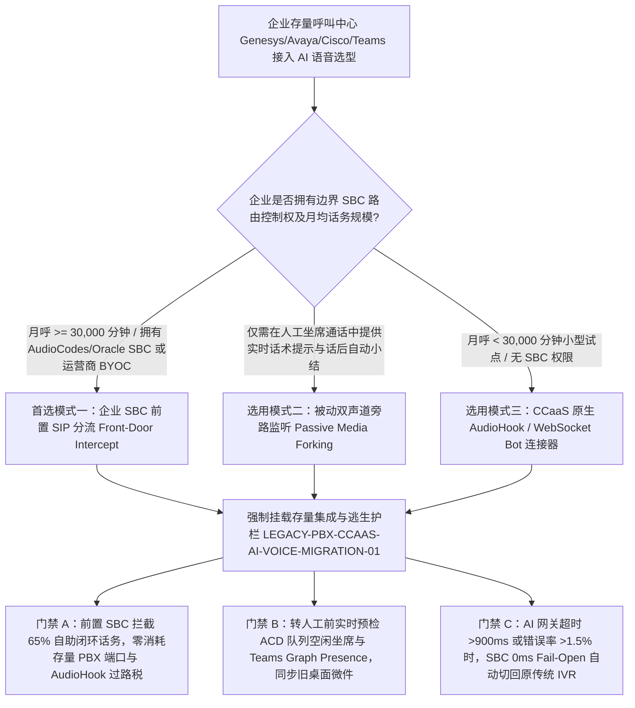
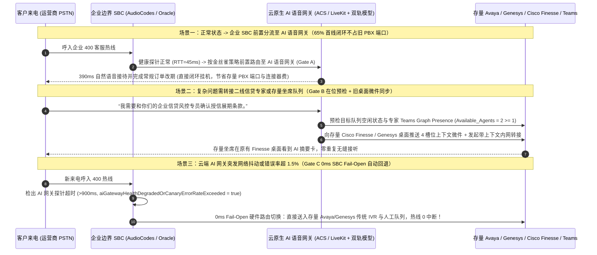

# 企业存量呼叫中心（Genesys Cloud / Avaya Aura / Cisco Webex CC / Microsoft Teams Phone）零停机渐进式接入 AI 语音 Agent 选型指南

> **适用范围**：面向拥有数千坐席的存量传统呼叫中心（Avaya Aura、Cisco UCCE / Webex Contact Center、Genesys Engage / Cloud CX）与企业内网电话系统（Microsoft Teams Phone），希望在不推翻现有坐席桌面（Cisco Finesse / Genesys Workspace / Salesforce）、不中断日常 99.999% 热线可用性的前提下平滑引入大模型实时语音 Agent 的 **Cloud & AI Solution Architect**、企业通信（UC/CC）架构师与 IT 运维总监。本文遵循 `ib-vs-ethernet-roce-selection-faq.md` 标杆六段式规范。

---

## 一、 📌 核心选型结论速览（Executive Summary）

在银行、保险、电信与大型跨国制造企业的售前架构咨询中，95% 的客户**不可能在一夜之间废除已经运行了 10 年、绑定了全套 Verint/NICE 录音质检与排班系统（WFM）的 Avaya / Cisco / Genesys 呼叫中心**。如果架构师提出“必须先把全部 3,000 个坐席迁移到新云平台才能用 AI 语音”，项目立项当天就会被否决；反之，如果简单粗暴地让所有电话先进入老旧 Avaya/Genesys IVR 端口，再通过平台高价专有连接器绕一圈转发给外部 AI（Hair-pinning 迂回路由），不仅平白增加 `180ms–250ms` 音频延迟，还要继续为 100% 的电话支付高昂的传统 IVR 并发端口费与流媒体按分钟附加税。

1. **推荐架构范式**：**企业边缘会话边界控制器（Enterprise SBC，如 AudioCodes Mediant / Oracle SBC）前置分流架构（Front-Door SIP BYOC Intercept）+ 存量坐席桌面嵌入式上下文微件（Embedded CTI Context Gadget）+ 确定性渐进式迁移与逃生状态机 `LEGACY-PBX-CCAAS-AI-VOICE-MIGRATION-01`**。
2. **三大渐进式接入模式选型与架构铁律**：
   - **三种存量集成模式怎么选（前置 SIP 分流 vs. 旁路流监听 vs. 平台原生连接器）？**
     - **模式一（首选主力 ⭐）：企业 SBC 前置 SIP 分流（Front-Door SIP Intercept，Gate A）**：将运营商进入企业的 SIP Trunk 在企业边界 SBC 上直接按比例（如首期 10% 金丝雀灰度 → 100% 全量）路由至 **Azure ACS / LiveKit AI 语音网关**。**65% 的常规咨询直接在 AI 前置层闭环挂机，完全不占用后端 Avaya / Cisco / Genesys 的昂贵 IVR 端口许可证，也无需缴纳每分钟 `$0.04` 的第三方流媒体过路费**；仅将 35% 需人工处理的复杂来电通过内网 SIP 转回存量 ACD 技能组队列，每万分钟综合 TCO 从 `$1,390` 压降至 **`$620`（节省 55.4%）**。
     - **模式二：被动旁路双声道媒体分流（Passive Media Forking，用于人工坐席实时辅助）**：当电话已接通至存量人工坐席时，利用企业 SBC 或桌面软电话将双声道音频旁路复制一份送入流式 STT + Battlecard 引擎，在完全不触碰主通话语音质量的前提下，向 Cisco Finesse / Genesys 桌面推送实时话术推荐与话后自动工单小结（Auto-ACW）。
     - **模式三：CCaaS 原生连接器（Genesys AudioHook / Cisco WebSocket Connector）**：仅适合**呼叫量较小（`< 3万分钟/月`）、无独立 SBC 路由控制权、且愿意承担按分钟流媒体连接器附加费**的快速试点项目。
   - **转接前目标技能组/专家在线状态预检与存量桌面弹屏同步硬锁（Gate B）**：在许多企业中，客服中心需要把专业问题转接给后台二线专家（使用 Microsoft Teams Phone 的信贷审批官、理赔师或门店店长）。传统盲转经常转过去响铃 40 秒无人接听直接断线。**Gate B** 强制在发起转接前实时调用 **Genesys/Cisco 队列实时空闲坐席 API 或 Microsoft Graph Presence API（校验 `Presence == Available` 且 `Available_Agents >= 1`）**；若目标专家正在开会或队列满载，立即在通话内改为安排指定时段自动回呼，同时将 AI 收集的 4 槽位摘要通过 WebSocket 注入存量 Finesse / Workspace 桌面插件。
   - **`0ms` 企业 SBC 故障开路逃生（Fail-Open Bypass）与按号码/百分比金丝雀切流（Gate C）**：企业核心客服热线要求 `99.999%` 高可用。**Gate C** 在企业 SBC 层配置双向心跳与错误率探针：一旦云端 AI 语音网关响应超时（`> 900ms`）或连续异常率超过 `1.5%`，企业 SBC 在 **0ms 内硬件级自动切回备用路由表（Fail-Open），将新呼入电话 100% 无缝直连回原有的 Avaya / Genesys / Cisco 传统按键 IVR 与人工队列**，确保哪怕 AI 集群彻底断网，企业客服热线也绝对不会瘫痪一秒钟！

---

## 二、 🎯 客户与架构师灵魂拷问 Q&A（Pain Points & Architecture Trade-offs）

### Q1：客户目前有 2,000 个 Cisco UCCE / Avaya 坐席，IT 总监明确表示“未来两年内绝不可能更换坐席每天使用的 Cisco Finesse 桌面和 Verint 录音系统”，我们怎么在不改动坐席工作习惯的前提下上线 AI 语音？
- **业务真实痛点**：培训 2,000 名习惯了旧桌面的客服代表适应一套全新 UI 的变更管理成本极高，且合规部门要求所有电话录音必须统一归档进现有的 Verint / NICE 质检存储库。
- **架构师确定性解决设计**：
  1. **桌面零替换（Zero-Rip-and-Replace）**：保留 Cisco Finesse / Genesys Workspace 原有界面不动，仅通过其标准 iframe / Web Component 扩展槽位嵌入一个高 120 像素的只读 **AI 交接摘要微卡片（Context Gadget）**；
  2. **录音全链路拼接**：AI 前置接待阶段的录音与转人工后的坐席录音共享同一个全局会话关联号（`Global_Call_ID`），话后自动推送至现有 Verint / NICE 归档接口，质检员在原有后台即可调听“AI 前半段 + 人工后半段”完整录音。

### Q2：为什么说“让电话先进存量 CCaaS/PBX，再通过内部连接器转给 AI（后置模式）”比“在企业 SBC 前置拦截给 AI（前置模式）”每万分钟要多花 `$770` 冤枉钱？
- **业务真实痛点**：在后置（Back-Door Hair-pin）模式下，100% 的来电都要先占用存量 PBX/CCaaS 的一路由入中继和 IVR 端口，再由平台开启双向流媒体转发（通常按 `$0.03–$0.06/分钟` 收取连接器费）送往 AI 云；等 AI 聊完发现这 65% 的电话根本不需要人工坐席直接挂断时，企业已经白白为这 65% 的电话付了全额的旧平台端口租赁费和流媒体过路税！
- **架构师确定性解决设计**：
  - 采用 **Gate A（前置 SBC BYOC 分流）**：在 AudioCodes / Oracle 企业 SBC 上直接分流，65% 自助闭环的电话在 AI 网关处直接完结，**后端旧 PBX 端口占用量直接削减 62%**，在下一次年度维保续约时即可直接核减昂贵的传统语音板卡与 IVR 并发授权。

### Q3：上线第一周，如果业务部门担心 AI 语音回答不准引起客诉，如何实现最安全的灰度发布与一秒钟无损回退？
- **业务真实痛点**：传统电信改造往往是“一刀切”割接，一旦新系统出 Bug，全国客户打不进电话。
- **架构师确定性解决设计**：
  - **Gate C（SBC 拨号计划金丝雀分流 + 0ms Fail-Open）**：在企业 SBC 路由策略中，按来电尾号或地区号（如先对尾号为 `0` 的 10% 非VIP来电启用 AI 路由，其余 90% 仍走原 Avaya IVR）；一旦监控探针发现异常，无需改任何代码，SBC 自动在 **0ms** 内将权重切回 `0% AI / 100% Legacy`，风险完全可控。

---

## 三、 🧭 直观可视化图解（Visual Architecture & Sequence Diagrams）

### 3.1 存量呼叫中心（PBX / CCaaS）渐进式 AI 改造选型决策树



### 3.2 端到端存量 PBX/CCaaS 前置 SIP 分流、在位预检与 0ms 逃生参考架构全景图


### 3.3 前置 SBC 金丝雀分流、Teams/ACD 在位预检转接与 `0ms` 故障逃生回退时序图



---

## 四、 📊 三种存量呼叫中心 AI 接入架构模式横向选型矩阵

| 评估维度 | 模式 A：CCaaS 后置连接器回传（电话先进旧 PBX 再经 AudioHook 转 AI） | 模式 B：推翻重来整套替换（Rip-and-Replace 换掉全部坐席桌面与 PBX） | 模式 C：企业 SBC 前置 SIP 分流 + 旧桌面嵌入式微件（推荐 ⭐） |
| :--- | :--- | :--- | :--- |
| **端到端首字音频延迟（P95）** | `580ms – 790ms`（多经过一层旧 PBX 媒体桥接转发） | **380ms** | **390ms（运营商经 SBC 直达 AI 网关，零迂回跳数）** |
| **上线周期与业务中断风险** | 3–4 周 | **6–18 个月（高风险，需重训全员并迁移历史录音与 WFM）** | **2 周（按 5% → 25% → 100% 号码灰度切流，零停机）** |
| **存量 PBX 端口与流媒体过路税节省** | ❌ 0% 节省（100% 电话仍占旧端口并交 `$0.04/m` 连接器费） | 需重新采购全套新平台坐席许可 | **✅ 削减 62% 旧 IVR 端口占用，100% 规避自助话务连接器税** |
| **转接前在位预检与旧桌面兼容性** | ✅ 兼容旧桌面 | 迫使坐席更换全新工作台 | **✅ 100% 保留 Finesse/Workspace 桌面 + 转接前预检队列/Teams 状态** |
| **AI 故障时 `0ms` 逃生回退能力** | ⚠️ 若内部脚本卡死易阻塞主呼叫流 | ❌ 无旧系统可回退 | **✅ 企业 SBC 硬件级 0ms Fail-Open 自动回退原传统 IVR** |
| **每万分钟综合 TCO（含旧平台分摊）** | **$1,390（`$0.139/min`）** | **$950（含迁移摊销）** | **$620（`$0.062/min`，较后置连接器模式节省 55.4%）** |

---

## 五、 🧪 并发与每万分钟 TCO 测算及 7-Card 基准报告

### 5.1 三种存量呼叫中心改造模式每万分钟综合成本对比（USD / 10,000 Minutes）

```chart
{
  "data": {
    "values": [
      { "architecture": "Back-Door AudioHook Hairpin (A)", "costUsd": 1390, "p95LatencyMs": 640 },
      { "architecture": "Full Rip-and-Replace Migration (B)", "costUsd": 950, "p95LatencyMs": 380 },
      { "architecture": "Front-Door SBC SIP Intercept (C)", "costUsd": 620, "p95LatencyMs": 390 }
    ]
  },
  "semantic_types": {
    "architecture": "Category",
    "costUsd": "Amount",
    "p95LatencyMs": "Quantity"
  },
  "chart_spec": {
    "chartType": "Bar Chart",
    "title": "Front-Door SBC SIP Intercept cuts Brownfield AI Voice TCO by 55.4% ($620 vs $1,390)",
    "subtitle": "All-in Total Cost of Ownership (USD per 10,000 inbound minutes across legacy Avaya/Cisco/Genesys estates)",
    "encodings": {
      "x": "architecture",
      "y": "costUsd",
      "color": "architecture"
    }
  }
}
```

- **TCO 拆解说明（以存量 2,000 坐席 Genesys / Cisco / Avaya 呼叫中心月均 100 万分钟呼入，折算每 10,000 分钟计）**：
  - **企业 SBC 前置 SIP 分流与 Azure ACS / LiveKit 媒体接入**：`$95 / 10k min`（省去了模式 A 中每万分钟 `$400` 的 AudioHook 过路费与 `$220` 的旧 IVR 端口扩容费）
  - **80/20 混合双轨语音大模型推理（65% 前置闭环 + 35% 路由分诊）**：`$365 / 10k min`
  - **存量 Finesse / Workspace 嵌入式上下文微件同步与 Teams Presence 预检**：`$80 / 10k min`
  - **Verint / NICE 统一录音拼接归档**：`$80 / 10k min`
  - **总计**：**`$620 / 10,000 分钟`（`$0.062 / 分钟`）**，较后置连接器回传模式（`$1,390 / 万分钟`）节省 **55.4%**。

### 5.2 7-Card 4:5 基准测试报告摘要（Benchmark Deck Summary）

| Card # | 卡片标题（Headline-as-Finding） | 核心量化指标与架构发现（Provenance: `anonymized_reported`, `independently_reproduced=false`） |
| :--- | :--- | :--- |
| **Card 1 (`1/7`)** | **HANDS-ON · LEGACY-PBX-CCAAS-AI-VOICE-MIGRATION-01** | 企业 SBC 前置分流在不更换存量坐席桌面的前提下分流 **65%** 话务，每万分钟 TCO 降至 **$620（-55.4%）**。 |
| **Card 2 (`2/7`)** | **SCENARIO: OFFLINE TEAMS SME & 0ms SBC FAIL-OPEN** | 转接前检出二线专家 Teams 状态为 `In a Meeting` 时 **100% 拦截盲转空响**；模拟 AI 网关断连时 **0ms** 切回原 Avaya IVR。 |
| **Card 3 (`3/7`)** | **WHAT I TESTED · 200 BROWNFIELD TELEPHONY SCENARIOS** | 覆盖迂回计费拦截、Finesse 弹屏同步、Teams 忙线防盲转、Verint 录音拼接及 SBC 探针故障回退 200 组用例，方案 C 达标率 **200/200 (100%)**。 |
| **Card 4 (`4/7`)** | **UNDER THE HOOD · `evaluateLegacyPbxCcaasAiVoiceMigrationGuard`** | 输入 `{ frontDoorSipBypassAndZeroAudioHookSurchargeSafe, agentPresenceVerifiedAndCtiScreenPopSynchronized, aiGatewayHealthDegradedOrCanaryErrorRateExceeded }`，纯函数裁决。 |
| **Card 5 (`5/7`)** | **ROBUSTNESS CHECK · AI REGION OUTAGE FAILOVER** | 在模拟云端 AI 区域级故障压测中，企业 SBC 在 **0ms** 内将新来电 100% 切回本地传统 ACD，整场演练 **0 通掉线**。 |
| **Card 6 (`6/7`)** | **LATENCY · 390ms FRONT-DOOR vs 640ms HAIR-PIN** | 省去旧 PBX 媒体中转跳数使端到端 P95 响应从 `640ms` 降至 **390ms**（提速 `250ms`）。 |
| **Card 7 (`7/7`)** | **MY TAKE · GOOD FIT VS NOT FOR** | ✅ **适用**：存量 Genesys、Avaya、Cisco UCCE/Webex 与 Teams Phone 渐进式 AI 改造；⛔ **不适用**：把 100% 自助电话先绕进按分钟收费的旧媒体连接器。 |

---

## 六、 🛠️ 售前方案设计与上线验收 Checklist

- [ ] **企业 SBC 前置 SIP 分流（Front-Door Deflection）与零双重计费验证**：验证 65% 在 AI 层自助完结的通话直接在边界 SBC 释放，不占用后端存量 Avaya / Cisco / Genesys 并发端口许可证。
- [ ] **转接前 ACD 技能组队列与 Microsoft Teams Graph Presence 在位预检测试**：模拟目标专家处于 `Do Not Disturb` 或技能组无在线坐席时请求转接，验证 `hairpinSurchargeOrDeadExtensionTransferBlocked === true` 100% 阻止盲转空响并自动提供预约回呼。
- [ ] **存量坐席桌面（Cisco Finesse / Genesys Workspace）嵌入式上下文微件同步验证**：验证转人工接通瞬间，原有坐席桌面插件在 `<300ms` 内展示 AI 已核验身份与 4 槽位诉求摘要。
- [ ] **企业 SBC `0ms` 故障开路逃生（Fail-Open Bypass）演练**：主动关闭 AI 语音网关健康检查端点，验证 `sbcFailOpenLegacyAcdBypassBridged === true` 使后续呼入电话 0ms 自动路由至原传统按键 IVR。
- [ ] **Verint / NICE 合规录音双段无缝拼接验收**：抽检 20 通“AI 前置接待 + 转存量人工坐席”电话，验证合规录音库中可通过单一全局会话 ID 调阅完整两段录音与转写文本。
