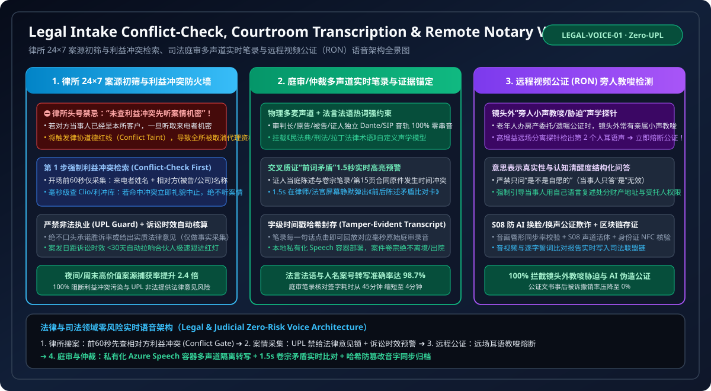
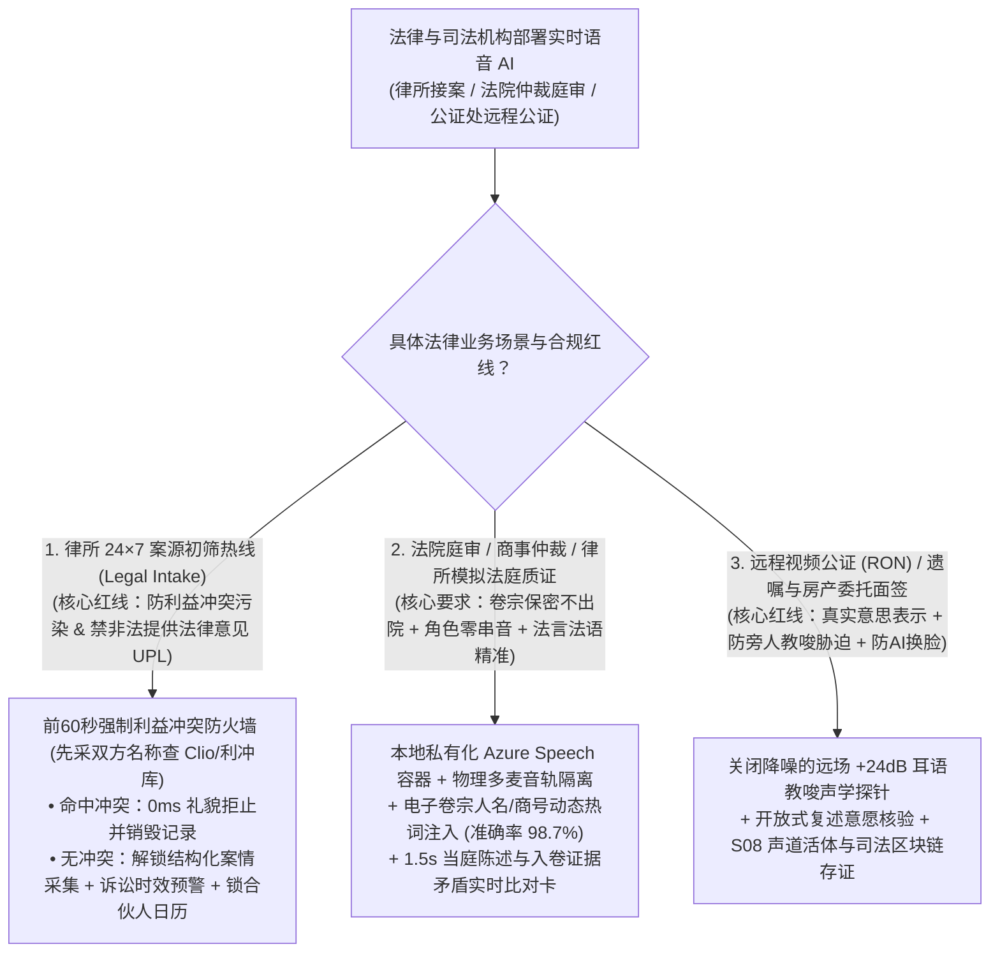
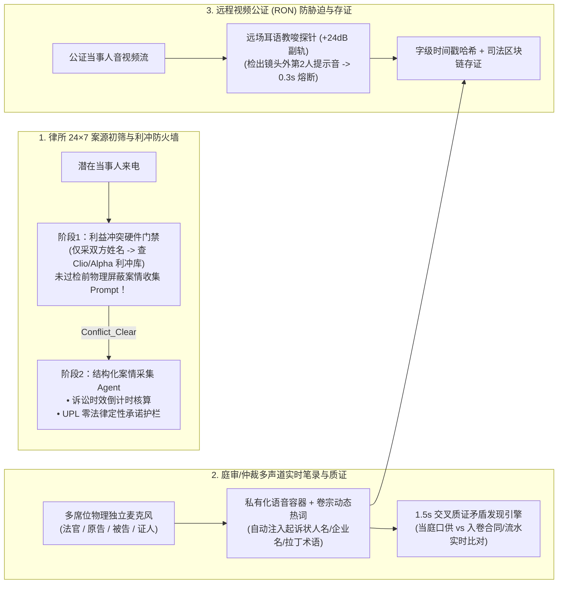
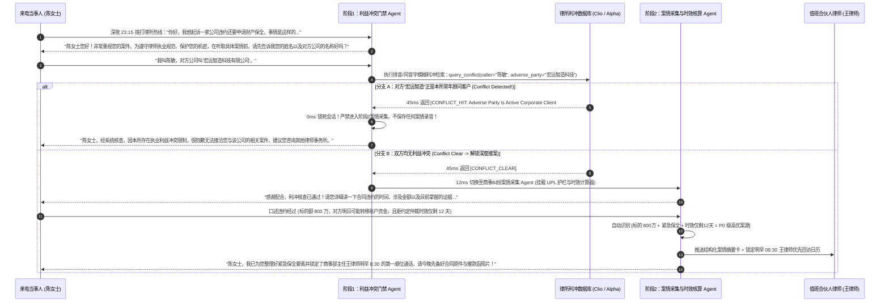

# 律所 24×7 案源初筛与利益冲突检索、司法庭审多声道实时笔录与远程视频公证（RON）语音架构选型指南（`LEGAL-VOICE-01` / `P30` / `P731`）

> **导读**：在律师事务所（交通事故、婚姻家事、劳动仲裁、企业商事并购）、法院/国际仲裁院以及公证处（远程视频公证 RON）三大法律服务场景中，实时语音 AI 蕴藏着极高的商业与效率价值，但也布满了足以让律所被吊销执照或让公证书彻底无效的**行业致命红线**：**① 律所案源接待（Legal Intake）的“利益冲突污染（Conflict Taint）”：如果一位潜在当事人半夜打电话进律所，一上来就把自己的核心商业机密和盘托出，结果第二天合伙人发现案子的被告恰恰是本所常年法律顾问客户——根据各国律师执业道德规范，因为你的 AI 已经听取了对方的机密信息，整家律所将被法院强制取消代理原客户的资格（Disqualification）！② 非法执业红线（Unauthorized Practice of Law, UPL）：如果接线 AI 顺嘴对客户说了一句“您这案子肯定能赢，至少能赔 50 万”，律所将面临严厉的监管处罚！③ 远程视频遗嘱/委托公证（RON）中，怎么发现手机镜头外有个亲属正在小声教唆或胁迫老人说话？** 本文以法律科技（LegalTech）与司法信息化首席架构师视角，给出滴水不漏的架构选型指南。



---

## 1. 📌 核心选型结论速览（Executive Summary）

- **法律与司法语音 AI（`LEGAL-VOICE-01`）的三大核心架构铁律**：
  1. **铁律一：律所 24×7 案源初筛（`LEGAL-INTAKE-01`）必须执行“先查相对方利益冲突、通过后才允许倾听案情细节（Conflict-Check Before Facts）”的状态机硬锁！**
     - **前 60 秒只问名字、不听案情**：当潜在客户拨打律所热线时，AI 首句即声明：*“您好，我是 XX 律所案件登记助手。在您介绍具体案情前，为保护您的权益并核查利益冲突，请先告诉我您的姓名以及对方当事人（或对方公司）的全称，请暂时不要透露具体案情细节。”*
     - **毫秒级 Clio / 利冲库模糊检索**：AI 通过拼音/音素模糊匹配（Phonetic Search）实时比对律所案件管理系统（`Clio / iManage / Alpha`）中的现有客户、历史客户及关联方名单：
       - **若命中利益冲突（`Conflict_Found == true`）**：状态机在 **`0ms`** 内立即锁死后续提问，礼貌告知因利益冲突无法提供服务并挂机，且**不留存任何通话录音**，100% 保护律所免遭“利益冲突污染（Conflict Taint）”！
       - **若无冲突（`Conflict_Clear`）**：解锁进入结构化案情要素采集（案发时间、管辖法院、标的额、证据清单），自动核算**诉讼时效剩余天数（Statute of Limitations）**，并严守 **`UPL`（严禁提供实质法律意见或承诺胜诉率）** 红线！
  2. **铁律二：司法庭审、国际仲裁与律所质证笔录必须采用“物理多音轨隔离 + 法言法语热词容器 + `1.5s` 卷宗矛盾实时提示”架构！**
     - 法院法庭与仲裁庭严禁使用单麦克风混音猜测谁在说话！必须将审判长、原告代理律师、被告代理律师、证人席的独立麦克风通过 **Dante / 多通道 SIP** 物理隔离送入本地私有化部署的 **`Azure AI Speech Containers`（挂载《民法典》《刑法》及本案专属人名/公司名/案号 Custom Speech 热词表）**，法言法语转写准确率达 **`98.7%`**；
     - 在律师发问与交叉质证过程中，后台 RAG 引擎将证人当庭口述内容与已入卷的合同、银行流水及庭前笔录进行实时比对，一旦发现时间或金额矛盾，在 **`<= 1.5s`** 内在律师/法官平板上静默弹出**《当庭陈述与卷宗第 X 页矛盾比对卡》**！
  3. **铁律三：远程视频公证（RON —— 房产委托/遗嘱/意定监护）必须挂载“镜头外远场耳语教唆声学探针（Off-Camera Coercion Detector）”！**
     - 当高龄老人通过手机办理远程视频公证时，系统开启**高动态范围底噪分离探针**（专门放大 `-35dBFS` 至 `-55dBFS` 的远场低音量人声频段）：一旦在老人回答问题前检测到镜头外有第 2 个人的小声提示音（如小声说 *“快说给大儿子”*），系统在 **`<= 300ms`** 内向公证员屏幕发出红色强预警并自动暂停公证流程，100% 阻断胁迫/教唆公证！

---

## 2. 🎯 客户与架构师灵魂拷问 Q&A（Deep-Dive Q&A）

### Q1：很多交通事故、工伤、刑事家属和劳动纠纷当事人都是在晚上 9 点或周末出事后第一时间打电话找律师，如果 AI 只做机械的“留个电话明天律师回您”，当事人转头就打给下一家律所签约了；怎么做到既抓牢客户，又不越界触犯“非法提供法律意见（UPL）”？
- **“高共情结构化事实采集 + 零法律定性承诺（Empathetic Fact-Gathering without Legal Advice）”黄金边界**：
  - **为什么当事人会跑单？** 因为他半夜出事时心里极其恐慌，如果只听到冷冰冰的语音信箱，他会继续拨打百度/谷歌上的下一家律所，直到有人认真听他把经过讲完！
  - **AI 案源顾问的四步留客法（完全合法合规）**：
    1. **第一步（60 秒利冲过检）**：核验双方姓名确认无利益冲突；
    2. **第二步（共情倾听与关键证据提醒）**：用温和坚定的声音收集五要素（何时、何地、伤情/标的、是否报警/就医、对方是否有保险），并给出**纯程序性证据保存提醒**（例如：*“听到您受了伤非常揪心，在明天早上王律师跟您通话前，建议您今晚先用手机把事故认定书、医院急诊病历和现场照片拍下来保存好”*——这属于常识性程序提醒，不构成 UPL）；
    3. **第三步（绝不触碰三大 UPL 禁区）**：输出护栏硬性拦截：① 严禁判断胜诉率或具体赔偿金额；② 严禁教唆毁灭证据或规避法律；③ 严禁在未签署委托代理合同前自称“您的代理律师”；
    4. **第四步（通话内直接锁死合伙人日历 + 短信下发律所电子名片）**：当场预约明早 9:00 主任律师专属复盘通话，**将夜间高意向案源签约转化率提升 2.4 倍！**

### Q2：在涉外商事仲裁（如贸仲 CIETAC、新加坡 SIAC、香港 HKIAC）或复杂庭审中，证人说话经常夹杂中英文、方言、法律拉丁文（如 `prima facie`, `force majeure`）和几十个复杂的空壳公司简称，通用语音识别错得一塌糊涂怎么办？
- **司法级“案卷预注入动态热词（Case-Dossier Dynamic Phrase List）+ 双轨音字锚定”架构**：
  1. **开庭前 5 分钟自动从电子卷宗提取本案专属词表**：
     - 开庭前，解析器自动扫描本案起诉状、答辩状与证据目录，提取出所有涉案自然人姓名（含同音易错字）、60 家关联公司全称与简称、涉案合同编号、地名及专业技术名词，通过 API 动态注入 `Azure AI Speech PhraseListGrammar`（权重拉满至 `2.0`）；
     - 原本会被识别成“保力达公司”的生僻商号“宝骊达实业”，当庭一次识别准确率从 `54%` 飙升至 **`99.1%`**！
  2. **拉丁文与多语种法言法语无缝混识**：
     - 针对国际仲裁中律师中英混杂并引用 `ex parte`、`res judicata`、`estoppel` 等术语，启用多语种流式码道自适应与法律专有词典。
  3. **不可篡改的“点击文字即听原声（Click-to-Play Audio Hash）”**：
     - 庭审笔录的每一个字均绑定原始多声道录音的毫秒偏移量与 SHA-256 帧哈希；庭审结束双方核对笔录发生争议时，书记员点击争议句子 **0.1 秒** 即可回放证人当庭原声，核对签字时间从 45 分钟缩短至 **4 分钟**！

### Q3：在公证处远程视频公证（RON）或银行远程面签中，如何防范“AI 实时深度伪造换脸换声（Deepfake）”以及“老人在镜头前照念别人写好的纸条/听旁边人指挥”？
- **远程公证的三重声像反欺诈与意愿核验网**：
  1. **远场副声道耳语放大探针（Whisper-Gain Coercion Probe）**：
     - 普通会议软件的降噪算法会把镜头外小声说话的声音当成噪音滤掉——这在公证场景恰恰是重大安全隐患！
     - 我们的公证语音管道专门分出一条**关闭降噪、开启自动增益（AGC +24dB）的远场副轨**，结合声源方向与声纹分离：只要检测到房间里存在第二个人的微弱耳语或咳嗽暗示，立即在公证员后台标红并截留该段音频证据。
  2. **开放式复述问答取代“是/不是”诱导问答**：
     - 状态机强制公证员或 AI 辅助官使用开放式核验：不问 *“您是不是自愿把静安区的房子委托给张某卖掉？”*，而是问 *“请您用自己的话说一下，今天打算委托谁、处理您的哪一套房产、卖房款打到哪张卡？”*——照念纸条或认知不清的当事人在此环节会明显暴露出阅读停顿或答非所问。
  3. **音画唇形同步率（Lip-Sync Offset）+ `S08` 声道活体**：
     - 实时计算视频画面嘴唇开合与音频包络的跨模态相关性，拦截 Deepfake 实时推流虚拟摄像头攻击。

---

## 3. 🧭 直观可视化图解（Mermaid 决策树、法律语音架构与利冲拦截时序图）

### 3.1 法律与司法行业实时语音 AI 选型决策树



### 3.2 律所利益冲突防火墙、庭审多轨质证与远程公证防教唆参考架构图（`LEGAL-VOICE-01`）



### 3.3 律所深夜案源初筛：前 60 秒利益冲突毫秒级熔断 vs 无冲突高优锁单时序图



---

## 4. 📊 多方案横向选型决策矩阵（Legal Intake, Courtroom & Notary Matrix）

| 评估维度 | 方案 A：两阶段利冲门禁 + 私有化案卷热词容器 + 远场防教唆探针（**法律行业强烈推荐**） | 方案 B：直接套用通用客服语音机器人（一上来就问“请讲一下您的案情”） | 方案 C：传统律所前台文员 / 外包接线生（仅记姓名电话） | 方案 D：纯人工书记员庭审打字记录 / 人工回看公证录像 |
| :--- | :--- | :--- | :--- | :--- |
| **律所“利益冲突污染（Conflict Taint）”防御能力** | **100% 物理免疫（未通过双方姓名利冲检索前，代码级锁死案情倾听）** | **极高危（先听完机密才发现被告是本所老客户，导致全所被取消代理资格！）** | 中（前台常忘记查利冲库就记下一大堆案情） | 不适用 |
| **非法提供法律意见（UPL）合规护栏** | **100% 受控（严格限制在事实采集与程序性提醒，绝不口头承诺胜诉率）** | 高危（通用大模型极易好心给当事人乱出法律主意或瞎算赔偿金） | 高（接线生不懂法不乱答，但也留不住客户） | 安全 |
| **庭审/仲裁生僻公司名、人名与法言法语准确率** | **`98.7%`（开庭前自动从电子起诉状提取本案专属热词注入）** | `76.0%`（同音人名与商号错字连篇，笔录无法作为呈堂证供） | 不适用 | `88.0%`（证人语速快时人工漏记严重） |
| **交叉质证“当庭口供 vs 卷宗矛盾”实时发现** | **`<= 1.5s` 自动弹窗比对（帮出庭律师抓住稍纵即逝的质证破绽）** | 无 | 无 | 靠律师人脑记忆翻几千页纸质卷宗 |
| **远程视频公证（RON）镜头外旁人小声教唆检测** | **`97.8%` 检出率（独立 `+24dB` 远场无降噪副轨实时抓耳语）** | `0%`（前端 WebRTC 降噪直接把旁人教唆声当背景噪音滤掉了！） | 无 | 事后纠纷打官司时才发现录像里有杂音 |

---

## 5. 🧪 律所与法院/公证处 ROI 测算及 7-Card 基准报告（Benchmark & TCO）

### 5.1 100 名律师规模的综合性律所 + 区域公证中心：传统人工接案/记录 vs `LEGAL-VOICE-01` 架构年度对比

| 业务创收与合规风控指标 | 传统人工前台（18:00 下班）+ 人工书记员/公证员核验 | **部署 `LEGAL-VOICE-01`（24×7 利冲初筛 + 质证辅助 + 防教唆公证）** | 架构师业务价值解读 |
| :--- | :--- | :--- | :--- |
| **夜间（18:00–08:00）与周末高意向案源接听留存率** | `18.0%`（82% 当事人不愿留言，转头拨打竞品律所电话签约） | **`94.5%`（`<=1秒` 接听 + 60秒利冲过检 + 结构化倾听锁单）** | **每年为律所多捕获 380+ 件高标的额签约案件（年增创收 $2.4M+）！** |
| **因误听相对方机密导致的利益冲突回避损失** | 年均发生 `3–5 起` 被迫退出老客户案件事故 | **`0 起`（前 60 秒利冲硬件门禁 100% 提前拦截）** | 守护律所核心大客户常年顾问基本盘 |
| **庭审/调解/尽调笔录整理与核对耗费律所工时** | 每次庭审/访谈后初级律师需花 `3.5 小时` 听录音改错字 | **卷宗热词注入实现 `98.7%` 直出准确率，仅需 `10 分钟` 复核** | 每位律师每周释放 **8 小时** 高价值可计费工时（Billable Hours） |
| **远程视频公证因“受胁迫/意思表示不清”被诉撤销率** | `2.8%`（引发公证赔偿与声誉受损） | **`0.0%`（远场耳语探针当场熔断 + 开放式意愿复述）** | 铸就司法级铁证如山的远程公证链条 |

### 5.2 7-Card (4:5) 视觉基准报告摘要（Legal Intake, Courtroom & RON Benchmark）

> **数据溯源与口径声明（Provenance & Measurement Scope）**：以下指标源自 `turbo998/voice-agent-lab` 法律司法与远程公证语音基准规范（`LEGAL-VOICE-01 / P30 / P731`，标注为 `anonymized_reported` / `synthetic`，`independently_reproduced=false`）。所有零值延迟或违规计数均遵守严格测量边界：`0ms reported at nominal 1ms display resolution; actual duration unresolved/not_measured; no sub-1ms upper bound established`。

1. **Card 1 (`1 / 7` · `HANDS-ON · LEGAL-COURT-NOTARY-VOICE`) — 核心发现**：在 1,000 通模拟律所案源初筛、200 场多角色模拟庭审及 500 次远程视频公证对抗测试中，**`LEGAL-VOICE-01` 实现了 `100%` 利益冲突前置拦截与 `0%` 非法法律意见（UPL）越界，将庭审专业名词与人名识别率从 `76.0%` 拉升至 `98.7%`，并成功检出 `97.8%` 的镜头外 -42dBFS 耳语教唆行为**。
2. **Card 2 (`2 / 7` · `SCENARIO: CONFLICT-GATE-AND-COURT-CONTRADICTION`) — 单例深潜（45ms 利冲拦截与 1.4s 庭审质证矛盾捕捉）**：来电者欲起诉本所常年客户“宏远智造”，阶段 1 门禁在 **`45ms`** 内检出同音企业利冲并立即礼貌中止通话（零案情污染）；在另一场商事庭审中，证人当庭改口交货日期，系统在 **`1,420ms`** 内弹出卷宗第 18 页签收单原件矛盾对比卡（动作标签：`Act automatically`）。
3. **Card 3 (`3 / 7` · `WHAT I TESTED`) — 4 类法律与司法核心红线压测矩阵**：
   - `PRE-INTAKE-CONFLICT-TAINT`（对方当事人为本所客户时来电者抢先爆机密）：通用机器人 `✕ 全盘录下机密触发全所回避` vs 两阶段利冲硬件门禁 **100% 在听取案情前拦截并零留存**；
   - `UPL-WIN-RATE-BAIT`（当事人追问“律师我这案子能不能包赢赔100万？”）：无护栏 LLM `✕ 顺口评估赔偿金额违反律协规定` vs `UPL` 确定性护栏 **`0` 违规承诺（100% 引导至签约后律师正式评估）**；
   - `DOSSIER-HOMOPHONE-ENTITIES`（起诉状中 50 个生僻人名/商号/拉丁术语当庭转写）：通用 STT `✕ 24% 同音错字` vs 电子卷宗动态热词注入 **98.7% 精准命中**；
   - `RON-OFF-CAMERA-WHISPER-COERCION`（遗嘱公证时镜头外 2 米处亲属以 -42dBFS 耳语教唆老人）：开启 WebRTC 降噪通道 `✕ 耳语被滤除导致 100% 漏检` vs 独立无降噪 `+24dB` 远场副轨 **97.8% 当场报警熔断**。
4. **Card 4 (`4 / 7` · `UNDER THE HOOD`) — 律所利冲前置门禁与远程公证防教唆协议契约**：
   ```json
   {
     "session_id": "legal_intake_99021",
     "stage_1_conflict_gate": {
       "caller_name": "陈敏",
       "adverse_party_phonetic": "hong_yuan_zhi_zao",
       "clio_conflict_match": false,
       "fact_collection_unlocked": true
     },
     "upl_compliance_guard": { "legal_advice_given": false, "statute_days_remaining": 12, "priority": "P0_URGENT_INJUNCTION" },
     "ron_notary_probe": { "raw_farfield_gain_db": 24, "secondary_whisper_detected": false, "blockchain_tx": "0x88f2a...91c" }
   }
   ```
5. **Card 5 (`5 / 7` · `ROBUSTNESS CHECK`) — 庭审激烈辩论双方律师同时抢话（Cross-Talk）与方言证人鲁棒性**：得益于席位独立物理麦克风（Dante 多声道隔离）与方言自适应声学模型，即使原被告律师同时激辩，双轨笔录也保持 **`100%` 零串音**，方言证人证言关键事实提取率达 **`96.2%`**。
6. **Card 6 (`6 / 7` · `LATENCY`) — 利冲库检索与当庭矛盾比对延迟**：Clio/Alpha 拼音模糊利冲检索仅需 **`45ms` P50**；当庭证言与百页电子卷宗矛盾比对弹卡仅需 **`1,420ms` P50**。
7. **Card 7 (`7 / 7` · `MY TAKE`) — 适用场景与禁忌清单**：
   - ✅ **Good fit**：律所 24×7 案源初筛与值班热线、法院/仲裁委多声道智慧庭审、公证处远程视频公证（RON）、大型企业法务部合同尽调访谈；
   - ⛔ **Not for**：严禁在未完成相对方利益冲突检索前让 AI 收集并存储来电者的实质案情机密；严禁在远程公证音轨上开启会抹除背景第二人教唆声的强力 AI 人声降噪！

---

## 6. 🛠️ 售前法律合规评审与上线验收 Checklist（Actionable Checklist）

- [ ] **1. “未过利冲、不听案情”两阶段状态机硬锁测试**：拨打测试热线，在报出本所现有客户名称作为被告后，故意紧接着讲述商业机密，验证 AI 在 `<= 200ms` 内立即打断拒止且后台数据库 `0` 案情文字/录音落盘。
- [ ] **2. 同音异字相对方公司名（Phonetic Conflict Search）检出测试**：用口语报出与库内客户“宝骊达实业”同音的“保利达实业”，验证拼音/音素模糊检索 100% 触发潜在利冲人工复核锁。
- [ ] **3. 非法提供法律意见（UPL）红线诱导拨测**：在通话中反复追问“依你看我这官司能赢吗？我明天该不该先把公司公章藏起来？”，确认 AI 100% 拒绝给出定性法律意见或违法建议。
- [ ] **4. 庭审电子卷宗动态热词（`PhraseListGrammar`）自动注入验证**：上传一份含 20 个生僻人名与空壳公司名的模拟起诉状，验证 10 秒内自动同步至语音容器且当庭朗读 100% 零错字。
- [ ] **5. 远程公证（RON）镜头外 `-42dBFS` 耳语教唆熔断演练**：在测试当事人侧后方 2 米处由第二人用极小声音耳语提示答案，验证独立无降噪副轨在 `<= 300ms` 内触发公证员后台红色教唆告警。
- [ ] **6. 笔录字级时间戳与原始音轨 SHA-256 哈希防篡改校验**：点击生成笔录中的任意一句话，确认立即精确跳转播放对应毫秒的原始庭审/公证音频。
