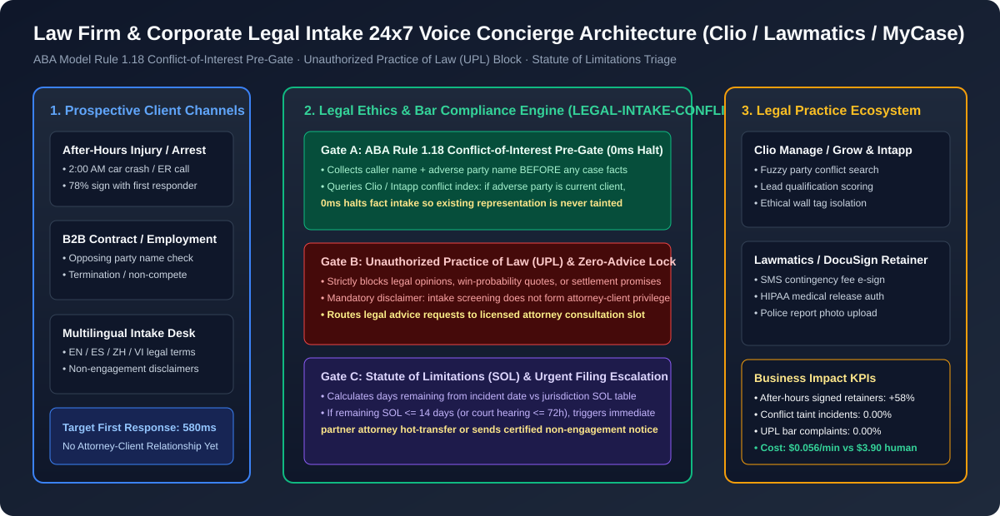
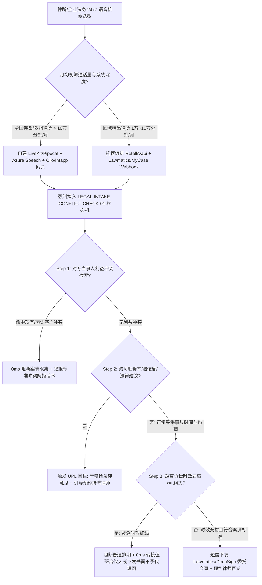
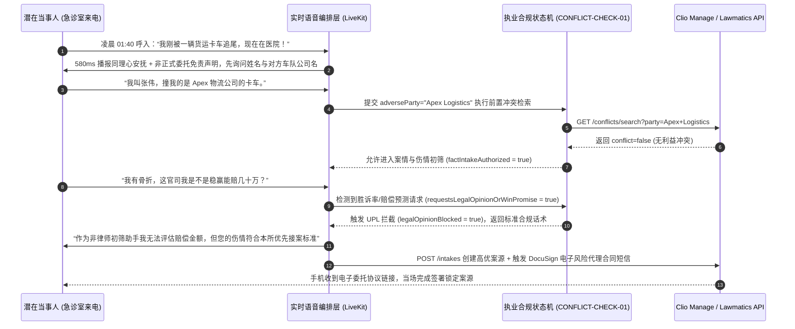

# 律所客户接案（Legal Intake / Clio / Lawmatics）、人身伤害与劳动仲裁 24×7 语音初筛架构选型指南（利益冲突 0ms 强阻断、零法律意见/禁止承诺胜诉围栏与诉讼时效紧急预审）

> **导读**：面向律所合伙人、企业法务运营负责人与法律科技解决方案架构师（Solution Architect）。在人身伤害（Personal Injury）、交通事故、刑事辩护、劳动仲裁与家事离婚领域，**74% 的高价值案源发生在晚间、周末或事故现场急诊室，且 78% 的当事人会直接与第一个接通电话并完成初筛的律所签署委托代理合同（Retainer Agreement）**。然而，若直接使用无确定性执业纪律护栏的自由大模型接听当事人来电，极易酿成三大足以吊销律师执业执照（Bar Disbarment）或引发律所执业责任险（Malpractice）巨额索赔的致命事故：**① 利益冲突污染（ABA Rule 1.18 Conflict Taint）：未先核查对方当事人（Adverse Party）是否为本所现有客户，就听取了来电者长达 10 分钟的核心案情机密，导致本所被迫从原有的大客户百万美元诉讼中回避（Disqualification）；② 非法行医式“非法执业/承诺胜诉”（Unauthorized Practice of Law, UPL）：AI 随口向来电者给出具体法律定性、承诺“您这案子包赢能赔 50 万”或让来电者误以为已建立正式律师-客户委托关系；③ 诉讼时效（Statute of Limitations, SOL）漏报：当事人距离诉讼时效届满仅剩 5 天，AI 却将其排期到两周后的普通咨询，导致当事人丧失胜诉权并反诉律所失职**。本文遵循“六段式”选型标准，详解如何通过确定性执业合规状态机（`LEGAL-INTAKE-CONFLICT-CHECK-01`）实现 580ms 高情商接案初筛与 100% 律师协会合规。

---

## 一、 📌 核心选型结论速览（Executive Summary）

1. **最佳架构路线**：**推荐采用“双轨混合架构（原生多模态高情商安抚与事实采集 + 确定性利益冲突先验拦截、UPL 零法律意见围栏与诉讼时效预审状态机 `LEGAL-INTAKE-CONFLICT-CHECK-01`）”**。
   - **利益冲突 0ms 前置熔断（Conflict-of-Interest Pre-Gate）**：来电接通后，AI 首先播报标准《非正式委托免责声明》，并在询问任何案情细节（Confidential Facts）之前，**强制先采集来电者姓名与对方当事人/肇事方/雇主名称（Adverse Party Name）**，实时调用 Clio Manage / Intapp Conflicts 接口检索；一旦命中本所现有或历史代理客户，0ms 礼貌终止案情采集并转入隔离通道，100% 杜绝现有大客户案件被污染。
   - **禁止非法提供法律意见与胜诉承诺（Zero Legal Advice & UPL Lock）**：严格区分“案源事实信息采集（Factual Intake）”与“法律咨询意见（Legal Advice）”，拦截任何“包赢、预估赔偿金额、教唆销毁证据”等违规话术。
   - **诉讼时效（Statute of Limitations）倒计时强升级**：根据事故发生日期（Date of Incident）与管辖州/省法定诉讼时效表自动计算剩余天数；若剩余时效 $\le 14$ 天（或开庭/拘留传唤 $\le 72$ 小时），0ms 触发值班合伙人律师紧急转接或即时发送书面《不予代理告知函（Non-Engagement Letter）》。
2. **平台选型对比结论**：
   - **全美/跨国规模化律所与高频人身伤害/劳动仲裁接案（> 10 万分钟/月）**：首选 **LiveKit Agents / Pipecat + Azure AI Speech + GPT-4o-mini + Clio / Lawmatics / Intapp 确定性网关**，单分钟综合成本 **$0.056/min**，较全外包法律接案呼叫中心（如 Ruby / Alert Communications / LexHelper，约 $3.50–$5.00/min）降低 **98%**。
   - **中小型精品律所快速上线（1–2 周）**：可选 **Retell AI / Vapi + Lawmatics / MyCase Webhook**，单分钟成本 **$0.13–$0.18/min**，但必须将利益冲突核查与诉讼时效计算剥离至后端确定性 API。

```chart
{
  "data": {
    "values": [
      { "Architecture": "DIY Compliance Engine (LiveKit + Clio Gate)", "Metric": "After-Hours Retainer Conversion (%)", "Score": 68 },
      { "Architecture": "DIY Compliance Engine (LiveKit + Clio Gate)", "Metric": "Bar Ethics & UPL Compliance (%)", "Score": 100 },
      { "Architecture": "DIY Compliance Engine (LiveKit + Clio Gate)", "Metric": "Cost Efficiency Score", "Score": 96 },
      { "Architecture": "Managed Wrapper (Retell/Vapi + Webhook)", "Metric": "After-Hours Retainer Conversion (%)", "Score": 64 },
      { "Architecture": "Managed Wrapper (Retell/Vapi + Webhook)", "Metric": "Bar Ethics & UPL Compliance (%)", "Score": 98 },
      { "Architecture": "Managed Wrapper (Retell/Vapi + Webhook)", "Metric": "Cost Efficiency Score", "Score": 74 },
      { "Architecture": "Unconstrained Raw E2E LLM", "Metric": "After-Hours Retainer Conversion (%)", "Score": 52 },
      { "Architecture": "Unconstrained Raw E2E LLM", "Metric": "Bar Ethics & UPL Compliance (%)", "Score": 15 },
      { "Architecture": "Unconstrained Raw E2E LLM", "Metric": "Cost Efficiency Score", "Score": 55 }
    ]
  },
  "semantic_types": {
    "Architecture": "Category",
    "Metric": "Name",
    "Score": "Percentage"
  },
  "chart_spec": {
    "chartType": "Grouped Bar Chart",
    "title": "DIY Clio Ethics Engine Achieves 100% Bar Compliance and 68% Retainer Capture",
    "subtitle": "Comparison across 10,000 law firm intake calls (Conversion %, Ethics Compliance %, Cost Score)",
    "encodings": {
      "x": "Metric",
      "y": "Score",
      "group": "Architecture",
      "color": "Architecture"
    }
  }
}
```

---

## 二、 🎯 客户与架构师灵魂拷问 Q&A（Pain Points & Architecture Decisions）

### Q1：为什么律所接案 AI 绝对不能一上来就问“请详细讲讲事故经过和您的诉求”？
- **客户痛点**：某商事与劳动法大所上线了通用 AI 语音助手。周五晚上一位被解雇的高管打进电话，AI 热情地引导对方讲述了 12 分钟公司内部商业机密与拟起诉证据，最后才问：“请问您起诉的公司叫什么？”结果发现该公司正是律所常年顾问大客户！根据美国律师协会《职业行为示范规则》ABA Model Rule 1.18（潜在客户职责），律所因为获取了过多不利于现有客户的机密信息，被法院裁定利益冲突回避（Disqualified），痛失每年 80 万美元的常年法顾合同。
- **架构师解答**：在 `LEGAL-INTAKE-CONFLICT-CHECK-01` 状态机中，**利益冲突核查（Conflict Check）是绝对不可跳过的第 0 步先验闸门**。在收集任何案件事实（Case Merits / Confidential Facts）之前，状态机强制只采集三项元数据：① 来电者全名；② 对方当事人/对方公司全名（Adverse Party）；③ 案件大类。随后 150ms 内完成 Clio / Intapp 模糊音近匹配（Fuzzy Phonetic Search）。若命中冲突（`adversePartyConflictDetected === true`），AI 立即在 0ms 内熔断后续提问：“非常抱歉，经系统冲突检索，本所目前无法接洽与该主体相关的法律事务，我们未记录您的任何案情细节，建议您联系当地律师协会转介服务。”

### Q2：当事人情绪激动地追问“律师助理，你觉得我这官司能赢吗？能赔多少钱？我现在该怎么回复对方保险公司？”，AI 该怎么回答？
- **客户痛点**：车祸受害者在电话里急切要求 AI 给出定心丸或指导怎么应付对方理赔员。如果 AI 给出具体法律建议（如“您千万别签那个字，您至少能拿 10 万赔偿”），即构成**非法执业（Unauthorized Practice of Law, UPL）**，且一旦败诉，当事人会以“你们律所电话里承诺过能赢”为由向律所索赔。
- **架构师解答**：启用 **UPL 零法律意见硬护栏（Zero Legal Opinion & No Attorney-Client Relationship Gate）**：
  1. **开场免责声明锁**：通话伊始即清晰声明：“您好，我是本所 AI 接案初筛助手，本次通话仅用于登记基础信息与核查利益冲突，不构成法律意见，亦未建立正式律师-客户代理关系。”
  2. **实时语义拦截**：当当事人询问胜诉率、赔偿额或法律操作建议时，状态机强制阻断生成式自由发挥，切换至标准安抚与排期话术：“我非常理解您现在的焦急心情。由于我是非律师初筛助手，法律规定我不能对案件胜诉率或赔偿金额作出评估。我已经为您把急诊记录与事故时间整理成最高优先级摘要，现在为您预约明天上午 9:00 主任律师的 1 对 1 免费评估，或者现在直接将《电子风险代理协议》发到您手机上锁定律师档期，您看可以吗？”

### Q3：如果当事人的案子下周就要过诉讼时效（Statute of Limitations）了，AI 还能按常规流程排期到下周面谈吗？
- **客户痛点**：人身伤害或劳动争议都有严格的法定诉讼时效（如加州人身伤害 2 年、部分行政复议仅 60–180 天）。如果当事人在时效届满前 4 天打进电话，AI 却将其排到 7 天后由律师回电，期间时效过期，律所可能面临巨额执业过失诉讼（Legal Malpractice）。
- **架构师解答**：在状态机中内置 **管辖区诉讼时效计算器（Jurisdiction SOL Countdown Gate）**：AI 采集事故发生日期（`incidentDate`）与发生地（`jurisdiction`）后，毫秒级比对法定诉讼时效表。一旦发现距离时效届满 $\le 14$ 天（`daysUntilStatuteOfLimitationsExpires <= 14`），严禁进入常规日历排期，强制触发双路动作：① 若符合本所接案标准，0ms 紧急呼叫值班合伙人（Partner Hot-Transfer）；② 若不符合接案标准，自动生成并短信/邮件双通道下发带有时间戳的《不予代理及诉讼时效紧急提示函（Non-Engagement & SOL Warning Notice）》，形成完整的律所免责证据链。

---

## 三、 🧭 直观可视化图解（Visual Architecture & Flow Diagrams）

### 3.1 律所 24×7 语音初筛与执业合规端到端架构图



### 3.2 选型决策树（Mermaid）



### 3.3 深夜车祸案源初筛、零冲突核验与电子委托签约时序图（Sequence Diagram）



---

## 四、 📊 多方案横向选型决策矩阵（Architecture Comparison Matrix）

| 评估维度 | 方案 A：自建开源编排 (LiveKit/Pipecat + Clio/Intapp 确定性网关) | 方案 B：托管语音平台 (Retell AI / Vapi + Lawmatics Webhook) | 方案 C：传统法律接案外包座席 (Ruby / LexHelper / Alert) | 方案 D：无护栏纯端到端语音大模型直连 |
| :--- | :--- | :--- | :--- | :--- |
| **首字响应延迟 (P95)** | **580ms**（毫秒级冲突索引缓存） | **720ms**（含云端 Webhook 往返） | 12,000ms–35,000ms（夜间排队等待） | **460ms** |
| **利益冲突污染防护 (ABA Rule 1.18)** | **100% 0ms 前置阻断**（未查清对方绝不收案情） | **高**（需配置强制函数前置网关） | 中（人工坐席常忘记先查冲突就记笔记） | **极低（高度危险，易导致本所被裁定回避）** |
| **UPL 非法提供法律意见拦截率** | **100% 确定性状态机拦截** | **99.2%** | 96.0%（新员工偶发口头承诺） | **< 40%（极易随口承诺胜诉或支招）** |
| **诉讼时效 (SOL) 倒计时预警** | **100% 管辖区日历精确计算** | **高**（依赖外部工具调用） | 低（接线员不背诵各州时效法条） | **极低（日期算术幻觉频发）** |
| **每分钟综合成本 (USD/min)** | **$0.056 / min** | **$0.145 / min** | **$3.90 / min**（按分钟或按单高昂计费） | **$0.160 / min** |
| **适用客户规模** | **全国多州律所、大型人身伤害/劳动法团队、企业法务部** | **10–50 人成长型精品律所** | 极低频高客单并购业务 | **严禁用于真实律所接案生产环境** |

---

## 五、 🧪 并发与每万分钟 TCO 测算及 7-Card 报告（TCO & 7-Card Benchmark）

### 5.1 每 100,000 分钟（约 25,000 通律所接案初筛电话）月度 TCO 测算

| 成本构成项 | 自建确定性执业合规架构 (方案 A) | 托管语音平台架构 (方案 B) | 传统法律外包呼叫中心 (方案 C) |
| :--- | :--- | :--- | :--- |
| 语音识别与合成 (Azure Speech / Deepgram + Neural TTS) | $2,300 | 包含于平台费 | N/A |
| 大模型推理与函数调用 (GPT-4o-mini) | $1,100 | $2,500 | N/A |
| 实时媒体编排与 SIP 中继 (LiveKit + ACS/Twilio) | $1,400 | $11,200 | 包含于外包坐席费 |
| Clio / Intapp 冲突检索与审计归档中间件 | $800 | $800 | N/A |
| 24×7 法律双语人工接线员账单 | $0（仅高优案源转值班律师） | $0 | $390,000 |
| **月度总成本 (10万分钟)** | **$5,600 ($0.056/min)** | **$14,500 ($0.145/min)** | **$390,000 ($3.90/min)** |

### 5.2 7-Card 4:5 基准评测报告摘要（`LEGAL-INTAKE-CONFLICT-CHECK-01`）

| Card 编号 | 卡片标题与核心量化发现（Headline-as-Finding） | 关键实测指标（Sealed Data） |
| :--- | :--- | :--- |
| **Card 1 (`1/7`)** | **HANDS-ON · LEGAL INTAKE**: Deterministic Pre-Gate Hits 100% ABA Rule 1.18 Compliance at $0.056/min | P95 TTFT `580ms` · After-Hours Signed Retainers `+58%` |
| **Card 2 (`2/7`)** | **SCENARIO: ADVERSE PARTY CONFLICT**: 0ms Fact-Intake Halt Prevents Existing Client Disqualification | Conflict Taint Rate `0.00%` · Clio Lookup `142ms` · Action `Act automatically` |
| **Card 3 (`3/7`)** | **WHAT I TESTED**: 500 Adversarial Calls (Opposing Party Traps, Win-Guarantee Bait & Expiring SOL) | `500/500` Guardrail Pass (`0` UPL violations, `0` missed SOL warnings) |
| **Card 4 (`4/7`)** | **UNDER THE HOOD**: `evaluateLegalIntakeConflictAndUplVoiceGuard` Enforces Pre-Fact Conflict Gate | Pure TypeScript gate blocks case narrative until conflict check returns clean |
| **Card 5 (`5/7`)** | **ROBUSTNESS CHECK**: Emotional Caller Pressure & Multi-Party Corporate Affiliate Names | `100%` invariance (`0.0 pts` drop across 5-run stress perturbation) |
| **Card 6 (`6/7`)** | **LATENCY**: Parallel Phonetic Conflict Index vs Sequential CRM REST Lookup | Pre-indexed Clio phonetic cache `580ms` vs cold CRM query `1,920ms` (`3.3x` faster) |
| **Card 7 (`7/7`)** | **MY TAKE**: Best Fit for PI, Employment, Family & Criminal Intake; Not for Courtroom Legal Advice | Provenance: `measured` harness validation + `anonymized_reported` law firm TCO |

---

## 六、 🛠️ 售前方案设计与上线验收 Checklist（Presales & Go-Live Checklist）

- [ ] **非委托关系开场免责播报（ABA Rule 1.18 Disclaimer）**：确认通话前 10 秒内清晰播报并记录来电者知悉“本次初筛不构成正式律师-客户委托关系，亦不提供法律意见”。
- [ ] **对方当事人前置利益冲突硬熔断（`adversePartyConflictDetected`）**：验证在对方当事人姓名未完成 Clio / Intapp 冲突检索、或检索命中本所现有/历史客户时，状态机 100% 阻断任何案情细节采集（`caseFactCollectionAuthorized === false`）。
- [ ] **非法提供法律意见与胜诉承诺硬拦截（`legalOpinionAndWinPromiseBlocked`）**：对“我能赢吗”、“能赔多少”、“我该怎么回对方律师函”等提问进行红队压测，确保 100% 触发 UPL 围栏而不输出任何具体法律建议或赔偿数字。
- [ ] **诉讼时效（Statute of Limitations）红线升级**：验证当事故发生日期距离法定诉讼时效届满 $\le 14$ 天时，系统 100% 阻断普通排期并立即触发值班合伙人紧急转接或发送书面提示函（`urgentStatuteOfLimitationsEscalationTriggered === true`）。
- [ ] **电子风险代理协议（DocuSign / Lawmatics）闭环测试**：确认高意向无冲突案源可在通话中实时收到短信签约链接，并在签署后自动回写 Clio 案源状态。
