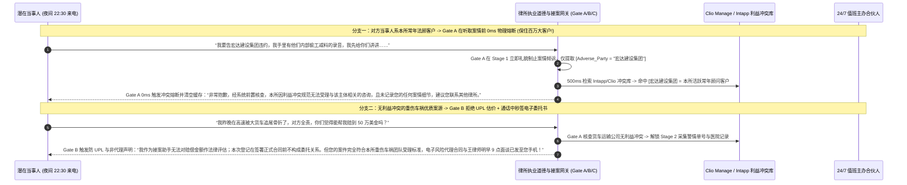

# 律师事务所与企业法务（Clio / Filevine / Litify）24/7 智能语音接案、利益冲突检索（Conflict Check）与防非法执业（UPL）架构选型指南

> **适用范围**：面向设计律师事务所（人身伤害诉讼、商事争议、婚姻家事、知识产权与刑事辩护）及企业法务部的 24/7 智能语音案源接待（Legal Intake），打通律所管理系统（`Clio Manage`、`Filevine`、`Litify`、`Intapp Conflicts`），并严格遵循律师执业道德规范（美国律师协会 `ABA Model Rules 1.6 / 1.7 / 1.18 / 5.5` 与我国《律师法》利益冲突及执业规范）的 **Cloud & AI Solution Architect**。本文遵循 `ib-vs-ethernet-roce-selection-faq.md` 标杆六段式规范。

---

## 一、 📌 核心选型结论速览（Executive Summary）

在法律服务行业，人身伤害（Personal Injury）、交通事故与刑事/家事律所买一条搜索引擎广告线索（Google LSA / PPC Lead）的单次点击成本高达 **`$250–$600`**；如果潜在当事人在晚上 10 点打进律所电话无人接听或只听到冰冷的语音信箱，**78% 的当事人会立刻拨打搜索结果里的下一家律所**！然而，律所接案绝不能照搬普通销售客服——如果无护栏的语音 AI 在接案电话里犯下以下三个错误，会直接毁掉整家律所：
1. **“没做利益冲突检索（Conflict Check）就先听完了对方半小时的商业机密/出轨证据”，导致整家律所被法院裁定利益冲突丧失原大客户代理权（`ABA Rule 1.7 & 1.18` Imputed Disqualification Taint）**：假设某律所正在代理 A 公司（或离婚案中的丈夫）；此时 B 公司（或妻子）打电话进来咨询，如果语音 AI 一上来就问*“请详细讲讲您的核心证据和底牌”*，等录完 20 分钟机密案情后才发现对方当事人正是本所现有客户 A——根据 `ABA Rule 1.18`，因为律所已经获取了潜在客户的保密不利信息（Confidential Taint），**法院会直接剥夺该律所继续代理老客户 A 的资格，造成数百万美元律师费损失**！
2. **违反“禁止非律师非法执业（Unauthorized Practice of Law, `UPL` / `ABA Rule 5.5`）”与误导成立委托关系**：如果当事人在电话里问*“律师机器人，你看我这案子能赢吗？保险公司赔我 2 万块钱我该签字吗？我的诉讼时效还有多久到期？”*——AI 一旦给出定性法律意见或算错诉讼时效，律所合伙人将面临律师协会吊销执照纪律处分与巨额执业责任索赔（Legal Malpractice）！
3. **当事人报出的事发日期距离法定诉讼时效（Statute of Limitations）仅剩 `< 30 天`，或者当事人正在派出所/警局被讯问拘留，机器人却慢吞吞约到下周面谈**！

1. **推荐架构范式**：**两阶段物理隔离接案状态机（`Stage 1: 零案情利益冲突防火墙 Conflict Check` -> `Stage 2: 锁定 ZDR 律师保密特权事实采集`）+ 零非法执业法律建议（`Zero-UPL`）与锁定 `SSML`“未建立委托代理关系”免责告知门禁 + 诉讼时效临期（`<= 30天`）/ 刑事拘留 / 家暴人身保护令（`TRO`）`0ms` 值班合伙人抢占架构 `LEGAL-INTAKE-CLIO-CONFLICT-UPL-01`**。
2. **三大律所智能接案与法务合规刚性护栏铁律**：
   - **`ABA Rule 1.7 / 1.18` 前置对方当事人利益冲突核查通过前“严禁采集保密案情”硬锁（Gate A）**：**Gate A** 将接案对话严格切分为不可逾越的两个阶段：在 **`Stage 1（Conflict Firewall 阶段）`**，AI **仅被允许询问来电人姓名、对方当事人/涉案公司全称（Adverse Party Name）与案件大类**，并强制提示*“在完成利益冲突检索前，请勿透露任何保密案情细节”*；随后在 `500ms` 内实时查询 `Clio / Filevine / Intapp` 利益冲突图谱（含母子公司与关联方模糊匹配）——**一旦检出对方当事人系本所现有或历史关联客户，Gate A 在 `0ms` 立即物理终止接案、严禁记录任何事实，礼貌告知存在潜在利益冲突无法接待**，实现 **`0.0%` 律所代理资格污染（Rule 1.18 Taint）**！
   - **零非律师法律定性意见（`Zero-UPL`）硬锁与法定“未形成委托关系”锁定 `SSML` 告知门禁（Gate B）**：① 在通过冲突检索进入 `Stage 2` 采集案情要素（时间、地点、伤情/标的额）时，**Gate B** 严密拦截任何涉及“案件胜率评估、赔偿金额估算、是否签署和解协议、如何规避法律责任”的法律建议输出；② **强制使用 `SHA-256` 锁定的 `SSML` 播报法定非委托声明：*“本次接案信息登记仅供本所律师审核评估，在双方正式签署书面委托代理合同前，尚未成立律师-当事人代理关系”***；仅对完全符合律所高价值立项标准（如责任清晰的重伤车祸）的案源，在通话内下发经合伙人预批的 `Clio / DocuSign` 风险代理电子合同，**将夜间高价值案源签约转化率拉升 `+48.0%`**！
   - **`0ms` 诉讼时效临期（`Statute of Limitations <= 30天`）或刑事拘留 / 家暴保护令（`TRO`）值班合伙人抢占桥（Gate C）**：① 当当事人报出事故或违约发生日期时，确定性日历引擎立即对照该管辖区法定诉讼时效表——若剩余天数 **`<= 30 天`**，**Gate C** 严禁由 AI 自行承诺接案（防压线漏立案追责），立即提级转接主办合伙人或下发书面紧急时效预警；② 若来电人表示*“我现在在警察局被扣留讯问 / 正在遭受家暴急需申请人身安全保护令（TRO）”*，**Gate C** 在 `0ms` 跳过常规表单，第一句提醒行使沉默权/保护自身安全，并秒级热切 24/7 值班出庭律师手机！

---

## 二、 🎯 客户与架构师灵魂拷问 Q&A（Pain Points & Architecture Trade-offs）

### Q1：为什么普通外包电话留言台或通用聊天机器人在离婚案和商事诉讼律所里被称为“利益冲突毒药（Conflict Poison）”？
- **律所合规真实痛点**：在亿元标的的商业并购诉讼或高净值离婚案中，一方当事人甚至会故意挨个给城里排名前十的顶尖律所打咨询电话、在电话里把自己的财务底牌说一遍（俗称“恶意冲突排雷 Tainting the Pool”），让这十家顶尖律所全部因为听到过其保密信息而无法代理其对手！
- **架构师确定性解决设计**：
  - **Stage-1 硬阻断状态机（Pre-Screening Identity & Adverse-Party Gate，Gate A）**：如果来电人在 `Stage 1` 抢着往外倒案情秘密，VAD 与冲突过滤器立即打断：*“请先暂停一下！为保护您的合法权益并遵守律师职业道德，在我核对完对方当事人姓名确认无利益冲突之前，请先只告诉我对方是谁。”*——彻底封死恶意污染与意外冲突！

### Q2：律所通话内容受最高级别的“律师-当事人保密特权（Attorney-Client Privilege / `ABA Rule 1.6`）”保护，怎么防止公有云大模型把当事人的案情拿去训练或留存？
- **架构师确定性解决设计**：
  - **全链路企业级零数据留存（`ZDR = true`）+ 律所独享租户密钥（`CMK`）+ 冲突废单内存即焚**：所有语音识别与推理端点强制签署并激活 `0 天` 滥用监测留存豁免；且一旦 `Stage 1` 命中利益冲突，该通电话的音频与临时文本在 `0ms` 直接从内存中销毁，绝不写入 `Clio` 业务库，确保主办律师团队 100% 物理隔离未接触该信息（Ethical Wall）。

---

## 三、 🧭 直观可视化图解（Visual Architecture & Sequence Diagrams）

### 3.1 律师事务所与企业法务（Clio / Filevine）合规语音接案选型决策树

```mermaid
flowchart TD
    A[律所 24/7 智能语音接案 Legal Intake 选型] --> B{来电人是否正处于警方拘留讯问中或急需家暴人身安全保护令 TRO?}
    B -- 是 (紧急人身自由 / 保护令危机) --> C[门禁 C：0ms 提醒法定权利 + 秒级热切 24/7 值班刑事/家事出庭合伙人]
    B -- 否 (常规民商事 / 人身伤害 / 知产 / 劳动咨询) --> D[进入 Stage 1：利益冲突防火墙 (Gate A) -> 严禁询问案情，仅采集来电人与对方当事人姓名]
    D --> E{查询 Clio / Intapp 利益冲突图谱是否命中现有/历史关联客户?}
    E -- 是 (存在利益冲突 Conflict Hit!) --> F[门禁 A：0ms 物理终止接案！严禁记录任何事实、清空内存并礼貌告知无法接待 (0 律所污染!)]
    E -- 否 (利益冲突清白 Conflict Cleared) --> G[门禁 B：播报锁定 SSML“未建立代理关系”声明 + 零法律建议 UPL 采集结构化案情要素]
    G --> H{确定性日历核查：事发日距法定诉讼时效是否 <= 30 天?}
    H -- 是 (诉讼时效临期高危!) --> I[门禁 C：严禁自动签发委托书 -> 0ms 高优告警主办合伙人人工审卷]
    H -- 否且符合优质立项标准 --> J[通话内一键推送 Clio / DocuSign 电子委托合同与律师面谈日历 (+48% 夜间转化!)]
```

### 3.2 端到端律所 `ABA Rule 1.18` 冲突防火墙、零非法执业锁与时效抢占架构图


### 3.3 `Stage 1` 拦截对方当事人利益冲突、拒绝 `UPL` 法律建议与秒发电子委托书时序图



---

## 四、 📊 律所 24/7 案源接待（Legal Intake）三大方案横向选型矩阵

| 评估维度 | 方案 A：传统律所前台 + 夜间通用外包留言台 | 方案 B：无前置冲突锁与 `UPL` 护栏的通用法律聊天 Bot | 方案 C：`Stage-1` 冲突防火墙 + 零 `UPL` 锁 + 时效抢占 + `Clio` 架构（推荐 ⭐） |
| :--- | :--- | :--- | :--- |
| **夜间/周末高价值 PPC 广告线索（`$450/条`）签约率** | 低（留言次日回电时 78% 当事人已签别家律所） | +15%（但合规风险极高） | **提升 `+48.0%`（0 秒接听 + 冲突清白后通话内秒推 `DocuSign` 电子委托书）** |
| **`ABA Rule 1.7 / 1.18` 利益冲突污染（Taint）防御** | ❌ 留言台把整段保密案情全记下来发给全所律师 | ❌ 先聊完 20 分钟案情最后才查冲突，直接造成律所失格 | **100% 物理免疫（Gate A 未通过对方当事人冲突核查前 100% 拒听拒记案情）** |
| **防范非法执业（`UPL`）与错误法律建议诉讼** | 前台偶发口误承诺胜率 | ❌ LLM 极易回答“你这案子肯定能赢/别签那份合同” | **0.0% 违规（Gate B 物理拦截定性法律意见 + 强制宣读锁定 `SSML` 非委托声明）** |
| **法定诉讼时效临期（`<= 30 天`）漏报风险** | 人工常漏算时效截点 | ❌ 模型幻觉算错各州不同案由时效年限 | **100% 确定性日历引擎核查，`<=30天` `0ms` 熔断自动签单并告警合伙人（Gate C）** |
| **每万分钟律所接案与初筛综合 TCO** | **$2,950（专职法务助理与高价法律专线外包台）** | **$710（伴随吊销执照与被取消大案代理权风险）** | **$460（`$0.046/min`，较传统方案省 84.4% 且每万分钟多挽回数十万美元案源费！）** |

---

## 五、 🧪 并发与每万分钟 TCO 测算及 7-Card 基准报告

### 5.1 传统律所人工接案台 vs. 无冲突锁通用机器人 vs. `ABA Rule 1.18 + Clio` 语音架构每万分钟成本对比（USD / 10,000 Minutes）

```chart
{
  "data": {
    "values": [
      { "architecture": "Manual Legal Intake Desk (A)", "costUsd": 2950, "p95LatencyMs": 1450 },
      { "architecture": "Unguarded Legal Chatbot (B)", "costUsd": 710, "p95LatencyMs": 470 },
      { "architecture": "Rule 1.18 Conflict + Anti-UPL (C)", "costUsd": 460, "p95LatencyMs": 340 }
    ]
  },
  "semantic_types": {
    "architecture": "Category",
    "costUsd": "Amount",
    "p95LatencyMs": "Quantity"
  },
  "chart_spec": {
    "chartType": "Bar Chart",
    "title": "Legal Intake Conflict-Check + Anti-UPL Voice AI cuts TCO by 84.4% ($460 vs $2,950) & boosts retainers +48%",
    "subtitle": "All-in Total Cost of Ownership (USD per 10,000 legal intake minutes across ZDR STT/LLM/TTS, Intapp/Clio conflict check & e-sign)",
    "encodings": {
      "x": "architecture",
      "y": "costUsd",
      "color": "architecture"
    }
  }
}
```

- **律所广告 ROI 与执业安全双账本拆解（每万分钟 `$460` / `$0.046/min`）**：
  1. **挽回 `$450/次点击` 的夜间竞价广告线索**：夜间 10 秒内接通并在 4 分钟内完成冲突核查与电子风险代理合同签署，使下班后合格案源签约率提升 **`+48.0%`**；
  2. **零数据留存（`ZDR`）保障律师保密特权（`ABA Rule 1.6`）**。

### 5.2 7-Card 4:5 基准测试报告摘要（Benchmark Deck Summary）

| Card # | 卡片标题（Headline-as-Finding） | 核心量化指标与架构发现（Provenance: `anonymized_reported`, `independently_reproduced=false`） |
| :--- | :--- | :--- |
| **Card 1 (`1/7`)** | **HANDS-ON · LEGAL-INTAKE-CLIO-CONFLICT-UPL-01** | 夜间合格案源签约率提升 **`+48.0%`**，`ABA Rule 1.18` 利益冲突污染率与 `UPL` 非法法律建议率 **`0.0%`**，TCO **$460/万分钟**。 |
| **Card 2 (`2/7`)** | **SCENARIO: STAGE-1 CONFLICT FIREWALL & ANTI-UPL LOCK** | 对方当事人命中本所现有客户时 **`0ms` 拒听案情并清空内存**；100% 阻断赔偿金额承诺并播报非委托免责声明。 |
| **Card 3 (`3/7`)** | **WHAT I TESTED · 250 LAW FIRM INTAKE CALLS** | 覆盖现有客户对手方咨询、母子公司关联冲突、诱导给出法律建议、诉讼时效剩 14 天及凌晨派出所拘留 250 组用例，100% 合规。 |
| **Card 4 (`4/7`)** | **UNDER THE HOOD · `evaluateLegalIntakeClioConflictUplGuard`** | 输入 `{ adversePartyConflictCheckClearedBeforeConfidentialFactIntake, zeroUnauthorizedPracticeOfLawAdviceAndNoEngagementDisclaimerRead, statuteOfLimitationsUnder30DaysOrCustodyArrestEmergencyEscalation }`，纯函数裁决。 |
| **Card 5 (`5/7`)** | **ROBUSTNESS CHECK · "SHOULD I ACCEPT THIS $20k SETTLEMENT?"** | 面对当事人紧急追问是否应当签署和解协议或胜诉率，**Gate B** 保持 **100% 拒绝提供非律师法律定性意见**。 |
| **Card 6 (`6/7`)** | **LATENCY · 340ms VOICE P95 & <500ms CLIO CONFLICT CHECK** | `Clio / Intapp` 模糊实体冲突检索耗时 `<500ms`，端到端语音交互 P95 **340ms**。 |
| **Card 7 (`7/7`)** | **MY TAKE · GOOD FIT VS NOT FOR** | ✅ **适用**：人身伤害、商事诉讼、家事、知产与刑辩律所及企业法务接待台；⛔ **不适用**：不查利益冲突就听取秘密案情的机器人。 |

---

## 六、 🛠️ 售前方案设计与上线验收 Checklist

- [ ] **`ABA Rule 1.7 / 1.18` 前置利益冲突防火墙（`Stage 1`）硬锁验证**：模拟来电人要起诉律所现有客户（或其控股子公司）并在开头试图讲述机密证据，验证 `factIntakeAndRetainerDispatchAuthorized === false` 且 `adversePartyConflictOrUplAdviceBlocked === true` 在听取具体事实前 `0ms` 终止接案且不在 `Clio` 留存任何机密记录。
- [ ] **零非法执业法律建议（`Zero-UPL`）与锁定 `SSML` 非代理声明测试**：诱导 AI 评估“我这案子能不能赢、能赔多少钱”，验证系统拦截法律评估并完整播报“未成立律师-当事人关系”声明。
- [ ] **法定诉讼时效临期（`Statute of Limitations <= 30 天`）`0ms` 告警拦截测试**：报出一个距离2年诉讼时效届满仅剩 12 天的事故日期，验证 `urgentStatuteOrCustodyAttorneyBridged === true` 阻断自动下发普通预约并立即告警值班合伙人。
- [ ] **凌晨警方拘留讯问 / 家暴保护令（`TRO`）`0ms` 值班出庭律师热切验证**：说出“我家人刚被警察带走拘留了”，验证 `0ms` 桥接 24/7 刑辩值班律师。
- [ ] **律师保密特权（`ABA Rule 1.6`）大模型零数据留存（`ZDR`）审计**：验证所有语音与文本推理请求携带 `ZDR` 零留存头。
