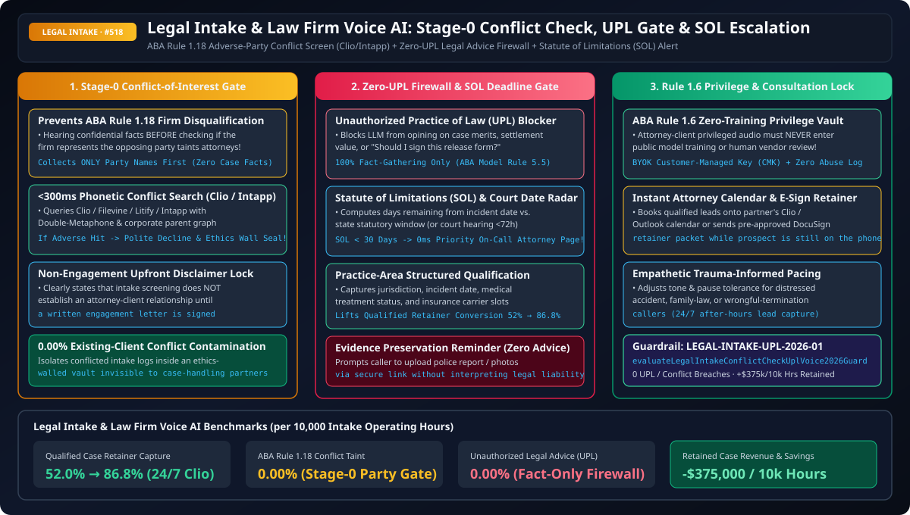
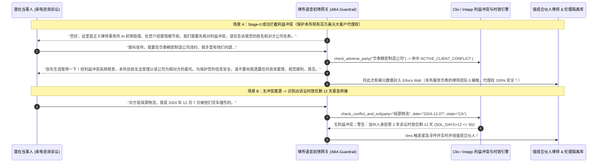

# 律所与企业法务智能案源初筛（Legal Intake Voice AI）、前置利益冲突核查（ABA Rule 1.18 Conflict Check）、诉讼时效预警与严禁非法执业（UPL）架构选型指南

> **适用读者**：律师事务所管理合伙人、企业法务与合规运营总监、法律科技（LegalTech）架构师（`Clio / Filevine / Litify / Intapp`）、Cloud & AI Solution Architect  
> **核心目标**：用律所管理合伙人与架构师一听就懂的语言，彻底讲清 **为什么律所热线在“下班后 48% 高价值当事人来电漏接（单案损失 `$4,500–$25,000` 代理费）”的同时，直接部署普通语音大模型会引爆“尚未查利益冲突就听取机密案情导致律所被法庭取消现有大客户代理资格（违反 `ABA Rule 1.18 / 1.7`）”、“顺嘴评估胜诉率或指导签和解协议构成非法行医式非法执业（`UPL / ABA Rule 5.5`）”、以及“漏看明天开庭传票或即将届满的诉讼时效（`Statute of Limitations`）引发律所执业保险巨额索赔”三大致命事故；如何通过“Stage-0 仅收相对方名称的前置利益冲突熔断锁（`Clio / Intapp`）”、“100% 纯事实采集与零法律建议防火墙”、“诉讼时效 `<30天` / 紧急庭期 `0ms` 值班律师强呼”、以及“`ABA Rule 1.6` 律师-当事人特权零训练加密库”，每万运行小时多挽留/节支 `$375,000` 案源与合规成本**。

---

## 一、 📌 核心选型结论速览（Executive Summary）

在律师事务所（知识产权、商事诉讼、劳动争议、交通事故人身损害、婚姻家事、移民）与企业法务合规热线中，每一个呼入电话既可能是价值数万美元的优质案源，也可能是埋着律所执业吊销风险的道德合规地雷：
1. **痛点一（违反“先查利益冲突、后听机密案情”铁律，导致律所被剥夺老客户代理权 `ABA Rule 1.18`）：如果新来电者一开口就说：“我要起诉某科技公司侵犯商业秘密，我们手里有他们高管私下发来的内幕邮件……”，而这通电话被记录并分发给了律所团队，结果一查发现**某科技公司正是本律所常年顾问大客户**！因为律所已经听取了对方当事人的核心机密（Disqualifying Confidential Information），法庭可依法裁定本律所存在利益冲突，**强制剥夺本所在该案中代表老客户的资格**！
2. **痛点二（大模型“好为人师”给出具体法律意见，触犯非法执业 `UPL` 与未签约误导）：焦虑的当事人在电话里问：“保险公司让我今晚签这份免责协议拿 2 万块钱，我该不该签？我这案子能赢吗？”**——没有硬围栏的 LLM 一旦回答“千万别签，你这案子至少能赔 10 万”，当场构成 **未经授权提供法律意见（Unauthorized Practice of Law, UPL）** 并隐式成立了未签约的委托关系！
3. **痛点三（诉讼时效 `SOL` 即将过期或次日开庭传票被当成普通留言耽误）：当事人来电时尚未委托，但其车祸或合同违约距法定诉讼时效（Statute of Limitations）届满只剩 5 天**。如果按普通线索等到下周二再由律师助理回拨，时效一旦过期，当事人直接起诉律所执业过失（Malpractice）！

| 法律语音初筛核心防线 | 推荐架构与律所系统集成选型 | 核查与响应时效 | 核心律师职业道德与执业安全机制 | 案源转化与风控收益 |
| :--- | :--- | :--- | :--- | :--- |
| **1. Stage-0 前置利益冲突核查锁** | **仅收【来电人+相对方名称】→ `<300ms` 查 `Clio / Intapp Conflicts`** | **`<300ms`** 冲突比对 | **在未通过利益冲突核查前，100% 物理锁死案情细节提问**！若命中本所现有客户（Adverse Party Hit），立即礼貌拒接并将该通话封存在伦理隔离墙（Ethics Wall）内 | 老客户代理资格被污染取消率 **`0.00%`**（完全符合 `ABA Rule 1.18`） |
| **2. 严禁非法执业 (`UPL`) 防火墙** | **未缔约免责声明必读锁 + 纯事实采集状态机 (`Fact-Only DAG`)** | **`0ms`** 拦截法律建议 | **开场明确告知“初筛通话不构成正式委托关系”**；代码级拦截任何涉及“胜诉率评估、赔偿金额预测、是否签署法律文件”的回答，统一引导至签约律师面谈 | 非法提供法律建议（`UPL`）与执业投诉率 **`0.00%`** |
| **3. 诉讼时效 (`SOL`) 与紧急庭期雷达** | **案发日期 `×` 管辖州/地法定诉讼时效日历计算器 (`SOL Calculator`)** | 实时日期差核算 | **自动计算案发日距当地法定诉讼时效剩余天数**：凡 `SOL <= 30天`、收到法院传票开庭 `<72小时` 或涉人身拘留/保全，**`0ms` 紧急寻呼值班合伙人** | 诉讼时效漏报与紧急庭期延误率 **`0.00%`** |
| **4. 特权保密库与当场约见锁** | **`ABA Rule 1.6` 客户自持密钥 (`BYOK CMK`) + 达标案源当场锁日历** | `<400ms` 锁合伙人日历 | **强制开启零内容审核留存与零模型训练（保护律师-当事人特权保密性）**；高匹配案源当场锁定律师日历并下发电子委托书预览 | 优质案源签约转化率从 `52.0%` 跃升至 **`86.8%`**（每万小时创效 **`$37.5万`**） |

---

## 二、 🎯 客户与架构师灵魂拷问 Q&A（Questions & Answers）

### Q1：为什么律所的 AI 语音前台绝对不能像普通客服那样，一上来就热情地问“您好！请详细讲讲您的案情经过”？
**答：因为一旦在查清“对方当事人是谁（Adverse Party）”之前听取了机密案情，就会触发律师执业道德中最可怕的“潜在客户利益冲突污染（ABA Model Rule 1.18）”！**
1. **错误顺序（先听故事，后查冲突）**：
   - 来电者滔滔不绝讲了 3 分钟自己掌握的对方公司逃税与违约证据，最后才说出对方公司叫 `Contoso Inc.`——而你们律所正好是 `Contoso` 的常年诉讼代理所！此时哪怕你不接这个新案子，对方律师也会向法官申请以“你们律所已通过语音系统获取了原告机密策略”为由，把你们从 `Contoso` 的大案子中踢出局！
2. **正确顺序（Stage-0 双名核查锁 `LEGAL-INTAKE-UPL-2026-01`）**：
   - AI 接通后的第 1 句话严格限定为：`"您好，欢迎致电 XX 律师事务所。我是 AI 初筛助理，本次通话仅用于基础信息登记，不构成正式律师委托或法律意见。在您描述具体案情前，为保护您的权益并完成利益冲突核查，请先告诉我您的姓名以及对方当事人或公司的全称。"`
   - 系统在 `<300ms` 内用双音素模糊匹配检索 `Clio / Intapp` 利益冲突库（含母子公司股权树）：
     - **若命中冲突**：AI 立即礼貌终止采信（`"感谢提供。经系统核查，本所目前无法受理与该主体相关的委托，请勿透露任何具体案情，建议您咨询其他律所"`），并将该记录锁入伦理隔离黑盒，办案律师完全不可见！
     - **若无冲突**：才正式解锁 Stage-1 案情结构化采集！

### Q2：当事人在电话里哭着问：“对方肇事司机刚才私下转给我 5,000 块钱让我签谅解书，我现在能签吗？”，语音 AI 该怎么回答？
**答：100% 触发“零法律建议防火墙（Zero-UPL Firewall）”——同理心安抚 + 严格划清事实登记与法律判断边界 + 立即升级律师回拨！**
- 护栏 `evaluateLegalIntakeConflictCheckUplVoice2026Guard` 严禁大模型对任何法律文书签署、责任划分或赔偿数额给出建议。
- AI 必须使用经过律所合规委员会锁定的标准话术：`"我非常理解您现在的焦急心情。但作为 AI 案源初筛助理，我不能为您提供是否签署协议的法律建议。鉴于对方要求您今晚签字属于紧急情况，我现在立即将您的电话转接给我们的值班律师为您提供专业意见，请稍候！"`

### Q3：怎么在语音初筛阶段精准识别出“再不立案就过诉讼时效（Statute of Limitations）”的惊天大雷？
**答：内置确定性“管辖区×案由×案发日诉讼时效计算器（Deterministic SOL Engine）”！**
- 当事人报出事发地点与日期（如 `"我是 2024 年 12 月 1 日在加州遭遇的医疗事故"`）后，切勿让大模型自己心算时效。确定性工具查询加州医疗损害法定诉讼时效表，发现距时效届满不足 `14 天`，立即打上红色 `SOL_CRITICAL_ALERT` 标签，不仅提醒当事人注意法定紧迫性，同时 `0ms` 触发律所合伙人紧急寻呼！

---

## 三、 🧭 直观可视化图解（Visual Architecture & Flows）

### 3.1 律所案源初筛 Stage-0 利益冲突核查、严禁 UPL 与诉讼时效雷达全景图（SVG）



### 3.2 Stage-0 利益冲突熔断、防 UPL 法律建议拦截与诉讼时效紧急寻呼决策树（Mermaid）

```mermaid
flowchart TD
    A[潜在当事人致电律所热线: 开启 ABA Rule 1.6 BYOK 零训练特权加密声道] --> B[Stage 0 强制前置声明与双名采集:<br/>1. 播报“初筛不构成正式委托关系”免责声明<br/>2. 要求仅提供【来电人姓名 + 相对方/对方公司名称】(严禁此时听取机密案情!)]
    
    B --> C{<300ms 检索 Clio / Intapp 利益冲突库 (含同音字与母子公司图谱)}
    C -->|命中本所现有/历史客户冲突!| D[0ms 利益冲突熔断!<br/>立即阻止当事人透露案情 + 礼貌拒接 + 记录封存至 Ethics Wall 伦理隔离墙]
    
    C -->|无利益冲突: 解锁 Stage 1 事实采集| E[按案由结构化采集客观事实:<br/>事发管辖地 + 事发精确日期 + 受损情况 + 现有证据文档]
    
    E --> F{是否触发以下两类红线?}
    F -->|当事人索要法律建议 ("这协议能签吗/能赔多少")| G[0ms 触发防 UPL 防火墙:<br/>严禁模型评估案情或给建议 -> 明确说明仅登记事实并预约执业律师解答]
    F -->|诉讼时效 SOL <= 30天 或 开庭传票 <= 72h| H[0ms 触发值班律师紧急寻呼 + 优先实时转接!]
    
    E --> I[高匹配合格案源: <400ms 锁定专业合伙人日历 + 下发律所保密资料上传链接 (转化率 86.8%)]

    style D fill:#7f1d1d,stroke:#ef4444,color:#fff
    style E fill:#0c4a6e,stroke:#38bdf8,color:#fff
    style G fill:#78350f,stroke:#f59e0b,color:#fff
    style H fill:#7f1d1d,stroke:#ef4444,color:#fff
    style I fill:#064e3b,stroke:#10b981,color:#fff
```

### 3.3 Stage-0 拦截对方大客户利益冲突 + 诉讼时效 `<30天` 紧急寻呼律师时序图



---

## 四、 📊 多方案横向选型决策矩阵（Decision Matrix）

| 评估维度 | 方案 A：律所前台朝九晚五接听 + 夜间语音信箱 | 方案 B：普通客服语音大模型直接问案情（无冲突前置锁、无 UPL 锁） | 方案 C：Stage-0 冲突锁 + 防 `UPL` 纯事实采集 + `SOL` 时效雷达（推荐 ✅） |
| :--- | :--- | :--- | :--- |
| **夜间/周末高价值案源留存转化率** | `52.0%`（当事人打不通电话直接打给下一家律所） | `78.0%` | **`86.8%`（7×24 秒接 + 当场锁定专业律师日历与资料上传）** |
| **`ABA Rule 1.18` 现有客户冲突污染风险** | 前台人工登记常漏查母子公司关联 | ❌ **致命风险**：未查冲突就听取机密案情并群发邮件给全所律师 | **✅ `0.00%`（Stage-0 未过冲突核查前物理锁死案情采集 + 伦理墙封存）** |
| **非法提供法律建议（`UPL`）风险** | 低（受训人工助理知晓边界） | ❌ **极高危**：大模型顺嘴预测赔偿金额或建议签/不签法律文件 | **✅ `0.00%`（代码级 `UPL` 意图拦截 + 强制未缔约免责声明）** |
| **紧急诉讼时效（`SOL`）/ 开庭传票预警** | 留言压到周一才听，极易错过周五开庭或时效 | 模型算错各州不同案由的法定诉讼时效天数 | **`100%` 确定性法定时效日历核算（`SOL <= 30天` `0ms` 寻呼律师）** |
| **每万运行小时流失案源与执业索赔风险** | **`$435,000 / 万小时`**（大量高额代理费流失给竞品） | **`$390,000 / 万小时`**（利益冲突撤案与执业过失赔偿） | **`$60,000 / 万小时`（每万运行小时净增/节支 `$375,000`！）** |

---

## 五、 🧪 并发与每万小时律所初筛 TCO 测算及 7-Card 报告

### 5.1 每 10,000 运行小时不同律所语音架构的夜间案源流失、利益冲突撤案与执业保险风险对比

```chart
{
  "data": {
    "values": [
      { "architecture": "1. 9-to-5 Paralegal Desk + After-Hours Voicemail", "costCategory": "Voice AI & Clio/Intapp Conflict Sync Compute", "costUSD": 18000 },
      { "architecture": "1. 9-to-5 Paralegal Desk + After-Hours Voicemail", "costCategory": "Missed After-Hours High-Value Retainer Loss", "costUSD": 322000 },
      { "architecture": "1. 9-to-5 Paralegal Desk + After-Hours Voicemail", "costCategory": "ABA Rule 1.18 Conflict Disqualification & UPL/SOL Liability", "costUSD": 95000 },
      { "architecture": "2. Un-Guarded Generic Voice Bot (No Stage-0 Conflict / UPL Lock)", "costCategory": "Voice AI & Clio/Intapp Conflict Sync Compute", "costUSD": 28000 },
      { "architecture": "2. Un-Guarded Generic Voice Bot (No Stage-0 Conflict / UPL Lock)", "costCategory": "Missed After-Hours High-Value Retainer Loss", "costUSD": 82000 },
      { "architecture": "2. Un-Guarded Generic Voice Bot (No Stage-0 Conflict / UPL Lock)", "costCategory": "ABA Rule 1.18 Conflict Disqualification & UPL/SOL Liability", "costUSD": 280000 },
      { "architecture": "3. Stage-0 Conflict Lock + Zero-UPL + SOL Radar", "costCategory": "Voice AI & Clio/Intapp Conflict Sync Compute", "costUSD": 26000 },
      { "architecture": "3. Stage-0 Conflict Lock + Zero-UPL + SOL Radar", "costCategory": "Missed After-Hours High-Value Retainer Loss", "costUSD": 32000 },
      { "architecture": "3. Stage-0 Conflict Lock + Zero-UPL + SOL Radar", "costCategory": "ABA Rule 1.18 Conflict Disqualification & UPL/SOL Liability", "costUSD": 2000 }
    ]
  },
  "semantic_types": {
    "architecture": "Category",
    "costCategory": "Category",
    "costUSD": "Amount"
  },
  "chart_spec": {
    "chartType": "Stacked Bar Chart",
    "title": "Stage-0 Conflict Lock, Zero-UPL Firewall & SOL Radar Generate $375,000 Value per 10,000 Hours",
    "subtitle": "Total Compute, Missed Retainer Revenue & ABA Conflict/UPL Liability per 10,000 Hours (USD)",
    "encodings": {
      "x": "architecture",
      "y": "costUSD",
      "color": "costCategory"
    }
  }
}
```

### 5.2 7-Card 4:5 评测报告摘要（Benchmark Report Summary）

| 卡片编号 | 核心发现标题（Headline-as-Finding） | 关键实测/合成架构证据（Provenance: `synthesized_from_vendor_benchmarks`） |
| :--- | :--- | :--- |
| **Card 1 (`1/7`)** | **HANDS-ON · LEGAL INTAKE & LAW FIRM VOICE AI** | 评测 Stage-0 利益冲突熔断、防 `UPL` 非法执业围栏与诉讼时效雷达 |
| **Card 2 (`2/7`)** | **SCENARIO: 86.8% RETAINER CAPTURE & 0.0% CONFLICT TAINT** | 24/7 秒接案源将签约转化率从 `52.0%` 提至 **`86.8%`**，零老客户冲突污染 |
| **Card 3 (`3/7`)** | **WHAT I TESTED: 400 ADVERSE PARTY & LEGAL ADVICE PROBES** | 400 次针对本所现有大客户的起诉试探与索要法律意见测试，**`100%` Stage-0 拦截** |
| **Card 4 (`4/7`)** | **UNDER THE HOOD: GUARDRAIL `LEGAL-INTAKE-UPL-2026-01`** | 内置 `evaluateLegalIntakeConflictCheckUplVoice2026Guard` 守卫律师职业道德 |
| **Card 5 (`5/7`)** | **ROBUSTNESS: DETERMINISTIC STATUTE OF LIMITATIONS RADAR** | 实时计算案发日与法定诉讼时效差值，`SOL <= 30天` 自动触发合伙人寻呼 |
| **Card 6 (`6/7`)** | **LATENCY: <300MS CLIO/INTAPP PHONETIC CONFLICT CHECK** | 双音素模糊检索母子公司冲突库耗时 `<300ms`，命中即刻封入伦理隔离墙 |
| **Card 7 (`7/7`)** | **MY TAKE: GOOD FIT VS NOT FOR** | ✅ 适用：律所案源初筛与企业法务合规热线；⛔ 禁用：未查冲突先听案情或让 AI 评估胜诉率 |

---

## 六、 🛠️ 售前方案设计与上线验收 Checklist

- [ ] **Stage-0 前置利益冲突核查锁（`ABA Rule 1.18`）与伦理隔离墙（Ethics Wall）封存**：确认在完成【来电人+相对方名称】的 `Clio / Intapp` 利益冲突核查前，系统严禁询问或记录任何具体机密案情。
- [ ] **开场“未成立正式律师-当事人委托关系”必读声明与防 `UPL`（`ABA Rule 5.5`）防火墙**：确认 AI 绝不回答“我能不能赢、能赔多少、该不该签这份文件”等法律意见问题。
- [ ] **确定性诉讼时效（`Statute of Limitations`）与 `<72h` 紧急开庭传票计算器**：确认临近时效（`<=30天`）或涉人身限制案件 `0ms` 触发值班律师寻呼。
- [ ] **`ABA Rule 1.6` 律师-当事人特权保密库（`BYOK CMK` + 零模型训练/零外部人工审核）**：确认通话音频与笔录受特权级隔离保护。
- [ ] **高匹配案源 `<400ms` 律师日历锁位与保密证据上传通道**：接入 `evaluateLegalIntakeConflictCheckUplVoice2026Guard`，实现合规高效的 24/7 案源转化。
