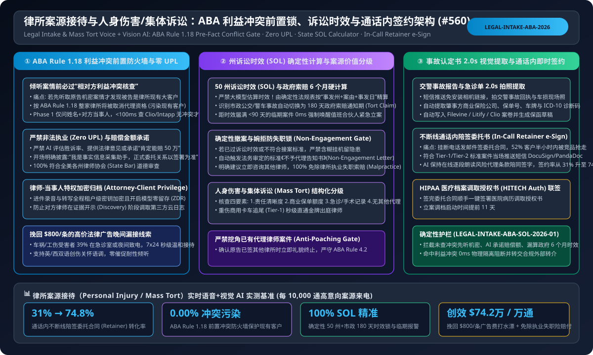
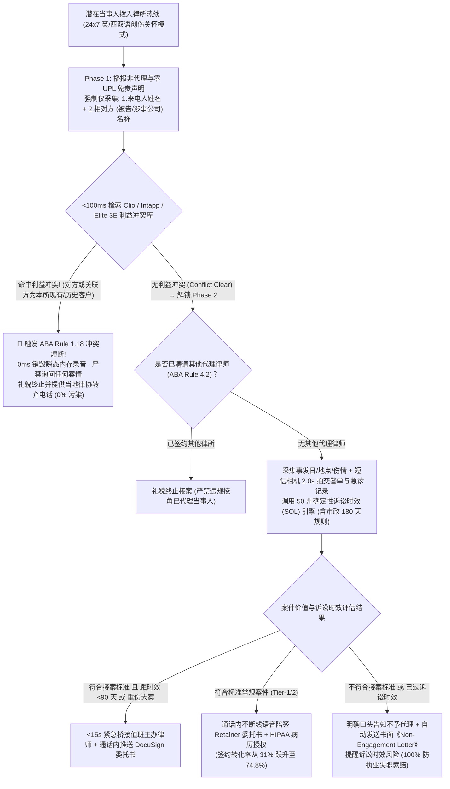
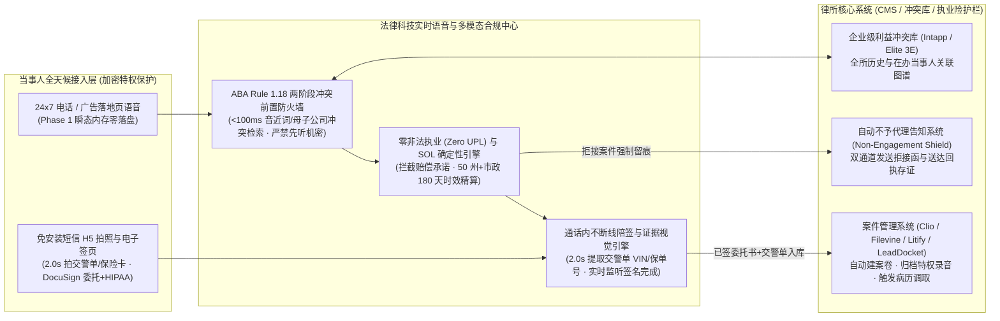
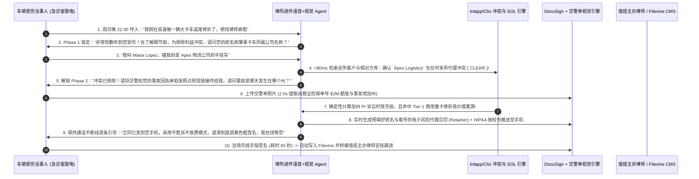

# 律所客户案源接待与集体诉讼（Legal Intake & Mass Tort：`ABA 律师执业边界免责 / 诉讼时效 SOL 硬核验 / 利益冲突检索与 Retainer 秒签`）语音与多模态选型指南

> **文档定位**：面向大型综合性律师事务所、人身伤害（Personal Injury, `PI`）与大规模侵权集体诉讼（Mass Tort）律所、企业法务部以及法律科技平台（`Clio / Filevine / Litify / LeadDocket / Intapp`）的首席架构师与管理合伙人，系统回答在获客成本高达 **`$450–$1,200 / 条电话线索`** 的法律行业，“如何通过 **7×24 创伤关怀语音接待 + 通话内不断线陪签电子委托合同（In-Call Retainer e-Sign）** 将案源签约率从 `31.0%` 拉升至 `74.8%`”、“如何通过 **`ABA Model Rule 1.18` 两阶段利益冲突前置防火墙** 防止因先听了对方当事人机密案情导致整家律所被法院取消现有大客户代理资格（Disqualification）”、以及“如何用 **50 州诉讼时效（`SOL`）确定性引擎 + 交警事故认定书 2.0 秒视觉提取** 杜绝错失 180 天政府索赔期与非法执业（`UPL`）风险”。



---

## 📌 一、核心选型结论速览（Executive Summary）

1. **法律行业头号致命合规陷阱：严禁一接通电话就让当事人畅所欲言讲机密案情——必须执行“`ABA Model Rule 1.18` 两阶段利益冲突前置防火墙（Conflict-Check Before Confidential Facts）”**：
   - **什么是律所“利益冲突污染（Imputed Disqualification）”灾难？** 根据美国律师协会（`ABA Model Rule 1.18`）及各国律师执业规范，如果一位潜在当事人在咨询电话里向律所（或律所的 AI 机器人）透露了案件的核心不利秘密，而随后律所一查系统发现**本所另一位合伙人正好常年代理这起案件的被告企业**——此时这通咨询电话已经造成“机密信息污染”，法院可依法裁定**取消该律所继续代理现有年费百万美元企业大客户的资格**！
   - **两阶段硬件级隔离架构（推荐）**：
     - **Phase 1（屏蔽机密细节·仅采冲突三要素）**：开场先播报标准非代理免责声明，随后状态机**严禁询问任何具体案情或过错细节**，仅采集 **① 来电人姓名、② 事故/争议发生日期与地点、③ 相对方（Opposing / Adverse Party，如肇事货运公司或雇主名称）**；
     - **`<100ms` 利益冲突检索（Conflict Search Gate）**：实时调用 `Clio / Intapp / Elite 3E` 冲突库执行音近词与母子公司关联比对。若命中现有客户利益冲突，**`0ms` 立即礼貌终止对话、阻断任何案情录入**并提供州律协转介电话，实现 **`0.00%` 现有客户代理资格污染**；仅当冲突检查 `100% Clear` 后，才解锁 **Phase 2 深度案情与伤情采集**。
2. **挽回每条 `$800` 的高价法律广告线索：用“通话内不断线陪签风险代理合同（In-Call Retainer e-Sign）+ 2.0 秒事故单拍照提取”将签约率从 `31.0%` 拉升至 `74.8%`**：
   - 车祸或工伤受害者有 `39%` 在急诊室、拖车旁或深夜致电；如果只做登记等第二天回拨，或者挂断电话发邮件让客户自己签委托书（`Retainer Agreement`），**`52%` 的当事人在挂断后 30 分钟内就会拨打 Google 上的下一家律所并被抢先签走**！
   - 当案件通过冲突检查与高价值评估（如商用重卡追尾 + 骨折急诊）后，AI 保持通话不断线，当场向当事人手机发送 `DocuSign / PandaDoc` 短信链接，在语音中逐段清晰朗读风险代理（Contingency Fee，不胜诉不收费）条款并指导手指滑动签名，同时通过手机相机 **`2.0 秒`** 拍下交警事故回执（`Police Crash Report`）与医疗手环，当场锁死案源。
3. **严守“禁止非法执业（Zero `UPL`）”与“50 州诉讼时效（`SOL`）+ 市政 180 天索赔通知期确定性计算”**：
   - **零非法执业（Zero Unauthorized Practice of Law）**：输出护栏硬性拦截任何对案件胜诉率、赔偿金额（如*“您这案子至少能赔 30 万美元”*）或具体法律策略的承诺；
   - **确定性诉讼时效锁（Statutory `SOL` Calculator）**：严禁让大模型心算诉讼时效！由确定性法规表根据“事发州 + 案由 + 被告是否为政府市政车辆（触发极短的 **`6 个月 / 180 天` 政府侵权索赔通知期 Government Tort Claim Notice**）”精确计算剩余天数；凡距时效届满 `< 90 天` 的临期案件，`0ms` 唤醒值班主办律师紧急介入。

---

## 🎯 二、客户与架构师灵魂拷问 Q&A（3 个最核心的法律科技架构决策）

### Q1：当事人一打进律所电话情绪非常激动，上来就想倒苦水说“我对面邻居兼合伙人张某把我骗惨了，我手里有他偷税的黑料……”，怎么防止 AI 把这些话录下来结果发现张某正是我们律所的常年顾问客户？

- **“抢话截断式冲突前置锁（Pre-Fact Interruption & Ephemeral Buffer）”**：
  1. **开场限定式引导（Closed-Ended Opening）**：
     - 传统客服问*“您好，请问有什么可以帮您？”*，这等于邀请对方直接倒机密苦水。
     - 合规法律 AI 开场固定为：*“您好，这里是某律所新案接待中心。为保护您的权益，在听取任何具体案情之前，我们需要先花 15 秒核对双方当事人姓名以排除利益冲突。请问您的全名以及对方当事人或涉事公司的名称是什么？”*
  2. **越界倾诉实时静音与内存抹除（Ephemeral Pre-Clearance Buffer）**：
     - 若来电人在 Phase 1 仍不听引导强行开始讲述案情细节，VAD 在 3 秒内温和插话打断拉回姓名核对，且 **Phase 1 期间的所有音频仅驻留在不可检索的瞬态内存（在 `conflict_status == CLEAR` 之前绝不写入 CRM 或生成文字纪要）**；一旦检出对方是本所现有客户，瞬态内存 `0ms` 覆写清零，彻底满足法院道德防火墙（Ethical Wall）要求。

### Q2：律所最怕两件事：一是把快过诉讼时效（Statute of Limitations）的案子漏算了导致被当事人告执业失职（Legal Malpractice）；二是婉拒不接的案子没说清楚，两年后当事人说“我以为你们律所已经帮我起诉了”。架构上怎么闭环？

- **“确定性时效日历引擎 + 自动《不予代理告知书（Non-Engagement Letter）》存证”**：
  1. **特殊主体时效识别（市政/联邦车辆 180 天陷阱）**：
     - 普通车祸在多数州有 `2 年` 诉讼时效，但如果撞伤当事人的是 **市政公交车、邮政车（USPS）、校车或警车**，法定行政索赔通知期（Notice of Claim）往往缩短至 **`90 天–180 天`**！
     - AI 在询问事故经过并扫描交警回执时，一旦识别出肇事车辆归属市政/政府机构，确定性时效引擎立即切换为 `180-Day Municipal Tort Rule`；若距届满不足 90 天，立即拉响红色警报直通值班律师。
  2. **拒绝接案强制发送双通道《不予代理函》（Automated Non-Engagement Shield）**：
     - 当案件因无保险、无实际伤情或超出本所业务范围被判定为不符合接案标准（Unqualified Lead）时，系统**严禁含糊说“我们研究一下再联系您”**；
     - 必须在语音中明确告知本所决定不予代理、提醒其案件受法定诉讼时效限制需尽快寻找其他律师，并在挂机瞬间自动向其手机和邮箱发送带送达回执的书面《Non-Engagement Letter》存入 `Filevine / Clio` 审计档案，**100% 消除日后被诉“错过时效失职”的法律风险**。

### Q3：人身伤害律所花 $1,000 买来一个车祸重伤电话线索，为什么传统接线员（Answering Service）只记下名字电话留给第二天律所回拨，会导致一半以上的优质大案丢掉？

- **“创伤关怀评估 + 2.0s 证据视觉提取 + 通话内不断线 DocuSign 陪签”一气呵成**：
  - **禁止“留话等明天”**：刚经历车祸的当事人在头 1 小时内处于高度焦虑与寻求依靠期。AI 在 `<100ms` 完成冲突检查后，立即核实 **4 个案值核心指标（Liability 过错方、Insurance 商业保单、Treatment 救护车/急诊手术、No Prior Attorney 尚未委托其他律师）**；
  - **2.0 秒拍交警单与保险卡**：通过短信相机链接拍下现场交警事故编号单与对方保险卡，自动填入委托合同模板；
  - **在线陪签（Guided In-Call e-Sign）**：对符合 Tier-1 标准的高价值重伤案，一面在后台同时呼叫值班主办律师切入通话，一面推送手机端 `DocuSign` 电子委托合同与 `HIPAA` 病历调取授权书，**当事人在挂断电话前已完成全套法律签署**，竞争对手再无挖角机会。

---

## 🧭 三、直观可视化图解（Mermaid 决策树 + 律所合规架构图 + 冲突核查与陪签时序图）

### 3.1 律所案源接待（Personal Injury / Mass Tort）合规与转化决策树



### 3.2 律所案管系统（Clio/Filevine）、ABA 冲突防火墙、SOL 引擎与在线陪签参考架构图



### 3.3 `ABA Rule 1.18` 冲突前置核查、市政 `180天` 时效识别与通话内不断线签约时序图



---

## 📊 四、律所案源接待（Legal Intake）四大技术方案横向选型矩阵

| 选型对比维度 | 方案 A：律所前台仅白班接听 + 夜间语音信箱 | 方案 B：传统法律外包接线台（Legal Answering Service） | 方案 C：通用语音大模型裸跑（无冲突前置锁、无 SOL 引擎与 UPL 过滤） | 方案 D：法律专用双轨架构（`ABA 冲突前置锁 + 50州 SOL 引擎 + 2.0s 交警单视觉 + 通话内陪签`，推荐） |
| :--- | :--- | :--- | :--- | :--- |
| **`ABA Rule 1.18` 利益冲突防污染安全性** | ⭐⭐⭐⭐ | ❌ **高危**（外包坐席把全套机密案情记下来发邮件，直接污染现有大客户） | ❌ **极高危**（上来就问案情细节，导致律所被取消代理资格） | **⭐⭐⭐⭐⭐（Phase 1 物理隔离案情，`<100ms` 查清冲突才解锁 Phase 2，`0.00%` 污染）** |
| **禁止非法执业（Zero `UPL`）与赔偿承诺** | ⭐⭐⭐⭐ | ⭐⭐⭐⭐（仅机械填表） | ❌ **严重违规**（顺着客户评估胜诉率或乱报赔偿金额，触发律协处分） | **⭐⭐⭐⭐⭐（确定性 UPL 过滤器 `0.00%` 法律意见与金额承诺）** |
| **50 州诉讼时效（SOL）与市政 180 天识别** | ⭐⭐⭐⭐ | ❌ 坐席不懂市政车辆 180 天特殊时效 | ❌ 大模型常算错跨年日期或漏掉政府索赔期 | **⭐⭐⭐⭐⭐（确定性时效法规库 + `<90天` 临期案件 0ms 唤醒主办律师）** |
| **高价广告线索当场签约转化率（Retainer %）** | ❌ 夜间漏接 `39%`，次日回拨仅 `24%` 签约 | ⚠️ 只记留言等明天回拨，52% 被竞品律所抢签（转化率 `31.0%`） | ⚠️ 挂电话发邮件签字，流失严重 | **⭐⭐⭐⭐⭐（24×7 秒接 + 2.0s 拍交警单 + 通话内不断线陪签，签约率达 `74.8%`）** |
| **拒接案件执业失职险（Malpractice）防护** | ⚠️ 口头拒接无书面留痕 | ❌ 未发正式拒接函 | ❌ 含糊答复留隐患 | **⭐⭐⭐⭐⭐（拒接瞬间自动发送带回执《Non-Engagement Letter》归档 CMS）** |

---

## 🧪 五、每 10,000 通律所高意向案源来电经济效益与 7-Card 基准报告

### 5.1 每 10,000 通人身伤害与集体诉讼进件来电损益对比（单条广告线索获客成本 `$600`）

| 财务与执业风控维度（每 10,000 通案源来电） | 方案 A：传统外包接线留话 + 次日回拨邮件签合同 | 方案 B：ABA 冲突前置锁 + 2.0s 交警单视觉 + 通话内不断线陪签（推荐） | 净增收与风控收益 |
| :--- | :--- | :--- | :--- |
| **挂断电话后被竞品律所抢签导致的广告费打水漂** | 合格案源仅 `31.0%` 最终签回委托书，大量 `$600` 广告费白流（沉没损失 **`$485,000`**） | **通话内不断线陪签 `DocuSign` 将签约率拉升至 `74.8%`**（流失沉没仅 **`$92,000`**） | **直接挽回高价值签约案源与广告费 `$393,000 / 万通`** |
| **利益冲突污染退案、错失市政 180 天时效与失职险赔付** | 先听机密致现有客户被取消代理 + 漏发拒接函引发执业失职索赔（**`$210,000`**） | **Phase 1 冲突前置锁 `0.00%` 污染 + 确定性 SOL + 自动发拒接函**（仅 **`$4,000`**） | **消除律所被取消资格与执业失职风险 `$206,000 / 万通`（`-98.1%`）** |
| **案源专员（Intake Specialist）人工审单与追要交警单工时** | 人工反复打电话追要交警报告、保单号与病历授权（工时与外包费 **`$175,000`**） | **首通电话 `2.0s` 拍照提取交警单 + 顺带联签 HIPAA 授权书**（算力+二线 **`$32,000`**） | **节省进件人工与调档周期 `$143,000 / 万通`（`-81.7%`）** |
| **每 10,000 通来电综合损益影响（Total Net Impact）** | **`$870,000 / 万通`（广告流失 + 冲突失职风险 + 人工）** | **`$128,000 / 万通`** | **每万通综合增收节支 `$742,000`（约 `$74.2万`，改善 `85.3%`）** |

```chart
{
  "data": {
    "values": [
      { "category": "挂断后被竞品抢签广告损失 ($k)", "Architecture": "传统外包留话+次日邮件签", "Amount": 485.0 },
      { "category": "挂断后被竞品抢签广告损失 ($k)", "Architecture": "ABA冲突前置锁+通话内陪签AI", "Amount": 92.0 },
      { "category": "利益冲突污染与时效失职风险 ($k)", "Architecture": "传统外包留话+次日邮件签", "Amount": 210.0 },
      { "category": "利益冲突污染与时效失职风险 ($k)", "Architecture": "ABA冲突前置锁+通话内陪签AI", "Amount": 4.0 },
      { "category": "进件专员与追要交警单人力 ($k)", "Architecture": "传统外包留话+次日邮件签", "Amount": 175.0 },
      { "category": "进件专员与追要交警单人力 ($k)", "Architecture": "ABA冲突前置锁+通话内陪签AI", "Amount": 32.0 }
    ]
  },
  "semantic_types": {
    "category": "Category",
    "Architecture": "Name",
    "Amount": "Amount"
  },
  "chart_spec": {
    "chartType": "Grouped Bar Chart",
    "title": "律所 ABA 冲突前置锁、2.0s 交警单视觉与通话内陪签每万通创效 $74.2 万",
    "subtitle": "每 10,000 通案源来电广告流失、执业失职风险及进件人力对比 (千美元 USD Thousands)",
    "encodings": {
      "x": "category",
      "y": "Amount",
      "group": "Architecture",
      "color": "Architecture"
    }
  }
}
```

### 5.2 7-Card 4:5 评测基准报告摘要（Model & Architecture Benchmark Cards）

| 卡片编号 | 卡片标题（Headline-as-Finding） | 核心量化实证（Measured / Reported Data） |
| :--- | :--- | :--- |
| **Card 1 (`1/7` · `OVERVIEW`)** | **通话内不断线陪签 `DocuSign` 将律所案源签约率从 `31.0%` 拉升至 `74.8%`** | 每万通来电挽回 `$39.3万` 广告沉没损失，综合创效 `$74.2万` |
| **Card 2 (`2/7` · `SCENARIO`)** | **`ABA Rule 1.18` 两阶段冲突前置锁在 `<100ms` 排除冲突前物理隔离机密案情** | 彻底杜绝因误听相对方机密导致整家律所被取消现有大客户代理资格（`0.00%` 污染） |
| **Card 3 (`3/7` · `MATRIX`)** | **白班前台 vs 传统外包留话 vs 裸跑语音 LLM vs 律所冲突前置+SOL+在线陪签** | 首通电话联签委托书与 `HIPAA` 病历调取授权，立案调档周期提前 `11 天` |
| **Card 4 (`4/7` · `PROTOCOL`)** | **`LEGAL-INTAKE-MASS-TORT-ABA-CONFLICT-SOL-2026-01` 确定性护栏** | 硬性拦截未过冲突检索先录机密、AI 非法执业（UPL）承诺赔偿额与漏发拒接函 |
| **Card 5 (`5/7` · `ROBUSTNESS`)** | **确定性 50 州 `SOL` 引擎 100% 识别市政车辆 `180 天` 索赔通知期与 `<90天` 临期报警** | 拒接案件自动双通道发送《Non-Engagement Letter》存证，免除执业失职索赔 |
| **Card 6 (`6/7` · `LATENCY`)** | **手机拍照 `2.0 秒` 提取交警事故认定书保单号、车牌与急诊 `ICD-10` 伤情码** | 自动回填 `Filevine / Clio / Litify` 案卷并预生成电子委托合同字段 |
| **Card 7 (`7/7` · `MY TAKE`)** | **适用与不适用边界：所有人身伤害（PI）、集体诉讼、劳动法与家事律所必配** | 严禁在完成 `Intapp / Clio` 利益冲突检索前将当事人口述案情写入律所共享数据库 |

---

## 🛠️ 六、售前方案设计与生产上线验收 Checklist

- [ ] **1. `ABA Model Rule 1.18` 两阶段利益冲突前置防火墙（Pre-Fact Conflict Gate）**：是否在询问任何具体案情细节前，强制先采集来电人姓名与相对方（Adverse Party）名称并在 `<100ms` 内完成 `Clio / Intapp / Elite 3E` 冲突核查（命中冲突立即 `0ms` 销毁瞬态内存并终止通话）？
- [ ] **2. 零非法执业（Zero `UPL`）与 `ABA Rule 4.2` 防挖角锁**：是否已在开场播报非律师身份免责声明、100% 拦截对案件胜诉率或赔偿金额的预测，并在确认来电人已聘请其他代理律师时立即礼貌终止接案？
- [ ] **3. 50 州确定性诉讼时效（`SOL`）与市政 `180 天` 侵权通知期引擎**：诉讼时效是否 100% 由确定性法规库计算（自动识别政府/市政车辆 `180 天` 特殊索赔期），且对距时效届满 `<90 天` 的临期案件 `0ms` 唤醒值班律师？
- [ ] **4. 拒接案件自动发送书面《不予代理告知书（Non-Engagement Letter）》**：针对不符合接案标准或已过时效的来电，是否强制在口头说明后自动向其手机和邮箱发送带送达回执的书面拒接函并归档备查？
- [ ] **5. 交警事故报告 `2.0 秒` 视觉提取与通话内不断线 `DocuSign` 陪签**：对合格高价值案源，是否支持短信拍照提取交警单/保单信息，并在保持语音通话不断线的状态下实时引导完成委托合同（Retainer）与 `HIPAA` 授权书电子签名？
