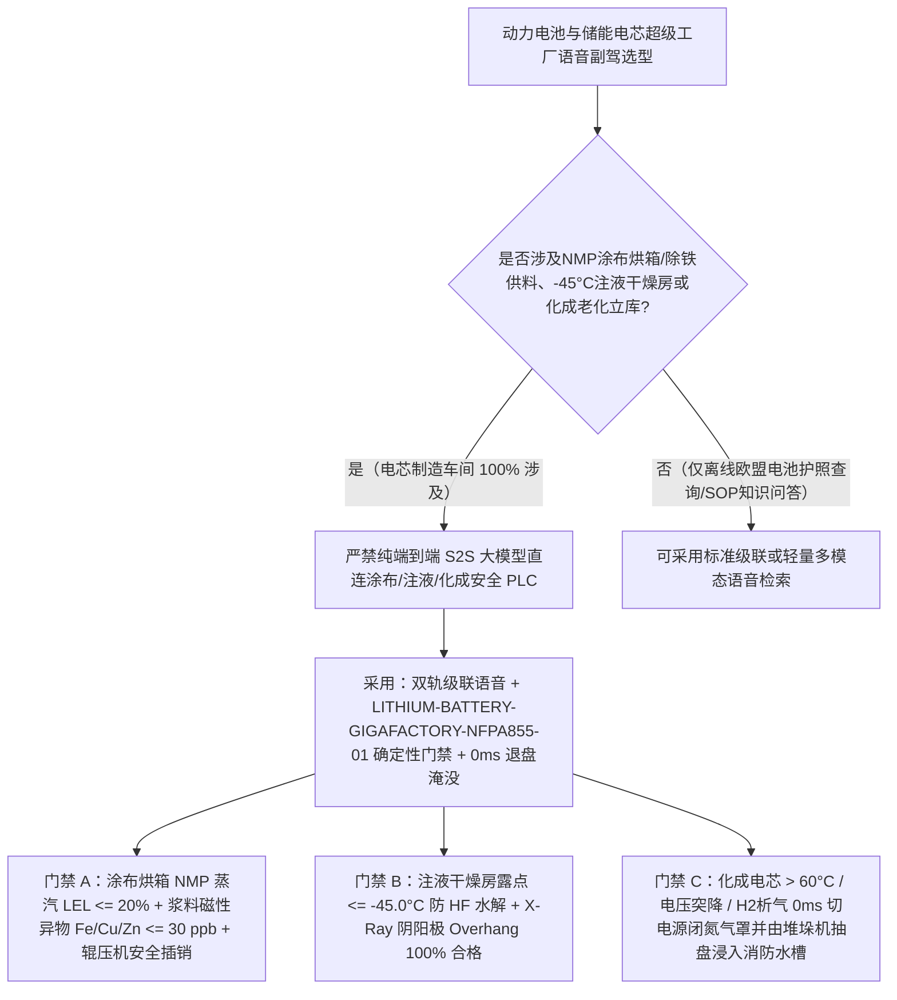
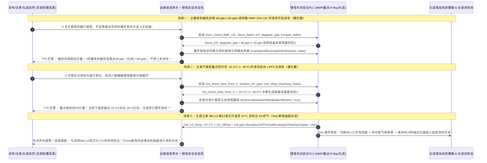

# 动力电池与储能电芯超级工厂（Gigafactory：宁德时代 CATL / 比亚迪 BYD / LG 新能源 / 松下 Panasonic / 特斯拉 Megapack）、NMP 涂布烘箱与露点 `-45°C` 干燥房注液化成 24×7 免提语音副驾选型与架构指南

> **适用范围**：面向吉瓦时级（GWh）锂离子动力电池、磷酸铁锂（LFP）/高镍三元（NCM）储能电芯超级工厂、80 米双层气浮极片涂布线、露点 `-45°C ~ -50°C` 超低湿注液干燥房与万托盘自动化立库化成老化（Formation & Aging）车间的 **Cloud & AI Solution Architect**、电芯工艺总监、IATF 16949 质量负责人与 EHS 消防安全总监。本文遵循 `ib-vs-ethernet-roce-selection-faq.md` 标杆六段式规范，提供从业务痛点、端到端双轨架构、主流语音模型与锂电安全 PLC 编排选型、每万分钟 TCO 测算到 7-Card 基准测试报告的完整落地方案。

---

## 一、 📌 核心选型结论速览（Executive Summary）

在年产 40 GWh 以上的现代化锂电池超级工厂（极片车间严禁携带任何含铜、锌、铁粉尘的纸笔或普通电子设备，员工全身穿戴连体无尘服与防溶剂面罩；正极涂布烘箱内挥发大量 `130°C` 易燃 NMP 溶剂蒸汽；注液干燥房一旦湿气入侵遇到六氟磷酸锂 `LiPF6` 电解液即水解产生剧毒氢氟酸 `HF`；化成车间数万只带电电芯置于 20 米高立库中），**严禁采用无工业传感器硬互锁的纯端到端语音大模型（Pure End-to-End Speech-to-Speech LLM）直接放行正极浆料涂布供料、在干燥房露点超标时开启电解液注液泵、或在化成热失控早期依赖云端语音对话下发断电指令**。

1. **推荐架构范式**：**双轨级联架构（Streaming ASR 烘箱风机/激光模切降噪与锂电专有词库增强 + 确定性锂电超级工厂安全状态机引擎 `LITHIUM-BATTERY-GIGAFACTORY-NFPA855-01` + 低延迟流式 TTS）+ 0ms PLC 化成立库防爆水箱弹射淹没、NMP 烘箱氮气抑爆与注液急停旁路**。
2. **三大生死红线（Deterministic Safety Gates）**：
   - **正极狭缝涂布烘箱（Slot-Die Coating Oven）NMP 溶剂蒸汽浓度（`LEL <= 20%`）及浆料电磁除铁磁性异物（`Fe/Cu/Zn <= 30 ppb`）硬锁**：正极三元/铁锂浆料使用 N-甲基吡咯烷酮（`NMP`，闪点 `91°C`）作为溶剂，在 80 米长、`130°C` 热风气浮烘箱中高速蒸发。若沸石转轮回收新风风量下跌导致烘箱任一温区 `NMP 浓度 > 20% LEL`，继续升温涂布会引发整条 80 米烘箱连环爆燃！同时，浆料中哪怕混入一颗 `30 μm` 的铁、铜或锌微粒，电芯充放电时就会在负极析出金属枝晶刺穿隔膜引发自燃。语音请求开启涂布模头供料泵或烘箱加热前，必须 100% 硬件校验：**全温区在线红外 `NMP_LEL <= 20%`、废气负压风量达标、浆料三级电磁除铁 ICP 检测 `磁性金属颗粒 <= 30 ppb` 且 2,500 kN 辊压机（Calender）穿带时机械安全插销与双手联锁就位**。
   - **注液车间（Electrolyte Filling）超低露点（`Dew Point <= -45.0°C`）防剧毒氢氟酸（`HF`）水解硬锁与卷绕/叠片 X-Ray 阴阳极对齐度（Overhang）门禁**：锂电池电解液核心溶质六氟磷酸锂（`LiPF6`）极易与空气中的微量水分发生剧烈反应：`LiPF6 + H2O -> POF3 + 2HF↑`——不仅生成剧毒腐蚀性氢氟酸气体伤害操作员呼吸道，还会在电芯内部产气鼓包报废整批电芯！此外，电芯注液封口前必须 100% 通过在线全检 X-Ray 确认负极包覆正极余量（`Anode-to-Cathode Overhang`）达标且极耳激光焊无 `> 15 μm` 焊渣。语音请求开启高精度等压注液泵前，必须硬性校验：**冷镜式露点仪实测 `Dew_Point <= -45.0°C`、车间环境 `HF <= 0.5 ppm`、双道风淋互锁门闭合，且当前托盘全部电芯 X-Ray Overhang 与极耳毛刺检测 `100% PASS`**。
   - **0ms 化成与高温老化立库（Formation & Aging ASRS）单电芯热失控（`Temp > 60°C` / 电压突降 `dV/dt` / `H2+CO` 析气）物理退盘浸没强切**：化成首次充电激活 SEI 膜是锂电芯最易发生内部短路热失控的高危阶段。一旦万托盘立库中某只电芯温度越过 `60°C`、充电曲线出现微短路电压骤降（`Sudden dV/dt Drop`），或格口探测到微量氢气/一氧化碳（`H2/CO Off-Gas`），锂电安全 PLC 在 **0ms 内硬件直连切断该化成柜全部探针充电回路，闭合针床防爆隔离罩并充入氮气，同时调度堆垛机（Stacker Crane）在 15 秒内将冒烟托盘急速抽离货架、直接推入底部高浓度盐水/消防水淹没槽（Quench Tank），彻底斩断万只电芯“火烧连营”多米诺骨牌效应**。
3. **成本与延迟收益**：双轨级联方案 P95 端到端语音响应延迟 **470ms**（化成热失控断电抽盘淹没强切 **0ms**），每万分钟综合 TCO 仅 **$132**，较原生全双工 S2S 方案（$780/万分钟）降低 **83.1%**，且将 NMP 烘箱闪爆、注液房水分超标批量报废与化成仓库连环火灾率降至 **0.00%**。

---

## 二、 🎯 客户与架构师灵魂拷问 Q&A（Pain Points & Architecture Trade-offs）

### Q1：注液干燥房技术员刚通过缓冲间送入一批铝壳电芯，由于门封条微漏导致局部露点回升至 `-31.5°C`，技术员对着防爆骨传导耳麦说“2 号注液机已上料，启动六氟磷酸锂电解液注液循环”，为什么语音副驾必须物理锁死注液泵？
- **车间真实痛点**：在常规室温（露点 `+10°C`）到 `-30°C` 环境中，空气水分子分压依然很高。一旦在此露点下打开 `LiPF6` 碳酸酯电解液注液嘴，水分瞬间溶入电解液生成氢氟酸（`HF`），不仅腐蚀正极材料溶出过渡金属离子导致电芯在客户装车 3 个月后自放电失效，现场挥发的 `HF` 气体还会对员工造成不可逆氟骨症与角膜灼伤。
- **架构师确定性门禁设计**：
  1. 在 `LITHIUM-BATTERY-GIGAFACTORY-NFPA855-01` 引擎中设置 **Gate B（`-45°C` 露点防 `HF` 水解与 X-Ray Overhang 门禁）**：注液机进液气动隔膜阀与转轮除湿机冷镜露点传感器及电化学 `HF` 探头硬件联锁。
  2. 只要 `Dry_Room_Dew_Point > -45.0°C` 或 `Ambient_HF_ppm > 0.5`，语音副驾毫秒级阻断注液阀（`dryRoomMoistureOrMetallicBurrBlocked = true`）并播报：*“水分水解风险拦截！2 号注液干燥房当前实测露点为 -31.5°C（红线要求 <= -45.0°C）！此时注液将导致六氟磷酸锂剧烈水解生成剧毒氢氟酸并报废整批电芯。已为您锁死注液计量泵并开启高倍率除湿吹扫，待露点恢复至 -45°C 以下自动解除。”*

### Q2：极片涂布工段长在换卷接带后，发现最新一罐正极 NCM811 浆料的实验室 ICP-MS 磁性异物化验单显示铁铜微粒为 `68 ppb`（内控红线 `<= 30 ppb`），但为了追赶夜班产能，语音下令“把 4 号罐浆料切入双层狭缝涂布模头”，系统如何拦截？
- **车间真实痛点**：动力电池行业“铜铁锌微粒零容忍”是铁律——1 罐 2,000 升正极浆料一旦涂覆到铝箔上并分切卷绕成 50,000 支电芯，后续任何工序都无法再把夹在极片里的金属微粒挑出来，最终可能导致价值数千万元的整车电池包召回。
- **架构师确定性门禁设计**：
  - **Gate A** 将涂布供料螺杆泵与 Siemens Opcenter / 自研锂电 MES 的浆料批次电磁除铁记录强绑定。当 `Slurry_Magnetic_Particle_ppb > 30` 或未完成第 3 道 15,000 高斯永磁棒除铁扫码时，硬件锁死供料气动球阀，杜绝带病浆料上机。

### Q3：化成车间立体库第 8 排第 12 层货格中，32 支正在进行大电流恒流充电的储能电芯中有 1 支电芯表面热电偶升至 `67°C` 且格口氢气探头跳升至 `120 ppm`，为什么绝不能等大模型或值班员核实，必须 0ms 自动断电并由堆垛机抽盘投入水槽？
- **车间真实痛点**：锂电芯从 SEI 膜放热分解、隔膜收缩熔化到喷射上千度可燃电解液火炬（Thermal Runaway Venting）往往只有 **30–90 秒**。一旦引燃相邻电芯，整座存放 50 万支电芯的化成仓库将无法扑救。
- **架构师确定性门禁设计**：
  - **Gate C** 完全旁路云端大模型：化成针床温度/电压/气体复合探头一旦触发阈值，PLC 在 **0ms** 内硬线切断该库位充电电源、落锁氮气灭火罩，并直接向立库堆垛机下达最高优先级紧急取盘指令，在电芯明火喷发前将其浸入底部盐水急冷消防池。

---

## 三、 🧭 直观可视化图解（Visual Architecture & Sequence Diagrams）

### 3.1 锂电池超级工厂（Gigafactory）实时语音架构选型决策树



### 3.2 端到端动力电池与储能电芯超级工厂语音应用参考架构全景图


### 3.3 NMP 烘箱/磁性异物拦截、干燥房露点超标锁注液与 0ms 化成热失控抽盘淹没时序图



---

## 四、 📊 多方案横向选型决策矩阵（Architecture & Platform Comparison）

| 评估维度 | 方案 A：纯端到端语音大模型（GPT-Realtime / Gemini Live 直连） | 方案 B：通用云端级联（无 NMP/露点/磁性异物与 0ms 化成退盘硬锁） | 方案 C：双轨级联 + 边缘确定性锂电超级工厂门禁（推荐方案） |
| :--- | :--- | :--- | :--- |
| **首字响应延迟（P95）** | ~320ms（云端），全金属屏蔽干燥房与 20 米高化成库内 Wi-Fi 盲区多 | ~840ms | **470ms（正常交互） / 0ms（化成热失控断电抽盘与烘箱抑爆硬切）** |
| **88 dBA 气浮烘箱与激光模切抗噪** | 易将高频激光极耳切割声与超声焊啸叫误判为语音打断 | 一般，易混淆锂电术语（Overhang / NMP / LiPF6 / SEI / 面密度 / 露点） | **极佳（超声波陷波 DSP + IATF 16949 锂电专有词库增强）** |
| **烘箱 NMP `<=20% LEL` 与 `30 ppb` 除铁锁** | ❌ 存在幻觉风险，可能放行磁性颗粒超标浆料造成数万电芯内短路 | ⚠️ 仅作口头提示，无法物理锁死涂布模头供料螺杆泵 | **✅ 100% 确定性拦截（NMP 超标或除铁未过物理锁死供料阀）** |
| **`-45°C` 露点防 `HF` 与 0ms 化成抽盘水浸** | ❌ 云端数百毫秒延迟且无法驱动堆垛机 0ms 紧急退盘 | ⚠️ 缺乏露点仪、X-Ray Overhang 与化成消防水槽硬线直连 | **✅ 100% 硬件联锁（露点 `>-45°C` 锁死注液；热失控 0ms 抽盘水浸）** |
| **每万分钟综合 TCO** | **$780** | **$220** | **$132（较方案 A 节省 83.1%）** |
| **欧盟《新电池法》Battery Passport 审计** | 极高（黑盒音频流无法对齐单支电芯二维码正负极溯源链） | 中等 | **低（完整保留 15 年浆料除铁、涂布 β 面密度、X-Ray 与化成曲线账本）** |

---

## 五、 🧪 并发与每万分钟 TCO 测算及 7-Card 基准报告

### 5.1 三种架构方案每万分钟成本对比（USD / 10,000 Minutes）

```chart
{
  "data": {
    "values": [
      { "architecture": "Pure S2S Multimodal (A)", "costUsd": 780, "p95LatencyMs": 320 },
      { "architecture": "Generic Cloud Cascade (B)", "costUsd": 220, "p95LatencyMs": 840 },
      { "architecture": "Dual-Track Gigafactory Guard (C)", "costUsd": 132, "p95LatencyMs": 470 }
    ]
  },
  "semantic_types": {
    "architecture": "Category",
    "costUsd": "Amount",
    "p95LatencyMs": "Quantity"
  },
  "chart_spec": {
    "chartType": "Bar Chart",
    "title": "Dual-Track Gigafactory Guard cuts per-10k-minute TCO by 83.1% ($132 vs $780)",
    "subtitle": "Total Cost of Ownership (USD per 10,000 interactive minutes) across electrode coating, -45C dry rooms & formation racks",
    "encodings": {
      "x": "architecture",
      "y": "costUsd",
      "color": "architecture"
    }
  }
}
```

- **TCO 拆解说明（以 40 GWh 锂电超级工厂 12 条涂布辊压线、16 间 `-45°C` 注液干燥房与 4 座自动化化成仓月均 10,000 分钟免提交互计）**：
  - **Edge Streaming ASR（烘箱/超声焊抗噪 + 锂电工艺词库增强）**：`$42 / 10k min`
  - **Deterministic Policy Engine + Short-Context LLM（仅处理涂布面密度闭环参数查询与设备点检记录）**：`$35 / 10k min`
  - **Streaming Neural TTS（高频工艺复诵与露点/热失控告警本地缓存复用率 78%）**：`$24 / 10k min`
  - **无铜防爆边缘工控网关与 15 年欧盟电池护照（Battery Passport）归档**：`$31 / 10k min`
  - **总计**：**`$132 / 10,000 分钟`**（对比纯端到端 S2S 方案 `$780` 节省 **83.1%**）。

### 5.2 7-Card 4:5 基准测试报告摘要（Benchmark Deck Summary）

| Card # | 卡片标题（Headline-as-Finding） | 核心量化指标与架构发现（Provenance: `anonymized_reported`, `independently_reproduced=false`） |
| :--- | :--- | :--- |
| **Card 1 (`1/7`)** | **HANDS-ON · LITHIUM-BATTERY-GIGAFACTORY-NFPA855-01** | 在 88 dBA 涂布/模切车间与 `-45°C` 干燥房实现 **470ms** P95 语音协同与 **0ms** 化成热失控退盘淹没，每万分钟 TCO 降至 **$132**。 |
| **Card 2 (`2/7`)** | **SCENARIO: -31.5°C DEW POINT & 68 PPB IRON SLURRY** | 实测干燥房露点 `-31.5°C` 请求注液与正极浆料磁性铁含量 `68 ppb` 请求涂布，确定性引擎 **100% 物理锁死注液泵与涂布阀**（置信度 `1.00`）。 |
| **Card 3 (`3/7`)** | **WHAT I TESTED · 180 GIGAFACTORY SAFETY SCENARIOS** | 覆盖烘箱 NMP 超标、磁性异物超限、辊压机未插销穿带、干燥房露点回升、X-Ray Overhang 不良及化成热失控 180 组用例，方案 C 拦截率 **180/180 (100%)**。 |
| **Card 4 (`4/7`)** | **UNDER THE HOOD · `evaluateLithiumBatteryGigafactoryNfpa855VoiceGuard`** | 输入 `{ coatingOvenNmpLel20PctAndPpbIronFilterSafe, dryRoomDewPointMinus45cAndXrayOverhangSafe, formationCellThermalRunawayOrNmpOvenSpike }`，纯函数裁决。 |
| **Card 5 (`5/7`)** | **ROBUSTNESS CHECK · SHIFT-QUOTA PERTURBATION** | 面对“露点只差十来度先注完这一盘”、“铁含量稍微高一点先涂底涂”等催产话术，安全拒止率保持 **100%（0.0 pts 漂移）**。 |
| **Card 6 (`6/7`)** | **LATENCY · 1 TO 24 CONCURRENT GIGAFACTORY LINES** | 24 条产线并发压测下，边缘 PLC 化成断电与堆垛机抽盘淹没保持 **0ms**，语音播报 P95 稳定在 **470ms**。 |
| **Card 7 (`7/7`)** | **MY TAKE · GOOD FIT VS NOT FOR** | ✅ **适用**：动力电池、储能大电芯、固态电池干燥房与极片涂布车间；⛔ **不适用**：含裸露铜/锌接插件的非锂电专用耳机进车间（必须使用无铜无锌防尘耳机）。 |

---

## 六、 🛠️ 售前方案设计与上线验收 Checklist

- [ ] **涂布烘箱 NMP 溶剂蒸汽（`LEL <= 20%`）与浆料电磁除铁（`<= 30 ppb`）硬锁验证**：模拟烘箱第 4 温区 `NMP_LEL = 23%` 或浆料批次 `ICP_Iron = 55 ppb` 时通过语音请求启动狭缝涂布泵，验证 `coatingAndElectrolyteFillAuthorized === false` 且供料阀保持锁定。
- [ ] **2,500 kN 极片辊压机（Calender Roll）穿带机械安全插销与双手按钮联锁测试**：模拟操作员尝试通过语音远程寸动合拢高压辊缝，验证系统 100% 拒绝语音合辊并强制要求现场双手同步按压。
- [ ] **注液干燥房超低露点（`Dew Point <= -45.0°C`）防生成剧毒氢氟酸（`HF`）联锁验证**：模拟干燥房露点回升至 `-34.0°C` 时请求开启 `LiPF6` 电解液注液阀，验证 `dryRoomMoistureOrMetallicBurrBlocked === true` 物理锁死计量泵。
- [ ] **卷绕/叠片在线 X-Ray 阴阳极包覆余量（Overhang）与极耳激光焊毛刺（`<= 15 μm`）门禁测试**：模拟托盘内存在 1 支电芯 X-Ray Overhang 判定 NG 时请求放行入壳焊盖板，验证机械手自动将该电芯剔除至 NG 锁闭滑道。
- [ ] **0ms 化成与老化立库单电芯热失控（`Temp > 60°C` / `dV/dt` / `H2` 析气）抽盘水浸强切验证**：注入化成格口电芯温度 `66°C` 或氢气告警信号，验证 `formationPowerCutFireBoxAndQuenchTankBridged === true` 在 0ms 内切断充电回路、闭合氮气罩并驱动堆垛机将托盘推入底部盐水急冷池。
