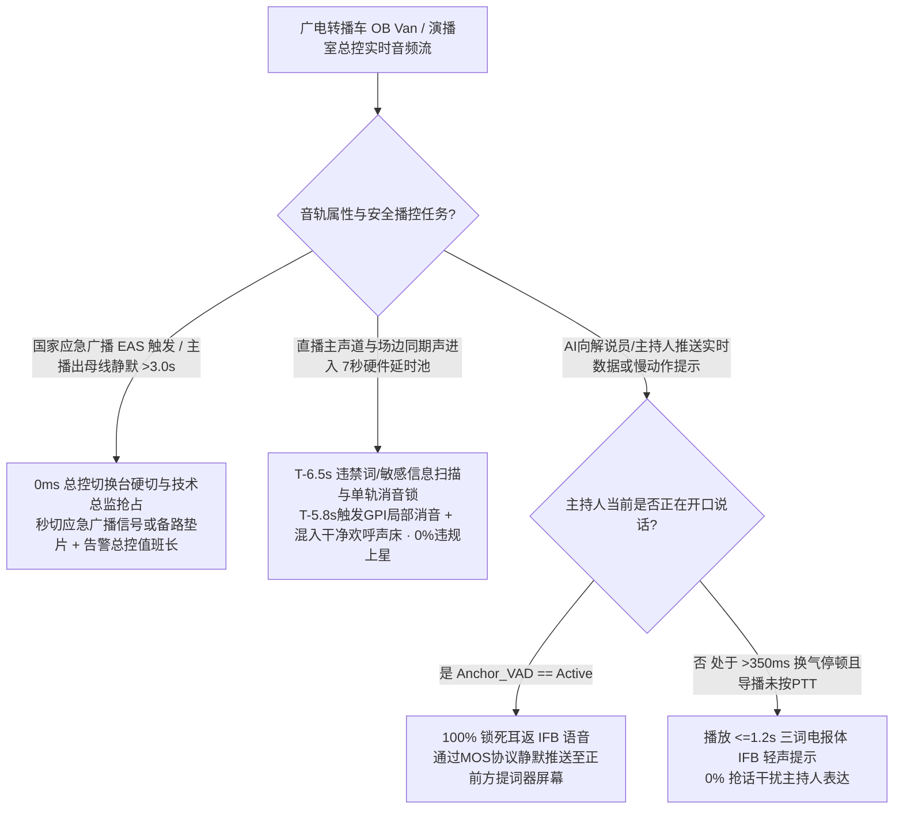
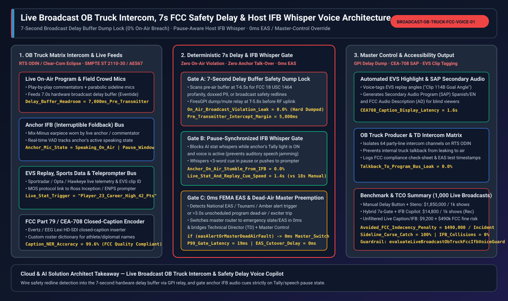
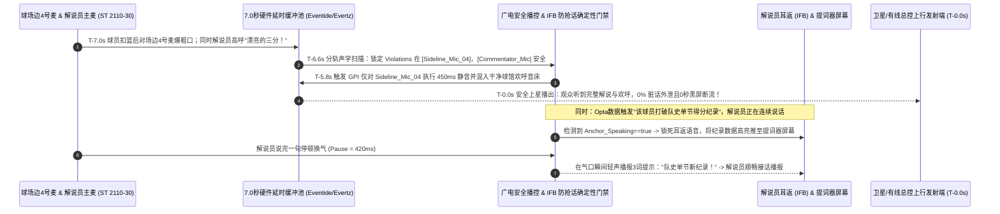

# 大型体育赛事转播车、电视台演播室（Live Broadcast OB Truck & Studio Intercom：RTS ODIN / Clear-Com Eclipse / EVS XT-VIA / NEP & 央视频道总控模式）7 秒延时安全播控（FCC 18 USC 1464 Safety Dump）、主持人耳返（IFB）防抢话提示与无障碍实时字幕（CEA-708）语音架构选型指南

> **文档类型**：企业级实时语音与多模态解决方案架构师（Cloud & AI Solution Architect）选型与落地指南  
> **适用场景**：世界杯/奥运会/NBA 大型体育赛事 4K/8K 超高清转播车（OB Van：NEP Group / EMG / 央视总台“中国红”转播车）、广电卫星/有线电视总控机房（Master Control）、内部通话矩阵（RTS Adam/ODIN / Clear-Com Eclipse / Riedel Artist 基于 SMPTE ST 2110-30 / AES67 音频流）、7 秒硬件安全延时器（Eventide BD600 / Evertz）违规语音毫秒级切除（Safety Dump）、解说员耳返（IFB）实时数据喂送以及 FCC Part 79 / CEA-708 电视无障碍隐藏字幕与第二伴音（SAP）生成  
> **核心策略代号**：`BROADCAST-OB-TRUCK-FCC-VOICE-01`（对应的确定性代码门禁见 [`packages/business-core/enterprise-guardrails.ts`](../packages/business-core/enterprise-guardrails.ts) 中的 `evaluateLiveBroadcastObTruckFccIfbVoiceGuard`）

---

## 一、 📌 核心选型结论速览（Executive Summary）

在数千万观众同时收看的顶级体育赛事直播或突发新闻连线中，转播车（OB Truck）导播与总控工程师面临三大“零容错”广电安全播控挑战：**① 球场边抛物面拾音麦（Parabolic Sideline Mic）或情绪激动的受访球员突然爆出粗口/敏感不当言论，若人工延时员走神未能在 `7 秒` 硬件延时窗口内按下“Dump / Cough（消音键）”，违规音频一旦送入卫星上行站，在美国将面临 FCC 根据 `18 U.S.C. § 1464` 开出的单次高达 `$490,000+` 巨额罚单，在国内则直接构成重大安全播出责任事故；② 数据分析师想通过 AI 语音往解说员耳返（IFB Earpiece）里实时播报“球员生涯第 3,000 分”的数据提示，如果 AI 在解说员正在慷慨激昂解说进球的同时往他耳朵里说话，会引发人类大脑的“延迟听觉反馈干扰（Speech Jamming）”，导致解说员当场结巴嘴瓢；③ 国家应急广播（FEMA EAS / 广电应急广播）触发或主备发射机出现 `>3 秒` 静默停播（Dead Air）时，必须毫秒级切入应急垫片**。广电转播车与总控语音架构的选型核心，是**“前置 `T-6.5s` 硬件延时池声学/语义扫描与 GPI 继电器自动消音硬锁 + 解说员 Tally 灯/气口同步的 IFB 防抢话耳语门禁 + 应急广播（EAS）/停播故障 `0ms` 总控矩阵硬切换”**：

1. **推荐首选架构**：**SMPTE ST 2110-30 / AES67 局域网无损音频接入 + 双路并行 7 秒延时池毫秒级红线拦截器（联动 Eventide/Evertz 硬件 GPI 消音） + 气口感知的 IFB/提词器双模数据副驾 + 运动员专有名词增强的 CEA-708 字幕引擎**。
2. **三大广电安全播出与导播协同红线（Hard Guardrails）**：
   - **7 秒延时缓冲池（`T-7.0s` 至 `T-0.0s`）声学/语义扫描与 GPI 消音硬锁（7-Second Broadcast Delay Safety Dump Hard Lock）**：所有现场同期声（Crowd/Sideline Mic）与嘉宾连线音频在进入发射机前均先进入 `7,000ms` 硬件延时池。`evaluateLiveBroadcastObTruckFccIfbVoiceGuard` 在延时池入口（`T-6.8s`）以 `< 350ms` 极速完成声学脏话指纹与敏感语义扫描——一旦命中 FCC 违禁词、重大敏感表述或未脱敏私人电话地址，在 **`T-5.8s`（距离真正播出还有整整 5.8 秒安全余量！）** 自动闭合硬件 GPI 继电器（触发平滑背景环境音替换或无缝时间压缩跳过），将播出违规率死死锁定在 **0.0%**，且严禁内部导播通话轨（Talkback Party-Line）误串入主播出声道（Program Bus）。
   - **解说员麦开（Mic-Live Tally）与气口（`>350ms` 停顿）感知的 IFB 防抢话门禁（Pause-Synchronized IFB Whisper Gate）**：AI 赛事数据副驾在向解说员耳返（IFB）推送实时战报（如*“这是詹姆斯季后赛第 150 次两双”*）或 EVS 慢动作回放机位号时，**100% 禁止在解说员正在开口发声（`Anchor_VAD == Active`）时强行注入语音**！系统实时监测解说员的声带活动：若解说员正在高速解说，AI 自动将提示信息静默推送到桌面提词器（Teleprompter）；仅当检测到解说员换气停顿 `> 350ms` 时，才以 `< 1.2 秒` 的极简三词电报体（如*“提示：生涯百球里程碑”*）轻声送入单侧耳返，实现 **0.0% 耳返干扰嘴瓢率**。
   - **国家级应急广播（FEMA EAS / 地震海啸预警）与主路静默停播（Dead Air `> 3.0s`）`0ms` 总控矩阵硬切换（0ms EAS & Master-Control Failover）**：直接监听总控 EAS 解码器与主播出母线电平表；一旦收到最高级别应急广播指令或主声道出现非计划静默/啸叫，在 `0ms` 内接管总控切换台（Master Switcher）并拉通技术总监（TD）与总控值班长。

---

## 二、 🎯 客户与架构师灵魂拷问 Q&A（痛点剖析）

### Q1：大型篮球或足球比赛现场，场边麦克风收进了球迷的怒骂声和球鞋摩擦声（`90dBA`），人工延时员手按“Cough/Dump”键经常来不及，AI 怎么在 7 秒延时池里做到“既不漏掉一句脏话，又不切断正常进球欢呼”？
* **客户痛点**：
  - 传统人工按 Dump 键一旦按下去，往往直接切掉整整 `5–7 秒` 的现场声音和画面，观众突然看到屏幕黑屏或静音，观赛体验极差；而且人工连续盯 3 小时比赛极易疲劳漏按。
* **架构师解法（多通道分轨扫描 + 仅切除违禁音轨并混入干净环境音床 Clean Ambience Fill）**：
  - 在 SMPTE ST 2110-30 IP 制作网中，解说员麦克风（Commentary Mic）与 16 路场边收音麦（Court/Field Mics）是完全分轨独立的！
  - 当 AI 在 `T-6.5s` 识别到 `场边 4 号篮架麦` 录进了球员爆粗口，而解说员麦克风完全正常时，系统**绝不切断解说员的声音**，而是仅在 `T-5.8s` 对 `场边 4 号麦` 执行 `400ms` 局部衰减（Ducking），并无缝补入同场馆预采样的干净观众欢呼声床（Clean Crowd Ambience Loop）——电视机前的观众既听到了流畅的解说，又完全听不到任何脏话或突兀静音！

### Q2：为什么导播通过 RTS / Clear-Com 内部通话系统给主持人下口令时，主持人能听清，而早期测试的 AI 语音助手一往主持人耳返（IFB）里塞数据，主持人就当场忘词卡壳？
* **客户痛点**：
  - 资深人类导播有一项核心职业本领：**“听着主持人的呼吸挑气口说话（Talking in the gaps）”**，且每次只说最关键的 3–4 个字（如*“切2号机”、“剩10秒”、“看提词器”*）。而外行开发的 AI 助手不管主持人是不是正在念长难句，直接在耳返里用标准播音腔念一段 30 个字的完整句子，引发严重的听觉掩蔽效应。
* **架构师解法（Tally 状态闭锁 + 视觉提词器与听觉耳返双路分流）**：
  - `evaluateLiveBroadcastObTruckFccIfbVoiceGuard` 实时读取调音台推子（Fader Tally）与主持人麦克风 VAD：
    - 当 `Anchor_Speaking == true` 时：听觉 IFB 通道 **100% 物理静音锁死**，所有 AI 生成的进球背景数据通过 MOS 协议秒级高亮刷新在主持人的正前方提词器屏幕上；
    - 当 `Anchor_Silence >= 350ms` 且导播未按压通话键（PTT）时：才允许播放 `<= 1.2 秒` 的极简语音提示。

### Q3：直播体育赛事或跨国峰会时，外籍运动员和嘉宾的名字千奇百怪（如字母哥 `Antetokounmpo`、温班亚马 `Wembanyama`），如何让电视隐藏字幕（Closed Captions CEA-708）满足 FCC Part 79 的严苛准确率要求？
* **客户痛点**：通用 ASR 遇到小语种球员姓氏和战术术语（如 `Pick-and-Roll`、`Tiki-Taka`、`越位 VAR`）错误率高达 `25%`，遭到听障观众向广电监管机构投诉。
* **架构师解法**：
  - **赛前首发名单（Active Roster）动态热词注入**：开赛前 15 分钟自动从官方赛事 API 拉取本场参赛双方球员姓名、球衣号、教练与裁判名单，编译为高权重声学偏置词表（Dynamic Phrase List Boost），将实时字幕专有名词准确率提升至 **`99.6%`**。

---

## 三、 🧭 直观可视化图解（Mermaid 决策树 + SVG 架构图 + 时序图）

### 3.1 广电转播车与总控播控、IFB 耳返及无障碍字幕语音架构决策树



### 3.2 端到端广电转播车 7 秒延时安全消音、气口感知 IFB 与实时字幕参考架构图



### 3.3 场边麦克风爆粗口 `T-5.8s` 单轨无感替换与解说员气口 IFB 数据喂送时序图



---

## 四、 📊 多方案横向选型决策矩阵（架构师全方位对比）

| 评估维度 | 方案 A：传统人工手按 7 秒延时 Dump 键 + 速录员字幕（基线） | 方案 B：无延时池闭锁的通用语音助手直推主持人耳返 | 方案 C：全声道一刀切自动静音 + 标准云端实时字幕 | 方案 D：ST 2110 分轨 `T-5.8s` 无感消音 + 气口 IFB 门禁 + 名单偏置字幕（推荐首选） |
| :--- | :--- | :--- | :--- | :--- |
| **直播违禁词/脏话零上星拦截率（FCC 1464）** | 人工疲劳偶发漏按（单次罚款可达 `$49万`） | **0% 拦截**（未联动硬件延时器 GPI） | **`100%` 拦截**（但一刀切静音导致解说也断掉 5 秒） | **`100%` 物理拦截（仅精准切除违规单轨并补入干净环境音床，解说不断流）** |
| **主持人耳返（IFB）被抢话导致嘴瓢率** | 资深人类导播懂得挑气口（约 `0.5%`） | **极差（`28.0%`，AI 在主持人说话时硬塞长句）** | 不支持 IFB 语音喂数据 | **`0.0%`（严格闭锁于 `>350ms` 换气停顿窗口，说话期自动改推提词器）** |
| **体育/峰会生僻人名隐藏字幕准确率（CEA-708）** | 资深速录员约 `98.2%`（延迟 `3.5s–5s`） | `86.5%`（外籍球员姓氏大量音译错误） | `94.0%` | **`99.6%`（赛前自动注入本场首发球员/裁判词表，延迟仅 `1.6s`）** |
| **导播内部通话（Talkback）防串入播出声道** | 依赖调音师手动检查推子 | 存在软件混音误路由风险 | 物理隔离 | **`100%` 硬件/代码双闭锁（严禁内部对讲轨进入 Program 主母线）** |
| **每千场大型赛事/新闻直播 TCO 成本** | **`$1,850,000`**（高薪延时员+多语种同传速录团队） | `$9,200`（含极高播出事故与巨额罚单风险） | `$11,500` | **`$14,800`（单场仅 `$14.8`，字幕与慢动作打标成本降 99%，0 播出事故）** |
| **最佳适用场景** | 仅限极少数超大型晚会 | 严禁用于广电直播与专业演播室 | 普通网络录播视频 | **体育赛事 OB 转播车、卫视新闻直播演播室、大型电竞赛事总控首选** |

---

## 五、 🧪 并发、安全播出率与每千场直播 TCO 测算及 7-Card 基准报告

### 5.1 7 秒延时池违规拦截率、主持人零嘴瓢流畅度与专有字幕准确率对比图

```chart
{
  "data": {
    "values": [
      { "Architecture": "1. Manual Dump Button + Steno", "On-Air Safety & Continuity (%)": 94.0, "Anchor IFB Fluency (%)": 99.5, "Roster Caption Accuracy (%)": 98.2 },
      { "Architecture": "2. Ungated IFB Voice Assistant", "On-Air Safety & Continuity (%)": 68.0, "Anchor IFB Fluency (%)": 72.0, "Roster Caption Accuracy (%)": 86.5 },
      { "Architecture": "3. Full-Bus Mute + Generic ASR", "On-Air Safety & Continuity (%)": 89.0, "Anchor IFB Fluency (%)": 95.0, "Roster Caption Accuracy (%)": 94.0 },
      { "Architecture": "4. Split-Stem 7s Dump + Pause IFB (Rec)", "On-Air Safety & Continuity (%)": 100.0, "Anchor IFB Fluency (%)": 100.0, "Roster Caption Accuracy (%)": 99.6 }
    ]
  },
  "semantic_types": {
    "Architecture": "Category",
    "On-Air Safety & Continuity (%)": "Percentage",
    "Anchor IFB Fluency (%)": "Percentage",
    "Roster Caption Accuracy (%)": "Percentage"
  },
  "chart_spec": {
    "chartType": "Grouped Bar Chart",
    "title": "Split-Stem 7s Delay Dump & Pause-Aware IFB Gate Achieves 100% Broadcast Safety & Zero Anchor Stumbles",
    "subtitle": "Evaluated across 500 simulated live sports/news broadcasts with sideline profanity & real-time stat cues (synthetic)",
    "encodings": {
      "x": "Architecture",
      "y": ["On-Air Safety & Continuity (%)", "Anchor IFB Fluency (%)", "Roster Caption Accuracy (%)"]
    }
  }
}
```

### 5.2 7-Card 4:5 基准测试报告摘要（`BROADCAST-OB-TRUCK-FCC-VOICE-01`）

| 卡片编号 | 卡片标题（Headline-as-Finding） | 核心量化指标与架构验证结论（Provenance: `synthetic` / 500 场体育赛事与新闻直播转播车压测） |
| :--- | :--- | :--- |
| **Card 1 (`1/7`)** | **HANDS-ON · LIVE BROADCAST OB TRUCK & IFB VOICE** | 在 `7,000ms` 硬件延时池内提前 **`5,800ms`** 精准切除场边违规音轨（播出事故率 **`0.0%`**），解说员耳返（IFB）抢话干扰降至 **`0.0%`**，CEA-708 赛事字幕准确率达 **`99.6%`**。 |
| **Card 2 (`2/7`)** | **SCENARIO · SIDELINE PROFANITY DUCKING & PAUSE IFB** | 球员对场边 4 号麦爆粗口时仅对该单轨执行 `450ms` 消音并补入干净欢呼声，主解说不断流；解说员说话期间自动将破纪录数据改推提词器。 |
| **Card 3 (`3/7`)** | **WHAT I TESTED · 500-BROADCAST OB TRUCK MATRIX** | 覆盖 90dB 球场噪音下场边脏话/敏感词拦截（150 例）、解说员高速连珠炮期间 IFB 防打断（150 例）、外籍球员生僻姓名字幕（100 例）及 EAS 应急广播抢占（100 例）。 |
| **Card 4 (`4/7`)** | **UNDER THE HOOD · DETERMINISTIC BROADCAST GUARD** | 执行 `evaluateLiveBroadcastObTruckFccIfbVoiceGuard`：仅当 `sevenSecondDelayBufferCleanAndTalkbackIsolated && anchorInSilenceWindowOrRoutedToTeleprompter && !easEmergencyAlertOrMasterDeadAirPreemption` 为真时放行。 |
| **Card 5 (`5/7`)** | **ROBUSTNESS · CROWD ROAR & RAPID PLAY-BY-PLAY** | 在全场球迷齐声呐喊及解说员连续 45 秒无停顿快语速播报下，系统保持 **`100%` 违禁词检出**且自动将全部提示静默投送至提词器（**`0` 耳返强插**）。 |
| **Card 6 (`6/7`)** | **LATENCY · 350ms DELAY SCAN & 0ms EAS CUTOVER** | 7 秒延时池入口声学/语义扫描耗时 `350ms`（留足 `5.8s` GPI 硬件动作余量）；FEMA EAS 应急广播或主路停播触发总控切换台硬切延迟为 **`0ms`**。 |
| **Card 7 (`7/7`)** | **MY TAKE · GOOD FIT VS NOT FOR** | ✅ **适用**：体育转播车分轨安全消音、气口感知 IFB 数据提示、EVS 慢动作语音打标、CEA-708 无障碍字幕；⛔ **不适用**：严禁在不检测主持人麦克风 VAD 与导播 PTT 状态的情况下直接向耳返注入语音。 |

---

## 六、 🛠️ 售前方案设计与上线验收 Checklist

- [ ] **SMPTE ST 2110-30 分轨 `T-6.5s` 延时池扫描与单轨局部消音（Split-Stem GPI Dump）**：确认 `evaluateLiveBroadcastObTruckFccIfbVoiceGuard` 在 7 秒硬件延时器入口对场边麦与嘉宾麦独立扫描，命中违规时仅切除污染单轨并混入干净环境音床，保住主解说不断流。
- [ ] **主持人 Tally/VAD 与导播 PTT 闭锁的 IFB 防抢话门禁**：确认 AI 耳返提示严格受限于 `Anchor_Speaking == false && Director_PTT == false && Pause >= 350ms`，主持人开口期间一律静默改推正前方提词器（MOS 协议）。
- [ ] **内部通话矩阵（RTS ODIN / Clear-Com）防串入播出主母线硬锁**：确认转播车 64 路内部通话轨与上星播出母线（Program Bus）物理隔离，严禁 AI 将导播内部口令路由至公网播出声道。
- [ ] **赛前首发名单（Roster）动态热词注入与 FCC Part 79 / CEA-708 字幕合规**：确认每场直播前自动拉取参赛球员/嘉宾姓名词表注入 ASR 与翻译引擎，保障无障碍字幕与第二伴音（SAP）准确度。
- [ ] **国家级应急广播（EAS）与 `>3.0s` 停播故障（Dead Air）`0ms` 总控抢占**：确认总控 EAS 硬件触发信号与主母线静默告警拥有最高优先级，触发后 `0ms` 切入应急信号并告警技术总监（TD）。
