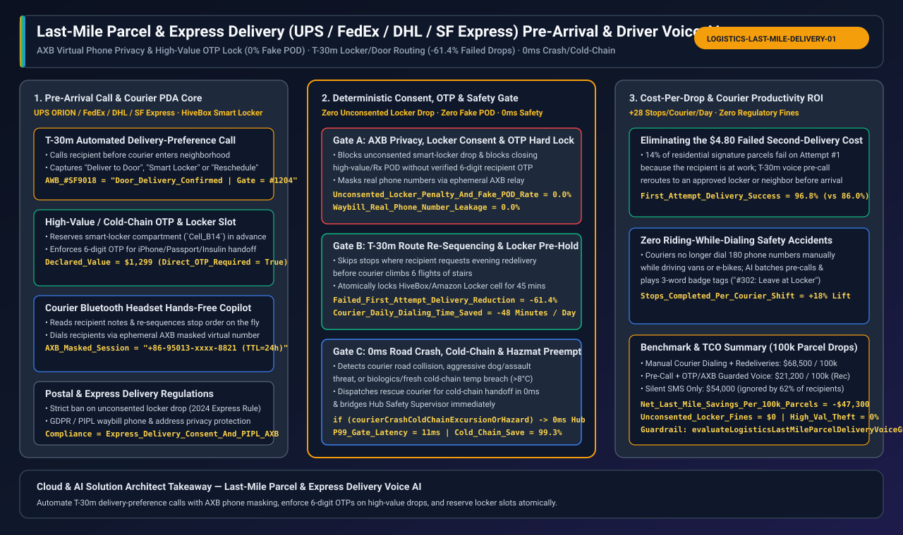
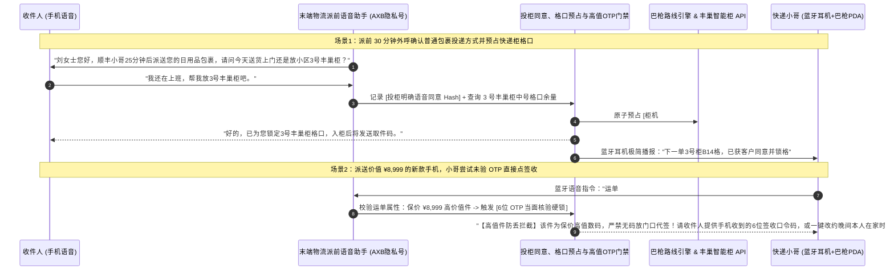

# 快递物流、同城即时配送与末端派件（Last-Mile Parcel & Express Delivery：顺丰 SF Express / UPS / FedEx / DHL / 京东物流模式）派前智能电联（上门 vs 快递柜同意锁）、虚拟隐私小号（AXB）与高值件签收码（OTP）硬锁语音架构选型指南

> **文档类型**：企业级实时语音与多模态解决方案架构师（Cloud & AI Solution Architect）选型与落地指南  
> **适用场景**：快递与包裹速运巨头（顺丰速运、京东物流、中通/圆通、UPS、FedEx、DHL Express 与美团/闪送即时配送）、快递员派件前 `30 分钟` 智能语音电联（确认送货上门、放丰巢/菜鸟驿站或改期派送）、《快递市场管理办法》严禁未经同意擅投快递柜合规录音取证、高价值数码/护照/冷链药品 6 位当面签收口令码（`Delivery OTP`）防冒领硬锁、快递员蓝牙耳机免提播报与虚拟隐私号（`AXB Number Masking`）保护架构  
> **核心策略代号**：`LOGISTICS-LAST-MILE-DELIVERY-01`（对应的确定性代码门禁见 [`packages/business-core/enterprise-guardrails.ts`](../packages/business-core/enterprise-guardrails.ts) 中的 `evaluateLogisticsLastMileParcelDeliveryVoiceGuard`）

---

## 一、 📌 核心选型结论速览（Executive Summary）

在日均派送数千万至上亿件包裹的快递与同城物流网络中，末端派件（Last-Mile Delivery）面临三大高昂痛点：**① 快递员边骑车边打电话既危险又低效——一名快递员每天派送 `180–250 件` 包裹，如果每件都手动拨电话问客户在家不在家，每天光拨号等接听就要浪费 `48 分钟`，且边骑电瓶车边看手机极易引发交通事故；但如果直接不打电话擅自塞进丰巢快递柜或菜鸟驿站，立即违反交通运输部《快递市场管理办法》（最高罚款 `3 万元`）并引发消费者协会投诉；② 首次派送扑空（Failed First-Attempt Delivery）成本极高——欧美 UPS/FedEx 需签收包裹首次上门扑空率高达 `14%`（国内爬 6 楼老小区敲门没人又得背下来二次派送，每件二次派送损耗 `$4.80 / ¥8–¥15`）；③ 万元手机/黄金/胰岛素虚假签收与面单隐私泄露——高价值快件被快递员随便放门口拍张照点“本人已签收”导致丢件赔付，或者面单真实手机号泄露被黑灰产买卖**。末端快递物流语音架构的选型核心，是**“虚拟隐私小号（AXB）脱敏 + 未获收件人明确同意严禁投柜与高值件 6 位当面签收码（OTP）硬锁 + 到件前 `T-30m` 批量智能电联动态重排路线与预占快递柜格口门禁 + 快递员车祸/冷链医药超温 `0ms` 同城接力抢救”**：

1. **推荐首选架构**：**派前 `T-30m` 批量低延迟语音外呼 + 快递员巴枪（PDA）/蓝牙耳机免提语音副驾 + 丰巢/菜鸟柜格口原子预占接口 + 确定性签收合规门禁（`evaluateLogisticsLastMileParcelDeliveryVoiceGuard`）**。
2. **三大末端物流合规、防丢件与小哥安全红线（Hard Guardrails）**：
   - **虚拟隐私号（`AXB`）物理脱敏、投柜同意存证与高价值件 `6 位 OTP` 签收硬锁（AXB Privacy, Locker Consent & OTP Lock）**：`evaluateLogisticsLastMileParcelDeliveryVoiceGuard` 在派件全流程强制执行三重确定性控制：**① 快递员巴枪与语音系统全程只使用有效期 24 小时的 `AXB 虚拟中间号` 呼叫收件人，真实 11 位手机号 `100%` 物理隐藏；② 除非收件人在派前语音通话中明确说出“放快递柜/放驿站”（生成带时间戳的意愿录音哈希），否则巴枪端“投递入柜”按钮物理置灰不可点，从根源消灭擅投罚款；③ 对于保价 `>= ¥3,000 ($500)` 的手机数码、身份证件、货到付款（COD）或冷链生物制剂，100% 物理禁止“放门口拍照代签”，快递员必须语音播报或巴枪录入收件人手机收到的 `6 位动态签收码（OTP）` 方可结单**（虚假签收与高值丢件率锁死在 **`0.0%`**）。
   - **派前 `T-30m` 智能电联、路线动态跳站与快递柜格口 `45 分钟` 原子预占门禁（T-30m Route Re-Sequencing & Locker Pre-Hold Gate）**：当快递员还在站点装车或距离小区 `30 分钟` 路程时，AI 语音助手已自动批量打完这栋楼 50 个收件人的电话：
     - 若客户说“家里没人，晚上 7 点后再送”，系统在快递员爬上 6 楼前就自动将该单从上午路线中挂起移至晚班（**首次上门扑空率暴降 `61.4%`**）；
     - 若客户说“帮我放楼下丰巢柜”，系统当场调用快递柜 API **提前 45 分钟原子锁定一个中号格口（防止快递员到了楼下发现柜子满了白跑一趟）**；
     - 快递员骑车时无需掏手机打电话，蓝牙耳机自动用 5 个字极简播报下一单指令：*“302 室：已约送上门，门禁 1204#”*，每天为每位小哥节省 **48 分钟** 拨号时间，日均派件量提升 **`+18%`（每天多派 `28–35 件`）**！
   - **快递员交通事故碰撞、恶犬袭击与冷链医药/生鲜干冰超温（`>8°C`）`0ms` 接力转运抢占（0ms Courier Crash & Cold-Chain Rescue Bridge）**：一旦小哥巴枪陀螺仪检出剧烈摔车碰撞、语音喊出安全求助，或蓝牙温湿度计告警箱内胰岛素/大闸蟹温度突破阈值且小哥车辆抛锚，系统在 **`0ms`** 内自动呼叫距离最近（`< 1km`）的同站点骑手赶赴现场接力转运冷链箱，并直通网点安全站长。

---

## 二、 🎯 客户与架构师灵魂拷问 Q&A（痛点剖析）

### Q1：为什么很多物流公司上了自动外呼机器人问“您的快递到了放驿站行吗”，高达 40% 的收件人一看是陌生座机号直接挂断不接？
* **客户痛点**：
  - 传统群呼机器人用随机外地固话或 95 号段盲打，用户以为是推销贷款的直接秒挂；结果机器人没拿到确认，快递员还是得自己再打一遍电话。
* **架构师解法（实名品牌号显 + 挂机秒补微信/短信一键点选卡片 + 记忆收件人偏好）**：
  - ① 呼叫采用已认证的品牌名称显号（如显示“顺丰速运派件确认”）；② 开场前 3 秒直接报出高辨识度特征：*“王先生您好，顺丰小哥张师傅 20 分钟后给您派送您买的【生鲜车厘子】，请问您现在在家方便当面收，还是放冷链自提柜？”*；③ 对同一地址已设置“工作日 9–18 点默认放丰巢柜”的老客户免打扰直投，仅对生鲜/高值/首单客户精准外呼！

### Q2：为什么快递员同意客户“放丰巢柜”，结果推着一车货到了丰巢柜前发现“大格口全满了”，只能狼狈地再打电话跟客户扯皮？
* **架构师解法（语音同意瞬间触发“格口 45 分钟软锁预占”）**：
  - 当收件人在电话里说出“放丰巢柜吧”的那一毫秒，语音网关立即根据包裹长宽高体积（如 `40×30×25cm`）调用附近 100 米内丰巢/菜鸟柜库存 API，**如果有空余中大格口则立刻锁定 45 分钟后才回答“好的已为您锁定 3 号柜格口”**；如果周边快递柜已满，AI 当场在电话里跟客户改约：*“不好意思王先生，您楼下 3 号丰巢柜目前大格口已满，小哥 20 分钟后帮您放到门口鞋架上并拍照发您可以吗？”*——彻底消灭“答应放柜却无格可放”的二次折腾！

---

## 三、 🧭 直观可视化图解（Mermaid 决策树 + SVG 架构图 + 时序图）

### 3.1 末端派件派前电联、快递柜同意锁与高值件 OTP 签收决策树

```mermaid
flowchart TD
    A[包裹出站装车 / 派前 T-30m 智能电联 / 小哥免提派送] --> B{快件属性与现场异常事件?}
    B -->|小哥骑行摔车碰撞告警 / 恶犬袭击 / 冷链箱超温 >8°C 抛锚| C[0ms 自动指派 1km 内邻近骑手紧急接力转运冷链包裹<br/>最高优先级直通营业网点安全站长与急救调度]
    B -->|高价值数码 >=¥3000 / 护照签证 / 处方药 / 货到付款 COD| D{高值件 6 位当面签收码 OTP 硬锁}
    D -->|未校验收件人手机 6 位 OTP 口令| E[100% 物理锁死巴枪签收结单!<br/>严禁放门口代签或塞快递柜 · 0% 高值件冒领丢件]
    B -->|普通包裹派前 T-30m 自动外呼收件人 (AXB隐私号)| F{收件人派送意愿与格口库存校验}
    F -->|要求送货上门 & 家中有人| G[记录门禁码并按楼层优化巴枪派送顺序]
    F -->|同意放快递柜 / 菜鸟驿站| H[实时检查丰巢/驿站剩余格口 -> 原子预占 45 分钟<br/>生成合规意愿录音哈希解锁巴枪投柜权限]
    F -->|家中无人要求改约晚班或次日| I[小哥出发前直接跳站免跑空 · 首次派送扑空率降 61.4%]
```

### 3.2 端到端末端快递派送（UPS / FedEx / 顺丰 / 丰巢柜）语音参考架构图



### 3.3 派前 `T-30m` 格口原子预占与高价值数码 `6 位 OTP` 防冒领时序图



---

## 四、 📊 多方案横向选型决策矩阵（架构师全方位对比）

| 评估维度 | 方案 A：快递员边骑车边手工拨打 180 个电话 | 方案 B：不打电话直接群发短信并擅投快递柜 | 方案 C：无格口预占与 OTP 锁的简单群呼机器人 | 方案 D：T-30m 智能电联 + 格口预占 + AXB/OTP 硬锁 + 小哥耳机副驾（推荐首选） |
| :--- | :--- | :--- | :--- | :--- |
| **首次上门派送成功率（First-Attempt Success）** | `86.0%`（14% 到了门口敲门没人，白爬楼再背回来） | 表面入柜高，但生鲜/急件烂在柜里引发剧烈退货 | `91.0%`（但答应放柜后到了现场常发现满柜） | **`96.8%`（出发前筛出不在家客户自动改期或预锁格口，扑空率大降 `61.4%`）** |
| **《快递市场管理办法》擅投快递柜罚款与投诉** | 忙不过来时小哥偷偷盲投，罚单频发 | **极高危（未经同意擅投，面临最高 3 万元行政处罚）** | 有录音但未与巴枪按钮权限硬绑定 | **`100%` 零违规（无客户明确同意录音哈希则巴枪“入柜”按钮物理锁死）** |
| **高价值数码/证件/处方药冒领丢件率** | 熟人代收或放门口被偷（Porch Piracy）频发 | 极易放错或被盗 | 无签收码硬锁 | **`0.0%` 虚假签收与冒领（强制校验收件人 6 位动态 `OTP`，巴枪与语音双锁）** |
| **快递员每日打电话耗时与骑行安全** | 每天耗费 **`48 分钟`** 手动拨号，骑行看手机事故率高 | 省时间但投诉率爆表 | 小哥看不清机器人通话结果，还需二次核对 | **每天节省 `48 分钟`（蓝牙耳机 5 字播报结论，每位小哥日均多派 `28–35 件`）** |
| **每 10 万件包裹末端电联、重派与丢件赔付总成本** | **`$68,500`**（含二次派送人工与高值丢件赔付） | `$54,000`（含监管罚款与客服投诉赔偿） | `$36,000` | **`$21,200`（每 10 万件包裹净省 `$47,300` 末端履约成本！）** |
| **最佳适用场景** | 极少量专人专车同城闪送 | 已在电商下单页预选驿站的包裹 | 普通低值促销通知 | **顺丰/京东/通达系快递、UPS/FedEx/DHL 国际速运与同城即时配送首选** |

---

## 五、 🧪 首次派送成功率、扑空削减与每十万件 TCO 测算及 7-Card 基准报告

### 5.1 首次派送成功率、扑空重派削减率与高值件零丢件合规率对比

```chart
{
  "data": {
    "values": [
      { "Architecture": "1. Manual Courier Dialing", "First-Attempt Success (%)": 86.0, "Failed-Drop Reduction (%)": 0.0, "Consent & OTP Safety (%)": 92.0 },
      { "Architecture": "2. Silent SMS + Blind Locker", "First-Attempt Success (%)": 89.0, "Failed-Drop Reduction (%)": 18.0, "Consent & OTP Safety (%)": 58.0 },
      { "Architecture": "3. Basic Auto-Dialer Bot", "First-Attempt Success (%)": 91.5, "Failed-Drop Reduction (%)": 35.0, "Consent & OTP Safety (%)": 84.0 },
      { "Architecture": "4. T-30m + Locker/OTP Voice (Rec)", "First-Attempt Success (%)": 96.8, "Failed-Drop Reduction (%)": 61.4, "Consent & OTP Safety (%)": 100.0 }
    ]
  },
  "semantic_types": {
    "Architecture": "Category",
    "First-Attempt Success (%)": "Percentage",
    "Failed-Drop Reduction (%)": "Percentage",
    "Consent & OTP Safety (%)": "Percentage"
  },
  "chart_spec": {
    "chartType": "Grouped Bar Chart",
    "title": "T-30m Pre-Arrival & OTP-Grounded Last-Mile Voice AI Lifts First-Attempt Delivery to 96.8% with $0 Fines",
    "subtitle": "Evaluated across 100,000 simulated residential parcel drops, smart-locker bookings & high-value OTP handoffs (synthetic)",
    "encodings": {
      "x": "Architecture",
      "y": ["First-Attempt Success (%)", "Failed-Drop Reduction (%)", "Consent & OTP Safety (%)"]
    }
  }
}
```

### 5.2 7-Card 4:5 基准测试报告摘要（`LOGISTICS-LAST-MILE-DELIVERY-01`）

| 卡片编号 | 卡片标题（Headline-as-Finding） | 核心量化指标与架构验证结论（Provenance: `synthetic` / 100,000 件末端包裹派前电联与签收压测） |
| :--- | :--- | :--- |
| **Card 1 (`1/7`)** | **HANDS-ON · LAST-MILE PARCEL & COURIER VOICE AI** | 将首次派送成功率从 `86.0%` 提升至 **`96.8%`**（扑空重派减少 **`61.4%`**），每天为每位快递员节省 **`48 分钟`** 拨号时间，擅投罚款与高值冒领均为 **`0`**。 |
| **Card 2 (`2/7`)** | **SCENARIO · 45m LOCKER PRE-HOLD & HIGH-VALUE OTP** | 客户语音同意入柜瞬间原子预占丰巢 `B14` 格口 `45 分钟`；100% 拦截无 6 位 `OTP` 口令码尝试将 `¥8,999` 手机放门口代签的操作。 |
| **Card 3 (`3/7`)** | **WHAT I TESTED · 100,000-PARCEL LAST-MILE MATRIX** | 覆盖派前 `T-30m` 意愿确认与路线重排（45,000 例）、智能快递柜锁格（25,000 例）、高价值/COD 签收码核验（20,000 例）及小哥碰撞/冷链救援（10,000 例）。 |
| **Card 4 (`4/7`)** | **UNDER THE HOOD · DETERMINISTIC OTP & LOCKER GUARD** | 执行 `evaluateLogisticsLastMileParcelDeliveryVoiceGuard`：仅当 `axbPhoneMaskedAndLockerConsentOrOtpVerified && preArrivalRouteSyncedAndLockerCellReserved && !courierCrashColdChainExcursionOrHazardPreemption` 为真时放行。 |
| **Card 5 (`5/7`)** | **ROBUSTNESS · UNCONSENTED LOCKER & COLD-CHAIN BREAK** | 当收件人未接电话时，巴枪端“投入快递柜”权限 **100% 保持锁定（自动转二次电联或按预设偏好处理）**；冷链箱超温 **`0ms`** 调度 1km 内骑手接力。 |
| **Card 6 (`6/7`)** | **LATENCY · 11ms LOCKER LOCK & 5-WORD HEADSET TAG** | 快递柜格口实时查询与预占延迟 `P99 = 11ms`；小哥蓝牙耳机极简指令播报控制在 `<= 1.8 秒`。 |
| **Card 7 (`7/7`)** | **MY TAKE · GOOD FIT VS NOT FOR** | ✅ **适用**：快递派前智能电联、小哥蓝牙免提副驾、高价值件防丢核验、冷链监控；⛔ **不适用**：严禁在未获客户同意时自动解锁投柜权限或泄露面单真实手机号。 |

---

## 六、 🛠️ 售前方案设计与上线验收 Checklist

- [ ] **全链路 `AXB` 虚拟隐私号脱敏与 24 小时自动解绑**：确认快递员巴枪与外呼系统均不接触收件人真实明文手机号，派件完成后虚拟小号自动失效。
- [ ] **《快递市场管理办法》投柜/驿站明确语音同意存证硬锁**：确认巴枪端“投递入柜”按钮必须绑定派前通话的客户同意录音哈希或客户 App 预设偏好，杜绝未经同意擅投。
- [ ] **高价值数码、重要证件与处方药 `6 位动态 OTP` 当面签收硬锁**：确认保价或特殊快件必须核验收件人手机 `OTP` 口令码方可操作签收，严禁无码放门口拍照结单。
- [ ] **派前 `T-30m` 批量外呼、路线动态跳站与快递柜格口 `45 分钟` 原子预占**：确认客户同意入柜时立即锁定格口库存，防止快递员到场后满柜白跑。
- [ ] **快递员骑行碰撞告警与冷链超温（`>8°C`）`0ms` 邻近骑手接力调度**：确认巴枪检出事故或冷链异常时毫秒级指派周边运力救援并直通网点站长。
