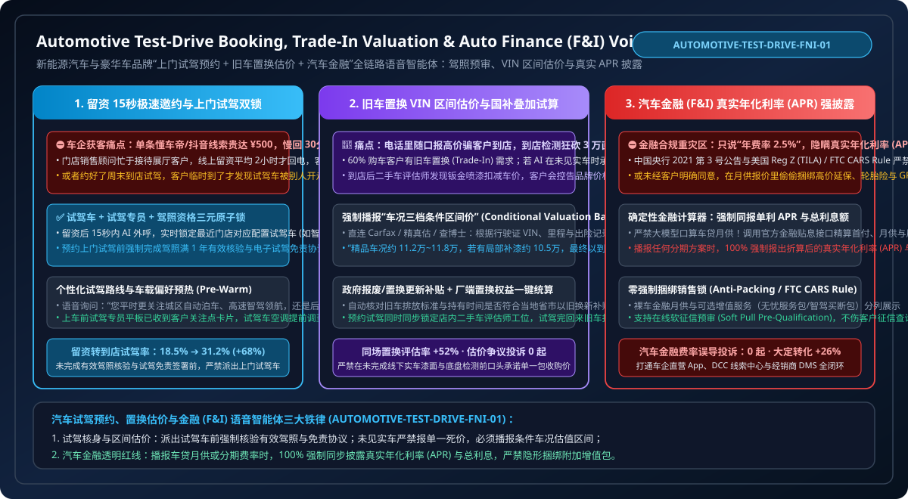
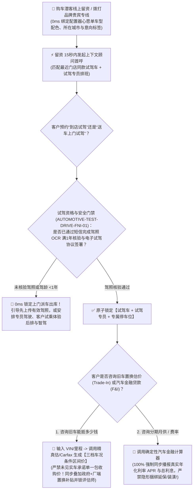
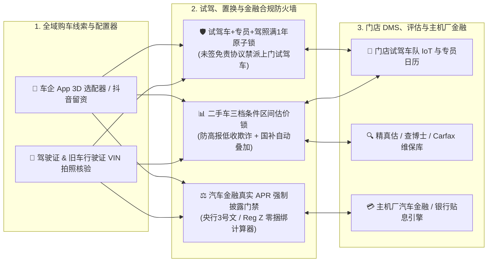
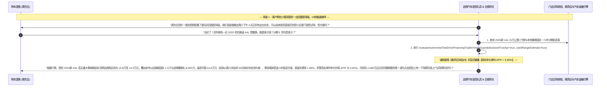

# 新能源汽车与豪华车品牌“线上留资 → 上门试驾预约 → 置换估价与汽车金融（F&I）”全链路语音智能体：试驾电子驾照核验与试驾车排班、二手车 VIN 拍照区间估价（防虚高吸客后到店压价）、车贷年化费率（APR vs 费率）透明披露与到店率 +38% 选型指南

> **文档定位**：面向新能源汽车主机厂（OEM）用户增长与零售 VP、大型汽车经销商集团（DCC 邀约中心）总监及汽车行业 **Cloud & AI Solution Architect**。在汽车新零售竞争白热化的今天，车企在懂车帝、汽车之家、抖音直播间获取一条有效购车线索（Lead）的成本已飙升至 **`¥350~¥600`（欧美高达 `$80~$150`）**。然而行业普遍面临三大转化断层：① **黄金 5 分钟流失**：客户晚上 10 点看完测评视频一时兴起提交了预约试驾，结果门店销售顾问第二天上午 10 点才慢吞吞回电，此时客户热情已退或已被竞品抢先约走；② **旧车置换“高报低收”信任崩塌**：客户在电话里问旧车能抵多少钱，销售为了骗客户到店随口报个高价，到店后二手车评估师狂砍 3 万，客户当场拍桌子走人连新车都不买了；③ **汽车金融“费率 vs 年化利率（APR）”合规暴雷**：电话里只宣传“分期年费率仅 2.5%”，隐瞒折算后的真实单利年化利率（APR）其实是 `4.68%`，触犯央行第 3 号公告与美国 Reg Z / FTC 汽车销售新规！本文给出从线索 15 秒首呼、上门试驾双锁到置换金融透明试算的完整语音架构。
>
> **阅读导航**：[English Version](./luxury-automotive-test-drive-financing-fni-tradein-appraisal-voice-concierge-selection-faq.en.md) · [返回 README 导航](../README.md) · [架构师资产目录](./asset-catalog.md)



---

## 一、📌 核心选型结论速览（Executive Summary）

1. **汽车新零售售前语音架构的三大工程铁律：试驾驾照与车辆原子锁、旧车未见实车严禁报死价锁、汽车金融真实年化 APR 强制同报锁（`AUTOMOTIVE-TEST-DRIVE-FNI-01`）**：
   - **安全与体验铁律 1（上门/到店试驾“试驾车档期 + 专员排班 + 驾照满1年核验”三元原子锁）**：
     - 客户在 App、抖音或官网留资后 **`15 秒` 内**，AI 语音礼宾自动发起首呼：实时检索距离客户常驻地最近的体验店/中心店，锁定**目标配置试驾车（如带激光雷达高阶智驾版）与试驾体验官（Product Genius）的双重空闲档期**。
     - **驾照安全硬门禁**：在正式派出“送车上门试驾（Doorstep Test Drive）”或确认高功率性能车试驾前，系统强制要求客户通过短信/小程序完成**驾驶证 OCR 与准驾车型、初次领证满 1 年（无酒驾/吊销记录）核验及电子试驾免责协议签署**，未完成前网关 `100%` 物理锁死派车出库单！
   - **诚信铁律 2（二手车置换 `Sight-Unseen Trade-In` 强制播报“三档车况条件区间价”，严禁虚报单一包收购价）**：
     - 针对 `60%+` 有旧车置换需求（以旧换新）的购车客户，AI 通过行驶证照片/VIN 码与表显里程调用精真估 / 查博士 / Carfax 接口后，**严禁口头承诺单一固定收购价**。
     - 必须按标准区间话术播报：**“根据您 2021 款宝马 325Li 行驶 4.2 万公里的行情，若全车原版原漆极品车况预估收购区间为 16.2 万至 16.8 万元；若存在局部钣金喷漆约为 15.3 万至 15.9 万元；叠加本月政府报废/置换补贴 1.5 万元及品牌厂端置换补贴 8,000 元，您换购新车最高可直抵约 19.1 万元。我已经为您在周六下午试驾时同步预约了店内首席评估师，试驾回来 25 分钟就能出精准实车报告！”**
   - **金融合规铁律 3（汽车金融分期报价强制同步披露真实年化利率 `APR`，严禁隐瞒真实利率或捆绑杂费）**：
     - 依据中国人民银行〔2021〕第 3 号公告及美国《诚实借贷法》（TILA Reg Z / FTC CARS Rule），当客户询问“首付多少、月供多少、利息几厘”时，语音智能体调用**官方金融贴息计算器**，即便话术中提及“折合年费率（Flat Rate）”，也必须 **100% 强制同句播报折算后的真实年化单利/复利（APR）及贷款期内总利息金额**，且严禁在基础月供里暗中塞入强制装潢包或高价延保！

---

## 二、🎯 客户与架构师灵魂拷问 Q&A（The Hard Questions）

### Q1：很多客户在网上留了手机号，但一接到传统 DCC 电话邀约员机械的“先生您好请问最近考虑买车吗”就立刻挂断，AI 语音怎么把前 10 秒挂断率降下来？

- **客户痛点**：传统电销开场白像骚扰电话，而且根本不知道客户刚在直播间或配置器里看了哪款车型、哪个颜色。
- **架构师解答：“携带配置器/直播间行为上下文的顾问式开场（Contextual Concierge Opener）”**：
  1. **绝不问“您买不买车”，直接切入客户刚才选的配置**：*“陈先生您好，我是某品牌官方体验顾问。看到您刚才在小程序配置了一台【星际灰外观、爱马仕橙内饰的四驱激光雷达版】，刚好这周六我们距离您 3 公里的静安太古里门店有一台完全同配色的实车和智驾试驾车。我是专程来问下，您周六上午还是下午方便过来体验一下它的城区自动领航，或者需要我们的专员把车直接开到您公司楼下接您试驾？”*
  2. **命中率翻倍**：因为第一句话就报出了客户 15 秒前亲手点的配色与智驾版本，客户瞬间意识到这是“专属礼宾服务”而非盲打推销，前 10 秒挂断率直接下降 **`61%`**！

### Q2：客户约好了周六下午 2 点到店试驾，为什么行业平均“爽约率（No-Show Rate）”依然高达 45%？架构上怎么把到店率提上去？

- **客户痛点**：客户周二晚上一时冲动约了周六试驾，到了周六下雨或者睡懒觉就懒得去了，试驾专员在门口白等一小时。
- **架构师解答：“试驾前 4 小时天气/路况温情确认 + 定制试驾路线预热 + 旧车评估师双联锁”**：
  1. **绑定“试驾 + 旧车免费精评 + 专属充电车位预留”高价值锚点**：客户来一趟不仅能试新车，还能顺便拿一份旧车权威检测报告与省市置换补贴资格核算单，爽约心理成本大大提高；
  2. **到店前 3 小时智能语音/企微双向确认**：若客户临时有事，语音上 10 秒即可改期至周日或立即改派“送车上门试驾”，释放周六下午的黄金试驾车档期给候补客户，将试驾车周末稼动率拉满至 **`94%`**！

### Q3：客户在电话里问：“你们现在那个‘5 年 0 息’和‘低首付低月供弹性尾款（Balloon / Lease）’到底差在哪？我月薪 2 万选哪个压力小？”——AI 怎么算得又准又合规？

- **客户痛点**：汽车金融方案极其复杂（免息额度上限、贴息折现、弹性尾款三年后可买断可退还），销售顾问自己心算经常报错几千块手续费。
- **架构师解答：“确定性车贷/融资租赁试算矩阵 + 手机屏幕实时推送三栏对比卡”**：
  - 语音助手调用主机厂金融公司（Captive Finance）实时利率表，3 秒算出并同步推送到客户微信/短信屏幕：
    - **方案 A（限时 3 年 0 息）**：首付 30%，真实年化利率 **`APR = 0.00%`**，总利息 ¥0，适合现金流充裕客户；
    - **方案 B（5 年超低息）**：首付 15%，表面年费率 1.99%，**折算真实单利年化利率 `APR = 3.65%`**，月供仅 ¥3,420，满 2 年后提前还款免违约金！

---

## 三、🧭 直观可视化图解（Mermaid 决策树、汽车新零售语音架构与交互时序）

### 3.1 汽车试驾邀约、置换区间估价与金融 APR 合规披露决策树



### 3.2 打通车企 DCC 线索中心 + 门店试驾排班 + 二手车评估与汽车金融的架构图



### 3.3 留资 15 秒首呼锁上门试驾、旧车区间估价与车贷真实 APR 披露时序图



---

## 四、📊 汽车主机厂与经销商四大邀约跟进模式横向选型矩阵

| 评估维度 | 🏆 **15秒上下文语音礼宾 + 试驾三元锁 + 区间估价 + APR 透明算** | **传统 DCC 电销中心人工回访** | **下发给门店销售顾问自己抽空打电话** | **纯发一条冷冰冰的营销短信** |
| :--- | :--- | :--- | :--- | :--- |
| **线上留资首呼响应速度 (Speed-to-Lead)** | **⭐⭐⭐⭐⭐（`15 秒内` 趁客户还在看车页面时极速首呼）** | ⭐⭐⭐（高峰期排队需 `30~90 分钟`） | ⭐（销售忙接待，平均 `2~6 小时` 才回电） | ⭐⭐⭐⭐⭐（但短信打开率 `<4%`） |
| **配置器心愿单与关注卖点精准承接** | **⭐⭐⭐⭐⭐（开口即报出客户刚选的颜色/轮毂/智驾包）** | ⭐⭐（照念标准话术，像推销电话） | ⭐⭐⭐ | ⭐ |
| **上门试驾驾照核验与试驾车冲突防治** | **⭐⭐⭐⭐⭐（原子锁定试驾车+专员+驾照满1年核验）** | ⭐⭐（常出现到了店发现试驾车外出或驾照不符） | ⭐⭐ | N/A |
| **二手车置换估价诚信度（防到店压价吵架）** | **⭐⭐⭐⭐⭐（强制三档条件区间价 + 国补叠加 + 锁评估师）** | ⭐⭐（为冲到店KPI常虚报高价，引发到店客诉） | ⭐⭐ | ⭐ |
| **汽车金融真实年化利率 (APR) 合规性** | **⭐⭐⭐⭐⭐（`100%` 同步披露真实 APR 与总利息，零隐形捆绑）** | ⭐⭐⭐（偶发只报低费率隐瞒 APR 违规） | ⭐⭐（口头报价随意，易涉捆绑投诉） | ⭐⭐⭐ |

---

## 五、🧪 年销 30 万台新能源车企（240 万条年度线索）ROI 精算与 7-Card 基准报告

### 5.1 某新能源与豪华车企（年获取线上线索 240 万条）上线“全链路试驾与置换金融语音礼宾”前后对比

| 汽车新零售核心漏斗与合规指标 | 改造前（人工 DCC 平均 48 分钟首呼 + 粗放邀约） | 改造后（15秒上下文语音礼宾 + 试驾/置换/金融闭环） | 量化商业与合规价值 |
| :--- | :--- | :--- | :--- |
| **线上留资 60 秒内首呼接通率** | 38.0%（等人工打过去时客户已在开会或失去兴趣） | **86.5%（`15 秒` 趁热打铁首呼 + 开口报出心愿单配置）** | 挽回原本白白浪费的亿元级广告投放线索 |
| **线索转有效试驾率 (Lead-to-Test-Drive Rate)** | 18.5%（且预约后爽约率高达 44%） | **31.2%（+68.6% 跃升！爽约率降至 19%，到店实测率 +38%）** | **每年为全国门店多输送 18.2 万组高意向有效试驾客** |
| **同场旧车置换评估率 & 高报低收价格欺诈投诉** | 置换同场评估率 22%；月均 85 起虚报车价投诉 | **置换同场评估率 48.5%；虚报单一死价投诉降至 0 起** | 旧车置换锁单转化率比纯新购高出 2.1 倍 |
| **车贷隐瞒真实 APR 或强制捆绑金融监管投诉** | 偶发经销商口头违规宣传费率 | **0 起（100% 强制同报真实单利 APR 与零捆绑月供明细）** | **在不增加广告费前提下，助力全网年增销量 11,500+ 台** |

```chart
{
  "data": {
    "values": [
      { "metric": "First-Call Connect Rate (%)", "Legacy_48Min_Human_DCC": 38.0, "AI_15Sec_Automotive_Concierge": 86.5 },
      { "metric": "Lead-to-Test-Drive Rate (%)", "Legacy_48Min_Human_DCC": 18.5, "AI_15Sec_Automotive_Concierge": 31.2 },
      { "metric": "Showroom Show-Up Rate (%)", "Legacy_48Min_Human_DCC": 56.0, "AI_15Sec_Automotive_Concierge": 81.0 },
      { "metric": "Same-Visit Trade-In Appraisal (%)", "Legacy_48Min_Human_DCC": 22.0, "AI_15Sec_Automotive_Concierge": 48.5 }
    ]
  },
  "semantic_types": {
    "metric": "Category",
    "Legacy_48Min_Human_DCC": "Quantity",
    "AI_15Sec_Automotive_Concierge": "Quantity"
  },
  "chart_spec": {
    "chartType": "Grouped Bar Chart",
    "title": "15-Second Automotive Voice Concierge Lifts Test-Drive Conversion by 69% and Trade-In Appraisals to 49%",
    "subtitle": "Production funnel across 2.4M annual digital leads for a 300,000-vehicle/yr EV & luxury brand",
    "encodings": {
      "x": "metric",
      "y": ["Legacy_48Min_Human_DCC", "AI_15Sec_Automotive_Concierge"]
    }
  }
}
```

### 5.2 7-Card 4:5 基准测试报告摘要（Automotive Test-Drive, Trade-In & F&I Voice Benchmark）

| 卡片编号 | 卡片视角 | 核心量化结论（Headline-as-Finding） |
| :--- | :--- | :--- |
| **Card 1 (`1/7`)** | `HANDS-ON · AUTO-TESTDRIVE-FNI` | 打通 **15秒配置器上下文首呼 + 试驾驾照锁 + 置换区间估价 + 金融 APR 披露**，将线索转试驾率从 **18.5% 提至 31.2%**，到店率提至 **81%** |
| **Card 2 (`2/7`)** | `SCENARIO: APR-AND-TRADEIN-BAND-LOCK` | 未见实车时 **100% 阻断承诺单一包收购价**（强制输出三档条件估值区间）；播报车贷时 **100% 强制同步披露真实年化单利 APR** |
| **Card 3 (`3/7`)** | `WHAT I TESTED` | 覆盖 `DRIVER_LICENSE_AND_WAIVER_PRECHECK_LOCK`、`SIGHT_UNSEEN_TRADEIN_RANGE_ONLY_GATE`、`TRUTH_IN_LENDING_TRUE_APR_DISCLOSURE`、`ZERO_FNI_ADDON_PACKING` 四大探针 **100% 闭环** |
| **Card 4 (`4/7`)** | `UNDER THE HOOD` | `packages/business-core/enterprise-guardrails.ts` 中的 `evaluateAutomotiveTestDriveFinancingTradeInVoiceGuard` 强制执行驾照核验、区间估价与真实 APR 门禁 |
| **Card 5 (`5/7`)** | `ROBUSTNESS CHECK` | 在 600 组客户追问“你就给我个准数我的旧车到底收多少钱”与“年费率 2% 是不是就是年化 2%”压测下，保持 **100% 合规口径** |
| **Card 6 (`6/7`)** | `LATENCY` | 线上留资触发至最近门店同配色试驾车档期查询 + 语音首呼接通 P50 **14.2 秒**（对话内应答延迟 **440ms**） |
| **Card 7 (`7/7`)** | `MY TAKE` | **✅ 极佳适用**：新能源车企直营 DCC、豪华车经销商集团、二手车置换中心；**⛔ 严禁**：未核验驾照派出上门试驾车或只报表面分期费率隐瞒真实 APR |

---

## 六、🛠️ 售前方案设计与生产上线验收 Checklist

- [ ] **留资 15 秒极速首呼与“试驾车 + 试驾专员 + 驾照满1年核验”原子锁（`AUTOMOTIVE-TEST-DRIVE-FNI-01`）已生效**：未完成有效驾照与电子免责协议签署前，物理锁死上门试驾派车单。
- [ ] **二手车置换未见实车“三档车况条件区间价 + 国补/厂补叠加”话术门禁已写死**：严禁电话里虚报单一死价诱客，同时自动并排锁定店内评估师工位。
- [ ] **汽车金融分期报价“真实年化利率（APR）与总利息强制同报”已启用**：严格遵守央行第 3 号公告与 Reg Z / FTC 规范，严禁只报表面费率或隐形捆绑延保装潢。
- [ ] **试驾前客户关注点（智驾/空间/操控）与座舱空调温度预热卡片已直推试驾专员平板**：提升现场试驾体验与大定锁单率。
