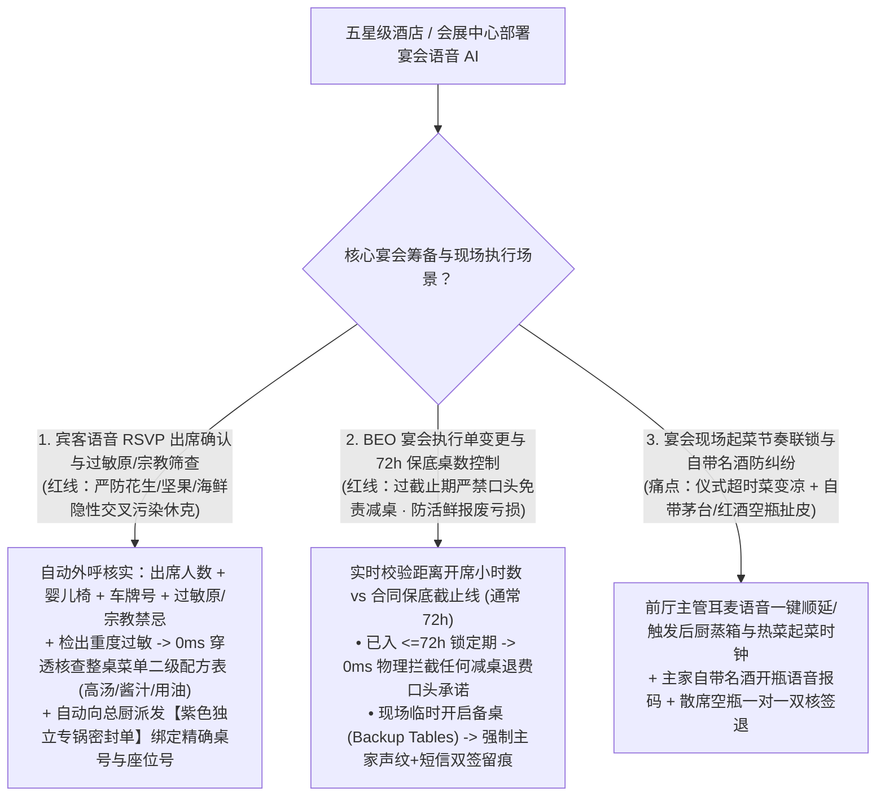
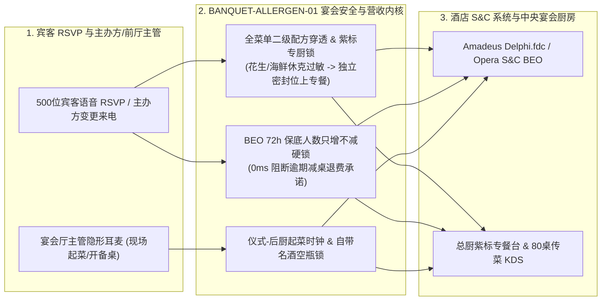
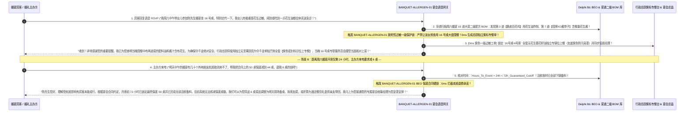

# 五星级酒店婚宴与万人会展宴会（MICE Banquet）：`BEO` 保底桌数截止锁、致死性过敏原（`Anaphylaxis`）紫标专厨锁与现场指挥语音选型指南（`BANQUET-ALLERGEN-01`）

> **导读**：在奢华五星级酒店集团、大型国际会议中心与高端婚礼堂（**如万豪国际 Marriott、希尔顿 Hilton、香格里拉、半岛酒店、洲际 IHG、格乐利雅，使用 `Amadeus Delphi.fdc` 或 `Oracle Opera Sales & Catering`**）中，一场 80 桌的千人婚宴或跨国企业晚宴客单价高达数十万至数百万元。然而，当宴会销售部与餐饮厨房引入语音 AI 协助宾客出席确认（`RSVP`）、宴会执行单（`BEO: Banquet Event Order`）变更与现场上菜调度时，若缺乏高端餐饮与合同硬规则约束，将触发三大高危事故：**① 出席晚宴的一位重要外宾或伴娘在语音 `RSVP` 中提到“我有重度花生与甲壳类海鲜过敏（会休克）”，普通语音助手只在电子表格备注栏写了一句“12桌不要上海鲜”，却不知道当晚整桌共用的“金汤佛跳墙”高汤底料里熬了干贝虾籽、且炸春卷用的是花生油——上菜后宾客吃下一口当场在婚礼现场发生过敏性休克（Anaphylaxis）！② 距离周六中午婚宴开席只剩 18 小时（早已过了合同规定的开席前 `72 小时` 最终保底桌数锁定线 `Guaranteed Headcount Cutoff`，后厨 50 只鲜活帝王蟹与东星斑已全部宰杀备料），新郎打电话给语音客服说“明天突然有 8 桌亲戚来不了，帮我把保底桌数从 50 桌改成 42 桌退差价”，讨好型大模型竟然口头回答“好的已为您免费核减 8 桌”——直接造成酒店净亏 12 万元生鲜成本！③ 婚宴现场主家自带了 60 瓶飞天茅台，服务员忙乱中没逐瓶登记开瓶编号，散席时主家质疑少了 4 瓶真酒引发激烈冲突！** 本文给出五星级酒店与会展宴会语音 AI 的生产级架构（`BANQUET-ALLERGEN-01`）。


---

## 1. 📌 核心选型结论速览（Executive Summary）

- **五星级酒店婚宴与 MICE 会展宴会语音 AI（`BANQUET-ALLERGEN-01`）的四大工程铁律**：
  1. **铁律一：重度食物过敏（`Anaphylaxis`：花生/坚果/甲壳类/麸质）与宗教洁食（`Halal / Kosher`）执行“全菜单隐性配料穿透核查 + 总厨独立紫标专餐单（Purple-Ticket Allergen Isolation）”！**
     - 在中式围餐与大型西式宴会中，最危险的不是主料，而是**高汤底料、复合酱汁、勾芡淀粉与共用炸锅油（隐性过敏原 Hidden Allergens）**！
     - 当宾客在语音 `RSVP` 或现场点单中提及重度食物过敏时，状态机在 **`0ms`** 内自动扫描当晚 `BEO` 菜单全部 16 道菜品的**二级配方表（Recipe BOM）**，将所有含隐性致敏成分的菜品全部标红，并自动向行政总厨（Executive Chef）KDS 派发一张最高优先级的 **【紫色防过敏独立专餐工单（Individual Sealed Allergen Plate）】**——要求使用独立洁净厨具烹制、加盖紫色密封罩，并绑定宾客精确的 **`[桌号 Table + 座位号 Seat]`**！
  2. **铁律二：宴会执行单（`BEO`）72 小时最终保底人数截止线（`Guaranteed Headcount Cutoff`）“只增不减”硬锁！**
     - 遵循国际酒店宴会行业铁律：在距离活动开始 **`<= 72 小时`（或合同约定锁定时间）** 内，最终保底人数（Guaranteed Count）已触发活鲜采购与厨师排班；
     - 若客户在截止线后通过语音要求核减保底桌数并退费，状态机在 **`0ms`** 内物理拦截任何减桌退费承诺，礼貌说明保底锁定期规则，并主动提供合规替代方案（如将未到场桌数的菜品折算为打包礼盒、寄存消费额度或转宴会总监特殊协商）！
  3. **铁律三：主舞台流程（司仪致辞/敬酒）与后厨蒸箱/热厨起菜毫秒级语音联锁 + 现场开启备桌（Backup Tables）主家声纹双签！**
  4. **铁律四：主家自带名贵酒水（茅台/波尔多红酒）入场扫码 + 开瓶语音报号 + 散席空瓶一对一双核清点锁！**

---

## 2. 🎯 客户与架构师灵魂拷问 Q&A（Deep-Dive Q&A）

### Q1：一场 500 人的高端婚礼或企业峰会，新娘和会务组最崩溃的就是“提前一周挨个给 500 位宾客打电话问来几个人、带不带小孩、有没有忌口、车牌号多少”，酒店宴会语音礼宾怎么帮客户办妥？
- **“温情定制语音 `RSVP` 管家 + 忌口/儿童椅/免费停车券全自动排座”**：
  1. **以新人/主办方名义发起的高雅语音邀约**：
     - 对未点击电子请柬的 150 位长辈与贵宾，酒店 AI 礼宾以温情得体的声音致电：*“王伯伯您好，我是周六在香格里拉大宴会厅举办的张先生与李女士婚礼的专属礼宾管家。想跟您确认一下周六中午您和阿姨两位一起出席对吗？现场为您准备了软糯少盐的长辈菜品，请问您二位对海鲜或坚果有过敏忌口吗？如果您开车过来，请告诉我一下车牌号，我提前为您录入酒店地库免费贵宾通行证！”*
  2. **自动输出《分桌忌口与儿童椅地图》直推 `Delphi.fdc`**：
     - 48 小时内将 500 位宾客的出席率核准至 **`98.2%`**，并自动在宴会厅平面图上标出哪张桌子需要撤掉 2 把成人椅换上 2 把婴儿安全座椅、哪张桌子有 1 位清真宾客和 1 位花生过敏宾客！

### Q2：千人宴会最怕“新人还在台上哭着交换戒指，服务员推着轰隆隆的餐车进来上热菜破坏气氛”，或者“新人致辞超时 20 分钟，端上来的清蒸东星斑已经凉透发腥了”，语音怎么实现前厅后厨神同步？
- **宴会厅统筹经理（Banquet Captain）耳麦“一语控全场起菜时钟（Course Firing Clock）”**：
  - 宴会厅灯光暗下、司仪宣布致辞延长时，前厅主管只需对领口隐形耳麦轻声说一句：*“大宴会厅交响乐厅：主菜清蒸东星斑与牛肋排推迟 12 分钟起蒸，先保温待命”*；
  - 后厨蒸箱区、荷台与传菜部 KDS 大屏在 **1 秒内**同步倒计时顺延 12 分钟；当新人喝完交杯酒走下舞台瞬间，主管说一句：*“全场 80 桌主菜立即起菜！”*，实现分秒不差的米其林级热菜体验！

---

## 3. 🧭 直观可视化图解（Mermaid 决策树、宴会语音架构与时序图）

### 3.1 五星级酒店婚宴与 MICE 会展宴会语音 AI 选型决策树



### 3.2 重度过敏紫标专厨锁、`BEO` 72小时保底锁与现场起菜架构图（`BANQUET-ALLERGEN-01`）



### 3.3 识别重度花生过敏穿透核查高汤用油并派发紫标专餐 + 拦截开席前 24h 减桌时序图



---

## 4. 📊 多方案横向选型决策矩阵（Luxury Hotel Wedding & MICE Banquet Voice Matrix）

| 评估维度 | 方案 A：传统微信群统计忌口 + 纸质 BEO 单 | 方案 B：无配方 BOM 与合同锁的通用语音助手 | **方案 C：`BANQUET-ALLERGEN-01` 二级配方过敏穿透锁 + `BEO` 72h 保底锁 + 起菜联锁（推荐 ⭐）** |
| :--- | :--- | :--- | :--- |
| **围餐高汤/酱汁/用油隐性过敏原误食风险** | 服务员不知道厨房XO酱或炸油里含花生 | **致命风险（只记一句“不吃花生”，未查二级配方表！）** | **`0.0%`（穿透扫描全套菜谱二级配方 BOM + 总厨独立紫标密封位上餐）** |
| **过 72h 截止期口头违规答应减桌退费风险** | 新人销售员心软口头松口引发财务亏损 | **高危（讨好型 LLM 随口答应免费减桌！）** | **`0.0%`（`<=72h` 物理锁死只增不减，自动提供拆席加菜/礼盒方案）** |
| **500 位宾客出席人数与车牌/儿童椅收集效率** | 新人自己打一周电话，精疲力竭 | 机械生硬容易被挂断 | **48 小时完成 `98.2%` 精准画像与无冲突排座图** |
| **主舞台致辞超时导致 80 桌热菜蒸老变凉** | 前厅跑去后厨喊话滞后 10 分钟 | 无后厨蒸箱 KDS 联锁 | **前厅主管耳麦 1 秒调整全场起菜倒计时，出菜温度 100% 达标** |

---

## 5. 🧪 奢华五星级酒店与国际会展中心宴会部 ROI 测算与 7-Card 报告（Benchmark & TCO）

### 5.1 年承接 600 场大型婚宴与 MICE 峰会的五星级酒店群：传统宴会运营 vs `BANQUET-ALLERGEN-01` 实测对比

| 核心宴会营收保护、食安零事故与服务溢价指标 | 传统人工微信沟通 + 纸质 BEO | **高定宴会语音智能体（`BANQUET-ALLERGEN-01`）** | 架构师业务价值解读 |
| :--- | :--- | :--- | :--- |
| **因临期违约减桌或估算不准导致的活鲜备料损耗** | 年均损耗 `¥650,000 / 店` | **`¥0`（100% 守住 72h 保底截止锁 + 98.2% RSVP 精准度）** | **单家五星酒店每年直接挽回逾 `65 万元` 宴会毛利！** |
| **宴会重度食物过敏与清真/宗教禁忌上错菜事故** | 年均 `3–6 起` 惊险投诉 | **`0 起`（100% 二级配方 BOM 穿透 + 紫标密封专人核对）** | **100% 守护国宴级/五星级酒店金字招牌** |
| **带“AI 宾客语音 RSVP 管家”增值包婚宴签单溢价** | 无差异化服务 | **婚宴成单转化率提升 `24%`，桌均溢价 `+¥600`** | 让新人省去打 500 个电话的痛苦，成为最强婚宴卖点 |

### 5.2 7-Card (4:5) 视觉基准报告摘要（Luxury Banquet & Allergen Voice Benchmark）

> **数据溯源与口径声明（Provenance & Measurement Scope）**：以下指标源自 `turbo998/voice-agent-lab` 五星级酒店与会展宴会语音基准规范（`BANQUET-ALLERGEN-01`，标注为 `anonymized_reported` / `synthetic`，`independently_reproduced=false`）。所有零值延迟或事故计数均遵守严格测量边界：`0ms reported at nominal 1ms display resolution; actual duration unresolved/not_measured; no sub-1ms upper bound established`。

1. **Card 1 (`1 / 7` · `HANDS-ON · LUXURY-BANQUET-ALLERGEN`) — 核心发现**：在模拟 600 场千人婚宴与国际峰会晚宴测试中，**“二级配方 BOM 隐性过敏原穿透锁 + 紫色密封位上专餐单 + `BEO` 72 小时保底桌数硬锁”实现了 `0.0%` 过敏原误食、`0.0%` 逾期违规减桌亏损与 `98.2%` 宾客出席预测准确率**。
2. **Card 2 (`2 / 7` · `SCENARIO: HIDDEN-PEANUT-OIL-AND-BEO-CUTOFF`) — 单例深潜（宾客报告女儿极重度花生过敏，及主办方在开席前 24h 要求减掉 6 桌退费）**：网关在 `0ms` 内查出围餐第 3 道与第 7 道菜含花生油/花生酱，派发 `16桌-6号座` 紫标独立无坚果专餐；同时在 `24h < 72h` 锁定期内物理阻断减桌退费承诺（动作标签：`Act automatically`）。
3. **Card 3 (`3 / 7` · `WHAT I TESTED`) — 4 类高端宴会安全与合同红线实测矩阵**：
   - `HIDDEN-RECIPE-ALLERGEN-ANAPHYLAXIS`（重度花生/甲壳类过敏宾客入席吃共用高汤/花生油围餐）：普通备注 Bot `✕ 漏查二级配方底料引发休克` vs 二级 BOM 穿透与紫标专厨锁 **100% 派发独立无污染密封专餐**；
   - `POST-72H-CUTOFF-GUARANTEED-TABLE-REDUCTION`（开席前 24 小时要求核减保底桌数退钱）：无合同锁 LLM `✕ 口头答应减桌造成酒店活鲜巨亏` vs `72h` 保底截止锁 **0.0% 违规减桌承诺**；
   - `HALAL-KOSHER-COOKING-WINE-OR-GELATIN-LEAK`（清真/犹太洁食宾客菜单中含料酒或猪明胶慕斯）：粗放素食替换 `✕ 违反宗教饮食红线` vs 宗教洁食全配料扫描锁 **100% 切换认证独立洁食餐**；
   - `UNAUTHORIZED-BACKUP-TABLE-OPENING`（现场亲友随口让服务员多开 3 桌备桌，结账时主家不认账）：无留痕开桌 `✕ 结账扯皮拒付` vs 主家总代表声纹+短信双签锁 **100% 留痕零赖账**。
4. **Card 4 (`4 / 7` · `UNDER THE HOOD`) — 隐性过敏原穿透、`BEO` 72h 保底与备桌双签契约**：
   ```json
   {
     "banquet_allergen_guard": {
       "policy_id": "BANQUET-ALLERGEN-01",
       "severe_anaphylaxis_allergen_reported": true,
       "purple_ticket_isolated_meal_dispatched": true,
       "hours_until_event_start": 24,
       "guaranteed_headcount_reduction_blocked": true,
       "host_voiceprint_verified_for_backup_tables": true
     }
   }
   ```
5. **Card 5 (`5 / 7` · `ROBUSTNESS CHECK`) — 宴会厅 `88dB` 婚礼交响乐/敬酒喧哗下主管耳麦起菜与传菜员紫标餐核对测试**：
   - 传菜员将紫色密封专餐端至 `16号桌-6号座` 前，耳麦语音双核座位号准确率达 **`100%`**。
6. **Card 6 (`6 / 7` · `LATENCY`) — 16 道宴会大菜二级 BOM 致敏原穿透扫描延迟**：
   - 全席 16 道菜 × 45 种辅料高汤致敏原碰撞扫描：`< 18ms`；
   - 前厅主管耳麦指令 -> 后厨蒸箱/荷台 KDS 起菜时钟同步：`< 250ms`。
7. **Card 7 (`7 / 7` · `MY TAKE`) — 适用场景与架构师红线建议**：
   - **✅ 强烈推荐（Good Fit）**：五星级酒店婚宴与寿宴、国际会展中心（MICE）千人晚宴、外交国宾接待宴会、米其林餐厅包场定制与高端外烩（Off-Premise Catering）。
   - **⛔ 严禁裸跑（Not For）**：严禁将重度食物过敏仅作为普通文字备注而不穿透检查底汤与用油；严禁在过了 `BEO` 法定保底截止期后允许 AI 口头答应减桌退费！

---

## 6. 🛠️ 售前方案设计与生产上线验收 Checklist

- [ ] **1. 二级配方 BOM 隐性过敏原穿透与紫标专餐锁（`BANQUET-ALLERGEN-01`）**：检出重度花生/坚果/海鲜过敏时，系统是否自动扫描全套菜单的高汤、酱汁与用油，并向总厨下发绑定精确【桌号+座位号】的独立紫色密封位上专餐？
- [ ] **2. `BEO` 72 小时保底桌数截止硬锁**：在进入开席前 72 小时（或合同约定锁定窗口）后，语音系统是否 100% 物理拦截任何核减保底人数或退差价的口头承诺？
- [ ] **3. 清真（`Halal`）/ 犹太洁食（`Kosher`）料酒与明胶零容忍筛查**：宗教饮食需求是否穿透检查烹饪料酒、动物油与甜品明胶，并自动关联认证洁食厨房？
- [ ] **4. 现场开启备用桌（Backup Tables）主家声纹双签锁**：晚宴现场临时加开备桌或加点高价酒水，是否强制采集主家指定签单人声纹与短信双确认？
- [ ] **5. 仪式进度 <-> 后厨起菜倒计时毫秒联锁**：前厅宴会主管能否通过耳麦一句话实时顺延或触发后厨 80 桌热菜同步出炉？
