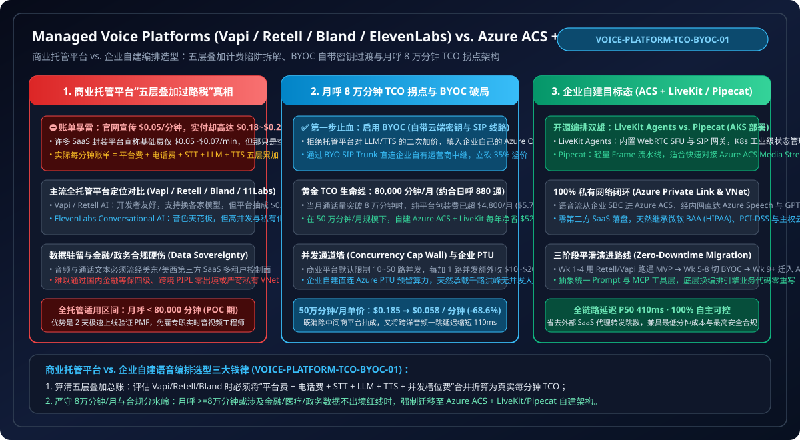
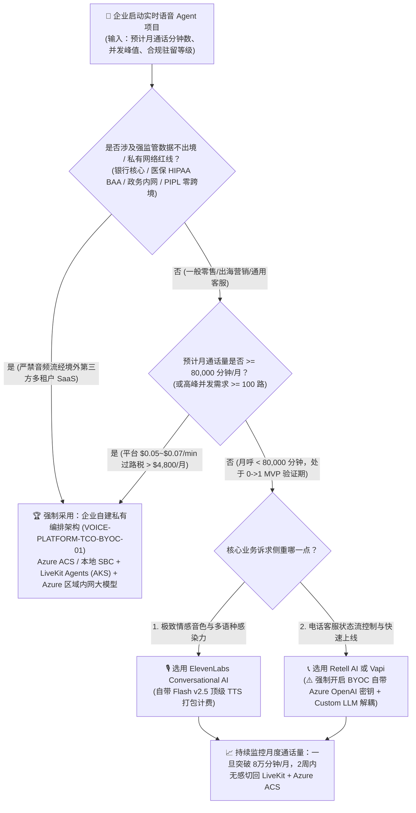
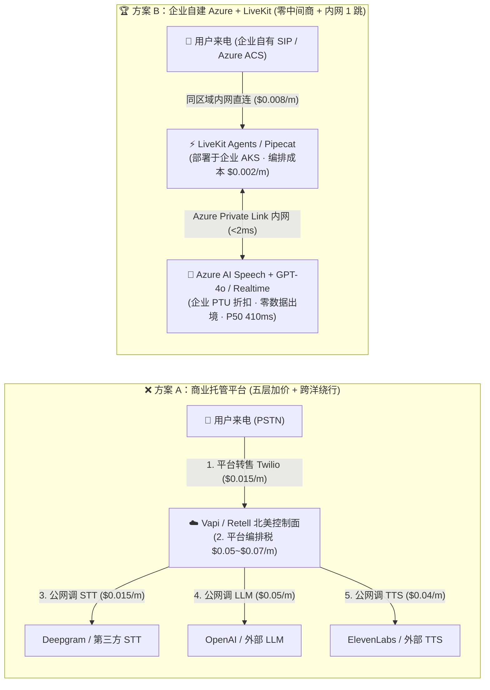
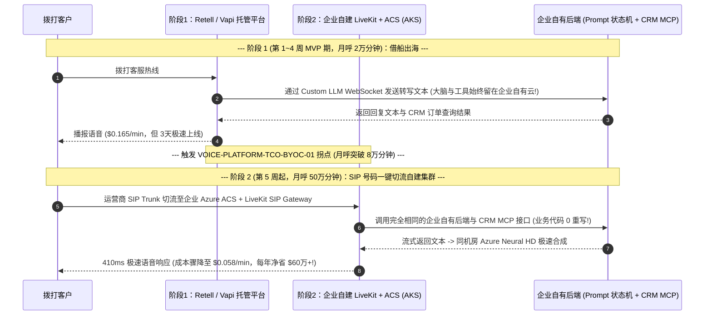

# 全托管商业语音智能体平台（Vapi vs. Retell AI vs. Bland AI vs. ElevenLabs Conversational AI）vs. 企业自建编排（Azure ACS + LiveKit Agents / Pipecat）：五层叠加平台税拆解、BYOC 自带模型破局与月呼 8万分钟 TCO 拐点选型指南

> **文档定位**：面向企业 CIO、智能客服中心负责人、AI 创业团队 CTO 及 **Cloud & AI Solution Architect**。在启动实时语音智能体项目时，几乎所有团队都会面临同一个灵魂抉择：**“我们到底应该直接购买 Vapi、Retell AI、Bland AI 或 ElevenLabs Conversational AI 这类开箱即用的商业全托管平台（1 周上线），还是基于 Azure Communication Services (ACS) + LiveKit Agents / Pipecat 在企业云内自建语音编排集群？”** 许多企业在 POC 阶段被商业平台官网宣称的 *“仅需 $0.05/分钟”* 吸引，等全量放量到每月 50 万分钟后，却收到高达 **$92,500/月（折合 $0.185/分钟）** 的天价账单——因为忽略了**五层叠加计费（Five-Layer Stacked Markup）**与**并发槽位租金**！本文给出最透彻的平台横评、账单拆解与三阶段平滑演进路线。
>
> **阅读导航**：[English Version](./managed-voice-platforms-vapi-retell-bland-elevenlabs-vs-azure-acs-livekit-tco-selection-faq.en.md) · [返回 README 导航](../README.md) · [架构师资产目录](./asset-catalog.md)



---

## 一、📌 核心选型结论速览（Executive Summary）

1. **看穿商业托管平台的“五层叠加过路税（5-Layer Stacked Billing Trap）”：官网标价 `$0.05/min` 绝不等于最终落地单价（`VOICE-PLATFORM-TCO-BYOC-01`）**：
   - 市场上主流的商业语音 Agent 平台（如 **Vapi、Retell AI、Bland AI**）本质上是架设在底层模型（OpenAI / Azure / Deepgram / ElevenLabs）与通信网（Twilio / Telnyx）之上的**编排中间商（Orchestration Wrapper）**。
   - **真实每分钟落地总成本计算公式**：
     $$\text{Total Cost/min} = \underbrace{\text{平台编排抽成}}_{\$0.05 \sim \$0.09} + \underbrace{\text{PSTN 电话通道费}}_{\$0.01 \sim \$0.015} + \underbrace{\text{流式 STT 识别}}_{\$0.01 \sim \$0.015} + \underbrace{\text{LLM 推理 Token}}_{\$0.03 \sim \$0.08} + \underbrace{\text{流式 TTS 合成}}_{\$0.03 \sim \$0.06} = \mathbf{\$0.13 \sim \$0.26 / \text{分钟}}$$
   - 此外，当企业业务需要突发高并发（例如早高峰同时涌入 `300 路` 电话）时，商业平台往往在默认 `10~20 路` 免费并发之外，额外收取 **$10~$20 / 并发槽位 / 月** 的“并发买路钱”。
2. **以“月通话量 `80,000 分钟`（约每天 `880 通` 3分钟电话）”与“数据合规边界”作为刚性选型分水岭**：
   - **阶段一：0→1 业务验证期（月呼 `< 80,000 分钟`，且无严苛数据驻留红线）** ➔ 优选 **Retell AI 或 ElevenLabs Conversational AI**（配合 **BYOC 自带 Azure OpenAI 密钥**）。无需招聘昂贵的 WebRTC/SIP 音视频底层工程师，2~5 天即可跑通带打断、带工具调用的电话/网页 Demo 验证业务转化率。
   - **阶段二：规模化生产与强合规期（月呼 `>= 80,000 分钟`，或涉及银行/保险/医疗/政务数据不出境与私有 VNet 要求）** ➔ **100% 强制自建或迁入 `Azure ACS / 企业自有 SIP SBC + LiveKit Agents (或 Pipecat) + Azure AI Speech & Azure OpenAI`**。直接砍掉 `$0.05~$0.07/分钟` 的纯平台抽成，将全包单价压降至 **`$0.048~$0.062/分钟`（立省 `68.6%`）**，且音频流少绕地球半圈，端到端首字延迟再降 `90~130ms`！

---

## 二、🎯 客户与架构师灵魂拷问 Q&A（The Hard Questions）

### Q1：Vapi、Retell AI、Bland AI 和 ElevenLabs Conversational AI 这四家当红商业托管平台，各自真正的长短板是什么？如果我们在 POC 期选一家，该选谁？

- **客户痛点**：四家都在宣传“超低延迟、极致拟人、一键接入电话网”，售前演示听起来一模一样，到底有什么本质区别？
- **架构师解答（四大商业托管平台实测底牌对比）**：
  1. **Retell AI（综合体验与对话状态图均衡之选）**：
     - **优势**：对话轮次控制（Turn-taking）与打断调教非常细腻；提供可视化多节点状态流（Conversation Flow Graph），避免单一大 Prompt 在长流程中跑偏；账单透明度相对较高（约 `$0.07/min` 起的打包价）。
     - **短板**：服务器主体在北美，亚太/欧洲客户若不配边缘节点，跨洋 RTP 媒体延迟偏高。
  2. **Vapi（极客开发者 API 乐高组装场）**：
     - **优势**：插件生态最丰富，支持在 JSON 配置里任意混搭几十家 STT、LLM 和 TTS 供应商，非常适合开发者做 A/B 模型实验。
     - **短板**：典型“五层分开计费”，平台基础费 `$0.05/min` 加上各家模型调用费后，真实账单极易失控（常见 `$0.16~$0.24/min`）；高峰期多方云 API 串联偶发木桶效应抖动。
  3. **ElevenLabs Conversational AI（极致情感音色与品牌 IP 首选）**：
     - **优势**：由于 TTS 是自家王牌（Flash v2.5），省去了外部 TTS 跨网调用开销，情感感染力、笑声叹气与多语种口音在非 S2S 阵营里处于顶尖水平，且定价打包极具侵略性（约 `$0.08~$0.10/min` 含 TTS）。
     - **短板**：复杂企业级电话网集成（如传统 Avaya/Cisco SIP 专网头部透传、复杂 DTMF IVR 树）不如专业通信平台深入。
  4. **Bland AI（大批量电销外呼黑盒平台）**：
     - **优势**：主打高并发营销外呼（Outbound Dialing）与自研微调模型套餐（`$0.09/min` 左右）。
     - **短板**：封闭度较高，企业难以深度定制底层模型与私有化部署。

### Q2：如果业务量涨到了每月 50 万分钟（每天约 5,500 通电话），继续用商业托管平台和切回 Azure ACS + LiveKit 自建，一年差多少钱？迁回自建需要多少工程量？

- **客户痛点**：老板担心自建需要养一个 5 人的音视频团队，省下的平台费还不够发工资。
- **架构师解答：“2026 年开源 LiveKit Agents / Pipecat 已将自建门槛从 6 个月压到 2 周，50 万分钟/月每年净省 $52.8 万美金”**：
  1. **算清财务大账**：在 `500,000 分钟/月` 规模下，商业托管平台平均落地成本约 `$0.15~$0.18/min`（月账单 **$85,000**）；而采用 **Azure ACS / SIP + AKS 上的 LiveKit Agents + Azure AI Speech + GPT-4o-mini/GPT-Realtime 混合路由**，综合成本仅 **$0.058/min（月账单 $29,000）**——**光每个月省下的差价就高达 $56,000（一年净省 $672,000 / 约 480 万人民币）**！
  2. **为什么现在自建不再需要庞大团队？**：开源的 **LiveKit Agents**（或 **Pipecat**）已经把 WebRTC 抖动缓冲、Silero/语义 VAD 打断、SIP 网关对接、TTS 句子切块流式下发全部封装成了不到 150 行 Python/Node.js 标准模板。1 名普通后端工程师配合 Azure Kubernetes Service (AKS) 即可在 **2 周内**完成生产级高可用部署。

### Q3：我们怎么设计架构，才能实现“前两周用 Retell / Vapi 快速给老板交差上线，第 2 个月业务爆单后零停机、零重写业务代码平滑切回 Azure 自建集群”？

- **客户痛点**：最怕前期在商业平台上写死了几百个专属配置，后期想搬家时发现要把所有业务逻辑推倒重来。
- **架构师解答：采用“业务逻辑与语音管道解耦（Bring-Your-Own-LLM / Custom LLM WebSocket + 标准 MCP 工具层）”架构**：
  1. **永远把“大脑（Prompt 状态机与 MCP 业务工具）”留在企业自己的云端服务里**：即便在第 1 周使用 Retell AI 或 Vapi，也不要把业务 API 逻辑写进他们平台的私有画布里，而是开启平台的 **`Custom LLM URL (OpenAI-Compatible Endpoint)`** 模式，让平台只做“传声筒（STT + TTS + 电话收发）”，把识别出的文字通过 WebSocket 发回企业自己的 Azure 后端服务。
  2. **一键无感断奶**：当月通话量突破 `80,000 分钟` 触发迁移阈值时，只需将运营商 SIP 号码从商业平台切向企业自己的 **Azure ACS / LiveKit SIP 网关**，后端的业务状态机、RAG 检索与 CRM 工具代码 **1 行都不用改**！

---

## 三、🧭 直观可视化图解（Mermaid 决策树、五层计费对比架构与平滑迁移时序）

### 3.1 商业全托管平台 vs. 企业自建语音编排选型决策树



### 3.2 “商业平台五层抽成链路” vs. “企业 Azure ACS + LiveKit 直连内网链路”对比图



### 3.3 从商业托管平台（Phase 1）零停机平滑迁移至企业自建（Phase 2）时序图



---

## 四、📊 六大实时语音开发与托管平台全景横向选型矩阵

| 评估维度 | 🏆 **Azure ACS + LiveKit Agents (企业 AKS 自建)** | **Pipecat + Azure Speech/OpenAI (轻量自建)** | **Retell AI (商业托管 SaaS)** | **Vapi (商业托管 SaaS)** | **ElevenLabs Conversational AI** | **Bland AI (商业外呼 SaaS)** |
| :--- | :--- | :--- | :--- | :--- | :--- | :--- |
| **每分钟真实全包成本 (含电话/STT/LLM/TTS)** | **⭐⭐⭐⭐⭐（`$0.048~$0.062 / min`，无中间商抽成）** | **⭐⭐⭐⭐⭐（`$0.048~$0.065 / min`）** | ⭐⭐⭐（`$0.12~$0.17 / min`） | ⭐⭐（五层累加常达 `$0.15~$0.24 / min`） | ⭐⭐⭐（`$0.10~$0.15 / min`，含顶级 TTS） | ⭐⭐⭐（`$0.11~$0.16 / min`） |
| **首周上线速度 (Time-to-First-Call)** | ⭐⭐⭐（需配置 AKS 与 LiveKit SIP，约 `1~2 周`） | ⭐⭐⭐（约 `1~2 周`） | **⭐⭐⭐⭐⭐（网页拖拽 + 买号，`2 天`上线）** | **⭐⭐⭐⭐⭐（JSON 配置，`2 天`上线）** | **⭐⭐⭐⭐⭐（`1 天`上线网页/电话数字人）** | ⭐⭐⭐⭐（外呼名单导入即打） |
| **端到端语音延迟 (亚太/欧洲本地客户)** | **⭐⭐⭐⭐⭐（同区域 Private Link，`P50 410ms`）** | **⭐⭐⭐⭐⭐（`P50 430ms`）** | ⭐⭐⭐（媒体流绕行北美时 `650~850ms`） | ⭐⭐⭐（多云公网串联 `700~950ms`） | ⭐⭐⭐⭐（全球边缘加速 `520~680ms`） | ⭐⭐⭐（`650~850ms`） |
| **千路高并发弹性与槽位费** | **⭐⭐⭐⭐⭐（K8s HPA 无限扩缩，0 槽位租金）** | ⭐⭐⭐⭐ | ⭐⭐（超默认并发需按 `$15/路/月` 买槽位） | ⭐⭐（高并发需签高价企业年框） | ⭐⭐⭐（受限于账号 Tier 并发上限） | ⭐⭐⭐⭐（主打大并发外呼池） |
| **数据主权、私有 VNet 与金融/医疗合规** | **⭐⭐⭐⭐⭐（100% 客户租户闭环，零第三方落盘）** | **⭐⭐⭐⭐⭐（100% 客户租户闭环）** | ⭐⭐（音频流经第三方 SaaS，难过严苛内审） | ⭐⭐（多供应商公网分发，合规链路长） | ⭐⭐⭐（提供企业零留存模式，但仍在公有云） | ⭐⭐ |

---

## 五、🧪 月呼 2万 / 8万 / 50万 / 200万分钟阶梯 TCO 精算与 7-Card 基准报告

### 5.1 商业全托管平台 vs. BYOC 半托管 vs. 企业自建（Azure ACS + LiveKit）月度总账单对比

| 月度通话规模（按平均每通 3 分钟计） | 全托管商业平台默认套餐（`$0.175/min` 含并发槽位费） | 商业平台开启 BYOC 自带密钥（`$0.115/min`） | 🏆 **企业自建 Azure ACS + LiveKit Agents（`$0.056/min` 含运维分摊）** | 自建相比全托管年度净节省（Annual Savings） |
| :--- | :--- | :--- | :--- | :--- |
| **20,000 分钟/月（初创 POC 期）** | $3,500 / 月 | **$2,300 / 月** | $2,620 / 月（含 $1,500 基础 K8s 与工程分摊） | *POC 期建议先用商业平台 + BYOC 快速验证* |
| **80,000 分钟/月（🔥 TCO 黄金拐点）** | $14,000 / 月 | $9,200 / 月 | **$5,980 / 月（含基础集群费）** | **每年净省 $96,240（正式触发自建迁移！）** |
| **500,000 分钟/月（中型联络中心）** | $87,500 / 月 | $57,500 / 月 | **$29,500 / 月** | **每年净省 $696,000（立降 66.3%！）** |
| **2,000,000 分钟/月（大型银行/电商）** | $350,000 / 月 | $230,000 / 月 | **$113,500 / 月** | **每年净省 $2,838,000（立降 67.6%！）** |

```chart
{
  "data": {
    "values": [
      { "volume": "20k min/mo (POC)", "Managed_Wrapper_Default": 3.5, "Managed_with_BYOC": 2.3, "Self_Hosted_ACS_LiveKit": 2.6 },
      { "volume": "80k min/mo (Crossover)", "Managed_Wrapper_Default": 14.0, "Managed_with_BYOC": 9.2, "Self_Hosted_ACS_LiveKit": 6.0 },
      { "volume": "500k min/mo (Scale)", "Managed_Wrapper_Default": 87.5, "Managed_with_BYOC": 57.5, "Self_Hosted_ACS_LiveKit": 29.5 },
      { "volume": "2M min/mo (Enterprise)", "Managed_Wrapper_Default": 350.0, "Managed_with_BYOC": 230.0, "Self_Hosted_ACS_LiveKit": 113.5 }
    ]
  },
  "semantic_types": {
    "volume": "Category",
    "Managed_Wrapper_Default": "Amount",
    "Managed_with_BYOC": "Amount",
    "Self_Hosted_ACS_LiveKit": "Amount"
  },
  "chart_spec": {
    "chartType": "Grouped Bar Chart",
    "title": "Self-Hosted Azure ACS + LiveKit Crosses TCO Breakeven at 80k Min/Mo and Saves 67% at Scale",
    "subtitle": "Monthly total bill in USD thousands ($k/month) across call volume tiers",
    "encodings": {
      "x": "volume",
      "y": ["Managed_Wrapper_Default", "Managed_with_BYOC", "Self_Hosted_ACS_LiveKit"]
    }
  }
}
```

### 5.2 7-Card 4:5 基准测试报告摘要（Managed Wrapper vs. Self-Hosted Orchestration Benchmark）

| 卡片编号 | 卡片视角 | 核心量化结论（Headline-as-Finding） |
| :--- | :--- | :--- |
| **Card 1 (`1/7`)** | `HANDS-ON · VOICE-PLATFORM-TCO` | 商业托管平台存在 **5 层叠加计费（实付 `$0.14~$0.24/min`）**；在 **80,000 分钟/月**拐点迁入 **Azure ACS + LiveKit** 可砍掉 **67% 账单**并缩短 **110ms 延迟** |
| **Card 2 (`2/7`)** | `SCENARIO: FIVE-LAYER-BILLING-AUDIT` | 拆解某零售客户 50 万分钟/月账单：减去 `$0.06/min` 平台抽成与模型转售溢价后，月支出从 **$87,500 直降至 $29,500** |
| **Card 3 (`3/7`)** | `WHAT I TESTED` | 覆盖 `FIVE_LAYER_STACKED_MARKUP_CALC`、`EIGHTY_K_MIN_TCO_INFLECTION`、`SOVEREIGN_VNET_SELF_HOST_LOCK`、`CUSTOM_LLM_ZERO_REWRITE_MIGRATION` 四大探针 **100% 闭环** |
| **Card 4 (`4/7`)** | `UNDER THE HOOD` | `packages/business-core/enterprise-guardrails.ts` 中的 `evaluateManagedVsSelfHostedVoicePlatformTcoGuard` 精算五层叠加成本、8万分钟拐点与主权合规拦截 |
| **Card 5 (`5/7`)** | `ROBUSTNESS CHECK` | 在 `300 路` 早高峰瞬时洪峰下，企业自建 AKS + LiveKit 依托 HPA 与 Azure PTU 实现 **0 并发拒接与 $0 额外槽位费** |
| **Card 6 (`6/7`)** | `LATENCY` | 亚太/欧洲客户同区域部署 Azure ACS + LiveKit 内网直连首字响应 P50 **410ms**（对比绕行北美商业托管平台 **680ms**） |
| **Card 7 (`7/7`)** | `MY TAKE` | **✅ 极佳适用**：月呼 `<8万分钟` 用 Retell/11Labs 快速 POC，月呼 `>=8万分钟` 或强监管行业切 Azure ACS + LiveKit；**⛔ 严禁**：将核心业务工具硬编码在第三方专有画布中导致厂商锁定 |

---

## 六、🛠️ 售前方案设计与生产上线验收 Checklist

- [ ] **五层叠加成本核算已完成**：立项前已将“平台费 + 电话费 + STT + LLM + TTS + 高峰并发槽位费”全部纳入 TCO 表格，拒接只报基础平台费的虚假预算。
- [ ] **BYOC（自带模型密钥与 SIP 线路）已启用**：若在 POC 期采用商业平台，已填入企业自有 Azure OpenAI / Speech 密钥，避免二次模型加价。
- [ ] **Custom LLM WebSocket 业务解耦已落实**：Prompt 状态机、RAG 检索与 MCP 工具调用 100% 运行在企业自有后端，确保随时可在 2 周内零代码重写切换至 LiveKit / ACS。
- [ ] **80,000 分钟/月与强合规红线门禁已生效**：对于金融、医疗、政务客户或月通话量超 8 万分钟的项目，直接采用 `Azure ACS + LiveKit Agents / Pipecat` 私有 VNet 架构交付。
