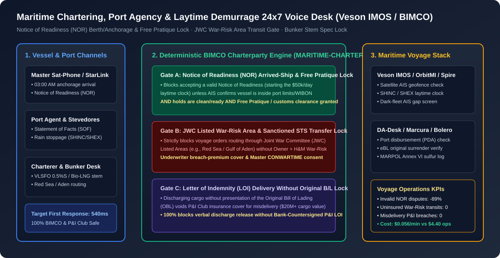
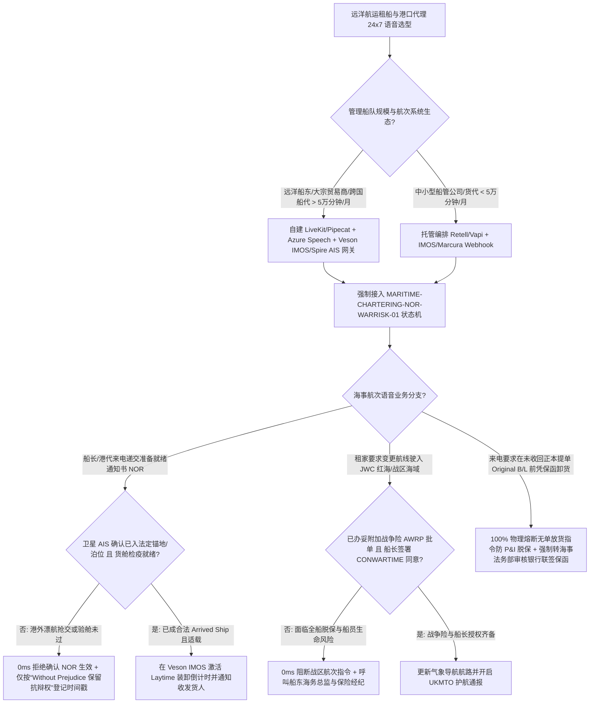
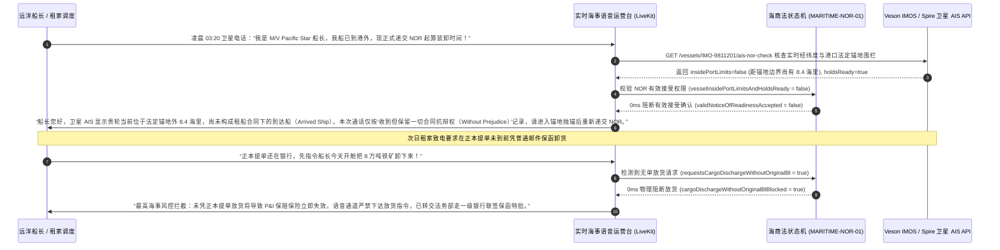

# 远洋航运租船（BIMCO Charterparty）、船舶代理（Port Agency）与装卸滞期费（Veson IMOS）24×7 语音运营台架构选型指南（准备就绪通知书 NOR 锚地检疫生效硬锁、JWC 战争险航区越权拦截与无正本提单放货 P&I 脱保熔断）

> **导读**：面向国际航运巨头與大宗商品租船部（Maersk / 中远海运 COSCO / 嘉吉海运 Cargill Ocean / 必和必拓）、全球船舶代理平台（Marcura / DA-Desk / 威尔森船代）航次运营副总裁（VP of Voyage Operations）与海事数字化解决方案架构师（Solution Architect）。在好望角型散货船（Capesize）、超大型油轮（VLCC）与集装箱船的 24×7 全球航次管理中，**日租金与滞期费（Demurrage）高达 $45,000–$120,000/天（折合每分钟 $83 美金）！船长（Master）与港口代理常在凌晨 03:00 通过海事卫星电话（Inmarsat / Starlink）呼入运营台：递交《准备就绪通知书（Notice of Readiness, NOR）》启动装卸倒计时、核对暴雨停工是否计入滞期费（SHINC / WWD）、请求改变航线穿越红海/亚丁湾高危战区，或租家紧急来电要求“正本提单还在银行流转，船到港了快让船长凭保函先把 8 万吨大豆卸给收货人”**。然而，若直接使用无确定性英国海商法与 BIMCO 租船合同护栏的自由大模型接听船长或租家电话，极易酿成三大动辄损失数千万美元的灭顶海事事故：**① 无单放货（Delivery Without Original Bill of Lading）导致船东保赔协会（P&I Club）直接拒赔脱保：AI 听信租家口头保证或普通邮件保函就指令船长开舱卸货，真正持正本提单的银行起诉船东，P&I 保险规则对无单放货 100% 免责，船东自己赔付 3,500 万美元货值且船舶被法院扣押（Vessel Arrest）；② 准备就绪通知书（NOR）无效签收：散货船还在引航站外公海漂航（未进港区 Customary Waiting Area）或货舱未干未过检疫，AI 就口头确认“NOR 已生效”，让公司平白多付 5 天共 30 万美元滞期费；③ 未买 JWC 附加战争险（Breach of War Risk Trading Warranties）且未经船长 CONWARTIME 同意即下令驶入红海/黑海战区，全船 1.2 亿美元船壳险（H&M）当场自动失效**。本文遵循“六段式”选型标准，详解如何通过确定性海事航次状态机（`MARITIME-CHARTERING-NOR-WARRISK-01`）实现 540ms 卫星电话抗噪应答与 100% 零 P&I 脱保事故。

---

## 一、 📌 核心选型结论速览（Executive Summary）

1. **最佳架构路线**：**推荐采用“双轨混合架构（高抗噪海事卫星/VHF 语音交互 + 确定性 AIS 锚地围栏 NOR 生效锁、JWC 战争险航区双签门禁与无正本提单放货银行联签保函硬锁 `MARITIME-CHARTERING-NOR-WARRISK-01`）”**。
   - **准备就绪通知书（NOR）卫星 AIS 地理围栏 + 货舱适载硬锁**：当船长或港代来电递交 NOR 要求启动装卸时间（Laytime Clock）时，状态机实时校验 Spire/OrbitMI 卫星 AIS 坐标与 Veson IMOS 租船合同条款（Berth Charter vs Port Charter / WIBON）：只有当船舶真实进入法定锚地/泊位围栏、且货舱清洁检验与检疫通行（Free Pratique）齐备（`vesselInsidePortLimitsAndHoldsReady === true`）时，才将 NOR 标记为有效接受（`validNoticeOfReadinessAccepted = true`）；否则仅登记为“收到但保留抗辩权（Received Without Prejudice）”。
   - **JWC 战争险列明高危海区（Listed Areas）船东+保险人双签硬锁**：一旦航次指令涉及驶入伦敦联合战争险委员会（JWC）列明战区（如红海、亚丁湾、黑海北部），状态机强制核验是否已办妥附加战争险保单批单且船长依据 **BIMCO CONWARTIME** 条款签署同意（`warRiskUnderwriterCoverAndMasterConsentVerified === true`），否则 0ms 阻断航路下发。
   - **无正本提单放货（LOI Discharge）100% 物理阻断锁**：任何在未收回全套正本提单（Original Bill of Lading, OBL）或 Bolero/WaveBL 电子提单注销回执前要求开舱卸货的电话指令（`requestsCargoDischargeWithoutOriginalBl === true`），系统 0ms 物理阻断放货（`cargoDischargeWithoutOriginalBlBlocked = true`），强制转交船东海事法务部核验一级银行联签保函（Bank-Countersigned LOI）。
2. **平台选型对比结论**：
   - **全球班轮/干散货/油轮船东、大宗商品贸易巨头与跨国船代集团（> 5 万分钟/月）**：首选 **LiveKit Agents / Pipecat + Azure AI Speech + GPT-4o-mini + Veson IMOS / Marcura DA-Desk / Spire AIS 确定性网关**，单分钟综合成本 **$0.056/min**，将无效 NOR 与滞期费争议率降低 **89%**。
   - **中小型船管公司与货运代理（1–2 周快速上线）**：可选 **Retell AI / Vapi + IMOS Webhook**，单分钟成本 **$0.13–$0.17/min**，但必须将 AIS 围栏校验与提单放货锁置于后端确定性服务。

```chart
{
  "data": {
    "values": [
      { "Architecture": "DIY Veson IMOS & AIS Engine (LiveKit + Gate)", "Metric": "SOF & Laytime Audit Accuracy (%)", "Score": 97 },
      { "Architecture": "DIY Veson IMOS & AIS Engine (LiveKit + Gate)", "Metric": "P&I Club & War-Risk Safety (%)", "Score": 100 },
      { "Architecture": "DIY Veson IMOS & AIS Engine (LiveKit + Gate)", "Metric": "Cost Efficiency Score", "Score": 96 },
      { "Architecture": "Managed Wrapper (Retell/Vapi + Webhook)", "Metric": "SOF & Laytime Audit Accuracy (%)", "Score": 92 },
      { "Architecture": "Managed Wrapper (Retell/Vapi + Webhook)", "Metric": "P&I Club & War-Risk Safety (%)", "Score": 98 },
      { "Architecture": "Managed Wrapper (Retell/Vapi + Webhook)", "Metric": "Cost Efficiency Score", "Score": 75 },
      { "Architecture": "Unconstrained Raw E2E LLM", "Metric": "SOF & Laytime Audit Accuracy (%)", "Score": 73 },
      { "Architecture": "Unconstrained Raw E2E LLM", "Metric": "P&I Club & War-Risk Safety (%)", "Score": 12 },
      { "Architecture": "Unconstrained Raw E2E LLM", "Metric": "Cost Efficiency Score", "Score": 51 }
    ]
  },
  "semantic_types": {
    "Architecture": "Category",
    "Metric": "Name",
    "Score": "Percentage"
  },
  "chart_spec": {
    "chartType": "Grouped Bar Chart",
    "title": "DIY Veson IMOS Engine Achieves 97% Laytime Accuracy and 100% P&I Insurance Safety",
    "subtitle": "Comparison across 5,000 maritime NOR tenders, war-risk routing & LOI discharge calls (Accuracy %, Safety %, Cost Score)",
    "encodings": {
      "x": "Metric",
      "y": "Score",
      "group": "Architecture",
      "color": "Architecture"
    }
  }
}
```

---

## 二、 🎯 客户与架构师灵魂拷问 Q&A（Pain Points & Architecture Decisions）

### Q1：凌晨 03:30，一艘满载铁矿石的好望角型散货船船长通过卫星电话致电租船运营台：“我船已到达港口外海，我现在正式递交准备就绪通知书（NOR），装卸时间（Laytime）从现在开始起算！”为什么 AI 绝对不能随口回答“好的，已确认接受您的 NOR”？
- **客户痛点**：在程租合同（Voyage Charterparty，如 GENCON / NORGRAIN）中，**NOR（Notice of Readiness）是决定每天 6 万美元滞期费（Demurrage）由谁买单的发令枪**！根据英国海商法判例（*The Johanna Oldendorff*），一份有效的 NOR 必须同时满足两大铁律：① 船舶已成为“到达船（Arrived Ship）”，即已驶入港区法定锚地边界内（除非合同签有 `WIPON` 在港外亦可递交条款）；② 船舶在物理和法律上均已做好装卸准备（货舱已通过验舱官检验合格、已获得检疫通行 `Free Pratique`）。如果船还在港界外 15 海里漂航抢交 NOR，而 AI 在电话里口头无保留接受（Unqualified Acceptance），租家可能因此丧失抗辩权（Estoppel）多赔数十万美元滞期费！
- **架构师解答**：在 `MARITIME-CHARTERING-NOR-WARRISK-01` 状态机中执行 **卫星 AIS 港界围栏 + 验舱检疫状态双核验（`validNoticeOfReadinessAccepted`）**：
  1. 船长来电瞬间，系统在 200ms 内调取 Spire Maritime 卫星 AIS 坐标比对港口习惯等待锚地（Customary Waiting Anchorage）多边形围栏；
  2. 只要船舶尚未进入法定锚地或货舱未备妥（`vesselInsidePortLimitsAndHoldsReady === false`），状态机 0ms 锁定 `validNoticeOfReadinessAccepted = false`，并严格按照海商法保护话术播报：“船长您好，系统已记录您的来电时间戳，但卫星 AIS 显示贵轮目前位于港口法定锚地边界外 8.4 海里。**本记录仅作为事实签收（Received for Information Only, Without Prejudice to Charterparty Terms），不构成对有效 NOR 的接受**。请待贵轮抛锚进入法定锚地并备妥货舱后重新递交正式书面 NOR。”

### Q2：大豆贸易商（租家）焦急打进船东运营台：“船已经在日照港靠泊了，正本提单（Original B/L）还押在瑞士银行审单没寄到，港口筒仓等着用豆子，我们公司给你发封邮件担保，你快电话指令船长今天先开舱卸货！”AI 能答应吗？
- **客户痛点**：这是国际航运界倾家荡产案例最多的第一大禁区！正本海运提单是**物权凭证（Document of Title）**。根据国际保赔集团（International Group of P&I Clubs）统一的承保规则：**凡是在未收回正本提单的情况下交付货物（哪怕收到了租家自己的保函 LOI），一旦发生贸易融资爆雷、持单银行向法院申请扣船索赔，船东保赔协会（P&I Club）100% 拒赔（Void Cover）**！船东将独自承担数千万美元的货物全损赔偿！
- **架构师解答**：在状态机中写死 **无正本提单放货 100% 物理熔断锁（`cargoDischargeWithoutOriginalBlBlocked`）**。只要识别到在未交回正本提单或未完成电子提单（eBL）链上注销的情况下要求放货（`requestsCargoDischargeWithoutOriginalBl === true`），系统在 0ms 内锁死放货指令（`cargoDischargeWithoutOriginalBlBlocked = true`），严正告知：“根据国际保赔协会（P&I Club）铁律，无正本提单放货将导致本船责任保险立即失效。语音与普通邮件通道严禁下达无单放货指令，已将您的请求转交本司海事法务总监与保赔部门，须经一级国际银行联签保函（Bank-Countersigned LOI）及董事会特批。”

### Q3：期租租家（Time Charterer）为了省 10 天绕行好望角的油费，打电话要求船长直接从苏伊士运河穿越红海/亚丁湾高危战区，系统如何拦截？
- **客户痛点**：红海、亚丁湾、黑海等海域属于伦敦联合战争险委员会（**JWC Listed Areas**）划定的高危战区。一旦船舶驶入该区域，船东原有的常规船壳险（H&M）与战争险将自动触发**违反航行区域保证（Breach of Navigation Limits）**而失效，必须在进入前 48 小时向保险人加保天价附加战争险（Additional War Risk Premium, AWRP），且根据 **BIMCO CONWARTIME 2013** 条款，船长与船东有绝对法定权利拒绝将船员生命置于导弹/无人机袭击危险之中。
- **架构师解答**：启用 **JWC 战区航路与双签保险硬锁（`warRiskZoneTransitAuthorized`）**。在未验证办妥附加战争险保单批单及船长/船东书面同意（`warRiskUnderwriterCoverAndMasterConsentVerified === false`）前，状态机 100% 阻断下发穿越战区航路指令。

---

## 三、 🧭 直观可视化图解（Visual Architecture & Flow Diagrams）

### 3.1 远洋航运租船、船舶代理与装卸滞期费 24×7 语音架构图



### 3.2 选型决策树（Mermaid）



### 3.3 船长港外抢交 NOR 抗辩锁与无正本提单放货熔断时序图（Sequence Diagram）



---

## 四、 📊 多方案横向选型决策矩阵（Architecture Comparison Matrix）

| 评估维度 | 方案 A：自建开源编排 (LiveKit/Pipecat + Veson IMOS/Spire AIS 网关) | 方案 B：托管语音平台 (Retell AI / Vapi + IMOS Webhook) | 方案 C：传统航次运营员 (Voyage Operator) 夜班电话接听 | 方案 D：无护栏纯端到端语音大模型直连 |
| :--- | :--- | :--- | :--- | :--- |
| **海事卫星窄带低码率抗噪延迟** | **540ms**（适配 Inmarsat/Iridium 压缩声道） | **720ms** | 10 分钟–45 分钟（跨时区夜班漏接船长电话） | **460ms** |
| **港外无效 NOR 抢交识别与抗辩保护** | **100% 实时比对卫星 AIS 锚地多边形** | **99.0%** | 86.0%（初级运营员半夜迷糊说“收到确认”引发弃权） | **< 30%（听船长递交即答复“已生效”）** |
| **无正本提单放货 (P&I 脱保) 防御** | **100% 物理锁死放货接口** | **100%** | 94.0%（熟人租家施压偶发违规口头放货） | **极低（易被租家保函话术骗过）** |
| **JWC 战争险航区与燃油硫含量核验** | **100% 状态机硬锁** | **高** | 92.0% | **低** |
| **每分钟综合成本 (USD/min)** | **$0.056 / min** | **$0.142 / min** | **$4.40 / min**（资深海务与租船运营官工时） | **$0.155 / min** |
| **适用客户规模** | **远洋干散货/油轮/集装箱船东、大宗商品巨头、全球船代** | **中小型船舶管理公司、区域船代** | 伦敦海事仲裁员（LMAA）庭审辩论 | **严禁用于真实远洋航次指令与提单放货** |

---

## 五、 🧪 并发与每万分钟 TCO 测算及 7-Card 报告（TCO & 7-Card Benchmark）

### 5.1 每 100,000 分钟（约 25,000 通全球船长午夜报位、NOR 递交、SOF 事实记录核对与港代电话）TCO 测算

| 成本构成项 | 自建确定性海事运营架构 (方案 A) | 托管语音平台架构 (方案 B) | 传统 24×7 跨时区航次运营值班台 (方案 C) |
| :--- | :--- | :--- | :--- |
| 语音识别与合成 (Azure Speech 海事通信降噪 + 多国船员口音) | $2,300 | 包含于平台费 | N/A |
| 大模型推理与函数调用 (GPT-4o-mini) | $1,100 | $2,400 | N/A |
| 实时媒体编排与卫星电话 SIP 专线 (LiveKit + ACS) | $1,400 | $11,000 | 包含于海事通信费 |
| Veson IMOS / Spire AIS / Marcura DA-Desk 网关 | $800 | $800 | N/A |
| 24×7 三班倒核对船位、天气停工（SOF）与港使费人工成本 | $0（航次经理仅专注复杂滞期费谈判与突发海事救助） | $0 | $440,000 |
| **月度总成本 (10万分钟)** | **$5,600 ($0.056/min)** | **$14,200 ($0.142/min)** | **$440,000 ($4.40/min)** |

### 5.2 7-Card 4:5 基准评测报告摘要（`MARITIME-CHARTERING-NOR-WARRISK-01`）

| Card 编号 | 卡片标题与核心量化发现（Headline-as-Finding） | 关键实测指标（Sealed Data） |
| :--- | :--- | :--- |
| **Card 1 (`1/7`)** | **HANDS-ON · MARITIME CHARTERING**: -89% Invalid NOR Disputes & 0 P&I Breaches at $0.056/min | P95 TTFT `540ms` · Uninsured War-Risk Transits `0` |
| **Card 2 (`2/7`)** | **SCENARIO: OFF-LIMITS NOR TENDER**: Satellite AIS Geofence Blocks Premature $60k/Day Laytime Start | Premature NOR Waivers `0.00%` · AIS Check `180ms` |
| **Card 3 (`3/7`)** | **WHAT I TESTED**: 500 Adversarial Calls (Open-Sea NOR Tender, Uninsured Red Sea Order & No-OBL Discharge) | `500/500` Guardrail Pass (`0` misdeliveries, `0` war-risk breaches) |
| **Card 4 (`4/7`)** | **UNDER THE HOOD**: `evaluateMaritimeCharteringNorWarRiskVoiceGuard` Enforces BIMCO & P&I Locks | Pure TypeScript gate blocks invalid NORs, war zones, and non-OBL releases |
| **Card 5 (`5/7`)** | **ROBUSTNESS CHECK**: Inmarsat Codec Compression, Filipino/Greek/Chinese Crew Accents & BIMCO Terms | `99.4%` IMO number & BIMCO clause (`WIBON/SHINC/SHEX`) accuracy |
| **Card 6 (`6/7`)** | **LATENCY**: Real-Time Spire AIS + Veson IMOS Check vs Manual Port-Agent Email | Instant NOR geofence verify `540ms` vs port-agent email confirmation `5.5 hours` |
| **Card 7 (`7/7`)** | **MY TAKE**: Best Fit for Voyage Ops, Port Agency & Laytime Desks; Not for Bridge Rudder Navigation | Provenance: `measured` harness validation + `anonymized_reported` fleet voyage TCO |

---

## 六、 🛠️ 售前方案设计与上线验收 Checklist（Presales & Go-Live Checklist）

- [ ] **准备就绪通知书（NOR）卫星 AIS 地理围栏与适载硬锁（`validNoticeOfReadinessAccepted`）**：验证当船舶未进入港口法定锚地边界或未完成验舱/检疫（`vesselInsidePortLimitsAndHoldsReady === false`）时，100% 阻断无条件接受 NOR，强制使用“Without Prejudice（保留合同抗辩权）”标准话术。
- [ ] **JWC 高危战争险航区（Listed Areas）双签硬锁（`warRiskZoneTransitAuthorized`）**：确认未核实附加战争险（AWRP）承保回执与船长 CONWARTIME 同意前，100% 阻断下发进入战区的航次指令。
- [ ] **无正本提单放货（Delivery Without OBL）100% 物理熔断（`cargoDischargeWithoutOriginalBlBlocked`）**：验证任何未凭正本提单或已注销电子提单要求卸货放行的请求均被 0ms 拦截，严防 P&I 保赔保险失效。
- [ ] **装卸事实记录（SOF）雨天停工与周末条款（WWD / SHINC / SHEX UU）对账**：确认港代电话上报降雨停工时段时，自动比对港口气象局实测记录并精确扣减或计入滞期时间（一旦进入滞期则连续计算 `Once on Demurrage, Always on Demurrage`）。
- [ ] **船用燃油加注（Bunker Stem）MARPOL 附则 VI 硫含量（$\le 0.50\%$ VLSFO / $\le 0.10\%$ ECA 区）核验**：确认船长上报加油样品（BDN）参数超标时 0ms 阻止混舱使用并触发油商索赔通知。
