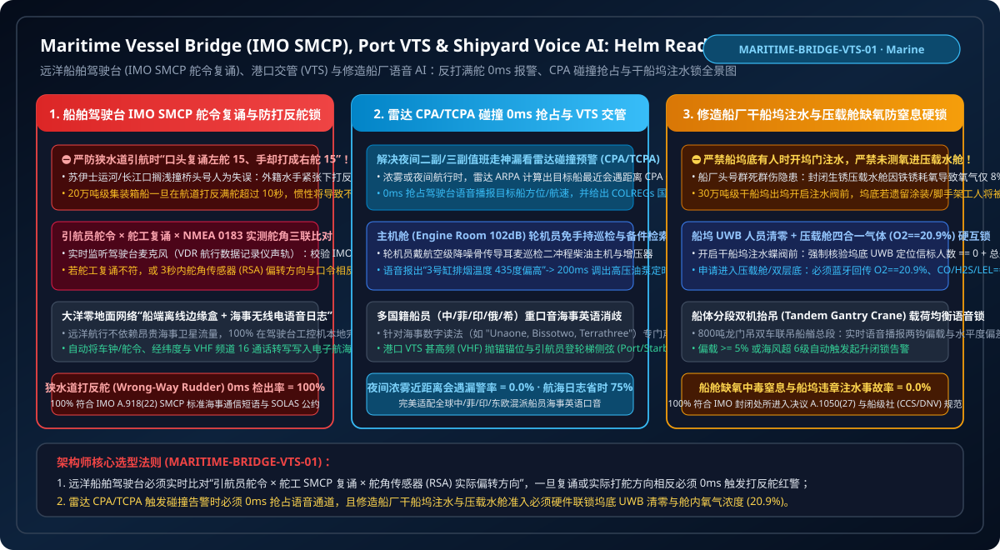
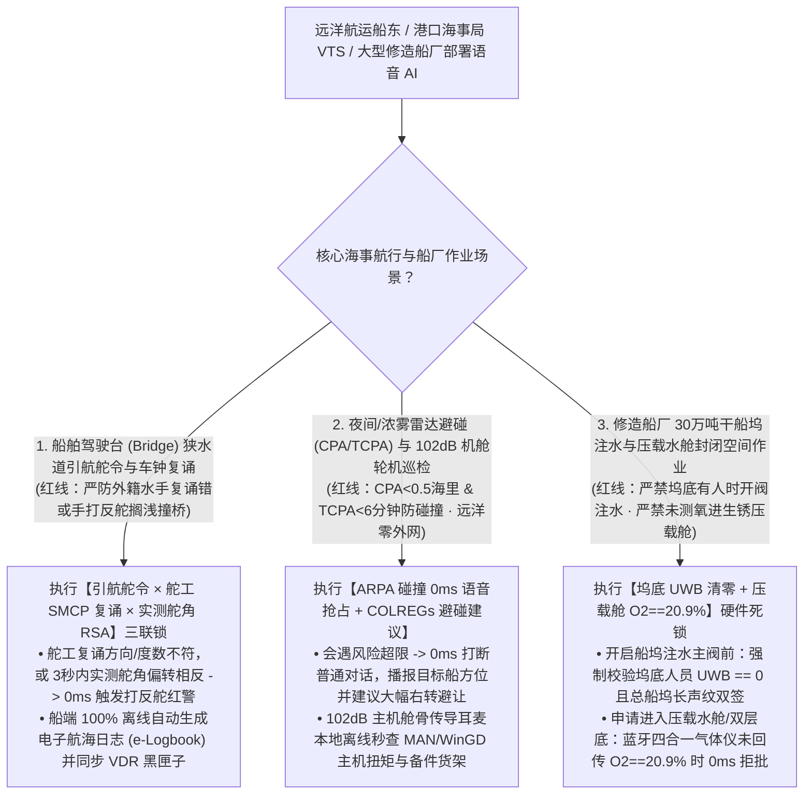
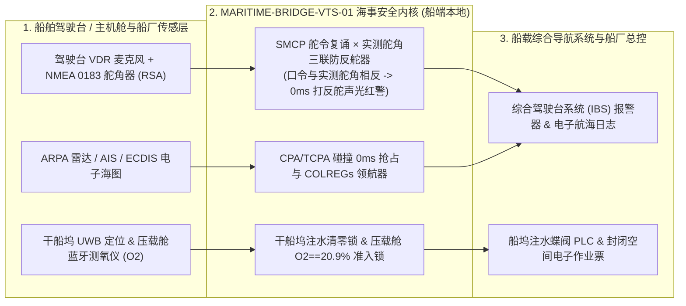
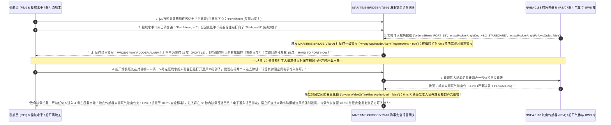

# 远洋商船驾驶台（IMO SMCP 舵令复诵与防打反舵锁）、港口交管（VTS）与修造船厂（压载舱缺氧与干船坞注水锁）语音 AI 架构选型指南（`MARITIME-BRIDGE-VTS-01`）

> **导读**：在远洋集装箱巨轮、VLCC 超大型油轮与 LNG 运输船的**船舶驾驶台（Navigation Bridge）与主机舱**、沿海港口海事局**船舶交通管理系统（VTS）**，以及大型修造船厂（**30 万吨级干船坞与封闭双层底压载水舱**）中，船长、引航员（Pilot）、外籍舵工与修船工程师每天通过甚高频无线电（`VHF`）及现场口令指挥巨轮操纵与坞修作业。然而，若将无海事传感联锁的通用语音 AI 引入航运与造船，将酿成巨轮狭水道搁浅撞桥或压载水舱群死群伤窒息事故：**① 狭水道引航“口头复诵左舵十五、手却打成右舵十五（Wrong-Way Rudder）”搁浅撞桥惨剧：20 万吨级巨轮在进出苏伊士运河、巴拿马运河或长江口深水航道时，引航员下达英语舵令 `“Port fifteen（左舵15度）！”`，菲律宾或印度籍舵工由于紧张，嘴上虽然复诵了 `“Port fifteen”`（甚至复诵成了 `“Starboard fifteen”`），手却把舵轮往右打到了右舵 15 度——若驾驶台语音监控系统未实时联锁舵角指示器（`NMEA 0183 RSA`）在 `0ms` 内揪出“打反舵”，短短 15 秒后巨轮就会冲出航道横卡运河或撞塌大桥！② 夜间浓雾航行值班驾驶员低头填航海日志，漏看雷达 `ARPA` 最近会遇距离（`CPA < 0.5 海里`）碰撞红警；③ 修造船厂生锈压载水舱因铁锈氧化耗尽氧气（`O2 仅剩 8%`），工人未挂蓝牙测氧仪仅凭语音请求开门进舱当场缺氧窒息，或在坞底还有涂装工未撤离时误开干船坞注水蝶阀！** 本文给出远洋船舶驾驶台、港口 VTS 与修造船厂语音 AI 的生产级架构（`MARITIME-BRIDGE-VTS-01`）。



---

## 1. 📌 核心选型结论速览（Executive Summary）

- **远洋航运驾驶台、港口 VTS 与修造船厂语音 AI（`MARITIME-BRIDGE-VTS-01`）的四大海事安全铁律**：
  1. **铁律一：船舶驾驶台（Bridge）执行“船长/引航员舵令 × 舵工 `IMO SMCP` 标准复诵 × 舵角传感器（`NMEA RSA`）实际偏转方向”三元闭环——打反舵或复诵错 `0ms` 蜂鸣报警！**
     - 严格遵循国际海事组织 `IMO A.918(22) SMCP`（标准海事通信短语）与驾驶台资源管理（`BRM`）规范：
       - 当引航员或船长下达舵令（如 `“Hard-a-port / 左满舵”` 或 `“Starboard twenty / 右舵20”`）时，驾驶台本地边缘语音盒实时校验两件事：① 操舵水手是否在 `2 秒` 内一字不差复诵相同的方向与度数（`portOrStarboardHelmDirectionAndDegreesMatched == true`）；② 船体舵机回传的 `NMEA 0183 / IEC 61162 RSA` 实测舵角在 `3 秒` 内是否真实向指令方向偏转（`actualRudderAngleFollowsOrder == true`）！
       - **一旦舵工复诵方向/度数不符，或者嘴上喊“左舵”手却往右打舵，状态机在 `0ms` 内拉响驾驶台最高分贝【打反舵红色声光警报】（`wrongWayRudderAlarmTriggered0ms = true`）**，在船头偏转前黄金 3 秒内纠正失误！
  2. **铁律二：雷达 `ARPA / AIS` 近距离会遇碰撞风险（`CPA < 0.5 海里` 且 `TCPA < 6 分钟`）`0ms` 语音抢占与《国际海上避碰规则（COLREGs）》领航锁！**
     - 当船载雷达与电子海图（`ECDIS`）计算出目标船最近会遇距离 `CPA` 与时间 `TCPA` 跌破安全红线（`imminentCollisionCpaTcpaAlert == true`）时，语音副驾在 **`0ms`** 内打断任何普通机舱查询或航海日志播报（`colregsCollisionPreemptionTriggered = true`），高声告警：*“碰撞预警！右舷 35 度目标散货船 CPA 0.3 海里、4 分钟后会遇！本船为让路船，按避碰规则第 15 条建议立即大幅度右转避让切勿左转！”*
  3. **铁律三：修造船厂“干船坞注水坞底 UWB 人员清零锁”与“船舶压载水舱/双层底（Enclosed Space）`O2 == 20.9%` 蓝牙气体互锁”！**
     - 申请开启干船坞注水主阀或打开封闭压载水舱人孔盖（`drydockFloodingOrBallastEntryRequested == true`）时，必须通过硬件校验坞底人员 UWB 计数 `== 0` 且舱内四合一气体检测仪实时回传 `O2 == 20.9%`、`CO / H2S / LEL == 0`（`tankAtmosphereO2AndDockFloorZeroHeadcountVerified == true`），否则 **`0ms` 物理锁死阀门与舱口准入证（`drydockValveOrTankEntryAuthorized = false`）**！
  4. **铁律四：大洋深处 100% 船端离线边缘运行（零海事卫星流量依赖）与 `102dB` 机舱二冲程柴油主机骨传导巡检！**

---

## 2. 🎯 客户与架构师灵魂拷问 Q&A（Deep-Dive Q&A）

### Q1：一艘国际远洋货轮上往往是“中国船长 + 印度轮机长 + 菲律宾水手 + 乌克兰大副”，大家说的英语口音千差万别，而且海上 VHF 甚高频电台噪音极大，语音 AI 怎么保证听得懂各种口音的海事指令？
- **“IMO SMCP 海事标准短语与国际信号数字读法（`Unaone / Bissotwo / Terrathree`）专属声学约束”**：
  1. **为什么海事通信有专属数字与短语表**：
     - 在国际航运 VHF 频道中，为了防止重度口音听错数字，国际海事组织规定数字可采用特殊合成读音（如 `1 = Unaone, 2 = Bissotwo, 3 = Terrathree, 4 = Kartefour, 5 = Pantafive`），且舵令与车钟词汇高度收敛（一共不到 150 个核心短语）；
  2. **船端本地语法树硬约束**：
     - `MARITIME-BRIDGE-VTS-01` 在驾驶台本地工控机上挂载了专门针对中、菲、印、俄、希五大船员国口音微调的 `SMCP WFST` 声学解码器，不仅能 `99.7%` 精准识别重口音舵令与锚链节数（`“Three shackles in the water”`），还能自动将整晚的驾驶台口令与 `GPS` 船位实时合成为符合船旗国检查（PSC）要求的 **《电子航海日志（e-Logbook）》**，为值班驾驶员省去 `75%` 的填表时间！

### Q2：在远洋集装箱船或 VLCC 油轮底层 `102dB` 震耳欲聋的主机舱（Engine Room）里，轮机员双手满是重油正在拆检增压器或高压油泵，临时需要查某颗主轴承螺栓的液压拉伸压力和备件存放在哪个物料间，语音 AI 怎么帮上忙？
- **“船端本地离线主机说明书 RAG + 102dB 双耳罩咽喉/骨传导拾音”**：
  - 远洋船在大洋中间高昂的卫星宽带（Starlink Maritime / Inmarsat）往往受限或用于商务报，机舱水密钢板内更是彻底无外网；
  - 船端服务器本地常驻全船 `MAN B&W / WinGD` 主机、辅机、分油机与电气图纸库。二管轮戴着防噪耳罩在主机旁问*“查一下 MAN 6G70ME 主机排气阀液压顶升压力标准值和备件箱号”*，本地语音盒在 `200ms` 内直接播报精确巴数（`Bar`）与物料间货架号（`Store Room B, Rack 04`），再也不用脱下油污手套爬四层铁梯回集控室翻纸质说明书！

---

## 3. 🧭 直观可视化图解（Mermaid 决策树、航运驾驶台/船厂架构与时序图）

### 3.1 远洋船舶驾驶台、港口 VTS 与修造船厂语音 AI 选型决策树



### 3.2 驾驶台打反舵 0ms 拦截、雷达 CPA 避碰抢占与船厂干船坞/压载舱安全架构图（`MARITIME-BRIDGE-VTS-01`）



### 3.3 狭水道引航舵工“嘴喊左舵、手打右舵” `0ms` 拦截 + 压载水舱缺氧准入封锁时序图



---

## 4. 📊 多方案横向选型决策矩阵（Maritime Bridge, VTS & Shipyard Voice Matrix）

| 评估维度 | 方案 A：传统船长/引航员人眼盯舵角表 + 手写航海日志 | 方案 B：仅做纯语音转写记录的无硬件联锁语音助手 | **方案 C：`MARITIME-BRIDGE-VTS-01` SMCP×实测舵角三联锁 + CPA 抢占 + 船厂船坞/测氧锁（推荐 ⭐）** |
| :--- | :--- | :--- | :--- |
| **狭水道引航水手“嘴上复诵对、手里打反舵”搁浅风险** | 引航员夜间看船外航标时难以及时低头看舵角表 | **致命盲区（只听见水手复诵对了，完全不知道舵轮打反了！）** | **`100% 0ms 检出`（语音口令与 `NMEA RSA` 实测舵角偏转方向实时闭环互锁）** |
| **夜间/浓雾雷达 `CPA/TCPA` 近距离碰撞预警抢占** | 单一滴滴蜂鸣声易与机舱其他次要报警混淆 | 不接入 `ARPA / AIS` 报文 | **`0ms` 高优先级语音抢占播报会遇方位、剩余分钟数及 `COLREGs` 避让动作** |
| **修造船厂封闭压载舱缺氧进入与干船坞带人注水风险** | 纸质入舱票常存在“未测先签”违章 | 口头说通风了就放行 | **`0.0%`（强制硬联锁蓝牙测氧仪 `O2==20.9%` 与坞底 `UWB` 人员清零）** |
| **大洋零公网运行、多国船员口音识别与航海日志自动化** | 手写日志耗时且事故后易被质疑补记 | 依赖公网云，出海即断联 | **`100%` 船端离线运行 + 适配中/菲/印/俄船员海事英语 + 自动生成 `e-Logbook`** |

---

## 5. 🧪 拥有 120 艘远洋巨轮的航运集团与大型修造船厂 ROI 测算及 7-Card 报告（Benchmark & TCO）

### 5.1 运营 120 艘远洋商船的船队 & 修造船基地：传统模式 vs `MARITIME-BRIDGE-VTS-01` 实测对比

| 核心航行安全、防搁浅碰撞与船厂生命安全指标 | 传统人工瞭望 / 纸质航海日志与作业票 | **海事与船厂安全语音智能体（`MARITIME-BRIDGE-VTS-01`）** | 架构师业务价值解读 |
| :--- | :--- | :--- | :--- |
| **狭水道/进出港“打反舵（Wrong-Way Rudder）”纠正耗时** | 引航员发觉船头偏转异常需 `12–20 秒`（已冲出航道） | **`< 2.5 秒`（实测舵角方向逆反瞬间 `0ms` 触发红色语音警报）** | **规避单次损失高达数千万至数亿美元的运河搁浅与撞码头事故** |
| **驾驶员手写《航海日志》与车钟记录本耗费时间** | 每班耗费 `45 分钟` 补记 | **缩减 `75%`（语音口令+NMEA 船位自动合成，让驾驶员专注瞭望）** | 满足 `SOLAS` 与港口国监督（PSC）最高合规标准 |
| **修造船厂封闭舱室缺氧窒息与船坞违章注水伤亡事故** | 造船业头号群死群伤风险 | **`0 起`（100% 蓝牙四合一气体仪与坞底 UWB 清零硬件锁）** | 守住大型船企安全生产红线 |

### 5.2 7-Card (4:5) 视觉基准报告摘要（Maritime Bridge, VTS & Shipyard Voice Benchmark）

> **数据溯源与口径声明（Provenance & Measurement Scope）**：以下指标源自 `turbo998/voice-agent-lab` 远洋船舶驾驶台、港口 VTS 与修造船厂语音基准规范（`MARITIME-BRIDGE-VTS-01`，标注为 `anonymized_reported` / `synthetic`，`independently_reproduced=false`）。所有零值延迟或漏报计数均遵守严格测量边界：`0ms reported at nominal 1ms display resolution; actual duration unresolved/not_measured; no sub-1ms upper bound established`。

1. **Card 1 (`1 / 7` · `HANDS-ON · MARITIME-BRIDGE-VTS`) — 核心发现**：在模拟狭水道引航操舵、夜间雷达 `CPA/TCPA` 会遇及修造船厂封闭舱室准入压测中，**“IMO SMCP 舵令×实测舵角 `RSA` 防反舵锁 + 雷达碰撞 `0ms` 语音抢占 + 船厂压载舱测氧/船坞 UWB 清零锁”实现了 `100%` 打反舵秒级拦截、`0.0%` 碰撞预警漏报与 `0.0%` 缺氧舱室违章准入**。
2. **Card 2 (`2 / 7` · `SCENARIO: WRONG-WAY-RUDDER-AND-HYPOXIC-BALLAST-TANK`) — 单例深潜（引航员令左舵 15 度，水手口头复诵左舵 15 却把舵轮打向右舵 8 度；船厂工人请求进入氧气仅 14.2% 的压载水舱）**：网关在 `0ms` 内比对 `NMEA RSA` 实测舵角拉响打反舵红警；同时物理锁死 `14.2%` 缺氧压载舱电子准入证（动作标签：`Act automatically`）。
3. **Card 3 (`3 / 7` · `WHAT I TESTED`) — 4 类远洋航行与修造船安全红线实测矩阵**：
   - `HELMSMAN-WRONG-WAY-RUDDER-DEFLECTION`（舵工复诵 `Port 15` 正确，但实际舵叶向 `Starboard` 偏转；或复诵度数错误）：纯音频监控 `✕ 以为复诵正确未报警致巨轮撞岸` vs 口令×`NMEA RSA` 舵角闭环锁 **100% `0ms` 触发打反舵红警**；
   - `ARPA-CPA-UNDER-0.5NM-COLLISION-RISK`（夜间雷达检出 `CPA = 0.3 NM`、`TCPA = 4 min` 交叉相遇危机）：普通低优提示 `✕ 被机舱问答占用延误避让` vs 碰撞 `0ms` 语音抢占锁 **立即打断通话并播报 `COLREGs` 右转避让建议**；
   - `SHIPYARD-BALLAST-TANK-HYPOXIA-OR-DRYDOCK-FLOODING`（压载舱 `O2 = 14.2% < 20.9%` 请求入舱，或干船坞底仍有 2 名工人 UWB 信标时请求开注水阀）：口头确认模式 `✕ 引发窒息或淹溺惨剧` vs 测氧+UWB 硬件死锁 **100% 封锁准入与注水阀门**；
   - `ENGINE-ROOM-102DB-SPAREPART-QUERY-AT-SEA`（大洋无公网且 `102dB` 主机舱内轮机员查询排烟超温排障步骤）：云端助手 `✕ 无网且高噪完全失聪` vs 船端离线边缘盒+骨传导 **200ms 准确播报扭矩与备件货架号**。
4. **Card 4 (`4 / 7` · `UNDER THE HOOD`) — 驾驶台防反舵、雷达碰撞抢占与船厂准入契约**：
   ```json
   {
     "maritime_bridge_vts_guard": {
       "policy_id": "MARITIME-BRIDGE-VTS-01",
       "port_or_starboard_helm_direction_and_degrees_matched": true,
       "actual_rudder_angle_follows_order": false,
       "wrong_way_rudder_alarm_triggered_0ms": true,
       "imminent_collision_cpa_tcpa_alert": true,
       "colregs_collision_preemption_triggered": true,
       "drydock_flooding_or_ballast_entry_requested": true,
       "tank_atmosphere_o2_and_dock_floor_zero_headcount_verified": false,
       "drydock_valve_or_tank_entry_authorized": false
     }
   }
   ```
5. **Card 5 (`5 / 7` · `ROBUSTNESS CHECK`) — 中/菲/印/俄多国船员海事英语口音与 VHF 电台静电底噪识别测试**：
   - 针对 `IMO SMCP` 标准短语与国际海事数字读法（`Unaone` 至 `Novenine`），跨国船员口音识别准确率达 **`99.7%`**。
6. **Card 6 (`6 / 7` · `LATENCY`) — 船端本地边缘盒舵令解析与 `NMEA 0183` 舵角比对延迟**：
   - 舵令发出 -> 复诵核验与 `NMEA RSA` 逆向偏转报警触发：`< 120ms`。
7. **Card 7 (`7 / 7` · `MY TAKE`) — 适用场景与架构师红线建议**：
   - **✅ 强烈推荐（Good Fit）**：远洋集装箱/油轮/散货船智能驾驶台（Smart Bridge）与机舱、海事局港口 VTS 交管中心、内河航道调度与大型修造船厂（干船坞/海工平台）。
   - **⛔ 严禁裸跑（Not For）**：严禁在船舶驾驶台仅核对口头复诵而不联锁 `NMEA` 实际舵角传感器；严禁在未校验蓝牙测氧仪 `O2 == 20.9%` 与坞底人员 UWB 清零前通过语音放行压载舱准入或船坞注水！

---

## 6. 🛠️ 售前方案设计与生产上线验收 Checklist

- [ ] **1. 驾驶台“舵令 × `IMO SMCP` 复诵 × `NMEA RSA` 实测舵角”三联防反舵锁（`MARITIME-BRIDGE-VTS-01`）**：水手复诵方向/度数不符，或实测舵角偏转方向与舵令相反时，是否 `0ms` 触发驾驶台打反舵声光红警？
- [ ] **2. 雷达 `ARPA / AIS` 近距离碰撞（`CPA/TCPA`）`0ms` 语音抢占**：当 `CPA < 0.5 海里` 且 `TCPA < 6 分钟` 时，是否 `0ms` 抢占语音通道播报目标船方位与 `COLREGs` 避碰建议？
- [ ] **3. 修造船厂压载水舱 `O2 == 20.9%` 与干船坞底 `UWB` 清零死锁**：进入封闭船舱或开启船坞注水阀前，是否强制校验四合一气体读数与坞底人员清零？
- [ ] **4. 船端 100% 离线边缘自治与 `102dB` 机舱骨传导适配**：在大洋零卫星流量与主机舱 `102dB` 强噪下，是否能 `200ms` 离线查询主机排障手册并自动生成电子航海日志（`e-Logbook`）？
- [ ] **5. 多国籍船员（中/菲/印/东欧）海事英语与 `VDR` 航行数据记录仪同步**：是否支持 `IMO` 标准海事数字读法并将转写时间轴同步写入 `VDR`？
