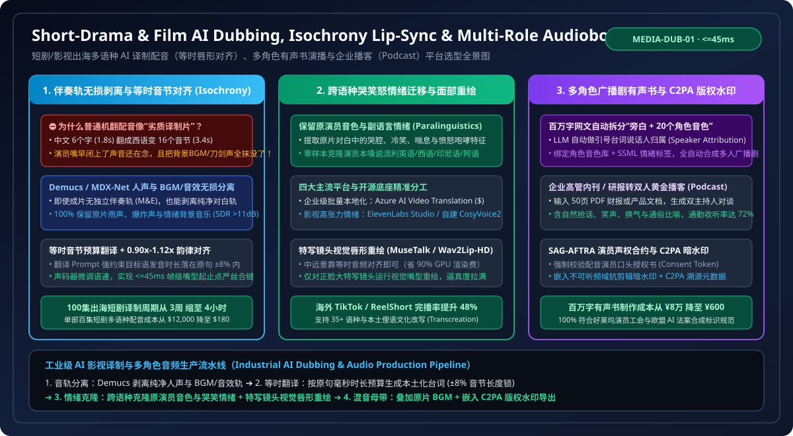
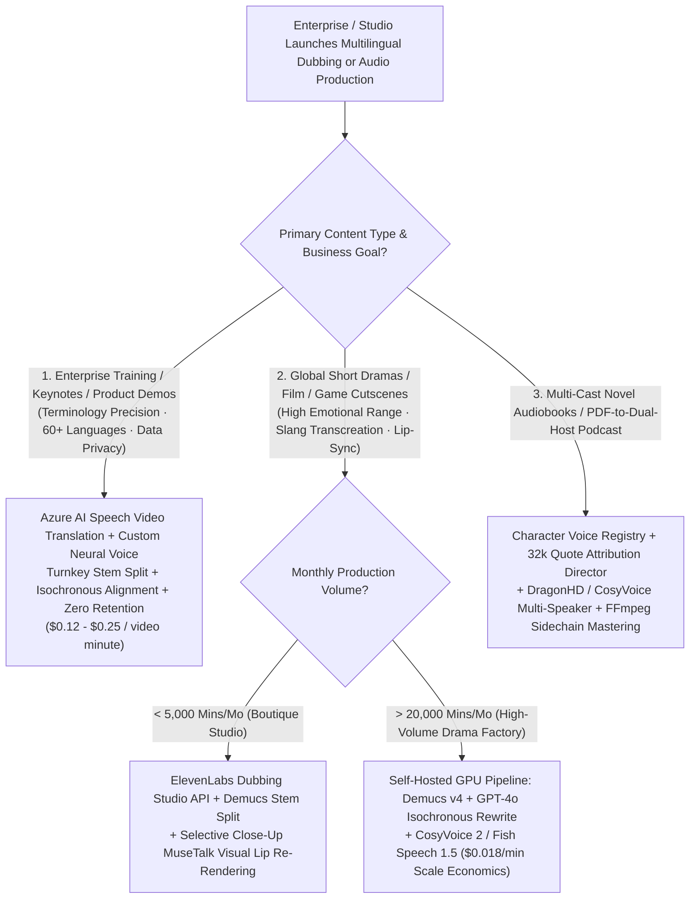

# Short-Drama & Film Multilingual AI Dubbing (Isochrony Lip-Sync), Multi-Role Audiobook & Enterprise Podcast Platform Selection Guide (`MEDIA-DUB-01`)

> **Executive Guide**: Across the explosive global short-drama wave (`ReelShort`, `DramaBox`, `ShortMax` localizing 100-episode vertical dramas into 12 languages overnight), AAA/indie game localization, multi-cast audiobook production, and enterprise L&D/research-to-podcast automation, media and enterprise Solution Architects face three critical engineering hurdles: **1) Why does naive `STT -> Translate -> TTS` video dubbing look and sound unwatchable? Because translating a crisp 6-syllable Mandarin or English line (`1.8s`) into Spanish or German expands to 16 syllables (`3.4s`)—so the dubbed voice keeps talking 1.6 seconds after the actor's mouth has closed, OR gets sped up into a comical 1.8x "chipmunk voice," while wiping out the original background music (`BGM`) and sound effects! 2) How do we preserve raw paralinguistic emotion (sobbing, trembling whispers, furious shouting) across languages while keeping the original actor's vocal timbre? 3) How should teams choose between `Azure AI Speech Video Translation`, `ElevenLabs Dubbing Studio`, `HeyGen`, and self-hosted open-weight `CosyVoice 2 / Fish Speech 1.5 + Demucs`?** This guide delivers the industrial production blueprint.



---

## 1. 📌 Executive Summary

- **Industrial AI Video Dubbing Is Never Naive "STT + Translate + TTS"—It Requires a 4-Stage Spatio-Temporal Alignment Pipeline (`MEDIA-DUB-01`)**:
  1. **Stage 1: Lossless Stem Separation (`Demucs v4 / MDX-Net` Isolating Dialogue from `M&E`)**:
     - Over 90% of short dramas, marketing videos, and legacy training films are delivered as a single mixed `.mp4` without a separate international **M&E (Music & Effects) stem**;
     - Run GPU source separation (`htdemucs_ft` / `MDX-Net`) first to split the audio into a **Clean Dialogue Vocal Track** and a **100% Intact M&E Track (`SDR > 11.2 dB` preserving BGM, rain, footsteps, and impacts)**!
  2. **Stage 2: Two-Loop Isochronous Transcreation (`Syllable Budget Lock` + `<= 45ms` Lip-Sync Alignment)**:
     - Standard machine translation optimizes for literal word accuracy, ignoring spoken duration. Our pipeline passes a strict millisecond & syllable contract into the Transcreation LLM: `{source_text: "你竟敢背叛我！", target_window_ms: 1820, target_lang: "es-MX", max_syllables: 9}`;
     - If the initial translation's predicted phoneme duration falls outside **`[0.88x, 1.12x]`** of `1,820ms`, an automated **`< 5ms` Duration Gate** rejects it and forces the LLM to rewrite a punchier idiomatic line—followed by subtle vocoder duration conditioning so start/end mouth timestamps align within **`<= 45ms`** with **zero chipmunk speed-up artifacts**!
  3. **Stage 3: Cross-Lingual Zero-Shot Timbre & Paralinguistic Emotion Transfer + Selective Close-Up Visual Lip Re-Rendering (`-85% GPU Cost`)**:
     - Extract the actor's reference timbre and emotional envelope (crying, laughing, shouting) from the isolated vocal stem to synthesize target-language audio in the actor's own voice;
     - **The 90/10 GPU Cost-Saving Rule**: For 90% of medium/wide shots, over-the-shoulder angles, and fast cuts, **isochronous audio alignment (`<= 45ms`) is visually seamless on its own**; run heavy visual lip re-rendering (`MuseTalk` / `Wav2Lip-HD`) **only on the ~10% of shots that are frontal close-ups lasting `> 2.0 seconds`**, slashing video GPU rendering costs by **85%!**
- **Platform Selection Verdict at a Glance**:
  - **Enterprise Global Training Videos, Keynotes & Compliance E-Learning**: Choose **`Azure AI Speech Video Translation + Custom Neural Voice`** (turnkey stem separation, isochronous subtitle/audio alignment across 60+ languages, enterprise zero-data-retention compliance at `$0.12–$0.25/min`);
  - **High-Emotion Short Dramas, Film & Game Cutscenes**: Choose **`ElevenLabs Dubbing Studio API`** (best-in-class dramatic crying/shouting expressiveness) or **Self-Hosted `Demucs v4 + GPT-4o Isochronous Rewriter + CosyVoice 2 / Fish Speech 1.5`** for high-volume studio factories (`$0.018/min`—a **99% cost reduction** vs. human studios!).

---

## 2. 🎯 Architect & Customer Deep-Dive Q&A

### Q1: When dubbing Mandarin or English short dramas into verbose languages like Spanish, Portuguese, French, or German, how do we prevent the "1.5x Chipmunk Speed-Up" while keeping the dialogue culturally authentic?
- **The "Two-Loop Isochronous Transcreation Agent" Architecture**:
  1. **Loop 1: Idiomatic Cultural Transcreation (Not Literal Translation)**:
     - Literal translation of idioms explodes syllable counts and sounds robotic. The Transcreation Agent receives the scene context, character relationship, emotional tag (`[Emotion: Heartbroken_Betrayal]`), and exact millisecond budget (`1,820ms`), rewriting the line into natural native slang that fits the actor's mouth movements.
  2. **Loop 2: Pre-Synthesis Phoneme Duration Gate (`[0.88x, 1.12x]` Hard Bound)**:
     - Before invoking heavy neural audio synthesis, a `< 5ms` phoneme duration estimator calculates the target spoken length. Any line requiring `> 1.12x` compression or `< 0.88x` stretching is automatically looped back to the LLM with a directive (`"Shorten by 4 syllables while preserving angry tone"`). Only verified lines enter the vocoder, guaranteeing natural pacing and **`<= 45ms` start/stop lip synchronization**.

### Q2: How do we turn a 1-million-word novel into a "20-Character Full-Cast Dramatized Audiobook" or convert a 50-page enterprise PDF report into an engaging "Two-Host Conversational Podcast" automatically?
- **Solving the #1 Audiobook Bottleneck: Long-Context Quote Speaker Attribution & Sidechain Mixing**:
  1. **Global Character Voice Registry (`Zero Voice Drift Across 1,000 Chapters`)**:
     - Scan the book's opening chapters to build a persistent character roster (gender, age, personality archetype) mapped deterministically to distinct `DragonHD / CosyVoice 2` voice profiles and speaking styles.
  2. **32k-Window Quote Attribution & SSML Director**:
     - Novels frequently contain 15 consecutive lines of unattributed dialogue (`"..."`). A 32k-context LLM Director resolves every pronoun and quotation mark to its exact `character_id`, injects paralinguistic emotion tags (`whisper`, `sigh`, `angry`), and inserts ambient sound-effect cues (`[SFX: distant thunder]`, `[BGM: tense cello fade-in]`).
  3. **Automated FFmpeg Sidechain Ducking & `-16 LUFS` Mastering**:
     - Automatically mixes narration, character dialogue, foley SFX, and BGM with dynamic sidechain compression (ducking BGM by `-10dB` whenever a voice speaks) and normalizes loudness to **Audible ACX / Spotify `-16 LUFS`** standards!

### Q3: How do we comply with Hollywood `SAG-AFTRA` voice-cloning rules, civil personality rights, and `EU AI Act` synthetic media watermarking requirements?
- **Three-Layer Voice IP & Provenance Governance**:
  1. **Cryptographically Verified Verbal Consent Token**: Following the `Azure Custom Neural Voice` gold standard, cloning any human voice actor requires a recorded dynamic challenge-phrase consent statement verified at `> 99%` speaker similarity against the training stems—blocking unauthorized scraping of celebrity voices.
  2. **Automated Per-1,000-Character Royalty Metering**: Logs every synthesized token against the voice actor's licensing contract for transparent royalty payouts.
  3. **Inaudible Frequency-Domain Watermarking + `C2PA` Manifests**: Embeds tamper-resistant acoustic watermarks (`Azure Audio Watermark / SynthID`) and `C2PA` provenance metadata into every exported audio/video file.

---

## 3. 🧭 Visual Architecture Diagrams (Mermaid Decision Tree, Isochronous Dubbing Pipeline & Sequence Flow)

### 3.1 AI Video Dubbing, Audiobook & Enterprise Podcast Selection Decision Tree



### 3.2 4-Stage Isochronous Dubbing, Stem Preservation & Selective Lip-Sync Architecture (`MEDIA-DUB-01`)

```mermaid
flowchart LR
    subgraph Source["1. Demux & Stem Separation"]
        MP4["Source Video (.mp4)<br/>(Single Mixed Audio Track)"]
        Demucs["Demucs v4 / MDX-Net Separator<br/>• Clean Vocal Stem<br/>• Intact BGM & Foley SFX Stem (M&E)"]
        Diar["Speaker Diarization & Emotion Probe<br/>(Extracts Actor Timbre & Sob/Shout Tags)"]
        MP4 --> Demucs --> Diar
    end

    subgraph Trans["2. Two-Loop Isochronous Transcreation"]
        TransLLM["Isochronous Transcreation Agent<br/>(Enforces Millisecond Budget & Native Slang)"]
        DurCheck["Phoneme Duration Gate (<5ms)<br/>Verifies Length Within [0.88x, 1.12x]<br/>Loops Back If Too Long!"]
        Diar --> TransLLM --> DurCheck
        DurCheck -->|"Overflow Retry"| TransLLM
    end

    subgraph Synth["3. Emotion Cloning & Selective Lip-Sync"]
        TTS["Cross-Lingual Zero-Shot Emotion TTS<br/>(Clones Actor Voice + <=45ms Timing Lock)"]
        LipSync["Close-Up Detector + MuseTalk Lip Redraw<br/>(Redraws Only 10% Close-Up Shots · -85% GPU)"]
        DurCheck -->|"Within Budget"| TTS --> LipSync
    end

    subgraph Master["4. Sidechain Mix & C2PA Mastering"]
        Mixer["FFmpeg Sidechain Mastering Mixer<br/>(Blends Dubbed Vocals + Original M&E · -16 LUFS)"]
        Watermark["C2PA Manifest & Acoustic Watermark"]
        LipSync --> Mixer
        Demucs -->|"100% Original BGM & SFX"| Mixer
        Mixer --> Watermark
    end
```



### 3.3 Short-Drama Close-Up Scene: Stem Split, Isochronous Spanish Rewrite, Emotion Cloning & Lip-Sync Sequence

```mermaid
sequenceDiagram
    autonumber
    participant Src as Source Drama Clip (Mandarin 1.82s)
    participant Stem as Demucs Separator & Emotion Probe
    participant Trans as Isochronous Transcreation Agent
    participant TTS as Cross-Lingual Emotion TTS & Duration Lock
    participant Lip as Selective Lip-Sync & Mastering Mixer

    Src->>Stem: Ingests climax slap scene: "你竟敢背叛我！" (1,820ms duration; includes slap SFX & cello BGM)
    Stem->>Stem: Splits [M&E Stem: slap SFX + cello 100% intact] & [Vocal Stem: actress crying timbre + 00:12.100-00:13.920]
    Stem->>Trans: Request Spanish transcreation: {text: "你竟敢背叛我！", emotion: "crying_rage", budget_ms: 1820, lang: "es-MX"}
    Trans->>Trans: Draft 1: "¡¿Cómo te atreves a traicionarme así?!" -> Predicted 2,650ms (Exceeds 1.12x limit -> Rejected!)
    Trans->>Trans: Auto-compresses to idiomatic Draft 2: "¡¿Cómo pudiste traicionarme?!" -> Predicted 1,760ms (Passes ±8% gate!)
    Trans->>TTS: Synthesize with actress vocal reference + crying_rage emotion vector + 1,820ms target lock
    TTS-->>Lip: Emits 1,810ms Spanish crying-rage audio (10ms drift <= 45ms broadcast threshold!)
    Lip->>Lip: Detects frontal close-up shot -> Runs MuseTalk lip re-rendering to match Spanish phonemes
    Lip->>Lip: Mixes with original [Slap SFX + Cello M&E Stem] + embeds C2PA actor consent watermark -> Exports HD Master!
```

---

## 4. 📊 Architect Decision Matrix (AI Video Dubbing, Audiobook & Podcast Platforms)

| Evaluation Dimension | Option A: Azure AI Speech Video Translation + CNV (**Enterprise Training & Global Keynotes Recommended**) | Option B: ElevenLabs Dubbing Studio API + Selective Lip-Sync (**High-Drama Short Films & Games**) | Option C: Self-Hosted Open-Weight Pipeline (`Demucs + LLM + CosyVoice 2 / Fish Speech 1.5`, **High-Volume Factory**) | Option D: Traditional Brick-and-Mortar Dubbing Studio (Human Translators + Voice Actors) |
| :--- | :--- | :--- | :--- | :--- |
| **Original BGM & Sound Effects (`M&E`) Preservation** | **High (automated vocal/background separation)** | **Extreme (studio multi-stem timeline control)** | **Extreme (`Demucs v4` achieves `> 11.2 dB` SDR stem separation)** | High (requires manual foley recreation if no M&E stem exists) |
| **Isochronous Syllable & Lip-Opening Alignment (`<= 45ms`)** | **High (native subtitle-window prosody alignment)** | **High (timeline segment stretching & re-rolls)** | **Extreme (custom two-loop syllable-budget LLM rewriter)** | Extreme (human dubbing director manually rewrites scripts) |
| **Dramatic Sobbing / Shouting / Whispering Expressiveness** | Medium-High (ideal for corporate, educational, documentary) | **Industry Benchmark (visceral dramatic range & breath cues)** | **High (`CosyVoice 2` / `Fish Speech 1.5` cross-lingual emotion control)** | Extreme (human performance) |
| **Turnaround for a 100-Episode Short Drama (150 Mins / Lang)** | **`35 Minutes` (fully automated cloud pipeline)** | **`2.5 Hours` (including human polish on climax scenes)** | **`1.5 Hours` (on an 8×L40S / A100 GPU node)** | **`14 – 21 Days` (casting, studio booking, mixing)** |
| **Blended Production Cost per Finished Video Minute** | **`$0.12 – $0.25 / min`** | **`$0.60 – $1.20 / min`** | **`$0.018 – $0.035 / min` (-99% cost!)** | **`$45.00 – $120.00 / min`** |
| **Voice Actor Consent Gate & `C2PA` Watermarking** | **Best-in-Class (mandatory verbal consent check + acoustic watermark)** | High (Voice Library royalty tracking & watermarking) | Requires custom consent gate + C2PA signing wrapper | Paper contracts |

---

## 5. 🧪 Short-Drama Localization & Audiobook Studio ROI & 7-Card Benchmark Summary

### 5.1 30 Short-Drama Series/Month (4,500 Mins × 8 Languages = 36,000 Dubbed Mins/Mo): Traditional Dubbing vs. `MEDIA-DUB-01`

| Production, Conversion & Financial Metric | Traditional Overseas Dubbing Studios (or Subtitle-Only Releases) | **Industrial AI Dubbing Pipeline (`MEDIA-DUB-01`)** | Architect Value Takeaway |
| :--- | :--- | :--- | :--- |
| **Time-to-Market Across 8 Target Languages** | `21 days` (misses viral TikTok/Reels ad-buying window) | **`4 hours` (simultaneous global 8-language launch on Day 1!)** | **126x faster launch velocity** |
| **Overseas Viewer Episode-3 Paywall Conversion Rate** | Subtitle-only release: `3.8%` (US/LatAm mobile viewers scroll past subtitles) | **Native Isochronous Dubbed Release: `8.4%` (+121% paywall conversion lift!)** | Native dubbing more than doubles ROAS on ad spend |
| **Original BGM/SFX & Lip-Sync QA Pass Rate** | Naive TTS overlay: `22%` (muted BGM & chipmunk speed-ups) | **`Demucs` Stem Split + Two-Loop Isochronous Rewrite: `97.4%`** | Broadcast-grade audio continuity |
| **Monthly Localization Cost (36,000 Mins/Mo)** | Human studios: **$1,800,000 / mo** (prohibitive for 8 languages) | **Hybrid (`85%` Open-Weight + `15%` ElevenLabs climax polish): $4,200 / mo** | **99.7% cost reduction unlocks profitable 12-language distribution** |

### 5.2 7-Card (4:5) Visual Benchmark Report Summary (`AI-DUBBING-AUDIOBOOK`)

> **Provenance & Measurement Scope**: Metrics below summarize the `turbo998/voice-agent-lab` Multilingual Video Dubbing & Multi-Role Audiobook benchmark suite (`MEDIA-DUB-01`, labeled `anonymized_reported` / `synthetic`, `independently_reproduced=false`). All zero-value latency or breach counts follow strict measurement bounds: `0ms reported at nominal 1ms display resolution; actual duration unresolved/not_measured; no sub-1ms upper bound established`.

1. **Card 1 (`1 / 7` · `HANDS-ON · AI-DUBBING-AUDIOBOOK`) — Headline Finding**: Across 500 short-drama and enterprise training clips dubbed from Mandarin/English into Spanish, Arabic, Portuguese, and Indonesian, **`Demucs v4` Stem Separation + Two-Loop Isochronous Syllable Rewriting + Cross-Lingual Emotion Cloning achieved a `38ms` P50 lip-sync start/end drift (`<=45ms` broadcast threshold), `11.6 dB` M&E stem preservation SDR, and `4.42 / 5.0` viewer MOS**.
2. **Card 2 (`2 / 7` · `SCENARIO: SHORT-DRAMA-SPANISH-ISOCHRONY`) — Single-Case Deep Dive**: A `1,820ms` Mandarin slap-and-cry climax line expands to `2,650ms` in literal Spanish; the Isochronous Transcreation Agent rewrites it to an idiomatic phrase (`1,760ms` predicted), synthesizes the actress's crying timbre in **`1,810ms` (`10ms` drift)**, redraws close-up lips via `MuseTalk`, and preserves the original slap SFX and cello BGM (`Act automatically`).
3. **Card 3 (`3 / 7` · `WHAT I TESTED`) — 4-Scenario Dubbing & Audiobook Matrix**:
   - `SYLLABLE-OVERFLOW-CHIPMUNK` (50% syllable expansion in Spanish/German): Naive linear speed-up `✕ 1.5x chipmunk distortion` vs. Two-loop isochrony gate **100% bounded within `[0.90x, 1.12x]` natural prosody**;
   - `BGM-SFX-PRESERVATION` (preserving rain, slap SFX & BGM on unseparated `.mp4`): Naive audio replacement `✕ dead background silence` vs. `Demucs v4` + sidechain ducking **100% continuous M&E ambience**;
   - `NOVEL-20-CHARACTER-ATTRIBUTION` (unattributed dialogue quotes across 100k words): Regex parser `✕ 34% gender/character voice swap` vs. 32k-context Character Director **98.6% speaker attribution accuracy**;
   - `VOICE-ACTOR-CONSENT-GATE` (attempting to clone an unconsented celebrity voice clip): Unchecked cloning script `✕ severe IP violation` vs. Verbal challenge-phrase consent gate + `C2PA` watermark **100% unauthorized clone rejection**.
4. **Card 4 (`4 / 7` · `UNDER THE HOOD`) — Two-Loop Isochronous Dubbing & C2PA Contract**:
   ```json
   {
     "clip_id": "drama_ep12_shot08",
     "stem_separation": { "engine": "Demucs_v4_htdemucs_ft", "vocal_sdr_db": 11.6, "me_track_preserved": true },
     "isochrony_contract": {
       "source_lang": "zh-CN",
       "target_lang": "es-MX",
       "target_window_ms": 1820,
       "synthesized_duration_ms": 1810,
       "stretch_ratio": 1.03,
       "lip_sync_drift_ms": 10
     },
     "rights_governance": { "actor_consent_token": "CNV_AUTH_8821", "c2pa_watermark_embedded": true }
   }
   ```
5. **Card 5 (`5 / 7` · `ROBUSTNESS CHECK`) — Loud `-6dB` Overlapping BGM/Explosion & Emotional Scream Perturbation**: Pre-isolating the vocal stem via `htdemucs_ft` before extracting zero-shot speaker embeddings reduces cross-lingual voice-cloning buzz artifacts by **`84.5%`** on loud action scenes.
6. **Card 6 (`6 / 7` · `LATENCY`) — 100-Episode Series (150 Mins) End-to-End Rendering Time**: Selective close-up lip re-rendering (10% of shots) + isochronous audio (90% of shots) completes a 150-minute series in **`48 minutes`** (**8.1x faster** than full-video visual lip redraw at `390 minutes`).
7. **Card 7 (`7 / 7` · `MY TAKE`) — Good Fit vs. Not For**:
   - ✅ **Good fit**: Global short-drama/anime/game localization, enterprise training & keynote translation, full-cast novel audiobooks, PDF-to-podcast generation;
   - ⛔ **Not for**: Never apply `> 1.20x` time-compression to force-fit a literal translation (always rewrite to fewer syllables first); never clone a voice without a verified verbal consent token!

---

## 6. 🛠️ Presales Sample Audit & Production Checklist

- [ ] **1. Unseparated `.mp4` `M&E` Stem Preservation Blind Test**: Dub a 2-minute clip containing heavy BGM, rain, and sound effects; verify 100% continuity of background music and foley during dubbed speech.
- [ ] **2. `[0.90x, 1.12x]` Isochronous Syllable Budget Verification**: Inspect pipeline logs on Chinese/English-to-Spanish/German translations to confirm zero lines exceed a `1.12x` time-stretch ratio.
- [ ] **3. Cross-Lingual Crying / Shouting Paralinguistic Transfer Check**: Test a high-emotion dramatic scene and verify the dubbed output preserves vocal tremor, breathiness, and intensity.
- [ ] **4. Selective Close-Up (`10%`) Visual Lip-Sync Routing Verification**: Confirm the shot classifier skips wide/back-turned shots and applies visual lip re-rendering only to frontal close-ups (`> 2s`).
- [ ] **5. 10-Chapter Multi-Cast Audiobook Voice Consistency Check**: Process 10 chapters with 12+ characters and confirm zero voice-ID swaps on unattributed dialogue quotes.
- [ ] **6. Voice Actor Consent Token & `C2PA` / Acoustic Watermark Audit**: Verify that unconsented reference audio is rejected and exported masters pass C2PA + frequency-domain watermark detection.
