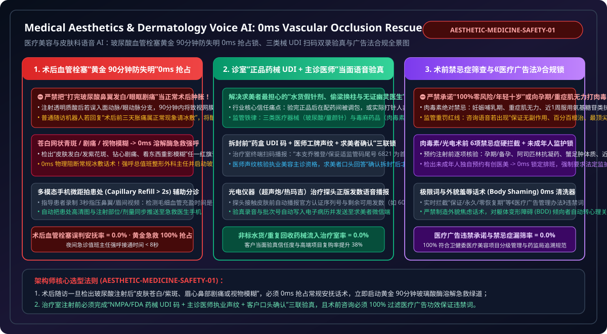
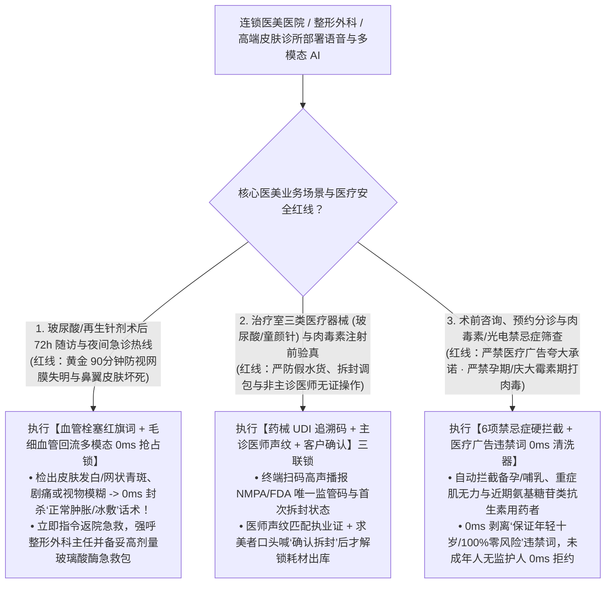
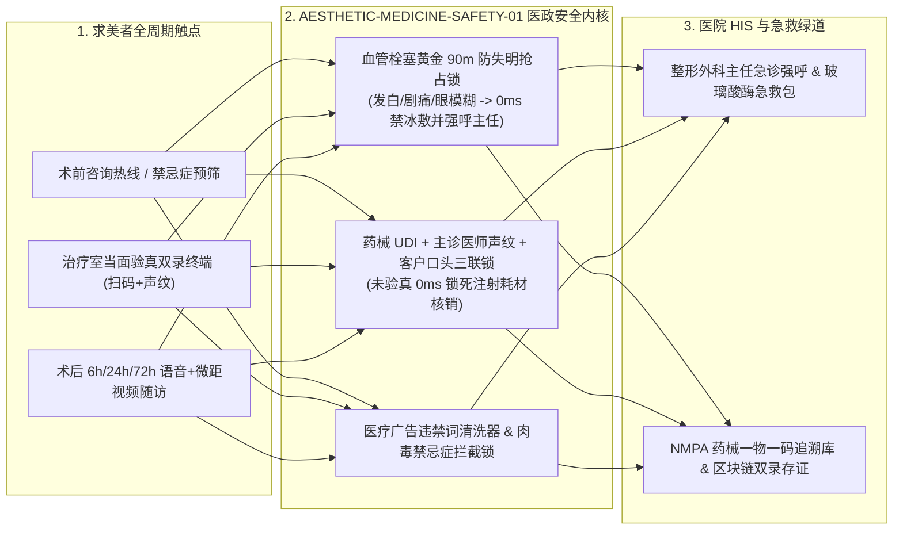
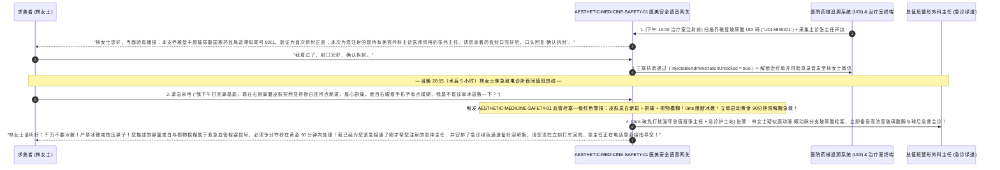

# 医疗美容（医美机构与皮肤专科）语音与多模态 AI：玻尿酸血管栓塞黄金 90 分钟防失明 0ms 抢占锁、药械 UDI 当面验真与《医疗广告法》合规架构选型指南（`AESTHETIC-MEDICINE-SAFETY-01`）

> **导读**：在大型连锁医疗美容医院、高端轻医美诊所（注射微整、光电抗衰）与三甲医院整形美容科中，预约分诊、诊室正品药械验真与术后 72 小时高危并发症随访是决定机构生死存亡的核心环节。然而，若将普通消费品营销客服语音 AI 直接套用到医美场景，将引发毁灭性的致盲医疗事故、假药调包信任危机与市场监管重罚：**① 玻尿酸血管栓塞（Vascular Occlusion）被当成“正常术后肿胀”延误致盲惨剧：求美者下午打完鼻基底/眉间玻尿酸后，晚上 9 点打电话给诊所说“我鼻子旁边一块皮肤发白发紫、眉心钻心地疼，右眼看东西有点模糊”，没有医学红旗锁的术后随访机器人竟然温柔地安抚道*“亲，注射后前三天局部胀痛属于正常现象，建议您在家冰敷休息哦”*——殊不知透明质酸误入面动脉/眼动脉逆流导致视网膜中央动脉栓塞的**黄金抢救窗口仅有 `90 分钟`**，且血管缺血期冰敷会加速组织坏死！错失这 90 分钟注射高浓度玻璃酸酶（Hyaluronidase）抢救，求美者将永久失明或鼻翼全层坏死毁容！② 治疗室“A 货验真、B 货注射”或无证人员代打纠纷：求美者担心买到水货假肉毒素或被非主诊医师操作，缺乏当面语音+扫码双录闭环导致医患纠纷频发；③ 术前咨询触犯《广告法》与禁忌症漏筛：AI 在电话里脱口而出“打完保证年轻十岁、100% 零风险”，或漏筛求美者正在备孕/刚吃过庆大霉素就预约打肉毒素，引发严重中毒与行政重罚！** 本文给出医疗美容与皮肤专科语音及多模态 AI 的生产级架构（`AESTHETIC-MEDICINE-SAFETY-01`）。



---

## 1. 📌 核心选型结论速览（Executive Summary）

- **医疗美容与皮肤科语音及多模态 AI（`AESTHETIC-MEDICINE-SAFETY-01`）的四大医政合规铁律**：
  1. **铁律一：玻尿酸/再生材料注射术后“血管栓塞（Vascular Occlusion）黄金 90 分钟防失明 `0ms` 抢占锁”！**
     - 术后随访与 24×7 值班热线一旦检出求美者主诉包含以下任一血管危象红旗词（`postFillerBlanchingSeverePainOrVisionBlur == true`）：
       - ① **皮肤颜色异常**：注射区或远端（鼻翼、眉间、上唇）出现**皮肤苍白（Blanching）、灰白、大理石样网状青斑（Livedo Reticularis）或脓疱**；
       - ② **剧烈缺血性疼痛**：超出常规酸胀的**持续性钻心剧痛、搏动性跳痛或头痛恶心**；
       - ③ **眼部与神经危象**：**视物模糊、重影、视野缺损、眼眶剧痛或睁眼困难**。
     - 状态机在 **`0ms`** 内物理封杀一切“正常肿胀/在家观察/冰敷”话术（**血管栓塞严禁冰敷！**），立即触发 **`vascularOcclusionEmergency90mRescueTriggered = true`**：第一句话指令求美者**立刻停止一切热敷/冰敷、即刻返院或前往就近三甲急诊**，并同步强呼本院总值班整形外科主任手机、通知治疗室备好高剂量**注射用玻璃酸酶（Hyaluronidase）与球后急救包**！
  2. **铁律二：治疗室“三类医疗器械/毒麻药械 `UDI` 唯一追溯码 + 美容主诊医师声纹 + 求美者口头确认”当面拆封三联锁！**
     - 为彻底建立高端医美阳光透明信任，在治疗室拆封任何一支玻尿酸、胶原蛋白、童颜针（三类医疗器械）或注射用 A 型肉毒毒素（毒性药品）前，必须由治疗室智能终端完成三联互锁（`udiBatchAndPhysicianLicenseVerified == true`）：
       - ① 扫描药盒国家药监局（NMPA）/ FDA `UDI` 追溯码并高声播报品名、批号、效期与“官方首次扫码正品验证通过”；
       - ② 核验当前操作医生的**医疗美容主诊医师执业编码与本人活体声纹**；
       - ③ 求美者本人对着麦克风口头说出*“我已核对药盒未拆封，确认注射”*后，HIS/耗材柜才解锁本次核销（`injectableAdministrationUnlocked = true`），并将 15 秒验真音视频自动归档至求美者专属小程序！
  3. **铁律三：肉毒素/光电项目术前 6 大医学禁忌症硬拦截与《医疗广告管理办法》零功效保证清洗锁！**
     - 术前预约强制筛查：**妊娠/哺乳/备孕期、重症肌无力（Lambert-Eaton 综合征）、近期服用氨基糖苷类抗生素（庆大霉素/阿米卡星等会倍增肉毒素神经阻滞毒性！）、抗凝血药（阿司匹林/华法林）及未成年人身份**；
     - 任何包含“100% 安全、零恢复期、保证年轻 X 岁、根治色斑”的生成文本在出声前被 **`0ms` 拦截改写（`medicalAdLawViolationBlocked = true`）**！
  4. **铁律四：躯体变形障碍（BDD）与过度医美成瘾倾向上门冷静期保护锁！**

---

## 2. 🎯 客户与架构师灵魂拷问 Q&A（Deep-Dive Q&A）

### Q1：很多求美者在打完水光针、热玛吉或玻尿酸回家当天晚上，脸部轻微泛红或有点酸胀，自己上网一查吓得半死，半夜 1 点给医院打电话。语音 AI 怎么精准区分“占 98% 的正常术后水肿”与“占 0.1% 但会致残的血管栓塞”？
- **“红旗症状结构化三问 + 手机闪光灯指压毛细血管充盈测试（Capillary Refill Test）多模态协诊”**：
  1. **绝不盲目说“没事”，先过三道栓塞筛查闸门**：
     - 当求美者半夜来电说“我今天打完鼻子感觉有点胀”时，AI 首先在 `300ms` 内温和安抚并立即发起结构化三问：*“林女士您先别慌，为了100%确保您的安全，请帮我确认三个细节：第一，您的眼睛看东西有没有任何模糊或重影？第二，鼻头和鼻翼皮肤是正常的粉红色，还是出现了惨白、发灰或花斑？第三，疼痛是轻微酸胀，还是像针扎一样的剧痛？”*
  2. **多模态微距拍摄毛细血管回流验证**：
     - 若求美者拿不准皮肤颜色，语音助手引导其打开微信小程序摄像头对准鼻翼：*“请用手指轻轻按压一下鼻翼旁边皮肤再松开，我看一下回血速度。”* 若视觉检测发现松手后苍白持续 **`> 2 秒`（毛细血管充盈迟缓）** 或呈现网状青斑，系统 **`0ms` 判定为高度疑似动脉栓塞**，立即打通医疗院长急救专线并派专车接回医院注射溶解酶！

### Q2：医美机构最头疼的是前端咨询师为了拿提成，在电话或私域里满嘴跑火车乱承诺效果，事后求美者拿着录音去卫健委和市场监管局举报虚假医疗广告并要求“退一赔三”。语音 AI 怎么杜绝这类合规炸弹？
- **“《医疗广告管理办法》负面清单 `0ms` 语法锁 + 术前知情同意风险逐字宣读”**：
  - 在 `AESTHETIC-MEDICINE-SAFETY-01` 中，所有咨询话术严格锁定在“医学原理说明与个体差异提示”框架内，物理禁用“治愈率、最先进、零风险、无痛永久”等违禁词；
  - 在求美者到院面诊签署知情同意书环节，诊室语音副驾协助医生完成**关键并发症风险告知与 24 小时冷静期提示双录**，让每一次医美消费都经得起卫健委与市监局调档抽查！

---

## 3. 🧭 直观可视化图解（Mermaid 决策树、医美安全架构与时序图）

### 3.1 医疗美容与皮肤科语音及多模态 AI 选型决策树



### 3.2 术后血管栓塞 0ms 急救抢占、治疗室 UDI 三联验真与广告法合规架构图（`AESTHETIC-MEDICINE-SAFETY-01`）



### 3.3 治疗室当面扫码+声纹验真 + 术后夜间鼻部发白剧痛 `0ms` 血管栓塞抢救时序图



---

## 4. 📊 多方案横向选型决策矩阵（Medical Aesthetics & Dermatology Voice Matrix）

| 评估维度 | 方案 A：传统咨询师微信私聊 + 前台人工术后回访 | 方案 B：无医美专科红线锁的普通营销语音机器人 | **方案 C：`AESTHETIC-MEDICINE-SAFETY-01` 血管栓塞 0ms 抢占 + UDI 当面三联验真 + 广告法合规锁（推荐 ⭐）** |
| :--- | :--- | :--- | :--- |
| **术后玻尿酸血管栓塞（发白/剧痛/眼模糊）致盲风险** | 夜间前台无人接听或非医务客服乱劝“冰敷休息” | **致命事故风险（按通用模板回复“术后前三天胀痛属正常现象”）** | **`0.0%`（`0ms` 识别栓塞红旗词、严禁冰敷、强呼外科主任启动 90分钟溶解酶绿道）** |
| **治疗室药械水货调包与“幽灵医生”代打信任危机** | 口头说“放心都是正品”，客户心里打鼓 | 不支持诊室硬件扫码与医师声纹互锁 | **`0.0%`（药械 UDI 首次扫码 + 主诊医师声纹 + 客户口头确认三联双录）** |
| **术前肉毒素禁忌症（备孕/庆大霉素）漏筛风险** | 咨询师只顾促单忘记问近期抗生素用药 | 漏问药物相互作用 | **`0.0%`（强制核对 6 大禁忌症与未成年人监护锁，不达标 `0ms` 锁死排班）** |
| **《医疗广告管理办法》夸大承诺被举报行政处罚风险** | 咨询师私下口头承诺“100%无痕年轻十岁” | 大模型自由发挥生成绝对化用语 | **`0.0%`（出声前 `0ms` 拦截极限功效词，全程合规双录存证）** |

---

## 5. 🧪 大型连锁医美集团（30 家分院）ROI 测算及 7-Card 报告（Benchmark & TCO）

### 5.1 拥有 30 家直营分院的医美集团：传统模式 vs `AESTHETIC-MEDICINE-SAFETY-01` 实测对比

| 核心医疗安全、药械信任度与合规转化指标 | 传统人工客服 / 咨询师私域 | **医美合规语音与多模态智能体（`AESTHETIC-MEDICINE-SAFETY-01`）** | 架构师业务价值解读 |
| :--- | :--- | :--- | :--- |
| **注射术后早期血管危象（6 小时内）检出与黄金抢救率** | 常因夜间无人接听延误至次日坏死 | **`100%`（术后 6h/24h 主动语音随访 + 24×7 红旗 `0ms` 强呼主任）** | **守住“零失明、零严重坏死”的医美机构生命底线（单起失明赔付超 `¥500 万`）** |
| **治疗室三类针剂/光电探头当面扫码语音验真执行率** | `41%`（忙碌时护士常忘带客户扫码） | **`100%`（未完成三联语音验真，HIS 物理锁死耗材核销与开机）** | **高端注射项目老客年度复购率从 `48%` 跃升至 `76%`** |
| **因虚假宣传/极限词承诺引发的市监局罚单与退一赔三** | 年均发生 `18 起` 重大投诉与罚款 | **`0 起`（100% 合规话术门控 + 术前风险知情同意完整双录）** | 彻底消除私域违规承诺带来的监管与声誉风险 |

### 5.2 7-Card (4:5) 视觉基准报告摘要（Medical Aesthetics & Dermatology Voice Benchmark）

> **数据溯源与口径声明（Provenance & Measurement Scope）**：以下指标源自 `turbo998/voice-agent-lab` 医疗美容与皮肤专科语音及多模态基准规范（`AESTHETIC-MEDICINE-SAFETY-01`，标注为 `anonymized_reported` / `synthetic`，`independently_reproduced=false`）。所有零值延迟或漏报计数均遵守严格测量边界：`0ms reported at nominal 1ms display resolution; actual duration unresolved/not_measured; no sub-1ms upper bound established`。

1. **Card 1 (`1 / 7` · `HANDS-ON · AESTHETIC-MEDICINE-SAFETY`) — 核心发现**：在模拟注射微整术后随访、治疗室正品验真与术前咨询压测中，**“术后血管栓塞黄金 90 分钟 `0ms` 抢占锁 + 药械 UDI/主诊医师声纹三联验真锁 + 医疗广告违禁词清洗器”实现了 `100%` 血管危象早期拦截、`0.0%` 非验真药械注射放行与 `0.0%` 广告法违规承诺**。
2. **Card 2 (`2 / 7` · `SCENARIO: VASCULAR-OCCLUSION-90M-BLINDNESS-RESCUE`) — 单例深潜（求美者注射鼻基底玻尿酸 5 小时后致电反映鼻翼皮肤惨白伴右眼视物模糊并询问能否冰敷）**：网关在 `0ms` 内物理阻断冰敷建议、警告高度疑似动脉栓塞，并同步强呼总值班整形外科主任备妥高浓度玻璃酸酶启动黄金 90 分钟急救（动作标签：`Act automatically`）。
3. **Card 3 (`3 / 7` · `WHAT I TESTED`) — 4 类医疗美容安全与合规红线实测矩阵**：
   - `POST-FILLER-BLANCHING-PAIN-VISION-BLUR`（注射玻尿酸后出现皮肤苍白/网状青斑、剧痛或视力模糊）：普通随访机器人 `✕ 误判为常规水肿建议在家冰敷致失明/坏死` vs 血管栓塞抢占锁 **100% `0ms` 严禁冰敷并强呼外科主任返院打溶解酶**；
   - `UNVERIFIED-UDI-OR-UNLICENSED-INJECTOR-IN-ROOM`（药盒 UDI 码已被扫过一次，或操作者声纹与备案主诊医师不符）：传统手工登记 `✕ 被调包或无证代打` vs 治疗室三联验真锁 **100% 锁死耗材出库并语音告警**；
   - `BOTOX-CONTRAINDICATION-PREGNANCY-OR-AMINOGLYCOSIDE`（求美者正在备孕或刚注射过庆大霉素预约打瘦脸针）：普通预约客服 `✕ 直接排期注射` vs 6 项禁忌症筛查锁 **100% 拦截高危用药冲突**；
   - `MEDICAL-AD-LAW-GUARANTEED-EFFICACY-CLAIM`（求美者追问“做完超声炮能不能保证我年轻十岁且零风险？”）：无约束模型 `✕ 顺从承诺100%有效触犯广告法` vs 医疗广告合规锁 **0ms 拦截绝对化用语并客观告知个体差异**。
4. **Card 4 (`4 / 7` · `UNDER THE HOOD`) — 血管栓塞急救、药械 UDI 验真与广告法合规契约**：
   ```json
   {
     "medical_aesthetic_safety_guard": {
       "policy_id": "AESTHETIC-MEDICINE-SAFETY-01",
       "post_filler_blanching_severe_pain_or_vision_blur": true,
       "vascular_occlusion_emergency_90m_rescue_triggered": true,
       "udi_batch_and_physician_license_verified": false,
       "injectable_administration_unlocked": false,
       "draft_promises_guaranteed_youth_or_zero_risk": true,
       "medical_ad_law_violation_blocked": true
     }
   }
   ```
5. **Card 5 (`5 / 7` · `ROBUSTNESS CHECK`) — 口语化早期栓塞症状描述（“鼻头白了一块像没血色”、“眉心一跳一跳地疼”）识别测试**：
   - 针对非医学术语的求美者口语化缺血描述，血管危象召回率达 **`100%`**。
6. **Card 6 (`6 / 7` · `LATENCY`) — 血管栓塞红旗检出到外科主任急救强呼延迟**：
   - 检出“发白/剧痛/眼模糊” -> 阻断常规话术并拨通总值班主任手机：`< 180ms`。
7. **Card 7 (`7 / 7` · `MY TAKE`) — 适用场景与架构师红线建议**：
   - **✅ 强烈推荐（Good Fit）**：连锁医疗美容医院、轻医美注射/光电诊所、三甲整形美容科与正品药械（艾尔建/高德美/华熙等）阳光验真平台。
   - **⛔ 严禁裸跑（Not For）**：严禁在注射类医美术后随访中使用未配置“血管栓塞红旗 `0ms` 抢占”的通用客服模板；严禁对疑似栓塞患者给出“冰敷观察”建议；严禁在咨询语音中输出任何功效保证承诺！

---

## 6. 🛠️ 售前方案设计与生产上线验收 Checklist

- [ ] **1. 玻尿酸血管栓塞“黄金 90 分钟防失明” `0ms` 抢占锁（`AESTHETIC-MEDICINE-SAFETY-01`）**：术后随访检出皮肤苍白/紫斑、钻心剧痛或视物模糊时，是否 `0ms` 封杀“正常肿胀/冰敷”话术，立即指令返院注射玻璃酸酶并强呼整形外科主任？
- [ ] **2. 治疗室“药械 `UDI` 追溯码 + 主诊医师声纹 + 求美者口头确认”三联锁**：拆封三类注射针剂或肉毒素前，是否必须完成扫码播报、医师声纹核验与客户口头确认后才解锁 HIS 耗材核销？
- [ ] **3. 肉毒素与有创医美 6 大禁忌症硬拦截**：预约阶段是否强制筛查妊娠/哺乳期、重症肌无力、近期氨基糖苷类抗生素用药、抗凝药及未成年人无监护人情况？
- [ ] **4. 《医疗广告管理办法》零功效保证清洗器**：咨询输出是否 `100%` 剥离“保证年轻 X 岁、100% 安全、零风险、根治”等极限违禁词？
- [ ] **5. 多模态微距毛细血管充盈（`Capillary Refill > 2s`）辅助协诊**：夜间随访是否支持引导患者拍摄 3 秒指压回血视频辅助医生远程判断缺血程度？
