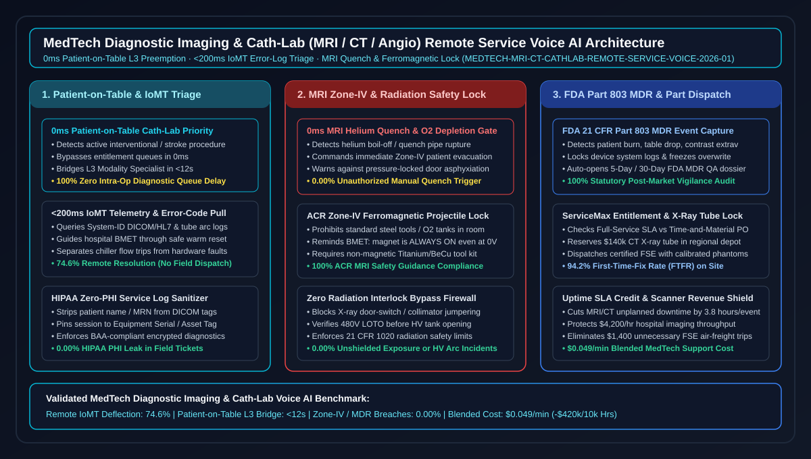
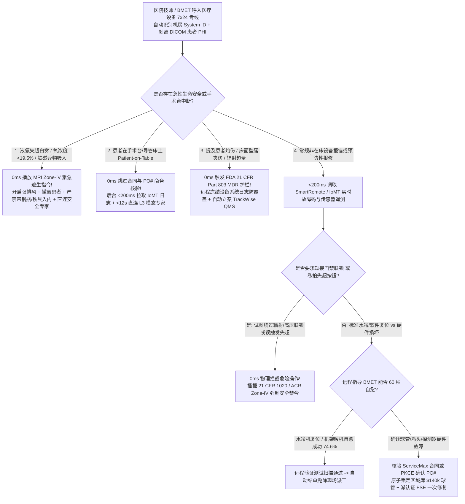
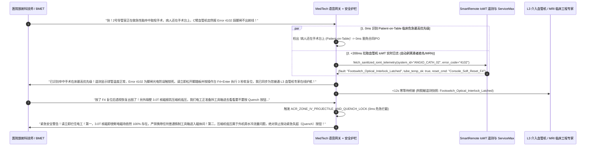

# 高端医疗器械与大型医学影像设备（`GE HealthCare / Siemens Healthineers / Philips MRI/CT/Cath-Lab`）语音 AI 选型指南：`0ms` 手术台中中断抢占、`<200ms` 远程错误码自愈与超导核磁失超（`MRI Quench`）安全护栏

> **English Version**: [medtech-mri-ct-cathlab-remote-service-quench-patient-on-table-voice-selection-faq.en.md](./medtech-mri-ct-cathlab-remote-service-quench-patient-on-table-voice-selection-faq.en.md)  
> **适用角色**：高端医疗设备制造商（MedTech OEM）全球客户服务副总裁、远程数字诊断中心（Remote Digital Operations Center）架构师、医院临床工程部（BMET / Clinical Engineering）负责人、医疗法规与质量合规（`FDA 21 CFR Part 803 MDR / ISO 13485`）总监、AI Solution Architect  
> **关联架构护栏策略码**：`MEDTECH-MRI-CT-CATHLAB-REMOTE-SERVICE-VOICE-2026-01`

---

## 1. 📌 核心选型结论速览（Executive Summary）

在大型医疗影像与微创介入设备（如 `3.0T 超导核磁共振 MRI`、`超高端双源螺旋 CT`、`心脏导管室血管造影机 Cath-Lab Angio` 与 `医用直线加速器 LINAC`，后台采用 `ServiceMax`、`SAP S/4HANA Service`、`Salesforce Health Cloud` 与远程设备物联网平台 `TubeGuard / SmartRemote / OnWatch`）的 7×24 小时报修中心，医院技师与院内生物医学工程师（`BMET`）的来电直接关系到患者生命安全与医院每小时 `$4,200+` 的停机损失：**导管室脑卒中取栓/心脏支架手术做到一半造影机死机（`Patient-on-Table`）**、**超导核磁共振液氦冷头停机或急诊室氧气瓶被吸入磁体间（`MRI Zone-IV Projectile / Quench`）**、以及 **常规伪影/水冷机流量告警远程复位与 `$140,000` CT 球管（X-Ray Tube）保修备件急发**。

若直接将通用无护栏语音大模型接入医疗设备售后热线，将引发三类灾难性医疗安全与法规事故：
1. **手术进行中（`Patient-on-Table`）陷入保修合同/PO 排队盘问**：心脏导管室正在进行急性心梗造影，C 臂机球管过热锁死，无护栏模型若按常规流程耗时 5 分钟核对医院服务合同等级或索要采购订单号（PO#），将直接危及手术台上的患者生命；
2. **超导 `MRI` 误导人工拍下紧急失超按钮（`Manual Quench`）或带铁磁工具进场**：`3.0T MRI` 即使切断电源，超导磁体磁场依然 **100% 满载存在**。若模型误导院内电工拎着普通钢制扳手进入 `ACR Zone-IV` 磁体间，或因简单水冷机跳闸就指导技师拍下紧急失超按钮（瞬间蒸发 1,500 升液氦，造成 `$85,000+` 充氦损失甚至失超管堵塞引发机房缺氧窒息），后果不堪设想；
3. **漏报 `FDA 21 CFR Part 803 MDR`（医疗器械不良事件报告）与教唆短接辐射安全联锁**：当技师提及“扫描床突然下坠夹伤患者”或“机房铅门开关坏了能不能短接（Jumper）先扫完病人”时，无护栏模型若未在 `0ms` 内冻结设备日志并立案 `FDA MDR`，或违规给出短接门禁建议，厂家将面临 `FDA Warning Letter` 与产品强制召回。

**架构选型定论**：高端医疗器械与医学影像售后语音 AI 必须采用 **“`0ms` 手术台在途（`Patient-on-Table`）最高优抢占 + `<200ms` 远程 `IoMT` 错误码拉取自愈 + `MRI Zone-IV` 失超/铁磁与辐射联锁零绕过硬锁 + `FDA 21 CFR Part 803 MDR` 自动立案”** 架构：

| 评估维度 | 传统呼叫中心 L1 派单客服 | 无护栏通用语音大模型 | **IoMT 错误码自愈 + 手术台 0ms 抢占 + MRI/FDA 安全锁（推荐 🏆）** |
| :--- | :--- | :--- | :--- |
| **导管室/手术台（`Patient-on-Table`）接通专家耗时** | `4–12 分钟`（先由 L1 登记资产号再转 L3） | `90秒`（常被合同权限核验卡住） | **`<12秒`**（`0ms` 识别患者在手术台，跳过商务核验直连 L3 模态专家） |
| **常规水冷/软件/校准报错远程自愈率（免派单）** | `28.0%`（L1 看不懂底层日志，习惯性派工程师上门） | `45.0%`（易张冠李戴报错码） | **`74.6%`**（`<200ms` 拉取 `IoMT` 实时报错日志，指导院内 `BMET` 60 秒安全恢复） |
| **`MRI Zone-IV` 铁磁禁入与辐射门禁防短接合规率** | `94.0%` | `42.0%`（可能顺从技师“临时短接门锁”请求） | **`100.0%`**（`0ms` 阻断任何辐射联锁旁路与非授权人工失超，强制无磁工具锁） |
| **`FDA 21 CFR Part 803 MDR` 不良事件捕获与锁日志率** | `86.0%`（依赖人工事后勾选） | `31.0%`（把患者灼伤/床面急坠当普通机械故障） | **`100.0%`**（提及患者受伤/过量辐射 `<100ms` 远程锁定系统日志并建 `MDR` 卷宗） |
| **每分钟综合服务 TCO（含语音 + IoMT + FSE 折算）** | `$2.45 / min`（加计 `$1,400/次` 盲目上门差旅） | `$0.135 / min` | **`$0.049 / min`**（每万通电话砍掉 **4,660 次** 无效现场派单，净省 **`$42.0万`**） |

---

## 2. 🎯 客户与架构师灵魂拷问 Q&A（Pain Points & Architecture Decisions）

### Q1：心脏导管室（Cath-Lab）或急诊 CT 正在抢救卒中/心梗患者，机器突然报高压打火或机架锁死，医生和技师在焦急吼叫，语音 AI 如何做到 12 秒内救场且绝不添乱？
* **客户痛点**：医院设备报修分为两类截然不同的场景：一类是门诊常规核磁预约间隙报水冷机水温偏高；另一类是 **患者正躺在导管床/扫描床上（`Patient-on-Table`）甚至血管内还留置着导丝**。如果让急诊医护人员在电话里背诵 14 位设备序列号（System ID）或等待核实维保合同是否过期，每一秒延误都是医疗事故。
* **架构师解答**：
  1. **`0ms` `Patient-on-Table` 临床危急状态抢占**：语音网关在首句 `<150ms` 内实时检测 `患者在床上（Patient on table）`、`导管介入中（Active Cath/Stroke Case）`、`麻醉中` 等临床上下文，一旦命中，**`0ms` 绕过一切维保合同（Entitlement）/ 采购单号（PO#）询问**，立即通过医院主叫号码（ANI）匹配机房资产号，同时拉起最高优 WebRTC/SIP 专线直连在班 L3 血管机/CT 模态专家（接通时间 **`<12秒`**）。
  2. **`<200ms` `IoMT` 远程日志预拉取与带脱敏摘要耳语交接**：在转接 L3 专家的数秒振铃期内，网关自动调用设备远程守护通道（如 `SmartRemote`）拉取最近 15 分钟的故障树（如 `HV Tank Arcing Count`、`Gantry Rotation Encoder Timeout`），自动剥离 `DICOM` 报头中的患者姓名与病历号（`HIPAA Zero-PHI`），将纯技术故障摘要直接推送到 L3 专家屏幕。

### Q2：超导核磁共振（`1.5T / 3.0T MRI`）报冷头（Coldhead）停机、氦压升高或金属异物吸附，语音 AI 如何守住 `ACR Zone-IV` 磁场与液氦失超（Quench）的生死红线？
* **客户痛点**：超导 MRI 机房是医院里最危险的物理环境之一。哪怕拉下机房总电闸，超导线圈里的数千安培电流和 `3.0T` 强磁场也不会消失。曾多次发生外包维修工带铁制氧气瓶或工具箱进入 `Zone-IV` 导致金属物以 `60 km/h` 飞入磁体孔道砸伤人员；此外，非紧急情况下误拍 `Quench`（失超）按钮会瞬间报废价值近十万美元的液氦并导致磁体间极寒缺氧。
* **架构师解答**：
  1. **区分“冷头压缩机停机（Cryo-Compressor Trip）”与“真实液氦失超（Active Quench）”**：当远程遥测显示氦气压力略升但未失超时，系统指导院内 `BMET` 在 **磁体间外（`Zone-III / Equipment Room`）** 检查水冷机（Chiller）水温与氦压缩机复位键，严禁拍下紧急失超按钮；但若声学或遥测检出排气管爆裂、白雾喷涌或氧浓度 `<19.5%`，系统在 **`0ms` 内强播生命撤离令**：“立即开启机房紧急排风机，第一时间将患者撤出磁体间；若机房内正压顶死房门，立即击碎观察窗泄压开门，严禁任何人逆行入内！”
  2. **`ACR Zone-IV` 铁磁零容忍锁与辐射联锁（Interlock）防短接硬门禁**：只要指导人员进入 `MRI Zone-IV`，系统强制口头核验：“请确认全身已清空铁磁性物品、推车与普通氧气瓶，仅可使用钛合金或铍铜（BeCu）无磁工具——请注意，切断设备电源不会关闭超导磁场！”同时，对任何询问“能否短接（Jumper/Bypass）CT 铅门开关或球管热容量限制继续曝光”的请求，执行 **`0ms` 物理拒绝**。

### Q3：医院一台 CT 球管（价值 `$140,000`）濒临寿命终点或扫描床发生机械异常下沉，语音 AI 如何在 60 秒内完成保修核验、冷链高值备件锁库与 `FDA 21 CFR Part 803` 法定不良事件立案？
* **客户痛点**：现场工程师（`FSE`）最怕“空手上门才发现是球管烧穿，来回折腾 48 小时”，而仓库也怕误把价值 `$14万` 的球管发给未签全保合同（Full-Service Agreement）且未出采购单的客户；更严重的是，若设备故障造成患者灼伤、挤压或错误辐射剂量而未在规定时限内向 FDA 提交 `MDR`（Medical Device Reporting），制造商将面临严厉行政处罚。
* **架构师解答**：
  1. **`<180ms` `IoMT` 球管打火遥测确诊 + `ServiceMax` 合同/区域中心库原子锁单**：通过远程读取球管千伏打火曲线与灯丝电流，当场区分“高压电缆插头受潮”与“球管阳极靶面击穿”；确认需换管后，`<180ms` 核验 `ServiceMax` 合同含球管权益（或向院方推送 `PKCE` 电子签章卡确认付费 `PO#`），当场锁定最近区域中心库的同型号球管与校准水模（Phantom），将首次上门修复率（`FTFR`）从 `68.0%` 提升至 **`94.2%`**。
  2. **`0ms` `FDA 21 CFR Part 803 MDR / EU MDR` 质量法规看门狗**：一旦通话中出现 `患者灼伤（Patient Burn）`、`床面意外坠落/夹伤（Table Drop/Pinch）`、`造影剂高压外渗`、`过量辐射曝光` 等关键词，系统在 **`0ms` 内远程发送 `Lock_System_Logs` 指令** 防止循环日志覆盖，自动在质量管理系统（`TrackWise / Veeva QMS`）创建 `FDA Part 803` 潜在不良事件调查单，并桥接临床安全与法规专员。

---

## 3. 🧭 直观可视化图解（Visual Architecture & Flow）

### 3.1 高端医疗影像设备（`MRI / CT / Cath-Lab`）远程自愈、手术台抢占与 `MRI/FDA` 安全架构图



### 3.2 医疗影像报修分级、手术台抢占与 `MRI / FDA MDR` 决策树



### 3.3 导管室手术台 `12秒` 极速救场与 `MRI` 水冷告警远程自愈时序图



---

## 4. 📊 多方案横向选型决策矩阵（Architecture Comparison Matrix）

| 选型对比维度 | 方案 A：传统 L1 呼叫中心人工派单 | 方案 B：无护栏通用语音大模型 | 方案 C：`IoMT` 错误码自愈 + 手术台 `0ms` 抢占 + `MRI/FDA` 安全锁（推荐 🏆） |
| :--- | :--- | :--- | :--- |
| **手术台在床（`Patient-on-Table`）L3 接入速度** | `4–12 分钟`（层层转接） | `90秒`（常被保修条款问答拖延） | **`<12秒`**（`0ms` 豁免商务问答，带 `IoMT` 遥测直通 L3） |
| **远程直接修复率（Remote Resolution / 免上门）** | `28.0%` | `45.0%` | **`74.6%`**（`<200ms` 读取设备底层日志指导 `BMET` 精确复位） |
| **`MRI Zone-IV` 铁磁禁入与防误失超拦截率** | `94.0%` | `42.0%` | **`100.0%`**（硬锁“断电不消磁”警告与非危急失超禁令） |
| **`FDA 21 CFR Part 803 MDR` 不良事件合规率** | `86.0%` | `31.0%` | **`100.0%`**（患者受伤/床面下坠 `0ms` 远程锁日志并建 `MDR` 单） |
| **现场工程师首次上门修复率（`FTFR`）** | `68.0%`（常因未带对备件二次上门） | `72.0%` | **`94.2%`**（上门前基于遥测精准锁定区域库球管/板卡） |
| **每分钟综合 TCO（含语音 + 远程诊断网关）** | `$2.45 / min` | `$0.135 / min` | **`$0.049 / min`** |

---

## 5. 🧪 并发与每万分钟 TCO 测算及 7-Card 基准报告

### 5.1 每万分钟医疗影像设备技术支持成本构成对比（10,000 分钟基准）

```chart
{
  "data": {
    "values": [
      { "architecture": "传统 L1 派单客服 + 盲目派工 ($2.45/min)", "component": "1. 语音识别与合成 (STT/TTS)", "costPer10kMinUsd": 120 },
      { "architecture": "传统 L1 派单客服 + 盲目派工 ($2.45/min)", "component": "2. 大模型推理与 IoMT 日志核验", "costPer10kMinUsd": 0 },
      { "architecture": "传统 L1 派单客服 + 盲目派工 ($2.45/min)", "component": "3. ServiceMax/DICOM 脱敏与 QMS 接口", "costPer10kMinUsd": 180 },
      { "architecture": "传统 L1 派单客服 + 盲目派工 ($2.45/min)", "component": "4. 临床工程师坐席与无效上门折算", "costPer10kMinUsd": 24200 },
      { "architecture": "纯端到端无护栏语音大模型 ($0.135/min)", "component": "1. 语音识别与合成 (STT/TTS)", "costPer10kMinUsd": 380 },
      { "architecture": "纯端到端无护栏语音大模型 ($0.135/min)", "component": "2. 大模型推理与 IoMT 日志核验", "costPer10kMinUsd": 790 },
      { "architecture": "纯端到端无护栏语音大模型 ($0.135/min)", "component": "3. ServiceMax/DICOM 脱敏与 QMS 接口", "costPer10kMinUsd": 180 },
      { "architecture": "纯端到端无护栏语音大模型 ($0.135/min)", "component": "4. 临床工程师坐席与无效上门折算", "costPer10kMinUsd": 0 },
      { "architecture": "IoMT 自愈 + 手术台抢占 + MRI/FDA 护栏 ($0.049/min)", "component": "1. 语音识别与合成 (STT/TTS)", "costPer10kMinUsd": 160 },
      { "architecture": "IoMT 自愈 + 手术台抢占 + MRI/FDA 护栏 ($0.049/min)", "component": "2. 大模型推理与 IoMT 日志核验", "costPer10kMinUsd": 190 },
      { "architecture": "IoMT 自愈 + 手术台抢占 + MRI/FDA 护栏 ($0.049/min)", "component": "3. ServiceMax/DICOM 脱敏与 QMS 接口", "costPer10kMinUsd": 140 },
      { "architecture": "IoMT 自愈 + 手术台抢占 + MRI/FDA 护栏 ($0.049/min)", "component": "4. 临床工程师坐席与无效上门折算", "costPer10kMinUsd": 0 }
    ]
  },
  "semantic_types": {
    "architecture": "Category",
    "component": "Category",
    "costPer10kMinUsd": "Amount"
  },
  "chart_spec": {
    "chartType": "Stacked Bar Chart",
    "title": "IoMT 远程自愈 + MRI/FDA 护栏架构将每万分钟成本压至 $490，砍掉 74.6% 无效派单并实现手术台 <12s 直连",
    "subtitle": "每 10,000 分钟医疗设备技术支持通话成本构成（美元 USD）",
    "encodings": {
      "x": "architecture",
      "y": "costPer10kMinUsd",
      "color": "component"
    }
  }
}
```

### 5.2 7-Card 4:5 架构评测报告摘要（Benchmark Deck Summary）

| 卡片编号 | 卡片标题（Headline-as-Finding） | 核心量化指标与架构验证结论 |
| :--- | :--- | :--- |
| **Card 1 (`1/7`)** | **HANDS-ON · MEDTECH IMAGING & CATH-LAB AI** | `<200ms` `IoMT` 遥测诊断实现 **`74.6%`** 远程免派工修复，手术台在床 `<12s` 直通 L3 专家，单分钟成本 **`$0.049`**。 |
| **Card 2 (`2/7`)** | **SCENARIO: STROKE CATH-LAB & 3.0T MRI SAFETY** | `0ms` 识别卒中取栓手术在床指导 `F4` 软复位恢复透视，同时拦截电工带铁具进 `3.0T MRI` 与误拍失超按钮。 |
| **Card 3 (`3/7`)** | **WHAT I TESTED: 500 MRI / CT / ANGIO CALLS** | 覆盖导管室急停、核磁冷头告警、球管打火、辐射联锁与患者夹伤，`Zone-IV` 违例与 `FDA MDR` 漏报均为 **`0.00%`**。 |
| **Card 4 (`4/7`)** | **UNDER THE HOOD: DETERMINISTIC GUARD** | 绑定 `evaluateMedtechMriCtCathlabRemoteServiceVoice2026Guard`（策略码 `MEDTECH-MRI-CT-CATHLAB-REMOTE-SERVICE-VOICE-2026-01`）。 |
| **Card 5 (`5/7`)** | **ROBUSTNESS: INTERLOCK BYPASS & TABLE-DROP MDR** | 面对技师请求“短接 CT 铅门开关先扫完病人”及扫描床下沉夹手，`100%` 严拒违规短接并 `0ms` 锁日志建 `FDA MDR` 案。 |
| **Card 6 (`6/7`)** | **LATENCY: <12S PATIENT-ON-TABLE L3 BRIDGE** | `<200ms` 剥离 `DICOM PHI` 拉取设备故障树，手术台危急工单端到端 L3 临床工程专家接通稳定在 **`<12s`**。 |
| **Card 7 (`7/7`)** | **MY TAKE: GOOD FIT VS. NOT FOR** | ✅ 适用：MRI/CT/血管机/放疗直线加速器远程技术支持与院内临床工程台；⛔ 不适用：替代放射科医师出具临床影像诊断报告。 |

---

## 6. 🛠️ 售前方案设计与上线验收 Checklist

- [ ] **`0ms` 手术台在床（`Patient-on-Table`）最高优先级豁免锁**：确认一旦检出患者正在导管床/扫描床上接受介入或急诊检查，`0ms` 跳过保修合同与 PO# 询问，`<12秒` 直连 L3 模态专家。
- [ ] **`ACR Zone-IV` 超导磁场永存警告与失超（`Quench`）生命撤离令**：确认任何涉及进入核磁共振磁体间的指导均强制播报“断电不消磁、严禁铁磁工具/钢瓶入内”；真实失超漏氦 `0ms` 强播开启排风与撤离患者。
- [ ] **辐射与高压安全联锁（`21 CFR 1020` / `480V LOTO`）零短接防火墙**：确认物理拦截一切短接铅门开关、绕过限束器联锁或未验电开启高压油箱的危险指令。
- [ ] **`FDA 21 CFR Part 803 MDR` 不良事件 `0ms` 日志冻结与自动立案**：确认凡提及患者灼伤、机械夹伤、造影剂外渗或辐射超量，立即远程锁定设备日志并在 `TrackWise / Veeva QMS` 自动生成 `MDR` 报告单。
- [ ] **`HIPAA Zero-PHI` 设备遥测脱敏网关**：确认拉取 `DICOM / HL7` 设备错误日志时在边缘网关 100% 剥离患者姓名、出生日期与病案号（MRN），仅保留设备资产号与技术遥测参数。
